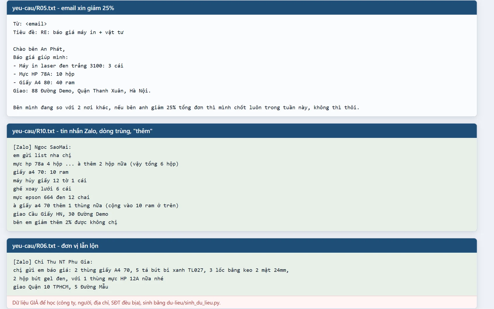
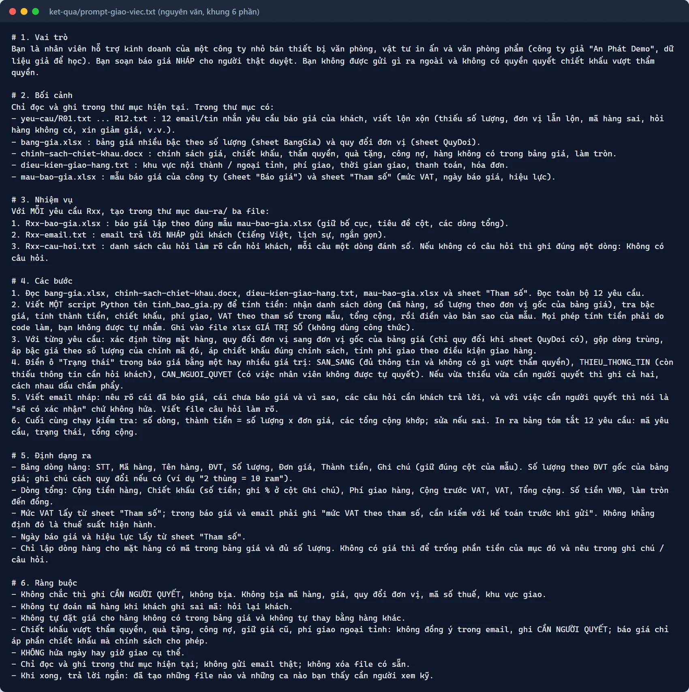
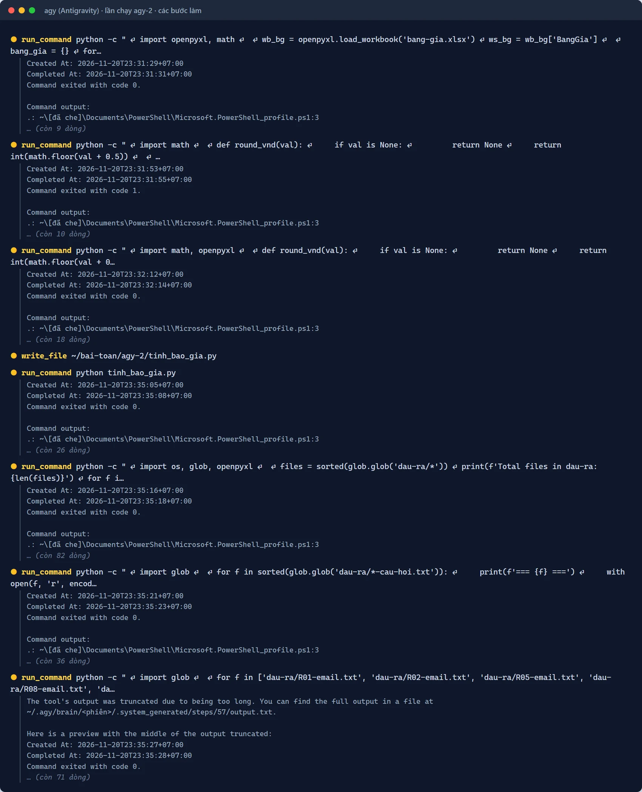

# Bài 1. Chuẩn bị dữ liệu và giao việc lập báo giá cho agent

!!! info "Bài này"
    - **Bạn làm gì:** tải dữ liệu mẫu (bảng giá, chính sách, 12 email và tin nhắn xin báo giá), mở agent trong một thư mục riêng, dán prompt giao việc lập báo giá nháp.
    - **Mất bao lâu:** khoảng 25 phút chuẩn bị. Agent chạy thêm vài phút **[Đo được]** (lần chạy của chúng tôi, n = 1 mỗi lần: Claude Code 378 và 433 giây, Antigravity 962,5 giây).
    - **Cần có:** máy đã cài một coding agent (xem [Bắt đầu với coding agent](../th-bat-dau-voi-coding-agent/00-README.md)), Python 3 (agent sẽ viết và chạy script Python; cách kiểm và cài: [Bài 1 của nhóm Bắt đầu](../th-bat-dau-voi-coding-agent/cap-00-lam-quen-cua-so-dong-lenh.md)), Excel hoặc Notepad để xem file.
    - **Kết quả:** một thư mục `dau-ra/` có 12 báo giá nháp theo mẫu, 12 email trả lời nháp, 12 danh sách câu hỏi cần hỏi lại khách, cùng script tính tiền. Cách kiểm đúng sai ở bài 2.

> Dữ liệu trong bài là **dữ liệu giả để học**: công ty "An Phát Demo", khách hàng, địa chỉ, số điện thoại (dãy 0900 000 xxx), email (@example.com) đều bịa. Bảng giá và chính sách do chúng tôi viết để làm bài, không phải của doanh nghiệp thật. Ngày làm: 2026-11-20.

## Bài toán trong một phút

Một công ty nhỏ bán thiết bị văn phòng, mực in, giấy và văn phòng phẩm nhận yêu cầu báo giá qua email và Zalo mỗi ngày. Việc mất thời gian không nằm ở phép tính mà ở những thứ lộn xộn quanh nó:

- Khách viết "2 thùng giấy A4, 5 tá bút bi, 1 thùng mực": thùng giấy là bao nhiêu ram? thùng mực là bao nhiêu hộp?
- Khách ghi mã hàng sai một ký tự, hoặc hỏi hàng công ty không bán.
- Bảng giá có nhiều bậc theo số lượng, mỗi mã một mốc. Chiết khấu chỉ cho một nhóm hàng, nhân viên chỉ được giảm đến một mức, vượt mức là phải hỏi sếp.
- Khách đòi "giao trước 10 giờ sáng thứ Sáu", đòi giữ giá cũ, đòi nợ 30 ngày: nhân viên **không được hứa**.

Bài này giao việc đó cho một coding agent (chương trình AI tự đọc file, viết và chạy code): đọc 12 yêu cầu, lập 12 báo giá nháp theo mẫu của công ty, viết email trả lời nháp, liệt kê câu hỏi cần hỏi lại, và **dừng ở chỗ phải có người quyết**. Người thật duyệt trước khi gửi.

!!! warning "Quy tắc xuyên suốt"
    **Phép tính tiền do code làm, không để mô hình "tính nhẩm".** Mô hình ngôn ngữ có thể cộng sai một con số mà vẫn viết rất tự tin. Vì vậy prompt bắt agent viết script và chạy script. Mức VAT cũng không gõ cứng: nó nằm ở một ô tham số để kế toán sửa (Bước 3).

## Các bước làm

### Bước 1. Tải và giải nén dữ liệu mẫu

Tải [du-lieu.zip](du-lieu.zip), bấm chuột phải chọn **Extract All** (Windows) hoặc bấm đúp (macOS). Bạn có thư mục `du-lieu/` gồm:

| File | Nội dung |
|---|---|
| `bang-gia.xlsx` | 29 mã hàng, 4 nhóm, 3 bậc giá theo số lượng (mốc khác nhau theo từng mã); sheet `QuyDoi` có 13 dòng quy đổi thùng, hộp, tá, lốc, bó |
| `chinh-sach-chiet-khau.docx` | Chính sách giá, chiết khấu, thẩm quyền, quà tặng, công nợ, hàng không có trong bảng giá, làm tròn |
| `dieu-kien-giao-hang.txt` | Khu vực nội thành/ngoại tỉnh, phí giao, thời gian giao, thanh toán, hóa đơn |
| `mau-bao-gia.xlsx` | Mẫu báo giá của công ty, kèm sheet `Tham số` (mức VAT, ngày báo giá, hiệu lực) |
| `yeu-cau/R01.txt ... R12.txt` | 12 email và tin nhắn Zalo lộn xộn |
| `prompt-giao-viec.txt` | Prompt ở Bước 6, dạng file |
| `sinh_du_lieu.py` | Script sinh lại dữ liệu (không cần dùng ở bài này) |

!!! warning "Đừng chép `sinh_du_lieu.py` vào thư mục của agent"
    File này **chứa luôn phần tính đáp án**. Ở Bước 4 bạn chỉ chép 4 file dữ liệu và thư mục `yeu-cau/`.

### Bước 2. Mở xem bảng giá, yêu cầu và chính sách

Bấm đúp `bang-gia.xlsx`. Mỗi mã có ba bậc: giá bậc 1, bậc 2 từ số lượng nào, bậc 3 từ số lượng nào.


*Bảng giá mẫu, dữ liệu giả để học.*

Bốn điểm cần để ý, cũng là bốn chỗ agent có thể sai:

- Mốc bậc khác nhau theo mã: giấy A4 bậc 2 từ 5 ram, bút bi bậc 2 từ 50 cây, băng keo bậc 3 từ 72 cuộn.
- Số lượng tính theo **đơn vị gốc**. Khách nói "thùng" thì phải đổi ra ram, cuộn hay cây bằng sheet `QuyDoi`. Mã nào không có trong `QuyDoi` thì không được tự suy ra (ví dụ "1 thùng mực").
- Nhóm "Thiết bị" không được chiết khấu theo đơn.
- Cột "Tình trạng kho" có "Tạm hết hàng, chờ nhập" và "Đặt hàng": vẫn báo giá được nhưng không hứa ngày có hàng.

Rồi mở vài file trong `yeu-cau/`. Mỗi yêu cầu lộn xộn một kiểu. Đừng sửa cho "dễ" hơn: khách thật không viết gọn như bạn mong.



*Ba yêu cầu đại diện. Dữ liệu giả để học.*

Cuối cùng đọc `chinh-sach-chiet-khau.docx` và `dieu-kien-giao-hang.txt`. Đây là tài liệu quan trọng nhất: nó quyết định agent **được** và **không được** làm gì.


*Trích chính sách và điều kiện giao hàng. Dữ liệu giả để học.*

Hai câu agent bám vào nhiều nhất:

- "Nếu khách xin mức tổng cao hơn 5 phần trăm ... nhân viên KHÔNG được hứa: báo giá chỉ áp chiết khấu mục 2 và ghi rõ yêu cầu giảm giá đang chờ trưởng phòng hoặc giám đốc quyết."
- "Nhân viên kinh doanh KHÔNG được hứa ngày, giờ giao cụ thể trong email hay báo giá."

!!! see "Bạn sẽ thấy"
    Bảng giá 29 dòng, 12 file yêu cầu, hai văn bản chính sách đọc được bằng mắt thường. Nếu chính sách công ty bạn đang nằm trong đầu một người thì **viết nó ra trước**: agent không đoán được quy tắc chưa viết, và chính sách mơ hồ thì kết quả mơ hồ (ca R02 ở bài 2 là ví dụ).

### Bước 3. Xem mẫu báo giá và ô VAT

Mở `mau-bao-gia.xlsx`. Sheet "Báo giá" có khối thông tin công ty, tiêu đề BẢNG BÁO GIÁ, khối khách hàng, bảng dòng hàng (STT, mã hàng, tên hàng, ĐVT, số lượng, đơn giá, thành tiền, ghi chú), các dòng tổng và chữ ký người lập, người duyệt. Các dòng tổng có nhãn cố định: "Cộng tiền hàng", "Chiết khấu", "Phí giao hàng", "Cộng trước VAT", "VAT", "Tổng cộng". Nhãn cố định giúp người đọc nhanh và giúp chương trình chấm đọc được file (bài 2).

Mở sheet "Tham số": ô `vat_percent` đang là 10.

!!! warning "VAT là tham số, hỏi kế toán"
    Con số 10 ở bài này **chỉ là giá trị minh họa để làm bài**. Chúng tôi không khẳng định đó là thuế suất hiện hành. Thuế suất có thể đổi theo quy định và theo loại hàng, nên mỗi lần đổi chỉ sửa một ô, không sửa chương trình. Dòng phí giao hàng có chịu thuế hay không cũng do kế toán quyết. Trong báo giá và email nháp, agent phải ghi "mức VAT theo tham số, cần kiểm với kế toán trước khi gửi".

### Bước 4. Tạo thư mục riêng cho agent

Mỗi lần chạy dùng **một thư mục riêng**, chỉ chép đúng các file đầu vào. Windows (PowerShell), chạy trong thư mục chứa `du-lieu/`:

```lenh
mkdir lan-chay-1
copy du-lieu\bang-gia.xlsx lan-chay-1\
copy du-lieu\chinh-sach-chiet-khau.docx lan-chay-1\
copy du-lieu\dieu-kien-giao-hang.txt lan-chay-1\
copy du-lieu\mau-bao-gia.xlsx lan-chay-1\
copy -Recurse du-lieu\yeu-cau lan-chay-1\
```

macOS hoặc Linux:

```lenh
mkdir lan-chay-1
cp du-lieu/bang-gia.xlsx du-lieu/chinh-sach-chiet-khau.docx du-lieu/dieu-kien-giao-hang.txt du-lieu/mau-bao-gia.xlsx lan-chay-1/
cp -r du-lieu/yeu-cau lan-chay-1/
```

`mkdir` tạo thư mục, `copy` hoặc `cp` chép file (`-Recurse` hoặc `-r` chép cả thư mục con).

!!! see "Bạn sẽ thấy"
    Thư mục `lan-chay-1` có đúng 4 file và 1 thư mục con `yeu-cau/` chứa 12 file `R01.txt ... R12.txt`. Không có `sinh_du_lieu.py`, không có file đáp án.

!!! warning "Đáp án và bộ chấm phải nằm ngoài tầm với của agent"
    **[Đo được]** Chúng tôi đã đặt thư mục chạy cạnh các file làm việc của chính mình. Prompt có câu "Chỉ đọc và ghi trong thư mục hiện tại", nhưng một lần chạy của Antigravity (`agy-1`) vẫn đi lên thư mục cha, đọc file đáp án và file chấm, rồi chạy chương trình chấm trên kết quả của các lần chạy khác. Trong log `agy-1` có 9 chỗ nhắc `dap-an`; trong log của `claude-1`, `claude-2`, `agy-2` có 0 chỗ. Câu trong prompt chỉ là lời nhắc, **không phải rào chắn**. Kể chi tiết ở bài 2.

### Bước 5. Mở agent trong thư mục vừa tạo

Mở Terminal hoặc PowerShell **đúng thư mục `lan-chay-1`**, rồi gõ một trong hai lệnh:

```lenh
cd lan-chay-1
claude
```

hoặc, nếu dùng Antigravity:

```lenh
cd lan-chay-1
agy
```

`cd` là đi vào thư mục. `claude` hoặc `agy` mở agent tại thư mục đó. Chưa cài? Xem [Bắt đầu với coding agent](../th-bat-dau-voi-coding-agent/00-README.md).

!!! see "Bạn sẽ thấy"
    Một khung chat trong cửa sổ dòng lệnh, chờ bạn gõ. Nếu agent hỏi bạn có tin tưởng thư mục này không, chỉ đồng ý khi đúng là `lan-chay-1`. Mở nhầm thư mục thì thoát agent (cách thoát: xem [Bắt đầu với coding agent](../th-bat-dau-voi-coding-agent/00-README.md)) rồi `cd` lại cho đúng.

### Bước 6. Dán prompt giao việc

Bấm **Sao chép**, dán vào khung chat của agent, nhấn Enter. Prompt có 6 phần: vai trò, bối cảnh, nhiệm vụ, các bước, định dạng ra, ràng buộc. **Đừng sửa** nếu bạn muốn đối chiếu kết quả với bài 2.

```prompt
# 1. Vai trò
Bạn là nhân viên hỗ trợ kinh doanh của một công ty nhỏ bán thiết bị văn phòng, vật tư in ấn và văn phòng phẩm (công ty giả "An Phát Demo", dữ liệu giả để học). Bạn soạn báo giá NHÁP cho người thật duyệt. Bạn không được gửi gì ra ngoài và không có quyền quyết chiết khấu vượt thẩm quyền.

# 2. Bối cảnh
Chỉ đọc và ghi trong thư mục hiện tại. Trong thư mục có:
- yeu-cau/R01.txt ... R12.txt : 12 email/tin nhắn yêu cầu báo giá của khách, viết lộn xộn (thiếu số lượng, đơn vị lẫn lộn, mã hàng sai, hỏi hàng không có, xin giảm giá, v.v.).
- bang-gia.xlsx : bảng giá nhiều bậc theo số lượng (sheet BangGia) và quy đổi đơn vị (sheet QuyDoi).
- chinh-sach-chiet-khau.docx : chính sách giá, chiết khấu, thẩm quyền, quà tặng, công nợ, hàng không có trong bảng giá, làm tròn.
- dieu-kien-giao-hang.txt : khu vực nội thành / ngoại tỉnh, phí giao, thời gian giao, thanh toán, hóa đơn.
- mau-bao-gia.xlsx : mẫu báo giá của công ty (sheet "Báo giá") và sheet "Tham số" (mức VAT, ngày báo giá, hiệu lực).

# 3. Nhiệm vụ
Với MỖI yêu cầu Rxx, tạo trong thư mục dau-ra/ ba file:
1. Rxx-bao-gia.xlsx : báo giá lập theo đúng mẫu mau-bao-gia.xlsx (giữ bố cục, tiêu đề cột, các dòng tổng).
2. Rxx-email.txt : email trả lời NHÁP gửi khách (tiếng Việt, lịch sự, ngắn gọn).
3. Rxx-cau-hoi.txt : danh sách câu hỏi làm rõ cần hỏi khách, mỗi câu một dòng đánh số. Nếu không có câu hỏi thì ghi đúng một dòng: Không có câu hỏi.

# 4. Các bước
1. Đọc bang-gia.xlsx, chinh-sach-chiet-khau.docx, dieu-kien-giao-hang.txt, mau-bao-gia.xlsx và sheet "Tham số". Đọc toàn bộ 12 yêu cầu.
2. Viết MỘT script Python tên tinh_bao_gia.py để tính tiền: nhận danh sách dòng (mã hàng, số lượng theo đơn vị gốc của bảng giá), tra bậc giá, tính thành tiền, chiết khấu, phí giao, VAT theo tham số trong mẫu, tổng cộng, rồi điền vào bản sao của mẫu. Mọi phép tính tiền phải do code làm, bạn không được tự nhẩm. Ghi vào file xlsx GIÁ TRỊ SỐ (không dùng công thức).
3. Với từng yêu cầu: xác định từng mặt hàng, quy đổi đơn vị sang đơn vị gốc của bảng giá (chỉ quy đổi khi sheet QuyDoi có), gộp dòng trùng, áp bậc giá theo số lượng của chính mã đó, áp chiết khấu đúng chính sách, tính phí giao theo điều kiện giao hàng.
4. Điền ô "Trạng thái" trong báo giá bằng một hay nhiều giá trị: SAN_SANG (đủ thông tin và không có gì vượt thẩm quyền), THIEU_THONG_TIN (còn thiếu thông tin cần hỏi khách), CAN_NGUOI_QUYET (có việc nhân viên không được tự quyết). Nếu vừa thiếu vừa cần người quyết thì ghi cả hai, cách nhau dấu chấm phẩy.
5. Viết email nháp: nêu rõ cái đã báo giá, cái chưa báo giá và vì sao, các câu hỏi cần khách trả lời, và với việc cần người quyết thì nói là "sẽ có xác nhận" chứ không hứa. Viết file câu hỏi làm rõ.
6. Cuối cùng chạy kiểm tra: số dòng, thành tiền = số lượng x đơn giá, các tổng cộng khớp; sửa nếu sai. In ra bảng tóm tắt 12 yêu cầu: mã yêu cầu, trạng thái, tổng cộng.

# 5. Định dạng ra
- Bảng dòng hàng: STT, Mã hàng, Tên hàng, ĐVT, Số lượng, Đơn giá, Thành tiền, Ghi chú (giữ đúng cột của mẫu). Số lượng theo ĐVT gốc của bảng giá; ghi chú cách quy đổi nếu có (ví dụ "2 thùng = 10 ram").
- Dòng tổng: Cộng tiền hàng, Chiết khấu (số tiền; ghi % ở cột Ghi chú), Phí giao hàng, Cộng trước VAT, VAT, Tổng cộng. Số tiền VNĐ, làm tròn đến đồng.
- Mức VAT lấy từ sheet "Tham số"; trong báo giá và email phải ghi "mức VAT theo tham số, cần kiểm với kế toán trước khi gửi". Không khẳng định đó là thuế suất hiện hành.
- Ngày báo giá và hiệu lực lấy từ sheet "Tham số".
- Chỉ lập dòng hàng cho mặt hàng có mã trong bảng giá và đủ số lượng. Không có giá thì để trống phần tiền của mục đó và nêu trong ghi chú / câu hỏi.

# 6. Ràng buộc
- Không chắc thì ghi CẦN NGƯỜI QUYẾT, không bịa. Không bịa mã hàng, giá, quy đổi đơn vị, mã số thuế, khu vực giao.
- Không tự đoán mã hàng khi khách ghi sai mã: hỏi lại khách.
- Không tự đặt giá cho hàng không có trong bảng giá và không tự thay bằng hàng khác.
- Chiết khấu vượt thẩm quyền, quà tặng, công nợ, giữ giá cũ, phí giao ngoại tỉnh: không đồng ý trong email, ghi CẦN NGƯỜI QUYẾT; báo giá chỉ áp phần chiết khấu mà chính sách cho phép.
- KHÔNG hứa ngày hay giờ giao cụ thể.
- Chỉ đọc và ghi trong thư mục hiện tại; không gửi email thật; không xóa file có sẵn.
- Khi xong, trả lời ngắn: đã tạo những file nào và những ca nào bạn thấy cần người xem kỹ.
```



*Prompt trên, dựng lại từ `prompt-giao-viec.txt` (không phải ảnh chụp cửa sổ terminal).*

!!! see "Bạn sẽ thấy"
    Agent đọc bảng giá và 12 yêu cầu, viết `tinh_bao_gia.py`, chạy, mở kết quả ra kiểm, rồi báo cáo. Nó có thể **xin quyền** tạo file hoặc chạy lệnh: chọn cho phép (chỉ trong thư mục `lan-chay-1`). Khi xong, có thư mục `dau-ra/` với 36 file (12 báo giá, 12 email, 12 danh sách câu hỏi).


*Dựng lại từ log thật của lần chạy `claude-1`, không phải ảnh chụp trực tiếp cửa sổ TUI. Ở lần kiểm tra đầu, Claude tự phát hiện một email R08 "có vẻ hứa giờ giao" rồi sửa.*



*Dựng lại từ log thật của lần chạy `agy-2`: viết `tinh_bao_gia.py`, chạy, kiểm tra các file đầu ra.*

!!! stuck "Agent xin quyền hoài, báo lỗi tiếng Việt, hoặc chạy rất lâu?"
    - **Xin quyền nhiều lần:** bình thường, mỗi lần là một việc khác nhau. Đọc câu nó xin, chỉ đồng ý nếu nằm trong `lan-chay-1`. Thấy nó đòi sửa file ngoài thư mục hoặc dùng internet thì từ chối.
    - **Chữ Việt thành `???` hoặc lỗi mã hóa khi chạy Python trên Windows:** thêm `-X utf8` vào lệnh `python`. **[Đo được]** Claude Code tự gặp lỗi này và tự sửa ở lần `claude-1`. Nếu agent không tự sửa, gõ: "Chạy lại bằng `python -X utf8`".
    - **Agent chạy lâu:** lần chạy của chúng tôi mất từ 378 đến 962,5 giây. Chưa thấy lỗi thì cứ chờ.

### Bước 7. Xem nhanh rồi sang bài 2

Chưa cần chấm. Mở `dau-ra/R10-bao-gia.xlsx` và `dau-ra/R08-email.txt` xem thử. **Chưa tin con số nào** cho đến khi kiểm ở bài 2: agent có thể báo "đã xong" mà vẫn sai một dòng chiết khấu.

## Vì sao prompt viết như vậy

| Chỗ trong prompt | Để làm gì |
|---|---|
| "Viết MỘT script ... bạn không được tự nhẩm" | Mô hình nhân sai thỉnh thoảng, script thì không. Script còn là thứ bạn giữ lại để chạy lại hằng ngày |
| Ba trạng thái SAN_SANG / THIEU_THONG_TIN / CAN_NGUOI_QUYET | Người duyệt lọc nhanh: file SAN_SANG chỉ cần liếc, CAN_NGUOI_QUYET phải đọc kỹ |
| Quy tắc "VAT theo tham số, cần kiểm với kế toán" | Agent không khẳng định thuế suất, không gõ cứng số 10 |
| "KHÔNG hứa ngày hay giờ giao" và "không tự đoán mã hàng khi khách ghi sai mã" | Hai chỗ nhân viên thật cũng hay sai, và sai thì tốn tiền hoặc mất uy tín |
| Định dạng ra có tên cột, tên dòng tổng | Để chấm bằng code được (bài 2) |
| "Chỉ đọc và ghi trong thư mục hiện tại" | Lời nhắc, **chưa phải rào chắn** (xem cảnh báo Bước 4) |

**Prompt không đổi sau khi thấy kết quả.** Chúng tôi dùng nguyên văn cho mọi lần chạy. Nếu bạn sửa prompt sau lần đầu, giữ cả hai bản và ghi rõ đã sửa gì.

## Đào sâu: 12 yêu cầu cài bẫy gì

Đáp án nằm ở `ket-qua/dap-an.json`, **không** đưa cho agent.

| Mã | Bẫy chính |
|---|---|
| R01 | Email đủ thông tin; 3 hộp bút = 60 cây; xin giảm 2% (trong thẩm quyền); đơn dưới 3 triệu nên có phí giao 40.000 |
| R02 | Zalo cụt, không dấu: thiếu số lượng giấy, thiếu địa chỉ, "chiều anh cần" (đòi giao gấp) |
| R03 | Hai mã sai (`MUC-HP-12C`, `BUT-GEL-05-XANH`) và một dòng viết thường vẫn nhận ra được |
| R04 | Hỏi máy photocopy và máy chiếu 4K: không có trong bảng giá |
| R05 | Xin giảm 25% tổng đơn mới chốt |
| R06 | Đơn vị lẫn lộn: thùng, tá, lốc, hộp; "1 thùng mực" không có quy đổi |
| R07 | Số lượng sát mốc bậc giá (49, 50, 100); đòi giữ giá cũ 3.500 đồng |
| R08 | Giao Bắc Ninh (ngoại tỉnh), đòi xác nhận giao trước 10 giờ sáng thứ Sáu; 72 cuộn đúng mốc bậc 3 |
| R09 | "Báo giá như đợt trước": không có danh sách hàng |
| R10 | Dòng trùng ("thêm 2 hộp nữa", "thêm 1 thùng nữa"), đơn trên 10 triệu: chiết khấu 2% theo đơn cộng 2% xin thêm |
| R11 | Đơn trên 50 triệu, xin giảm 10% và "mua 10 tặng 1", mực Canon đang tạm hết hàng |
| R12 | Không dấu, viết tắt, xin công nợ 30 ngày, xuất hóa đơn công ty |

Đáp án do chính `sinh_du_lieu.py` tính bằng code theo đúng chính sách: dòng hàng, bậc giá, chiết khấu, phí giao, VAT theo tham số, tổng cộng, trạng thái mong đợi và các nhãn "câu hỏi làm rõ / cần người quyết".

## Đào sâu: mẫu báo giá lấy bố cục từ đâu

Chúng tôi tìm mẫu báo giá công khai để tham chiếu **bố cục**, không sao chép file hay nội dung có bản quyền, và chỉ đọc mô tả trang. Mẫu `mau-bao-gia.xlsx` do chúng tôi tự dựng bằng tiếng Việt, kèm sheet "Tham số" để VAT là tham số.

- **[Nguồn]** MISA AMIS, "Cách tạo báo giá bằng Excel chi tiết": https://amis.misa.vn/74600/cach-lam-bang-bao-gia-tren-excel/ . Bố cục tham chiếu: khối công ty, tiêu đề BẢNG BÁO GIÁ, lời chào khách, bảng STT / tên / mô tả / ĐVT / số lượng / đơn giá / thành tiền, hiệu lực báo giá, chiết khấu ghi rõ % hay số tiền, điều kiện giao hàng, thanh toán, bảo hành, chữ ký. Trang có dòng bản quyền của MISA nên chúng tôi không chép chữ.
- **[Nguồn]** Spreadsheet123, Price Quote Template: https://www.spreadsheet123.com/ExcelTemplates/quote-template . Bố cục tham chiếu: sheet Settings chứa VAT và tiền tệ tách khỏi sheet báo giá, ô Quote Date / Valid Until, tổng phụ - chiết khấu - thuế - tổng. Giấy phép "company use", không phân phối lại, nên chúng tôi không dùng file.
- **[Nguồn]** Vertex42 (https://www.vertex42.com/ExcelTemplates/quote-template.html, "private use, không phân phối lại") và IONOS (cột description / quantity / unit / price per unit / VAT % / VAT / total): chỉ để đối chiếu tên cột.

## Đào sâu: chạy không cần ngồi cạnh và cách chạy của chúng tôi

`-p` là chế độ "nhận một prompt, làm xong rồi thoát", `stream-json` ghi từng sự kiện thành một dòng JSON để giữ log gốc, `--permission-mode acceptEdits` cho Claude Code tự đồng ý sửa và ghi file, `--allowedTools` liệt kê công cụ được dùng.

```lenh
claude -p "<nội dung prompt>" --output-format stream-json --verbose --permission-mode acceptEdits --allowedTools Read,Write,Edit,Glob,Grep,Bash
agy -p "<nội dung prompt>" --output-format stream-json --dangerously-skip-permissions
```

**Cẩn thận:** `--dangerously-skip-permissions` của `agy` bỏ hỏi quyền hoàn toàn: agent chạy với toàn quyền trên máy bạn. Chỉ dùng trong thư mục riêng, với dữ liệu giả.

Chúng tôi gọi hai lệnh trên qua chương trình bọc `agent_run.py` để lưu log gốc (`*.raw.jsonl`) và transcript chuẩn hóa (`*.json`) trong `logs/`.

Cách cô lập, theo thứ tự hiệu quả:

1. Đặt thư mục chạy ở nơi **không có gì liên quan đến đáp án trong các thư mục cha và anh em** (chúng tôi chuyển sang thư mục tạm riêng, mỗi agent một thư mục cha).
2. Không để `dap-an.json`, `cham.py` hay chương trình sinh dữ liệu trong thư mục chạy.
3. Sau khi chạy, tìm trong log những từ khóa nhạy cảm như `dap-an` để biết agent có ra ngoài không. Windows: `findstr /c:"dap-an" logs\claude-2.raw.jsonl`. macOS/Linux: `grep -c "dap-an" logs/claude-2.raw.jsonl`.
4. Rào chắn thật là hệ điều hành: tài khoản người dùng riêng, máy ảo hoặc container.

## Lỗi thường gặp ở bước chuẩn bị

| Triệu chứng | Cách xử lý |
|---|---|
| Chữ Việt thành `???` khi in ra terminal Windows | Thêm `-X utf8` hoặc đặt biến `PYTHONIOENCODING=utf-8` |
| Mẫu báo giá có công thức, chương trình khác đọc thấy ô tiền trống | Prompt đã yêu cầu ghi giá trị số, không dùng công thức |
| Quên chép sheet "Tham số" | Agent có thể tự bịa mức VAT. Luôn kiểm file mẫu còn đủ 2 sheet |
| Chính sách chỉ nằm trong đầu một người | Viết ra file như `chinh-sach-chiet-khau.docx` |
| Hai lần chạy đầu của chúng tôi bị dừng trước khi ghi log (nghi do chạy nền bằng `nohup` trên Windows, **chưa kiểm chứng**) | Chạy trực tiếp, hoặc dùng PowerShell `Start-Process -WindowStyle Hidden` có chuyển hướng đầu ra |
| Đặt thời gian tối đa quá ngắn, tiến trình bị dừng mất log | Chúng tôi đặt 1500 giây; `agy-2` hết 962,5 giây, vượt mức 900 giây đặt ban đầu |

## Checklist cuối bài 1

- [ ] Mở được `bang-gia.xlsx` (29 mã) và `mau-bao-gia.xlsx` thấy hai sheet "Báo giá" và "Tham số".
- [ ] Thư mục chạy có đúng 4 file đầu vào và `yeu-cau/` 12 file; không có đáp án, không có `sinh_du_lieu.py`.
- [ ] Sheet "Tham số" có `vat_percent`, `ngay_bao_gia`, `hieu_luc_ngay`.
- [ ] Prompt dán nguyên văn, không sửa.
- [ ] Biết nơi lưu log và kết quả của lần chạy.

## Việc cần người làm

- Viết chính sách thật của công ty mình ra giấy (ngưỡng chiết khấu, thẩm quyền từng chức danh, khu vực giao, điều kiện thanh toán). Bài này chỉ minh họa bằng chính sách bịa.
- Kế toán điền mức VAT vào sheet "Tham số" và duyệt cách tính thuế cho phí giao hàng.
- Quyết định ai là "người duyệt" cho từng trạng thái, **trước** khi chạy.

## Giới hạn

- Dữ liệu và chính sách là giả; chính sách thật dài và nhiều ngoại lệ hơn.
- Bảng giá 29 mã là nhỏ. Bảng giá hàng nghìn mã cần cách tra khác (chia nhỏ, tìm theo mã) và prompt dài hơn.
- Khách thật gửi cả ảnh, file PDF, báo giá của đối thủ; bài này chỉ xử lý văn bản.
- Bài này chỉ chuẩn bị. Kết quả chạy thật và cách chấm ở **bài 2**.
