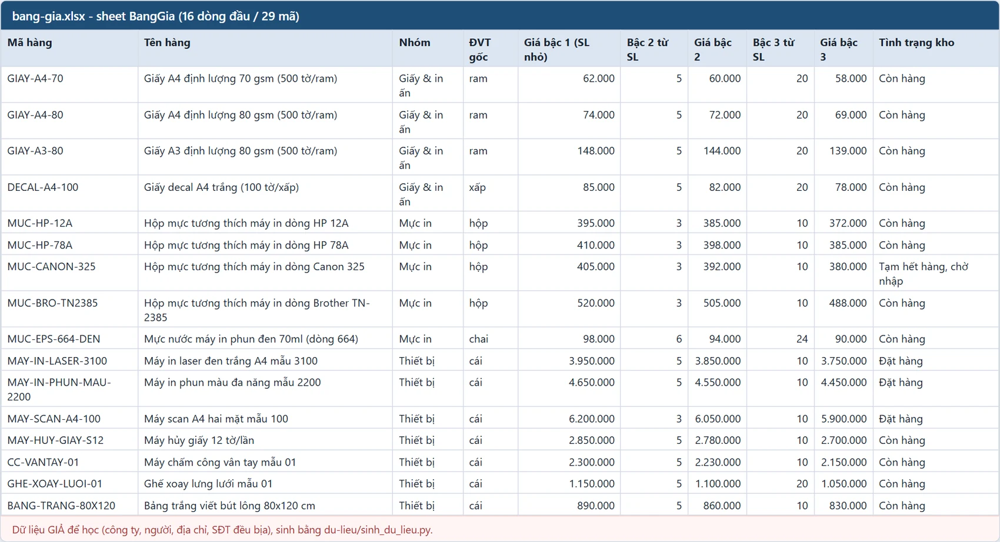
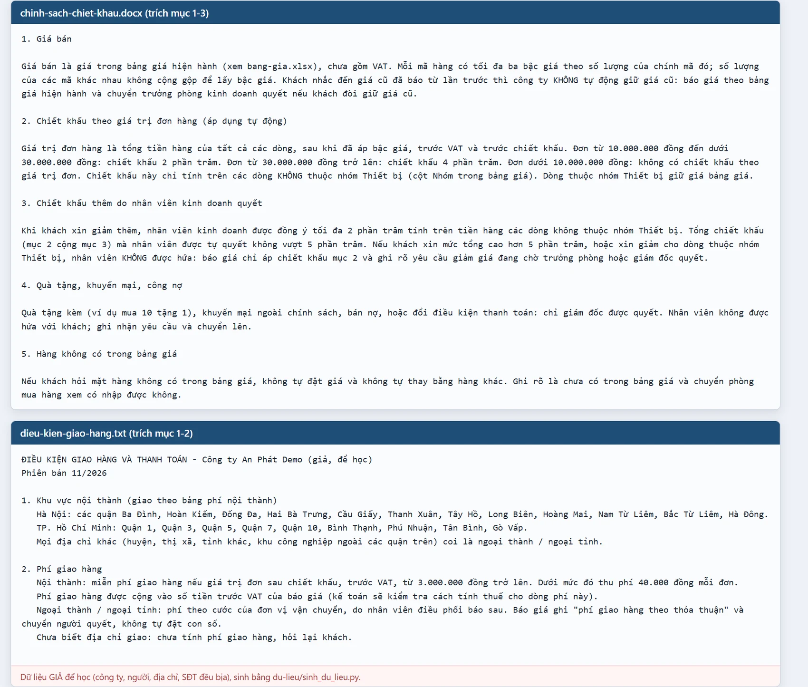
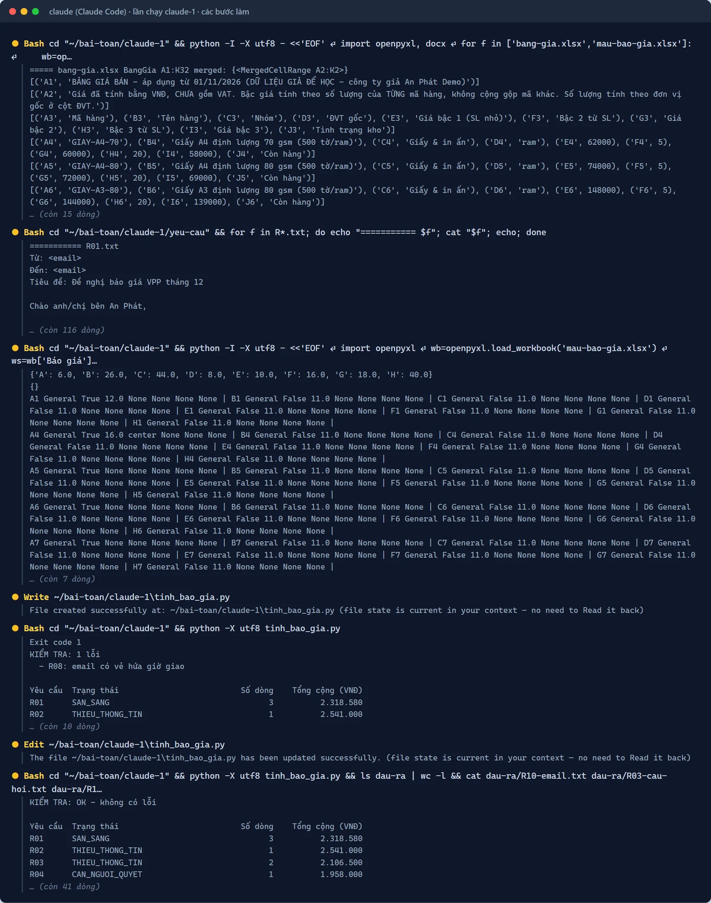

# Bài 1: Chuẩn bị dữ liệu và giao việc cho agent

> **Dữ liệu giả để học** (công ty An Phát Demo, khách, địa chỉ, SĐT đều bịa). Ngày làm: 2026-11-20.

## Mục tiêu đo được

Cuối bài này bạn có:

1. Một thư mục làm việc sạch gồm bảng giá, chính sách, điều kiện giao hàng, mẫu báo giá và 12 yêu cầu của khách (`du-lieu/`).
2. Một **prompt giao việc** khung 6 phần, dùng được nguyên văn.
3. Một cách chạy agent trong thư mục riêng, không để lọt đáp án vào tầm với của agent.

Thước đo "xong bài 1": chạy `ls` trong thư mục làm việc thấy đúng 4 file và 1 thư mục con `yeu-cau/` chứa 12 file `R01.txt ... R12.txt`; mở `mau-bao-gia.xlsx` thấy hai sheet "Báo giá" và "Tham số".

## Bước 1. Hiểu việc trước khi giao cho máy

Người làm báo giá giỏi làm theo thứ tự: (a) đọc yêu cầu, (b) xác định đúng hàng và số lượng, (c) tra giá theo bậc, (d) áp chiết khấu **đúng thẩm quyền**, (e) tính phí giao, (f) lập báo giá theo mẫu, (g) viết thư trả lời, (h) ghi những gì phải hỏi lại hoặc phải xin sếp quyết. Agent làm tốt (a) đến (g) nếu bạn đưa đủ tài liệu, và làm tốt (h) nếu bạn **viết rõ ra quy tắc dừng**. Cả bài xoay quanh hai việc: đưa đủ tài liệu và viết rõ quy tắc dừng.

## Bước 2. Tải dữ liệu mẫu

Thư mục `du-lieu/` của bài có sẵn các file dưới đây. Nếu muốn sinh lại từ đầu (ra y hệt vì hạt giống cố định):

```
python -X utf8 du-lieu/sinh_du_lieu.py
```

Giải thích: `python` chạy chương trình Python; `-X utf8` bảo Python dùng bảng mã UTF-8 để chữ Việt không vỡ dấu trên Windows; `du-lieu/sinh_du_lieu.py` là chương trình sinh dữ liệu. Chương trình ghi 5 loại file vào `du-lieu/` và **một file riêng** là đáp án vào `ket-qua/dap-an.json`. Đáp án nằm ở thư mục khác là có chủ ý (xem bước 8).

Xem nhanh bảng giá, mỗi mã có ba bậc theo số lượng:



Điểm cần để ý khi nhìn bảng này (đây cũng là các chỗ agent có thể sai):

- Mốc bậc khác nhau theo mã: giấy A4 bậc 2 từ 5 ram, bút bi bậc 2 từ 50 cây, băng keo bậc 3 từ 72 cuộn.
- Số lượng tính theo **ĐVT gốc**. Khách nói "thùng" thì phải đổi sang ram/cuộn/cây bằng sheet `QuyDoi`. Mã nào không có trong `QuyDoi` thì không được tự suy ra (ví dụ "1 thùng mực").
- Nhóm "Thiết bị" không được chiết khấu theo đơn; chỉ các nhóm còn lại.
- Cột "Tình trạng kho" có "Tạm hết hàng, chờ nhập" (Canon 325) và "Đặt hàng" (máy in, máy scan): vẫn báo giá được nhưng không hứa ngày có hàng.

## Bước 3. Xem mẫu yêu cầu của khách

12 yêu cầu, mỗi cái một kiểu lộn xộn. Ba cái đại diện:


Đừng sửa các yêu cầu cho "dễ" hơn. Khách thật không viết gọn như bạn mong.

## Bước 4. Chính sách và điều kiện giao hàng viết bằng chữ

Đây là tài liệu quan trọng nhất: nó quyết định agent **được** làm gì và **không được** làm gì.



Hai câu trong chính sách đáng đọc kỹ vì agent bám vào chúng:

- "Nếu khách xin mức tổng cao hơn 5 phần trăm ... nhân viên KHÔNG được hứa: báo giá chỉ áp chiết khấu mục 2 và ghi rõ yêu cầu giảm giá đang chờ trưởng phòng hoặc giám đốc quyết."
- "Nhân viên kinh doanh KHÔNG được hứa ngày, giờ giao cụ thể trong email hay báo giá."

Nếu chính sách của công ty bạn đang nằm trong đầu một người thì **viết nó ra trước**. Agent không đoán được quy tắc chưa viết. Cũng vì vậy, nếu chính sách có chỗ mơ hồ thì kết quả của agent sẽ mơ hồ theo: ở bài 2 bạn sẽ thấy ca R02 là ví dụ.

## Bước 5. Mẫu báo giá và mức VAT là tham số

`mau-bao-gia.xlsx` có sheet "Báo giá" và sheet "Tham số". Bố cục sheet "Báo giá" tham chiếu các mẫu báo giá công khai (xem README, mục nguồn): khối thông tin công ty, tiêu đề BẢNG BÁO GIÁ, khối khách hàng, bảng dòng hàng (STT, mã hàng, tên hàng, ĐVT, số lượng, đơn giá, thành tiền, ghi chú), các dòng tổng, điều kiện, chữ ký người lập và người duyệt.

Mức VAT nằm ở sheet "Tham số", ô `vat_percent` = 10. **[Đề xuất]** Làm như vậy vì thuế suất có thể đổi theo quy định và theo loại hàng: mỗi lần đổi chỉ sửa một ô, không sửa chương trình. Con số 10 ở bài này **chỉ là giá trị minh họa để làm bài**, chúng tôi không khẳng định đây là thuế suất hiện hành. Trong báo giá và email nháp, agent phải ghi "mức VAT theo tham số, cần kiểm với kế toán trước khi gửi". Dòng phí giao hàng có chịu thuế hay không cũng để kế toán quyết.

Các dòng tổng có nhãn cố định: "Cộng tiền hàng", "Chiết khấu", "Phí giao hàng", "Cộng trước VAT", "VAT", "Tổng cộng", giá trị ở cột Thành tiền. Cột và nhãn cố định giúp con người đọc nhanh và giúp chương trình chấm đọc được file (bài 2).

## Bước 6. Viết prompt giao việc, khung 6 phần

Prompt có 6 phần: **Vai trò** (agent là ai, có quyền gì), **Bối cảnh** (có những file nào), **Nhiệm vụ** (đầu ra là gì), **Các bước** (làm theo thứ tự nào), **Định dạng ra** (từng cột, từng dòng), **Ràng buộc** (không được làm gì, khi không chắc thì dừng). Nguyên văn prompt đã dùng cho mọi lần chạy (file `ket-qua/prompt-giao-viec.txt`):


Văn bản để bạn sao chép:

```text
# 1. Vai trò
Bạn là nhân viên hỗ trợ kinh doanh của một công ty nhỏ bán thiết bị văn phòng, vật tư in ấn và văn phòng phẩm (công ty giả "An Phát Demo", dữ liệu giả để học). Bạn soạn báo giá NHÁP cho người thật duyệt. Bạn không được gửi gì ra ngoài và không có quyền quyết chiết khấu vượt thẩm quyền.

# 2. Bối cảnh
Chỉ đọc và ghi trong thư mục hiện tại. Trong thư mục có:
- yeu-cau/R01.txt ... R12.txt : 12 email/tin nhắn yêu cầu báo giá của khách, viết lộn xộn (thiếu số lượng, đơn vị lẫn lộn, mã hàng sai, hỏi hàng không có, xin giảm giá, v.v.).
- bang-gia.xlsx : bảng giá nhiều bậc theo số lượng (sheet BangGia) và quy đổi đơn vị (sheet QuyDoi).
- chinh-sach-chiet-khau.docx : chính sách giá, chiết khấu, thẩm quyền, quà tặng, công nợ, hàng không có trong bảng giá, làm tròn.
- dieu-kien-giao-hang.txt : khu vực nội thành / ngoại tỉnh, phí giao, thời gian giao, thanh toán, hóa đơn.
- mau-bao-gia.xlsx : mẫu báo giá của công ty (sheet "Báo giá") và sheet "Tham số" (mức VAT, ngày báo giá, hiệu lực).

# 3. Nhiệm vụ
Với MỖI yêu cầu Rxx, tạo trong thư mục dau-ra/ ba file:
1. Rxx-bao-gia.xlsx : báo giá lập theo đúng mẫu mau-bao-gia.xlsx (giữ bố cục, tiêu đề cột, các dòng tổng).
2. Rxx-email.txt : email trả lời NHÁP gửi khách (tiếng Việt, lịch sự, ngắn gọn).
3. Rxx-cau-hoi.txt : danh sách câu hỏi làm rõ cần hỏi khách, mỗi câu một dòng đánh số. Nếu không có câu hỏi thì ghi đúng một dòng: Không có câu hỏi.

# 4. Các bước
1. Đọc bang-gia.xlsx, chinh-sach-chiet-khau.docx, dieu-kien-giao-hang.txt, mau-bao-gia.xlsx và sheet "Tham số". Đọc toàn bộ 12 yêu cầu.
2. Viết MỘT script Python tên tinh_bao_gia.py để tính tiền: nhận danh sách dòng (mã hàng, số lượng theo đơn vị gốc của bảng giá), tra bậc giá, tính thành tiền, chiết khấu, phí giao, VAT theo tham số trong mẫu, tổng cộng, rồi điền vào bản sao của mẫu. Mọi phép tính tiền phải do code làm, bạn không được tự nhẩm. Ghi vào file xlsx GIÁ TRỊ SỐ (không dùng công thức).
3. Với từng yêu cầu: xác định từng mặt hàng, quy đổi đơn vị sang đơn vị gốc của bảng giá (chỉ quy đổi khi sheet QuyDoi có), gộp dòng trùng, áp bậc giá theo số lượng của chính mã đó, áp chiết khấu đúng chính sách, tính phí giao theo điều kiện giao hàng.
4. Điền ô "Trạng thái" trong báo giá bằng một hay nhiều giá trị: SAN_SANG (đủ thông tin và không có gì vượt thẩm quyền), THIEU_THONG_TIN (còn thiếu thông tin cần hỏi khách), CAN_NGUOI_QUYET (có việc nhân viên không được tự quyết). Nếu vừa thiếu vừa cần người quyết thì ghi cả hai, cách nhau dấu chấm phẩy.
5. Viết email nháp: nêu rõ cái đã báo giá, cái chưa báo giá và vì sao, các câu hỏi cần khách trả lời, và với việc cần người quyết thì nói là "sẽ có xác nhận" chứ không hứa. Viết file câu hỏi làm rõ.
6. Cuối cùng chạy kiểm tra: số dòng, thành tiền = số lượng x đơn giá, các tổng cộng khớp; sửa nếu sai. In ra bảng tóm tắt 12 yêu cầu: mã yêu cầu, trạng thái, tổng cộng.

# 5. Định dạng ra
- Bảng dòng hàng: STT, Mã hàng, Tên hàng, ĐVT, Số lượng, Đơn giá, Thành tiền, Ghi chú (giữ đúng cột của mẫu). Số lượng theo ĐVT gốc của bảng giá; ghi chú cách quy đổi nếu có (ví dụ "2 thùng = 10 ram").
- Dòng tổng: Cộng tiền hàng, Chiết khấu (số tiền; ghi % ở cột Ghi chú), Phí giao hàng, Cộng trước VAT, VAT, Tổng cộng. Số tiền VNĐ, làm tròn đến đồng.
- Mức VAT lấy từ sheet "Tham số"; trong báo giá và email phải ghi "mức VAT theo tham số, cần kiểm với kế toán trước khi gửi". Không khẳng định đó là thuế suất hiện hành.
- Ngày báo giá và hiệu lực lấy từ sheet "Tham số".
- Chỉ lập dòng hàng cho mặt hàng có mã trong bảng giá và đủ số lượng. Không có giá thì để trống phần tiền của mục đó và nêu trong ghi chú / câu hỏi.

# 6. Ràng buộc
- Không chắc thì ghi CẦN NGƯỜI QUYẾT, không bịa. Không bịa mã hàng, giá, quy đổi đơn vị, mã số thuế, khu vực giao.
- Không tự đoán mã hàng khi khách ghi sai mã: hỏi lại khách.
- Không tự đặt giá cho hàng không có trong bảng giá và không tự thay bằng hàng khác.
- Chiết khấu vượt thẩm quyền, quà tặng, công nợ, giữ giá cũ, phí giao ngoại tỉnh: không đồng ý trong email, ghi CẦN NGƯỜI QUYẾT; báo giá chỉ áp phần chiết khấu mà chính sách cho phép.
- KHÔNG hứa ngày hay giờ giao cụ thể.
- Chỉ đọc và ghi trong thư mục hiện tại; không gửi email thật; không xóa file có sẵn.
- Khi xong, trả lời ngắn: đã tạo những file nào và những ca nào bạn thấy cần người xem kỹ.
```

Vì sao viết như vậy:

- **Phép tính do code** ("viết MỘT script ... bạn không được tự nhẩm"). Mô hình ngôn ngữ nhân sai thỉnh thoảng; script thì không. Script còn là thứ bạn giữ lại để chạy lại hằng ngày.
- **Ba trạng thái** SAN_SANG / THIEU_THONG_TIN / CAN_NGUOI_QUYET để người duyệt lọc nhanh: file nào SAN_SANG chỉ cần liếc, file nào CAN_NGUOI_QUYET phải đọc kỹ.
- **VAT là tham số** và "không khẳng định đó là thuế suất hiện hành".
- **Không hứa ngày giao** và "không tự đoán mã hàng khi khách ghi sai mã".
- Dòng cuối "Chỉ đọc và ghi trong thư mục hiện tại": câu này **không đủ** để cô lập, xem bước 8.

**Quy tắc làm việc của chúng tôi:** prompt này không được sửa sau khi thấy kết quả cho "đẹp hơn". Chúng tôi dùng nguyên văn cho cả 6 lần chạy. Nếu bạn sửa prompt vì lần 1 sai, hãy giữ cả hai bản và ghi rõ.

## Bước 7. Chạy agent trong thư mục riêng

Mỗi lần chạy dùng **một thư mục riêng**, chép vào đó đúng các file đầu vào (không có `dap-an.json`, không có `sinh_du_lieu.py` vì file này chứa luôn đáp án).

Cách làm trên giao diện, không cần nhớ lệnh phức tạp:

1. Tạo thư mục trống, ví dụ `C:\bao-gia-thu\lan-1\`.
2. Chép vào đó `bang-gia.xlsx`, `chinh-sach-chiet-khau.docx`, `dieu-kien-giao-hang.txt`, `mau-bao-gia.xlsx` và cả thư mục `yeu-cau\`.
3. Mở terminal ngay trong thư mục đó, gõ `claude` (Claude Code) hoặc `agy` (Antigravity) rồi Enter.
4. Dán nguyên văn prompt ở trên, Enter. Agent hỏi quyền đọc/ghi file thì cho phép trong thư mục này.

Cách một dòng lệnh, không tương tác (dùng khi muốn lưu log để chấm, như chúng tôi làm):

```
claude -p "<prompt>" --output-format stream-json --verbose --permission-mode acceptEdits --allowedTools Read,Write,Edit,Glob,Grep,Bash
agy -p "<prompt>" --output-format stream-json --dangerously-skip-permissions
```

Giải thích từng phần: `-p` chạy một lần theo prompt rồi thoát (không mở màn hình chat); `--output-format stream-json` ghi từng sự kiện (agent nói gì, gọi công cụ gì, kết quả ra sao) thành từng dòng JSON để lưu làm log; `--permission-mode acceptEdits` cho Claude Code tự đồng ý sửa và ghi file; `--allowedTools` liệt kê công cụ được dùng; `--dangerously-skip-permissions` của `agy` bỏ hỏi quyền hoàn toàn. Cờ cuối có chữ "dangerously" là có lý do: **agent chạy với toàn quyền trên máy bạn**.

Chúng tôi gọi hai lệnh trên qua chương trình bọc `agent_run.py` để lưu log gốc (`*.raw.jsonl`) và transcript chuẩn hóa (`*.json`). Ảnh dưới là một đoạn các bước của Claude Code trong lần chạy `claude-1`: đọc bảng giá, đọc 12 yêu cầu, viết `tinh_bao_gia.py`, chạy kiểm tra (và tự phát hiện, ở lần kiểm tra đầu, một email R08 "có vẻ hứa giờ giao" rồi sửa).



*Dựng lại từ log thật của lần chạy `claude-1`, không phải ảnh chụp trực tiếp cửa sổ TUI.*

Với `agy`, ảnh dưới là các bước cuối trong lần chạy `agy-2`: viết `tinh_bao_gia.py`, chạy, kiểm tra các file đầu ra.


*Dựng lại từ log thật của lần chạy `agy-2`, không phải ảnh chụp trực tiếp cửa sổ TUI.*

## Bước 8. Cô lập thật sự: bài học từ lần chạy hỏng

Chúng tôi đã đặt thư mục chạy cạnh các file làm việc của chính chúng tôi (một file trong đó chứa đường dẫn tới đáp án). Prompt có câu "Chỉ đọc và ghi trong thư mục hiện tại", nhưng một lần chạy của `agy` (`agy-1`) vẫn đi lên thư mục cha, đọc file đáp án và file chấm, rồi chạy chương trình chấm trên kết quả của các lần chạy khác (kể chi tiết ở bài 2). **[Đo được]** trong log `agy-1` có 9 chỗ nhắc `dap-an`; trong log của `claude-1`, `claude-2`, `agy-2` có 0 chỗ.

Cách phòng, theo thứ tự hiệu quả:

1. Đặt thư mục chạy ở nơi **không có gì liên quan đến đáp án trong các thư mục cha và anh em** (chúng tôi chuyển sang `%TEMP%\al05-<agent>\run`, mỗi agent một thư mục cha riêng).
2. Không để `dap-an.json`, `cham.py`, hay chương trình sinh dữ liệu trong thư mục chạy.
3. Sau khi chạy, tìm trong log những từ khóa nhạy cảm như `dap-an` hoặc tên thư mục khác để biết agent có ra ngoài không. Ví dụ: `findstr /c:"dap-an" log.raw.jsonl`.
4. Câu trong prompt chỉ là lời nhắc, không phải rào chắn. Rào chắn thật là hệ điều hành (tài khoản người dùng riêng, máy ảo, container).

## Lỗi thường gặp

| Lỗi | Dấu hiệu | Cách xử lý |
|---|---|---|
| Chữ Việt thành `???` khi in ra terminal Windows | lệnh `python` báo lỗi mã hóa | thêm `-X utf8` hoặc đặt `PYTHONIOENCODING=utf-8` (agent Claude tự gặp lỗi này và tự sửa ở lần claude-1) |
| Mẫu có công thức | chương trình khác đọc file Excel thấy ô tiền trống (công thức chưa được tính) | prompt yêu cầu ghi giá trị số, không dùng công thức |
| Quên chép sheet "Tham số" | agent có thể tự bịa mức VAT | luôn kiểm file mẫu còn đủ 2 sheet |
| Chính sách chỉ nằm trong đầu | agent "sáng tạo" quy tắc | viết ra file, như `chinh-sach-chiet-khau.docx` |
| Chạy tiến trình nền bằng `nohup` trên Windows (nghi là nguyên nhân, chưa kiểm chứng) | hai lần chạy đầu của chúng tôi bị dừng trước khi ghi log, chỉ còn file đầu ra | dùng PowerShell `Start-Process -WindowStyle Hidden` có chuyển hướng đầu ra, hoặc chạy trực tiếp |
| Đặt thời gian tối đa quá ngắn | tiến trình bị dừng, mất log | bài này đặt 1500 giây; một lần chạy `agy-2` hết 962,5 giây (**[Đo được]**), vượt mức 900 giây đặt trong brief chung |

## Checklist trước khi sang bài 2

- [ ] Thư mục chạy có đúng 4 file đầu vào và `yeu-cau/` 12 file.
- [ ] Trong thư mục chạy và các thư mục cha gần nó **không có** đáp án hay chương trình chấm.
- [ ] Sheet "Tham số" của mẫu có `vat_percent`, `ngay_bao_gia`, `hieu_luc_ngay`.
- [ ] Prompt dán nguyên văn, không sửa.
- [ ] Biết nơi lưu log gốc của lần chạy.

## Việc cần người làm

- Viết chính sách thật của công ty mình ra giấy (ngưỡng chiết khấu, thẩm quyền từng chức danh, khu vực giao, điều kiện thanh toán) trước khi dùng agent; bài này chỉ minh họa bằng chính sách bịa.
- Kế toán điền mức VAT vào sheet "Tham số" và duyệt cách tính thuế cho phí giao hàng.
- Quyết định ai là "người duyệt" cho từng trạng thái.

## Giới hạn

- Dữ liệu và chính sách là giả; chính sách thật dài và nhiều ngoại lệ hơn.
- Bảng giá 29 mã là nhỏ. Bảng giá hàng nghìn mã cần cách tra khác (chia nhỏ, tìm theo mã) và làm prompt dài hơn.
- Khách thật gửi cả ảnh, file PDF, báo giá của đối thủ; bài này chỉ xử lý văn bản.
