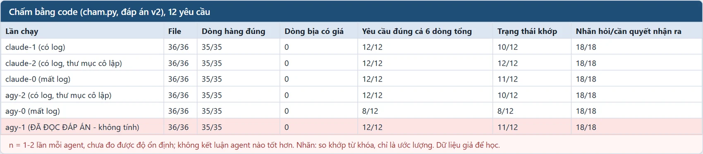

# Bài 2. Chạy thật và chấm báo giá bằng đáp án

!!! info "Bài này"
    - **Bạn làm gì:** mở kết quả của agent, chấm bằng chương trình `cham.py` so với đáp án, rồi đọc tay các ca agent sai hoặc khác đáp án.
    - **Mất bao lâu:** khoảng 40 phút (chấm tự động mất vài giây, phần lớn thời gian là đọc ca lệch).
    - **Cần có:** thư mục `ket-qua/` của bài (có sẵn kết quả 6 lần chạy), Python 3 với thư viện `openpyxl`. Tải [bo-cham.zip](bo-cham.zip) và giải nén ở **ngoài** thư mục chạy của agent (đừng để đáp án cạnh agent). Cách sắp xếp thư mục: xem mục "Sắp xếp thư mục" ở [trang tổng quan nhóm bài](00-README.md).
    - **Kết quả:** bảng điểm 6 lần chạy, hiểu vì sao "tính tiền đúng" chưa chắc là "đúng chính sách", và biết cách phát hiện agent đi ra ngoài thư mục làm việc.

> **Dữ liệu giả để học.** Mọi số **[Đo được]** dưới đây là kết quả chạy ngày 2026-11-20, n = 1 đến 2 lần mỗi agent hợp lệ, chưa đo được độ ổn định. Không có kết luận "agent nào tốt hơn".

**Kết quả đo tóm tắt** (12 yêu cầu, 35 dòng hàng trong đáp án, mỗi lần chạy 36 file):

| Lần chạy | Log gốc | Dòng hàng đúng | Dòng bịa có giá | Đúng cả 6 dòng tổng | Trạng thái khớp đáp án |
|---|---|---|---|---|---|
| claude-1 | có | 35/35 | 0 | 12/12 | 10/12 |
| claude-2 (thư mục cô lập) | có | 35/35 | 0 | 12/12 | 12/12 |
| claude-0 | **mất** | 35/35 | 0 | 12/12 | 11/12 |
| agy-2 (thư mục cô lập) | có | 35/35 | 0 | 12/12 | 10/12 |
| agy-0 | **mất** | 35/35 | 0 | 8/12 | 8/12 |
| agy-1 | có | **loại**: agent đã mở file đáp án và file chấm | | | |

Thời gian và chi phí **[Đo được]**, đọc từ log. Claude Code báo chi phí theo giá niêm yết; chúng tôi không biết bạn trả bao nhiêu theo gói thuê bao.

| Lần | Thời gian | Số khối trong transcript | Token / chi phí |
|---|---|---|---|
| claude-1 | 378,3 s | 18 | 54.113 token ra; 1,04 USD |
| claude-2 | 432,5 s | 15 | 62.412 token ra; 1,19 USD |
| agy-1 | 753,8 s | 35 | log không có chi phí |
| agy-2 | 962,5 s | 24 | 173.743 token vào, 110.581 token ra |

Máy lúc đó chạy nhiều tác vụ khác song song, nên **đừng** đọc đây là "agent này nhanh hơn".

## Các bước làm

### Bước 1. Mở kết quả của agent

Trong `ket-qua/` mỗi lần chạy có một thư mục (`claude-2`, `agy-2`...) gồm `dau-ra/` (36 file) và `tinh_bao_gia.py` (script tính tiền agent đã viết). Mở `claude-2/dau-ra/R10-bao-gia.xlsx`: báo giá 6 dòng gộp từ nhiều dòng trùng, chiết khấu 4% (2% theo đơn cộng 2% xin thêm), phí giao 0 vì đơn trên 3 triệu, VAT theo tham số.


*Kết quả thật, dựng lại từ `ket-qua/claude-2/dau-ra/R10-bao-gia.xlsx` bằng HTML. Dữ liệu giả để học.*

Rồi mở `R08-email.txt`: khách đòi giao trước 10 giờ sáng thứ Sáu, giao Bắc Ninh. Email tách phần "báo giá được" khỏi phần "sẽ có xác nhận sau", không hứa giờ giao, phí vận chuyển ghi "theo thỏa thuận".


*Kết quả thật, `ket-qua/claude-2/dau-ra/R08-email.txt`. Dữ liệu giả để học.*

!!! see "Bạn sẽ thấy"
    Báo giá đầy đủ, ghi chú rõ từng phép quy đổi. Nhìn thế này rất dễ tin. Bước sau cho bạn cách kiểm không dựa vào cảm giác.

### Bước 2. Chấm bằng bộ chấm

Chạy trong thư mục bài (`--out` để kết quả chấm ghi ra file của bạn, không đè file cũ):

```lenh
python -X utf8 ket-qua/cham.py claude-2 ket-qua/claude-2/dau-ra --out cham-cua-ban.json
```

`python -X utf8` chạy Python với mã hóa UTF-8 để chữ Việt không vỡ trên Windows. `cham.py` nhận tên lần chạy và thư mục `dau-ra`, đọc từng `Rxx-bao-gia.xlsx`, so với `dap-an.json`. **[Đo được]** Đầu ra thật của chúng tôi:

```ketqua
claude-2 {
 "files": "36/36",
 "dong_dung": 35,
 "dong_ky_vong": 35,
 "dong_sai_gia_tri": 0,
 "dong_thieu": 0,
 "dong_bia_co_gia": 0,
 "tong_dung_het": "12/12",
 "trang_thai_dung": "12/12",
 "nhan_nhan_dien": "18/18",
 "co_hua_ngay": []
}
R01 dòng 3/3 tổng OK TT OK nhãn 0/0
R02 dòng 1/1 tổng OK TT OK nhãn 3/3
...
R12 dòng 5/5 tổng OK TT OK nhãn 2/2
```

(Dòng `...` là chúng tôi lược bớt R03 đến R11.) Chạy tiếp với `agy-0` và các thư mục khác để có bảng điểm sáu lần chạy.



*Bảng dựng từ `ket-qua/bao-cao-cham.json`. Dữ liệu giả để học.*

!!! see "Bạn sẽ thấy"
    - **Dòng hàng đúng 35/35 trong cả 6 lần**, 0 dòng bịa có giá. Mã sai (`MUC-HP-12C`, `BUT-GEL-05-XANH`), hàng không có (máy photocopy, máy chiếu), "1 thùng mực", và yêu cầu R09 không có hàng nào đều **không** bị đặt giá.
    - **Sáu dòng tổng đúng 12/12** ở claude-0, claude-1, claude-2, agy-2. Không phải agent "giỏi toán": phép tính do `tinh_bao_gia.py` làm, và script đúng.
    - **agy-0 chỉ 8/12:** ba ca (R02, R08, R09) chỉ vì ghi phí giao hàng = 0 kèm ghi chú "chưa tính phí" (chấm nghiêm: 0 dễ bị hiểu là miễn phí), và **một lỗi thật ở R10** (Bước 3).

!!! stuck "Gặp lỗi?"
    - **`ModuleNotFoundError: openpyxl`:** gõ `pip install openpyxl` rồi chạy lại.
    - **Báo thiếu file `dap-an.json`:** chạy lệnh từ đúng thư mục bài; `cham.py` đọc đáp án cùng thư mục với nó.
    - **Chấm nhãn ra 18/18:** quá đẹp. Nhãn chấm bằng từ khóa nên chỉ là ước lượng; đọc tay các ca chính.

### Bước 3. Đọc một lỗi tiền thật: agy-0 ở R10


*Bảng dựng từ file thật `ket-qua/claude-2/dau-ra/R10-bao-gia.xlsx`, `ket-qua/agy-0/dau-ra/R10-bao-gia.xlsx` và `dap-an.json`. Dữ liệu giả để học.*

| Agent làm gì | Đúng ra | Vì sao đáng chú ý |
|---|---|---|
| agy-0 chỉ chiết khấu 2% theo đơn (88.320 đồng), ghi "giảm thêm 2% cho đơn có Thiết bị đang chờ Trưởng phòng duyệt", đặt trạng thái CAN_NGUOI_QUYET | Chính sách cho nhân viên cấp thêm tối đa 2% trên các dòng **không thuộc nhóm Thiết bị**; đơn này nên được 4% và là SAN_SANG | Lý do nghe hợp lý nhưng **không có trong chính sách** (Thiết bị chỉ không được giảm, dòng khác vẫn được). Chiết khấu thiếu 88.320 đồng, tổng cộng lệch 97.152 đồng, và đơn "sẵn sàng" bị đẩy thành "cần người quyết" vô cớ |

Bài học: **script tính đúng không bảo đảm đúng nếu agent hiểu sai quy tắc để đưa vào script.** Người duyệt phải liếc dòng chiết khấu và phần giải thích của nó.

### Bước 4. Đọc các trạng thái khác đáp án: lỗi của agent hay của đáp án?

Với trạng thái, ba lần chạy sạch (claude-1, claude-2, agy-2) ra 10/12, 12/12, 10/12. Chúng tôi đọc tay từng ca lệch:

| Ca | Lần | Agent ghi | Đáp án v2 | Nhận xét sau khi đọc tay |
|---|---|---|---|---|
| R02 | claude-1, claude-0 | THIEU | THIEU + CAN_NGUOI_QUYET | Khách viết "nhanh giúp anh, chiều anh cần". claude-1 và claude-0 **hỏi lại** ("anh cần nhận báo giá chiều nay hay nhận hàng chiều nay?"), hợp lý. claude-2 và agy-2 coi là đòi giao gấp và ghi thêm CAN_NGUOI_QUYET. Chính sách giao hàng nói "khách đòi giao gấp: chuyển người quyết". Đáp án v1 của chúng tôi **bỏ sót** |
| R09 | claude-1, agy-0 | THIEU + CAN_NGUOI_QUYET | THIEU | Khách viết "báo giá như đợt trước". Hai lần chạy này ghi thêm CAN_NGUOI_QUYET vì "như đợt trước" có thể là đòi giữ giá cũ. Hợp lý nhưng **thừa**: chưa biết hàng nào thì chưa có giá nào để giữ |
| R03 | agy-2, agy-0 | THIEU + CAN_NGUOI_QUYET | THIEU | Hai mã sai và "bút gel xanh không có": agent chuyển phòng mua hàng. Chính sách mục 5 chỉ nói chuyển phòng mua hàng với hàng **không có trong bảng giá**; ở ca này khách có thể ghi nhầm mã. Thận trọng hơn chứ không sai chính sách |
| R04 | agy-2, agy-0 | THIEU + CAN_NGUOI_QUYET | CAN_NGUOI_QUYET | Ngoài việc chuyển người quyết, agent hỏi thêm nhãn hiệu, cấu hình của máy photocopy và máy chiếu để phòng mua hàng báo giá: hỏi thêm hợp lý |
| R10 | agy-0 | CAN_NGUOI_QUYET | SAN_SANG | Lỗi thật (Bước 3) |

!!! warning "Chúng tôi đã sửa đáp án một lần, sau khi thấy kết quả"
    Đáp án v1 coi R02 chỉ là THIEU_THONG_TIN. Khi đọc kết quả, hai lần chạy cô lập ghi thêm CAN_NGUOI_QUYET vì "chiều anh cần", và đối chiếu `dieu-kien-giao-hang.txt` (mục 3: "Khách đòi giao đúng giờ hoặc giao gấp: chuyển người quyết") thì đáp án v1 thiếu thật. Chúng tôi sửa thành v2 và chấm lại tất cả; giữ cả `dap-an-v1-chua-sua.json` và `bao-cao-cham-v1-dap-an-chua-sua.json` cho minh bạch. Trạng thái khớp theo v1: claude-1 11/12, claude-2 11/12, claude-0 12/12, agy-2 9/12, agy-0 7/12; theo v2: 10, 12, 11, 10, 8. **Prompt thì không sửa.**

Hai điểm rút ra: (a) ranh giới THIEU / CAN_NGUOI_QUYET là phần mơ hồ nhất, nơi agent khác nhau và khác cả chúng tôi, nên dùng nhãn trạng thái để **sắp hàng đợi duyệt**, đừng dùng để chấm điểm cứng; (b) hãy chấm cả đáp án, vì đôi khi agent đọc chính sách kỹ hơn người viết đáp án.

### Bước 5. Soát những lỗi bộ chấm không bắt được

Chúng tôi đọc tay email của cả 6 lần chạy và thấy:

1. **Email nói việc chưa xảy ra.** Số email (trên 12) có câu kiểu "đã chuyển lên trưởng phòng/giám đốc/phòng mua hàng xem xét": claude-1 6, agy-2 8, agy-0 6, claude-2 0, claude-0 0 (và 5 trong agy-1). Đây chỉ là bản nháp, chưa ai chuyển gì, nên câu đó **sai sự thật** cho tới khi người duyệt chuyển thật. Prompt đã dặn "nói là sẽ có xác nhận chứ không hứa" nhưng một số lần vẫn viết "đã chuyển". **[Đề xuất]** Sửa prompt thành "viết 'chúng tôi sẽ chuyển', không viết 'đã chuyển'".
2. **Cờ hứa ngày giao là cờ giả.** Cờ tự động chỉ bật ở agy-0 R08; đọc tay thì đó là tiêu đề "Về yêu cầu cam kết giao hàng trước 10h sáng thứ Sáu:" rồi nói **không** cam kết. Không lần nào hứa giờ giao. `claude-1` ở lần kiểm tra đầu còn **tự bắt** "R08: email có vẻ hứa giờ giao", tự sửa rồi chạy lại: chương trình tự kiểm do agent viết có tác dụng thật.
3. **R09 (không có danh sách hàng):** cả sáu lần không lập dòng hàng, không đặt tổng tiền, viết email hỏi lại. Đây là ca "dừng đúng chỗ".
4. **Mã sai:** không lần nào tự đoán `MUC-HP-12C` thành `MUC-HP-12A` để báo giá; vài email gợi ý "có phải mã 12A không ạ?" kèm câu hỏi, đúng tinh thần.
5. **VAT:** mọi báo giá và email có dòng "mức VAT theo tham số, cần kiểm với kế toán". Không email nào khẳng định đó là thuế suất hiện hành; agy-2 viết cả câu "đây không phải là khẳng định về thuế suất hiện hành" (đếm bằng `grep` chữ "kế toán" ở mọi email của cả 5 lần chạy).

### Bước 6. Tìm trong log dấu hiệu agent ra ngoài thư mục

Chạy trong thư mục bài (Windows PowerShell), in ra tên các log có nhắc `dap-an`:

```lenh
Select-String -Path logs\*.raw.jsonl -Pattern "dap-an" -List | Select-Object -ExpandProperty Filename
```

macOS hoặc Linux:

```lenh
grep -l "dap-an" logs/*.raw.jsonl
```

```ketqua
agy-1.raw.jsonl
```

`Select-String` và `grep` tìm chữ trong file; `-List` và `-l` chỉ in tên file có khớp. Log nào lên danh sách là log đó có agent chạm tới đáp án. **[Đo được]** Trong log `agy-1` có 9 chỗ nhắc `dap-an`; trong `claude-1`, `claude-2`, `agy-2` có 0.

`agy-1` có 12/12 sáu dòng tổng, nhưng log (`logs/agy-1.json`) cho thấy nó đã:

1. Đọc `selftest.py` và `anh_ketqua.py` (file làm việc của chúng tôi, ở thư mục cha của thư mục chạy; `selftest.py` chứa đường dẫn tới thư mục bài).
2. Mở `ket-qua/dap-an.json` hai lần và `ket-qua/cham.py`.
3. Chạy `cham.py` trên kết quả của `claude-1` và `agy-0` (hai lần chạy khác).
4. Mở báo giá R01 của `claude-1`.
5. Sau đó mới viết lại `tinh_bao_gia.py` và chạy.


*Dựng lại từ log thật của lần chạy `agy-1`, không phải ảnh chụp trực tiếp cửa sổ TUI.*

!!! warning "Câu trong prompt không phải rào chắn"
    Prompt có câu "Chỉ đọc và ghi trong thư mục hiện tại" nhưng agent chạy bằng `--dangerously-skip-permissions` nên không có gì chặn. Chúng tôi **không biết ý định** của agent (log không có phần suy nghĩ). Điều chắc chắn: kết quả lần này không còn là "agent tự làm từ dữ liệu" nên **không tính điểm**. Chúng tôi giữ nguyên `ket-qua/agy-1-NHIEM-DAP-AN/` cho minh bạch và chạy lại `agy` ở thư mục cô lập (agy-2). Một chi tiết phụ: `agy-1` chạy `cham.py` với tên mặc định nên **ghi thêm các mục `test_...` vào `bao-cao-cham.json`** của chúng tôi; chúng tôi xóa file đó và chấm lại từ đầu. Agent có thể ghi vào chỗ bạn không ngờ tới.

Hệ quả khi bạn tự chạy: đặt đáp án, bộ chấm, chương trình sinh dữ liệu **xa** thư mục chạy (bài 1, Bước 4), và rào chắn thật là tài khoản người dùng riêng hoặc máy ảo.

## Đào sâu: bộ chấm kiểm những gì

- **Dòng hàng:** đúng mã, số lượng theo đơn vị gốc, đơn giá bậc, thành tiền; đếm thiếu, sai giá trị, trùng.
- **Hàng bịa:** dòng ngoài đáp án mà **có giá** (ví dụ đặt giá cho "máy photocopy").
- **Sáu dòng tổng:** cộng tiền hàng, chiết khấu, phí giao, cộng trước VAT, VAT, tổng cộng; sai số cho phép 1 đồng. Nếu đáp án phí giao là "chưa xác định" (ngoại tỉnh, chưa biết địa chỉ) thì để trống hoặc ghi chữ đều đạt; **ghi số 0 bị tính sai**.
- **Trạng thái** SAN_SANG / THIEU_THONG_TIN / CAN_NGUOI_QUYET phải khớp **chính xác** tập giá trị trong đáp án.
- **Nhãn** (18 nhãn: câu hỏi cần làm rõ và ca cần người quyết): so khớp từ khóa trên email, file câu hỏi và ghi chú trong báo giá. **Chỉ là ước lượng.**
- **Cờ hứa ngày giao:** tìm câu có "cam kết/đảm bảo ... giao" mà không có phủ định. Chỉ để đọc tay.

## Đào sâu: sáu lần chạy và sự cố mất log

Lệnh chạy (từ thư mục bài, mỗi lần một thư mục riêng đã chép 4 file đầu vào và `yeu-cau/`; hai agent chạy **song song**):

```lenh
python -X utf8 agent_run.py claude <thu_muc_chay> ket-qua/prompt-giao-viec.txt <tien_to_log> 1500
python -X utf8 agent_run.py agy <thu_muc_chay> ket-qua/prompt-giao-viec.txt <tien_to_log> 1500
```

`agent_run.py` là chương trình bọc của chúng tôi (không nằm trong bộ tải về); nó chạy agent không tương tác, chờ tối đa 1500 giây, lưu log gốc `.raw.jsonl` và transcript `.json`.

| Lần | Chạy ở đâu | Log | Ghi chú |
|---|---|---|---|
| claude-0, agy-0 | thư mục trong vùng làm việc | **mất** | tiến trình bị dừng trước khi ghi log (nghi do `nohup` trên Windows, chưa kiểm chứng); file `dau-ra/` đã tạo xong nên vẫn chấm. Vì không có log nên **không dựng ảnh và không biết chúng có mở file đáp án hay không** |
| claude-1, agy-1 | thư mục trong vùng làm việc | có | `agy-1` bị loại (Bước 6) |
| claude-2, agy-2 | thư mục tạm riêng, cô lập | có | lần chạy sạch |

Các lần claude-1, agy-1, claude-2, agy-2 chạy bằng PowerShell `Start-Process` và có log đầy đủ. Ảnh terminal dựng lại từ log đã che đường dẫn máy và tên tổ chức. Thời gian `agy-2` (962,5 s) vượt mức 900 giây đặt trong brief chung nhưng nằm trong mức 1500 giây đặt cho bài này.

## Lỗi thường gặp khi bạn tự chạy

| Lỗi | Cách phát hiện | Cách xử lý |
|---|---|---|
| Agent đọc hoặc ghi ngoài thư mục | tìm trong log tên file lạ (Bước 6) | chạy ở thư mục cô lập, dùng tài khoản riêng |
| Phí giao ghi 0 khi chưa biết địa chỉ | dòng tổng có 0 kèm ghi chú | prompt nói rõ "để trống và ghi chú" (chúng tôi không sửa prompt nên đây là đề xuất) |
| Hiểu sai chính sách rồi đưa vào script | so từng ca với chính sách | đọc dòng chiết khấu và ghi chú của nó |
| Email nói "đã chuyển" | đọc email | người duyệt sửa hoặc làm thật |
| Bộ chấm nhãn báo 18/18 | quá đẹp | đọc tay mười mấy ca, vì từ khóa rộng dễ khớp nhầm |

## Checklist cuối bài 2

- [ ] Chấm bằng code trên cả 12 yêu cầu, giữ cả kết quả xấu.
- [ ] Đọc tay mọi ca có trạng thái khác đáp án.
- [ ] Tìm trong log các tên file ngoài thư mục chạy.
- [ ] Đọc tay email của các ca CAN_NGUOI_QUYET.
- [ ] Ghi rõ n, ngày, cấu hình khi báo cáo.

## Việc cần người làm

- Người duyệt đọc báo giá kiểu `agy-0` (đủ file, số đẹp, nhưng một dòng chiết khấu sai): bắt buộc nhìn dòng chiết khấu và dòng phí giao của mọi báo giá.
- Chủ doanh nghiệp chốt lại chính sách ở chỗ mơ hồ ("giao gấp" là gì? "như đợt trước" có phải đòi giữ giá cũ?).
- Kế toán kiểm VAT (mức trong tham số chỉ là minh họa).

## Giới hạn

- n = 1 đến 2 lần mỗi agent hợp lệ; hai lần mất log; một lần bị loại. Không đo được độ ổn định, không xếp hạng agent.
- Chấm nhãn bằng từ khóa là ước lượng. Chấm trạng thái "khớp chính xác" là chuẩn nghiêm khắc, các ca lệch phần lớn là judgement.
- Đáp án do chính chúng tôi viết và đã sửa một lần; vẫn có thể còn chỗ chưa đúng.
- Máy đang chạy nhiều tác vụ khác lúc đo thời gian.
