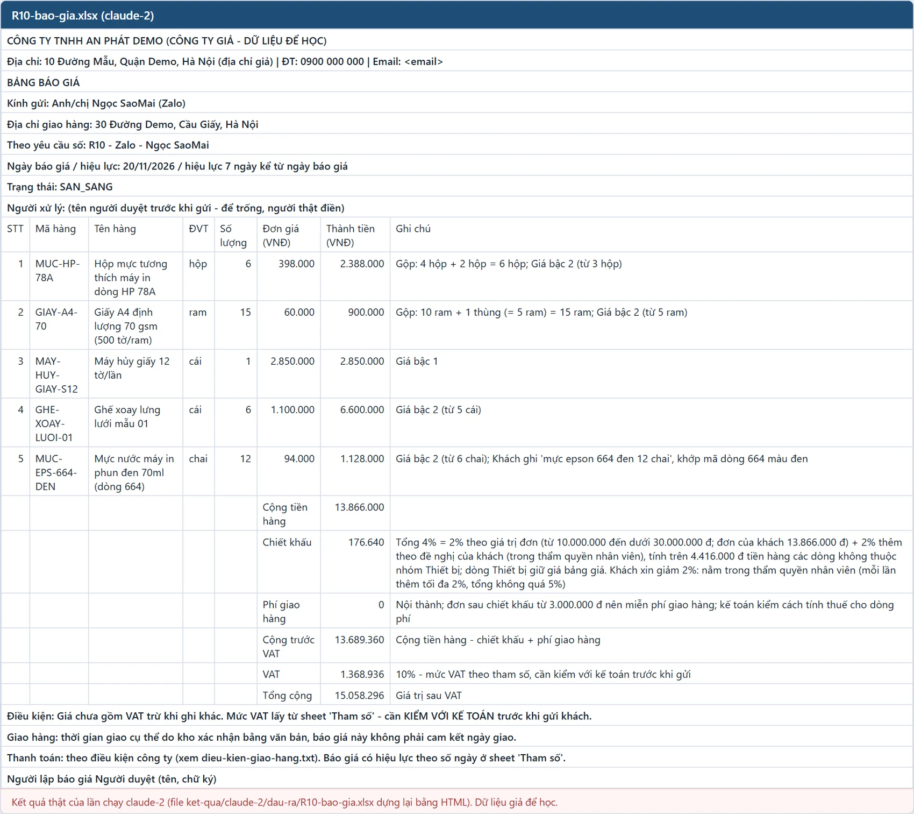

# Bài 3: Đưa vào dùng hằng ngày

> **Dữ liệu giả để học.** Số liệu **[Đo được]** là từ các lần chạy ngày 2026-11-20 (n = 1-2 lần mỗi agent hợp lệ). Mọi chính sách trong bài là chính sách bịa của công ty giả An Phát Demo.

## Mục tiêu đo được

Sau bài này bạn có một quy trình lặp lại được mỗi ngày, trong đó:

1. Yêu cầu mới của khách vào thư mục, báo giá nháp + email nháp + câu hỏi làm rõ ra thư mục khác, **không có gì tự gửi đi**.
2. Một chương trình tự kiểm (`ket-qua/kiem-tra-bao-gia.py`) chạy được **không cần đáp án** và bắt được các lỗi số học, sai bậc giá, VAT lệch tham số, chiết khấu quá mức.
3. Người duyệt có một danh sách ngắn việc phải nhìn kỹ, sắp theo trạng thái.

Thước đo: với một lô 12 yêu cầu, bạn chạy xong, người duyệt mở được hàng đợi trong vài phút, và mọi báo giá chưa SAN_SANG đều có ghi rõ lý do.

## Bước 1. Quy trình một ngày

```
sáng:   copy email/Zalo mới vào  yeu-cau/  (mỗi yêu cầu một file Rxx.txt)
        cập nhật bang-gia.xlsx, tham số VAT (nếu có thay đổi) -> chạy agent -> dau-ra/
        chạy kiem-tra-bao-gia.py trên dau-ra/
        người duyệt mở hàng đợi: CAN_NGUOI_QUYET, THIEU_THONG_TIN, rồi SAN_SANG
chiều:  người duyệt sửa, gửi từng cái (ngoài hệ thống này), ghi lại kết quả
```

Chia việc rõ ràng, theo nguyên tắc **agent đọc hiểu, code tính tiền, người quyết**:

| Việc | Ai làm | Vì sao |
|---|---|---|
| Hiểu email lộn xộn, tách dòng hàng, đổi đơn vị | Agent | Ngôn ngữ tự nhiên, việc agent giỏi |
| Tra bậc giá, chiết khấu, phí giao, VAT, tổng | **Code** (`tinh_bao_gia.py`) | Phép tính phải lặp lại y hệt; 35/35 dòng hàng đúng trong mọi lần chạy hợp lệ **[Đo được]** |
| Kiểm số học và quy tắc, không cần đáp án | Code (`kiem-tra-bao-gia.py`) | Bắt lỗi nhất quán |
| Quyết chiết khấu vượt mức, quà tặng, công nợ, giữ giá cũ, phí giao ngoại tỉnh, hàng không có | **Người** | Không phải việc của nhân viên, càng không phải của máy |
| Duyệt cuối, bấm gửi | **Người** | Người chịu trách nhiệm trước khách |

### Một điều cần sửa nếu muốn dùng hằng ngày

Ở bài 2, các script `tinh_bao_gia.py` do agent viết có **12 yêu cầu gõ cứng trong một biến `YEU_CAU`** (ví dụ ở `ket-qua/claude-2/tinh_bao_gia.py`, từ dòng 232). Phần tính tiền, điền mẫu thì dùng lại được. Phần dữ liệu yêu cầu thì chỉ đúng cho 12 yêu cầu này.

**[Đề xuất]** Khi dùng thật, tách làm hai bước:

1. Agent đọc yêu cầu mới và ghi một file cấu trúc nhỏ cho mỗi yêu cầu, ví dụ `cau-truc/R13.json`:

```json
{
  "id": "R13",
  "khach": "tên người/đơn vị",
  "dia_chi": "địa chỉ giao hoặc null nếu chưa biết",
  "dong": [{"ma": "GIAY-A4-80", "so_luong": 25, "dvt": "ram"}],
  "xin_giam_pct": 2,
  "van_de": ["đòi giao trước 10h sáng thứ Sáu"]
}
```

2. Một script cố định (`tinh_bao_gia.py` đã được người xem và duyệt) đọc `cau-truc/*.json`, tính tiền, điền mẫu. Script này **không đổi** mỗi ngày; chỉ dữ liệu đổi. Mỗi khi chính sách đổi, bạn sửa script một lần, chạy lại trên 12 yêu cầu mẫu và so với kết quả cũ.

Cách tách này cũng cho phép người duyệt mở file JSON để xem agent đã đọc hiểu yêu cầu thế nào, trước khi nhìn tới số tiền.

## Bước 2. Tự kiểm bằng code, không cần đáp án

Hằng ngày bạn không có `dap-an.json`. Thay vào đó dùng `ket-qua/kiem-tra-bao-gia.py`:

```
python -X utf8 ket-qua/kiem-tra-bao-gia.py <thu_muc_dau-ra> <thu_muc_co_bang-gia_va_mau>
```

Giải thích: tham số thứ nhất là thư mục chứa các file `Rxx-bao-gia.xlsx`, `Rxx-email.txt`, `Rxx-cau-hoi.txt`; tham số thứ hai là thư mục có `bang-gia.xlsx` và `mau-bao-gia.xlsx` (lấy mức VAT từ sheet "Tham số"). Chương trình chỉ dùng bảng giá, mẫu và quy tắc chính sách (chiết khấu không quá 5% trên tiền hàng không phải Thiết bị, v.v.).

Nó phân biệt **LỖI** (số học, mã không có trong bảng giá, đơn giá sai bậc, VAT sai tham số, chiết khấu quá mức, trạng thái trống) và **CẢNH BÁO** (phí giao ghi 0 khi chưa biết địa chỉ, email nói "đã chuyển", email thiếu chữ "kế toán", câu giống lời hứa giao hàng, dòng không có giá).

Kết quả chạy trên 6 thư mục đầu ra **[Đo được]**:

| Lần chạy | Lỗi | Cảnh báo | Cảnh báo là gì |
|---|---|---|---|
| claude-1 | 0 | 6 | 6 email viết "đã chuyển ..." |
| claude-2 | 0 | 0 | |
| claude-0 | 0 | 0 | |
| agy-2 | 0 | 8 | 8 email viết "đã chuyển ..." |
| agy-0 | 0 | 12 | email "đã chuyển", 4 dòng không giá (ghi chú), 1 cờ giả hứa giờ giao ở R08 (một tiêu đề), phí giao ghi 0 ở R02 |
| agy-1 (bị loại) | 0 | 5 | |

**Phải nhớ giới hạn của bộ tự kiểm này:** nó **không bắt** được lỗi của agy-0 ở R10 (bỏ phần chiết khấu thêm 2% được phép). Báo giá đó đúng số học và không vượt 5%, chỉ là **thiếu** một khoản chiết khấu mà chính sách cho phép; muốn bắt cần đáp án hoặc người duyệt đọc dòng chiết khấu. Tự kiểm chỉ chứng minh "nhất quán", không chứng minh "đúng với chính sách".

Chính vì vậy bản gốc của chúng tôi còn có `cham.py` (cần đáp án) để đo định kỳ trên bộ 12 yêu cầu mẫu mỗi khi đổi prompt, đổi agent, đổi phiên bản.

## Bước 3. Người duyệt đọc gì trước

Sắp hàng đợi theo trạng thái (đọc ô "Trạng thái" trong mỗi báo giá):

1. **CAN_NGUOI_QUYET**: đọc ghi chú ở dòng chiết khấu, phí giao, và mục "Nội dung đang chờ" trong email. Quyết rồi mới tiếp.
2. **THIEU_THONG_TIN**: đọc `Rxx-cau-hoi.txt`, gửi câu hỏi cho khách; báo giá nháp chỉ có phần đã chắc.
3. **SAN_SANG**: vẫn nhìn dòng chiết khấu, dòng phí giao và câu VAT.

Ví dụ báo giá R10 (đơn lớn, dòng trùng, chiết khấu 4%) dưới dạng người duyệt sẽ mở:



*Kết quả thật, dựng lại từ file `ket-qua/claude-2/dau-ra/R10-bao-gia.xlsx`. Dữ liệu giả để học.*

Checklist ngắn cho người duyệt mỗi báo giá (nên in dán cạnh máy):

- [ ] Số lượng và đơn vị: có khớp ý khách không (2 thùng = bao nhiêu)?
- [ ] Đơn giá đúng bậc? Dòng sát mốc bậc (49/50) có đúng?
- [ ] **Dòng chiết khấu**: đúng % theo chính sách, tính đúng nhóm hàng? Có khoản được phép mà bị bỏ không (như agy-0 ở R10)?
- [ ] Phí giao: nội thành hay ngoại tỉnh, ghi "theo thỏa thuận" thay vì 0 khi chưa rõ?
- [ ] Mức VAT: đã khớp tham số kế toán xác nhận?
- [ ] Email: có câu "đã chuyển ..." mà chưa ai chuyển? có câu nào giống lời hứa ngày giờ giao?
- [ ] Câu hỏi làm rõ: đủ, không hỏi lặp, không quá nhiều.
- [ ] Việc cần người quyết đã có người nhận chưa?

## Bước 4. Những lỗi sẽ gặp khi dùng thật

| Tình huống | Gặp ở đâu trong bài này | Cách đối phó |
|---|---|---|
| Agent hiểu sai chính sách rồi tính "đúng" theo hiểu sai | agy-0 R10: bỏ 2% chiết khấu thêm | Người duyệt đọc dòng chiết khấu; chạy `cham.py` trên 12 yêu cầu mẫu mỗi khi đổi prompt/agent |
| Email nói việc chưa xảy ra ("đã chuyển lên trưởng phòng") | 6/12, 8/12, 6/12 email ở claude-1, agy-2, agy-0 | Người duyệt sửa; **[Đề xuất]** sửa prompt thành "sẽ chuyển" |
| Chính sách có chỗ mơ hồ, agent hiểu khác nhau | R02 ("chiều anh cần" = giao gấp?), R09 ("như đợt trước" = giữ giá cũ?) | Chủ doanh nghiệp quyết một cách hiểu và viết vào chính sách |
| Agent đi ra ngoài thư mục làm việc, đọc file không được đọc | agy-1 đọc đáp án | Chạy ở thư mục/tài khoản cô lập; kiểm log |
| Bảng giá đổi mà quên cập nhật | không xảy ra trong bài, nhưng là rủi ro số một | Ghi ngày hiệu lực bảng giá ở mỗi báo giá (mẫu đã có "Ngày báo giá") và bắt buộc cập nhật trước khi chạy |
| Tiến trình chạy nền bị dừng mất log | claude-0, agy-0 | Dùng `Start-Process` và đặt thời gian tối đa dư (1500 giây trong bài này) |
| Khách gửi ảnh chụp, PDF, báo giá đối thủ | không có trong bài | Bài này chỉ xử lý văn bản; xem phần mở rộng |

## Bước 5. Chi phí và thời gian (tham khảo)

**[Đo được]** Với lô 12 yêu cầu, Claude Code báo chi phí theo giá niêm yết là 1,04 USD (claude-1) và 1,19 USD (claude-2), mất 378 s và 432 s. Antigravity (agy-2) 962,5 s, log không báo chi phí (173.743 token vào, 110.581 token ra). Chia ra khoảng 0,09-0,10 USD cho một yêu cầu theo giá niêm yết của Claude Code. Đây là hai điểm đo, máy lúc đó chạy nhiều việc song song, và gói thuê bao của bạn có thể tính khác. **[Đề xuất]** Hãy đo lại trên máy và gói của bạn trước khi hứa với ai về chi phí. So với thời gian một nhân viên lập 12 báo giá bằng tay, bạn tự đo bằng cách bấm giờ một buổi: chúng tôi **không có số này**.

## Bước 6. Giữ log và bằng chứng

Mỗi lần chạy giữ lại: (a) log gốc `*.raw.jsonl`, (b) thư mục `dau-ra/`, (c) bản `tinh_bao_gia.py` đã dùng, (d) phiên bản bảng giá và tham số VAT, (e) tên người duyệt và quyết định. Khi khách hoặc kế toán hỏi "vì sao giá này", bạn có thứ để trả lời. Tìm trong log các đường dẫn lạ là cách kiểm nhanh agent có ra ngoài thư mục (bài 1, bước 8).

**Dữ liệu khách hàng thật:** email và Zalo của khách có tên, số điện thoại, địa chỉ. Khi dùng agent chạy trên dịch vụ đám mây, nội dung này được gửi tới nhà cung cấp. **[Đề xuất]** Đọc điều khoản và cấu hình quyền riêng tư của gói bạn dùng, cân nhắc ẩn danh trước khi đưa vào, và hỏi luật sư/người phụ trách bảo vệ dữ liệu nếu có khách là tổ chức yêu cầu bảo mật. Chúng tôi không đưa kết luận pháp lý ở đây.

## Mở rộng (chưa làm trong bài này)

- **Mẫu DOCX:** nhiều công ty gửi báo giá bằng Word hoặc PDF. Cách làm tương tự (điền vào mẫu `.docx` bằng thư viện `python-docx`) nhưng chúng tôi **chưa thử**, nên không có số liệu.
- **Ảnh và PDF đính kèm:** cần bước đọc chữ trong ảnh (OCR); độ chính xác phải đo riêng.
- **Bảng giá lớn:** cần tìm kiếm theo mã/tên thay vì đưa cả bảng vào prompt.
- **Nối với email/Zalo/phần mềm kế toán:** để agent đọc hộp thư trực tiếp và lưu báo giá vào hệ thống. Làm khi quy trình ở thư mục đã ổn định và có người chịu trách nhiệm; khâu gửi vẫn nên do người bấm.
- **Chạy lặp để đo độ ổn định:** chúng tôi mới có 1-2 lần cho mỗi agent. Muốn nói gì về độ ổn định cần chạy mỗi cấu hình ít nhất vài chục lần và ghi lại.
- **Lấy thêm câu hỏi từ khách hàng thật** (có đồng ý) để mở rộng bộ 12 yêu cầu.

## Việc cần người làm

- Chủ doanh nghiệp: viết chính sách giá, chiết khấu, thẩm quyền, giao hàng thành văn bản rõ ràng; quyết những chỗ mơ hồ.
- Người duyệt: dùng checklist ở bước 3 cho từng báo giá; chịu trách nhiệm trước khi gửi.
- Kế toán: xác nhận mức VAT trong "Tham số", cách tính thuế cho phí giao hàng, mẫu hóa đơn.
- Người quản trị máy: cô lập thư mục/tài khoản chạy agent, giữ log, đặt quyền truy cập.

## Giới hạn

- Dữ liệu và chính sách giả; 12 yêu cầu; n = 1-2 lần mỗi agent hợp lệ; không xếp hạng agent.
- Bộ tự kiểm không bắt được lỗi hiểu sai chính sách. Người duyệt không thể bỏ.
- Chi phí và thời gian chỉ là 3 điểm đo trong một ngày, máy đang bận.
- Chưa thử mẫu DOCX/PDF, ảnh đính kèm, bảng giá lớn, dữ liệu khách hàng thật.
- Không phải tư vấn thuế hay pháp luật: mức VAT, hóa đơn, bảo vệ dữ liệu cần kế toán/luật sư xác nhận.
