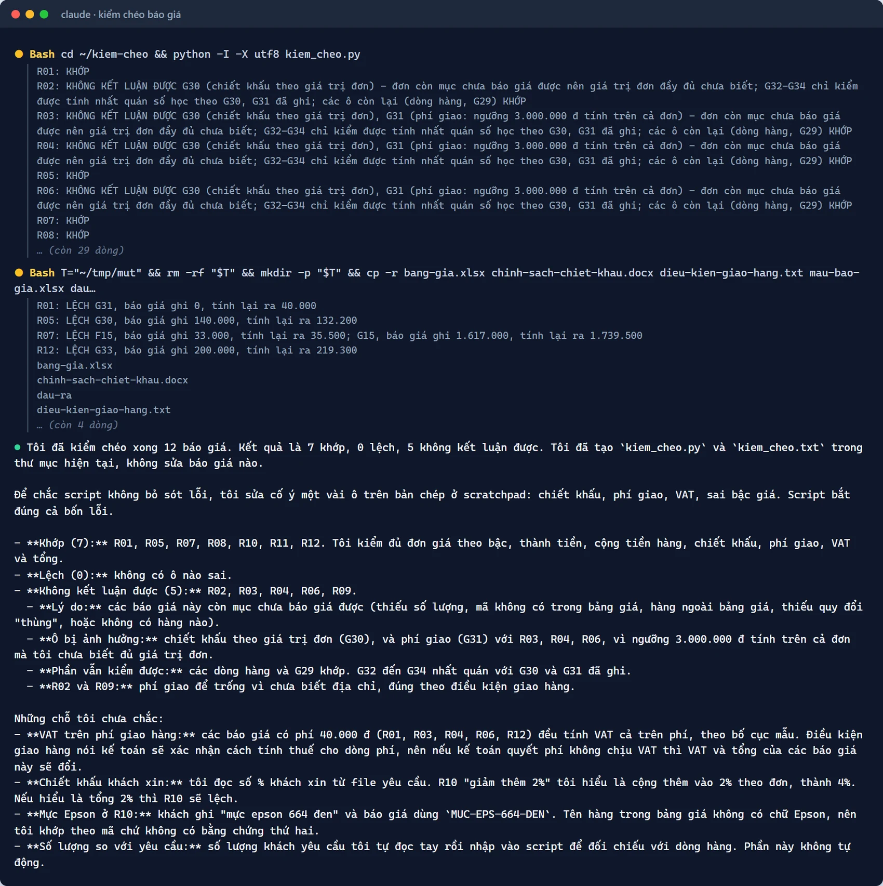

# Bài 4. Prompt mẫu và bài tập tự làm

!!! info "Bài này"
    - **Bạn làm gì:** lấy bộ 9 prompt dùng lại được cho công việc báo giá (giao việc, giải thích script, kiểm chéo, viết email không hứa ngày giao, hỏi lại khách, đổi bảng giá, báo cáo cho sếp...), rồi tự làm 3 bài tập có bộ chấm.
    - **Mất bao lâu:** đọc và thử prompt khoảng 45 phút; mỗi bài tập 20 đến 40 phút (agent chạy thêm vài phút).
    - **Cần có:** đã làm bài 1 đến 3 (có thư mục `ket-qua/claude-2/dau-ra/` làm mẫu), agent đã cài, Python 3 với `openpyxl`.
    - **Kết quả:** một bộ prompt của riêng bạn, và ba bài tập mà đạt hay chưa đạt do **code chấm**, không do cảm giác.

> **Dữ liệu giả để học.** Năm prompt (số 2, 3, 4, 5, 8) chúng tôi đã chạy thật bằng Claude Code (`claude -p`), **lần chạy ngày 2026-11-21, n = 1 mỗi prompt**, trên đầu ra có sẵn của lần `claude-2` ở bài 2. Kết quả dán dưới prompt là kết quả thật, có đánh dấu chỗ lược. Prompt không ghi gì thì **chưa chạy thử**. Log nằm ở `logs/bai4-*.json`. Mức VAT 10 trong dữ liệu chỉ là tham số minh họa, hỏi kế toán.

## Bộ prompt dùng lại được

Quy ước: mỗi prompt đặt trong khung **Prompt**, bấm **Sao chép**. Phần trong `[ngoặc vuông]` là chỗ bạn điền. Mọi prompt đều có câu "Chỉ đọc và ghi trong thư mục hiện tại", nhưng câu đó **chỉ là lời nhắc** (xem "Gặp lỗi?" ở prompt 3).

### Prompt 1. Giao việc chính (bản rút gọn)

**Dùng khi nào:** mỗi lần có lô yêu cầu mới. Bản đầy đủ ở bài 1; bản này gọn hơn, tổng quát cho mọi file trong `yeu-cau/`, và thêm quy tắc "không viết đã chuyển" mà bài 2 đề xuất. **Chưa chạy lại** bản rút gọn này.

```prompt
# Vai trò
Bạn là nhân viên hỗ trợ kinh doanh của một công ty nhỏ bán thiết bị văn phòng, vật tư in ấn và văn phòng phẩm (công ty giả, dữ liệu giả để học). Bạn soạn báo giá NHÁP cho người thật duyệt. Bạn không gửi gì ra ngoài và không có quyền quyết chiết khấu vượt thẩm quyền.

# Bối cảnh
Chỉ đọc và ghi trong thư mục hiện tại. Trong thư mục có: yeu-cau/ (mỗi file một email hoặc tin nhắn xin báo giá), bang-gia.xlsx (bảng giá nhiều bậc theo số lượng; sheet QuyDoi quy đổi đơn vị), chinh-sach-chiet-khau.docx, dieu-kien-giao-hang.txt, mau-bao-gia.xlsx (mẫu báo giá và sheet "Tham số" có mức VAT).

# Nhiệm vụ
Với MỖI file trong yeu-cau/, tạo trong dau-ra/ ba file: Rxx-bao-gia.xlsx (theo đúng mẫu; ô Trạng thái ghi SAN_SANG, THIEU_THONG_TIN hoặc CAN_NGUOI_QUYET, nhiều giá trị cách nhau dấu chấm phẩy), Rxx-email.txt (email trả lời nháp), Rxx-cau-hoi.txt (câu hỏi làm rõ, mỗi câu một dòng đánh số; nếu không có thì ghi "Không có câu hỏi.").

# Quy tắc
- Viết MỘT script Python để tính tiền; mọi phép tính tiền do code làm, không tự nhẩm. Ghi giá trị số vào xlsx, không dùng công thức.
- Chỉ quy đổi đơn vị khi sheet QuyDoi có. Không tự đoán mã hàng sai, không tự đặt giá cho hàng không có trong bảng giá.
- Mức VAT lấy từ sheet "Tham số"; trong báo giá và email ghi "mức VAT theo tham số, cần kiểm với kế toán trước khi gửi".
- Chiết khấu vượt thẩm quyền, quà tặng, công nợ, giữ giá cũ, phí giao ngoại tỉnh: không đồng ý trong email, ghi CAN_NGUOI_QUYET.
- KHÔNG hứa ngày hoặc giờ giao cụ thể. Không viết "đã chuyển" khi chưa ai chuyển; viết "chúng tôi sẽ".
- Khi xong, trả lời ngắn: đã tạo những file nào và ca nào cần người xem kỹ.
```

!!! see "Bạn sẽ thấy"
    Thư mục `dau-ra/` có 3 file cho mỗi yêu cầu, và agent chạy kiểm tra trước khi báo cáo (bài 1 và 2 mô tả chi tiết).

### Prompt 2. Giải thích script bằng lời thường

**Dùng khi nào:** agent vừa viết `tinh_bao_gia.py` và bạn không đọc được code, nhưng cần biết quy tắc tiền nào đang nằm trong đó trước khi tin.

```prompt
Trong thư mục hiện tại có file tinh_bao_gia.py, do một agent viết để tính và lập báo giá cho một công ty bán văn phòng phẩm. Mình không biết lập trình.

Hãy đọc file đó rồi giải thích bằng tiếng Việt đời thường, như nói với một chủ shop:
1. File này làm những việc gì, theo thứ tự nào (tối đa 6 gạch đầu dòng).
2. Quy tắc tính tiền nào đang nằm trong code: cách chọn bậc giá, chiết khấu, phí giao hàng, VAT. Với mỗi quy tắc, nói nó nằm ở khoảng dòng nào của file.
3. Chỗ nào bị "gõ cứng" trong code (ví dụ mức VAT, ngưỡng miễn phí giao hàng, danh sách quận nội thành, danh sách yêu cầu của khách) mà sau này đổi chính sách thì phải sửa tay? Liệt kê từng chỗ.
4. Có điều gì trong code bạn thấy rủi ro hoặc không chắc không? Nếu không thấy thì nói không thấy, đừng bịa.

Chỉ đọc file, không sửa, không chạy, không tạo file mới. Trả lời ngay trong khung chat, tối đa 400 từ.
```

**Kết quả thật** (lần chạy ngày 2026-11-21, n = 1; 53,5 giây; 0,26 USD theo giá niêm yết; chỉ đọc file, không chạy gì). Chúng tôi lược bớt, `[...]` là chỗ lược:

```ketqua
2. Quy tắc tiền
- Bậc giá (130–137): lấy bậc cao nhất mà số lượng đạt ngưỡng. Số lượng tính riêng từng mã [...]
- Chiết khấu (190–208): đơn từ 30 triệu giảm 4%, từ 10 triệu giảm 2%. Nhân viên được thêm tối đa 2%, tổng không quá 5%. Chỉ giảm trên hàng không thuộc nhóm "Thiết bị". [...]
- Phí giao (210–216): nội thành, sau chiết khấu từ 3 triệu thì miễn phí, dưới thì 40.000đ. [...]
- VAT (218–220): tính trên (sau chiết khấu + phí giao), làm tròn 0,5 lên.

3. Chỗ gõ cứng (đổi chính sách phải sửa tay)
- Dòng 30–35: tên nhóm "Thiết bị", các bậc chiết khấu, 2%, 5%, ngưỡng 3 triệu, phí 40.000đ.
- Dòng 232–406: 12 yêu cầu của khách (hàng, số lượng, địa chỉ, xin giảm, câu hỏi, câu email). Có khách mới là phải sửa code.
- Không gõ cứng: mức VAT (đọc từ Excel, 79–82) và danh sách quận (đọc từ file txt, 85–97). [...]

4. Rủi ro / không chắc
- Phí giao cũng bị tính VAT (dòng 218). Chính code (dòng 459) dặn kế toán kiểm lại.
- Dòng 205: khách xin tổng giảm từ 5% trở xuống sẽ làm chương trình dừng và báo lỗi.
- [...]
- Mình không thấy lỗi tính toán rõ ràng nào trong phần đã đọc.
```

!!! see "Bạn sẽ thấy"
    Một bản giải thích ngắn có số dòng, danh sách chỗ gõ cứng, và phần "không chắc". **[Đo được]** Chúng tôi mở file ra kiểm số dòng: đúng ở các dòng 31, 34 (ngưỡng và bậc chiết khấu), 130 (hàm chọn bậc giá), 205 (dòng báo lỗi "chưa có ca khách xin tổng <= 5%"); VAT nằm ở dòng 219 (agent ghi 218 đến 220). Chúng tôi chưa kiểm hết các số dòng khác. Cảnh báo ở dòng 205 và việc VAT tính cả trên phí giao đều có thật trong code, và khớp đúng chỗ kế toán phải xác nhận.

### Prompt 3. Kiểm chéo bằng phép tính độc lập

**Dùng khi nào:** trước khi người duyệt mở báo giá, để một agent khác tự tính lại từ dữ liệu gốc. Khác với bộ tự kiểm của bài 3: agent này đọc cả chính sách và bảng giá.

```prompt
Trong thư mục hiện tại có:
- dau-ra/: 12 báo giá nháp Rxx-bao-gia.xlsx do một agent khác lập (bỏ qua các file email và câu hỏi trong đó)
- bang-gia.xlsx, chinh-sach-chiet-khau.docx, dieu-kien-giao-hang.txt, mau-bao-gia.xlsx (sheet "Tham số" có mức VAT)
- yeu-cau/: 12 yêu cầu của khách

Nhiệm vụ: kiểm chéo các báo giá đó bằng một phép tính ĐỘC LẬP. Bạn tự viết script kiem_cheo.py, đọc dữ liệu gốc (bảng giá, chính sách, điều kiện giao hàng, tham số VAT) và các dòng hàng + số lượng đã ghi trong từng báo giá, rồi tự tính lại: đơn giá theo bậc, thành tiền, cộng tiền hàng, chiết khấu, phí giao, VAT theo tham số, tổng cộng. Không dùng lại script nào của agent kia và không tự nhẩm tiền.

So kết quả của bạn với số trong báo giá, rồi ghi ra kiem_cheo.txt: mỗi yêu cầu một dòng, dạng "R01: KHỚP" hoặc "R01: LỆCH <ô nào>, báo giá ghi X, tính lại ra Y". Ô nào khó tính lại vì chính sách chưa rõ thì ghi "KHÔNG KẾT LUẬN ĐƯỢC" và nêu lý do. Không sửa báo giá. Cuối cùng trả lời ngắn: bao nhiêu khớp, bao nhiêu lệch, bao nhiêu không kết luận được, và những chỗ bạn chưa chắc.

Chỉ đọc và ghi trong thư mục hiện tại.
```

**Kết quả thật** (lần chạy ngày 2026-11-21, n = 1; 197,1 giây; 0,64 USD theo giá niêm yết). Agent viết `kiem_cheo.py` 315 dòng, ghi `kiem_cheo.txt`:

```ketqua
Tôi đã kiểm chéo xong 12 báo giá. Kết quả là 7 khớp, 0 lệch, 5 không kết luận được.
Để chắc script không bỏ sót lỗi, tôi sửa cố ý một vài ô trên bản chép ở scratchpad: chiết khấu, phí giao, VAT, sai bậc giá. Script bắt đúng cả bốn lỗi.

- Khớp (7): R01, R05, R07, R08, R10, R11, R12.
- Không kết luận được (5): R02, R03, R04, R06, R09. Lý do: các báo giá này còn mục chưa báo giá được [...]

Những chỗ tôi chưa chắc:
- VAT trên phí giao hàng: [...] nếu kế toán quyết phí không chịu VAT thì VAT và tổng của các báo giá này sẽ đổi.
- Chiết khấu khách xin: R10 "giảm thêm 2%" tôi hiểu là cộng thêm vào 2% theo đơn, thành 4%. Nếu hiểu là tổng 2% thì R10 sẽ lệch.
- [...]
- Số lượng khách yêu cầu tôi tự đọc tay rồi nhập vào script. Phần này không tự động.
```



*Dựng lại từ log thật của lần chạy `bai4-kiem-cheo` (ngày 2026-11-21), không phải ảnh chụp trực tiếp cửa sổ TUI. Đường dẫn máy đã che; phần giữa được lược.*

!!! see "Bạn sẽ thấy"
    Một file `kiem_cheo.txt` mỗi yêu cầu một dòng, và danh sách "chỗ chưa chắc". **[Đo được]** Đối chiếu với bộ chấm `cham.py` (bài 2): 12/12 yêu cầu của `claude-2` đúng cả sáu dòng tổng, nên "0 lệch" là đúng. Năm ca "không kết luận được" là agent **quá thận trọng**: ví dụ R03, R04, R06 vẫn kiểm được phần đã báo giá (chính agent ghi "G29 khớp").

!!! stuck "Gặp lỗi?"
    - **Agent ghi file ngoài thư mục chạy.** **[Đo được]** Ở prompt 3 và prompt 8, agent ghi bản thử ra thư mục tạm của chính Claude Code (`scratchpad`), dù prompt dặn chỉ ghi trong thư mục hiện tại. Ở prompt 3 nó dùng chỗ đó để thử cố ý sửa lỗi. Không thấy dấu hiệu đọc thư mục nào khác (log cả 5 lần chạy có 0 chỗ nhắc `dap-an`). Bài học vẫn là bài 2: câu trong prompt không phải rào chắn.
    - **Hai agent đọc chính sách giống nhau thì sai giống nhau.** Kiểm chéo bắt lỗi tính, không bắt lỗi hiểu sai chính sách chung. Hãy đọc kỹ các "chỗ chưa chắc" mà agent nêu.
    - **Lỗi chữ Việt khi chạy Python trên Windows:** agent tự thêm `-X utf8` (xem ảnh).

### Prompt 4. Viết email trả lời, không hứa ngày giao

**Dùng khi nào:** khách đòi giờ giao hoặc dọa hủy đơn, và nhân viên không được hứa.

```prompt
Trong thư mục hiện tại có yeu-cau/R08.txt (email của khách), dau-ra/R08-bao-gia.xlsx (báo giá nháp đã lập) và dieu-kien-giao-hang.txt (điều kiện giao hàng của công ty).

Hãy viết email trả lời khách cho yêu cầu R08, lưu vào email-R08.txt (tiếng Việt, lịch sự, tối đa 180 từ). Quy tắc:
- KHÔNG hứa ngày hoặc giờ giao cụ thể, kể cả khi khách đòi rất gấp hoặc dọa hủy đơn. Với việc khách đòi giờ giao, nói rõ là kho sẽ xác nhận lịch giao bằng văn bản.
- Không tự đặt con số phí vận chuyển nếu điều kiện giao hàng nói phí do bộ phận khác báo sau.
- Nêu rõ cái đã báo giá được (đọc số từ file báo giá, không tự tính lại) và cái chưa thể trả lời.
- Không viết như thể việc nội bộ đã xong ("đã chuyển lên giám đốc") khi chưa ai làm; viết "chúng tôi sẽ ...".
- Nhắc mức VAT trong báo giá là tham số, cần kế toán xác nhận trước khi gửi; không khẳng định đó là thuế suất hiện hành.

Chỉ đọc và ghi trong thư mục hiện tại; không gửi email thật.
```

**Kết quả thật** (lần chạy ngày 2026-11-21, n = 1; 65,1 giây; 0,24 USD). Nội dung `email-R08.txt`:

```ketqua
Tiêu đề: Re: Báo giá vật tư đóng gói - gấp (R08)

Chào anh/chị Phương,

Chúng tôi xin báo giá phần đã tính được:
- Thùng carton 30x20x20: 300 cái, 2.460.000 đ
- Màng bọc PE 50cm: 24 cuộn, 2.784.000 đ
- Băng keo trong 48mm: 72 cuộn, 900.000 đ
Cộng tiền hàng 6.144.000 đ; VAT 10% là 614.400 đ; tổng 6.758.400 đ, chưa gồm phí vận chuyển. Mức VAT 10% chỉ là tham số tạm tính, kế toán sẽ xác nhận, chưa phải thuế suất chốt. Báo giá có hiệu lực 7 ngày từ 20/11/2026.

Hai việc chưa thể trả lời ngay:
- Phí vận chuyển đến Bắc Ninh tính theo cước đơn vị vận chuyển; bộ phận điều phối sẽ báo sau.
- Giao trước 10 giờ sáng thứ Sáu: chúng tôi chưa thể cam kết giờ giao. Chúng tôi sẽ chuyển yêu cầu gấp này đến trưởng kho/giám đốc, và kho sẽ xác nhận lịch giao bằng văn bản.

Trân trọng,
Công ty An Phát Demo
```

!!! see "Bạn sẽ thấy"
    Email tách "đã báo giá" và "chưa trả lời được", không có câu hứa giờ giao, không có con số phí vận chuyển, dùng "sẽ chuyển". **[Đo được]** Chúng tôi kiểm bằng code: cờ hứa ngày giao của `cham.py` không bật, không có câu "đã chuyển/đã gửi lên", không có số tiền nào cạnh chữ "phí vận chuyển", có chữ "kế toán". Email 169 từ (lệnh đếm tách theo khoảng trắng), trong mức 180. Chúng tôi **đọc tay** thêm: số tiền khớp báo giá R08. Lưu ý: email ghi "10%" cho khách; nhắc "cần kế toán xác nhận trước khi gửi" nằm trong phần trả lời của agent chứ không trong thư, và người duyệt phải tự quyết có để con số 10% trong thư hay không.

### Prompt 5. Liệt kê câu hỏi làm rõ khi thiếu số lượng hoặc đơn vị

**Dùng khi nào:** tin nhắn của khách cụt, hoặc dùng đơn vị bảng quy đổi không có (như "1 thùng mực").

```prompt
Trong thư mục hiện tại có yeu-cau/R02.txt và yeu-cau/R06.txt (hai tin nhắn của khách), bang-gia.xlsx (có sheet QuyDoi: quy đổi đơn vị) và dieu-kien-giao-hang.txt.

Với MỖI yêu cầu, liệt kê các câu hỏi làm rõ cần hỏi khách trước khi lập báo giá, vì thiếu hoặc mơ hồ về số lượng, đơn vị, địa chỉ giao. Quy tắc:
- Mỗi câu một dòng, đánh số, viết như câu hỏi gửi khách bằng tiếng Việt lịch sự, một ý một câu.
- Chỉ hỏi điều thật sự thiếu. Đơn vị nào sheet QuyDoi đã có quy đổi thì tự đổi, không hỏi lại; đơn vị nào chưa có quy đổi thì hỏi, không tự suy ra.
- Không hỏi lại điều khách đã nói.

Ghi kết quả vào cau-hoi-R02.txt và cau-hoi-R06.txt. Sau đó trả lời ngắn: mỗi file mấy câu, và ở R06 đơn vị nào bạn tự đổi (đổi thành bao nhiêu).

Chỉ đọc và ghi trong thư mục hiện tại.
```

**Kết quả thật** (lần chạy ngày 2026-11-21, n = 1; 53,9 giây; 0,20 USD). Hai file:

```ketqua
cau-hoi-R02.txt
1. Dạ anh cho em hỏi anh cần bao nhiêu giấy A4 định lượng 80 ạ?
2. Anh tính số lượng giấy A4 80 đó theo ram hay theo thùng ạ?
3. Anh cho em xin địa chỉ nhận hàng (số nhà, đường, quận/huyện, tỉnh/thành) ạ?

cau-hoi-R06.txt
1. Dạ chị cho em hỏi 1 thùng mực HP 12A chị cần là bao nhiêu hộp ạ?

(Phần trả lời trong khung chat, lược: ở R06 agent tự đổi 2 thùng giấy A4 70 = 10 ram, 5 tá bút bi = 60 cây,
3 lốc băng keo 2 mặt = 18 cuộn, 2 hộp bút gel = 24 cây, đúng theo sheet QuyDoi.)
```

!!! see "Bạn sẽ thấy"
    R02 có 3 câu, R06 có 1 câu, không hỏi lại điều khách đã nói. **[Đo được]** Bộ nhãn từ khóa của `cham.py` nhận ra cả ba ý cần hỏi (số lượng giấy, địa chỉ, quy đổi thùng mực); các số quy đổi khớp đáp án. Chỉ là ước lượng bằng từ khóa, chúng tôi đọc tay thêm. Một chi tiết đáng chú ý: ở R02 agent **không** đưa "chiều anh cần" vào câu hỏi mà nêu lý do (giao gấp phải chuyển người quyết), một cách hiểu nhất quán với chính sách giao hàng. Câu hỏi 2 hơi thừa (hỏi ram hay thùng, trong khi chưa có số lượng).

### Prompt 6. Đổi bảng giá hoặc chiết khấu khi có chương trình mới

**Dùng khi nào:** công ty thêm bậc giá, đổi mức chiết khấu, đổi ngưỡng miễn phí giao. **Chưa chạy thử** (ba bài tập bên dưới là cách thử).

```prompt
Công ty vừa có thay đổi, áp dụng từ hôm nay:
[ĐIỀN THAY ĐỔI CỦA BẠN. Ví dụ: thêm bậc giá thứ tư cho mã GIAY-A4-80, từ 100 ram giá 66.000 đồng. Hoặc: đơn từ 20.000.000 đồng chiết khấu 3%.]

Làm theo thứ tự:
1. Đọc bang-gia.xlsx, chinh-sach-chiet-khau.docx, dieu-kien-giao-hang.txt và tinh_bao_gia.py hiện có. Liệt kê (chưa sửa gì) thay đổi trên ảnh hưởng tới những chỗ nào của dữ liệu, của file chính sách và của code, kể cả chỗ trong code đang gõ cứng quy tắc cũ và các câu ghi chú, email có nhắc con số cũ.
2. Sửa đúng những chỗ đó, không đụng quy tắc khác.
3. Chạy lại cho mọi yêu cầu trong yeu-cau/, ghi kết quả vào dau-ra-moi/ (không đè dau-ra/).
4. Lập bảng "trước và sau": mỗi yêu cầu một dòng gồm tổng cộng cũ, tổng cộng mới, chênh lệch; yêu cầu nào không đổi ghi "không đổi". Số liệu lấy bằng code.

Mọi phép tính tiền do code làm. Chỉ đọc và ghi trong thư mục hiện tại.
```

!!! see "Bạn sẽ thấy"
    Một danh sách tác động trước khi sửa, rồi bảng "trước và sau". Hãy so bảng đó với bộ chấm của bài tập (bên dưới).

### Prompt 7. Sửa khi định dạng dữ liệu đổi

**Dùng khi nào:** phần mềm kế toán xuất bảng giá với tên cột hoặc cách ghi số khác. **Chưa chạy thử.**

```prompt
Phần mềm kế toán của công ty vừa đổi cách xuất file bảng giá. File mới là bang-gia-moi.xlsx (đặt cạnh bang-gia.xlsx cũ). Mình nghĩ tên cột, thứ tự cột hoặc cách ghi số có thể đã khác.

1. So sánh hai file: liệt kê mọi khác biệt về tên sheet, tên cột, thứ tự cột, cách ghi số (dấu chấm hay phẩy, có chữ "đ" hay không), đơn vị tính.
2. Nếu có khác biệt, sửa phần đọc bảng giá trong tinh_bao_gia.py để đọc được file mới. Không đoán: chỗ nào không chắc về ý nghĩa của một cột thì hỏi mình, đừng tự gán.
3. Chạy lại script trên các yêu cầu trong yeu-cau/ bằng cả hai file bảng giá, báo cáo yêu cầu nào cho kết quả khác nhau (đáng ra không có, trừ khi giá thật sự đổi).

Chỉ đọc và ghi trong thư mục hiện tại; không xóa file cũ.
```

!!! see "Bạn sẽ thấy"
    Bảng khác biệt trước, rồi mới sửa code. Nếu kết quả hai bảng giá khác nhau mà giá không đổi, có lỗi đọc cột.

### Prompt 8. Báo cáo cho sếp từ kết quả

**Dùng khi nào:** giám đốc cần một trang xem nhanh 12 báo giá nháp và việc phải quyết.

```prompt
Trong thư mục hiện tại có dau-ra/ gồm 12 báo giá nháp Rxx-bao-gia.xlsx và 12 file Rxx-cau-hoi.txt. Mỗi báo giá có ô "Trạng thái" (SAN_SANG, THIEU_THONG_TIN hoặc CAN_NGUOI_QUYET) và các dòng tổng (Cộng tiền hàng, Chiết khấu, Phí giao hàng, VAT, Tổng cộng).

Làm một báo cáo cho giám đốc, tối đa 1 trang, lưu vào bao-cao-sep.md (tiếng Việt, ngắn, không dùng thuật ngữ lập trình):
1. Một bảng 12 dòng: mã yêu cầu, trạng thái, tổng cộng (đồng). Số liệu đọc bằng code từ file xlsx, không tự nhẩm; thêm một dòng tổng cộng của các yêu cầu SAN_SANG.
2. Những việc giám đốc phải quyết: gom từ ghi chú trong báo giá, mỗi việc một dòng kèm mã yêu cầu.
3. Những yêu cầu đang chờ khách trả lời, mỗi yêu cầu cần khách cho biết gì (rút từ file cau-hoi).
Mức VAT trong báo giá là tham số cần kế toán xác nhận: ghi một dòng nhắc, không khẳng định thuế suất.
Không bịa: thông tin nào không có trong file thì không ghi. Chỉ đọc và ghi trong thư mục hiện tại.
```

**Kết quả thật** (lần chạy ngày 2026-11-21, n = 1; 106,0 giây; 0,37 USD). `bao-cao-sep.md`, lược:

```ketqua
Có 2 báo giá sẵn sàng gửi (R01, R10), 7 báo giá cần người có thẩm quyền quyết, 5 báo giá còn chờ khách bổ sung thông tin. R02 và R12 nằm ở cả hai nhóm sau nên được đếm hai lần (2 + 7 + 5 − 2 = 12).

| Mã | Trạng thái | Tổng cộng (đồng) | Lưu ý |
| R01 | Sẵn sàng gửi | 2.318.580 | |
| R02 | Thiếu thông tin + Cần người quyết | 2.541.000 | chưa có phí giao; chưa báo giá giấy A4 80 gsm (khách chưa nêu số lượng) |
| R03 | Thiếu thông tin | 2.106.500 | chưa gồm 2 mặt hàng sai mã; phí giao tạm tính |
[...]
| Cộng các yêu cầu sẵn sàng | R01 + R10 | 17.376.876 | |

2. Việc cần giám đốc / người có thẩm quyền quyết
- R05: khách xin giảm 25% tổng đơn, vượt thẩm quyền nhân viên; trưởng phòng hoặc giám đốc quyết.
- R12: khách xin công nợ 30 ngày; chỉ giám đốc duyệt (mặc định là chuyển khoản trước khi giao).
[...]
4. Nhắc kế toán
Mức VAT trong các báo giá (đang để 10%) chỉ là tham số minh họa, cần kế toán xác nhận trước khi gửi khách; [...]
```

!!! see "Bạn sẽ thấy"
    Một trang có bảng 12 dòng, danh sách việc cần quyết (10 dòng), danh sách chờ khách, và dòng nhắc VAT. **[Đo được]** Chúng tôi so 12 số "Tổng cộng" trong bảng với `dap-an.json`: 12/12 khớp; đếm trạng thái 2 sẵn sàng, 7 cần người quyết, 5 thiếu thông tin đúng. Agent thêm một cột "Lưu ý" ngoài yêu cầu và tự báo "chưa kiểm xem vừa đúng 1 trang khi in". Ca R11 "hàng tạm hết" agent không đưa vào việc giám đốc quyết vì đó là việc kho xác nhận: hợp lý nhưng người duyệt cần biết.

### Prompt 9. Hỏi "chỗ nào bạn không chắc"

**Dùng khi nào:** ngay sau khi agent làm xong, trước khi người duyệt mở file. **Chưa chạy thử** như một prompt riêng; tuy nhiên prompt 3 đã kèm câu tương tự và agent nêu được 4 chỗ cụ thể.

```prompt
Trước khi người duyệt mở các báo giá nháp trong dau-ra/, hãy tự soi lại và liệt kê trung thực những chỗ bạn KHÔNG chắc, chia ba nhóm:
(a) Chỗ bạn hiểu yêu cầu của khách chưa chắc (đơn vị, số lượng, mã hàng, địa chỉ).
(b) Chỗ chính sách có thể hiểu theo hai cách và bạn đã chọn một cách.
(c) Con số hoặc ô nào trong báo giá người duyệt nên tự kiểm lại.
Mỗi mục một dòng: mã yêu cầu, bạn đã chọn gì, vì sao, và người duyệt cần làm gì. Nhóm nào không có gì thì ghi "không có", đừng liệt kê cho đủ. Không sửa file nào. Trả lời ngay trong khung chat.
```

!!! see "Bạn sẽ thấy"
    Danh sách ngắn, cụ thể theo mã yêu cầu. Nếu agent trả lời chung chung ("có thể có sai sót"), hỏi lại: "Nêu mã yêu cầu và ô cụ thể."

## Ba bài tập tự làm

Dữ liệu ba bài tập nằm ở `du-lieu/bai-tap/bt1`, `bt2`, `bt3`. Mỗi thư mục là một bộ đầu vào đủ dùng (4 file và `yeu-cau/`), **không có đáp án**. Đáp án và bộ chấm nằm ở `ket-qua/bai-tap/` (đừng chép sang thư mục chạy). Script `sinh_bai_tap.py` ở đó sinh lại toàn bộ bằng hạt giống cố định.

Cách làm chung (PowerShell, trong thư mục bài). Thay `bt1` bằng `bt2` hoặc `bt3`:

```lenh
copy -Recurse du-lieu\bai-tap\bt1 bt1-lan-chay
cd bt1-lan-chay
claude
```

macOS hoặc Linux: `cp -r du-lieu/bai-tap/bt1 bt1-lan-chay`. Dán **Prompt 1** vào agent. Xong thì thoát agent, quay về thư mục bài và chấm:

```lenh
python -X utf8 ket-qua/bai-tap/cham_bai_tap.py bt1 bt1-lan-chay/dau-ra
```

Bộ chấm `cham_bai_tap.py` dùng lại `cham.py`: so từng dòng hàng, sáu dòng tổng, trạng thái với đáp án riêng của bài tập; in `ĐẠT` hoặc `CHƯA ĐẠT` cho từng yêu cầu và thoát mã 0 nếu đạt tất cả. Thông số **[Đo được]**: chúng tôi **chưa cho agent làm** ba bài tập này. Chúng tôi đã dựng bằng code một đầu ra đúng và một đầu ra sai cho mỗi bài (`python -X utf8 ket-qua/bai-tap/sinh_bai_tap.py --tu-kiem`) và bộ chấm trả đúng kỳ vọng ở cả 6 trường hợp (đúng thì `ĐẠT`, sai thì `CHƯA ĐẠT`). Một lần chạy 12 yêu cầu của Claude Code ở bài 2 tốn khoảng 1 USD theo giá niêm yết.

### Bài tập 1. Thêm một bậc giá mới

**Đề:** công ty thêm **bậc 4** cho hai mã: `GIAY-A4-80` từ 100 ram giá 66.000 đồng, `BUT-BI-TL027-XANH` từ 500 cây giá 3.300 đồng. Bảng giá đã có thêm hai cột K, L ("Bậc 4 từ SL", "Giá bậc 4"). Hai yêu cầu mới: R13 (20 thùng giấy A4 80, 25 hộp bút bi, 12 cuộn băng keo) và R14 (99 ram giấy, 24 hộp bút bi).

**Dữ liệu:** `du-lieu/bai-tap/bt1/`.

**Tiêu chí đạt (đã kiểm bằng code):** `cham_bai_tap.py bt1 ...` in `ĐẠT` cho cả R13 và R14: 5/5 dòng hàng đúng, sáu dòng tổng đúng, trạng thái SAN_SANG. Số cần ra: R13 có tổng cộng 9.253.200, R14 có tổng cộng 9.414.900; cả hai không chiết khấu, không phí giao. **Đừng dán các số này cho agent.**

**Gợi ý:** để ý hai dòng sát mốc: 20 thùng = 100 ram (đúng mốc, được bậc 4) và 99 ram (chưa tới mốc). Thử chấm kết quả cũ để thấy bộ chấm bắt lỗi: `python -X utf8 ket-qua/bai-tap/cham_bai_tap.py bt1 ket-qua/claude-2/dau-ra` báo `CHƯA ĐẠT` vì thư mục đó không có R13, R14. Nếu muốn dùng bộ tự kiểm `kiem-tra-bao-gia.py` của bài 3: nó chỉ biết 3 bậc và chỉ quét R01 đến R12, nên bạn phải sửa cả hai chỗ. **[Đo được]** Chúng tôi gọi hàm kiểm của nó trên đầu ra đúng của R13 và nó báo 2 lỗi giả ("đơn giá khác giá bậc") vì không biết bậc 4.

### Bài tập 2. Thêm một yêu cầu xin chiết khấu quá mức

**Đề:** hai yêu cầu mới trong `bt2`. R13: đơn trên 10 triệu, khách xin giảm tổng đơn 8%. R14: đơn dưới 3 triệu, khách xin giảm 6%. Cả hai vượt thẩm quyền 5% của nhân viên. Agent phải chỉ áp chiết khấu theo chính sách, **không đồng ý** mức khách xin, và đẩy lên người quyết.

**Dữ liệu:** `du-lieu/bai-tap/bt2/` (bảng giá giữ nguyên).

**Tiêu chí đạt (đã kiểm bằng code):** `cham_bai_tap.py bt2 ...` in `ĐẠT` cho R13 và R14: trạng thái CAN_NGUOI_QUYET (không phải SAN_SANG), sáu dòng tổng đúng. Số cần ra: R13 chiết khấu 209.400 (2% theo đơn, không thêm), tổng cộng 11.286.660; R14 chiết khấu 0, phí giao 40.000 (vì sau chiết khấu 2.793.000 chưa tới 3 triệu), tổng cộng 3.116.300. Bộ chấm bắt được cả kiểu sai "nhượng bộ 5% rồi ghi SAN_SANG". Bạn **đọc tay** thêm email: không được có câu đồng ý mức khách xin, và không được viết "đã chuyển".

**Gợi ý:** nhìn dòng "Chiết khấu" và phần ghi chú của nó trong báo giá; đây là chỗ agy-0 sai ở bài 2.

### Bài tập 3. Thêm điều kiện giao hàng mới và kiểm tác động

**Đề:** công ty đổi chính sách: miễn phí giao nội thành từ **2.000.000 đồng** (cũ: 3.000.000). Trong `bt3`, file `dieu-kien-giao-hang.txt` đã sửa, cùng 12 yêu cầu cũ. Chạy lại cả 12 rồi kiểm xem yêu cầu nào bị ảnh hưởng.

**Dữ liệu:** `du-lieu/bai-tap/bt3/`.

**Tiêu chí đạt (đã kiểm bằng code):**

1. `cham_bai_tap.py bt3 ...` in `ĐẠT` cho cả 12 yêu cầu.
2. So với kết quả cũ, đúng **2** yêu cầu đổi tổng cộng: R01 và R12, mỗi cái giảm 44.000 đồng (phí giao 40.000 thành 0 và VAT giảm theo). Cách so: `python -X utf8 ket-qua/bai-tap/cham_bai_tap.py bt3 bt3-lan-chay/dau-ra --so-voi ket-qua/claude-2/dau-ra`.
3. Soát chữ cũ: các file `.txt` của bạn không còn nhắc "3.000.000".

Kiểm tác động có thể thử ngay, không cần agent. **[Đo được]** Chấm kết quả cũ `claude-2` theo chính sách mới thì bộ chấm báo `CHƯA ĐẠT` đúng ở R01 và R12:

```lenh
python -X utf8 ket-qua/bai-tap/cham_bai_tap.py bt3 ket-qua/claude-2/dau-ra
```

```ketqua
R01 CHƯA ĐẠT | dòng 3/3 | tổng sai: phi_giao,cong_truoc_vat,vat,tong_cong | ...
      - tổng phi_giao: có 40000, đúng 0
R02 ĐẠT | ...
[...]
R12 CHƯA ĐẠT | dòng 5/5 | tổng sai: phi_giao,cong_truoc_vat,vat,tong_cong | ...
      - tổng phi_giao: có 40000, đúng 0
KẾT QUẢ: CHƯA ĐẠT (bt3, 12 yêu cầu)
```

(Đã lược các dòng R02 đến R11, đều `ĐẠT`.) Soát chữ cũ trong kết quả cũ (PowerShell; macOS: `grep -l "3.000.000" ket-qua/claude-1/dau-ra/*.txt`):

```lenh
Select-String -Path ket-qua\claude-1\dau-ra\*.txt -Pattern "3.000.000" -SimpleMatch -List | Select-Object -ExpandProperty Filename
```

**[Đo được]** Lệnh này trả 9 file ở `claude-1` và 9 file ở `agy-2`, 0 file ở `claude-2` (nhưng 9 báo giá `.xlsx` của `claude-2` nhắc ngưỡng trong ghi chú; lệnh trên không đọc được `.xlsx`). Nghĩa là đổi một con số ngưỡng làm câu chữ cũ trong nhiều file sai theo.

**Gợi ý:** thử X khác. Với X = 5.000.000 thì **0** yêu cầu đổi tổng cộng, vì trong 12 yêu cầu không có đơn nội thành nào sau chiết khấu nằm giữa 3 và 5 triệu (đơn R07 là 5.039.500). Với X = 6.000.000 chỉ R07 đổi. Kết luận "không ảnh hưởng gì" như vậy chỉ đúng với bộ 12 yêu cầu này, không đúng với đơn thật.

## Dùng với dữ liệu thật của bạn

Checklist ẩn danh trước khi đưa email và Zalo thật vào thư mục của agent:

- [ ] Thay tên người và tên công ty khách bằng mã (KH01, KH02...).
- [ ] Xóa hoặc thay số điện thoại, email, địa chỉ chi tiết (giữ lại tên quận hoặc tỉnh nếu cần để tính phí giao).
- [ ] Xóa mã số thuế, số tài khoản, thông tin hóa đơn thật.
- [ ] Giữ một bảng đối chiếu mã với tên thật ở **ngoài** thư mục của agent.
- [ ] Bảng giá có giá vốn hoặc giá riêng từng khách: quyết định có đưa vào không (xem bảng dưới).

| Tình huống | Gợi ý |
|---|---|
| Email đã ẩn danh theo checklist, bảng giá công khai | Dùng được sau khi người có quyền (chủ doanh nghiệp) đồng ý |
| Email còn tên, số điện thoại, địa chỉ khách | Ẩn danh trước. Nội dung gửi tới nhà cung cấp dịch vụ khi dùng agent đám mây: hỏi người phụ trách bảo vệ dữ liệu hoặc luật sư, xem [An toàn dữ liệu và pháp lý](../an-toan-du-lieu-va-phap-ly-vn.md) |
| Bảng giá vốn, giá riêng từng khách, hợp đồng có điều khoản bảo mật | Chưa đưa lên dịch vụ đám mây khi chưa có phép của chủ doanh nghiệp |
| Khách yêu cầu bảo mật dữ liệu bằng văn bản | Làm theo văn bản đó; không tự suy diễn, hỏi người phụ trách |

**Ai duyệt:** người được giao quyền giá (chủ doanh nghiệp, trưởng phòng kinh doanh) duyệt từng báo giá trước khi gửi; kế toán duyệt VAT và cách tính thuế cho phí giao hàng. Agent không gửi gì ra ngoài. Chúng tôi không đưa kết luận pháp lý ở đây.

## Hỏi nhanh

**Prompt có phải giữ y từng chữ không?** Không. Bạn sửa tên file, tên cột cho khớp dữ liệu của mình. Nhưng nếu muốn đối chiếu với bài 2, dùng nguyên văn prompt ở bài 1.

**Agent báo "đã kiểm xong, không có lỗi" thì tin được chưa?** Chưa. Ở bài 2, một báo giá sai 88.320 đồng chiết khấu vẫn đi kèm lời báo "đã kiểm". Hãy dùng bộ chấm hoặc kiểm chéo, rồi người duyệt đọc dòng chiết khấu.

**Dùng Claude Code hay Antigravity?** Chúng tôi không xếp hạng: mỗi bên chỉ 1 đến 2 lần chạy hợp lệ. Prompt trong bài này chạy bằng Claude Code; Antigravity chưa chạy thử với prompt 2 đến 9.

**Có cho agent tự gửi báo giá cho khách không?** Không. Prompt đều dặn "nháp"; khâu gửi do người bấm.

**Mức VAT là bao nhiêu?** Bài không khẳng định. Con số 10 chỉ là tham số minh họa trong sheet "Tham số". Hỏi kế toán, họ điền vào ô đó.

**Một lần chạy tốn bao nhiêu?** **[Đo được]** Năm lần chạy ở bài này tốn từ 0,20 đến 0,64 USD theo giá niêm yết (tính từ log), mất 54 đến 197 giây. Gói thuê bao của bạn có thể tính khác; hãy tự đo.

**Bảng giá vài nghìn mã thì sao?** Chúng tôi chưa thử; bảng mẫu có 29 mã.

**Khách gửi ảnh hoặc PDF thì sao?** Bài này chỉ xử lý văn bản. Phần đọc ảnh chưa kiểm.

## Checklist cuối bài 4

- [ ] Đã lưu bộ prompt của riêng bạn, đã sửa tên file, tên cột cho khớp.
- [ ] Đã chạy ít nhất một bài tập và chấm bằng `cham_bai_tap.py`.
- [ ] Biết đọc "chỗ chưa chắc" của agent, và biết kiểm chéo không bắt được lỗi hiểu sai chính sách chung.
- [ ] Đã ẩn danh dữ liệu khách trước khi thử với dữ liệu thật.
- [ ] Người duyệt và kế toán đã được phân việc.

## Giới hạn

- Năm prompt đã chạy thật chỉ n = 1, một agent, một ngày; kết quả khác đi ở lần chạy sau là bình thường.
- Prompt 1, 6, 7, 9 chưa chạy thử như viết trong bài. Ba bài tập chưa cho agent làm; chỉ bộ chấm được thử bằng đầu ra dựng bằng code.
- Dữ liệu và chính sách là giả. Chấm nhãn bằng từ khóa chỉ là ước lượng.
- Không phải tư vấn thuế hay pháp luật.
