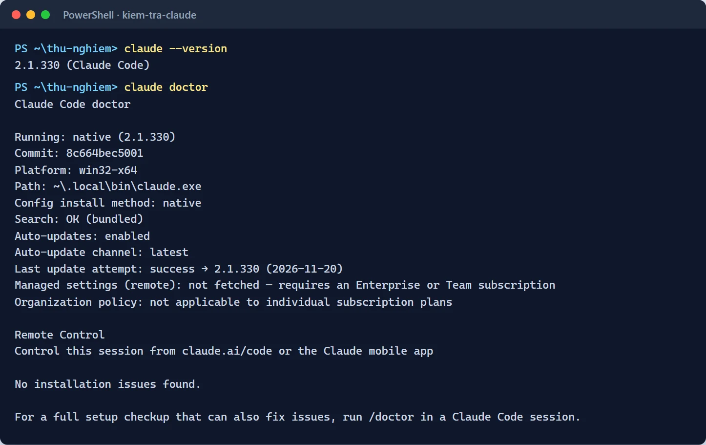
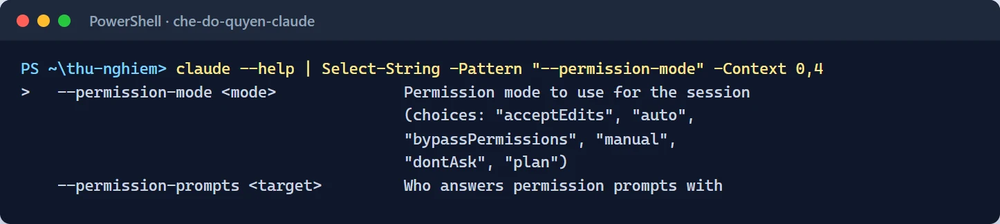

# Bài 1. Cài đặt Claude Code

!!! info "Bài này"
    - **Bạn làm gì:** cài Claude Code, đăng nhập, kiểm tra chạy được, biết cách xin quyền và cách thoát.
    - **Mất bao lâu:** khoảng 15 phút, phần lớn là chờ tải và đăng nhập trên trình duyệt **[Đề xuất]** (ước tính, chúng tôi chưa đo trên máy mới).
    - **Cần có:** máy Windows 10 (bản 1809 trở lên), macOS 13 trở lên hoặc Linux; internet; một tài khoản Claude đủ điều kiện (xem Bước 1). Chưa biết mở cửa sổ dòng lệnh? Đọc nhanh [bài 3](cap-02-lam-quen-cua-so-dong-lenh.md) trước.
    - **Kết quả:** lệnh `claude --version` in ra số phiên bản, và lệnh `claude` mở được khung chat của agent.

> Máy của chúng tôi đã cài sẵn và đang đăng nhập, nên chúng tôi **không cài lại, không đăng nhập lại**. Các bước cài và đăng nhập dưới đây lấy từ tài liệu chính thức, gắn nhãn **[Nguồn]** và ngày đọc 2026-11-21. Phần "kiểm tra" là kết quả chạy thật trên máy chúng tôi (Windows 10). Chỗ nào chưa kiểm, bài ghi rõ "chưa kiểm".

## Claude Code là gì, trong một phút

**Agent** là chương trình AI tự đọc file, viết file và chạy lệnh trên máy bạn để làm xong một việc. **Claude Code** là một agent như vậy, do Anthropic làm, chạy trong cửa sổ dòng lệnh (khung chữ đen, gõ lệnh, không bấm chuột). Bạn mở nó trong **một thư mục**, gõ việc cần làm bằng tiếng Việt thường, nó làm trong thư mục đó và **hỏi xin phép** trước những việc nhạy cảm.

Cả chuỗi bài thực hành sau này đều dùng một agent như thế. Bài này chỉ làm một việc: đưa nó lên máy bạn và chạy được.

## Các bước làm

### Bước 1. Kiểm tra máy và tài khoản

**[Nguồn]** Trang [Advanced setup](https://code.claude.com/docs/en/setup) (đọc 2026-11-21) nêu yêu cầu:

| Mục | Yêu cầu theo tài liệu |
|---|---|
| Hệ điều hành | Windows 10 bản 1809 trở lên (hoặc Windows Server 2019+), macOS 13.0+, Ubuntu 20.04+, Debian 10+, Alpine 3.19+ |
| Máy | RAM từ 4 GB, bộ xử lý x64 hoặc ARM64 |
| Mạng | Cần internet |
| Vị trí | Nằm trong [các quốc gia Anthropic hỗ trợ](https://www.anthropic.com/supported-countries) |
| Git cho Windows | Không bắt buộc. Có thì Claude Code dùng Git Bash; không có thì dùng PowerShell |

**Tài khoản.** **[Nguồn]** Claude Code cần một tài khoản gói Pro, Max, Ultra, Team, Enterprise hoặc tài khoản Claude Console. **Gói miễn phí của claude.ai không gồm Claude Code.** Cũng có thể dùng qua Amazon Bedrock, Google Cloud hoặc Microsoft Foundry nếu công ty bạn có sẵn.

!!! warning "Giá và hạn mức"
    Bài này không ghi giá hay hạn mức dùng, vì chúng đổi theo thời gian. Xem bảng giá chính thức trước khi đăng ký: https://claude.com/pricing (chúng tôi không đọc trang này khi soạn bài).

### Bước 2. Mở PowerShell

Trên Windows, nhấn `Win + X` rồi chọn **Windows PowerShell** (hoặc **Terminal**). **[Nguồn]** [Terminal guide](https://code.claude.com/docs/en/terminal-guide). Cửa sổ hiện dòng bắt đầu bằng `PS C:\...>`. Nếu dòng chỉ bắt đầu bằng `C:\...>` (không có `PS`) thì bạn đang ở CMD, một chương trình khác dùng lệnh khác: đóng đi và mở lại PowerShell.

macOS: nhấn `Cmd + Space`, gõ `Terminal`, nhấn `Enter`. Linux: thường là `Ctrl + Alt + T`.

### Bước 3. Dán lệnh cài

Windows PowerShell:

```lenh
irm https://claude.ai/install.ps1 | iex
```

`irm` tải về nội dung từ địa chỉ trên, `iex` chạy nó. Đây là lệnh cài "native" mà tài liệu ghi là cách được khuyến nghị. macOS, Linux hoặc WSL:

```lenh
curl -fsSL https://claude.ai/install.sh | bash
```

!!! see "Bạn sẽ thấy"
    Lệnh **không hiện thanh tiến trình** khi đang tải, nên cứ để cửa sổ mở và chờ. Khi xong, **[Nguồn]** tài liệu nói bạn sẽ thấy dòng "Claude Code successfully installed!". Không cần quyền Administrator trên Windows. Chúng tôi chưa chạy lệnh này trên máy này (đã cài sẵn), nên chưa kiểm dòng chữ đó.

!!! warning "Chỉ dán lệnh cài từ trang chính thức"
    Lệnh trên tải một đoạn mã từ internet rồi **chạy ngay**. Chỉ dùng khi địa chỉ bắt đầu bằng `https://claude.ai/`. Đừng dán lệnh cài lấy từ bình luận, nhóm chat hay video không rõ nguồn. **[Đề xuất]**

Cách cài khác (CMD, Homebrew, WinGet, npm) nằm ở phần Đào sâu bên dưới.

### Bước 4. Mở cửa sổ mới và kiểm tra

Đóng cửa sổ PowerShell, **mở cái mới** (để máy nhận đường dẫn mới), rồi gõ:

```lenh
claude --version
```

Lệnh in số phiên bản. Tiếp theo, `claude doctor` kiểm sức khỏe cài đặt mà không mở phiên làm việc:

```lenh
claude doctor
```

```ketqua
2.1.330 (Claude Code)
```



*Kết quả thật của `claude --version` và `claude doctor` trên máy Windows của chúng tôi (bản dựng lại từ đầu ra thật, không phải ảnh chụp cửa sổ). Dấu `~` thay cho phần đầu đường dẫn có tên người dùng, đã che.*

!!! see "Bạn sẽ thấy"
    `claude --version` in một số kiểu `2.1.330 (Claude Code)`. **[Đo được]** Máy chúng tôi ra `2.1.330`, ngày 2026-11-21; số của bạn có thể mới hơn vì bản cài tự cập nhật. `claude doctor` kết thúc bằng dòng `No installation issues found.` khi mọi thứ ổn.

!!! stuck "Gặp lỗi?"
    Thấy "claude is not recognized" hoặc "command not found": thư mục cài chưa nằm trong PATH (danh sách nơi máy tìm chương trình). Đóng hẳn PowerShell, mở cửa sổ mới rồi thử lại. Vẫn lỗi thì xem bảng "Lỗi thường gặp" cuối bài.

### Bước 5. Mở Claude Code trong một thư mục riêng và đăng nhập

Tạo thư mục thử rồi mở Claude Code **trong đó** (đừng mở trong thư mục cá nhân như Desktop hay Documents):

```lenh
mkdir thu-claude
cd thu-claude
claude
```

`mkdir` tạo thư mục, `cd` đi vào, `claude` mở agent tại đó. Lần đầu, **[Nguồn]** Claude Code mở trình duyệt để bạn đăng nhập ([Authentication](https://code.claude.com/docs/en/authentication), đọc 2026-11-21):

- Đăng nhập bằng tài khoản Claude của bạn trên trình duyệt vừa mở.
- Trình duyệt không tự mở: nhấn `c` để chép địa chỉ đăng nhập rồi dán vào trình duyệt.
- Trình duyệt hiện một mã thay vì quay lại: dán mã vào dòng `Paste code here if prompted`.
- Xong, cửa sổ hiện `Login successful` và bảo bạn nhấn `Enter` để tiếp tục.

Muốn đổi tài khoản sau này: gõ `/login` trong khung chat. Muốn đăng xuất: gõ `/logout`.

!!! see "Bạn sẽ thấy"
    Một khung chat trong cửa sổ dòng lệnh, phía trên có tên phiên bản, mô hình đang dùng và thư mục làm việc **[Nguồn]**. Chúng tôi **chưa chụp màn hình đăng nhập** vì máy đã đăng nhập sẵn và chúng tôi không đăng xuất để thử. Màn hình của bạn có thể khác mô tả.

### Bước 6. Đọc câu xin quyền và thư mục tin cậy

Dán thử một việc chỉ đọc, không sửa gì:

```prompt
Thư mục này đang có file nào? Chỉ liệt kê, đừng tạo hay sửa gì.
```

Chưa chạy lại prompt này trong giao diện tương tác. Bạn nên biết trước ba điều **[Nguồn]** ([Permissions](https://code.claude.com/docs/en/permissions), [Permission modes](https://code.claude.com/docs/en/permission-modes), [Security](https://code.claude.com/docs/en/security), đọc 2026-11-21):

1. **Agent hỏi trước khi làm việc nhạy cảm.** Đọc file trong thư mục bạn mở thì không cần hỏi. Sửa file, chạy lệnh, truy cập mạng thì hỏi (ở chế độ thủ công). Khi hỏi, chọn **Yes** để cho phép một lần; có lựa chọn cho phép luôn các lần sau (chỉ chọn khi bạn chắc).
2. **Chế độ cấp quyền.** Nhấn `Shift + Tab` để đổi chế độ; dòng chân cửa sổ cho biết chế độ hiện tại.

| Chế độ (chữ ở chân cửa sổ) | Chạy không hỏi những gì |
|---|---|
| `manual mode on` | Đọc file trong thư mục bạn mở. Hỏi trước khi sửa file, chạy lệnh, dùng mạng |
| `accept edits on` | Thêm: sửa file và vài lệnh file thông dụng (`mkdir`, `cp`, `mv`...) trong thư mục làm việc |
| `plan mode on` | Chỉ đọc và lập kế hoạch; chưa sửa gì cho đến khi bạn duyệt |
| `auto mode on` | Mọi việc, nhưng một mô hình khác duyệt từng hành động thay bạn |



*Đầu ra thật của `claude --help` trên máy chúng tôi: tùy chọn `--permission-mode` liệt kê đúng sáu tên chế độ (bản dựng lại từ đầu ra thật, không phải ảnh chụp cửa sổ).*

3. **Chế độ khởi động.** Với bản 2.1.283 trở lên, tài liệu ghi terminal khởi động ở chế độ `auto` (một mô hình duyệt thay bạn, bạn sẽ ít thấy câu hỏi hơn). Khi học, nên nhấn `Shift + Tab` về chế độ thủ công để tự đọc từng câu xin quyền.

**Thư mục tin cậy.** Lần đầu mở trong một thư mục chưa tin, Claude Code hiện hộp hỏi có tin thư mục đó không. Chỉ đồng ý cho thư mục bạn tạo để làm việc. Mở trực tiếp trong thư mục gốc của người dùng thì lựa chọn "tin" chỉ nhớ trong phiên đó; hãy bắt đầu từ một thư mục con. Chúng tôi chưa kiểm chữ chính xác của hộp hỏi này trên màn hình.

!!! warning "Hàng rào chỉ là câu hỏi, không phải tường"
    **[Nguồn]** Ranh giới "chỉ làm trong thư mục bạn mở" là một câu hỏi xin phép. Một lệnh chạy bạn đã đồng ý vẫn có thể ghi ra bất cứ đâu tài khoản Windows của bạn ghi được. Vì vậy: dùng thư mục riêng và đọc kỹ từng câu xin quyền (bài 4).

### Bước 7. Thoát

**[Nguồn]** Gõ `/exit`, hoặc nhấn `Ctrl + D` hai lần khi ô gõ đang trống. Nhấn `Esc` để ngắt agent đang làm dở mà chưa thoát. Gõ `/help` để xem các lệnh. Sau khi thoát, bạn quay về dòng `PS ...>`.

!!! see "Bạn sẽ thấy"
    Khung chat biến mất, dòng `PS ...>` hiện lại. Chúng tôi chưa thử phím thoát trong giao diện tương tác (môi trường soạn bài chạy không có bàn phím), nên phần này theo tài liệu.

## Lỗi thường gặp

| Triệu chứng | Cách xử lý |
|---|---|
| `'irm' is not recognized` | Bạn đang ở CMD. Mở PowerShell (`Win + X`), hoặc dùng lệnh CMD ở phần Đào sâu **[Nguồn]** |
| `The token '&&' is not a valid statement separator` | Bạn dán lệnh CMD vào PowerShell. Dùng lệnh `irm` ở Bước 3 **[Nguồn]** |
| `claude is not recognized` sau khi cài | Mở cửa sổ mới. Vẫn lỗi: chạy hai dòng sau trong PowerShell, đóng và mở lại cửa sổ **[Nguồn]** |
| Lỗi SSL/TLS (`Could not create SSL/TLS secure channel`) | Thường gặp trên Windows 10 cũ. Chạy một lần `[Net.ServicePointManager]::SecurityProtocol = [Net.SecurityProtocolType]::Tls12` rồi cài lại **[Nguồn]** |
| Báo cần Git for Windows hoặc PowerShell | Máy thiếu cả hai. Bảo đảm `powershell.exe` nằm trong PATH, hoặc cài Git for Windows **[Nguồn]** |
| Trang trả về HTML hoặc "App unavailable in region" | Cài từ nơi không nằm trong danh sách quốc gia hỗ trợ **[Nguồn]** |
| Trình duyệt không mở khi đăng nhập | Nhấn `c` để chép địa chỉ, dán vào trình duyệt **[Nguồn]** |
| Đăng nhập hết hạn | Gõ `/login` trong khung chat **[Nguồn]** |

Hai dòng thêm PATH cho `claude` (Windows PowerShell, **[Nguồn]**):

```lenh
$currentPath = [Environment]::GetEnvironmentVariable('PATH', 'User')
[Environment]::SetEnvironmentVariable('PATH', "$currentPath;$env:USERPROFILE\.local\bin", 'User')
```

## Đào sâu: các cách cài khác và điều chúng tôi đã kiểm

Mọi lệnh dưới đây là **[Nguồn]** ([Advanced setup](https://code.claude.com/docs/en/setup), đọc 2026-11-21), chúng tôi chưa chạy trên máy này.

| Cách | Lệnh |
|---|---|
| Windows CMD | `curl -fsSL https://claude.ai/install.cmd -o install.cmd && install.cmd && del install.cmd` |
| Homebrew (macOS) | `brew install --cask claude-code` (không tự cập nhật; cập nhật bằng `brew upgrade claude-code`) |
| WinGet (Windows) | `winget install Anthropic.ClaudeCode` (không tự cập nhật; cập nhật bằng `winget upgrade Anthropic.ClaudeCode`) |
| npm | `npm install -g @anthropic-ai/claude-code@latest`, cần Node.js 22 trở lên; tài liệu dặn không dùng `sudo` |
| Linux (apt, dnf, apk) | Có kho gói có chữ ký; xem phần "Install with Linux package managers" của trang trên |

Bản cài "native" tự cập nhật nền. Cập nhật tay: `claude update`. Gỡ cài (Windows PowerShell, native): xóa `claude.exe` trong `.local\bin` và thư mục `.local\share\claude` của thư mục người dùng.

**Đã kiểm trên máy này (Windows 10, 2026-11-21):** `claude --version` ra `2.1.330 (Claude Code)`; `claude doctor` ghi `Running: native`, `Platform: win32-x64`, `Search: OK (bundled)`, `Auto-updates: enabled`, `Auto-update channel: latest`, `No installation issues found.`; `claude --help` có các lệnh con `doctor`, `update`, `install`, `auth` (login, logout, status) và các tùy chọn `-p` (chạy một lần rồi thoát), `--permission-mode`.

**Chưa kiểm:** chạy lệnh cài từ đầu trên máy sạch; màn hình đăng nhập lần đầu; chữ chính xác của hộp "tin thư mục" và của câu xin quyền; phím thoát trong giao diện; cài trên macOS/Linux thật.

## Checklist cuối bài 1

- [ ] `claude --version` in ra số phiên bản trong cửa sổ PowerShell mới.
- [ ] `claude doctor` không báo vấn đề cài đặt.
- [ ] Đã đăng nhập, mở được khung chat trong thư mục `thu-claude`.
- [ ] Biết nhấn `Shift + Tab` đổi chế độ và đọc chế độ hiện tại.
- [ ] Biết thoát bằng `/exit` hoặc `Ctrl + D` hai lần.

## Việc cần người làm

- Chọn tài khoản trả phí (gói nào, ai trả) **trước khi** cài. Bài này không quyết thay bạn.
- Máy công ty: hỏi người phụ trách CNTT trước khi cài và đăng nhập bằng tài khoản nào **[Đề xuất]**.
- Quyết định thư mục nào được phép mở agent. Bắt đầu từ thư mục thử, không phải thư mục chứa dữ liệu thật.

## Giới hạn

- Chúng tôi chỉ chạy được trên Windows 10. Phần macOS và Linux lấy từ tài liệu, chưa chạy thật.
- Bài chưa có ảnh màn hình đăng nhập, hộp tin cậy thư mục và câu xin quyền thật, vì máy đã đăng nhập sẵn và môi trường soạn bài không có bàn phím tương tác.
- Tên chế độ, chữ ở chân cửa sổ và chế độ khởi động theo tài liệu ngày 2026-11-21; bản mới có thể đổi.
- Giá và hạn mức không có trong bài.
