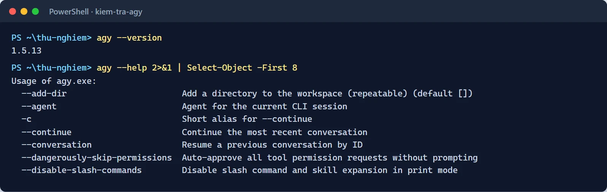
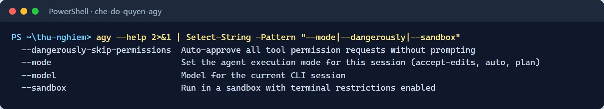

# Bài 2. Cài đặt Antigravity CLI (lệnh agy)

!!! info "Bài này"
    - **Bạn làm gì:** cài Antigravity CLI của Google (lệnh `agy`), đăng nhập, kiểm tra chạy được, biết cách thoát và đọc câu xin quyền. Bài cũng cảnh báo cờ `--dangerously-skip-permissions`.
    - **Mất bao lâu:** khoảng 15 phút **[Đề xuất]** (ước tính, chưa đo trên máy mới).
    - **Cần có:** một tài khoản Google đủ điều kiện dùng Antigravity (Bước 1), internet, một cửa sổ PowerShell ([bài 3](cap-02-lam-quen-cua-so-dong-lenh.md) hướng dẫn mở). Chỉ cần **một** trong hai agent: nếu đã xong [bài 1](cap-00-cai-dat-claude-code.md) và hài lòng, bạn có thể bỏ qua bài này.
    - **Kết quả:** `agy --version` in ra số phiên bản, và lệnh `agy` mở được khung chat của agent.

> Máy của chúng tôi đã cài sẵn `agy` và đang đăng nhập, nên chúng tôi **không cài lại, không đăng nhập lại**. Các bước cài và đăng nhập lấy từ tài liệu chính thức của Google, gắn nhãn **[Nguồn]** và ngày đọc 2026-11-21. Phần kiểm tra là kết quả chạy thật (Windows 10). Chỗ nào chưa kiểm, bài ghi "chưa kiểm".

## Antigravity CLI là gì, trong một phút

Cũng là một **agent** (chương trình AI tự đọc file, viết file và chạy lệnh), do Google làm, chạy trong cửa sổ dòng lệnh. Lệnh mở nó là `agy`. Cách dùng giống Claude Code: mở trong một thư mục, giao việc bằng tiếng Việt, nó xin phép trước việc nhạy cảm. Trong chuỗi bài này chúng tôi chạy cả hai agent trên cùng một việc để so sánh.

## Các bước làm

### Bước 1. Kiểm tra tài khoản và máy

**[Nguồn]** Theo trang [Authenticate](https://antigravity.google/docs/install?tab=cli) (đọc 2026-11-21):

- Tài khoản cá nhân: đăng nhập bằng **tài khoản Google** thuộc gói **Free, Pro hoặc Ultra** của Antigravity. Trang không ghi giá hay hạn mức nên bài này cũng không ghi.
- Tài khoản Google Workspace: trang ghi rõ "Google Workspace plans don't include Antigravity plans" (gói Workspace không gồm gói Antigravity).
- Doanh nghiệp: chọn Business Account, dùng Google Cloud, rồi chọn thuê bao hoặc trả theo lượng dùng.
- Cũng có cách dùng khóa Gemini API; bài này không đi theo cách đó.

**Yêu cầu hệ thống cho CLI:** chúng tôi **không tìm thấy** trang nào của Google nêu yêu cầu hệ điều hành hay cấu hình riêng cho CLI (trang [Getting started](https://antigravity.google/docs/getting-started) chỉ nêu yêu cầu cho ứng dụng và IDE). Chưa kiểm.

!!! warning "Hạn mức dùng"
    Chúng tôi chưa tìm được con số hạn mức của từng gói trong tài liệu chính thức nên không nêu. Xem trên trang gói của Google trước khi dùng cho việc lớn.

### Bước 2. Mở PowerShell

`Win + X`, chọn **Windows PowerShell** (hoặc **Terminal**). Dòng bắt đầu bằng `PS C:\...>` nghĩa là bạn đang ở PowerShell. Chi tiết và cách mở trên macOS, Linux xem [bài 3](cap-02-lam-quen-cua-so-dong-lenh.md).

### Bước 3. Dán lệnh cài

**[Nguồn]** [Getting started](https://antigravity.google/docs/getting-started), Windows PowerShell:

```lenh
irm https://antigravity.google/cli/install.ps1 | iex
```

macOS hoặc Linux:

```lenh
curl -fsSL https://antigravity.google/cli/install.sh | bash
```

Trang cũng có bản cho CMD (xem Đào sâu). **[Nguồn]** Trên Windows, chương trình `agy` được đặt ở thư mục `AppData\Local\agy\bin` trong thư mục người dùng; trên macOS, Linux ở `~/.local/bin/agy`. Trang không nhắc tới `winget`, nên chúng tôi không hướng dẫn cách đó.

!!! see "Bạn sẽ thấy"
    Trình cài chạy và đặt `agy` vào máy. Chúng tôi chưa chạy lệnh này (đã cài sẵn) nên chưa kiểm dòng thông báo cuối cùng. Chạy xong, **mở cửa sổ PowerShell mới** rồi sang Bước 4.

!!! warning "Chỉ dán lệnh cài từ trang chính thức"
    Lệnh trên tải mã từ internet rồi chạy ngay. Chỉ dùng khi địa chỉ bắt đầu bằng `https://antigravity.google/`. **[Đề xuất]**

### Bước 4. Kiểm tra chạy được

```lenh
agy --version
```

`agy --help` liệt kê các tùy chọn (rất dài; ảnh dưới chỉ lấy 8 dòng đầu):

```lenh
agy --help
```

```ketqua
1.5.13
```



*Kết quả thật trên máy chúng tôi (bản dựng lại từ đầu ra thật, không phải ảnh chụp cửa sổ). Ảnh dùng thêm `2>&1 | Select-Object -First 8` để chỉ lấy 8 dòng đầu của phần trợ giúp.*

!!! see "Bạn sẽ thấy"
    **[Đo được]** `agy --version` ra `1.5.13` trên máy chúng tôi, ngày 2026-11-21. Trang Getting started ghi CLI là "v1.2+" nên số của bạn có thể khác. Danh sách tùy chọn có `--mode`, `-p`, `--dangerously-skip-permissions`; danh sách lệnh con có `update`, `install`, `models`.

!!! stuck "Gặp lỗi?"
    "agy is not recognized": mở cửa sổ mới. Vẫn lỗi: lệnh `agy install` (có trong `agy --help`) có nhiệm vụ "cấu hình đường dẫn và hồ sơ shell" của máy; xem Lỗi thường gặp.

### Bước 5. Mở trong thư mục riêng và đăng nhập lần đầu

```lenh
mkdir thu-agy
cd thu-agy
agy
```

`mkdir` tạo thư mục, `cd` đi vào, `agy` mở agent tại đó. **[Nguồn]** Lần đầu mở, màn hình thiết lập hỏi ba thứ: bảng màu, kiểu hiển thị (**Alt-Screen**: toàn màn hình; **Inline**: kết quả nằm trong lịch sử cửa sổ), và có tin thư mục này (workspace trust) không. Hãy chọn tin **chỉ** thư mục `thu-agy`.

Đăng nhập **[Nguồn]** ([Authenticate](https://antigravity.google/docs/install?tab=cli)):

- Máy bạn: `agy` tìm phiên đã lưu trong kho khóa của hệ điều hành; có thì vào luôn không mở trình duyệt. Chưa có thì mở trình duyệt mặc định để bạn đăng nhập Google.
- Qua SSH (máy từ xa): không mở được trình duyệt, nên `agy` in một địa chỉ để bạn mở trên máy mình, đăng nhập, rồi dán mã trả về vào cửa sổ.
- Đăng xuất: gõ `/logout` trong khung chat để xóa thông tin đăng nhập.

!!! see "Bạn sẽ thấy"
    Một khung chat trong cửa sổ dòng lệnh. Chúng tôi **chưa chụp màn hình thiết lập và đăng nhập** vì máy đã đăng nhập sẵn. Giao diện thật của bạn có thể khác mô tả.

### Bước 6. Đọc câu xin quyền

Dán thử một việc chỉ đọc:

```prompt
Thư mục này đang có file nào? Chỉ liệt kê, đừng tạo hay sửa gì.
```

Chưa chạy lại prompt này trong giao diện tương tác. Điều bạn cần biết, **[Nguồn]** ([Modes](https://antigravity.google/docs/cli/modes.md), [Permissions](https://antigravity.google/docs/permissions), [Using the CLI](https://antigravity.google/docs/cli/using), đọc 2026-11-21):

| Chế độ | Hành vi |
|---|---|
| `default` | Dừng để bạn xem thay đổi trước khi sửa hoặc tạo file, và hỏi trước khi chạy lệnh |
| `accept-edits` | Tự duyệt việc tạo và sửa file trong thư mục làm việc, vẫn hỏi trước khi chạy lệnh |
| `auto` | Tự duyệt sửa file, chạy lệnh trong "hộp cát" (sandbox) |
| `plan` | Lập kế hoạch trước khi viết code |

- Đổi chế độ: nhấn `Shift + Tab` (xoay vòng `default`, `accept-edits`, `auto`, `plan`) hoặc mở bằng `agy --mode=accept-edits`.
- `auto` cần sandbox của terminal. Trang Modes ghi: trên Windows, sandbox cần **Windows 11 24H2 trở lên** (kèm bản cập nhật tháng 8/2026), và `auto` chưa có cho tài khoản doanh nghiệp. Khi `auto` không dùng được, `agy` chạy ở `default`. Máy của chúng tôi là Windows 10, nên theo tài liệu thì ở `default`; chúng tôi chưa kiểm trên giao diện.
- Câu xin quyền hiện thành một "thẻ" trong cửa sổ. Với lệnh chạy: nhấn `y` để chấp nhận, `n` để từ chối; `Ctrl + G` mở rộng câu lệnh để bạn sửa trước khi duyệt.
- Một thay đổi file đang chờ **nằm đó cho tới khi bạn chấp nhận hoặc từ chối**; `Esc` không bỏ qua nó.
- Thư mục dự án đang mở: đọc và ghi file trong đó tự động được phép; đường dẫn khác mặc định hỏi.

### Bước 7. Thoát

**[Nguồn]** Gõ `/exit`, hoặc nhấn `Ctrl + D`; `Ctrl + C` nhấn hai lần cũng thoát. Một lần `Ctrl + C` chỉ ngắt lượt agent đang chạy; `Esc` dừng dòng chữ đang hiện. Gõ `?` để xem các lệnh.

!!! see "Bạn sẽ thấy"
    Khung chat biến mất và dòng `PS ...>` hiện lại. Phím thoát chúng tôi chưa thử trong giao diện tương tác; phần này theo tài liệu.

## Cảnh báo: cờ `--dangerously-skip-permissions`

**[Đo được]** `agy --help` trên máy chúng tôi mô tả cờ này là "Auto-approve all tool permission requests without prompting" (tự duyệt mọi yêu cầu xin quyền, không hỏi). **[Nguồn]** Trang [Agent settings](https://antigravity.google/docs/agent-settings.md) cho biết cờ này bật chế độ `always-proceed`: chạy mọi công cụ không hỏi, và nó đè lên chế độ `auto`.



*Đầu ra thật của `agy --help` trên máy chúng tôi, chỉ giữ các dòng về chế độ và quyền (bản dựng lại từ đầu ra thật, không phải ảnh chụp cửa sổ).*

Nói cách khác, bật cờ này nghĩa là agent chạy lệnh **trên máy bạn, với quyền tài khoản của bạn, không hỏi**.

!!! warning "Chỉ dùng khi đủ cả bốn điều kiện"
    1. Trong **thư mục riêng** chỉ chứa thứ bạn sẵn sàng mất.
    2. Với **dữ liệu giả**, không có dữ liệu khách hàng, mật khẩu, khóa truy cập.
    3. **Không** để file đáp án hay bí mật cạnh đó. **[Đo được]** Trong một bài toán khác của chuỗi này, một lần chạy Antigravity đã tự đi mở file đáp án nằm ngoài thư mục làm việc. Ở bài 4 nhóm này, một lần chạy cũng chạy `git status`, việc mà prompt không yêu cầu (lệnh báo không có kho git, không hại gì; n=1).
    4. Không bật làm thói quen. Với việc thật, để agent hỏi và bạn đọc từng câu.

Tài liệu của Google không kèm cảnh báo riêng cho cờ này, và **chưa nói** cờ có đè lên quy tắc cấm (deny) bạn đặt hay không. Chúng tôi chưa kiểm điều đó, nên đừng dựa vào quy tắc cấm để bảo vệ khi dùng cờ. Để tham khảo, tài liệu bảo mật của Claude Code về chế độ bỏ qua quyền (`bypassPermissions`) dặn chỉ dùng trong môi trường cô lập như máy ảo hoặc container không có internet **[Nguồn]** ([Permission modes](https://code.claude.com/docs/en/permission-modes)).

## Lỗi thường gặp

| Triệu chứng | Cách xử lý |
|---|---|
| `agy is not recognized` sau khi cài | Mở cửa sổ PowerShell mới. Vẫn lỗi: `agy install` cấu hình đường dẫn; cờ `--skip-path` của nó thì tắt việc này (xem `agy install --help`) |
| Đăng nhập Workspace không được | Tài liệu ghi gói Workspace không gồm gói Antigravity; dùng tài khoản Google cá nhân hoặc đường doanh nghiệp (Business Account) **[Nguồn]** |
| Đang ở SSH, trình duyệt không mở | Mở địa chỉ `agy` in ra trên máy bạn, dán mã trả về vào cửa sổ **[Nguồn]** |
| Chọn `auto` mà vẫn thấy hỏi | `auto` cần sandbox; nếu không có thì chạy `default` **[Nguồn]** |
| Thay đổi file "treo", `Esc` không tắt | Phải chấp nhận hoặc từ chối thay đổi đó **[Nguồn]** |
| Lệnh cập nhật | `agy update` (có trong `agy --help`) **[Đo được]** |

## Đào sâu: cách cài khác và điều chúng tôi đã kiểm

Windows CMD **[Nguồn]** ([Getting started](https://antigravity.google/docs/getting-started), đọc 2026-11-21), chưa chạy trên máy này:

```lenh
curl -fsSL https://antigravity.google/cli/install.cmd -o install.cmd && install.cmd && del install.cmd
```

Lệnh `agy install` có hai cờ: `--skip-aliases` (bỏ qua việc dọn bí danh trong hồ sơ shell) và `--skip-path` (bỏ qua việc thêm vào PATH) **[Đo được]** từ `agy install --help`.

`agy models` liệt kê các mô hình dùng được cho tài khoản của bạn **[Đo được]**; danh sách phụ thuộc tài khoản nên bài không chép lại.

Chạy không tương tác (cách chúng tôi dùng để ghi log ở bài 4): `agy -p "<việc cần làm>"` chạy một lượt rồi thoát; cờ `--output-format stream-json` ghi từng sự kiện thành một dòng JSON.

**Đã kiểm trên máy này (Windows 10, 2026-11-21):** `agy --version` ra `1.5.13`; `agy --help` có các cờ `--mode`, `-p`, `--sandbox`, `--dangerously-skip-permissions` và các lệnh con `update`, `install`, `models`, `plugin`, `mcp`.

**Chưa kiểm:** chạy trình cài từ đầu; màn hình thiết lập và đăng nhập lần đầu; chữ chính xác của câu xin quyền; phím thoát trong giao diện; cài trên macOS/Linux thật; hạn mức dùng theo gói.

## Checklist cuối bài 2

- [ ] `agy --version` in ra số phiên bản trong cửa sổ PowerShell mới.
- [ ] Đã đăng nhập bằng tài khoản Google được phép, mở được khung chat trong thư mục `thu-agy`.
- [ ] Biết nhấn `Shift + Tab` đổi chế độ.
- [ ] Biết thoát bằng `/exit` hoặc `Ctrl + D`.
- [ ] Hiểu vì sao không dùng `--dangerously-skip-permissions` cho việc thật.

## Việc cần người làm

- Quyết định tài khoản Google nào dùng (cá nhân hay doanh nghiệp) và gói nào, **trước** khi cài.
- Máy công ty: hỏi người phụ trách CNTT trước khi cài và đăng nhập **[Đề xuất]**.
- Đặt quy tắc nhóm: ai được phép dùng cờ bỏ qua xin quyền, và chỉ trong thư mục nào.

## Giới hạn

- Chúng tôi chỉ chạy được trên Windows 10. macOS và Linux lấy từ tài liệu.
- Không tìm thấy yêu cầu hệ thống cho CLI, giá và hạn mức trong tài liệu chính thức; bài không nêu.
- Chưa có ảnh màn hình thiết lập, đăng nhập, câu xin quyền thật; chữ giao diện của bạn có thể khác.
- Số phiên bản và tên chế độ theo tài liệu ngày 2026-11-21; bản mới có thể đổi.
