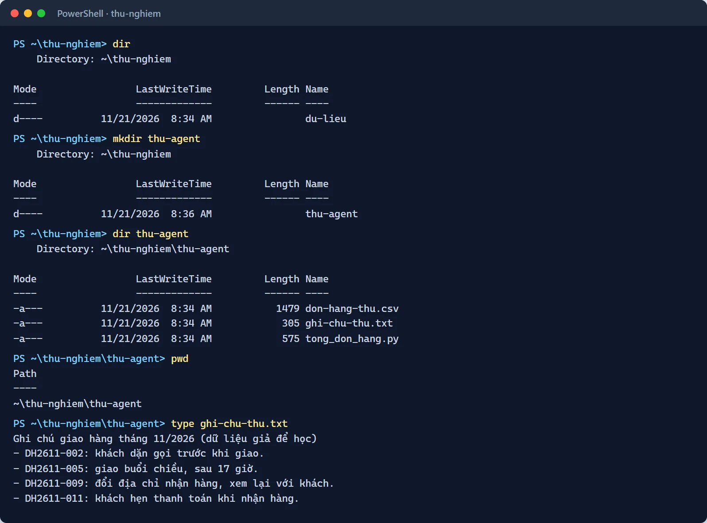
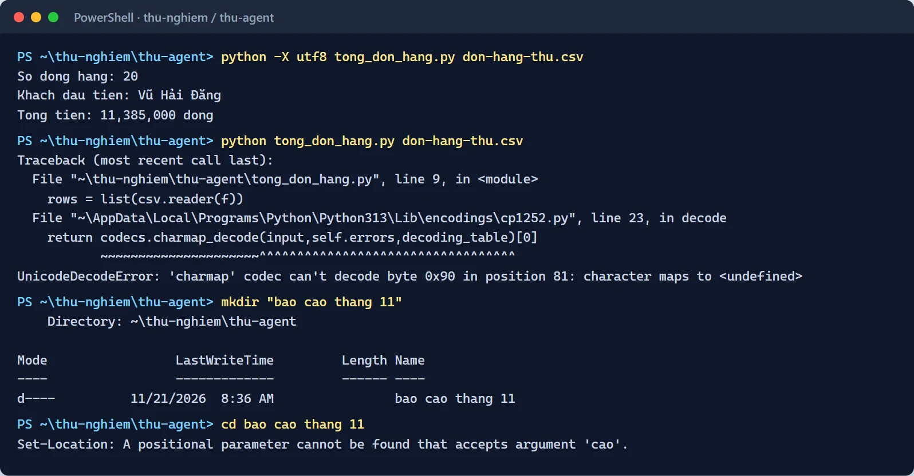

# Bài 3. Làm quen với cửa sổ dòng lệnh

!!! info "Bài này"
    - **Bạn làm gì:** mở cửa sổ dòng lệnh (PowerShell), biết mình đang ở thư mục nào, đi vào thư mục, xem file, tạo thư mục, chép file, chạy một script Python, dán lệnh và dừng lệnh.
    - **Mất bao lâu:** khoảng 30 phút nếu gõ từng lệnh theo bài.
    - **Cần có:** máy Windows (bài làm trên PowerShell; có bảng tương đương cho macOS, Linux), Python 3 đã cài, và [du-lieu.zip](du-lieu.zip) (2 file dữ liệu giả và 1 script nhỏ).
    - **Kết quả:** bạn đọc được dòng `PS ...>`, tự tạo thư mục thử `thu-agent` có 3 file bên trong và chạy được `python -X utf8` mà không lỗi tiếng Việt. Đó là mọi thứ bạn cần để mở agent ở [bài 4](cap-03-giao-viec-dau-tien-va-an-toan.md).

> Mọi đầu ra ở bài này là **kết quả chạy thật** của chúng tôi trên Windows 10 (PowerShell 7; các lệnh cũng chạy trong Windows PowerShell 5.1 có sẵn của Windows). Dữ liệu trong `du-lieu.zip` là **giả**: tên khách, sản phẩm, giá đều bịa. Đường dẫn đầy đủ trên máy bạn dài hơn và có tên người dùng của bạn; trong bài chúng tôi viết `…` hoặc `~` thay cho phần đầu đó.

## Vì sao cần học cái này

Agent chạy trong cửa sổ dòng lệnh và làm việc **trong thư mục bạn đang đứng**. Bạn không cần thuộc nhiều lệnh. Bạn cần biết: đang đứng ở đâu, đi sang thư mục khác thế nào, tạo một thư mục riêng cho agent, và cách dán một đoạn chữ vào cửa sổ. Sáu lệnh dưới đây là đủ.

## Các bước làm

### Bước 1. Mở cửa sổ dòng lệnh

**[Nguồn]** ([Terminal guide](https://code.claude.com/docs/en/terminal-guide), đọc 2026-11-21):

- **Windows:** nhấn `Win + X`, chọn **Windows PowerShell** (hoặc **Terminal**).
- **macOS:** nhấn `Cmd + Space`, gõ `Terminal`, nhấn `Enter`.
- **Linux:** thường là `Ctrl + Alt + T`.

Cửa sổ có một con trỏ nhấp nháy: đó là nơi bạn gõ lệnh, nhấn `Enter` để chạy. Trên Windows, dòng nhắc `PS C:\...>` nghĩa là PowerShell. Dòng `C:\...>` không có `PS` là CMD, một chương trình khác dùng lệnh khác; bài này chỉ dùng PowerShell.

!!! see "Bạn sẽ thấy"
    Cửa sổ nền tối hoặc xanh, một dòng bắt đầu bằng `PS` và đường dẫn thư mục của bạn, rồi dấu `>`. Chữ sau dấu `>` là chỗ bạn gõ. Trong các ví dụ dưới đây, **dòng lệnh là phần bạn gõ**, khung "Kết quả mẫu" là phần máy in ra.

### Bước 2. Chuẩn bị thư mục thử

1. Tải [du-lieu.zip](du-lieu.zip).
2. Trong File Explorer, tạo thư mục tên `thu-nghiem` ngay trong thư mục người dùng của bạn (nơi PowerShell mở ra), rồi giải nén `du-lieu.zip` vào đó (chuột phải, **Extract All**). Bạn có `thu-nghiem\du-lieu\` với 3 file: `don-hang-thu.csv`, `ghi-chu-thu.txt`, `tong_don_hang.py`.
3. Trong PowerShell, đi vào `thu-nghiem`:

```lenh
cd thu-nghiem
```

`cd` (change directory) nghĩa là "đi vào thư mục". Lệnh này **không in gì** khi thành công; chỉ dòng nhắc đổi theo.

### Bước 3. Xem đang có gì: `dir` (hoặc `ls`)

```lenh
dir
```

`dir` liệt kê file và thư mục ở chỗ bạn đang đứng. Trong PowerShell, `ls` làm đúng việc đó.

```ketqua
    Directory: …\thu-nghiem

Mode                 LastWriteTime         Length Name
----                 -------------         ------ ----
d----          11/21/2026  8:34 AM                du-lieu
```

Cột `Mode` bắt đầu bằng `d` là thư mục (`du-lieu`); bắt đầu bằng `-a` là file. Ngày giờ và định dạng ngày trên máy bạn sẽ khác.

### Bước 4. Tạo thư mục và chép file: `mkdir`, `copy`

Mỗi lần giao việc cho agent, ta dùng **một thư mục riêng** chỉ chứa dữ liệu cần dùng. Tạo thư mục `thu-agent` rồi chép ba file vào:

```lenh
mkdir thu-agent
copy du-lieu\don-hang-thu.csv thu-agent\
copy du-lieu\ghi-chu-thu.txt thu-agent\
copy du-lieu\tong_don_hang.py thu-agent\
dir thu-agent
```

`mkdir` tạo thư mục; `copy` chép file (từ đâu, đến đâu); dấu `\` cuối `thu-agent\` nghĩa là "vào trong thư mục này".

```ketqua
    Directory: …\thu-nghiem

Mode                 LastWriteTime         Length Name
----                 -------------         ------ ----
d----          11/21/2026  8:36 AM                thu-agent

    Directory: …\thu-nghiem\thu-agent

Mode                 LastWriteTime         Length Name
----                 -------------         ------ ----
-a---          11/21/2026  8:34 AM           1479 don-hang-thu.csv
-a---          11/21/2026  8:34 AM            305 ghi-chu-thu.txt
-a---          11/21/2026  8:34 AM            575 tong_don_hang.py
```

Ba lệnh `copy` không in gì khi thành công. Muốn chắc, `dir thu-agent` phải liệt kê đủ 3 file như trên.

!!! stuck "Gặp lỗi?"
    "Cannot find path ... because it does not exist": bạn đang đứng sai thư mục, hoặc chưa giải nén `du-lieu`. Gõ `dir` để xem có thấy `du-lieu` không; nếu không, `cd` về `thu-nghiem`.

### Bước 5. Đi vào thư mục và xem file: `cd`, `pwd`, `type`

```lenh
cd thu-agent
pwd
type ghi-chu-thu.txt
```

`pwd` cho biết thư mục hiện tại (agent cũng làm việc ở đúng chỗ này). `type` in nội dung một file chữ ra cửa sổ. Muốn đi ngược ra thư mục cha: `cd ..`.

```ketqua
Path
----
…\thu-nghiem\thu-agent

Ghi chú giao hàng tháng 11/2026 (dữ liệu giả để học)
- DH2611-002: khách dặn gọi trước khi giao.
- DH2611-005: giao buổi chiều, sau 17 giờ.
- DH2611-009: đổi địa chỉ nhận hàng, xem lại với khách.
- DH2611-011: khách hẹn thanh toán khi nhận hàng.
```



*Các lệnh Bước 3 đến 5 chạy thật (bản dựng lại từ đầu ra thật, không phải ảnh chụp cửa sổ). Dấu `~` thay cho phần đầu đường dẫn có tên người dùng, đã che.*

!!! see "Bạn sẽ thấy"
    Dòng nhắc đổi thành `PS ...\thu-nghiem\thu-agent>`. Đó là dấu hiệu bạn đã ở trong thư mục `thu-agent`. Từ giờ, **mọi lệnh bạn gõ và mọi việc agent làm đều ở đây**.

### Bước 6. Chạy Python: `python -X utf8`

`tong_don_hang.py` là script nhỏ đọc `don-hang-thu.csv`, in số dòng hàng, tên khách đầu tiên và tổng tiền. Trước hết kiểm Python đã có chưa:

```lenh
python --version
```

```ketqua
Python 3.13.0
```

Số phiên bản của bạn có thể khác; miễn là Python 3. Nếu PowerShell báo không nhận ra `python`, bạn cần cài Python 3 trước (từ python.org); bài này không hướng dẫn chi tiết bước đó. Rồi chạy script:

```lenh
python -X utf8 tong_don_hang.py don-hang-thu.csv
```

`python` chạy chương trình Python; `-X utf8` bảo Python dùng bảng mã UTF-8 để đọc và ghi chữ (cần để tiếng Việt không lỗi trên Windows); `tong_don_hang.py` là script; `don-hang-thu.csv` là file đưa vào.

```ketqua
So dong hang: 20
Khach dau tien: Vũ Hải Đăng
Tong tien: 11,385,000 dong
```

Thử bỏ `-X utf8` để thấy vì sao cần nó:

```lenh
python tong_don_hang.py don-hang-thu.csv
```

```ketqua
Traceback (most recent call last):
  File "…\thu-agent\tong_don_hang.py", line 9, in <module>
    rows = list(csv.reader(f))
  File "…\Python313\Lib\encodings\cp1252.py", line 23, in decode
    return codecs.charmap_decode(input,self.errors,decoding_table)[0]
           ~~~~~~~~~~~~~~~~~~~~~^^^^^^^^^^^^^^^^^^^^^^^^^^^^^^^^^^
UnicodeDecodeError: 'charmap' codec can't decode byte 0x90 in position 81: character maps to <undefined>
```

(Phần đường dẫn đã rút gọn thành `…`.) **[Đo được]** Trên Windows của chúng tôi, Python mặc định đọc file bằng bảng mã cp1252 nên vỡ chữ Việt. Trong bài toán đối soát sao kê của chuỗi này, Claude Code cũng gặp lỗi mã hóa tương tự hai lần và tự sửa bằng cách thêm `-X utf8`.

### Bước 7. Đường dẫn có dấu cách

Tên thư mục có dấu cách (`bao cao thang 11`) phải **đặt trong ngoặc kép**, nếu không PowerShell hiểu mỗi từ là một thứ riêng:

```lenh
mkdir "bao cao thang 11"
cd bao cao thang 11
```

```ketqua
    Directory: …\thu-nghiem\thu-agent

Mode                 LastWriteTime         Length Name
----                 -------------         ------ ----
d----          11/21/2026  8:36 AM                bao cao thang 11

Set-Location: A positional parameter cannot be found that accepts argument 'cao'.
```

Lệnh `mkdir` có ngoặc kép thành công. Lệnh `cd` không có ngoặc kép báo lỗi, vì PowerShell đọc `bao`, `cao`, `thang`, `11` là bốn thứ rời nhau. Chữ thông báo lỗi có thể khác theo phiên bản và ngôn ngữ Windows. Gõ lại cho đúng và quay ra:

```lenh
cd "bao cao thang 11"
pwd
cd ..
```

```ketqua
Path
----
…\thu-nghiem\thu-agent\bao cao thang 11
```



*Bước 6 và 7 chạy thật (bản dựng lại từ đầu ra thật). Hai ảnh Bước 3 đến 7 lấy từ cùng một lần chạy.*

!!! tip "Mẹo tránh lỗi dấu cách"
    Đặt tên thư mục và file **không dấu, không dấu cách**, nối bằng gạch ngang (`bao-cao-thang-11`). Khi gặp đường dẫn có dấu cách mà không đổi tên được, luôn bọc trong ngoặc kép.

### Bước 8. Dán lệnh và dừng lệnh

- **Dán:** trong PowerShell dùng `Ctrl + V` hoặc bấm chuột phải. macOS: `Cmd + V`. Linux: `Ctrl + Shift + V` **[Nguồn]** ([Terminal guide](https://code.claude.com/docs/en/terminal-guide)). Dán xong **nhấn `Enter`** thì lệnh mới chạy.- **Dừng một lệnh đang chạy:** nhấn `Ctrl + C`. Chúng tôi chưa chụp được kết quả (môi trường soạn bài không gửi được phím), nên mô tả này là cách dùng thông thường của cửa sổ dòng lệnh, **chưa kiểm** trên máy chúng tôi.
- **Chạy lại lệnh cũ:** nhấn mũi tên lên (`↑`) để gọi lại lệnh trước, rồi `Enter` **[Nguồn]** (trang Quickstart của Claude Code nêu `↑` cho lịch sử lệnh).
- **Lưu ý:** trong cửa sổ dòng lệnh bạn **không bấm chuột để đặt con trỏ** được; dùng mũi tên trái/phải để sửa chữ đang gõ **[Nguồn]**.

!!! warning "Dán xong hãy đọc trước khi nhấn Enter"
    Lệnh dán vào cửa sổ chạy ngay khi nhấn `Enter`, với quyền tài khoản của bạn. Đừng dán lệnh bạn không hiểu, nhất là lệnh bắt đầu bằng `del`, `Remove-Item`, `format`, hoặc có `| iex` lấy từ nguồn lạ.

## Bảng tương đương cho macOS và Linux

Chúng tôi kiểm cú pháp các lệnh này bằng Git Bash trên Windows (cùng họ lệnh với macOS và Linux); **chưa chạy trên máy macOS hay Linux thật**.

| Việc | PowerShell (Windows) | macOS, Linux |
|---|---|---|
| Đang ở đâu | `pwd` | `pwd` |
| Liệt kê | `dir` hoặc `ls` | `ls` |
| Tạo thư mục | `mkdir thu-agent` | `mkdir thu-agent` |
| Chép file | `copy du-lieu\a.csv thu-agent\` | `cp du-lieu/a.csv thu-agent/` |
| Vào thư mục, ra | `cd thu-agent`, `cd ..` | `cd thu-agent`, `cd ..` |
| Xem file chữ | `type ghi-chu-thu.txt` | `cat ghi-chu-thu.txt` |
| Chạy Python | `python -X utf8 file.py` | `python3 -X utf8 file.py` (macOS, Linux thường dùng `python3`) |
| Dấu cách trong tên | `"bao cao"` | `"bao cao"` |

Chú ý: đường dẫn Windows dùng `\`, macOS và Linux dùng `/`.

## Lỗi thường gặp

| Triệu chứng | Cách xử lý |
|---|---|
| `Cannot find path ... does not exist` | Sai thư mục hoặc sai tên. `pwd` để biết đang ở đâu, `dir` để xem tên file |
| `python` không nhận ra | Chưa cài Python 3, hoặc cần mở cửa sổ mới sau khi cài |
| `UnicodeDecodeError` hoặc `UnicodeEncodeError` (cp1252) | Thêm `-X utf8` vào lệnh `python` |
| `A positional parameter cannot be found that accepts argument` | Đường dẫn có dấu cách mà thiếu ngoặc kép |
| Dán xong không thấy gì chạy | Chưa nhấn `Enter` |
| Gõ `copy` nhưng ra lỗi `Cannot find path` | Dùng dấu `\` (Windows). Dấu `/` là của macOS, Linux |
| Chữ Việt vỡ khi mở CSV bằng Excel | Mở bằng Notepad, hoặc Excel: *Data > From Text/CSV* và chọn UTF-8 |

## Đào sâu: vì sao `-X utf8`, và vì sao `copy` không in gì

Python 3 trên Windows, nếu không được dặn, đọc và ghi file bằng bảng mã mặc định của hệ điều hành (ở máy chúng tôi là cp1252). File CSV của chúng ta lưu bằng UTF-8, nên chữ có dấu thành byte mà cp1252 không giải mã được. Cờ `-X utf8` đổi mặc định sang UTF-8 cho cả lượt chạy. `tong_don_hang.py` cố ý dùng `open()` không ghi bảng mã để lỗi hiện ra; ở bài 4, script của cả hai agent đều tự ghi `encoding` khi đọc và ghi file, và prompt vẫn dặn `-X utf8` như lớp bảo hiểm thứ hai.

File `don-hang-thu.csv` lưu UTF-8 **có BOM** (3 byte đầu file) để Excel mở đúng chữ Việt. Nhiều script Python đọc BOM thành một ký tự lạ dính vào tên cột đầu. Ở bài 4 **[Đo được]** (n=1 mỗi agent): Claude Code kiểm file trước rồi đọc bằng `utf-8-sig`; Antigravity chạy script lần đầu gặp `KeyError: 'ma_don'`, tự soi các byte đầu file thấy BOM, rồi sửa script.

Nhiều lệnh dòng lệnh **im lặng khi thành công** (`cd`, `copy`, `mkdir` trong bash). Im lặng là bình thường; chỉ khi có lỗi mới có chữ.

Script sinh dữ liệu: `du-lieu/sinh_du_lieu_thu.py` (hạt giống cố định 20261121; chạy `python -X utf8 sinh_du_lieu_thu.py` trong thư mục `du-lieu` sẽ ghi lại đúng hai file dữ liệu cũ).

## Checklist cuối bài 3

- [ ] Mở được PowerShell và nhận ra dòng `PS ...>`.
- [ ] Gõ `pwd` và biết mình đang ở thư mục nào.
- [ ] Có thư mục `thu-agent` chứa đủ 3 file (xem bằng `dir thu-agent`).
- [ ] Chạy `python -X utf8 tong_don_hang.py don-hang-thu.csv` ra `So dong hang: 20` và `Tong tien: 11,385,000 dong`.
- [ ] Biết bọc đường dẫn có dấu cách trong ngoặc kép.
- [ ] Biết dán xong phải nhấn `Enter`, và biết `Ctrl + C` dùng để dừng.

## Việc cần người làm

- Chọn một chỗ cố định để làm bài (ví dụ thư mục `thu-nghiem` trong thư mục người dùng) và **không để dữ liệu thật** ở đó.
- Quyết định quy ước đặt tên thư mục của nhóm (không dấu, không dấu cách) **[Đề xuất]**.
- Máy công ty có thể chặn PowerShell hoặc Python: hỏi người phụ trách CNTT.

## Giới hạn

- Chỉ chạy được trên Windows 10. Cột macOS, Linux chỉ kiểm cú pháp bằng Git Bash, chưa chạy trên máy thật.
- Chưa kiểm phím `Ctrl + C` và mũi tên lên trên máy chúng tôi.
- Ngày giờ, định dạng ngày và chữ thông báo lỗi của PowerShell thay đổi theo ngôn ngữ và phiên bản Windows của bạn.
- Bài chỉ dạy sáu lệnh vừa đủ để làm bài 4; không thay thế một khóa học dòng lệnh.
