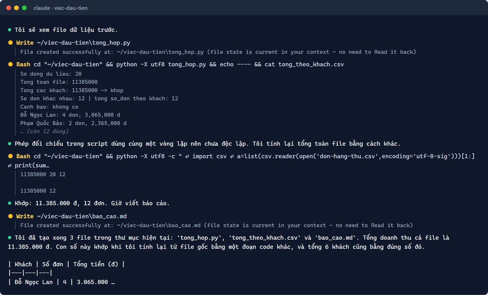
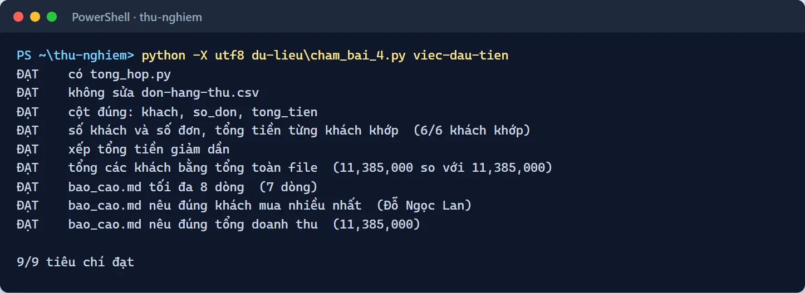

# Bài 4. Giao việc đầu tiên và quy tắc an toàn

!!! info "Bài này"
    - **Bạn làm gì:** tạo thư mục thử, đặt một file dữ liệu giả vào, mở agent và dán prompt 6 phần giao việc đầu tiên, đọc câu xin quyền, rồi chấm kết quả bằng một script.
    - **Mất bao lâu:** khoảng 25 phút làm theo bài. Agent chạy xong trong 1 đến 2 phút **[Đo được]** (n=1 mỗi agent: Claude Code 52,3 giây, Antigravity 116,1 giây).
    - **Cần có:** một agent đã cài và đăng nhập ([bài 2](cap-01-cai-dat-claude-code.md) hoặc [bài 3](cap-02-cai-dat-antigravity.md)), biết dùng `cd`, `mkdir`, `copy` ([bài 1](cap-00-lam-quen-cua-so-dong-lenh.md)), và [du-lieu.zip](du-lieu.zip).
    - **Kết quả:** một thư mục có `tong_hop.py`, `tong_theo_khach.csv`, `bao_cao.md`; bộ chấm báo đạt 9 trên 9 tiêu chí; và bạn nắm bộ quy tắc an toàn trước khi làm với dữ liệu của mình.

> Dữ liệu là **giả**: tên khách, sản phẩm, giá đều bịa, sinh bằng script có hạt giống cố định. Không có dữ liệu của doanh nghiệp thật.

## Việc đầu tiên trong một phút

Một shop nhỏ có file `don-hang-thu.csv`: 12 đơn tháng 11, tổng 20 dòng hàng, 6 khách. Mỗi dòng là **một món hàng** trong một đơn, nên một đơn có thể chiếm nhiều dòng. Chủ shop muốn biết: **mỗi khách mua mấy đơn và tổng bao nhiêu tiền**. Việc nhỏ, nhưng có hai chỗ dễ sai: đếm đơn (không phải đếm dòng) và cộng tiền. Phép cộng tiền do code làm, không để mô hình "tính nhẩm". Tên sản phẩm `Nồi cơm điện 1,8L` có dấu phẩy bên trong nên cắt chữ theo dấu phẩy sẽ sai; đọc bằng thư viện CSV thì đúng.

## Các bước làm

### Bước 1. Tạo thư mục thử, chỉ đặt một file vào

Giải nén `du-lieu.zip` ở nơi bạn làm bài (nếu chưa), rồi, trong PowerShell, đứng ở thư mục chứa `du-lieu\`:

!!! stuck "Vừa xong bài 1 và đang ở trong thư mục `thu-agent`, hoặc đang mở agent?"
    Thoát agent trước (cách thoát: bài 2 hoặc bài 3), rồi gõ `cd ..` để lên một cấp. Gõ `dir` kiểm tra: phải thấy thư mục `du-lieu`. Nếu thấy lỗi "Cannot find path", bạn đang đứng sai thư mục.

```lenh
mkdir viec-dau-tien
copy du-lieu\don-hang-thu.csv viec-dau-tien\
dir viec-dau-tien
```

`mkdir` tạo thư mục, `copy` chép đúng **một** file dữ liệu vào đó. macOS, Linux: `cp du-lieu/don-hang-thu.csv viec-dau-tien/`.

!!! see "Bạn sẽ thấy"
    `dir viec-dau-tien` chỉ liệt kê `don-hang-thu.csv`. Ngoài file này thư mục trống: đó là chủ ý.

!!! warning "Đừng để bộ chấm trong thư mục của agent"
    `du-lieu\cham_bai_4.py` là script chấm. Nó **không bao giờ** nằm trong `viec-dau-tien`. Agent chạy được lệnh liệt kê file; thấy bộ chấm hoặc đáp án thì bài kiểm vô nghĩa. Bộ chấm này tự tính đáp án từ file gốc, nên không có file đáp án nào để lộ, nhưng quy tắc vẫn đúng với mọi bài sau.

### Bước 2. Mở agent trong thư mục vừa tạo

```lenh
cd viec-dau-tien
claude
```

hoặc, nếu dùng Antigravity:

```lenh
cd viec-dau-tien
agy
```

`cd` đi vào thư mục, `claude` hoặc `agy` mở agent tại đó. Cách cài, đăng nhập, thoát: [bài 2](cap-01-cai-dat-claude-code.md) và [bài 3](cap-02-cai-dat-antigravity.md).

!!! see "Bạn sẽ thấy"
    Khung chat, chờ bạn gõ. Nếu agent hỏi có tin thư mục này không, chỉ đồng ý khi đúng là `viec-dau-tien`. Mở nhầm thư mục thì thoát agent rồi `cd` lại.

### Bước 3. Dán prompt giao việc đầu tiên

Bấm **Sao chép**, dán vào khung chat, nhấn `Enter`. Prompt có 6 phần: vai trò, bối cảnh, nhiệm vụ, các bước, định dạng ra, ràng buộc. Đây đúng là prompt chúng tôi đã chạy ở phần "Đo được" bên dưới.

```prompt
# 1. Vai trò
Bạn là trợ lý văn phòng cho một shop nhỏ bán đồ gia dụng. Bạn viết và chạy code Python để tính toán; bạn không tự tính nhẩm tiền.

# 2. Bối cảnh
Trong thư mục hiện tại có file don-hang-thu.csv: các đơn hàng tháng 11/2026 (dữ liệu giả để học). Cột: ma_don, ngay, khach, san_pham, so_luong, don_gia (đơn giá tính bằng đồng). Mỗi dòng là một món hàng trong một đơn, nên một đơn có thể có nhiều dòng. File mã hóa UTF-8, có tiếng Việt.

# 3. Nhiệm vụ
Cho biết mỗi khách đã mua bao nhiêu đơn và tổng cộng bao nhiêu tiền, rồi ghi ra một bảng và một báo cáo ngắn.

# 4. Các bước
1. Đọc don-hang-thu.csv bằng Python.
2. Viết script tong_hop.py: với mỗi khách, đếm số đơn khác nhau (theo ma_don) và cộng so_luong nhân don_gia của mọi dòng. Mọi phép tính do code làm.
3. Chạy bằng lệnh python -X utf8 tong_hop.py (để Windows không lỗi tiếng Việt).
4. Mở file kết quả ra đọc lại, đối chiếu tổng của các khách với tổng toàn file; nếu lệch thì sửa.

# 5. Định dạng ra (ghi vào thư mục hiện tại, UTF-8)
- tong_hop.py: script đã dùng.
- tong_theo_khach.csv: cột khach, so_don, tong_tien (số nguyên, đồng), xếp theo tong_tien giảm dần.
- bao_cao.md: tối đa 8 dòng: khách mua nhiều nhất, tổng doanh thu cả file, điều bạn không chắc.

# 6. Ràng buộc
- Chỉ đọc và ghi trong thư mục hiện tại.
- Không sửa file don-hang-thu.csv.
- Không dùng internet.
- Không chắc thì ghi vào bao_cao.md, không đoán.
```

!!! see "Bạn sẽ thấy"
    Agent đọc file, viết `tong_hop.py`, chạy, đọc kết quả, tự đối chiếu rồi báo cáo. Nó có thể **xin quyền** tạo file hoặc chạy lệnh (Bước 4). Khi xong, thư mục có thêm ba file: `tong_hop.py`, `tong_theo_khach.csv`, `bao_cao.md`.

### Bước 4. Đọc từng câu xin quyền

Mỗi lần agent xin quyền, **dừng lại đọc ba thứ**: nó định làm *việc gì* (đọc, ghi, chạy lệnh, dùng mạng), *ở đâu* (đường dẫn), và *lệnh nguyên văn là gì*. Rồi quyết định theo bảng "Khi nào từ chối" bên dưới. Nếu không hiểu lệnh, hỏi lại ngay trong khung chat:

```prompt
Giải thích lệnh bạn vừa xin chạy bằng lời thường: nó làm gì, đọc hay ghi file nào, có ảnh hưởng gì ngoài thư mục này không?
```

Chưa chạy lại prompt này trong giao diện tương tác; đó là cách bạn hỏi bất cứ lúc nào.

!!! info "Vì sao ảnh log của chúng tôi không có câu xin quyền"
    Chúng tôi chạy agent ở chế độ không tương tác (`claude -p` với `--permission-mode acceptEdits` và danh sách công cụ cho phép; `agy -p` với `--dangerously-skip-permissions`) để ghi log. Nên log không có câu hỏi. Khi bạn chạy tương tác như bài này, bạn sẽ thấy các câu hỏi. Giao diện chính xác của chúng chưa kiểm (xem bài 2 và bài 3).

### Bước 5. Chấm kết quả bằng code

Mở `bao_cao.md` đọc trước, rồi chấm. Đứng ở thư mục chứa cả `du-lieu\` và `viec-dau-tien\`:

```lenh
python -X utf8 du-lieu\cham_bai_4.py viec-dau-tien
```

`cham_bai_4.py` tự tính đáp án từ `du-lieu\don-hang-thu.csv`, so với file của agent, rồi in từng tiêu chí.

```ketqua
ĐẠT    có tong_hop.py
ĐẠT    không sửa don-hang-thu.csv
ĐẠT    cột đúng: khach, so_don, tong_tien
ĐẠT    số khách và số đơn, tổng tiền từng khách khớp  (6/6 khách khớp)
ĐẠT    xếp tổng tiền giảm dần
ĐẠT    tổng các khách bằng tổng toàn file  (11,385,000 so với 11,385,000)
ĐẠT    bao_cao.md tối đa 8 dòng  (7 dòng)
ĐẠT    bao_cao.md nêu đúng khách mua nhiều nhất  (Đỗ Ngọc Lan)
ĐẠT    bao_cao.md nêu đúng tổng doanh thu  (11,385,000)

9/9 tiêu chí đạt
```



*Lần chạy Claude Code thật, dựng lại từ log (không phải ảnh chụp cửa sổ). Bỏ hai lệnh xem file đầu, rút gọn đầu ra dài và đoạn cuối câu trả lời. Đường dẫn thư mục làm việc đã thay bằng `~/viec-dau-tien`.*



*Kết quả chấm lần chạy Claude Code (n=1). Ảnh dựng lại từ đầu ra thật.*

!!! see "Bạn sẽ thấy"
    **[Đo được]** (ngày 2026-11-21, n=1 mỗi agent) cả Claude Code và Antigravity đều ra **9/9**. Bảng đúng, tổng 11.385.000 đồng, khách đứng đầu là Đỗ Ngọc Lan (4 đơn, 3.065.000 đồng). Bạn chạy lại có thể khác chi tiết (câu chữ báo cáo, thứ tự lệnh) nhưng bảng số phải khớp.

!!! stuck "Bộ chấm báo KHÔNG ở một dòng?"
    Đọc phần chữ trong ngoặc của dòng đó. `không sửa don-hang-thu.csv` sai nghĩa là agent đã ghi đè file dữ liệu: chép lại file gốc và chạy lại. `số khách và số đơn... khớp` sai có thể do agent đếm **dòng** thay vì đếm **đơn**: nhắc nó "đếm số ma_don khác nhau". Dòng về `bao_cao.md` sai thì mở báo cáo xem có nêu đúng tên và tổng không.

## Agent đã làm gì trên máy bạn

Đây là điều quan trọng nhất của bài. Agent không chỉ "trả lời": nó **đọc file, ghi file và chạy lệnh** trên máy bạn. **[Đo được]** từ log hai lần chạy (n=1 mỗi agent):

| | Claude Code | Antigravity |
|---|---|---|
| Thời gian | 52,3 giây | 116,1 giây |
| Lệnh chạy | 4 lệnh shell (xem file hai lần, chạy script, tính lại độc lập) | 9 lệnh (liệt kê, chạy script 3 lần, soi byte đầu file, tính lại độc lập, đếm dòng báo cáo, `git status`, liệt kê lại) |
| Đọc file | qua lệnh shell | 2 lần đọc file bằng công cụ riêng |
| Ghi file | 2 lần (`tong_hop.py`, `bao_cao.md`) | 3 lần (`tong_hop.py` hai lần, `bao_cao.md`) |
| File tạo ra | `tong_hop.py`, `tong_theo_khach.csv`, `bao_cao.md` | giống |
| Việc không có trong prompt | không thấy | chạy `git status` (báo "không phải kho git") |
| Tự đối chiếu bằng cách khác | có (tính lại tổng bằng một đoạn code khác) | có |
| Điều "không chắc" trong báo cáo | 3 điểm (trùng tên, chưa trừ giảm giá/phí, không có trạng thái hủy) | 2 điểm (không có mã khách, không có trạng thái đơn) |
| Bộ chấm | 9/9 | 9/9 |

Hai điều đáng nhớ:

- **Cả hai đều phải xử lý BOM** của file CSV (3 byte đánh dấu đầu file). Claude Code kiểm file trước và đọc bằng `utf-8-sig`. Antigravity chạy script lần đầu, gặp `KeyError: 'ma_don'`, tự soi các byte đầu file, thấy BOM rồi sửa script. Cả hai tự xử lý được, nhưng đó là lý do bạn phải **đọc kết quả**, không chỉ nghe agent báo "xong".
- **Antigravity chạy `git status`**, một lệnh prompt không yêu cầu. Lần này vô hại. Bài học: agent có thể làm việc ngoài những gì bạn nói, nên thư mục riêng và dữ liệu giả là bắt buộc khi bạn chưa kiểm soát được.

## Vì sao prompt viết như vậy

| Chỗ trong prompt | Để làm gì |
|---|---|
| Vai trò + "không tự tính nhẩm tiền" | Buộc agent chọn đường viết code thay vì cộng nhẩm |
| Bối cảnh nói "một đơn có thể có nhiều dòng" | Nếu thiếu, agent dễ đếm dòng thay vì đếm đơn (đây là chỗ bộ chấm kiểm) |
| Các bước đánh số, bước 4 "đọc lại, đối chiếu" | Agent tự kiểm một lần trước khi báo cáo |
| Định dạng ra có tên cột cụ thể | Để chấm bằng code được. Chỉ nói "lập bảng" thì mỗi lần ra một kiểu |
| "Không chắc thì ghi vào bao_cao.md" | Cho agent chỗ nói thật thay vì đoán |
| Ràng buộc "chỉ đọc và ghi trong thư mục hiện tại" | Là lời dặn. **Chưa phải hàng rào thật** (xem phần an toàn) |

## Quy tắc an toàn khi dùng agent

!!! warning "Tám quy tắc, đọc trước khi dùng với bất cứ dữ liệu nào của bạn"
    1. **Một thư mục riêng cho mỗi việc.** Mở agent chỉ trong thư mục đó, chỉ chép vào đó đúng file cần dùng.
    2. **Dữ liệu giả trước, dữ liệu thật sau.** Thử cả quy trình bằng dữ liệu bịa; chỉ khi chạy đúng mới nghĩ tới dữ liệu thật.
    3. **Không để đáp án, mật khẩu, khóa truy cập, file cá nhân trong tầm agent.** Agent chạy được lệnh liệt kê và đọc file, nên nó có thể đọc **mọi thứ tài khoản của bạn đọc được**, không chỉ thư mục hiện tại. **[Đo được]** Trong một bài toán khác của chuỗi này, một lần Antigravity đã tự mở file đáp án nằm ngoài thư mục làm việc.
    4. **Đọc từng câu xin quyền** (Bước 4). Đừng nhấn Enter cho qua.
    5. **Chọn "cho phép một lần", không chọn "luôn cho phép"** khi chưa chắc.
    6. **Không dùng chế độ bỏ qua xin quyền** (`--dangerously-skip-permissions` của `agy`, `bypassPermissions` của Claude Code) cho việc thật. Chỉ dùng trong thư mục riêng, với dữ liệu giả.
    7. **Lời dặn trong prompt không phải hàng rào.** **[Nguồn]** Tài liệu bảo mật của Claude Code nêu ranh giới thư mục là một câu hỏi xin phép: lệnh bạn đã duyệt vẫn có thể ghi ở bất cứ đâu tài khoản của bạn ghi được ([Security](https://code.claude.com/docs/en/security), đọc 2026-11-21).
    8. **Người duyệt cuối cùng là bạn.** Tài liệu ghi rõ bạn chịu trách nhiệm xem lại mã và lệnh trước khi duyệt **[Nguồn]**. Con số agent báo chỉ tin sau khi bạn kiểm bằng cách khác.

### Khi nào từ chối

**[Đề xuất]** Từ chối (chọn No, hoặc nhấn `n` với Antigravity) khi agent xin:

| Agent xin | Vì sao |
|---|---|
| Ghi, sửa hoặc xóa file ngoài thư mục làm việc | Ngoài phạm vi việc bạn giao |
| Đọc thư mục khác hoặc file cá nhân (Desktop, Downloads, thư mục cấu hình) | Ngoài phạm vi; có thể chứa thứ nhạy cảm |
| Lệnh chứa `del`, `Remove-Item`, `rm`, `format`, hoặc bạn **không hiểu** | Có thể xóa mất file. Hỏi lại "giải thích bằng lời thường" rồi hãy quyết |
| Dùng mạng (`curl`, `wget`, `Invoke-WebRequest`, tải gói) khi prompt đã ghi "không dùng internet" | Mâu thuẫn với lời dặn. **[Nguồn]** Claude Code ở chế độ thủ công hỏi trước các lệnh mạng như `curl`, `wget` |
| Cài thêm gói (`pip install ...`) | Việc này không cần cài gì. Dừng lại hỏi: gói nào, vì sao |
| Sửa cài đặt hoặc cấu hình của chính agent | Ngoài phạm vi |

Từ chối là lựa chọn an toàn; bạn có thể nói lại việc cần làm theo cách khác.

## Dữ liệu thật thì sao

Bài này dùng dữ liệu giả. Trước khi đưa dữ liệu thật (sao kê, danh bạ khách hàng, bảng chấm công, đơn hàng có tên và số điện thoại) cho agent, đi qua ba câu hỏi **[Đề xuất]**:

| Dữ liệu của bạn | Cách làm |
|---|---|
| Dữ liệu giả hoặc dữ liệu công khai | Làm tự do trong thư mục riêng |
| Dữ liệu nội bộ, không có thông tin cá nhân (ví dụ bảng giá, tồn kho) | Hỏi người phụ trách có cho dùng dịch vụ AI không; làm trong thư mục riêng |
| Có thông tin cá nhân của khách hàng hoặc nhân viên (tên, số điện thoại, tài khoản ngân hàng, địa chỉ) | **Dừng.** Ẩn danh hoặc bỏ cột không cần, đọc trang pháp lý dưới đây, và để người có thẩm quyền (chủ doanh nghiệp, pháp chế) duyệt trước |

Nguyên tắc: agent dùng mô hình ở đám mây, nên nội dung file nó đọc được gửi đi để mô hình xử lý. Việc lưu trữ và việc có dùng để huấn luyện hay không phụ thuộc chính sách của từng nhà cung cấp và từng loại tài khoản; hãy đọc chính sách của nhà cung cấp bạn dùng (với Claude Code, xem các trang Security và Data usage trong tài liệu).

Về quy định pháp luật Việt Nam đối với dữ liệu cá nhân: chúng tôi **không tự diễn giải**. Đọc [An toàn dữ liệu và pháp lý Việt Nam](../an-toan-du-lieu-va-phap-ly-vn.md) và hỏi người có chuyên môn pháp lý của bạn.

## Đào sâu: hai lần chạy chi tiết

**Điều kiện chạy (ngày 2026-11-21, n=1 mỗi agent).** Mỗi agent chạy một lần trong thư mục riêng chỉ có `don-hang-thu.csv`, chạy không tương tác bằng `agentlab\agent_run.py` (ghi log vào `logs\bai4-claude-1.*` và `logs\bai4-agy-1.*`). Claude Code: `--permission-mode acceptEdits` và cho phép các công cụ Read, Write, Edit, Glob, Grep, Bash. Antigravity: `--dangerously-skip-permissions` (chỉ chấp nhận được vì thư mục riêng và dữ liệu giả; xem bài 3). Chỉ **một** lần cho mỗi agent nên chưa đo được dao động giữa các lần.

**Claude Code (52,3 giây, 7 lượt).** Xem file (`ls`, `head`), xem các dòng cuối kèm ký tự ẩn (`cat -A`), viết `tong_hop.py` đọc bằng `utf-8-sig`, chạy `python -X utf8 tong_hop.py`. Script tự in "khớp" khi tổng các khách bằng tổng toàn file; Claude Code nhận ra phép đối chiếu đó dùng cùng một vòng lặp nên **chưa độc lập**, rồi tính lại tổng bằng một đoạn code khác (cùng ra 11.385.000 đồng, 12 đơn). Rồi viết `bao_cao.md` 7 dòng.

**Antigravity (116,1 giây).** Liệt kê thư mục, đọc file, viết `tong_hop.py`, chạy: lỗi `KeyError: 'ma_don'`. Nó đọc 10 byte đầu file (`b'\xef\xbb\xbfma_don,'`), thấy BOM, viết lại script với `utf-8-sig`, chạy lại, tính lại độc lập, viết `bao_cao.md` rồi đếm số dòng báo cáo, chạy `git status` (báo "fatal: not a git repository"), liệt kê lại thư mục và chạy lại script lần cuối.

Bảng kết quả của hai agent giống nhau từng dòng:

```file
khach,so_don,tong_tien
Đỗ Ngọc Lan,4,3065000
Phạm Quốc Bảo,2,2365000
Lê Thu Trang,3,2185000
Trần Văn Minh,1,1940000
Vũ Hải Đăng,1,1110000
Nguyễn Thị Hoa,1,720000
```

Phần "điều không chắc" trong `bao_cao.md` của Claude Code, trích nguyên văn một ý: "coi mỗi tên khách là một người; không có mã khách nên hai người trùng tên sẽ bị gộp, một người ghi tên lệch sẽ bị tách". Đây là loại câu bạn muốn thấy: agent nói rõ giới hạn thay vì tỏ ra chắc chắn.

**Sinh lại dữ liệu và chạy lại bộ chấm.** Cần Python 3. Trong thư mục `du-lieu`:

```lenh
python -X utf8 sinh_du_lieu_thu.py
```

Lệnh in `Đã ghi 20 dòng hàng, 12 đơn, 6 khách (hạt giống 20261121).` và ghi lại `don-hang-thu.csv`, `ghi-chu-thu.txt` đúng bản cũ.

## Lỗi thường gặp

| Triệu chứng | Cách xử lý |
|---|---|
| Agent làm việc ở thư mục khác | Thoát agent, `cd viec-dau-tien`, mở lại |
| `UnicodeEncodeError` hoặc `UnicodeDecodeError` khi chạy script | Chạy lại bằng `python -X utf8` (bài 1) |
| Số liệu lệch bộ chấm | Có thể do đếm dòng thay vì đếm đơn. Nhắc "đếm số ma_don khác nhau" rồi chạy lại |
| Agent xin cài gói hoặc dùng mạng | Từ chối (bảng "Khi nào từ chối") |
| Báo cáo dài hơn 8 dòng | Nhắc "rút bao_cao.md xuống tối đa 8 dòng" |
| Muốn thử lại từ đầu | Xóa thư mục `viec-dau-tien`, làm lại Bước 1 |

## Checklist cuối bài 4

- [ ] Thư mục `viec-dau-tien` lúc đầu chỉ có `don-hang-thu.csv`; bộ chấm nằm ngoài.
- [ ] Đã dán prompt 6 phần không sửa; agent tạo đủ ba file kết quả.
- [ ] Đọc từng câu xin quyền, không nhấn qua loa.
- [ ] `cham_bai_4.py` báo 9/9 tiêu chí đạt.
- [ ] Kể được ba việc agent làm trên máy bạn (đọc, ghi, chạy lệnh) và ba trường hợp phải từ chối.
- [ ] Biết dừng lại trước khi đưa dữ liệu có thông tin cá nhân cho agent.

## Việc cần người làm

- Quyết định ai trong nhóm được dùng agent và trên loại dữ liệu nào, **trước khi** ai đó thử với dữ liệu thật.
- Chọn chỗ cố định cho các thư mục thử, tách khỏi nơi để dữ liệu thật và khỏi mọi thứ bí mật.
- Với dữ liệu thật: người có thẩm quyền duyệt việc đưa dữ liệu cho dịch vụ AI, theo trang pháp lý ở trên.

## Giới hạn

- Mỗi agent chỉ chạy **một lần** (n=1). Cả hai ra 9/9, nhưng chưa đo dao động; chạy lại có thể khác chi tiết.
- Việc rất nhỏ (20 dòng, 6 khách) nên dễ đúng. Bài chưa nói về việc khó, nơi agent sai (xem các bài toán thực hành sau).
- Log của chúng tôi không có câu xin quyền thật vì chạy không tương tác; giao diện câu xin quyền chưa kiểm.
- Bảng "Khi nào từ chối" và ba câu hỏi về dữ liệu thật là **[Đề xuất]** của chúng tôi, không phải điều luật hay chính sách của nhà cung cấp.
- Bài không đánh giá mức bảo mật dữ liệu của từng nhà cung cấp agent.
