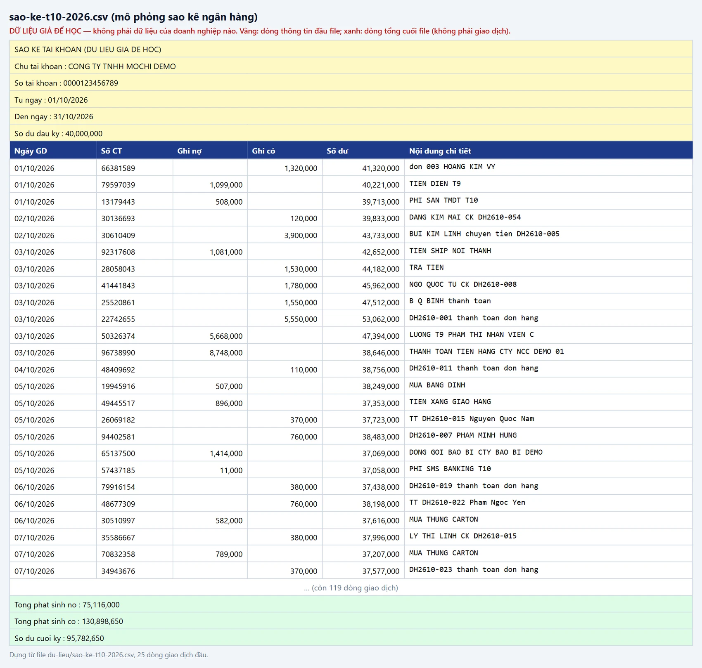
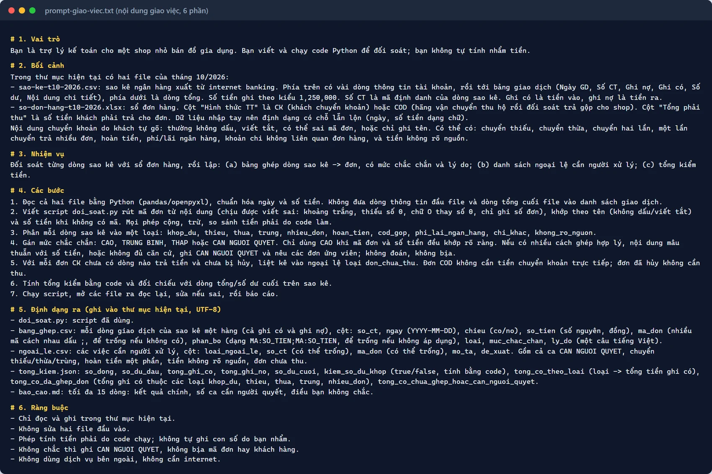

# Bài 1. Chuẩn bị dữ liệu và giao việc cho agent

> Dữ liệu trong bài là **dữ liệu giả để học**: tên người, số điện thoại, số tài khoản, công ty và nhà cung cấp đều bịa, sinh bằng script có hạt giống cố định. Không phải dữ liệu của doanh nghiệp nào.

## Mục tiêu đo được

Sau bài này bạn làm được ba việc, và kiểm được từng việc bằng mắt hoặc bằng lệnh:

1. Tải bộ dữ liệu mẫu (sao kê 144 dòng, sổ 128 đơn) về máy và mở được cả hai file. Kiểm: tổng ghi có của sao kê là 130.898.650 đ, tổng ghi nợ là 75.116.000 đ.
2. Hiểu vì sao việc ghép sao kê với đơn hàng là việc "ít nhưng rắc rối", và nhận ra 10 kiểu bẫy trong nội dung chuyển khoản.
3. Giao được việc cho một coding agent (Claude Code hoặc Antigravity `agy`) bằng một prompt 6 phần, trong thư mục riêng, đúng cách để agent không động vào file gốc.

## 1. Bài toán: nhân viên kế toán ngồi ghép từng dòng

Một shop nhỏ nhận tiền bằng chuyển khoản. Cuối tháng, kế toán mở hai thứ:

- **Sao kê ngân hàng** (CSV hoặc Excel tải từ internet banking), khoảng 150 dòng một tháng.
- **Sổ đơn hàng** (Excel), khoảng 120 đơn.

Việc cần làm là với mỗi dòng "tiền vào" trên sao kê, tìm đơn hàng nào đã được trả, rồi đánh dấu. Nghe đơn giản, nhưng nội dung chuyển khoản do khách tự gõ trên điện thoại, nên:

- Khách quên mã đơn, chỉ ghi tên, hoặc ghi tên không dấu, viết tắt (`B Q BINH`).
- Khách gõ sai mã (`DH261O-028` có chữ O thay số 0, `DH 2610 067` có khoảng trắng).
- Khách chuyển thiếu, chuyển thừa, chuyển hai lần.
- Khách trả một lần cho ba đơn.
- Hãng vận chuyển trả gộp tiền thu hộ (COD) mà không ghi mã đơn nào.
- Có tiền vào mà không ai biết của ai.
- Có tiền ra (hoàn tiền cho khách) cần khớp với đơn đã hủy.

Người làm bằng tay mất vài giờ và dễ sót. Một coding agent có thể viết script Python làm phần máy móc (rút mã đơn, cộng tiền, so tổng) trong vài phút. Phần cần người là những ca mà dữ liệu không đủ để chắc chắn. **Mục tiêu của cả chuỗi bài là agent ghép phần chắc chắn, và đẩy phần không chắc sang cho bạn, chứ không đoán.**

Quy tắc xuyên suốt: **phép tính tiền do code (Python) làm, không để mô hình "tính nhẩm"**. Mô hình ngôn ngữ có thể cộng sai một con số mà vẫn viết rất tự tin. Script thì cộng đúng hoặc báo lỗi.

## 2. Mẫu sao kê thật dùng làm tham chiếu

Trước khi sinh dữ liệu, tôi tìm cách sao kê ngân hàng Việt Nam được trình bày để mô phỏng đúng cột. Kết quả tìm được (chỉ dùng làm tham chiếu về định dạng, không chép nội dung):

- **[Nguồn]** Bài hướng dẫn đọc sao kê Vietcombank của DNSE mô tả các cột: ngày giao dịch, số chứng từ (Số CT), số tiền ghi có, số tiền ghi nợ, số dư, nội dung chi tiết. Ghi có là tiền vào, ghi nợ là tiền ra. https://www.dnse.com.vn/hoc/cach-doc-sao-ke-tai-khoan-vcb-chinh-xac-nhat
- **[Nguồn]** Thư viện mã nguồn mở `ofxstatement-vn-vietcombank` (giấy phép MIT) chuyển sao kê Excel của Vietcombank sang định dạng OFX. Điều này cho thấy sao kê Excel của ngân hàng có cấu trúc bảng khá ổn định. https://github.com/darkms/ofxstatement-vn-vietcombank
- **[Nguồn]** Trang hỗ trợ của MISA có hướng dẫn nhập sao kê ngân hàng từ file Excel vào phần mềm kế toán. https://helpact.misa.vn/?p=72941 (tôi chỉ xem phần tóm tắt trong kết quả tìm kiếm).

**Điều tôi không tìm được:** một file sao kê mẫu chính thức, công khai của một ngân hàng, kèm tiêu đề cột chính xác từng ký tự. Vì vậy file sao kê giả trong bài dùng bộ cột phổ biến nhất (`Ngày GD, Số CT, Ghi nợ, Ghi có, Số dư, Nội dung chi tiết`), kèm vài dòng thông tin tài khoản ở đầu file và dòng tổng ở cuối. Sao kê thật của ngân hàng bạn có thể khác tên cột; khi đó chỉ cần sửa lại một dòng trong prompt.

## 3. Tải và mở dữ liệu mẫu

Thư mục `du-lieu/` của bài có:

| File | Nội dung |
|---|---|
| `sao-ke-t10-2026.csv` | Sao kê tháng 10/2026: 144 dòng giao dịch (97 ghi có, 47 ghi nợ) |
| `so-don-hang-t10-2026.xlsx` | Sổ 128 đơn: 108 đơn chuyển khoản (CK) và 20 đơn thu hộ (COD) |
| `sinh_du_lieu.py` | Script sinh lại hai file trên và đáp án, hạt giống 20261120 |

Cách mở nhanh (không cần biết code): bấm đúp `so-don-hang-t10-2026.xlsx` bằng Excel. Với file CSV, **đừng bấm đúp** nếu Excel của bạn hiện tiếng Việt vỡ chữ; thay vào đó dùng *Data > From Text/CSV* và chọn mã hóa UTF-8. Hoặc mở bằng Notepad.



*Ảnh dựng từ file `du-lieu/sao-ke-t10-2026.csv` (25 dòng giao dịch đầu). Dữ liệu giả để học. Vàng là dòng thông tin đầu file, xanh là dòng tổng cuối file.*


*Ảnh dựng từ file `du-lieu/so-don-hang-t10-2026.xlsx`. Dữ liệu giả để học. Các dòng màu hồng có ngày hoặc tổng tiền nhập dạng chữ (`5.550.000 đ`, `02-10-2026`), là định dạng lẫn lộn cố ý.*

Nếu muốn tự sinh lại (cần Python 3 và thư viện `openpyxl`):

```bash
cd du-lieu
python -X utf8 sinh_du_lieu.py
```

Lệnh này in ra số liệu tóm tắt và ghi `sao-ke-t10-2026.csv`, `so-don-hang-t10-2026.xlsx`, cùng file đáp án `../ket-qua/dap-an.json`. `-X utf8` giúp Windows in tiếng Việt không lỗi. Chạy lại luôn ra đúng bản cũ vì hạt giống cố định.

## 4. Các bẫy đã cài (và cách đáp án gắn nhãn)

Tôi cài bẫy có chủ đích để agent có chỗ sai. Mỗi dòng sao kê có một nhãn trong đáp án: loại (`loai`), mã đơn đúng (`orders`), và **mức** là `ro` (đáp án xác định, agent phải đúng) hoặc `mo_ho` (dữ liệu không đủ, đúng ra phải để người quyết).

| Bẫy | Số dòng | Ví dụ nội dung | Nhãn |
|---|---|---|---|
| Mã đơn chuẩn, tiền đủ | 66 | `NGUYEN VAN AN CK DH2610-012` | ro |
| Mã đơn viết lệch (khoảng trắng, chữ O, thiếu số 0, chỉ ghi số) | cùng nhóm trên | `DH 2610 012`, `DH261O-028`, `don hang so 33` | ro |
| Chỉ ghi tên (không dấu, viết tắt), tiền đủ | cùng nhóm trên | `B Q BINH thanh toan` | ro |
| Chuyển thiếu | 4 | tiền ít hơn đơn 20.000 đến 100.000 đ | ro, ngoại lệ |
| Chuyển thừa | 4 | tiền nhiều hơn đơn 10.000 đến 200.000 đ | ro, ngoại lệ |
| Chuyển hai lần cho một đơn | 3 | dòng thứ hai cùng số tiền, 1 đến 4 ngày sau | ro, ngoại lệ |
| Một lần trả nhiều đơn, có ghi mã | 5 | `TT DH2610-020, DH2610-021` | ro |
| Hoàn tiền (ghi nợ), một ca hoàn một phần | 3 | `HOAN TIEN DH2610-037 TRU PHI SHIP` | ro (ca một phần là ngoại lệ) |
| Ghi mã của đơn khác, tên và tiền lại khớp đơn khác | 3 | `DANG KIM MAI CK DH2610-054` | mo_ho |
| Hai khách trùng tên, hai đơn cùng số tiền, chỉ ghi tên | 2 | `TRAN VAN BINH CK` | mo_ho |
| Trả hai đơn nhưng không ghi mã | 1 | `TRAN HUU DAT CK 2 don` | mo_ho |
| Hãng vận chuyển trả gộp COD, không ghi mã | 2 | `DV VAN CHUYEN XANH DOI SOAT COD DOT 1 T10` | mo_ho |
| Tiền không rõ nguồn | 6 | `CHUYEN KHOAN`, `TT HD 0087`, `PHAM QUOC TOAN CK` | mo_ho |
| Phí, lãi ngân hàng | 4 | `PHI SMS BANKING T10` | ro |
| Chi không liên quan đơn (lương, tiền điện, nhập hàng) | 41 | `TIEN DIEN T9` | ro |

Tổng: **130 dòng "ro", 14 dòng "mo_ho", 26 dòng cần đưa vào danh sách ngoại lệ**. Ngoài ra có 10 đơn CK chưa ai trả (8 đơn mới đặt cuối tháng, 2 đơn cũ đã giao mà chưa thu), 3 đơn đã hủy không cần thu, 3 đơn hoàn tiền, và 9 đơn COD chưa có đợt đối soát nào.

Hai ca bẫy tinh vi hơn:

- Một dòng `MUA HANG ZALO` có số tiền **trùng đúng** tổng của một đơn chưa thu (560.000 đ). Không có tên, không có mã, nên đúng ra phải để người quyết; ghép theo số tiền là đoán.
- Khách trả hộ: dòng `don 003 HOANG KIM VY` ghi đúng mã, đúng tiền, nhưng tên người chuyển khác tên khách trên đơn. Đây là chuyện bình thường (chuyển hộ), và đáp án coi là ghép rõ ràng.

## 5. Đáp án đặt ngoài thư mục agent

Rất quan trọng: file `ket-qua/dap-an.json` **không bao giờ** nằm trong thư mục agent làm việc. Nếu để chung, agent có thể đọc thấy đáp án (agent chạy được lệnh liệt kê file), và bài kiểm trở thành vô nghĩa. Làm theo thứ tự: tạo thư mục riêng cho mỗi lần chạy, **chỉ chép hai file dữ liệu vào**.

```bash
mkdir lan-chay-1
cp du-lieu/sao-ke-t10-2026.csv du-lieu/so-don-hang-t10-2026.xlsx lan-chay-1/
```

`mkdir` tạo thư mục, `cp` chép file. Trên Windows PowerShell dùng `mkdir lan-chay-1` và `copy du-lieu\*.csv lan-chay-1\` tương tự.

## 6. Giao việc cho agent

Có hai cách, cùng một prompt.

**Cách A, tương tác (khuyên dùng cho người mới).** Mở terminal trong `lan-chay-1`, gõ `claude` (Claude Code) hoặc `agy` (Antigravity), rồi dán prompt ở dưới và Enter. Bạn thấy agent đọc file, viết script, chạy, sửa. Khi nó xin quyền ghi file trong thư mục này, cho phép.

**Cách B, chạy không tương tác (cách tôi dùng để ghi log).** Script `agent_run.py` gọi:

```bash
claude -p "<nội dung prompt>" --output-format stream-json --verbose --permission-mode acceptEdits
agy    -p "<nội dung prompt>" --output-format stream-json --dangerously-skip-permissions
```

`-p` là chế độ "nhận một prompt, làm xong rồi thoát". `stream-json` ghi từng sự kiện thành một dòng JSON, nhờ đó giữ được log gốc để dựng lại ảnh và kiểm. **Cẩn thận:** `--dangerously-skip-permissions` của `agy` cho phép agent chạy lệnh không hỏi. Chỉ dùng trong thư mục riêng, với dữ liệu giả, và đừng đặt gì quan trọng cạnh đó. Agent chạy toàn quyền trên máy bạn nên prompt phải có câu "Chỉ đọc và ghi trong thư mục hiện tại".



*Ảnh dựng từ file `ket-qua/prompt-giao-viec.txt`, không phải ảnh chụp cửa sổ terminal.*

### Prompt (nguyên văn, đã dùng cho cả hai agent)

```text
# 1. Vai trò
Bạn là trợ lý kế toán cho một shop nhỏ bán đồ gia dụng. Bạn viết và chạy code Python để đối soát; bạn không tự tính nhẩm tiền.

# 2. Bối cảnh
Trong thư mục hiện tại có hai file của tháng 10/2026:
- sao-ke-t10-2026.csv: sao kê ngân hàng xuất từ internet banking. Phía trên có vài dòng thông tin tài khoản, rồi tới bảng giao dịch (Ngày GD, Số CT, Ghi nợ, Ghi có, Số dư, Nội dung chi tiết), phía dưới là dòng tổng. Số tiền ghi theo kiểu 1,250,000. Số CT là mã định danh của dòng sao kê. Ghi có là tiền vào, ghi nợ là tiền ra.
- so-don-hang-t10-2026.xlsx: sổ đơn hàng. Cột "Hình thức TT" là CK (khách chuyển khoản) hoặc COD (hãng vận chuyển thu hộ rồi đối soát trả gộp cho shop). Cột "Tổng phải thu" là số tiền khách phải trả cho đơn. Dữ liệu nhập tay nên định dạng có chỗ lẫn lộn (ngày, số tiền dạng chữ).
Nội dung chuyển khoản do khách tự gõ: thường không dấu, viết tắt, có thể sai mã đơn, hoặc chỉ ghi tên. Có thể có: chuyển thiếu, chuyển thừa, chuyển hai lần, một lần chuyển trả nhiều đơn, hoàn tiền, phí/lãi ngân hàng, khoản chi không liên quan đơn hàng, và tiền không rõ nguồn.

# 3. Nhiệm vụ
Đối soát từng dòng sao kê với sổ đơn hàng, rồi lập: (a) bảng ghép dòng sao kê -> đơn, có mức chắc chắn và lý do; (b) danh sách ngoại lệ cần người xử lý; (c) tổng kiểm tiền.

# 4. Các bước
1. Đọc cả hai file bằng Python (pandas/openpyxl), chuẩn hóa ngày và số tiền. Không đưa dòng thông tin đầu file và dòng tổng cuối file vào danh sách giao dịch.
2. Viết script doi_soat.py rút mã đơn từ nội dung (chịu được viết sai: khoảng trắng, thiếu số 0, chữ O thay số 0, chỉ ghi số đơn), khớp theo tên (không dấu/viết tắt) và số tiền khi không có mã. Mọi phép cộng, trừ, so sánh tiền phải do code làm.
3. Phân mỗi dòng sao kê vào một loại: khop_du, thieu, thua, trung, nhieu_don, hoan_tien, cod_gop, phi_lai_ngan_hang, chi_khac, khong_ro_nguon.
4. Gán mức chắc chắn: CAO, TRUNG BINH, THAP hoặc CAN NGUOI QUYET. Chỉ dùng CAO khi mã đơn và số tiền đều khớp rõ ràng. Nếu có nhiều cách ghép hợp lý, nội dung mâu thuẫn với số tiền, hoặc không đủ căn cứ, ghi CAN NGUOI QUYET và nêu các đơn ứng viên; không đoán, không bịa.
5. Với mỗi đơn CK chưa có dòng nào trả tiền và chưa bị hủy, liệt kê vào ngoại lệ loại don_chua_thu. Đơn COD không cần tiền chuyển khoản trực tiếp; đơn đã hủy không cần thu.
6. Tính tổng kiểm bằng code và đối chiếu với dòng tổng/số dư cuối trên sao kê.
7. Chạy script, mở các file ra đọc lại, sửa nếu sai, rồi báo cáo.

# 5. Định dạng ra (ghi vào thư mục hiện tại, UTF-8)
- doi_soat.py: script đã dùng.
- bang_ghep.csv: mỗi dòng giao dịch của sao kê một hàng (cả ghi có và ghi nợ), cột: so_ct, ngay (YYYY-MM-DD), chieu (co/no), so_tien (số nguyên, đồng), ma_don (nhiều mã cách nhau dấu ;, để trống nếu không có), phan_bo (dạng MA:SO_TIEN;MA:SO_TIEN, để trống nếu không áp dụng), loai, muc_chac_chan, ly_do (một câu tiếng Việt).
- ngoai_le.csv: các việc cần người xử lý, cột: loai_ngoai_le, so_ct (có thể trống), ma_don (có thể trống), mo_ta, de_xuat. Gồm cả ca CAN NGUOI QUYET, chuyển thiếu/thừa/trùng, hoàn tiền một phần, tiền không rõ nguồn, đơn chưa thu.
- tong_kiem.json: so_dong, so_du_dau, tong_ghi_co, tong_ghi_no, so_du_cuoi, kiem_so_du_khop (true/false, tính bằng code), tong_co_theo_loai (loại -> tổng tiền ghi có), tong_co_da_ghep_don (tổng ghi có thuộc các loại khop_du, thieu, thua, trung, nhieu_don), tong_co_chua_ghep_hoac_can_nguoi_quyet.
- bao_cao.md: tối đa 15 dòng: kết quả chính, số ca cần người quyết, điều bạn không chắc.

# 6. Ràng buộc
- Chỉ đọc và ghi trong thư mục hiện tại.
- Không sửa hai file đầu vào.
- Phép tính tiền phải do code chạy; không tự ghi con số do bạn nhẩm.
- Không chắc thì ghi CAN NGUOI QUYET, không bịa mã đơn hay khách hàng.
- Không dùng dịch vụ bên ngoài, không cần internet.
```

### Vì sao prompt viết như vậy

- **Vai trò + "không tự tính nhẩm"**: đặt ngay từ câu đầu để agent chọn con đường viết code.
- **Bối cảnh nói rõ hai điều dễ sai**: file CSV có dòng đầu và dòng cuối không phải giao dịch; "Số tiền kiểu 1,250,000" là chữ, không phải số. Nếu không nói, agent có thể đọc nhầm dòng tổng thành một giao dịch.
- **Các bước đánh số**: agent làm theo thứ tự, và bước 7 bắt nó mở file ra đọc lại (tự kiểm).
- **Định dạng ra có tên cột cụ thể**: để chấm bằng code được. Nếu bạn chỉ nói "lập bảng ghép", mỗi lần chạy sẽ ra một kiểu bảng khác nhau, không so được.
- **Câu "không chắc thì ghi CAN NGUOI QUYET"** có ở bước 4 và ràng buộc. Đây là phần quan trọng nhất. Không có nó, agent có xu hướng ghép cho "đẹp".
- **Prompt không đổi sau khi thấy kết quả.** Tôi không chỉnh prompt để agent làm đẹp hơn. Nếu bạn sửa prompt sau lần chạy đầu, giữ cả hai bản và ghi rõ.

## Lỗi thường gặp ở bước chuẩn bị

- **Chữ tiếng Việt vỡ khi mở CSV bằng Excel**: file có BOM UTF-8 nên thường mở đúng; nếu vỡ, dùng *Data > From Text/CSV*.
- **Lệnh `python` báo `UnicodeEncodeError` (cp1252) trên Windows** khi in tiếng Việt. **[Đo được]** Claude Code gặp đúng lỗi này hai lần trong lần chạy của tôi và tự sửa bằng `-X utf8` (xem bài 2). Bạn thêm `-X utf8` vào lệnh `python`.
- **Để đáp án chung thư mục với agent.** Đừng.
- **Đặt dữ liệu thật vào thử.** Sao kê thật có tên khách, số tài khoản. Nếu dùng dữ liệu thật, chạy trên máy của bạn, đừng gửi lên dịch vụ ngoài khi chưa được phép, và hỏi bộ phận pháp chế/kế toán trưởng về quy định bảo mật dữ liệu khách hàng của công ty.
- **Sai đường dẫn**: agent chạy trong thư mục hiện tại, nên mở terminal đúng thư mục trước khi gõ `claude`/`agy`.

## Checklist cuối bài 1

- [ ] Mở được `so-don-hang-t10-2026.xlsx` và thấy 128 dòng đơn.
- [ ] Mở được `sao-ke-t10-2026.csv`, thấy dòng tổng cuối file: nợ 75.116.000, có 130.898.650, dư cuối 95.782.650.
- [ ] Tạo thư mục riêng cho lần chạy, chỉ có hai file dữ liệu bên trong.
- [ ] `dap-an.json` nằm ngoài thư mục agent.
- [ ] Đã dán prompt 6 phần, không sửa nội dung.

## Việc cần người làm

- Quyết định ai là người duyệt kết quả cuối tháng (kế toán trưởng hay chủ shop) trước khi chạy.
- Xác định ngưỡng "chấp nhận được" của shop: lệch bao nhiêu đồng thì chủ động bỏ qua, bao nhiêu thì phải hỏi khách. Đây là quyết định kinh doanh, không phải việc của agent. **[Đề xuất]** viết sẵn thành quy ước và đưa vào prompt.
- Với dữ liệu thật: chép sao kê ra thư mục tạm, không đưa lên chỗ chung.

## Giới hạn

- Dữ liệu là sinh, bẫy do tôi nghĩ ra. Dữ liệu thật của bạn sẽ có kiểu lộn xộn khác (ví dụ có thể gặp nội dung bị ngân hàng cắt ngắn, hoặc mã giao dịch của ngân hàng thêm vào đầu nội dung; tôi chưa kiểm điều này với sao kê thật).
- Không tìm được tiêu đề cột chính xác của sao kê từng ngân hàng, nên cột trong bài là cột phổ biến chứ không phải bản sao của một ngân hàng cụ thể.
- Bài chỉ chuẩn bị. Kết quả chạy thật và cách chấm ở **bài 2**.
