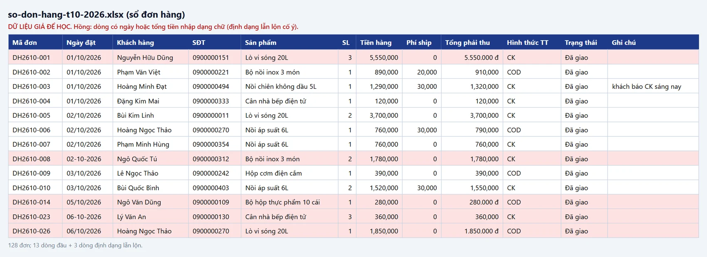

# Bài 1. Chuẩn bị dữ liệu và giao việc cho agent

!!! info "Bài này"
    - **Bạn làm gì:** tải dữ liệu mẫu, mở agent trong một thư mục riêng, dán prompt giao việc đối soát sao kê.
    - **Mất bao lâu:** khoảng 20 phút chuẩn bị. Agent chạy thêm vài phút đến vài chục phút **[Đo được]** (lần chạy của chúng tôi: Claude Code 557 giây, Antigravity 1.257 giây).
    - **Cần có:** máy đã cài một coding agent (xem [Bắt đầu với coding agent](../th-bat-dau-voi-coding-agent/00-README.md)), Python 3 (agent sẽ viết và chạy script Python; cách kiểm và cài: [Bài 1 của nhóm Bắt đầu](../th-bat-dau-voi-coding-agent/cap-00-lam-quen-cua-so-dong-lenh.md)), Excel hoặc Notepad để xem file.
    - **Kết quả:** một thư mục có bảng ghép sao kê với đơn hàng, danh sách ngoại lệ, tổng kiểm. Cách kiểm đúng sai ở bài 2.

> Dữ liệu trong bài là **dữ liệu giả để học**: tên người, số điện thoại, số tài khoản, công ty và nhà cung cấp đều bịa, sinh bằng script có hạt giống cố định. Không có dữ liệu của doanh nghiệp thật.

## Bài toán trong một phút

Một shop nhỏ nhận tiền bằng chuyển khoản. Cuối tháng, kế toán mở hai thứ:

- **Sao kê ngân hàng** (CSV hoặc Excel tải từ internet banking), khoảng 150 dòng một tháng.
- **Sổ đơn hàng** (Excel), khoảng 120 đơn.

Với mỗi dòng "tiền vào", kế toán phải tìm xem khách trả cho đơn nào rồi đánh dấu. Nghe đơn giản, nhưng nội dung chuyển khoản do khách tự gõ nên rất lộn xộn: không dấu, viết tắt, sai mã đơn (`DH261O-028` có chữ O thay số 0), chỉ ghi tên, chuyển thiếu, chuyển thừa, chuyển hai lần, trả một lần cho ba đơn, hãng vận chuyển trả gộp tiền thu hộ (COD) mà không ghi mã đơn nào.

Làm tay mất vài giờ và dễ sót. Một coding agent có thể **viết một script Python** làm phần máy móc (rút mã đơn, cộng tiền, so tổng) trong vài phút. Phần còn lại, những ca không chắc, agent phải **đưa cho người quyết**.

!!! warning "Quy tắc xuyên suốt cả chuỗi bài"
    **Phép tính tiền do code làm, không để mô hình "tính nhẩm".** Mô hình ngôn ngữ có thể cộng sai một con số mà vẫn viết rất tự tin. Vì vậy prompt bắt agent viết code và chạy code.

## Các bước làm

### Bước 1. Tải và giải nén dữ liệu mẫu

Tải [du-lieu.zip](du-lieu.zip), bấm chuột phải chọn **Extract All** (Windows) hoặc bấm đúp (macOS). Bạn có thư mục `du-lieu/` gồm:

| File | Nội dung |
|---|---|
| `sao-ke-t10-2026.csv` | Sao kê tháng 10/2026: 144 dòng giao dịch (97 ghi có, 47 ghi nợ) |
| `so-don-hang-t10-2026.xlsx` | Sổ 128 đơn: 108 đơn chuyển khoản (CK) và 20 đơn thu hộ (COD) |
| `sinh_du_lieu.py` | Script sinh lại hai file trên, hạt giống 20261120 (không cần dùng ở bài này) |
| `prompt-giao-viec.txt` | Prompt ở Bước 5, dạng file |
| `bai_tap.py`, `doi_cot_sao_ke.py`, `kiem_nhanh.py`, `sao-ke-moi.csv` | Dùng ở bài 3 và bài 4 (chưa cần ở bài này) |

### Bước 2. Mở xem dữ liệu

Bấm đúp `so-don-hang-t10-2026.xlsx` để mở bằng Excel. Với file CSV, **đừng bấm đúp** nếu Excel hiện tiếng Việt vỡ chữ: mở bằng Notepad, hoặc dùng *Data > From Text/CSV* và chọn mã hóa UTF-8.


*Sao kê mẫu: 25 dòng giao dịch đầu của `sao-ke-t10-2026.csv` (dữ liệu giả để học). Vàng là dòng thông tin đầu file, xanh là dòng tổng cuối file.*



*Sổ đơn hàng mẫu (dữ liệu giả để học). Các dòng màu hồng có ngày hoặc tổng tiền nhập dạng chữ (`5.550.000 đ`, `02-10-2026`): định dạng lẫn lộn cố ý.*

!!! see "Bạn sẽ thấy"
    Sổ đơn có 128 dòng. Cuối file sao kê có dòng tổng: **nợ 75.116.000, có 130.898.650, dư cuối 95.782.650**. Ghi nhớ ba số này, bài 2 dùng để kiểm.

### Bước 3. Tạo thư mục riêng cho agent

Mỗi lần chạy dùng **một thư mục riêng**, chỉ chép hai file dữ liệu vào. Đây là hàng rào đơn giản nhất để agent không động vào thứ khác.

Windows (PowerShell), chạy trong thư mục chứa `du-lieu/`:

```lenh
mkdir lan-chay-1
copy du-lieu\sao-ke-t10-2026.csv lan-chay-1\
copy du-lieu\so-don-hang-t10-2026.xlsx lan-chay-1\
```

macOS hoặc Linux:

```lenh
mkdir lan-chay-1
cp du-lieu/sao-ke-t10-2026.csv du-lieu/so-don-hang-t10-2026.xlsx lan-chay-1/
```

`mkdir` tạo thư mục, `copy` hoặc `cp` chép file.

!!! warning "Đừng để file đáp án trong thư mục này"
    Ở bài 2 bạn sẽ dùng file đáp án để chấm. File đó **không bao giờ** nằm trong `lan-chay-1`. Agent chạy được lệnh liệt kê file, nếu thấy đáp án thì bài kiểm vô nghĩa. **[Đo được]** Trong bài toán báo giá của chuỗi này, một lần Antigravity đã đi mở file đáp án nằm ngoài thư mục làm việc.

### Bước 4. Mở agent trong thư mục vừa tạo

Mở cửa sổ dòng lệnh (Terminal hoặc PowerShell) **đúng thư mục `lan-chay-1`**, rồi gõ một trong hai lệnh:

```lenh
cd lan-chay-1
claude
```

hoặc, nếu dùng Antigravity:

```lenh
cd lan-chay-1
agy
```

`cd` là đi vào thư mục. `claude` hoặc `agy` mở agent tại thư mục đó. Chưa cài? Xem [Bắt đầu với coding agent](../th-bat-dau-voi-coding-agent/00-README.md).

!!! see "Bạn sẽ thấy"
    Một khung chat trong cửa sổ dòng lệnh, chờ bạn gõ. Nếu agent hỏi bạn có tin tưởng thư mục này không, chỉ đồng ý khi đúng là `lan-chay-1`. Mở nhầm thư mục thì thoát agent (cách thoát: xem [Bắt đầu với coding agent](../th-bat-dau-voi-coding-agent/00-README.md)) rồi `cd` lại cho đúng.

### Bước 5. Dán prompt giao việc

Bấm **Sao chép**, dán vào khung chat của agent, nhấn Enter. Prompt có 6 phần (vai trò, bối cảnh, nhiệm vụ, các bước, định dạng ra, ràng buộc). **Đừng sửa** nếu bạn muốn đối chiếu kết quả với bài 2.

```prompt
# 1. Vai trò
Bạn là trợ lý kế toán cho một shop nhỏ bán đồ gia dụng. Bạn viết và chạy code Python để đối soát; bạn không tự tính nhẩm tiền.

# 2. Bối cảnh
Trong thư mục hiện tại có hai file của tháng 10/2026:
- sao-ke-t10-2026.csv: sao kê ngân hàng xuất từ internet banking. Phía trên có vài dòng thông tin tài khoản, rồi tới bảng giao dịch (Ngày GD, Số CT, Ghi nợ, Ghi có, Số dư, Nội dung chi tiết), phía dưới là dòng tổng. Số tiền ghi theo kiểu 1,250,000. Số CT là mã định danh của dòng sao kê. Ghi có là tiền vào, ghi nợ là tiền ra.
- so-don-hang-t10-2026.xlsx: sổ đơn hàng. Cột "Hình thức TT" là CK (khách chuyển khoản) hoặc COD (hãng vận chuyển thu hộ rồi đối soát trả gộp cho shop). Cột "Tổng phải thu" là số tiền khách phải trả cho đơn. Dữ liệu nhập tay nên định dạng có chỗ lẫn lộn (ngày, số tiền dạng chữ).
Nội dung chuyển khoản do khách tự gõ: thường không dấu, viết tắt, có thể sai mã đơn, hoặc chỉ ghi tên. Có thể có: chuyển thiếu, chuyển thừa, chuyển hai lần, một lần chuyển trả nhiều đơn, hoàn tiền, phí/lãi ngân hàng, khoản chi không liên quan đơn hàng, và tiền không rõ nguồn.

# 3. Nhiệm vụ
Đối soát từng dòng sao kê với sổ đơn hàng, rồi lập: (a) bảng ghép dòng sao kê -> đơn, có mức chắc chắn và lý do; (b) danh sách ngoại lệ cần người xử lý; (c) tổng kiểm tiền.

# 4. Các bước
1. Đọc cả hai file bằng Python (pandas/openpyxl), chuẩn hóa ngày và số tiền. Không đưa dòng thông tin đầu file và dòng tổng cuối file vào danh sách giao dịch.
2. Viết script doi_soat.py rút mã đơn từ nội dung (chịu được viết sai: khoảng trắng, thiếu số 0, chữ O thay số 0, chỉ ghi số đơn), khớp theo tên (không dấu/viết tắt) và số tiền khi không có mã. Mọi phép cộng, trừ, so sánh tiền phải do code làm.
3. Phân mỗi dòng sao kê vào một loại: khop_du, thieu, thua, trung, nhieu_don, hoan_tien, cod_gop, phi_lai_ngan_hang, chi_khac, khong_ro_nguon.
4. Gán mức chắc chắn: CAO, TRUNG BINH, THAP hoặc CAN NGUOI QUYET. Chỉ dùng CAO khi mã đơn và số tiền đều khớp rõ ràng. Nếu có nhiều cách ghép hợp lý, nội dung mâu thuẫn với số tiền, hoặc không đủ căn cứ, ghi CAN NGUOI QUYET và nêu các đơn ứng viên; không đoán, không bịa.
5. Với mỗi đơn CK chưa có dòng nào trả tiền và chưa bị hủy, liệt kê vào ngoại lệ loại don_chua_thu. Đơn COD không cần tiền chuyển khoản trực tiếp; đơn đã hủy không cần thu.
6. Tính tổng kiểm bằng code và đối chiếu với dòng tổng/số dư cuối trên sao kê.
7. Chạy script, mở các file ra đọc lại, sửa nếu sai, rồi báo cáo.

# 5. Định dạng ra (ghi vào thư mục hiện tại, UTF-8)
- doi_soat.py: script đã dùng.
- bang_ghep.csv: mỗi dòng giao dịch của sao kê một hàng (cả ghi có và ghi nợ), cột: so_ct, ngay (YYYY-MM-DD), chieu (co/no), so_tien (số nguyên, đồng), ma_don (nhiều mã cách nhau dấu ;, để trống nếu không có), phan_bo (dạng MA:SO_TIEN;MA:SO_TIEN, để trống nếu không áp dụng), loai, muc_chac_chan, ly_do (một câu tiếng Việt).
- ngoai_le.csv: các việc cần người xử lý, cột: loai_ngoai_le, so_ct (có thể trống), ma_don (có thể trống), mo_ta, de_xuat. Gồm cả ca CAN NGUOI QUYET, chuyển thiếu/thừa/trùng, hoàn tiền một phần, tiền không rõ nguồn, đơn chưa thu.
- tong_kiem.json: so_dong, so_du_dau, tong_ghi_co, tong_ghi_no, so_du_cuoi, kiem_so_du_khop (true/false, tính bằng code), tong_co_theo_loai (loại -> tổng tiền ghi có), tong_co_da_ghep_don (tổng ghi có thuộc các loại khop_du, thieu, thua, trung, nhieu_don), tong_co_chua_ghep_hoac_can_nguoi_quyet.
- bao_cao.md: tối đa 15 dòng: kết quả chính, số ca cần người quyết, điều bạn không chắc.

# 6. Ràng buộc
- Chỉ đọc và ghi trong thư mục hiện tại.
- Không sửa hai file đầu vào.
- Phép tính tiền phải do code chạy; không tự ghi con số do bạn nhẩm.
- Không chắc thì ghi CAN NGUOI QUYET, không bịa mã đơn hay khách hàng.
- Không dùng dịch vụ bên ngoài, không cần internet.
```


*Prompt trên, dựng lại từ `prompt-giao-viec.txt` (không phải ảnh chụp cửa sổ terminal).*

!!! see "Bạn sẽ thấy"
    Agent đọc hai file, viết `doi_soat.py`, chạy, mở kết quả ra đọc lại, rồi báo cáo. Nó có thể **xin quyền** tạo file hoặc chạy lệnh trong thư mục này: chọn cho phép (chỉ trong thư mục `lan-chay-1`). Khi xong, thư mục có thêm `doi_soat.py`, `bang_ghep.csv`, `ngoai_le.csv`, `tong_kiem.json`, `bao_cao.md`.

!!! stuck "Agent xin quyền hoài, hoặc báo lỗi tiếng Việt khi chạy Python?"
    - **Xin quyền nhiều lần:** bình thường, mỗi lần là một việc khác nhau. Đọc câu nó xin, chỉ đồng ý nếu nó nằm trong `lan-chay-1`. Thấy nó đòi sửa file ngoài thư mục hoặc dùng internet thì từ chối.
    - **`UnicodeEncodeError` (cp1252) trên Windows:** Python in tiếng Việt lỗi. **[Đo được]** Claude Code gặp đúng lỗi này hai lần và tự sửa bằng cách thêm `-X utf8` vào lệnh `python`. Nếu agent không tự sửa, gõ: "Chạy lại bằng `python -X utf8`".
    - **Agent chạy lâu:** hai lần chạy của chúng tôi mất 9 và 21 phút. Chưa thấy lỗi thì cứ chờ.

### Bước 6. Xem nhanh rồi sang bài 2

Chưa cần chấm. Mở `bao_cao.md` đọc báo cáo của agent, rồi mở `bang_ghep.csv` bằng Excel để thấy bảng ghép. **Chưa tin con số nào** cho đến khi chấm ở bài 2: agent có thể tự báo "đã khớp" mà vẫn sai.

## Vì sao prompt viết như vậy

| Chỗ trong prompt | Để làm gì |
|---|---|
| Vai trò + "không tự tính nhẩm" | Đặt ngay câu đầu để agent chọn con đường viết code |
| Bối cảnh nói rõ hai điều dễ sai | File CSV có dòng đầu và dòng cuối **không** phải giao dịch; "1,250,000" là chữ, không phải số. Không nói thì agent có thể đọc dòng tổng thành một giao dịch |
| Các bước đánh số, bước 7 "mở file ra đọc lại" | Agent làm đúng thứ tự và tự kiểm một lần |
| Định dạng ra có tên cột cụ thể | Để chấm bằng code được. Chỉ nói "lập bảng ghép" thì mỗi lần ra một kiểu, không so được |
| "Không chắc thì ghi CAN NGUOI QUYET" (ở bước 4 và ràng buộc) | Phần quan trọng nhất. Không có nó, agent có xu hướng ghép cho "đẹp" |

**Prompt không đổi sau khi thấy kết quả.** Chúng tôi không chỉnh prompt cho agent làm đẹp hơn. Nếu bạn sửa prompt sau lần chạy đầu, giữ cả hai bản và ghi rõ đã sửa gì.

## Đào sâu: dữ liệu mẫu được dựng thế nào

### Mẫu sao kê thật dùng làm tham chiếu

Trước khi sinh dữ liệu, chúng tôi tìm cách sao kê ngân hàng Việt Nam trình bày để mô phỏng đúng cột (chỉ để tham chiếu định dạng, không chép nội dung):

- **[Nguồn]** Bài hướng dẫn đọc sao kê Vietcombank của DNSE mô tả các cột: ngày giao dịch, số chứng từ (Số CT), số tiền ghi có, số tiền ghi nợ, số dư, nội dung chi tiết. Ghi có là tiền vào, ghi nợ là tiền ra. https://www.dnse.com.vn/hoc/cach-doc-sao-ke-tai-khoan-vcb-chinh-xac-nhat
- **[Nguồn]** Thư viện mã nguồn mở `ofxstatement-vn-vietcombank` (giấy phép MIT) chuyển sao kê Excel của Vietcombank sang định dạng OFX, cho thấy sao kê Excel của ngân hàng có cấu trúc bảng khá ổn định. https://github.com/darkms/ofxstatement-vn-vietcombank
- **[Nguồn]** Trang hỗ trợ của MISA có hướng dẫn nhập sao kê ngân hàng từ file Excel vào phần mềm kế toán. https://helpact.misa.vn/?p=72941 (chỉ xem phần tóm tắt trong kết quả tìm kiếm).

**Chưa tìm được:** một file sao kê mẫu chính thức, công khai của một ngân hàng kèm tiêu đề cột chính xác từng ký tự. File giả trong bài dùng bộ cột phổ biến nhất (`Ngày GD, Số CT, Ghi nợ, Ghi có, Số dư, Nội dung chi tiết`), kèm vài dòng thông tin tài khoản ở đầu và dòng tổng ở cuối. Sao kê của ngân hàng bạn có thể khác tên cột; khi đó sửa phần mô tả cột và tiền tố mã đơn trong prompt (và tên cột trong bộ chấm nếu bạn chấm bằng `cham.py`).

### Các bẫy đã cài và cách đáp án gắn nhãn

Chúng tôi cài bẫy có chủ đích để agent có chỗ sai. Mỗi dòng sao kê có một nhãn trong đáp án: loại, mã đơn đúng, và **mức**: `ro` (đáp án xác định, agent phải đúng) hoặc `mo_ho` (dữ liệu không đủ, đúng ra phải để người quyết).

| Bẫy | Số dòng | Ví dụ nội dung | Nhãn |
|---|---|---|---|
| Mã đơn chuẩn, tiền đủ | 66 | `NGUYEN VAN AN CK DH2610-012` | ro |
| Mã đơn viết lệch (khoảng trắng, chữ O, thiếu số 0, chỉ ghi số) | cùng nhóm trên | `DH 2610 012`, `DH261O-028`, `don hang so 33` | ro |
| Chỉ ghi tên (không dấu, viết tắt), tiền đủ | cùng nhóm trên | `B Q BINH thanh toan` | ro |
| Chuyển thiếu | 4 | tiền ít hơn đơn 20.000 đến 100.000 đ | ro, ngoại lệ |
| Chuyển thừa | 4 | tiền nhiều hơn đơn 10.000 đến 200.000 đ | ro, ngoại lệ |
| Chuyển hai lần cho một đơn | 3 | dòng thứ hai cùng số tiền, 1 đến 4 ngày sau | ro, ngoại lệ |
| Một lần trả nhiều đơn, có ghi mã | 5 | `TT DH2610-020, DH2610-021` | ro |
| Hoàn tiền (ghi nợ), một ca hoàn một phần | 3 | `HOAN TIEN DH2610-037 TRU PHI SHIP` | ro (ca một phần là ngoại lệ) |
| Ghi mã của đơn khác, tên và tiền lại khớp đơn khác | 3 | `DANG KIM MAI CK DH2610-054` | mo_ho |
| Hai khách trùng tên, hai đơn cùng số tiền, chỉ ghi tên | 2 | `TRAN VAN BINH CK` | mo_ho |
| Trả hai đơn nhưng không ghi mã | 1 | `TRAN HUU DAT CK 2 don` | mo_ho |
| Hãng vận chuyển trả gộp COD, không ghi mã | 2 | `DV VAN CHUYEN XANH DOI SOAT COD DOT 1 T10` | mo_ho |
| Tiền không rõ nguồn | 6 | `CHUYEN KHOAN`, `TT HD 0087`, `PHAM QUOC TOAN CK` | mo_ho |
| Phí, lãi ngân hàng | 4 | `PHI SMS BANKING T10` | ro |
| Chi không liên quan đơn (lương, tiền điện, nhập hàng) | 41 | `TIEN DIEN T9` | ro |

Tổng: **130 dòng "ro", 14 dòng "mo_ho", 26 dòng cần đưa vào danh sách ngoại lệ**. Ngoài ra có 10 đơn CK chưa ai trả (8 đơn mới đặt cuối tháng, 2 đơn cũ đã giao mà chưa thu), 3 đơn đã hủy không cần thu, 3 đơn hoàn tiền, và 9 đơn COD chưa có đợt đối soát nào.

Hai ca bẫy tinh vi hơn:

- Một dòng `MUA HANG ZALO` có số tiền **trùng đúng** tổng của một đơn chưa thu (560.000 đ). Không có tên, không có mã, nên đúng ra phải để người quyết; ghép theo số tiền là đoán.
- Khách trả hộ: dòng `don 003 HOANG KIM VY` ghi đúng mã, đúng tiền, nhưng tên người chuyển khác tên khách trên đơn. Chuyện bình thường (chuyển hộ), đáp án coi là ghép rõ ràng.

### Muốn tự sinh lại dữ liệu

Cần Python 3 và thư viện `openpyxl`. Chạy trong thư mục `du-lieu`:

```lenh
python -X utf8 sinh_du_lieu.py
```

Lệnh in số liệu tóm tắt và ghi lại hai file dữ liệu cùng file đáp án. Hạt giống cố định nên luôn ra đúng bản cũ. `-X utf8` giúp Windows in tiếng Việt không lỗi.

### Cách B: chạy không cần ngồi cạnh (cách chúng tôi dùng để ghi log)

`-p` là chế độ "nhận một prompt, làm xong rồi thoát", `stream-json` ghi từng sự kiện thành một dòng JSON để giữ log gốc.

```lenh
claude -p "<nội dung prompt>" --output-format stream-json --verbose --permission-mode acceptEdits
agy -p "<nội dung prompt>" --output-format stream-json --dangerously-skip-permissions
```

**Cẩn thận:** `--dangerously-skip-permissions` của `agy` cho agent chạy lệnh không hỏi. Chỉ dùng trong thư mục riêng, với dữ liệu giả, và đừng đặt gì quan trọng cạnh đó. Agent chạy toàn quyền trên máy bạn, nên prompt phải có câu "Chỉ đọc và ghi trong thư mục hiện tại" (và câu đó chưa phải hàng rào thật).

## Lỗi thường gặp ở bước chuẩn bị

| Triệu chứng | Cách xử lý |
|---|---|
| Chữ tiếng Việt vỡ khi mở CSV bằng Excel | File có BOM UTF-8 nên thường mở đúng. Nếu vỡ, dùng *Data > From Text/CSV*, chọn UTF-8 |
| `UnicodeEncodeError` (cp1252) trên Windows | Thêm `-X utf8` vào lệnh `python` |
| Agent làm việc ở thư mục khác | Mở terminal đúng thư mục `lan-chay-1` trước khi gõ `claude` hoặc `agy` |
| Muốn thử bằng sao kê thật | Chạy trên máy của bạn, đừng gửi lên dịch vụ ngoài khi chưa được phép. Sao kê thật có tên khách và số tài khoản: hỏi kế toán trưởng hoặc pháp chế về quy định bảo mật dữ liệu khách hàng của công ty |
| Để đáp án chung thư mục với agent | Đừng. Xem cảnh báo ở Bước 3 |

## Checklist cuối bài 1

- [ ] Mở được `so-don-hang-t10-2026.xlsx` và thấy 128 dòng đơn.
- [ ] Mở được `sao-ke-t10-2026.csv`, thấy dòng tổng cuối file: nợ 75.116.000, có 130.898.650, dư cuối 95.782.650.
- [ ] Tạo thư mục riêng cho lần chạy, chỉ có hai file dữ liệu bên trong.
- [ ] File đáp án nằm ngoài thư mục agent.
- [ ] Đã dán prompt 6 phần, không sửa nội dung, và agent đã tạo đủ 5 file kết quả.

## Việc cần người làm

- Quyết định ai duyệt kết quả cuối tháng (kế toán trưởng hay chủ shop) **trước khi** chạy.
- Xác định ngưỡng "chấp nhận được" của shop: lệch bao nhiêu đồng thì bỏ qua, bao nhiêu thì phải hỏi khách. Đây là quyết định kinh doanh, không phải việc của agent. **[Đề xuất]** viết sẵn thành quy ước và đưa vào prompt.
- Với dữ liệu thật: chép sao kê ra thư mục tạm, không đưa lên chỗ chung.

## Giới hạn

- Dữ liệu là sinh, bẫy do chúng tôi nghĩ ra. Dữ liệu thật của bạn sẽ có kiểu lộn xộn khác (ví dụ nội dung bị ngân hàng cắt ngắn, hoặc mã giao dịch của ngân hàng thêm vào đầu nội dung; chúng tôi chưa kiểm điều này với sao kê thật).
- Không tìm được tiêu đề cột chính xác của sao kê từng ngân hàng, nên cột trong bài là cột phổ biến chứ không phải bản sao của một ngân hàng cụ thể.
- Bài này chỉ chuẩn bị. Kết quả chạy thật và cách chấm ở **bài 2**.
