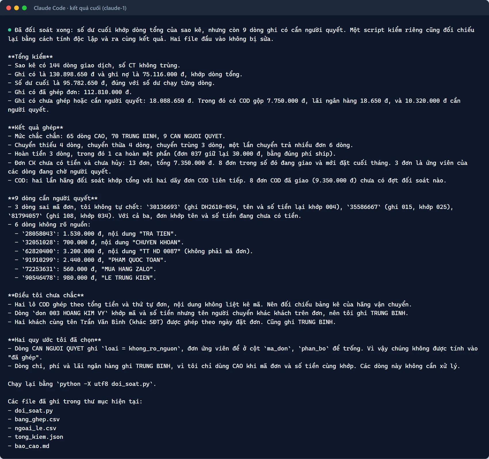
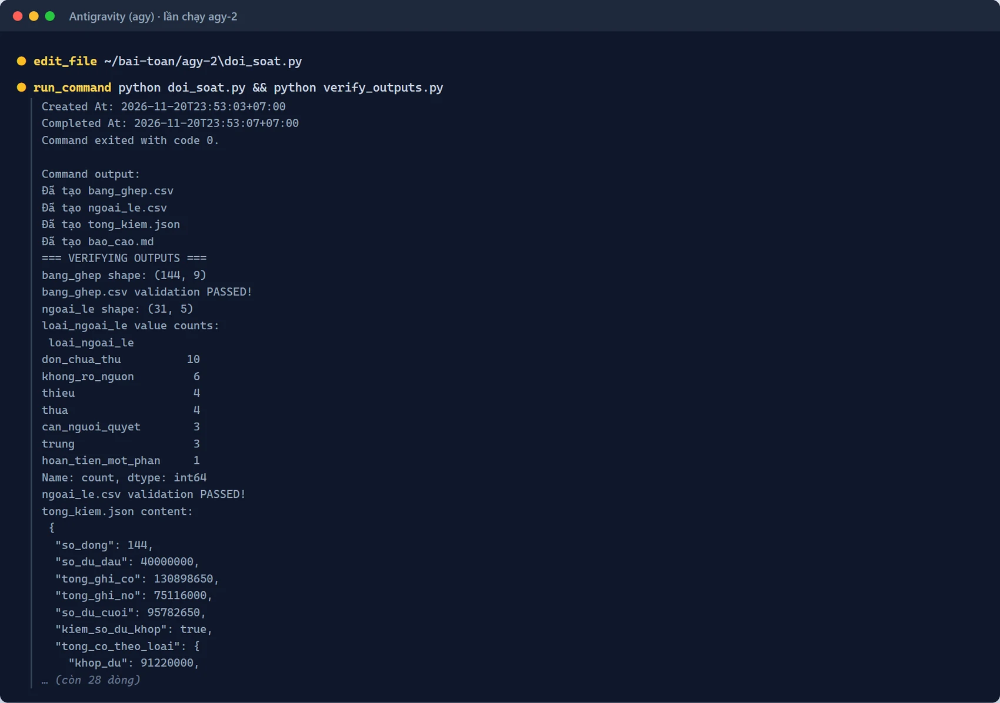
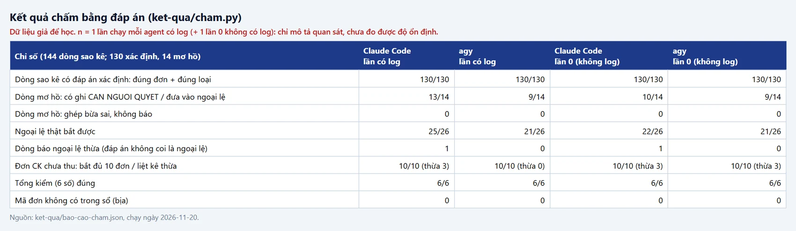
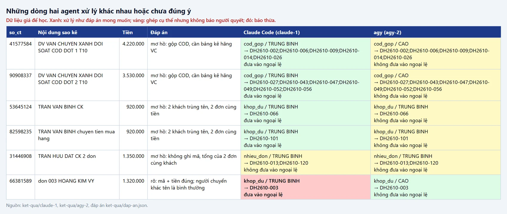

# Bài 2. Chạy thật và kiểm kết quả bằng đáp án

!!! info "Bài này"
    - **Bạn làm gì:** chấm kết quả của agent bằng bộ chấm `cham.py` (so với đáp án), rồi đọc những dòng agent làm sai hoặc làm khác nhau.
    - **Mất bao lâu:** chấm mất vài giây. Đọc kỹ các ca đáng xem khoảng 30 phút.
    - **Cần có:** Python 3 và thư viện `openpyxl`; thư mục `ket-qua/` của bài toán (có `cham.py`, `dap-an.json`, đầu ra `claude-1/` và `agy-2/` của chúng tôi). Muốn chấm đầu ra của chính bạn thì cần thư mục `lan-chay-1` từ bài 1. Tải [bo-cham.zip](bo-cham.zip) và giải nén ở **ngoài** thư mục chạy của agent (đừng để đáp án cạnh agent).
    - **Kết quả:** một bảng điểm, và biết nên tin phần nào, soi lại phần nào.

> Dữ liệu là **dữ liệu giả để học** (xem bài 1). Mọi con số dưới đây là **[Đo được]**: kết quả chạy ngày 2026-11-20 trên đúng bộ dữ liệu và prompt của bài 1. Mỗi agent chỉ có **một lần chạy có log đầy đủ** (n = 1), nên bài này mô tả quan sát, không kết luận agent nào tốt hơn và chưa đo được độ ổn định.

## Kết quả đo trong một bảng

| Chỉ số | Claude Code (`claude-1`) | Antigravity `agy` (`agy-2`) |
|---|---|---|
| Số lần chạy có log | 1 | 1 |
| Thời gian chạy | 557 giây | 1.257 giây |
| Dòng "xác định" ghép đúng | 130/130 | 130/130 |
| Dòng "mơ hồ" được báo cho người quyết | 13/14 | 9/14 |
| Dòng "mơ hồ" ghép sai mà không báo | 0 | 0 |
| Ngoại lệ thật bắt được | 25/26 | 21/26 |
| Báo ngoại lệ thừa | 1 dòng | 0 |
| Đơn CK chưa thu (đáp án 10 đơn) | đủ 10, liệt kê thừa 3 | đủ 10, không thừa |
| Tổng kiểm (6 số) đúng | 6/6 | 6/6 |
| Mã đơn không có trong sổ | 0 | 0 |

Cách đọc đúng bảng:

- "130/130" nghe dễ hơn thực tế. 41 dòng là chi không liên quan đơn, và 24 dòng ghép bằng mã viết lệch hoặc bằng tên. Cả hai agent xử lý được chữ O thay số 0, thiếu số 0, khoảng trắng, "don hang so 33".
- Cả hai đọc đúng **mọi** số tiền và chiều (có/nợ) của 144 dòng.
- "Số tiền đã ghép đơn" **khác nhau giữa hai agent**: 112.810.000 đ so với 113.720.000 đ, chênh đúng 910.000 đ. Nguyên nhân là ba dòng "sai mã đơn" (120.000 + 380.000 + 410.000 đ): Claude Code xếp vào "không rõ nguồn", còn `agy` vẫn ghi loại "khớp đủ" (nhưng mức CAN NGUOI QUYET và đưa sang ngoại lệ). Cả hai đều hợp lý, nên **con số tổng phụ thuộc quy ước**. Khi so hai báo cáo, hãy so theo quy ước, đừng so mỗi con số.

## Các bước làm

### Bước 1. Xem agent đã làm gì

Mỗi agent chạy trong một thư mục riêng và để lại log gốc (`logs/claude-1.raw.jsonl`, `logs/agy-2.raw.jsonl`). Bốn ảnh dưới đây dựng lại từ log thật.


*Dựng lại từ log thật của lần chạy `claude-1`, không phải ảnh chụp trực tiếp cửa sổ TUI. Đường dẫn máy đã được che (hiện là `~/bai-toan`).*



*Dựng lại từ log thật của lần chạy `claude-1`, không phải ảnh chụp trực tiếp cửa sổ TUI.*



*Dựng lại từ log thật của lần chạy `agy-2`, không phải ảnh chụp trực tiếp cửa sổ TUI. Chúng tôi lược các dòng lỗi nhiễu của profile PowerShell trên máy chạy.*


*Dựng lại từ log thật của lần chạy `agy-2`, không phải ảnh chụp trực tiếp cửa sổ TUI.*

!!! see "Bạn sẽ thấy"
    Claude Code: 20 lần gọi công cụ, một script chính `doi_soat.py` (652 dòng). `agy`: 67 lần gọi công cụ, 25 file Python (gồm cả script nháp), sau đó xóa bớt, còn `doi_soat.py` (570 dòng). Số liệu đầy đủ ở mục "Đào sâu" cuối bài.

### Bước 2. Kiểm hai file đầu vào không bị sửa

Prompt ở bài 1 dặn "không sửa hai file đầu vào". Đừng tin lời dặn, hãy kiểm. So mã băm của file trong thư mục chạy với bản gốc (Windows PowerShell, chạy ở thư mục chứa `du-lieu/` và `lan-chay-1/`):

```lenh
(Get-FileHash du-lieu\sao-ke-t10-2026.csv).Hash -eq (Get-FileHash lan-chay-1\sao-ke-t10-2026.csv).Hash
```

Hai mã băm giống nhau thì in `True`. macOS hoặc Linux:

```lenh
cmp du-lieu/sao-ke-t10-2026.csv lan-chay-1/sao-ke-t10-2026.csv && echo giong-het
```

!!! see "Bạn sẽ thấy"
    `True` (PowerShell) hoặc `giong-het` (macOS/Linux). **[Đo được]** Cả hai agent của chúng tôi đều không sửa file CSV. Với file Excel, mã băm của hai bản không giống nhau nên chúng tôi so từng ô và thấy giống hệt.

### Bước 3. Chấm bằng `cham.py`

Agent tự báo "đã đối soát xong" chưa đủ. Cần một thứ độc lập: **đáp án** sinh cùng dữ liệu. Chạy trong thư mục `ket-qua/`:

```lenh
cd ket-qua
python -X utf8 cham.py claude-1=claude-1 agy-2=agy-2
```

`cham.py` đọc `bang_ghep.csv`, `ngoai_le.csv`, `tong_kiem.json` trong mỗi thư mục rồi so với `dap-an.json`. Cú pháp `ten=thu-muc`: tên hiện trong báo cáo, rồi đường dẫn thư mục đầu ra. Muốn chấm lần chạy của bạn: `python -X utf8 cham.py cua-toi=..\lan-chay-1`.

```ketqua
== claude-1
{
 "dong_ro_dung": "130/130",
 "dong_mo_ho_da_bao": "13/14",
 "chac_sai_trong_mo_ho": 0,
 "ngoai_le_bat_duoc": "25/26",
 "ngoai_le_bao_thua": 1,
 "don_chua_thu": "10/10 (thừa 3)",
 "tong_kiem_dung": "6/6",
 "ma_don_khong_ton_tai": 0
}
== agy-2
{
 "dong_ro_dung": "130/130",
 "dong_mo_ho_da_bao": "9/14",
 "chac_sai_trong_mo_ho": 0,
 "ngoai_le_bat_duoc": "21/26",
 "ngoai_le_bao_thua": 0,
 "don_chua_thu": "10/10 (thừa 0)",
 "tong_kiem_dung": "6/6",
 "ma_don_khong_ton_tai": 0
}
```

Cách chấm, nói gọn:

- **Dòng "xác định" (130 dòng):** đúng khi tập mã đơn khớp **và** loại khớp (ca trả nhiều đơn còn phải đúng phần phân bổ).
- **Dòng "mơ hồ" (14 dòng):** đạt khi agent ghi `CAN NGUOI QUYET` hoặc đưa dòng vào `ngoai_le.csv`. Ghép sai mà không báo là "chắc sai"; ghép đúng mà không báo là "đúng nhưng không báo".
- **Ngoại lệ:** so với 26 dòng đáp án coi là cần người xử lý. **Đơn chưa thu:** so với 10 đơn đáp án. **Tổng kiểm:** so từng con số với đáp án.



*Dựng từ `ket-qua/bao-cao-cham.json`. Dữ liệu giả để học. n = 1 lần có log mỗi agent.*

!!! stuck "Gặp lỗi?"
    - **`ModuleNotFoundError: openpyxl`:** gõ `pip install openpyxl` rồi chạy lại.
    - **`FileNotFoundError` về `dap-an.json`:** bạn đang đứng sai thư mục. `cham.py` phải chạy trong `ket-qua/`, cạnh `dap-an.json`.
    - **Tiếng Việt vỡ chữ khi in:** thiếu `-X utf8` trong lệnh `python`.

### Bước 4. Đọc các ca đáng xem

Điểm số chỉ cho biết đúng bao nhiêu. Chỗ đáng học nằm ở các ca agent làm khác nhau hoặc làm quá tay.



*Dựng từ `ket-qua/claude-1`, `ket-qua/agy-2` và đáp án `ket-qua/dap-an.json`. Dữ liệu giả để học.*

| Ca | Agent làm gì | Đúng ra | Vì sao đáng chú ý |
|---|---|---|---|
| 3 dòng ghi sai mã đơn (ví dụ `DANG KIM MAI CK DH2610-054`, 120.000 đ) | Cả hai ghi `CAN NGUOI QUYET`, nêu đơn ứng viên | Để người quyết | Mã chỉ tới đơn khách khác, còn tên và tiền khớp đơn khác. Không ai ghép bừa. Đúng điều bài toán muốn |
| 6 dòng tiền không rõ nguồn, kể cả `MUA HANG ZALO` 560.000 đ | Cả hai ghi `CAN NGUOI QUYET` | Để người quyết | Dòng này trùng đúng tổng đơn `DH2610-121` chưa thu, nhưng tiền vào ngày 27/10, đơn đặt ngày 30/10. `agy` nêu đơn đó làm ứng viên; Claude Code nhận ra tiền vào trước ngày đặt nên không nêu |
| 2 dòng COD gộp (4.220.000 và 3.530.000 đ) | Cả hai tìm bằng code đúng tập 5 và 6 đơn COD có tổng bằng số tiền. Claude Code ghi `TRUNG BINH`, đưa vào ngoại lệ. `agy` ghi `CAO`, không đưa vào ngoại lệ | Để người đối chiếu bảng kê của hãng vận chuyển | Nội dung sao kê không có mã đơn nào. Dữ liệu thật có thể có nhiều tổ hợp cho cùng một tổng, nên `CAO` là tự tin hơn mức bằng chứng. Lần này `agy` đoán đúng, nhưng prompt đã dặn chỉ dùng `CAO` khi mã đơn và tiền đều khớp |
| 2 khách cùng tên Trần Văn Bình, 2 đơn cùng 920.000 đ | Cả hai ghép dòng đến trước vào đơn đặt trước, ghi `TRUNG BINH`. Claude Code đưa vào ngoại lệ, `agy` không | Để người quyết | Cách ghép của cả hai trùng đáp án, nhưng chỉ có sao kê và sổ đơn thì không thể biết. Một mẫu, đừng coi "đoán theo thứ tự ngày" là quy tắc an toàn |
| `TRAN HUU DAT CK 2 don` (trả hai đơn không ghi mã) | Cả hai ghép đúng cặp đơn, `TRUNG BINH`, không báo ngoại lệ | Người xác nhận | Tổng bằng hai đơn của cùng một khách nên ghép đúng, nhưng đáp án muốn người xem |
| `don 003 HOANG KIM VY` | Claude Code ghi `TRUNG BINH` và đưa vào ngoại lệ | Ghép rõ (khách chuyển hộ, mã và tiền đúng) | Báo thừa một dòng. Thận trọng quá mức, nhưng chi phí chỉ là một câu hỏi |
| 3 đơn chưa thu thừa của Claude Code | Liệt kê thêm ba đơn là ứng viên của ba dòng "sai mã" | Đáp án chỉ tính 10 đơn | Về logic là đúng (chưa có dòng nào được ghép chắc chắn), chỉ khác quy ước đếm |

### Bước 5. Đọc script, không chỉ đọc điểm

Điểm đo **kết quả**. Nhưng bạn sẽ dùng lại **script** mỗi tháng. Kiểm nhanh: đếm các dòng có dãy 8 chữ số (số chứng từ) trong script. Windows PowerShell, chạy trong `ket-qua/`:

```lenh
(Select-String -Path agy-2\doi_soat.py -Pattern '\d{8}').Count
(Select-String -Path claude-1\doi_soat.py -Pattern '\d{8}').Count
```

macOS hoặc Linux:

```lenh
grep -cE '[0-9]{8}' agy-2/doi_soat.py claude-1/doi_soat.py
```

```ketqua
42
0
```

!!! warning "42 dòng so với 0 dòng"
    Script của `agy` có **38 nhánh `so_ct == "..."` viết cứng**, cùng mã đơn và chuỗi phân bổ tiền gõ sẵn (ví dụ danh sách mã và số tiền của hai đợt COD). Agent khám phá kết quả bằng nhiều script nháp rồi **dán kết quả vào script cuối** thay vì để script tự suy ra. Số tiền ở các dòng đó đúng, nhưng chạy lại với sao kê tháng sau sẽ **không** cho kết quả đúng (bài 3 đo điều này). Các con số phân bổ cũng không còn do code tính ở lần chạy cuối, sát nhất với nguyên tắc "tiền do code làm" trong cả bài. Script của Claude Code là quy tắc tổng quát; chỉ tiền tố tháng `DH2610` viết cứng ở vài chỗ.

Vì vậy, **chấm kết quả chưa đủ để tin script**.

## Lỗi thường gặp (và cách xử)

| Triệu chứng | Nguyên nhân thường gặp | Cách xử |
|---|---|---|
| Agent báo "xong" nhưng thiếu file | Hết giờ giữa chừng | Tăng giới hạn thời gian; kiểm danh sách file ra |
| Dòng tổng bị tính như giao dịch | Prompt không nói file có dòng tổng | Giữ câu này ở bước 1 của prompt |
| Tổng "đã ghép" của hai lần không khớp nhau | Quy ước xếp ca mơ hồ khác nhau | Ghi quy ước vào prompt |
| `UnicodeEncodeError` | Windows dùng cp1252 | Thêm `-X utf8` |
| Kết quả đúng nhưng chạy lại tháng sau sai | Script viết cứng ca cụ thể | Đếm dãy 8 chữ số (Bước 5); yêu cầu "không viết cứng số CT hay mã đơn" |

## Checklist cuối bài 2

- [ ] Mỗi agent chạy trong thư mục riêng, file đầu vào không bị sửa (so mã băm).
- [ ] Có log gốc của mỗi lần chạy (nếu chạy không tương tác).
- [ ] Đã chạy `cham.py` và đọc cả phần "mơ hồ", không chỉ phần tổng.
- [ ] Đã đếm dãy 8 chữ số trong script cuối.
- [ ] Đã ghi quy ước xếp ca mơ hồ trước khi so hai báo cáo.

## Việc cần người làm

- Quyết định từng dòng `CAN NGUOI QUYET` (hỏi khách, xem bảng kê hãng vận chuyển).
- Xác nhận với kế toán trưởng cách xử lý chuyển thiếu, chuyển thừa, chuyển hai lần: hoàn tiền, trừ vào đơn sau, hay giữ chờ. Đó là quy trình của công ty, không phải việc của agent. Quy định về chứng từ, hóa đơn và kỳ hạch toán: cần kiểm với kế toán hoặc luật sư, bài này không viết điều khoản.
- Đọc script ít nhất một lần trước khi dùng cho tháng sau.

## Giới hạn

- n = 1 lần chạy có log mỗi agent (cộng 1 lần không log). Không so được độ ổn định, không kết luận agent nào tốt hơn.
- Đáp án là của chính dữ liệu chúng tôi sinh; các quyết định "mơ hồ" do chúng tôi gán nhãn. Một kế toán khác có thể gán khác (ví dụ chấp nhận ghép theo thứ tự ngày với hai khách trùng tên).
- Hạn `agy` bị chúng tôi nới từ 900 giây lên 1.800 giây ở lần có log; kết quả `agy` thuộc về cấu hình này.
- Chưa thử dữ liệu có nội dung bị ngân hàng cắt ngắn, thêm tiền tố mã của ngân hàng, hoặc sao kê Excel nhiều sheet.

## Đào sâu: thời gian, khối lượng và các sự cố khi chạy

### Thời gian và khối lượng

| | Claude Code (`claude-1`) | Antigravity `agy` (`agy-2`) |
|---|---|---|
| Thời gian chạy | 557 giây | 1.257 giây |
| Số lần gọi công cụ | 20 (10 lệnh shell, 9 sửa file, 1 ghi file) | 67 (34 lệnh, 28 ghi file, 4 đọc file, 1 sửa file) |
| File Python agent tự ghi | 1 script chính `doi_soat.py` (652 dòng) | 25 file Python (gồm cả script nháp), sau đó xóa bớt, còn `doi_soat.py` (570 dòng) |
| Token ghi trong log | output 80.370 (trong đó thinking 53.308) | input 270.441, output 130.911 |
| Chi phí log ghi | 1,51 USD (số của log Claude Code) | log `agy` không có số chi phí |

Hai công cụ tính token khác nhau, nên không so trực tiếp được. Chỉ dùng để ước lượng tài nguyên.

### Cách chạy để có log

Cách tương tác: mở terminal trong thư mục, gõ `claude` (hoặc `agy`), dán prompt. Để lưu log, chúng tôi dùng một script bọc (`agent_run.py`, công cụ nội bộ, không bắt buộc) chạy lệnh `-p` như bài 1 và ghi hai file mỗi lần: `*.raw.jsonl` (log gốc từng sự kiện) và `*.json` (bản chuẩn hóa để dựng ảnh). Mỗi lần chạy một thư mục riêng (`runs/claude-1`, `runs/agy-2`) với hạn 900 giây.

### Các sự cố khi chạy (giữ nguyên, vì đây là phần giá trị)

1. **`agy` hết giờ ở lần chạy đầu (900 giây).** Hạn 900 giây không đủ: `agy` còn đang khám phá dữ liệu, chưa ghi được `bang_ghep.csv`. Script bọc ban đầu **không lưu log khi hết giờ**, nên lần đó không có log. Chúng tôi giữ các script nháp ở `ket-qua/agy-lan1-timeout900/` và chạy lần hai (`agy-2`) với hạn 1.800 giây, có bọc lại để hết giờ vẫn lưu log. Lần hai xong sau 1.257 giây. Nếu bạn dùng chế độ `-p`, đặt giới hạn thời gian rộng hơn với dữ liệu cỡ này.
2. **Lần "lần 0" mất log do cách chúng tôi khởi chạy.** Lần đầu chúng tôi khởi chạy cả hai agent từ một lệnh nền rồi đóng ngay; nhiều khả năng script bọc bị dừng trước khi ghi log (và `agy` cũng vượt hạn 900 giây), dù agent vẫn chạy xong và để lại file. Chúng tôi **không dùng** lần này làm kết quả chính vì không có log. File kết quả giữ ở `ket-qua/lan0-khong-co-log/` và vẫn được chấm.
3. **Claude Code gặp lỗi mã hóa Windows (cp1252) hai lần** khi in tiếng Việt từ một lệnh Python nhanh, rồi tự thêm `-X utf8`.
4. **Claude Code thử vá script bằng một lệnh dài, lệnh dừng giữa chừng vì không tìm thấy đoạn cần thay.** Nó nhận ra chưa có thay đổi nào được ghi, rồi sửa từng chỗ bằng 9 lần Edit. Đây là hành vi mong muốn: kiểm lại trước khi tin.
5. **Dòng lỗi lạ trong log của `agy`:** mỗi lệnh kèm một đoạn lỗi về file profile PowerShell của máy chạy. Đó là nhiễu của máy, không liên quan bài toán. Gặp thì bỏ qua.

### Mức dao động giữa các lần chạy

Hai lần chạy "lần 0" không log được chấm bằng cùng `cham.py`. **[Đo được, không log]** Claude Code: dòng mơ hồ báo 10/14, ngoại lệ 22/26 (lần có log: 13/14 và 25/26); `agy`: 9/14 và 21/26 (trùng lần có log). Dòng xác định đều 130/130, tổng kiểm đều 6/6. Phần "xác định" ổn trong hai lần mỗi agent, còn mức thận trọng ở phần "mơ hồ" thay đổi giữa các lần. Với hai lần mỗi bên, **không đủ để nói gì về độ ổn định**.
