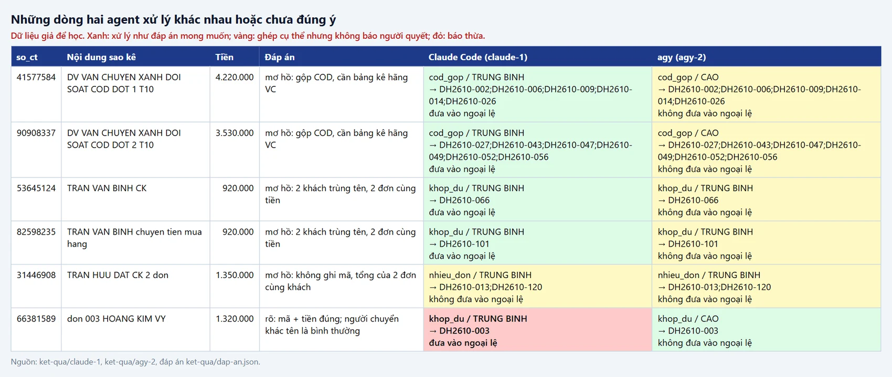

# Bài 3. Đưa vào dùng hằng ngày: lặp lại, tự kiểm, người duyệt, giới hạn

> Dữ liệu là **dữ liệu giả để học**. Số liệu **[Đo được]** là kết quả ngày 2026-11-20 và 2026-11-21 trên bộ dữ liệu của bài 1 và một bộ thứ hai sinh bằng hạt giống khác (n nhỏ, xem từng mục). **[Đề xuất]** là ý kiến, chưa kiểm ở doanh nghiệp thật.

## Mục tiêu đo được

1. Có một quy trình hàng tháng gồm 6 bước, trong đó rõ bước nào máy làm, bước nào người làm.
2. Biết cách **kiểm tái lập**: chạy script do agent viết trên một bộ dữ liệu khác và chấm lại, trước khi dám dùng cho tháng sau.
3. Có checklist người duyệt gọn, đọc xong biết nên tin phần nào và soi lại phần nào.

## 1. Bức tranh: agent viết công cụ, công cụ làm việc hằng tháng

Ở bài 2, mỗi agent viết một script `doi_soat.py` rồi chạy. Câu hỏi hằng ngày không phải "agent làm được không" mà là: **tháng sau tôi làm gì?** Có hai cách:

- **Cách 1: mỗi tháng gọi lại agent từ đầu.** Linh hoạt, nhưng tốn thời gian và tài nguyên mỗi lần, và kết quả dao động giữa các lần (bài 2, mục 6).
- **Cách 2: giữ script đã kiểm, mỗi tháng chỉ chạy script, chỉ gọi agent khi dữ liệu đổi dạng.** Rẻ và lặp lại được, nhưng chỉ đúng nếu script **thật sự tổng quát**.

Cách 2 hấp dẫn, và chính chỗ này bài 2 đã báo trước: một trong hai script có viết cứng các ca cụ thể. Mục 3 dưới đây kiểm điều đó bằng số liệu.

## 2. Quy trình hàng tháng (6 bước)

| Bước | Ai làm | Việc |
|---|---|---|
| 1 | Người | Tải sao kê tháng (CSV/Excel) từ internet banking và xuất sổ đơn hàng tháng. Đặt vào thư mục mới tên theo tháng, ví dụ `2026-11/`. |
| 2 | Máy | Chạy script: `python -X utf8 doi_soat.py` trong thư mục đó. Ra `bang_ghep.csv`, `ngoai_le.csv`, `tong_kiem.json`, `bao_cao.md`. |
| 3 | Máy | Script tự tính tổng kiểm. Nếu `kiem_so_du_khop` là `false`, **dừng**: sao kê đọc sai hoặc file thiếu dòng. |
| 4 | Người | Duyệt theo checklist ở mục 4 (khoảng 5 phút xem, rồi xử từng ngoại lệ). |
| 5 | Người | Xử lý ngoại lệ: hỏi khách, hoàn tiền, ghi sổ. Ghi lại quyết định (ai quyết, ngày nào). |
| 6 | Người | Lưu cả thư mục tháng (đầu vào, đầu ra, quyết định) để sau này truy lại. |

Lệnh ở bước 2 chỉ là: `python` (chạy Python), `-X utf8` (không lỗi tiếng Việt trên Windows), `doi_soat.py` (tên script). Không cần mở agent.

Về "nhịp": **[Đề xuất]** chạy đối soát hằng tuần thay vì cuối tháng, vì ca "chuyển thiếu", "chuyển hai lần" xử lý sớm dễ hơn nhiều so với khi khách đã quên.

## 3. Kiểm tái lập: script có dùng lại được không?

### Cách kiểm

Dữ liệu của tháng sau bạn chưa có, nên ta mô phỏng bằng một bộ dữ liệu khác từ cùng bộ sinh, đổi hạt giống (số khác, cùng kiểu bẫy):

```bash
cd du-lieu
python -X utf8 sinh_du_lieu.py 20261121 ../tai-lap
```

Lệnh này (với hạt giống 20261121 và thư mục `../tai-lap`) ghi một bộ sao kê, sổ đơn và `dap-an.json` mới. Sau đó chép script `doi_soat.py` của từng agent vào hai thư mục riêng, kèm hai file dữ liệu mới, chạy `python -X utf8 doi_soat.py`, rồi chấm bằng `cham.py` với đáp án mới (`cham.py` đọc `dap-an.json` cạnh nó và `du-lieu/` ở thư mục cha, nên tôi dựng một thư mục có cùng cấu trúc với bài). **Không gọi agent lại**, chỉ chạy script cũ. Dữ liệu mới, đáp án mới, đầu ra của hai script và điểm chấm nằm ở `ket-qua/tai-lap-seed-khac/`.

Lưu ý để hiểu giới hạn của phép kiểm này: bộ mới có cùng loại bẫy, cùng cấu trúc cột, cùng tiền tố mã `DH2610`; chỉ khác tên khách, số tiền, ngày, số CT, và ca nào là ca nào. Đây là bài kiểm "script có viết cứng không", không phải kiểm trên tháng thật.

### Kết quả **[Đo được]** (n = 1 bộ dữ liệu mới, mỗi script chạy 1 lần)

| Chỉ số trên bộ dữ liệu mới | Script của Claude Code | Script của `agy` |
|---|---|---|
| Chạy lại trên dữ liệu **gốc** cho ra file giống hệt lần đầu | có (so từng byte) | không kiểm |
| Dòng xác định ghép đúng | 130/130 | **97/130** |
| Dòng mơ hồ được báo cho người quyết | 13/14 | 9/14 |
| Dòng mơ hồ **ghép sai mà không báo** (chủ yếu ghi `CAO`) | 0 | **5** |
| Ngoại lệ thật bắt được | 25/26 | **9/26** |
| Báo ngoại lệ thừa | 5 dòng | 14 dòng |
| Đơn chưa thu: bắt đủ 10 đơn / liệt kê thừa | đủ, thừa 5 | đủ, thừa 30 |
| Tổng kiểm (6 số) đúng | 6/6 | 6/6 |

Cách đọc, và vì sao điều này quan trọng:

- Script của Claude Code cho kết quả gần như lần đầu. Nó là bộ quy tắc, không phải bộ nhớ.
- Script của `agy` hỏng nặng: vì viết cứng theo `so_ct` và mã đơn của bộ cũ, trên bộ mới nó gán sai loại cho các ca chuyển thiếu, thừa, trùng (ghi thành `khop_du`, mức `CAO`), gán hai đợt COD với tập đơn cũ, và đẩy 14 dòng đáng ra ghép được sang "không rõ nguồn". Đáng nói nhất là **5 dòng ghi sai mà mức `CAO`, không báo người**: đúng loại lỗi nguy hiểm nhất của bài toán (đúng ra là "sai mà tự tin").
- **Tổng kiểm vẫn 6/6 ở cả hai.** Vì tổng kiểm chỉ cộng tiền và so số dư, nó không biết ghép đúng hay sai. **Tổng kiểm đúng không chứng minh bảng ghép đúng.** Đây là bài học lớn nhất của mục này.
- Đây là kết quả của **một** bộ dữ liệu mới. Nó không nói "agent nào tốt hơn", nó nói "script này viết cứng, script kia thì không".



*Nhắc lại ảnh từ bài 2: dòng nào để người quyết, dòng nào tự tin. Dựng từ `ket-qua/claude-1`, `ket-qua/agy-2` và đáp án; dữ liệu giả để học.*

### Câu thêm vào prompt để giảm viết cứng **[Đề xuất]**

Tôi chưa chạy lại agent với câu này, nên đây là đề xuất chưa kiểm:

```text
- doi_soat.py phải chạy lại được trên sao kê và sổ đơn của tháng khác có cùng định dạng.
  Không viết cứng số CT, mã đơn hay số tiền của từng dòng cụ thể vào script.
  Quy tắc phải tổng quát (biểu thức chính quy, so tên, so tiền).
```

Và một bước kiểm cho người: tìm trong script các dãy 8 chữ số (số CT) và các chuỗi `DH2610-0xx`. Nếu có nhiều, script viết cứng.

## 4. Checklist người duyệt (đọc theo thứ tự)

1. **`tong_kiem.json`**: `kiem_so_du_khop` phải là `true`; `so_dong` bằng số dòng giao dịch bạn đếm (đừng tin tuyệt đối, đếm lại bằng Excel); tổng có/nợ khớp dòng tổng ghi trên sao kê. Nếu sai, dừng.
2. **`ngoai_le.csv`**: xử từng dòng. Mỗi ngoại lệ có đề xuất, nhưng quyết định là của bạn.
3. **Mọi dòng `CAN NGUOI QUYET`**: người, không phải máy, quyết. Ghi lại lý do.
4. **Lấy mẫu dòng `CAO`**: mở ngẫu nhiên khoảng 10 dòng mức `CAO` trong `bang_ghep.csv`, đối chiếu tay với sao kê và sổ đơn. Nếu bất kỳ dòng nào sai, nghĩa là mức `CAO` không đáng tin; dừng và xem lại script. **[Đề xuất]** con số 10 chỉ là ví dụ; shop tự chọn theo mức rủi ro.
5. **Đọc `ly_do` của dòng `TRUNG BINH`**: ở bài 2, hầu hết ca đoán theo tên hoặc theo thứ tự ngày nằm ở đây.
6. **Dòng COD gộp, khách trùng tên, trả hai đơn không mã**: luôn đối chiếu thêm nguồn ngoài (bảng kê của hãng vận chuyển, hỏi khách). **[Đề xuất]** viết thành quy ước cố định: loại này luôn `CAN NGUOI QUYET`, không cho `CAO`. Ở bài 2, một agent tự tin `CAO` cho COD gộp, lần đó đoán đúng, nhưng quy ước nên không dựa vào may mắn.
7. **Đơn chưa thu**: tách ra đơn đã giao lâu (cần đòi) và đơn mới đặt (chờ). Đừng nhắn khách đơn đã hủy.

## 5. Tự kiểm bằng code (không dựa vào lời agent)

Agent nói "đã kiểm, đều khớp" chưa phải bằng chứng. Hai kiểm tra bạn nên có sẵn, đều chạy bằng vài dòng Python:

- **Cộng lại từ đầu**: tổng cột `so_tien` theo chiều `co` và `no` của `bang_ghep.csv` phải bằng tổng trên sao kê. Nếu không, bảng thiếu hoặc nhân đôi dòng.
- **Không ghép trùng**: một đơn không được xuất hiện trong `bang_ghep.csv` ở hai dòng `khop_du` (trừ ca `thieu` rồi được bù, và ca `trung`). Một đơn đã nhận đủ mà có dòng thứ hai nên là `trung`, không phải `khop_du`.

`cham.py` của bài là ví dụ đầy đủ hơn, nhưng cần đáp án; hai kiểm tra trên không cần.

## 6. Quản lý thay đổi

- **Đổi định dạng sao kê** (ngân hàng đổi cột, thêm dòng đầu file): script sẽ lỗi hoặc đọc sai. Cách kiểm: `kiem_so_du_khop` thành `false`, hoặc số dòng lệch. Khi đó gọi lại agent, đưa **một** sao kê mới, nhờ sửa script, rồi chạy lại kiểm tái lập mục 3.
- **Sang tháng mới**: tiền tố mã đơn (`DH2610`) đổi theo tháng. Script của Claude Code có tiền tố này viết cứng ở vài chỗ; sang tháng 11 phải đổi thành `DH2611` hoặc nhờ agent làm tham số. **[Đề xuất]** đưa tiền tố vào đầu file thành một biến cấu hình.
- **Thêm ngân hàng thứ hai**: mỗi ngân hàng một hàm đọc sao kê, phần ghép dùng chung.

## 7. Chi phí và tài nguyên **[Đo được]**

Chỉ có hai điểm số, đừng suy rộng:

- Một lần Claude Code tạo script: 557 giây, log ghi 1,51 USD (số do log Claude Code ghi, tính theo cấu hình tại thời điểm chạy).
- Một lần `agy`: 1.257 giây; log `agy` không ghi chi phí.
- Chạy lại script đã có: vài giây, không tốn lần gọi agent.

Nếu bạn dùng cách 2 (giữ script), chi phí gọi agent chỉ phát sinh khi cần sửa script. **[Đề xuất]** ghi lại mỗi lần sửa: ai, ngày nào, vì sao, và kết quả kiểm tái lập sau sửa.

## 8. Dữ liệu cá nhân và bảo mật

Sao kê thật có tên khách, số tài khoản, số tiền. Khi dùng dữ liệu thật:

- Chạy agent trên máy bạn, trong thư mục riêng; không dán sao kê vào dịch vụ web khi chưa được phép.
- Một số công cụ gửi nội dung file lên dịch vụ đám mây của hãng để mô hình xử lý. Kiểm tra chính sách của công cụ và quy định của công ty trước khi dùng dữ liệu thật. Điều khoản pháp lý về bảo vệ dữ liệu cá nhân: cần kiểm với luật sư/bộ phận pháp chế, bài này không viết điều khoản.
- Xóa file tạm sau khi xong; đừng để `runs/` chứa sao kê thật trên ổ chung.

## 9. Mở rộng

- **Sổ Excel nhiều sheet, nhiều kho**: thêm bước ghép sheet trước khi đối soát.
- **Đối soát hai chiều**: ngoài "dòng sao kê chưa khớp đơn", thêm báo cáo "đơn đã giao quá N ngày mà chưa thu" cho đội bán hàng.
- **Ghi vào phần mềm kế toán**: xuất `bang_ghep.csv` sang định dạng nhập của phần mềm (xem tài liệu của phần mềm bạn dùng; ví dụ MISA có hướng dẫn nhập sao kê, https://helpact.misa.vn/?p=72941). **[Đề xuất]** chỉ nhập các dòng `CAO` đã duyệt, các dòng khác nhập tay sau khi quyết.
- **Dùng mã chuyển khoản riêng cho từng đơn**: giải pháp tốt nhất vẫn là giảm lộn xộn từ gốc: yêu cầu khách ghi mã đơn theo mẫu cố định, hoặc dùng mã QR chuyển khoản có sẵn nội dung. **[Đề xuất]**; tôi chưa kiểm tính năng này ở ngân hàng nào.

## Lỗi thường gặp

| Triệu chứng | Nguyên nhân | Cách xử |
|---|---|---|
| Tháng sau script chạy được nhưng kết quả toàn `CAN NGUOI QUYET` | Script viết cứng theo tháng cũ | Chạy kiểm tái lập; sửa script hoặc yêu cầu agent bỏ viết cứng |
| Tổng kiểm 6/6 nhưng người duyệt thấy sai | Tổng kiểm chỉ kiểm tiền, không kiểm ghép | Thêm lấy mẫu dòng `CAO` (mục 4.4) |
| Số "đã ghép" của hai tháng khác quy ước | Quy ước xếp ca mơ hồ khác nhau | Ghi quy ước một lần, dùng mãi |
| Khách bực vì nhắn nhầm đơn đã hủy | Danh sách đơn chưa thu không loại đơn hủy | Kiểm cột `Trạng thái` trước khi nhắn |
| Excel mở CSV bị vỡ chữ | Mã hóa | *Data > From Text/CSV*, chọn UTF-8 |

## Checklist cuối bài 3

- [ ] Đã chốt người duyệt và ngưỡng xử lý lệch tiền.
- [ ] Đã chạy kiểm tái lập trên một bộ dữ liệu khác; script nào viết cứng thì sửa trước khi dùng.
- [ ] Đã viết quy ước: COD gộp, khách trùng tên, trả hai đơn không mã luôn là `CAN NGUOI QUYET`.
- [ ] Đã thêm kiểm "cộng lại từ đầu" và "không ghép trùng".
- [ ] Đã quyết định chạy hàng tuần hay hàng tháng.

## Việc cần người làm

- Duyệt kết quả, quyết từng ngoại lệ, giữ lại hồ sơ quyết định.
- Làm việc với khách: hỏi lại, hoàn tiền, nhắc thanh toán.
- Chọn cách xử lý chuyển thiếu/thừa/trùng theo chính sách shop; hạch toán và chứng từ: **cần kiểm với kế toán/luật sư**.
- Đọc script (hoặc nhờ người biết Python đọc) trước khi dùng thật.

## Giới hạn

- Kiểm tái lập chỉ dùng **một** bộ dữ liệu mới và từ cùng một bộ sinh, nên bẫy giống nhau; dữ liệu thật sẽ có kiểu lộn xộn khác và có thể làm cả script "tổng quát" của Claude Code hỏng ở chỗ khác. Con số 130/130 trên bộ mới không dự báo kết quả trên dữ liệu thật.
- n nhỏ: mỗi agent một lần chạy có log, mỗi script một lần chạy lại. Không đo được độ ổn định, không kết luận agent nào tốt hơn. Phần "viết cứng" là quan sát về một script cụ thể.
- Câu prompt đề xuất ở mục 3 và các quy ước ở mục 4 chưa được chạy lại bằng agent.
- Không có phép đo thời gian tiết kiệm so với làm tay: tôi không có số liệu đó và không ước lượng.
