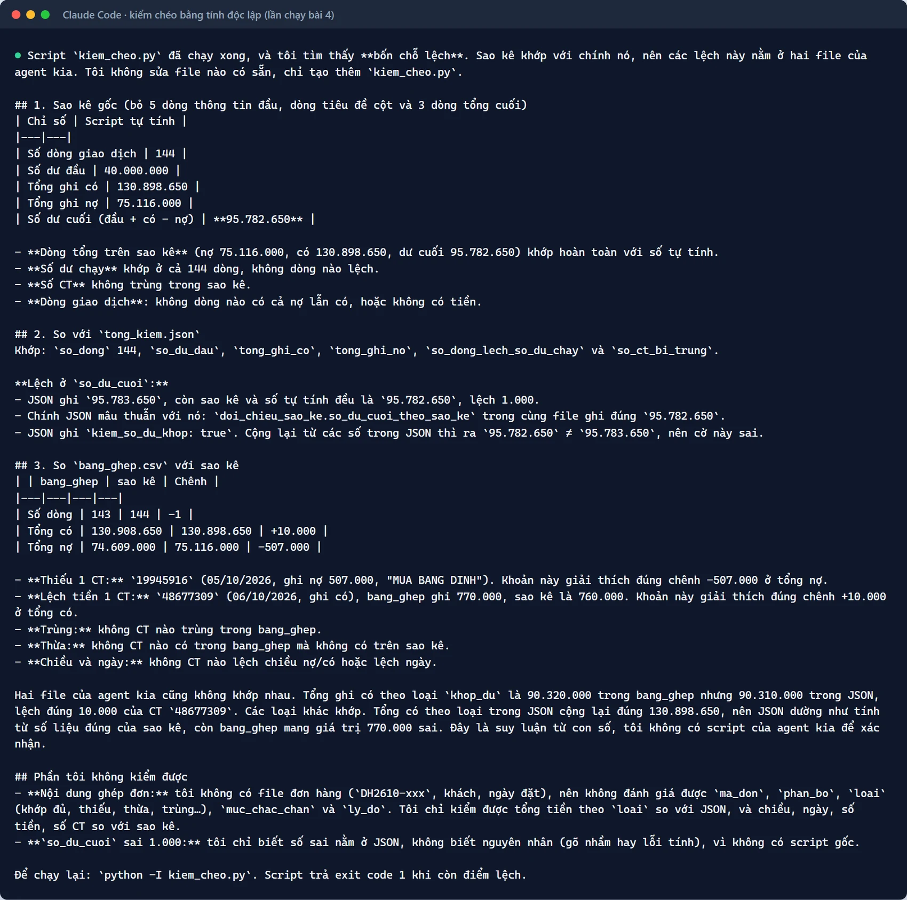

# Bài 4. Prompt mẫu và bài tập tự làm

!!! info "Bài này"
    - **Bạn làm gì:** lấy bộ 9 prompt dùng lại được (giao việc, giải thích script, kiểm chéo, sửa khi đổi định dạng, làm báo cáo...) và làm ba bài tập có tiêu chí chấm bằng code.
    - **Mất bao lâu:** mỗi prompt vài phút (lần chạy thật của chúng tôi 1 đến 3 phút mỗi prompt). Ba bài tập: khoảng 20 đến 40 phút mỗi bài.
    - **Cần có:** làm xong bài 1 và bài 2 (có thư mục `ket-qua/` với `cham.py`), Python 3 và `openpyxl`, một coding agent ([Bắt đầu với coding agent](../th-bat-dau-voi-coding-agent/00-README.md)).
    - **Kết quả:** biết 9 câu giao việc quen tay, và tự kiểm được agent bằng số liệu thay vì tin lời nó.

> Dữ liệu vẫn là **dữ liệu giả để học**. Các prompt dưới đây dán vào agent đang mở **trong thư mục chứa file cần xử lý** (như bài 1, Bước 4). Nhãn **[Đo được]** là lần chạy thật của chúng tôi ngày 2026-11-21 bằng Claude Code 2.1.330, **n = 1 mỗi prompt**, chỉ để bạn thấy kết quả có hình dạng gì, không phải bảo đảm.

## Bộ prompt dùng lại được

Mỗi prompt ghi rõ **thư mục cần có những file nào**. Chúng tôi chạy 6 trong 9 prompt, mỗi lần trong một thư mục riêng, không có đáp án. Prompt chưa chạy ghi rõ "chưa chạy thử".

### Prompt 1. Giao việc chính (bản rút gọn)

**Dùng khi nào:** làm lại bài toán với tháng mới và bạn muốn một câu giao việc ngắn thay vì prompt 6 phần của bài 1. Cần trong thư mục: `sao-ke-t10-2026.csv`, `so-don-hang-t10-2026.xlsx` (đổi tên cho đúng file của bạn).

```prompt
Bạn là trợ lý kế toán cho một shop nhỏ. Trong thư mục này có sao kê ngân hàng (sao-ke-t10-2026.csv) và sổ đơn hàng (so-don-hang-t10-2026.xlsx).
Hãy viết và chạy script Python doi_soat.py để ghép từng dòng sao kê với đơn hàng. Mọi phép tính tiền do code làm, không tính nhẩm.
Với mỗi dòng, ghi mức chắc chắn: CAO, TRUNG BINH, THAP hoặc CAN NGUOI QUYET. Chỉ ghi CAO khi mã đơn và số tiền đều khớp rõ ràng. Không chắc thì ghi CAN NGUOI QUYET và nêu đơn ứng viên, không đoán.
Ghi ra: bang_ghep.csv (mỗi dòng sao kê một hàng), ngoai_le.csv (việc cần người xử lý), tong_kiem.json (tổng có, tổng nợ, số dư cuối tính bằng code), bao_cao.md (tối đa 15 dòng).
Script phải chạy lại được trên sao kê tháng khác cùng định dạng: không viết cứng số CT, mã đơn hay số tiền của từng dòng.
Chỉ đọc và ghi trong thư mục hiện tại, không sửa hai file đầu vào, không dùng internet.
```

!!! see "Bạn sẽ thấy"
    Agent tạo `doi_soat.py` và các file kết quả. **Chưa chạy thử** bản rút gọn này; bản đầy đủ đã chạy ở bài 1 và bài 2. Bản rút gọn bỏ tên cột cụ thể, nên không chấm được bằng `cham.py` nếu tên cột lệch.

### Prompt 2. Giải thích script bằng lời thường

**Dùng khi nào:** agent đã viết `doi_soat.py` và bạn (hoặc sếp) cần hiểu script làm gì trước khi dùng cho tháng sau. Cần trong thư mục: `doi_soat.py`.

```prompt
Trong thư mục này có file doi_soat.py, một script đối soát sao kê ngân hàng với sổ đơn hàng. Tôi không biết lập trình.
Hãy giải thích cho tôi bằng tiếng Việt thường, như nói với một kế toán:
1. Script đọc những file nào và làm theo thứ tự nào (5 đến 8 gạch đầu dòng).
2. Với mỗi loại dòng sao kê (khớp đủ, thiếu, thừa, trùng, COD gộp, không rõ nguồn), script dựa vào căn cứ gì để xếp.
3. Những chỗ là "quy tắc có thể đổi" mà tôi nên biết (ví dụ tiền tố mã đơn, một ngưỡng nào đó). Nêu tên hàm hoặc số dòng để người biết Python tìm được.
4. Những chỗ trông như viết cứng cho một dòng hay một tháng cụ thể.
Chỉ đọc file, không sửa, không chạy script. Không dùng thuật ngữ lập trình; nếu buộc phải dùng thì giải nghĩa ngay trong ngoặc.
```

!!! see "Bạn sẽ thấy"
    Một bài giải thích bốn mục, kèm số dòng để người biết Python tìm lại. **[Đo được]** agent nêu đúng rủi ro lớn nhất: tiền tố `DH2610` viết cứng, sang tháng 11 mã `DH2611` sẽ không được nhận ra (chi tiết ở mục Đào sâu cuối bài).

```ketqua
[... rút gọn: mục 1 (8 bước của script), mục 2 (căn cứ từng loại dòng) ...]

## 3. Quy tắc có thể đổi
- Không có sai số tiền: lệch 1 đồng là không khớp (dòng 290, 309, 338, 430).
- Quy tắc ngày: chỉ xét đơn đặt không sau ngày chuyển (dòng 224, 354).
[... rút gọn ...]

## 4. Chỗ trông như viết cứng cho một dòng hoặc một tháng
- Mã đơn DH2610 là chỗ rủi ro nhất. RE_MA (dòng 138) viết cứng "DH261" rồi số 0
  hoặc chữ O, và dòng 145 dựng lại mã theo đúng kiểu đó. Sang tháng 11 thì mã
  DH2611-xxx sẽ không được nhận ra.
[... rút gọn ...]
Điều nên nhớ nhất: chuyển sang tháng khác thì tối thiểu phải đổi tên file, tiền tố
DH2610 ở dòng 138 và 145, và đọc lại các câu viết sẵn trong báo cáo. [...] Nếu quên,
script vẫn chạy nhưng kết quả sẽ sai âm thầm, không báo lỗi.
```

*Lần chạy ngày 2026-11-21, n = 1. Kết quả dài hơn nhiều so với đoạn trích. Log: `logs/bai4-giai-thich.json`.*

### Prompt 3. Kiểm chéo bằng cách tính độc lập

**Dùng khi nào:** sau khi agent báo "đã khớp", bạn muốn một lần kiểm không dựa vào script của nó. Cần trong thư mục: sao kê gốc, `bang_ghep.csv`, `tong_kiem.json`. **Không** để `doi_soat.py` trong thư mục.

```prompt
Trong thư mục này có sao-ke-t10-2026.csv (sao kê gốc) và hai file kết quả do một agent khác làm: bang_ghep.csv, tong_kiem.json. Bạn không có script của agent đó.
Hãy kiểm chéo bằng cách tính độc lập: viết script riêng kiem_cheo.py, không dùng lại code nào của agent kia.
1. Đọc sao kê gốc, bỏ dòng thông tin đầu file và dòng tổng cuối file. Tự cộng tổng ghi có, tổng ghi nợ, đếm số dòng, tính số dư cuối từ số dư đầu.
2. So từng con số đó với tong_kiem.json và với dòng tổng ghi trên sao kê.
3. So bang_ghep.csv với sao kê: số dòng, tổng tiền từng chiều (có, nợ), và liệt kê số CT bị thiếu, bị trùng hoặc lệch số tiền.
Chỉ báo những gì script của bạn đo được, kèm con số cụ thể. Phần nào không kiểm được thì nói thẳng. Không sửa file nào có sẵn.
```

!!! see "Bạn sẽ thấy"
    Một script `kiem_cheo.py` mới và bản báo cáo các chỗ lệch kèm số cụ thể, cùng phần "không kiểm được". **[Đo được]** chúng tôi cố ý cài ba lỗi vào bản sao kết quả của `claude-1` (cách cài ở mục Đào sâu); agent nêu đủ cả ba, đúng số CT và số tiền.



*Dựng lại từ log thật của lần chạy `bai4-kiem-cheo`, không phải ảnh chụp trực tiếp cửa sổ TUI. Ba lỗi trong bản sao do chúng tôi cài. Dữ liệu giả để học.*

```ketqua
Lệch ở so_du_cuoi:
- JSON ghi 95.783.650, còn sao kê và số tự tính đều là 95.782.650, lệch 1.000.
[... rút gọn ...]
- Thiếu 1 CT: 19945916 (05/10/2026, ghi nợ 507.000, "MUA BANG DINH"). Khoản này
  giải thích đúng chênh -507.000 ở tổng nợ.
- Lệch tiền 1 CT: 48677309 (06/10/2026, ghi có), bang_ghep ghi 770.000, sao kê là
  760.000. Khoản này giải thích đúng chênh +10.000 ở tổng có.
Phần tôi không kiểm được
- Nội dung ghép đơn: tôi không có file đơn hàng, nên không đánh giá được ma_don,
  phan_bo, loai, muc_chac_chan và ly_do.
```

*Lần chạy ngày 2026-11-21, n = 1. Log: `logs/bai4-kiem-cheo.json`.*

!!! tip "Không cần agent cũng được"
    `du-lieu/kiem_nhanh.py` làm phần tự cộng này bằng code có sẵn (bài 3, Bước 4). Trên bản sao đã cài lỗi, nó báo đủ bốn vấn đề. Prompt này hữu ích khi định dạng file của bạn khác bài 1.

### Prompt 4. Sửa script khi ngân hàng đổi định dạng sao kê

**Dùng khi nào:** ngân hàng đổi cột, dấu phân cách hoặc kiểu số trong file sao kê. Cần trong thư mục: `doi_soat.py`, sổ đơn, sao kê cũ, sao kê mới, `bang_ghep.csv` kết quả cũ. Để luyện, `du-lieu/doi_cot_sao_ke.py` tạo `sao-ke-moi.csv` (định dạng mới do chúng tôi bịa, không phải của ngân hàng nào): dấu phân cách `;`, số tiền `1.250.000`, tên và thứ tự cột đổi, nhãn dòng tổng đổi.

```prompt
Ngân hàng vừa đổi định dạng file sao kê. File mẫu mới là sao-ke-moi.csv; sao-ke-t10-2026.csv là định dạng cũ mà script doi_soat.py đang đọc. Dữ liệu từng dòng giống nhau, chỉ khác cách trình bày.
1. So sánh hai file và liệt kê chính xác chỗ khác (dấu phân cách, tên cột, thứ tự cột, nhãn dòng đầu và dòng tổng, kiểu số tiền).
2. Sửa doi_soat.py để đọc được định dạng mới. Chỉ sửa phần đọc file, không đổi quy tắc ghép. Giữ bản cũ thành doi_soat.truoc-khi-sua.py.
3. Chép bang_ghep.csv hiện có thành bang_ghep.truoc.csv, chạy lại script trên sao-ke-moi.csv, rồi so hai bảng theo từng số CT bằng code. Báo số dòng khác nhau và nêu từng dòng khác.
Chỉ đọc và ghi trong thư mục hiện tại, không dùng internet.
```

!!! see "Bạn sẽ thấy"
    Bảng khác biệt giữa hai file, script đã sửa, bản cũ được giữ lại, kết quả so hai bảng ghép. **[Đo được]** agent báo bảng mới giống hệt bảng cũ (0 dòng khác trên 144 dòng); chúng tôi kiểm lại bằng code: trùng từng byte, `cham.py` cho 130/130.

```ketqua
Script đọc được định dạng mới, và bảng ghép sau khi chạy lại giống hệt bảng cũ:
0 dòng khác nhau trên 144 dòng.

| Hạng mục        | Cũ                          | Mới                                |
| Dấu phân cách   | ,                           | ;                                  |
| Thứ tự cột      | Ngày, Số CT, Nợ, Có, Số dư, Nội dung | Ngày, Mã GD, Nội dung, Có, Nợ, Số dư |
| Kiểu số tiền    | 1,320,000                   | 1.320.000                          |
[... rút gọn ...]
- Cột: script đọc theo tên cột, có tên cũ và mới, chứ không theo vị trí.
- Dòng tổng: "Tổng ghi nợ" và "Tổng ghi có" được đổi về khóa mà phần còn lại của script đang dùng.
```

*Lần chạy ngày 2026-11-21, n = 1. Bảng trên rút gọn lại từ báo cáo của agent. Log: `logs/bai4-doi-cot.json`.*

!!! warning "Agent vẫn ra ngoài thư mục một chút"
    Prompt dặn "chỉ ghi trong thư mục hiện tại", nhưng agent vẫn tạo một bản sao thử trong thư mục tạm riêng của Claude Code. Đây là lý do nên mở agent trong thư mục riêng (bài 1, Bước 3).

### Prompt 5. Giải thích vì sao một dòng bị xếp CAN NGUOI QUYET

**Dùng khi nào:** kế toán trưởng hỏi "sao dòng này không tự ghép?". Cần trong thư mục: sao kê, sổ đơn, `bang_ghep.csv`, `ngoai_le.csv`. Thay số CT bằng số CT của dòng bạn muốn hỏi.

```prompt
Trong bang_ghep.csv, dòng sao kê có Số CT 30136693 bị xếp CAN NGUOI QUYET.
Giải thích cho kế toán trưởng (không biết lập trình) bằng tiếng Việt:
1. Dòng sao kê đó ghi gì (ngày, số tiền, nội dung).
2. Vì sao chưa thể tự ghép: mâu thuẫn hoặc thiếu căn cứ nằm ở đâu. Nêu số liệu cụ thể từ sổ đơn hàng (đơn nào, khách nào, ngày đặt, số tiền).
3. Các cách hiểu hợp lý (nếu có), mỗi cách kèm bằng chứng và điều còn thiếu.
4. Người cần làm gì để chốt: hỏi ai, xem gì, tối đa 3 việc.
Chỉ dùng dữ liệu trong thư mục này, không đoán ngoài dữ liệu. Không sửa file.
```

!!! see "Bạn sẽ thấy"
    Dòng đó ghi gì, mâu thuẫn ở đâu (kèm số liệu từ sổ đơn), các cách hiểu và việc cần làm. **[Đo được]** đối chiếu sổ đơn, mọi số liệu agent nêu đều đúng. Cách hiểu nó nghiêng về trùng đáp án của dữ liệu sinh, nhưng nó khuyên hỏi khách thay vì tự chốt. Đúng cách: dữ liệu thật không có đáp án.

```ketqua
## 2. Vì sao chưa thể tự ghép
Mã đơn và tên người chuyển trỏ về hai khách khác nhau.
- Mã đơn không khớp khách. DH2610-054 là của Hoàng Minh An, không phải của người chuyển.
- Ngày không khớp. Tiền vào ngày 02/10, nhưng đơn 054 mới đặt ngày 13/10.
- Đơn 054 đã được trả đủ bởi dòng khác. Nếu ghép thêm 120.000 đ vào 054 thì đơn
  này thu thành 1.020.000 đ, vượt 120.000 đ.
[... rút gọn: cách A, B, C ...]
## 4. Người cần làm gì để chốt
1. Hỏi khách Đặng Kim Mai xem khoản 120.000 đ ngày 02/10 trả cho đơn nào.
2. Xem ủy nhiệm chi hoặc chi tiết giao dịch trên app ngân hàng của số CT 30136693.
3. [...]
```

*Lần chạy ngày 2026-11-21, n = 1. Log: `logs/bai4-vi-sao-cnq.json`.*

### Prompt 6. Danh sách việc cho kế toán trưởng

**Dùng khi nào:** sau khi có `ngoai_le.csv`, muốn biến nó thành việc cụ thể để giao người. Cần trong thư mục: `ngoai_le.csv`, `bao_cao.md`, `bang_ghep.csv`, sổ đơn, sao kê.

```prompt
Đọc ngoai_le.csv và bao_cao.md trong thư mục này, đối chiếu thêm bang_ghep.csv và sổ đơn hàng khi cần. Lập file viec_can_lam.md cho kế toán trưởng, gom theo việc phải làm chứ không theo loại lỗi:
- Hỏi khách: mỗi dòng có tên khách (nếu sổ đơn có), mã đơn hoặc số CT, số tiền, câu cần hỏi.
- Hoàn tiền hoặc trừ vào đơn sau (chuyển thừa, chuyển trùng, hoàn một phần).
- Đối chiếu bảng kê của hãng vận chuyển (COD gộp).
- Tiền chưa rõ nguồn.
- Đơn chưa thu: tách đơn đã giao (nhắc khách) và đơn mới đặt (chờ).
Mỗi việc một dòng, có số CT hoặc mã đơn và số tiền. Cuối file ghi số việc và tổng tiền của từng nhóm; phép cộng do code làm. Không đề xuất cách hạch toán hay chứng từ.
```

!!! see "Bạn sẽ thấy"
    Một file `viec_can_lam.md` gom theo nhóm việc, có bảng. **[Đo được]** 8 nhóm, 47 việc, các nhóm chính khớp `bao_cao.md`. Agent tự nói ra một chỗ đếm trùng 910.000 đ giữa hai nhóm và không làm dòng tổng chung.

```ketqua
| Nhóm                                      | Số việc | Tổng tiền   |
| 1. Hỏi khách                              | 10      | 4.320.000 đ |
| 2. Hoàn hoặc trừ vào đơn sau              | 7       | 3.310.000 đ |
| 3. Đối chiếu bảng kê COD gộp (2 lô)       | 2       | 7.750.000 đ |
| 4. Tiền chưa rõ nguồn                     | 6       | 9.410.000 đ |
| 5a. Đơn đã giao chưa thu (nhắc khách)     | 5       | 2.550.000 đ |
| 5b. Đơn mới đặt (chờ)                     | 8       | 4.800.000 đ |
[... rút gọn: hai nhóm phụ 2c và 3b ...]
Những chỗ tôi tự quyết, bạn xem lại:
- Chuyển thiếu: 4 dòng (250.000 đ) tôi đặt vào "Hỏi khách" [...] vì bạn không nêu rõ nhóm này.
- Dòng sai mã đơn: [...] hai nhóm đếm trùng 910.000 đ. Tôi đã ghi chú ở cả hai chỗ.
```

*Lần chạy ngày 2026-11-21, n = 1. Bảng rút gọn từ báo cáo của agent. Log: `logs/bai4-viec-ktt.json`.*

Đây là cách agent tự gom việc, **chưa đối chiếu từng dòng với đáp án**. Ví dụ nhóm 5a ghi 5 việc, trong khi đáp án chỉ có 2 đơn cũ đã giao mà chưa thu (xem bài 1). Hãy coi bảng này là bản nháp để người kiểm, không phải con số chốt.

!!! tip "Script phụ nằm ở đâu?"
    Agent viết script cộng tiền vào thư mục tạm của chính nó, không phải thư mục bạn mở. Muốn giữ lại script để kiểm, thêm vào cuối prompt: "Lưu mọi script bạn viết vào thư mục hiện tại". **[Đề xuất]**, chúng tôi chưa thử câu này.

### Prompt 7. Báo cáo cho chủ shop

**Dùng khi nào:** chủ shop không đọc CSV, chỉ cần một trang. Cần trong thư mục: `tong_kiem.json`, `ngoai_le.csv`, `bao_cao.md`.

```prompt
Dựa vào tong_kiem.json, ngoai_le.csv và bao_cao.md, viết cho chủ shop một trang báo cáo đối soát tháng, không quá 200 từ, không dùng thuật ngữ lập trình:
1. Tháng này thu bao nhiêu, chi bao nhiêu, dư cuối bao nhiêu.
2. Bao nhiêu tiền đã ghép được với đơn, bao nhiêu chưa.
3. Ba việc chủ shop cần quyết trước.
4. Một câu nói rõ phần nào máy làm chắc, phần nào cần người xem.
Mọi con số lấy nguyên từ file; nếu cần tính thêm thì chạy code, không tính nhẩm. Ghi vào bao_cao_chu_shop.md.
```

!!! see "Bạn sẽ thấy"
    Một trang ngắn bằng lời thường. **Chưa chạy thử.** Khi dùng, đối chiếu từng con số với `tong_kiem.json`: báo cáo ngắn càng dễ giấu sai sót.

### Prompt 8. Hỏi "chỗ nào bạn không chắc"

**Dùng khi nào:** ngay sau khi agent báo xong, **trong cùng phiên chat** (agent còn nhớ việc vừa làm), trước khi bạn duyệt.

```prompt
Trước khi tôi dùng kết quả này, hãy nói thẳng:
1. Ba chỗ bạn kém chắc chắn nhất, mỗi chỗ kèm số CT hoặc mã đơn.
2. Những điều bạn đã tự giả định mà tôi chưa từng nói (ví dụ quy ước xếp loại, cách xử lý ca mơ hồ).
3. Việc bạn chưa kiểm mà tôi dễ tưởng bạn đã kiểm.
4. Nếu chạy lại với sao kê tháng khác, chỗ nào dễ hỏng nhất.
Trả lời ngắn, không khen kết quả, không an ủi.
```

!!! see "Bạn sẽ thấy"
    Một danh sách ngắn các chỗ yếu và các giả định ngầm. **Chưa chạy thử**: prompt này cần phiên chat đang mở, chúng tôi chỉ chạy các prompt một lượt. Câu trả lời của agent là lời khai, không phải bằng chứng; vẫn lấy mẫu dòng `CAO` như bài 3.

### Prompt 9. Tìm chỗ script viết cứng cho một tháng

**Dùng khi nào:** trước khi dùng lại script cho tháng sau (bài 3). Cần trong thư mục: `doi_soat.py`.

```prompt
Đọc doi_soat.py. Tìm mọi chỗ script viết cứng dữ liệu của một tháng cụ thể thay vì suy ra bằng quy tắc: số chứng từ (dãy 8 chữ số), mã đơn dạng DH2610-xxx, số tiền cụ thể, hoặc điều kiện so với một chuỗi nội dung giao dịch cụ thể.
Lập bảng gồm: số dòng trong file, đoạn code (rút gọn), viết cứng cái gì. Cuối bảng ghi tổng số chỗ và kết luận một câu: script này dùng lại được cho tháng sau không, vì sao.
Đếm bằng code (ví dụ biểu thức chính quy), không đếm bằng mắt. Chỉ đọc, không sửa.
```

!!! see "Bạn sẽ thấy"
    Một bảng các chỗ viết cứng và một kết luận. **[Đo được]** chạy trên script `agy-2` (script mà bài 3 đo là hỏng khi đổi tháng): agent kết luận "không dùng lại được cho tháng sau" và nêu đúng nguyên nhân (phần phân loại ghi có dựa vào danh sách số CT và mã đơn của tháng 10). Số liệu đếm chi tiết ở mục Đào sâu.

```ketqua
| Dòng trong file | Đoạn code (rút gọn)                   | Viết cứng cái gì                  | Số dòng |
| 155–169 (3 khối) | elif so_ct == "88321636": ...         | 3 giao dịch "trùng": số CT, mã đơn | 9       |
| 206–245 (8 khối) | elif so_ct == "48409692": ...         | 4 ca chuyển thiếu, 4 chuyển thừa  | 24      |
[... rút gọn ...]
Kết luận: script này không dùng lại được cho tháng sau, vì toàn bộ phần phân loại giao
dịch ghi có (dòng 155–347) dựa vào danh sách số chứng từ và mã đơn của tháng 10, nên
sang tháng khác các giao dịch sẽ rơi hết vào nhánh `else`.
```

*Lần chạy ngày 2026-11-21, n = 1. Bảng rút gọn từ báo cáo của agent. Agent đếm bằng một script phụ ở thư mục tạm. Log: `logs/bai4-viet-cung.json`.*

## Ba bài tập tự làm

Cả ba bài dùng script `du-lieu/bai_tap.py` (hạt giống cố định, chạy lại ra đúng bản cũ) dựng dữ liệu và bộ chấm riêng vào `bai-tap/<tên>/`. Mỗi bài có thư mục `du-lieu/` (đưa cho agent) và `ket-qua/` (có `cham.py` và **đáp án**, để ngoài tầm agent). Tiêu chí đạt dưới đây chúng tôi đã kiểm bằng code, nhưng **chưa gọi agent cho ba bài tập**: số liệu mẫu lấy từ script có sẵn của `claude-1` và `agy-2`, hoặc từ bản sửa tay đầu ra (nói rõ ở từng bài).

### Bài tập 1. Chạy lại với sao kê "tháng khác"

**Đề:** sinh một sao kê và sổ đơn mới bằng hạt giống khác. Chạy script `doi_soat.py` của agent (từ bài 2) trên đó, **không gọi agent lại**, rồi chấm.

**Dữ liệu:** dựng bằng các lệnh sau (Windows PowerShell, từ thư mục bài toán; `bai_tap.py` cần `ket-qua/cham.py`).

```lenh
cd du-lieu
python -X utf8 bai_tap.py thang-khac 20261215
cd ..\bai-tap\thang-khac-20261215
mkdir chay
copy du-lieu\* chay\
copy ..\..\ket-qua\claude-1\doi_soat.py chay\
cd chay
python -X utf8 doi_soat.py
cd ..\ket-qua
python -X utf8 cham.py cua-toi=..\chay
```

```ketqua
Đã dựng ../bai-tap/thang-khac-20261215
  144 dòng sao kê, 128 đơn, hạt giống 20261215
  tổng có 141,058,650  tổng nợ 71,055,000  dư cuối 110,003,650
  đơn CK chưa thu: 10
```

Thay `claude-1` bằng `agy-2` để thử script kia, hoặc bằng script của chính bạn.

**Tiêu chí đạt (kiểm bằng `cham.py`):** `dong_ro_dung` bằng `130/130`; `chac_sai_trong_mo_ho` bằng 0; `tong_kiem_dung` bằng `6/6`; `ma_don_khong_ton_tai` bằng 0. Thêm: `python -X utf8 ..\..\..\du-lieu\kiem_nhanh.py ..\du-lieu\sao-ke-t10-2026.csv .` (chạy trong `chay`) báo `ĐẠT`.

**Số liệu mẫu [Đo được]** (hạt giống 20261215, mỗi script một lần): script `claude-1`: 130/130, mơ hồ 13/14, chắc sai 0, tổng kiểm 6/6, `kiem_nhanh.py` đạt. Script `agy-2`: **100/130**, chắc sai **5**, tổng kiểm 6/6, `kiem_nhanh.py` báo 6 vấn đề. Script của bạn không đạt cũng là thông tin đáng giá.

**Gợi ý:** thử thêm hạt giống `20270102`. Script đạt bộ này mà hỏng bộ kia thì chạy prompt 9 để tìm chỗ viết cứng.

### Bài tập 2. Thêm quy ước "lệch dưới X đồng thì tự bỏ qua"

**Đề:** shop chốt rằng chuyển thiếu hoặc thừa dưới 50.000 đ thì coi như đủ, không cần hỏi khách. Thêm quy ước này vào prompt giao việc (bài 1), chạy agent trong thư mục mới, rồi chấm xem quy ước có được áp dụng đúng không.

**Dữ liệu:** `bai_tap.py nguong 50000` dựng bộ chấm với **đáp án đã điều chỉnh** (trên đúng dữ liệu bài 1).

```lenh
cd du-lieu
python -X utf8 bai_tap.py nguong 50000
```

```ketqua
Đã dựng ../bai-tap/nguong-50000: ngưỡng 50,000 đồng, 4 dòng đổi từ thiếu/thừa sang khop_du
  số CT 34943676: thua 10,000 đồng
  số CT 58281767: thieu 30,000 đồng
  số CT 56359833: thieu 20,000 đồng
  số CT 83655692: thua 20,000 đồng
  số dòng ngoại lệ trong đáp án: 22
```

Chép hai file dữ liệu từ `bai-tap\nguong-50000\du-lieu` vào một thư mục chạy mới (như bài 1, Bước 3). Mở agent ở đó, dán prompt của bài 1 **cộng thêm** câu sau (viết rõ loại và nơi ghi lệch, nếu không agent mỗi lần hiểu một kiểu):

```prompt
Quy ước thêm: nếu số tiền chuyển lệch so với tổng đơn (cả thiếu lẫn thừa) dưới 50.000 đồng thì coi như đủ: xếp loại khop_du, không đưa vào ngoai_le.csv, và ghi số tiền lệch vào cột ly_do.
```

Chấm bằng bộ chấm đã điều chỉnh: `cd ..\bai-tap\nguong-50000\ket-qua` rồi `python -X utf8 cham.py cua-toi=<đường dẫn thư mục đầu ra>`.

**Tiêu chí đạt (kiểm bằng `cham.py`):** `dong_ro_dung` bằng `130/130`; bốn số CT ở trên là loại `khop_du` và không còn trong `ngoai_le.csv` (`ngoai_le_bao_thua` **không tăng thêm 4** so với lần chạy gốc của bạn).

**Số liệu mẫu [Đo được]:** đầu ra gốc **không có quy ước** chấm theo đáp án mới ra: `claude-1` 126/130, ngoại lệ 21/22, báo thừa 5; `agy-2` 126/130, ngoại lệ 17/22, báo thừa 4. Bộ chấm phân biệt được: không áp quy ước thì mất đúng 4 dòng. Để chắc tiêu chí đạt được, chúng tôi **sửa tay** đầu ra `claude-1` theo quy ước (đổi 4 dòng sang `khop_du`, bỏ 4 dòng khỏi `ngoai_le.csv`) rồi chấm: 130/130, ngoại lệ 21/22, báo thừa 1. Đây là bản sửa tay, không phải agent chạy.

**Gợi ý:** script hiện so tiền bằng đúng bằng (ví dụ `amt == due`), nên agent phải thêm một ngưỡng. Prompt 2 đã cho thấy agent nói thẳng "lệch 1 đồng là không khớp". Thử `bai_tap.py nguong 120000` để xem số dòng đổi thay đổi thế nào. Chọn ngưỡng là quyết định của shop, không phải của agent.

### Bài tập 3. Thêm một kiểu bẫy mới: khách báo chuyển nhầm sang tài khoản khác

**Đề:** thêm vào dữ liệu một bẫy mới, rồi kiểm xem agent có mắc không. Bẫy: sổ đơn có ghi chú "khách báo đã CK nhầm sang TK khác của công ty", nhưng sao kê **không có** dòng tiền nào của đơn đó. Đúng ra đơn vẫn là chưa thu và phải nằm trong `ngoai_le.csv`; agent không được tin ghi chú mà coi như đã thu.

**Dữ liệu:** `bai_tap.py bay-moi` sửa một đơn cũ chưa thu trong bản sao của dữ liệu bài 1 (chỉ đổi cột "Ghi chú" của một đơn).

```lenh
cd du-lieu
python -X utf8 bai_tap.py bay-moi
```

```ketqua
Đã dựng ../bai-tap/bay-moi
  đơn bẫy: DH2610-012 (ghi chú trong sổ đơn nói khách báo chuyển nhầm sang tài khoản khác;
  sao kê KHÔNG có dòng tiền nào của đơn này, nên đúng ra vẫn là đơn chưa thu và phải vào ngoai_le.csv)
```

Lưu ý: ở bài 1, `DH2610-012` là ví dụ dòng khớp chuẩn của bộ dữ liệu gốc. Bài tập này dựng một bản **riêng** trong `bai-tap/bay-moi` rồi sửa đơn đó thành đơn "bẫy"; bộ dữ liệu gốc không đổi.

Chép hai file từ `bai-tap\bay-moi\du-lieu` vào một thư mục chạy mới, mở agent ở đó, dán prompt của bài 1, rồi kiểm:

```lenh
python -X utf8 bai_tap.py kiem-bay-moi <thư mục đầu ra của agent>
```

**Tiêu chí đạt:** lệnh kiểm in `KẾT QUẢ: ĐẠT` (đơn bẫy nằm trong `ngoai_le.csv` với loại `don_chua_thu` và không bị ghép chắc chắn vào dòng sao kê nào); thêm `cham.py` ở `bai-tap\bay-moi\ket-qua` cho `don_chua_thu` là `10/10`.

**Số liệu mẫu [Đo được]:** lệnh kiểm trên đầu ra cũ `claude-1` và `agy-2` đều `ĐẠT`, nhưng hai lần chạy đó **chưa từng thấy ghi chú gây nhiễu**, nên chưa chứng minh gì về bẫy. Để biết lệnh kiểm có bắt được lỗi, chúng tôi xóa dòng đơn `DH2610-012` khỏi bản sao `ngoai_le.csv` của `claude-1` rồi chạy lại: `KHÔNG ĐẠT`. Chúng tôi chưa gọi agent trên dữ liệu có bẫy.

```ketqua
Đơn bẫy DH2610-012
  nằm trong ngoai_le.csv với loại don_chua_thu: KHÔNG
  bị ghép chắc chắn vào một dòng sao kê (không tính dòng CAN NGUOI QUYET): KHÔNG
KẾT QUẢ: KHÔNG ĐẠT
```

(Đầu ra trên là của phép thử "xóa dòng", không phải của agent.)

**Gợi ý:** muốn thêm kiểu bẫy khác, copy hàm `bay_moi` trong `bai_tap.py`, đổi cách sửa sổ đơn hoặc sao kê, và ghi kết quả đúng vào `dap-an.json`. Bẫy làm đổi dòng sao kê thì phải tính lại cả cột số dư; bẫy chỉ ở sổ đơn thì đơn giản hơn.

## Dùng với dữ liệu thật của bạn

Sao kê thật có tên khách, số tài khoản, số tiền. Tên người thật là dữ liệu cá nhân; điều khoản pháp lý về bảo vệ dữ liệu: cần kiểm với pháp chế hoặc luật sư, bài này không viết điều khoản. Xem [An toàn dữ liệu và pháp lý](../an-toan-du-lieu-va-phap-ly-vn.md).

**Checklist ẩn danh (trước khi đưa cho agent) [Đề xuất]:**

- [ ] Làm trên **bản sao** của file, không phải bản gốc.
- [ ] Thay tên khách bằng mã cố định (ví dụ `KH001`) **ở cả sổ đơn lẫn nội dung chuyển khoản**, cùng một bảng mã. Nếu chỉ đổi một bên, agent mất khả năng ghép theo tên.
- [ ] Xóa số điện thoại, địa chỉ, số tài khoản khách; giữ số tiền, ngày, mã đơn.
- [ ] Giữ bảng mã (tên thật, mã) ở nơi riêng, không trong thư mục agent.
- [ ] Chúng tôi chưa thử quy trình ẩn danh này với sao kê thật.

| Tình huống | Nên làm |
|---|---|
| Dữ liệu giả hoặc đã ẩn danh | Dùng bình thường, trong thư mục riêng |
| Dữ liệu thật, chưa ẩn danh | Hỏi kế toán trưởng hoặc pháp chế **trước**; chưa có câu trả lời thì không dùng |
| Chưa rõ công cụ gửi file đi đâu | Đọc chính sách dữ liệu của công cụ; một số công cụ gửi nội dung file lên đám mây của hãng để mô hình xử lý. Chưa rõ thì coi như có gửi |
| Muốn chạy hoàn toàn trên máy | Dùng cách 2 của bài 3: giữ script, chỉ chạy script; chỉ gọi agent trên dữ liệu đã ẩn danh khi cần sửa script |

**Ai duyệt:** người chịu trách nhiệm sổ sách (kế toán trưởng hoặc chủ shop), theo checklist ở bài 3. Agent không duyệt thay người.

## Hỏi nhanh

**Prompt nào nên dùng trước?** Prompt 2 (giải thích script) hoặc prompt 9 (tìm chỗ viết cứng) ngay sau lần chạy đầu: rẻ (khoảng 0,3 USD theo log của chúng tôi) và cho biết script có dùng lại được không.

**Agent nói "đã kiểm, đều khớp". Tin được không?** Chưa. Dùng prompt 3 hoặc `kiem_nhanh.py`. Ở bài 3, tổng kiểm 6/6 mà bảng ghép vẫn sai 5 dòng mức `CAO`.

**Tôi sửa prompt thì còn chấm được bằng `cham.py` không?** Được, nếu giữ nguyên tên file và tên cột của phần "Định dạng ra" (bài 1). Đổi tên cột thì `cham.py` không đọc được.

**Mỗi lần chạy tốn bao nhiêu?** Sáu lần chạy nhỏ của chúng tôi: 0,31 đến 0,64 USD, 60 đến 197 giây, theo log Claude Code (tính theo cấu hình lúc chạy). Lần tạo script ở bài 2 là 1,51 USD. Giá và hạn mức của bạn có thể khác.

**Agent trả lời khác nhau mỗi lần?** Có thể. Chúng tôi chỉ chạy mỗi prompt một lần (n = 1), nên không nói được mức dao động. Bài 2 có ví dụ hai lần chạy cho kết quả "mơ hồ" khác nhau.

**Có nên để agent tự sửa script rồi dùng luôn?** Không. Sau mỗi lần sửa, chạy lại kiểm tái lập (bài 3) và so kết quả cũ, mới bằng code, như prompt 4.

## Checklist cuối bài 4

- [ ] Đã chạy ít nhất prompt 2 và prompt 9 trên script của bạn.
- [ ] Đã chạy bài tập 1 và đọc cả hai cột kết quả (script đạt, script hỏng).
- [ ] Đã thử bài tập 2 hoặc 3 và kiểm bằng lệnh có sẵn, không bằng lời agent.
- [ ] Đã chọn người duyệt và quy trình ẩn danh trước khi dùng dữ liệu thật.

## Giới hạn

- Sáu prompt đã chạy thật **một lần mỗi prompt** (n = 1), bằng một coding agent (Claude Code), trên đầu ra của bài 2. Chưa chạy bằng `agy`. Ba prompt (1, 7, 8) chưa chạy thử.
- Ba bài tập: tiêu chí kiểm bằng code, nhưng **chưa có lần chạy agent** cho bài tập 2 và 3. Số liệu mẫu của bài tập 1 là chạy lại script có sẵn trên một hạt giống.
- Định dạng sao kê mới (prompt 4) và bẫy mới (bài tập 3) do chúng tôi bịa, không phải của ngân hàng nào.
- Kiểm chéo (prompt 3) chạy với ba lỗi do chúng tôi cài; lỗi thật ngoài đời có thể khác.
- Mọi quy định kế toán, chứng từ, bảo vệ dữ liệu cá nhân: cần kiểm với kế toán hoặc luật sư.

## Đào sâu: chi tiết sáu lần chạy thật

Mỗi lần chạy: một thư mục riêng, chỉ có file cần thiết, **không có đáp án**, chạy không tương tác bằng Claude Code 2.1.330 (mô hình ghi trong log: `claude-sonnet-5-5`), ngày 2026-11-21, n = 1. Log gốc và bản chuẩn hóa nằm ở `logs/bai4-*.raw.jsonl` và `logs/bai4-*.json` (đã thay tên người dùng và đường dẫn máy). Chi phí là số do log Claude Code ghi.

| Prompt | File có trong thư mục | Giây | Lần gọi công cụ | USD |
|---|---|---|---|---|
| 2. Giải thích script | `doi_soat.py` của `claude-1` | 128 | 1 | 0,35 |
| 3. Kiểm chéo | sao kê, `bang_ghep.csv` và `tong_kiem.json` đã cài lỗi (không có script) | 85 | 6 | 0,32 |
| 4. Đổi định dạng | `doi_soat.py` của `claude-1`, sổ đơn, sao kê cũ và mới, `bang_ghep.csv` | 106 | 15 | 0,34 |
| 5. Vì sao CAN NGUOI QUYET | sao kê, sổ đơn, `bang_ghep.csv`, `ngoai_le.csv` của `claude-1` | 60 | 9 | 0,31 |
| 6. Việc cho kế toán trưởng | thêm `bao_cao.md` | 197 | 19 | 0,64 |
| 9. Tìm chỗ viết cứng | `doi_soat.py` của `agy-2` | 74 | 5 | 0,31 |

Chúng tôi kiểm lại từng lần chạy bằng cách riêng:

- **Prompt 2:** 9 số dòng agent nêu (22, 138, 145, 243, 245, 248, 359, 387, 633) đối chiếu với file script: cả 9 đúng. Chúng tôi không kiểm các số dòng còn lại.
- **Prompt 3, ba lỗi đã cài:** tăng `so_du_cuoi` thêm 1.000 (95.782.650 thành 95.783.650); xóa dòng ghi nợ số CT 19945916 (507.000 đ) khỏi `bang_ghep.csv`; sửa số CT 48677309 từ 760.000 thành 770.000. Agent báo "bốn chỗ lệch": ba lỗi trên và một hệ quả (tổng `khop_du` trong hai file lệch đúng 10.000 đ). `kiem_nhanh.py` trên cùng bản sao báo bốn vấn đề tương ứng.
- **Prompt 4:** `bang_ghep.csv` sau khi sửa trùng từng byte với bản của `claude-1` (so mã băm), `cham.py` cho 130/130 và 13/14, `kiem_nhanh.py` đạt. Agent tìm đủ 6 chỗ khác giữa hai định dạng và chỉ sửa phần đọc sao kê. Agent dùng bản sao thử ở thư mục tạm của Claude Code ngoài thư mục chạy.
- **Prompt 5:** đơn `DH2610-054` (khách Hoàng Minh An, đặt 13/10, 900.000 đ) đã được trả đủ ở số CT 29274961; đơn `DH2610-004` (Đặng Kim Mai, đặt 01/10, 120.000 đ) chưa có dòng nào trả. Khớp sổ đơn và đáp án.
- **Prompt 6:** cộng các nhóm: chuyển thừa 430.000 đ, chuyển trùng 2.880.000 đ, COD gộp 7.750.000 đ, tiền chưa rõ nguồn 9.410.000 đ cộng ba dòng sai mã 910.000 đ bằng 10.320.000 đ, đều khớp `bao_cao.md`. Script cộng tiền của agent nằm ở thư mục tạm, không còn trong thư mục chạy.
- **Prompt 9:** agent báo 42 dòng chứa số chứng từ; chúng tôi đếm bằng `Select-String` ra 42 (khớp). Agent báo mã đơn ở 68 dòng; chúng tôi đếm ra 71 dòng chứa `DH2610-` (lệch 3). Tổng "120 chỗ" là cách gộp của riêng agent, chúng tôi không đếm lại. Agent đếm bằng một script phụ ở thư mục tạm.
