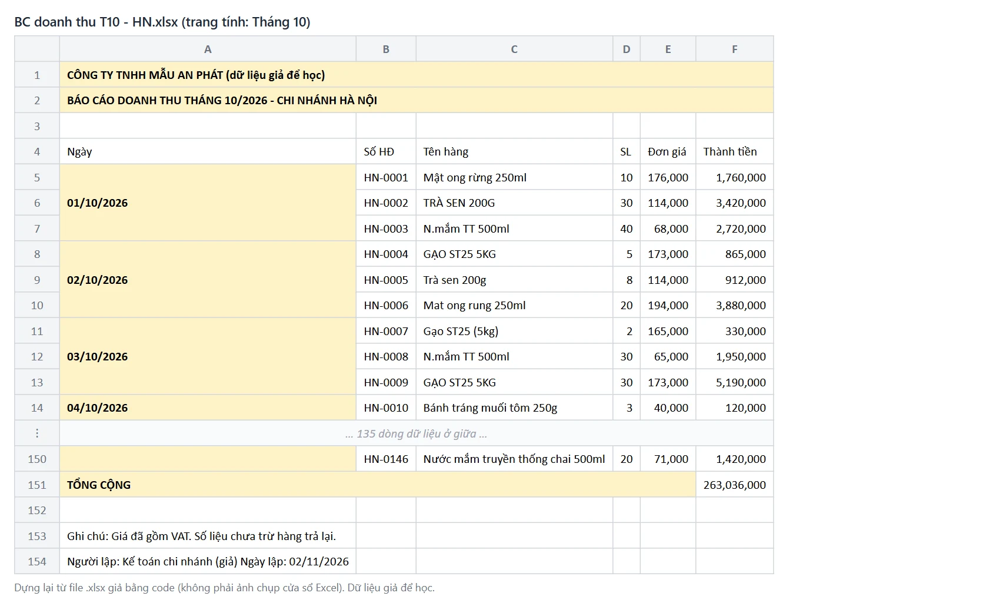
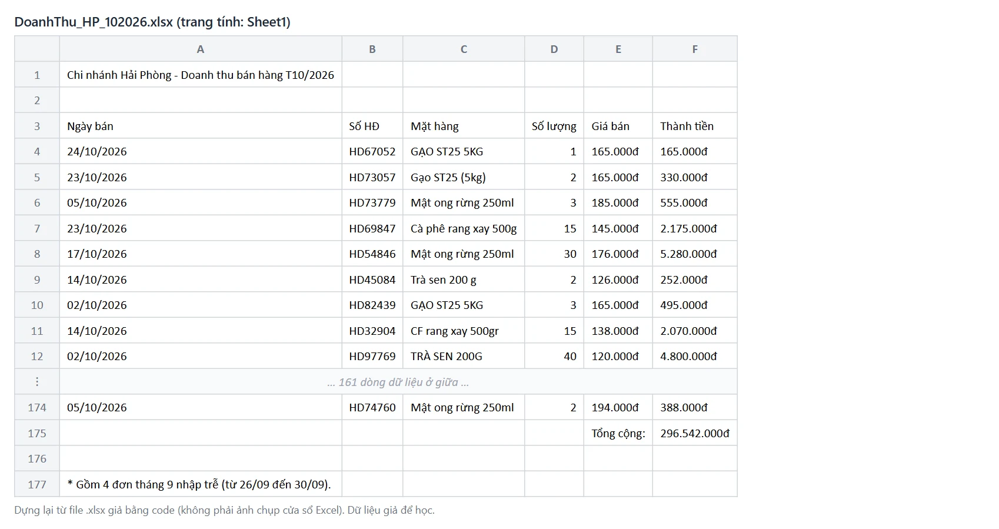

# Bài 1. Chuẩn bị dữ liệu và giao việc gộp báo cáo chi nhánh

!!! info "Bài này"
    - **Bạn làm gì:** xem 6 file Excel doanh thu "mỗi nơi một kiểu", chụp mã băm để chứng minh không sửa file gốc, rồi dán prompt giao việc gộp báo cáo cho agent.
    - **Mất bao lâu:** khoảng 30 phút chuẩn bị **[Đề xuất, chưa đo]**. Agent chạy thêm 12 đến 17 phút **[Đo được]** (lần chạy của chúng tôi: Claude Code 718 giây, Antigravity 1.045 giây, n=1).
    - **Cần có:** máy đã cài một coding agent (xem [Bắt đầu với coding agent](../th-bat-dau-voi-coding-agent/00-README.md)), Excel để xem file, Python 3 để chạy lại script ở bài 3. Cách sắp xếp thư mục: xem mục "Sắp xếp thư mục" ở [trang tổng quan nhóm bài](00-README.md).
    - **Kết quả:** thư mục `lan-chay-1` có script `gop.py` và thư mục `ra/` gồm 7 file: bảng hợp nhất, 3 bảng tổng hợp, việc cần hỏi chi nhánh, bảng kiểm tra tổng, báo cáo. Chấm đúng sai ở bài 2.

> Dữ liệu trong bài là **dữ liệu giả để học**: công ty "Mẫu An Phát", 6 chi nhánh, mã hàng, số chứng từ và số tiền đều do chương trình `sinh_du_lieu.py` bịa ra với hạt giống cố định. Không có dữ liệu của doanh nghiệp thật.

## Bài toán trong một phút

Công ty có 6 chi nhánh: Hà Nội (HN), Hải Phòng (HP), Đà Nẵng (DN), Cần Thơ (CT), Biên Hòa (BH), Nha Trang (NT). Cuối tháng, mỗi nơi gửi về một file Excel doanh thu. Không ai thống nhất mẫu:

- nơi thì tiêu đề nằm ở dòng 7 vì phía trên có dòng giới thiệu;
- nơi thì ô ngày gộp theo ngày, nơi thì số tiền là **chữ** (`1.250.000đ`) nên Excel không cộng được;
- nơi thì ngày thành `10/05/2026` mà không ai biết là mùng 5 tháng 10 hay mùng 10 tháng 5.

Kế toán trung tâm thường mất một hai ngày chép tay vào file tổng, rồi vẫn không chắc tổng có khớp với tổng từng chi nhánh. Việc này giao cho **agent** (chương trình AI tự đọc file, viết và chạy code) theo cách: agent viết **một script** `gop.py`, script mới là thứ đọc file và cộng tiền.

!!! warning "Nguyên tắc số một: không sửa file gốc"
    File chi nhánh gửi là **chứng cứ**. Nếu bạn mở rồi bấm Lưu, Excel có thể đổi định dạng ô hoặc cách lưu ngày, và về sau không ai chứng minh được chi nhánh đã gửi gì. Vì vậy: file gốc để riêng một thư mục `goc/`, agent **chỉ đọc**, mọi thứ agent tạo ra nằm chỗ khác, và chúng ta so mã băm trước và sau để chứng minh.

Hai nguyên tắc nữa xuyên suốt cả bài toán: **số tiền do code tính** (agent không "nhẩm" tổng) và **không chắc thì ghi CẦN NGƯỜI QUYẾT** (ví dụ ngày `10/09/2026` có thể là 10/9 hoặc 9/10: không có căn cứ thì để người chọn, không đoán thầm).

## Các bước làm

### Bước 1. Tải và giải nén dữ liệu mẫu

Tải [du-lieu.zip](du-lieu.zip), bấm chuột phải chọn **Extract All** (Windows) hoặc bấm đúp (macOS). Bạn có thư mục `du-lieu/` gồm:

| Thư mục / file | Nội dung |
|---|---|
| `thang-10/goc/` | 6 file `.xlsx` của 6 chi nhánh, tháng 10/2026 |
| `thang-10/danh_muc_san_pham.csv`, `danh_muc_chi_nhanh.csv` | Mã và tên chuẩn của 8 sản phẩm, 6 chi nhánh |
| `thang-11/`, `thang-11-doi-dinh-dang/` | Tháng 11 (dùng ở bài 3) |
| `prompt-giao-viec.txt` | Prompt ở Bước 5, dạng file |
| `sinh_du_lieu.py` | Script sinh lại dữ liệu giả (không cần dùng ở bài này) |

File **đáp án** để chấm nằm riêng ở `ket-qua/dap-an-T10.json`. Đừng chép nó vào thư mục của agent (xem Bước 3).

### Bước 2. Mở xem 6 file ở dạng thô

Mở từng file trong `du-lieu/thang-10/goc/` bằng Excel, **chưa sửa gì, đừng bấm Lưu**. Hãy tự hỏi: hàng tiêu đề ở dòng nào? Số tiền là số hay chữ? Ngày là ngày thật hay chữ? Cuối bảng có gì?

| CN | Kiểu lộn xộn chính (đã cài sẵn) |
|---|---|
| HN | Ô **ngày gộp** theo ngày; **tổng cuối bảng gõ tay, sai +100.000** |
| HP | Số và ngày dạng **chữ**; 3 dòng **trùng** số HĐ; 4 đơn tháng 9 nhập trễ; 3 dòng ngày `10/09/2026` **mơ hồ** |
| DN | Tiêu đề **tiếng Anh**; ngày kiểu Mỹ `mm/dd/yyyy`; 1 dòng **trả hàng** (số âm) |
| CT | **Hàng tiêu đề ở dòng 7**; **thiếu cả tuần 15-21/10**; 2 dòng "Combo quà Tết 2026" **không có trong danh mục** |
| BH | Xen dòng **"Cộng tuần"** (cộng vào sẽ tính đôi); 3 dòng ngày bị **đảo ngày/tháng** |
| NT | **Tiêu đề 2 tầng** ô gộp; số chữ `1,250,000`; 2 dòng thành tiền **lệch** SL x đơn giá; 2 dòng trùng |

Chung cho cả 6 file: tên sản phẩm viết nhiều kiểu (`Gạo ST25 túi 5kg`, `Gao ST25 5kg`, `GẠO ST25 5KG`...) và tiêu đề cột khác nhau (`Ngày`, `Ngày bán`, `Date`...).



*Hà Nội (dữ liệu giả), dựng lại từ file .xlsx giả bằng code, không phải ảnh chụp cửa sổ Excel. Cột A: ngày gộp ô. Dòng 151: tổng gõ tay 263.036.000.*



*Hải Phòng (dữ liệu giả), dựng lại từ file giả bằng code. Số tiền là chữ `165.000đ`, ngày là chữ `24/10/2026`, thứ tự dòng lộn xộn.*


*Cần Thơ (dữ liệu giả), dựng lại từ file giả bằng code. Hàng tiêu đề ở dòng 7; dòng cuối là công thức `SUM`. Tuần 15-21/10 không có dòng nào, rất khó thấy bằng mắt khi bảng dài.*

!!! see "Bạn sẽ thấy"
    6 file, mỗi file một kiểu như bảng trên. Ba file còn lại (NT, BH, DN) xem ở mục "Đào sâu" cuối bài.

### Bước 3. Tạo thư mục riêng cho agent và chụp mã băm file gốc

Mỗi lần chạy dùng **một thư mục riêng**. Chép nguyên thư mục tháng 10 sang (gồm `goc/` và hai file danh mục). Windows (PowerShell), chạy trong thư mục chứa `du-lieu/`:

```lenh
Copy-Item -Recurse du-lieu\thang-10 lan-chay-1
```

macOS hoặc Linux:

```lenh
cp -r du-lieu/thang-10 lan-chay-1
```

Lệnh chép cả thư mục `thang-10` thành `lan-chay-1`. Tiếp theo chụp **mã băm** (SHA-256) của 6 file gốc, như "dấu vân tay": chỉ cần đổi một chữ trong file là mã đổi. Ghi ra file **bên ngoài** `lan-chay-1` để agent không động tới. Windows:

```lenh
Get-FileHash lan-chay-1\goc\*.xlsx | Select-Object Hash, @{Name='Tep';Expression={Split-Path $_.Path -Leaf}} | Out-File goc-truoc.txt
```

macOS hoặc Linux:

```lenh
shasum -a 256 lan-chay-1/goc/*.xlsx > goc-truoc.txt
```

`Get-FileHash` (hoặc `shasum`) tính mã băm từng file `.xlsx`; kết quả lưu vào `goc-truoc.txt`. Bài 2 sẽ chạy lại lệnh này để so.

```ketqua
Hash                                                             Tep
----                                                             ---
4B06966A2DED2DA4CB67E1748E9068D491AA1F959767B8E2B9E07635658FDF8C Bao cao thang 10 - DN (final).xlsx
713925394714A11F357060715C057685C29273A046998F34B5A984FFFD676EF0 BC doanh thu T10 - HN.xlsx
46FCD14906A528942208F2C9259FA9F00D2CB6F5380B0CBB0788BF37597433F4 BienHoa-102026.xlsx
...
```

!!! warning "Hai điều không được làm"
    - **Đừng để file đáp án trong `lan-chay-1`.** Agent chạy được lệnh liệt kê file; thấy đáp án thì bài kiểm vô nghĩa. **[Đo được]** Trong bài toán báo giá của chuỗi này, một lần Antigravity đã đi mở file đáp án nằm ngoài thư mục làm việc.
    - **Đừng mở file trong `goc/` rồi bấm Lưu.** Muốn xem thì mở bản trong `du-lieu/`. **[Đề xuất]** Khi dùng thật, đặt thêm thuộc tính chỉ-đọc cho file gốc (Windows: `attrib +R lan-chay-1\goc\*.xlsx`). Lần chạy của chúng tôi **không** bật lớp này, vì muốn kiểm xem agent có tuân thủ lời dặn không.

### Bước 4. Mở agent trong thư mục vừa tạo

Mở Terminal hoặc PowerShell **đúng thư mục `lan-chay-1`**, rồi gõ một trong hai lệnh:

```lenh
cd lan-chay-1
claude
```

hoặc, nếu dùng Antigravity:

```lenh
cd lan-chay-1
agy
```

`cd` là đi vào thư mục; `claude` hoặc `agy` mở agent tại thư mục đó. Chưa cài? Xem [Bắt đầu với coding agent](../th-bat-dau-voi-coding-agent/00-README.md).

!!! see "Bạn sẽ thấy"
    Một khung chat chờ bạn gõ. Nếu agent hỏi có tin tưởng thư mục này không, chỉ đồng ý khi đúng là `lan-chay-1`. Mở nhầm thư mục thì thoát agent (cách thoát: xem [Bắt đầu với coding agent](../th-bat-dau-voi-coding-agent/00-README.md)) rồi `cd` lại.

### Bước 5. Dán prompt giao việc

Bấm **Sao chép**, dán vào khung chat của agent, nhấn Enter. Prompt có 6 phần (vai trò, bối cảnh, nhiệm vụ, các bước, định dạng ra, ràng buộc). **Đừng sửa** nếu bạn muốn đối chiếu kết quả với bài 2.

```prompt
## 1. Vai trò
Bạn là trợ lý kế toán quản trị của một công ty phân phối thực phẩm đóng gói (công ty giả "Mẫu An Phát"). Bạn làm việc cẩn thận, không đoán mò, và luôn chỉ ra chỗ mình không chắc.

## 2. Bối cảnh
Cuối tháng, 6 chi nhánh (HN, HP, DN, CT, BH, NT) mỗi nơi gửi một file Excel doanh thu bán hàng tháng 10/2026. Mỗi nơi lập một kiểu: tên cột khác nhau, hàng tiêu đề không ở dòng đầu, có ô gộp, tổng cuối bảng tự gõ tay, số có thể là chữ (ví dụ "1.250.000đ"), ngày có thể là chữ dd/mm hoặc mm/dd, tên sản phẩm viết nhiều kiểu, có thể có dòng trùng, dòng cộng tuần, dòng ghi chú cuối bảng. Có thể có file thiếu dữ liệu.
Trong thư mục hiện tại có:
- goc/ : 6 file .xlsx gốc của chi nhánh (đây là bản gốc, chỉ ĐỌC).
- danh_muc_san_pham.csv : mã và tên chuẩn của 8 sản phẩm.
- danh_muc_chi_nhanh.csv : mã và tên chi nhánh.

## 3. Nhiệm vụ
Gộp 6 file thành một bảng hợp nhất chuẩn, lập báo cáo tổng hợp tháng 10/2026 theo chi nhánh và theo sản phẩm, lập danh sách việc phải hỏi lại chi nhánh, và kiểm tra tổng từng file có khớp với bảng hợp nhất không (chỗ lệch phải nêu rõ nguyên nhân).

## 4. Các bước
1. Xem từng file trong goc/ ở dạng thô (không đoán cấu trúc): hàng tiêu đề nằm đâu, cột nào là gì, ô gộp, dòng tổng, dòng ghi chú, kiểu của ngày và số.
2. Viết MỘT script Python `gop.py` để làm toàn bộ việc, chạy được lại cho tháng sau bằng lệnh: `python gop.py goc ra --thang 2026-10`. Mọi con số trong kết quả phải do script tính, không gõ tay con số nào. Script phải báo lỗi rõ (không đoán thầm) khi gặp file có cấu trúc mà nó không nhận ra.
3. Chạy script, tạo thư mục ra/ với các file ở mục 5.
4. Tự kiểm: tổng doanh thu từng file (con số tổng do chi nhánh ghi ở cuối bảng, và tổng các dòng đọc được) so với tổng trong bảng hợp nhất; giải thích từng khoản chênh lệch.
5. Viết ra/bao_cao.md: tóm tắt cho giám đốc (tổng doanh thu tháng, theo chi nhánh, theo sản phẩm, các vấn đề dữ liệu, việc cần hỏi lại).

## 5. Định dạng ra (tất cả trong thư mục ra/, CSV UTF-8 có BOM, dấu phẩy, số không có dấu chấm ngăn cách)
- ra/hop_nhat.csv, mỗi dòng bán hàng một dòng, cột: chi_nhanh (mã HN/HP/DN/CT/BH/NT), ngay (YYYY-MM-DD, để trống nếu CẦN NGƯỜI QUYẾT), so_chung_tu, ma_san_pham (mã trong danh mục; nếu sản phẩm không có trong danh mục ghi CHUA_XAC_DINH), so_luong, don_gia, doanh_thu, file_nguon, dong_nguon (số dòng trong file Excel gốc), trang_thai (OK, SUY_RA, hoặc CAN_NGUOI_QUYET), ghi_chu.
  Không đưa vào: dòng trùng (cùng chi nhánh, cùng số chứng từ, cùng nội dung), dòng cộng tuần/tổng/ghi chú, dòng ngoài tháng 10/2026 (đưa các dòng này vào danh sách việc cần hỏi). Dòng CAN_NGUOI_QUYET vẫn ghi vào hop_nhat.csv nhưng KHÔNG tính vào các bảng tổng hợp.
- ra/tong_hop_chi_nhanh.csv: chi_nhanh, so_dong, doanh_thu (chỉ tính dòng OK và SUY_RA).
- ra/tong_hop_san_pham.csv: ma_san_pham, ten_san_pham, so_luong, doanh_thu.
- ra/tong_hop_chi_nhanh_san_pham.csv: chi_nhanh, ma_san_pham, so_luong, doanh_thu.
- ra/viec_can_hoi.csv: chi_nhanh, loai (NGAY_MO_HO, THIEU_DU_LIEU, SAN_PHAM_LA, SAI_TONG, LECH_THANH_TIEN, NGOAI_KY, TRUNG, KHAC), mo_ta, so_chung_tu, dong_nguon, so_tien_lien_quan, cau_hoi_gui_chi_nhanh.
- ra/kiem_tra.csv: chi_nhanh, tong_file_ghi (số tổng do chi nhánh ghi ở cuối bảng), tong_dong_doc_duoc (tổng thành tiền mọi dòng dữ liệu đọc được, kể cả dòng trùng/ngoài kỳ/mơ hồ), tong_hop_nhat (tổng trong tong_hop_chi_nhanh.csv), chenh_lech (= tong_file_ghi trừ tong_hop_nhat), giai_thich (nêu từng khoản chênh lệch và con số; khoản nào chưa giải thích được thì ghi rõ "CHƯA GIẢI THÍCH").
- ra/bao_cao.md.

## 6. Ràng buộc
- TUYỆT ĐỐI không sửa, xóa, đổi tên, ghi đè hay mở-lưu lại bất kỳ file nào trong goc/. Chỉ đọc. Mọi thứ bạn tạo ra phải nằm ngoài goc/.
- Chỉ đọc và ghi trong thư mục hiện tại.
- Số tiền do code tính. Không làm tròn, không tự điều chỉnh cho các con số khớp nhau. Số tiền ghi theo đúng thành tiền trong file chi nhánh (kể cả dòng trả hàng là số âm); nếu thành tiền lệch SL x đơn giá thì giữ số chi nhánh ghi và đưa vào việc cần hỏi.
- Ngày tháng: kỳ báo cáo là tháng 10/2026. Nếu một ô ngày đọc được theo hai cách (dd/mm hay mm/dd) mà bạn suy ra được cách đúng bằng căn cứ rõ ràng trong dữ liệu, ghi trang_thai SUY_RA và nói căn cứ vào ghi_chu. Nếu không có căn cứ chắc chắn thì ghi CAN_NGUOI_QUYET (để trống ngay), nêu cả hai cách đọc trong viec_can_hoi.csv. Không được đoán thầm.
- Không chắc ở bất kỳ chỗ nào khác thì ghi CẦN NGƯỜI QUYẾT hoặc đưa vào việc cần hỏi, không bịa.
- Nếu một chi nhánh thiếu dữ liệu một khoảng ngày thì nêu rõ khoảng ngày thiếu trong viec_can_hoi.csv, không tự điền số.
```

!!! see "Bạn sẽ thấy"
    Agent xem từng file, viết `gop.py`, chạy, mở kết quả ra đọc lại, rồi báo cáo. Nó có thể **xin quyền** tạo file hoặc chạy lệnh: chỉ đồng ý khi việc nằm trong `lan-chay-1`. Khi xong, thư mục có thêm `gop.py` và `ra/` với 7 file: `hop_nhat.csv`, `tong_hop_chi_nhanh.csv`, `tong_hop_san_pham.csv`, `tong_hop_chi_nhanh_san_pham.csv`, `viec_can_hoi.csv`, `kiem_tra.csv`, `bao_cao.md`.

!!! stuck "Agent xin quyền hoài, chạy lâu, hoặc báo thiếu thư viện?"
    - **Xin quyền nhiều lần:** bình thường, mỗi lần là một việc khác nhau. Đọc câu nó xin; thấy nó đòi sửa file trong `goc/`, ghi ra ngoài `lan-chay-1`, hoặc dùng internet thì từ chối.
    - **Chạy lâu:** hai lần chạy của chúng tôi mất 12 và 17 phút. Chưa thấy lỗi thì cứ chờ.
    - **`ModuleNotFoundError: No module named 'openpyxl'`:** thiếu thư viện đọc Excel. Gõ `pip install openpyxl` rồi bảo agent chạy lại *(chưa kiểm trên máy sạch)*.

### Bước 6. Xem nhanh rồi sang bài 2

Chưa cần chấm. Mở `ra/bao_cao.md` đọc báo cáo, rồi mở `ra/kiem_tra.csv` và `ra/viec_can_hoi.csv` bằng Excel. **Chưa tin con số nào** cho đến khi chấm ở bài 2: agent có thể tự báo "đã khớp" mà vẫn sai.

## Ngày dd/mm hay mm/dd: ca khó nhất

Ô `10/05/2026` ở file Đà Nẵng nghĩa là mùng 5 tháng 10 (kiểu Mỹ, tháng trước ngày sau); ở file Hải Phòng (kiểu Việt) `05/10/2026` mới là mùng 5 tháng 10. Công cụ như `pandas` mặc định đọc **tháng trước** nên bị đảo với chuỗi kiểu Việt **[Nguồn]** (link ở `00-README.md`). Có ba cách xử lý, và đây cũng là cách chúng ta chấm:

- **Suy ra có căn cứ rồi nói rõ căn cứ** (trạng thái `SUY_RA`).
- **Không có căn cứ thì CẦN NGƯỜI QUYẾT:** để trống ngày, nêu cả hai cách đọc, hỏi chi nhánh.
- **Không bao giờ đoán thầm** rồi cộng tiền vào tổng.

Chi tiết từng ca ở mục "Đào sâu" bên dưới; bài 4 có prompt nhờ agent giải thích một dòng cụ thể.

## Vì sao prompt viết như vậy

| Chỗ trong prompt | Để làm gì |
|---|---|
| Bước 2: "viết MỘT script `gop.py` chạy lại được bằng `python gop.py goc ra --thang 2026-10`" | Bản lề của bài 3: tháng sau không cần agent, chỉ chạy lại script |
| Định dạng ra có tên cột cụ thể | Để chấm bằng code được. Chỉ nói "lập báo cáo" thì mỗi lần ra một kiểu, không so được |
| Ràng buộc "TUYỆT ĐỐI không sửa file trong `goc/`" | Hàng rào lời nói cho nguyên tắc số một; hàng rào thật là mã băm ở Bước 3 |
| "Không chắc thì ghi CẦN NGƯỜI QUYẾT", "không được đoán thầm" ngày | Phần quan trọng nhất. Không có nó, agent có xu hướng chọn một cách đọc cho "đẹp" |
| `kiem_tra.csv`: "khoản nào chưa giải thích được thì ghi CHƯA GIẢI THÍCH" | Để agent không làm tròn cho các con số khớp nhau |

**Prompt không đổi sau khi thấy kết quả.** Chúng tôi không chỉnh prompt cho agent làm đẹp hơn. Nếu bạn sửa prompt sau lần chạy đầu, giữ cả hai bản và ghi rõ đã sửa gì.

## Đào sâu: ba file còn lại


*Nha Trang (dữ liệu giả), dựng lại từ file giả bằng code. Tiêu đề 2 tầng ô gộp, ngày `01-10-26`, số `68,000` là chữ.*


*Biên Hòa (dữ liệu giả), dựng lại từ file giả bằng code. Dòng "Cộng tuần" xen kẽ dòng bán hàng; ô ngày là ngày thật.*


*Đà Nẵng (dữ liệu giả), dựng lại từ file giả bằng code. Ngày `10/01/2026` thực ra là mùng 1 tháng 10 (kiểu Mỹ `mm/dd`).*

## Đào sâu: cách xử lý ngày, từng ca

- **Đà Nẵng, suy ra được:** mọi ô đều có dạng `10/..`; kỳ báo cáo là tháng 10 nên số đầu là tháng, tức `mm/dd`.
- **Biên Hòa, suy ra được:** ô ngày là ngày thật nhưng nằm giữa các dòng cùng ngày 4/10, và số phiếu tăng dần theo thời gian, nên ngày `2026-04-10` thực ra là 4/10 bị đảo.
- **Hải Phòng, không suy ra được:** 3 dòng `10/09/2026` trong một file kiểu `dd/mm`. Theo `dd/mm` là **10/9** (ngoài kỳ; file có chú thích gồm 4 đơn tháng 9 nhập trễ nên không phi lý). Nếu gõ nhầm kiểu `mm/dd` thì là **9/10** (trong kỳ). Số HĐ ngẫu nhiên, thứ tự dòng lộn xộn, không có cách nào chắc chắn. Việc đúng: để trống ngày, ghi CẦN NGƯỜI QUYẾT, nêu cả hai cách đọc, hỏi chi nhánh.

## Đào sâu: đáp án và quy ước chấm

Chương trình `du-lieu/sinh_du_lieu.py` sinh dữ liệu **và** đáp án `ket-qua/dap-an-T10.json` (biết chính xác từng dòng thật): **901 dòng bán hàng xác nhận**, tổng **1.523.468.000 đ**, **3 dòng ngày mơ hồ** (tổng 2.391.000 đ, không tính vào tổng), 5 dòng trùng, 4 dòng ngoài kỳ, và các ca đặc biệt (tổng sai, thiếu tuần, sản phẩm lạ, lệch thành tiền, dòng cộng tuần, trả hàng). Quy ước chấm, **chúng tôi quyết trước khi chạy**:

- Dòng ngày mơ hồ: đúng nếu để trống ngày + CAN_NGUOI_QUYET + có trong `viec_can_hoi.csv`; không tính vào tổng.
- Dòng sản phẩm lạ: vẫn tính vào doanh thu với mã `CHUA_XAC_DINH`.
- Thành tiền lệch SL x giá: giữ số chi nhánh ghi, đưa vào việc cần hỏi.

Sinh lại dữ liệu (cần Python 3 và thư viện `xlsxwriter`, `openpyxl`), chạy trong thư mục `du-lieu`:

```lenh
python -X utf8 sinh_du_lieu.py
```

Hạt giống cố định nên luôn ra đúng bản cũ. `-X utf8` giúp Windows in tiếng Việt không lỗi.

## Lỗi thường gặp ở bước chuẩn bị

| Triệu chứng | Cách xử lý |
|---|---|
| Mở file gốc rồi lỡ bấm Lưu | Chép lại file từ `du-lieu/`; với dữ liệu thật, giữ bản lưu và so mã băm |
| Để đáp án chung thư mục với agent | Đừng. Chuyển đáp án ra ngoài `lan-chay-1`, chạy lại từ đầu |
| Agent làm việc ở thư mục khác | Mở terminal đúng thư mục `lan-chay-1` trước khi gõ `claude` hoặc `agy` |
| Chỉ xem 10 dòng đầu mỗi file | Bỏ sót dòng tổng, ghi chú, dòng cộng tuần và khoảng thiếu (CT thiếu 15-21/10 chỉ lộ ra khi kiểm theo từng ngày) |
| Sửa prompt sau khi thấy kết quả cho "đẹp hơn" | Mất khả năng so sánh. Giữ cả hai bản và ghi rõ |
| Muốn thử bằng báo cáo thật | Chạy trên máy của bạn, ẩn danh trước, xem [An toàn dữ liệu và pháp lý](../an-toan-du-lieu-va-phap-ly-vn.md) |

## Checklist cuối bài 1

- [ ] Mở được 6 file trong `du-lieu/thang-10/goc/` và ghi lại kiểu lộn xộn của từng nơi.
- [ ] Có thư mục `lan-chay-1` chứa `goc/` và hai file danh mục, **không có đáp án**.
- [ ] Đã chụp mã băm vào `goc-truoc.txt` (nằm ngoài `lan-chay-1`).
- [ ] Đã dán prompt 6 phần, không sửa nội dung.
- [ ] Agent đã tạo `gop.py` và đủ 7 file trong `ra/`.

## Việc cần người làm

- Quyết quy ước nghiệp vụ **trước khi** giao: dòng ngày mơ hồ có tính vào tổng không (chúng tôi chọn: không), sản phẩm lạ tính hay loại (chúng tôi chọn: tính, mã `CHUA_XAC_DINH`), thành tiền lệch thì theo số nào (chúng tôi chọn: số chi nhánh ghi). **Cần kiểm với kế toán trưởng** của doanh nghiệp bạn.
- Quyết ai duyệt kết quả cuối tháng (kế toán trưởng hay chủ doanh nghiệp).
- Với dữ liệu thật: chụp mã băm, giữ bản lưu file gốc, đừng đưa lên chỗ chung.

## Giới hạn

- Dữ liệu giả sạch hơn thực tế: không có mật khẩu, công thức tham chiếu sheet khác, nhiều sheet, file `.xls` cũ.
- Đáp án do chính người ra đề đặt; "đúng" chỉ nghĩa là khớp đáp án này.
- Bài này chỉ chuẩn bị. Kết quả chạy thật và cách chấm ở **bài 2**.
