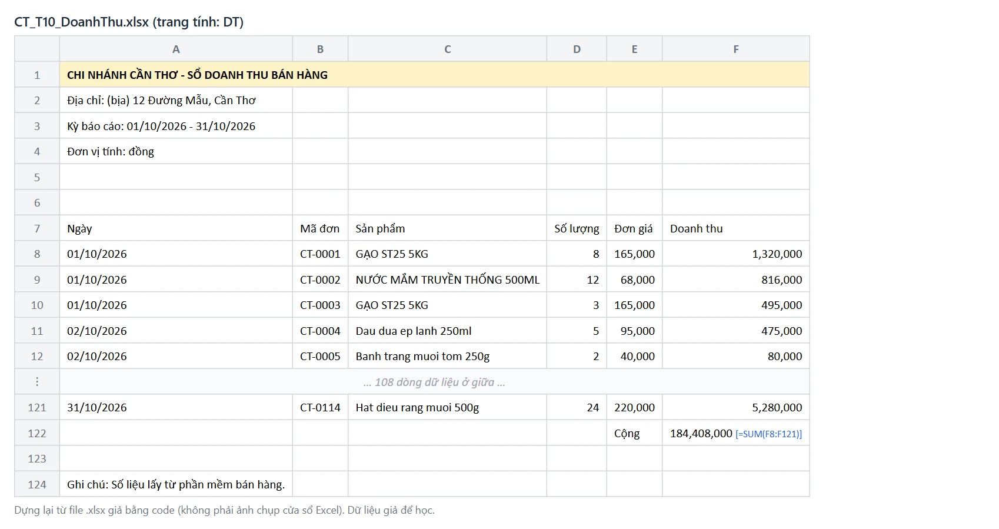
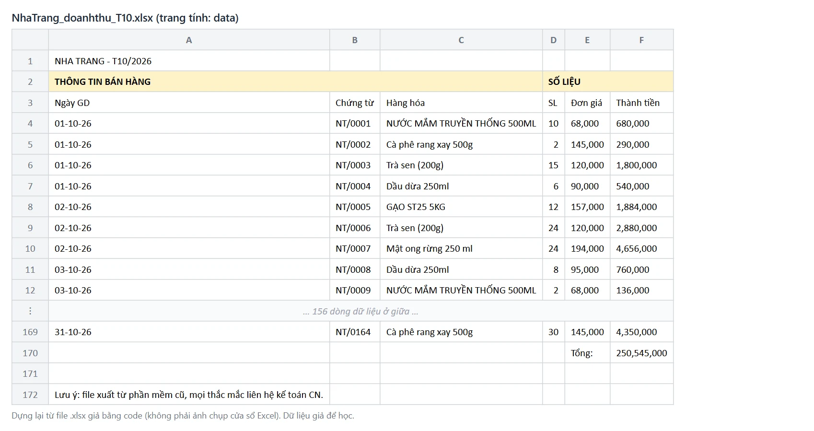
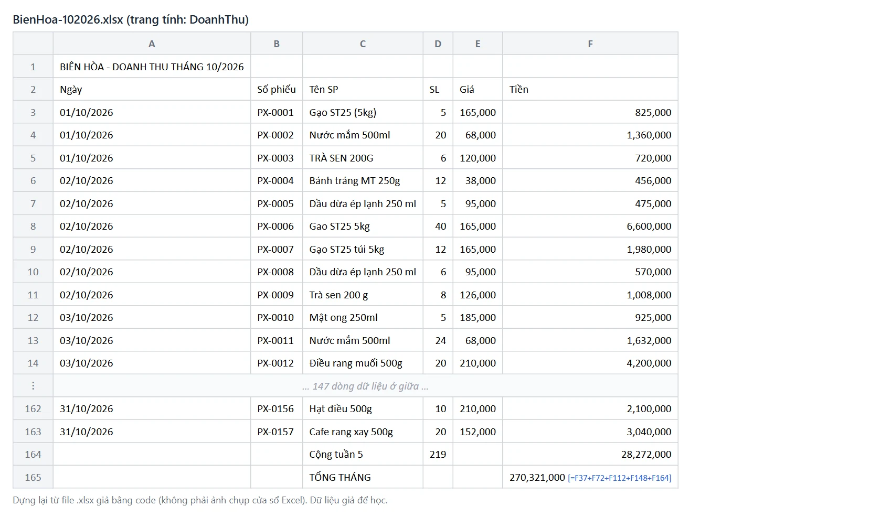
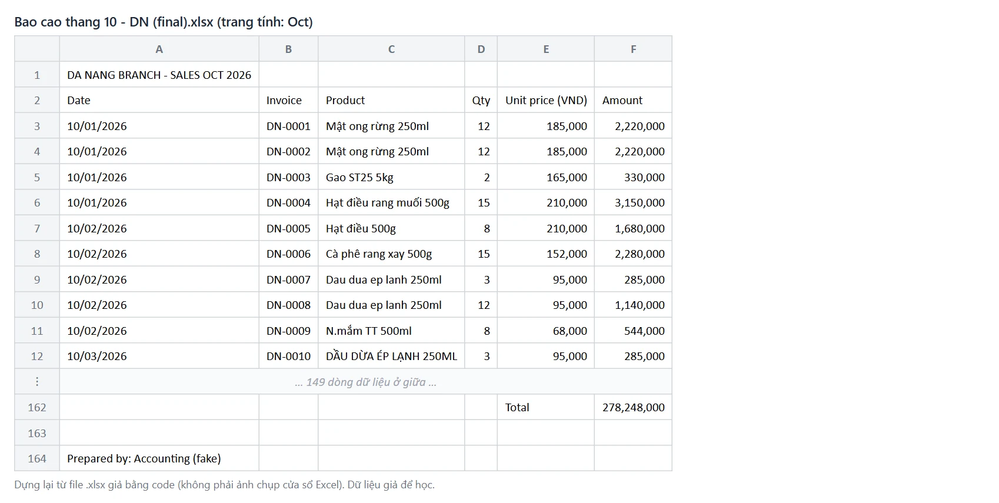
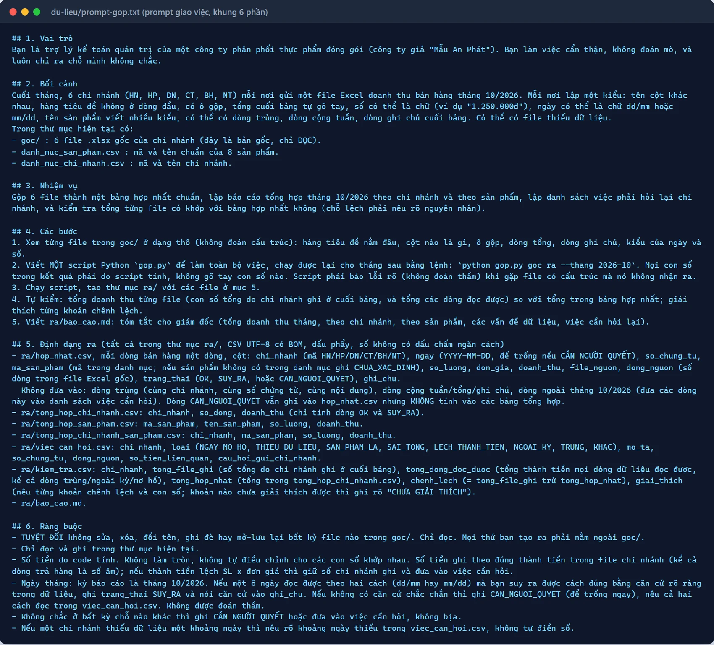

# Bài 1: Chuẩn bị dữ liệu và giao việc cho agent

> Dữ liệu dùng trong bài là **dữ liệu giả để học** (công ty "Mẫu An Phát", 6 chi nhánh bịa). Xem `00-README.md`.

## Mục tiêu đo được

Sau bài này bạn có:

1. Một thư mục làm việc an toàn: 6 file chi nhánh để trong `goc/` (chỉ đọc), danh mục sản phẩm/chi nhánh, và một bản **mã băm SHA-256** của 6 file để sau này chứng minh "không sửa file gốc".
2. Hiểu 6 file lộn xộn theo 6 kiểu khác nhau và liệt kê được các "bẫy" trước khi giao cho agent.
3. Một prompt giao việc theo khung 6 phần, dùng được ngay.
4. Một **đáp án** (do người, không do agent, cất ngoài thư mục agent làm việc) để chấm ở bài 2.

Thời gian ước tính cho người mới: 30 đến 45 phút nếu chỉ làm theo bài **[Đề xuất, chưa đo]**; dữ liệu mẫu tải sẵn trong `du-lieu/`.

## 1. Bài toán một câu

Cuối tháng 6 chi nhánh gửi 6 file Excel doanh thu tháng 10/2026, mỗi nơi một kiểu. Ta cần: (a) một bảng hợp nhất chuẩn, (b) báo cáo tháng theo chi nhánh và theo sản phẩm, (c) danh sách việc phải hỏi lại chi nhánh, (d) bảng kiểm tra "tổng từng file có khớp tổng hợp nhất không; lệch ở đâu thì nêu rõ".

## 2. Nguyên tắc số một: không sửa file gốc

File chi nhánh gửi là chứng cứ. Nếu bạn mở rồi bấm Lưu, Excel có thể đổi định dạng ô, đổi cách lưu ngày, thêm thông tin; về sau không còn chứng minh được chi nhánh đã gửi gì. Ba lớp bảo vệ, từ dễ đến chắc:

1. **Để file gốc trong một thư mục riêng tên `goc/`** và bảo agent trong prompt "chỉ đọc, không ghi" (chúng tôi làm điều này).
2. **Chụp mã băm trước khi giao việc, so lại sau khi xong.** Mã băm là "dấu vân tay" của file; chỉ cần đổi một chữ là mã băm đổi. Lệnh trên Windows PowerShell:
   ```powershell
   cd thang-10
   Get-FileHash goc\*.xlsx -Algorithm SHA256 | Select-Object Hash, Path | Out-File goc-truoc.txt
   ```
   Giải thích: `Get-FileHash` tính dấu vân tay từng file `.xlsx` trong `goc`; `Select-Object` chỉ giữ cột mã và đường dẫn; `Out-File` lưu vào `goc-truoc.txt`. Sau khi agent làm xong, chạy lại lệnh, lưu ra `goc-sau.txt` rồi so hai file: giống hệt là chưa bị sửa.
3. **Đặt thuộc tính chỉ-đọc cho file gốc** (`attrib +R goc\*.xlsx` trên Windows). **[Đề xuất]**: chúng tôi *không* làm bước này trong lần chạy thật, vì muốn kiểm xem agent có tuân thủ lời dặn không; bạn dùng thật nên bật thêm lớp này.

Trong bài 2, `cham.py` so mã băm `goc/` của thư mục agent đã làm với bản gốc ban đầu. Kết quả **[Đo được]**: cả hai agent để nguyên file gốc.

## 3. Xem từng file ở dạng thô: 6 chi nhánh, 6 kiểu

Mở từng file bằng Excel (hoặc đọc ảnh dưới đây), **chưa sửa gì**. Hãy tự hỏi: hàng tiêu đề ở dòng nào? Cột nào là cột nào? Số tiền là số hay chữ? Ngày là ngày thật hay chữ? Cuối bảng có gì?

| CN | File | Kiểu lộn xộn (đã cài sẵn trong dữ liệu giả) |
|---|---|---|
| HN Hà Nội | `BC doanh thu T10 - HN.xlsx` | Ô **ngày gộp theo ngày** (ngày chỉ ghi ở dòng đầu của nhóm). **Tổng cuối bảng gõ tay, sai +100.000** so với tổng các dòng. Có ghi chú cuối bảng. |
| HP Hải Phòng | `DoanhThu_HP_102026.xlsx` | Số dạng chữ `1.250.000đ`. Ngày dạng chữ `dd/mm/yyyy`. Dòng lộn xộn thứ tự. **3 dòng trùng số HĐ**. **4 đơn tháng 9 nhập trễ** (ngoài kỳ). **3 dòng ngày gõ kiểu `10/09/2026`** mà không có căn cứ để biết là 10/9 hay 9/10. |
| DN Đà Nẵng | `Bao cao thang 10 - DN (final).xlsx` | Tiêu đề **tiếng Anh** (`Date`, `Qty`, `Unit price (VND)`, `Amount`). Ngày chữ **`mm/dd/yyyy`** cả file. Có 1 dòng **trả hàng** (số âm). |
| CT Cần Thơ | `CT_T10_DoanhThu.xlsx` | **Hàng tiêu đề ở dòng 7** (phía trên là dòng giới thiệu). **Thiếu cả tuần 15-21/10**. 2 dòng sản phẩm **"Combo quà Tết 2026" không có trong danh mục**. Tổng cuối là công thức. |
| BH Biên Hòa | `BienHoa-102026.xlsx` | Ô ngày là ngày thật nhưng **3 dòng bị đảo ngày/tháng** (ví dụ 4/10 thành 10/4). Có **dòng "Cộng tuần"** xen giữa dữ liệu (nếu cộng vào sẽ tính đôi). |
| NT Nha Trang | `NhaTrang_doanhthu_T10.xlsx` | **Tiêu đề 2 tầng ô gộp**. Ngày `dd-mm-yy`. Số chữ kiểu `1,250,000`. **2 dòng thành tiền lệch SL x đơn giá** (+50.000). **2 dòng trùng chứng từ**. |

Chung cho cả 6 file: **tên sản phẩm viết nhiều kiểu** (`Gạo ST25 túi 5kg`, `Gao ST25 5kg`, `GẠO ST25 5KG`, `ST25 5kg`...), tiêu đề cột khác nhau (`Ngày`/`Ngày bán`/`Date`/`Ngày GD`; `SL`/`Số lượng`/`Qty`), có dòng ghi chú cuối bảng.


*Hà Nội (dữ liệu giả). Dựng lại từ file .xlsx giả bằng code, không phải ảnh chụp cửa sổ Excel. Cột A: ngày gộp ô, dòng 151: tổng gõ tay 263.036.000.*


*Hải Phòng (dữ liệu giả). Dựng lại từ file giả bằng code. Số tiền là chữ `165.000đ`, ngày là chữ `24/10/2026`, dòng lộn xộn thứ tự.*


*Cần Thơ (dữ liệu giả). Hàng tiêu đề ở dòng 7; dòng cuối là công thức `SUM`. Tuần 15-21/10 không có dòng nào (khó thấy bằng mắt khi bảng dài).*


*Nha Trang (dữ liệu giả). Tiêu đề 2 tầng ô gộp, ngày `01-10-26`, số `68,000` là chữ.*


*Biên Hòa (dữ liệu giả). Dòng "Cộng tuần" xen kẽ dòng bán hàng; ô ngày là ngày thật.*


*Đà Nẵng (dữ liệu giả). Ngày `10/01/2026` thực ra là mùng 1 tháng 10 (kiểu Mỹ `mm/dd`).*

## 4. Ca khó nhất: ngày dd/mm hay mm/dd

Trong báo cáo tháng 10, ô `10/05/2026` ở file Đà Nẵng nghĩa là **mùng 5 tháng 10** (kiểu Mỹ: tháng trước, ngày sau). Còn ở file Hải Phòng (kiểu Việt: ngày trước, tháng sau) `05/10/2026` mới là mùng 5 tháng 10. Hai cách đọc khác hẳn nhau; công cụ như `pandas` mặc định đọc **tháng trước** nên bị đảo với chuỗi kiểu Việt **[Nguồn]** (link trong README).

Cách xử lý đúng gồm ba loại, và đây cũng là cách chúng ta sẽ chấm:

- **Suy ra có căn cứ rồi nói rõ căn cứ.** Ví dụ Đà Nẵng: mọi ô đều có dạng `10/..`; kỳ báo cáo là tháng 10 nên số đầu là tháng, tức `mm/dd`. Ví dụ Biên Hòa: ô ngày là ngày thật nhưng nằm giữa các dòng cùng ngày 4/10, và số phiếu tăng dần theo thời gian, nên ngày `2026-04-10` thực ra là 4/10 bị đảo.
- **Không có căn cứ thì CẦN NGƯỜI QUYẾT.** Ví dụ Hải Phòng: 3 dòng `10/09/2026` trong một file kiểu `dd/mm`. Nếu theo `dd/mm` thì là **10/9** (ngoài kỳ; file có chú thích gồm 4 đơn tháng 9 nhập trễ nên không phi lý), nếu gõ nhầm kiểu `mm/dd` thì là **9/10** (trong kỳ). Số HĐ ngẫu nhiên, thứ tự dòng lộn xộn, không có cách nào chắc chắn. Việc đúng là **để trống ngày, ghi CẦN NGƯỜI QUYẾT, nêu cả hai cách đọc, hỏi chi nhánh**.
- **Không bao giờ đoán thầm** rồi cộng tiền vào tổng.

## 5. Dựng thư mục làm việc cho agent

Mỗi lần chạy một agent dùng **một thư mục riêng** để các lần chạy không lẫn nhau. Cấu trúc:

```
runs/<tên-agent>/
  goc/                       6 file .xlsx gốc (chép từ du-lieu/thang-10/goc)
  danh_muc_san_pham.csv
  danh_muc_chi_nhanh.csv
```
**Không để file đáp án trong thư mục này** (nếu agent nhìn thấy đáp án thì phép thử vô nghĩa). Đáp án `dap-an-T10.json` cất ở `ket-qua/`, ngoài thư mục agent. Chúng tôi dùng cả hai agent trên **cùng dữ liệu, cùng prompt**.

Lệnh chép (PowerShell):
```powershell
Copy-Item -Recurse du-lieu\thang-10 runs\claude
Copy-Item -Recurse du-lieu\thang-10 runs\agy
```
Mỗi lệnh chép toàn bộ thư mục `thang-10` (gồm `goc/` và hai file danh mục) sang thư mục chạy riêng.

## 6. Prompt giao việc (khung 6 phần)

Đây là prompt **dùng nguyên văn** (file `du-lieu/prompt-gop.txt`); chúng tôi **không sửa sau khi thấy kết quả**. Khung 6 phần: Vai trò, Bối cảnh, Nhiệm vụ, Các bước, Định dạng ra, Ràng buộc. Điểm đáng chú ý:

- **Bước 2 bắt buộc viết một script `gop.py`** chạy lại được bằng lệnh `python gop.py goc ra --thang 2026-10`. Đây là bản lề của bài 3: tháng sau không cần agent.
- **Định dạng ra** nêu đúng tên file và tên cột, để chấm bằng code được.
- **Ràng buộc** có điều "không sửa file gốc", "số do code tính", và "không chắc thì ghi CẦN NGƯỜI QUYẾT".

```text
## 1. Vai trò
Bạn là trợ lý kế toán quản trị của một công ty phân phối thực phẩm đóng gói (công ty giả "Mẫu An Phát"). Bạn làm việc cẩn thận, không đoán mò, và luôn chỉ ra chỗ mình không chắc.

## 2. Bối cảnh
Cuối tháng, 6 chi nhánh (HN, HP, DN, CT, BH, NT) mỗi nơi gửi một file Excel doanh thu bán hàng tháng 10/2026. Mỗi nơi lập một kiểu: tên cột khác nhau, hàng tiêu đề không ở dòng đầu, có ô gộp, tổng cuối bảng tự gõ tay, số có thể là chữ (ví dụ "1.250.000đ"), ngày có thể là chữ dd/mm hoặc mm/dd, tên sản phẩm viết nhiều kiểu, có thể có dòng trùng, dòng cộng tuần, dòng ghi chú cuối bảng. Có thể có file thiếu dữ liệu.
Trong thư mục hiện tại có:
- goc/ : 6 file .xlsx gốc của chi nhánh (đây là bản gốc, chỉ ĐỌC).
- danh_muc_san_pham.csv : mã và tên chuẩn của 8 sản phẩm.
- danh_muc_chi_nhanh.csv : mã và tên chi nhánh.

## 3. Nhiệm vụ
Gộp 6 file thành một bảng hợp nhất chuẩn, lập báo cáo tổng hợp tháng 10/2026 theo chi nhánh và theo sản phẩm, lập danh sách việc phải hỏi lại chi nhánh, và kiểm tra tổng từng file có khớp với bảng hợp nhất không (chỗ lệch phải nêu rõ nguyên nhân).

## 4. Các bước
1. Xem từng file trong goc/ ở dạng thô (không đoán cấu trúc): hàng tiêu đề nằm đâu, cột nào là gì, ô gộp, dòng tổng, dòng ghi chú, kiểu của ngày và số.
2. Viết MỘT script Python `gop.py` để làm toàn bộ việc, chạy được lại cho tháng sau bằng lệnh: `python gop.py goc ra --thang 2026-10`. Mọi con số trong kết quả phải do script tính, không gõ tay con số nào. Script phải báo lỗi rõ (không đoán thầm) khi gặp file có cấu trúc mà nó không nhận ra.
3. Chạy script, tạo thư mục ra/ với các file ở mục 5.
4. Tự kiểm: tổng doanh thu từng file (con số tổng do chi nhánh ghi ở cuối bảng, và tổng các dòng đọc được) so với tổng trong bảng hợp nhất; giải thích từng khoản chênh lệch.
5. Viết ra/bao_cao.md: tóm tắt cho giám đốc (tổng doanh thu tháng, theo chi nhánh, theo sản phẩm, các vấn đề dữ liệu, việc cần hỏi lại).

## 5. Định dạng ra (tất cả trong thư mục ra/, CSV UTF-8 có BOM, dấu phẩy, số không có dấu chấm ngăn cách)
- ra/hop_nhat.csv, mỗi dòng bán hàng một dòng, cột: chi_nhanh (mã HN/HP/DN/CT/BH/NT), ngay (YYYY-MM-DD, để trống nếu CẦN NGƯỜI QUYẾT), so_chung_tu, ma_san_pham (mã trong danh mục; nếu sản phẩm không có trong danh mục ghi CHUA_XAC_DINH), so_luong, don_gia, doanh_thu, file_nguon, dong_nguon (số dòng trong file Excel gốc), trang_thai (OK, SUY_RA, hoặc CAN_NGUOI_QUYET), ghi_chu.
  Không đưa vào: dòng trùng (cùng chi nhánh, cùng số chứng từ, cùng nội dung), dòng cộng tuần/tổng/ghi chú, dòng ngoài tháng 10/2026 (đưa các dòng này vào danh sách việc cần hỏi). Dòng CAN_NGUOI_QUYET vẫn ghi vào hop_nhat.csv nhưng KHÔNG tính vào các bảng tổng hợp.
- ra/tong_hop_chi_nhanh.csv: chi_nhanh, so_dong, doanh_thu (chỉ tính dòng OK và SUY_RA).
- ra/tong_hop_san_pham.csv: ma_san_pham, ten_san_pham, so_luong, doanh_thu.
- ra/tong_hop_chi_nhanh_san_pham.csv: chi_nhanh, ma_san_pham, so_luong, doanh_thu.
- ra/viec_can_hoi.csv: chi_nhanh, loai (NGAY_MO_HO, THIEU_DU_LIEU, SAN_PHAM_LA, SAI_TONG, LECH_THANH_TIEN, NGOAI_KY, TRUNG, KHAC), mo_ta, so_chung_tu, dong_nguon, so_tien_lien_quan, cau_hoi_gui_chi_nhanh.
- ra/kiem_tra.csv: chi_nhanh, tong_file_ghi (số tổng do chi nhánh ghi ở cuối bảng), tong_dong_doc_duoc (tổng thành tiền mọi dòng dữ liệu đọc được, kể cả dòng trùng/ngoài kỳ/mơ hồ), tong_hop_nhat (tổng trong tong_hop_chi_nhanh.csv), chenh_lech (= tong_file_ghi trừ tong_hop_nhat), giai_thich (nêu từng khoản chênh lệch và con số; khoản nào chưa giải thích được thì ghi rõ "CHƯA GIẢI THÍCH").
- ra/bao_cao.md.

## 6. Ràng buộc
- TUYỆT ĐỐI không sửa, xóa, đổi tên, ghi đè hay mở-lưu lại bất kỳ file nào trong goc/. Chỉ đọc. Mọi thứ bạn tạo ra phải nằm ngoài goc/.
- Chỉ đọc và ghi trong thư mục hiện tại.
- Số tiền do code tính. Không làm tròn, không tự điều chỉnh cho các con số khớp nhau. Số tiền ghi theo đúng thành tiền trong file chi nhánh (kể cả dòng trả hàng là số âm); nếu thành tiền lệch SL x đơn giá thì giữ số chi nhánh ghi và đưa vào việc cần hỏi.
- Ngày tháng: kỳ báo cáo là tháng 10/2026. Nếu một ô ngày đọc được theo hai cách (dd/mm hay mm/dd) mà bạn suy ra được cách đúng bằng căn cứ rõ ràng trong dữ liệu, ghi trang_thai SUY_RA và nói căn cứ vào ghi_chu. Nếu không có căn cứ chắc chắn thì ghi CAN_NGUOI_QUYET (để trống ngay), nêu cả hai cách đọc trong viec_can_hoi.csv. Không được đoán thầm.
- Không chắc ở bất kỳ chỗ nào khác thì ghi CẦN NGƯỜI QUYẾT hoặc đưa vào việc cần hỏi, không bịa.
- Nếu một chi nhánh thiếu dữ liệu một khoảng ngày thì nêu rõ khoảng ngày thiếu trong viec_can_hoi.csv, không tự điền số.
```


*Prompt thật `du-lieu/prompt-gop.txt`, dựng thành ảnh để dễ đọc.*

## 7. Đáp án (để chấm ở bài 2)

`du-lieu/sinh_du_lieu.py` sinh dữ liệu và sinh luôn `ket-qua/dap-an-T10.json` (đáp án đúng, biết chính xác từng dòng thật). Đáp án gồm: **901 dòng bán hàng xác nhận**, tổng **1.523.468.000 đ** (chia theo chi nhánh và theo sản phẩm), **3 dòng ngày mơ hồ** (tổng 2.391.000 đ, không tính vào tổng), 5 dòng trùng, 4 dòng ngoài kỳ, các ca đặc biệt (tổng sai, thiếu tuần, sản phẩm lạ, lệch thành tiền, dòng cộng tuần, trả hàng). Quy ước chấm:

- Dòng ngày mơ hồ: **đúng** nếu để trống ngày + CAN_NGUOI_QUYET + có trong `viec_can_hoi.csv`; không tính vào tổng.
- Dòng sản phẩm lạ: vẫn tính vào doanh thu với mã `CHUA_XAC_DINH`.
- Thành tiền lệch SL x giá: giữ số chi nhánh ghi, đưa vào việc cần hỏi.

Sinh lại bằng: `python -X utf8 du-lieu\sinh_du_lieu.py` (giải thích: chạy chương trình bằng Python, `-X utf8` để tiếng Việt không bị lỗi font; hạt giống cố định nên ra đúng dữ liệu như trong bài).

## Lỗi thường gặp

- **Mở file gốc rồi Lưu**: đổi định dạng ô. Dùng bản sao và chỉ-đọc.
- **Để đáp án trong thư mục agent làm việc**: kết quả không còn đáng tin.
- **Sửa prompt sau khi thấy kết quả để "đẹp hơn"**: mất khả năng so sánh. Nếu buộc sửa, giữ cả hai bản và ghi rõ.
- **Chỉ nhìn 10 dòng đầu mỗi file**: bỏ sót dòng tổng, ghi chú, dòng cộng tuần, và khoảng thiếu giữa tháng (CT thiếu 15-21/10 chỉ lộ ra khi kiểm theo từng ngày).

## Checklist trước khi giao việc

- [ ] 6 file ở `goc/`, đã chụp SHA-256 (`goc-truoc.txt`)
- [ ] Mỗi agent có thư mục riêng, không có đáp án trong đó
- [ ] Đã mở xem thô từng file, ghi lại kiểu lộn xộn của từng nơi
- [ ] Prompt có đủ 6 phần, có điều "không sửa file gốc", "CẦN NGƯỜI QUYẾT", "số do code tính"
- [ ] Đã quyết quy ước chấm (ngày mơ hồ, sản phẩm lạ, lệch thành tiền) *trước* khi chạy

## Việc cần người làm

- Quyết quy ước nghiệp vụ trước khi giao: dòng ngày mơ hồ có tính vào tổng không (chúng tôi chọn: không), sản phẩm lạ tính hay loại (chúng tôi chọn: tính, mã `CHUA_XAC_DINH`), thành tiền lệch thì theo số nào (chúng tôi chọn: số chi nhánh ghi). **Cần kiểm với kế toán trưởng** của doanh nghiệp bạn.
- Chụp mã băm file gốc, bật chỉ-đọc, giữ bản lưu.

## Giới hạn

- Dữ liệu giả, sạch hơn thực tế: không có mật khẩu, công thức tham chiếu sheet khác, nhiều sheet, file `.xls` cũ.
- Đáp án do chính người ra đề đặt; "đúng" chỉ nghĩa là khớp đáp án này.
- Bài này chưa nói đến kết quả chạy; xem bài 2.
