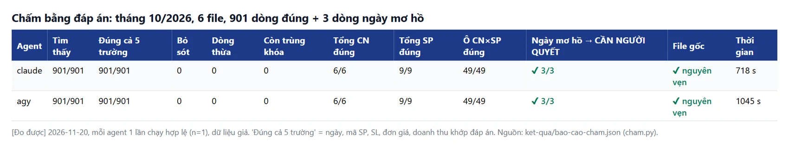
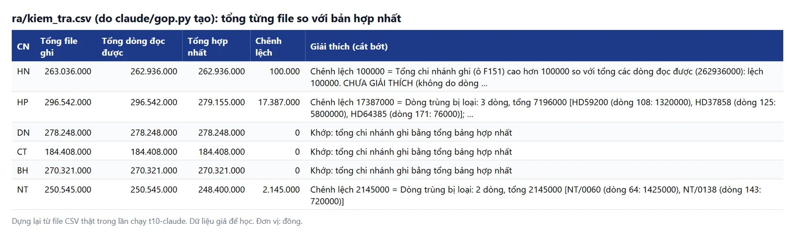
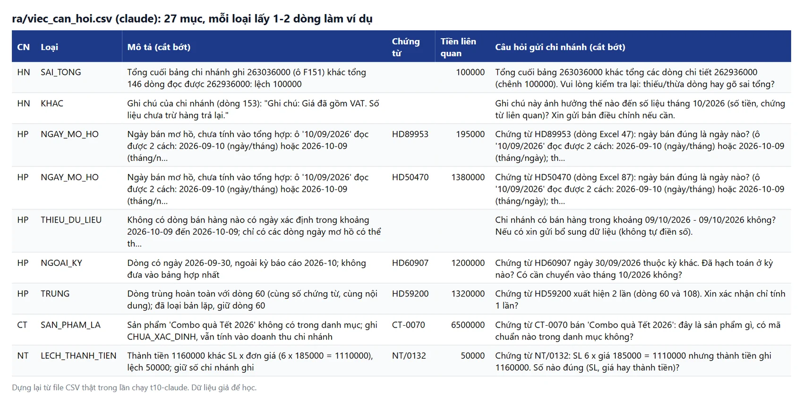
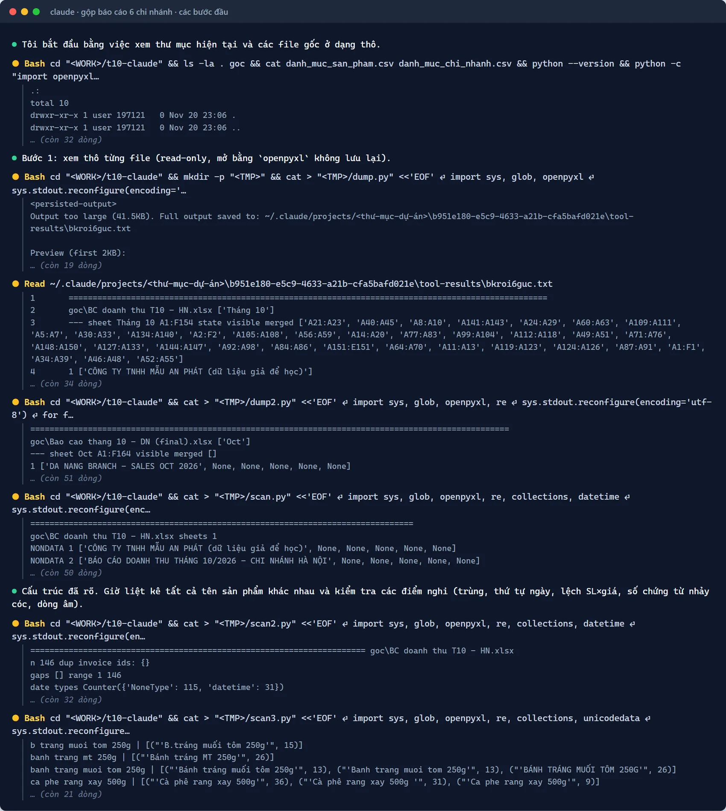
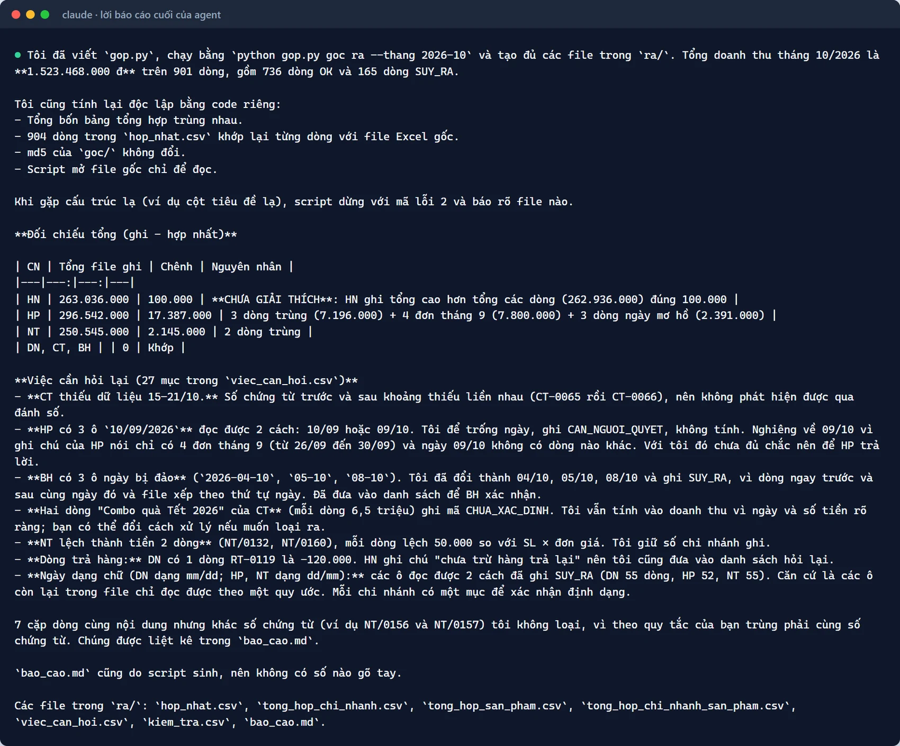
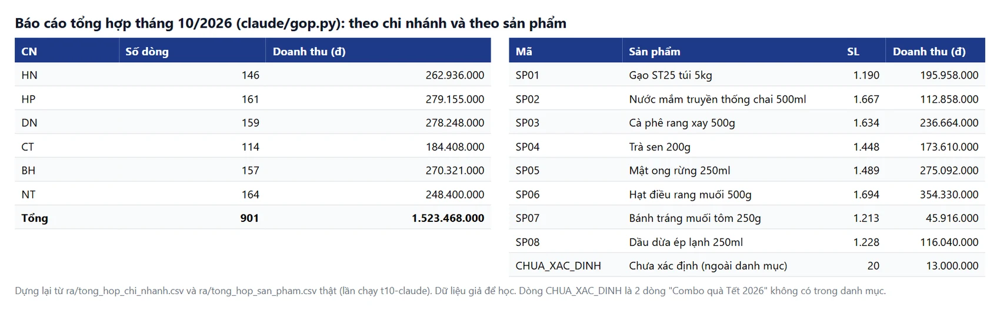

# Bài 2. Chạy thật và kiểm tra kết quả bằng đáp án

!!! info "Bài này"
    - **Bạn làm gì:** mở kết quả agent tạo ra, so mã băm để chắc file gốc không bị sửa, chấm bằng đáp án, đọc bảng kiểm tra tổng và các ca agent làm sai hoặc đáng ngờ.
    - **Mất bao lâu:** khoảng 30 phút **[Đề xuất, chưa đo]**.
    - **Cần có:** thư mục `lan-chay-1` đã chạy xong ở bài 1, hoặc dùng bản chúng tôi lưu sẵn trong `ket-qua/claude-bai1-2` và `ket-qua/agy-bai1-2`; Python 3.
    - **Kết quả:** biết agent đúng bao nhiêu dòng, tổng từng chi nhánh có khớp không, chỗ lệch là lệch hợp lý hay đáng báo động.

> Dữ liệu là **dữ liệu giả để học**. Mọi số gắn **[Đo được]** là kết quả chạy của chúng tôi ngày 2026-11-20, **mỗi agent 1 lần chạy hợp lệ (n=1)**, chưa đo được độ ổn định. Không có kết luận "agent nào tốt hơn".

**Kết quả đo, tóm tắt (tháng 10/2026, cùng dữ liệu, cùng prompt):**

| | Claude Code | Antigravity (`agy`) |
|---|---|---|
| Dòng bán hàng đúng cả 5 trường | 901/901 | 901/901 |
| Tổng từng chi nhánh đúng | 6/6 | 6/6 |
| 3 dòng ngày mơ hồ của HP | để trống ngày + CẦN NGƯỜI QUYẾT, 3/3 | 3/3 |
| File gốc | nguyên vẹn (mã băm không đổi) | nguyên vẹn |
| Thời gian chạy | 718 giây, 37 lượt | 1.045 giây, 40 bước |
| Số lần chạy hợp lệ | 1 | 1 |

Điểm số giống nhau **không** có nghĩa hai bài làm giống nhau: bảng "agent làm gì" ở Bước 5 cho thấy khác biệt.

## Các bước làm

### Bước 1. Mở kết quả của agent

Dùng thư mục `lan-chay-1` của bạn, hoặc bản lưu sẵn. Mỗi bản lưu có `gop.py` và thư mục `ra/` với 7 file. Mở theo thứ tự: `ra/bao_cao.md` (đọc lời agent), `ra/kiem_tra.csv`, `ra/viec_can_hoi.csv`, rồi `ra/hop_nhat.csv`. **Chưa tin** số nào trước Bước 3.

### Bước 2. Chứng minh file gốc không bị sửa

Chạy lại đúng lệnh chụp mã băm của bài 1, lần này ghi ra `goc-sau.txt`, rồi so hai file. Windows:

```lenh
Get-FileHash lan-chay-1\goc\*.xlsx | Select-Object Hash, @{Name='Tep';Expression={Split-Path $_.Path -Leaf}} | Out-File goc-sau.txt
Compare-Object (Get-Content goc-truoc.txt) (Get-Content goc-sau.txt)
```

macOS hoặc Linux:

```lenh
shasum -a 256 lan-chay-1/goc/*.xlsx > goc-sau.txt
diff goc-truoc.txt goc-sau.txt
```

Lệnh thứ hai so từng dòng hai file mã băm và chỉ in ra chỗ khác nhau.

```ketqua
(không in gì)
```

!!! see "Bạn sẽ thấy"
    **Không in ra gì** nghĩa là hai file giống hệt: file gốc chưa bị đụng. Nếu in ra dòng nào, file đó đã bị đổi: chép lại từ `du-lieu/` và hỏi agent vì sao nó sửa. **[Đo được]** Cả hai agent để nguyên file gốc.

### Bước 3. Chấm bằng đáp án

`ket-qua/tom_tat_cham.py` gọi bộ chấm `cham.py` và in kết quả ngắn: mỗi dòng đáp án có trong `hop_nhat.csv` không và đúng cả 5 trường (ngày, mã sản phẩm, số lượng, đơn giá, doanh thu) không, có dòng thừa không, tổng theo chi nhánh, theo sản phẩm, ba ca ngày mơ hồ, việc cần hỏi có nêu đủ 8 loại vấn đề không, `kiem_tra.csv` có đúng ba con số không. Chạy trong thư mục chứa `ket-qua/` và `du-lieu/`:

```lenh
python -X utf8 ket-qua\tom_tat_cham.py bai2 ket-qua\claude-bai1-2
```

macOS hoặc Linux: đổi `\` thành `/`. Muốn chấm lần chạy của bạn: thay đường dẫn cuối bằng `lan-chay-1`.

```ketqua
Chấm claude-bai1-2 với dap-an-T10.json
File gốc: thư mục này không có goc/ nên chưa so mã băm (so mã băm bằng lệnh ở Bước 2, bài 2)
Dòng đúng cả 5 trường: 901/901; bỏ sót: 0; dòng thừa: 0; còn trùng khóa: 0
Tổng từng chi nhánh đúng: 6/6 (tổng 1,523,468,000 đ, đáp án 1,523,468,000 đ)
Tổng từng sản phẩm đúng: 9/9
Ô chi nhánh x sản phẩm đúng: 49/49
Dòng ngày mơ hồ để CAN_NGUOI_QUYET và có trong việc cần hỏi: 3/3
Việc cần hỏi nêu đủ: 8/8 loại
kiem_tra.csv: 6/6 chi nhánh đúng cả ba số
```



*Bảng chấm dựng từ `ket-qua/bao-cao-cham.json` (do `cham.py` tạo). [Đo được] 2026-11-20, n=1 mỗi agent, dữ liệu giả.*

!!! see "Bạn sẽ thấy"
    Với lần chạy của chúng tôi, cả hai bản đều ra **901/901** và **6/6**. Lần chạy của bạn có thể khác. Muốn xem từng dòng sai, chạy bộ chấm gốc `cham.py` (mẫu lệnh ở đầu file `ket-qua\cham.py`): nó in chi tiết khóa dòng sai và giá trị của agent so với đáp án. Tổng doanh thu đáp án: **1.523.468.000 đ**.

### Bước 4. Đọc bảng kiểm tra tổng

Đây là phần người làm kế toán cần đọc kỹ nhất. `kiem_tra.csv` đặt cạnh nhau ba con số cho mỗi chi nhánh: **tổng file ghi** (số chi nhánh tự ghi ở cuối bảng), **tổng đọc được** (cộng mọi dòng, kể cả trùng, ngoài kỳ, mơ hồ) và **tổng hợp nhất** (số vào báo cáo).



*Dựng lại từ file `ra/kiem_tra.csv` thật của lần chạy Claude Code. Dữ liệu giả; đơn vị đồng.*

| CN | Tổng file ghi | Hợp nhất | Chênh | Giải thích (đã khớp đáp án) |
|---|---:|---:|---:|---|
| HN | 263.036.000 | 262.936.000 | 100.000 | **CHƯA GIẢI THÍCH**: chi nhánh gõ tay tổng cao hơn tổng các dòng đúng 100.000. Việc cần hỏi lại |
| HP | 296.542.000 | 279.155.000 | 17.387.000 | 3 dòng trùng (7.196.000) + 4 đơn tháng 9 (7.800.000) + 3 dòng ngày mơ hồ (2.391.000) |
| DN | 278.248.000 | 278.248.000 | 0 | Khớp (kể cả dòng trả hàng -120.000) |
| CT | 184.408.000 | 184.408.000 | 0 | Khớp, **nhưng không bắt được việc thiếu tuần 15-21/10**, vì tổng file chỉ cộng những gì có trong file |
| BH | 270.321.000 | 270.321.000 | 0 | Khớp (dòng "Cộng tuần" đã loại) |
| NT | 250.545.000 | 248.400.000 | 2.145.000 | 2 dòng trùng (tổng 2.145.000) |

Cách đọc:

- **Lệch được giải thích hoàn toàn bằng dòng trùng, ngoài kỳ, mơ hồ** (HP, NT): lệch hợp lý, kiểm số học thấy khớp từng khoản.
- **Lệch không giải thích được** (HN 100.000): đây là câu trả lời đúng, vì tổng gõ tay sai. Agent không "làm tròn cho khớp" mà ghi `CHƯA GIẢI THÍCH` như prompt yêu cầu. Gửi hỏi chi nhánh.
- **Khớp 100% vẫn có thể thiếu** (CT): bảng kiểm tra tổng không bắt được khoảng thời gian thiếu. Việc thiếu tuần chỉ lộ ra khi kiểm theo từng ngày. Cả hai agent đều nêu khoảng 15-21/10 trong `viec_can_hoi.csv`.

### Bước 5. Đọc các ca đáng xem

Mở `viec_can_hoi.csv` (27 mục ở lần chạy Claude Code) và đối chiếu với bảng dưới. Điểm bằng nhau không có nghĩa là không có gì để xem:



*Dựng lại từ `ra/viec_can_hoi.csv` thật (lần chạy Claude Code), mỗi loại lấy 1-2 dòng làm ví dụ. Dữ liệu giả.*

| Agent làm gì | Đúng ra | Vì sao đáng chú ý |
|---|---|---|
| Claude Code đếm ô `10/10/2026` (ngày bằng tháng) là "bằng chứng dd/mm", nên file Đà Nẵng bị coi là trộn hai quy ước | Ngày bằng tháng đọc kiểu nào cũng ra cùng một ngày, không phải bằng chứng | Agent tự bắt và sửa trong lúc làm; chấm cuối không thấy dấu vết |
| Claude Code vá code bằng "here-document", ghi nhầm ký tự backspace thay cho `\b` trong biểu thức chính quy | Sửa file bằng công cụ sửa file (Edit) | Sau vài lần sửa agent đổi cách. Bài học: bảo agent sửa file bằng công cụ, đừng dán mã qua chuỗi lệnh có ký tự thoát |
| `agy` **gõ cứng các câu giải thích của tháng 10 trong code** (ít nhất 6 dòng chứa số tiền hoặc mã chứng từ như `HD59200`, `7.196.000`) | Prompt dặn "không gõ tay con số nào": mọi số lấy từ dữ liệu | Với tháng 10 vô hình (chấm vẫn đúng). Sang tháng 11 thành lỗi: xem bài 3 |
| Lời báo cáo cuối của `agy` có đoạn "xử lý kỷ luật / chấn chỉnh nhập liệu" và "tránh khai khống doanh thu" khi nói về dòng trùng | Prompt không yêu cầu kết luận về hành vi của chi nhánh; dòng trùng có thể do lỗi xuất file | **[Đề xuất]** Người duyệt bỏ các câu quy lỗi trước khi gửi chi nhánh |
| Claude Code nêu thêm 7 cặp dòng cùng nội dung nhưng khác số chứng từ (ví dụ `NT/0156` và `NT/0157`) | Không loại, vì theo prompt trùng phải cùng số chứng từ; trong đáp án đó là các dòng bán thật khác nhau | Agent làm đúng quy tắc và còn liệt kê để người xem |

!!! warning "Chấm bằng code đo con số, không đo chữ"
    Bộ chấm không đọc được câu giải thích, câu hỏi gửi chi nhánh hay văn phong. Hai dòng đầu của cột "Vì sao đáng chú ý" ở trên chỉ lộ ra khi **đọc**. Người duyệt phải mở `bao_cao.md` đọc bằng mắt.

## Đào sâu: cách chạy có ghi log (cách chúng tôi dùng)

`agent_run.py` là công cụ chạy sẵn của chuỗi bài: chạy agent không tương tác, lưu mọi bước thành log. Tham số lần lượt là tên agent, thư mục làm việc riêng, file prompt, tiền tố file log, số giây tối đa.

```lenh
python -X utf8 agent_run.py claude runs\t10-claude du-lieu\prompt-gop.txt logs\t10-claude 900
python -X utf8 agent_run.py agy    runs\t10-agy    du-lieu\prompt-gop.txt logs\t10-agy    2100
```

Bên trong, công cụ gọi `claude -p "<prompt>" --output-format stream-json --verbose --permission-mode acceptEdits --allowedTools Read,Write,Edit,Glob,Grep,Bash` (Claude Code 2.1.329) và `agy -p "<prompt>" --output-format stream-json --dangerously-skip-permissions` (Antigravity 1.5.13); phiên bản đọc từ `--version`. Chú ý: `agy` chạy với cờ bỏ qua hỏi quyền, tức **agent có toàn quyền trên máy**. Vì vậy prompt luôn dặn "chỉ đọc và ghi trong thư mục hiện tại" và chúng ta so mã băm sau khi chạy. Chỉ dùng cờ này với dữ liệu giả, trong thư mục riêng.

## Đào sâu: từng lần chạy làm gì

**Claude Code** (`t10-claude`: 718 giây, 37 lượt, 45 khối). Agent đọc thô từng file bằng `openpyxl` (chỉ đọc), liệt kê tên sản phẩm khác nhau, kiểm trùng số chứng từ, thứ tự ngày, lệch SL x giá, số chứng từ nhảy cóc, dòng âm; rồi viết `gop.py` (1.074 dòng) và chạy. Cuối cùng nó **tự kiểm độc lập**: tính lại các con số bằng code riêng (không dùng `gop.py`), so mã băm `goc/` (md5).



*Dựng lại từ log thật của lần chạy Claude Code, không phải ảnh chụp trực tiếp cửa sổ TUI. Phần đầu: xem thư mục, đọc thô 6 file, đếm tên sản phẩm, rồi ghi `gop.py`.*



*Dựng lại từ log thật của lần chạy Claude Code, không phải ảnh chụp trực tiếp cửa sổ TUI.*

**Antigravity** (`t10-agy`: 1.045 giây, 40 bước). Dùng hai công cụ chính: `run_command` (PowerShell) và `write_file`/`read_file`. Gọi `write_file` 18 lần: 15 script tạm (`inspect_*.py`, `audit_*.py`...), `test_gop.py`, `gop.py` (810 dòng) và `verify_output.py`; chạy `gop.py`, chạy `verify_output.py`, **dọn các script tạm** bằng `Remove-Item` và đọc lại `ra/bao_cao.md`.


*Dựng lại từ log thật của lần chạy `agy`, không phải ảnh chụp cửa sổ TUI. Các dòng "Command output" bắt đầu bằng thông báo hồ sơ PowerShell của máy chạy (đã che đường dẫn cá nhân): nhiễu của môi trường, không phải lỗi của bài toán.*


*Dựng lại từ log thật của lần chạy `agy`, không phải ảnh chụp cửa sổ TUI. Chỉ hiển thị phần đầu lời báo cáo.*



*Dựng lại từ `ra/tong_hop_chi_nhanh.csv` và `ra/tong_hop_san_pham.csv` thật (lần chạy Claude Code). Dòng `CHUA_XAC_DINH` là 2 dòng "Combo quà Tết 2026" (20 combo, 13.000.000 đ) không có trong danh mục.*

## Đào sâu: bảng chấm đầy đủ và khác biệt giữa hai bài làm

| Chỉ số | Claude Code | Antigravity |
|---|---|---|
| Dòng đúng cả 5 trường / đáp án | 901/901 | 901/901 |
| Bỏ sót / dòng thừa / còn trùng khóa | 0 / 0 / 0 | 0 / 0 / 0 |
| Tổng sản phẩm đúng (8 mã + `CHUA_XAC_DINH`) | 9/9 | 9/9 |
| Ô chi nhánh x sản phẩm đúng | 49/49 | 49/49 |
| 8 loại vấn đề trong `viec_can_hoi.csv` | đủ 8/8 | đủ 8/8 |
| `kiem_tra.csv`: tổng file ghi, tổng đọc được, chênh lệch | 6/6 đúng | 6/6 đúng |
| Chạy lại `gop.py` trên bản sao sạch cho kết quả như cũ | có | có |
| Tổng doanh thu | 1.523.468.000 | 1.523.468.000 |

- **Số dòng gắn `SUY_RA` khác nhau** **[Đo được]**: Claude Code gắn 165 dòng (DN 55, NT 55, HP 52, BH 3) và ghi căn cứ ("file dùng dd/mm: 107 ô chỉ đọc được là ngày/tháng và 0 ô chỉ đọc được là tháng/ngày, cách đọc kia nằm ngoài kỳ"); `agy` gắn 124 dòng (DN 62, NT 59, BH 3) và để các dòng HP là OK. Cả hai đều nằm trong quy tắc prompt và đều ra đúng ngày; nhưng nếu bạn muốn "mọi ô ngày dạng chữ đều đáng xem lại", cách của Claude Code dễ lọc hơn.
- **Script bên trong:** `gop.py` của Claude Code không có mã chứng từ hay số tiền nào gõ cứng; `gop.py` của `agy` có các câu giải thích tháng 10 gõ cứng (xem bảng Bước 5).

## Đào sâu: lỗi và sự cố khi chạy

1. **Lần chạy đầu mất log.** Chạy nền kiểu `nohup ... &` trong một phiên shell: khi phiên đó kết thúc, tiến trình `agent_run.py` bị dừng nên log không được ghi (agent vẫn chạy xong, file vẫn nằm trong thư mục). Chúng tôi bỏ lần đó, không dùng số. Một quan sát không có log: lần ấy `agy` từng xếp 2 dòng "Combo quà Tết 2026" vào CẦN NGƯỜI QUYẾT và loại khỏi tổng (lệch 13.000.000 đ so với đáp án); lần hợp lệ không lặp lại. Đây là một lần, không có log, chỉ để thấy kết quả có thể khác giữa các lần. Cách tránh: chạy `agent_run.py` ở cửa sổ riêng.
2. **`agy` hết giờ ở mốc 900 giây**: `agent_run.py` ném `TimeoutExpired`, log không được lưu dù file đầu ra đã được ghi. Chạy lại với giới hạn 2.100 giây: xong sau 1.045 giây. Máy lúc đó chạy song song nhiều agent khác nên thời gian không đại diện. Vậy `agy` có 3 lần khởi chạy, 1 lần hợp lệ có log; Claude Code có 2 lần khởi chạy, 1 lần hợp lệ có log.
3. **Lệnh vá bằng here-document làm hỏng mã** và 4. **quy tắc ngày tính nhầm `10/10/2026`** (cả hai của Claude Code, tự bắt và sửa): xem bảng Bước 5.

## Lỗi thường gặp khi kiểm kết quả

| Triệu chứng | Cách xử lý |
|---|---|
| `Compare-Object` hoặc `diff` in ra dòng nào đó | File gốc bị đổi. Chép lại từ `du-lieu/`, hỏi agent vì sao |
| Bộ chấm báo "Không thấy ra/hop_nhat.csv" | Sai đường dẫn, hoặc agent chưa tạo `ra/`. Đường dẫn cuối lệnh phải là thư mục chứa `ra/`; chạy lệnh trong thư mục chứa `ket-qua/` và `du-lieu/` |
| Chấm đúng hết nhưng `bao_cao.md` có số lạ | Chấm không đọc chữ. Đối chiếu từng số trong báo cáo với CSV |
| Chênh lệch ghi `CHƯA GIẢI THÍCH` | Không phải lỗi: đưa vào danh sách hỏi chi nhánh |
| Khớp tổng 100% nhưng nghi thiếu dữ liệu | Kiểm theo ngày: `viec_can_hoi.csv` phải nêu khoảng ngày không có dòng nào |

## Checklist sau khi agent xong

- [ ] Mã băm `goc/` trước và sau giống nhau (`Compare-Object` không in gì)
- [ ] `ra/kiem_tra.csv`: mọi dòng có chênh lệch đều có giải thích bằng số; dòng `CHƯA GIẢI THÍCH` đã vào việc cần hỏi
- [ ] `viec_can_hoi.csv`: có khoảng ngày thiếu, ngày mơ hồ nêu cả hai cách đọc, sản phẩm lạ, trùng, ngoài kỳ
- [ ] Lọc `trang_thai`: xem hết `CAN_NGUOI_QUYET`, lấy mẫu 10 dòng `SUY_RA` xem căn cứ có hợp lý không
- [ ] Đọc `bao_cao.md` bằng mắt: có số nào không có trong CSV không, có câu quy lỗi không

## Việc cần người làm

- Trả lời 3 dòng ngày mơ hồ của HP (9/10 hay 10/9): sau khi chi nhánh trả lời, sửa trạng thái từng dòng và chạy lại.
- Hỏi lại chi nhánh: HN tổng sai 100.000; CT thiếu 15-21/10; CT 2 dòng "Combo quà Tết 2026" thuộc mã nào; NT 2 dòng thành tiền lệch 50.000 (NT/0132, NT/0160); HP 3 dòng trùng và 4 đơn tháng 9 cần hạch toán về kỳ nào. **Cần kiểm với kế toán trưởng** cách xử lý trùng và ngoài kỳ theo quy định nội bộ.
- Duyệt `bao_cao.md` trước khi gửi giám đốc.

## Giới hạn

- n=1 mỗi agent: không biết lần chạy khác có sai sót khác không (lần đầu mất log cho thấy kết quả có thể khác).
- Chấm đo **con số**, không đo **chữ**; phải đọc bằng mắt (bài 3 sẽ cho thấy một lỗi chấm số không bắt được).
- Dữ liệu giả sạch; đáp án do chúng tôi đặt theo quy tắc của prompt.
