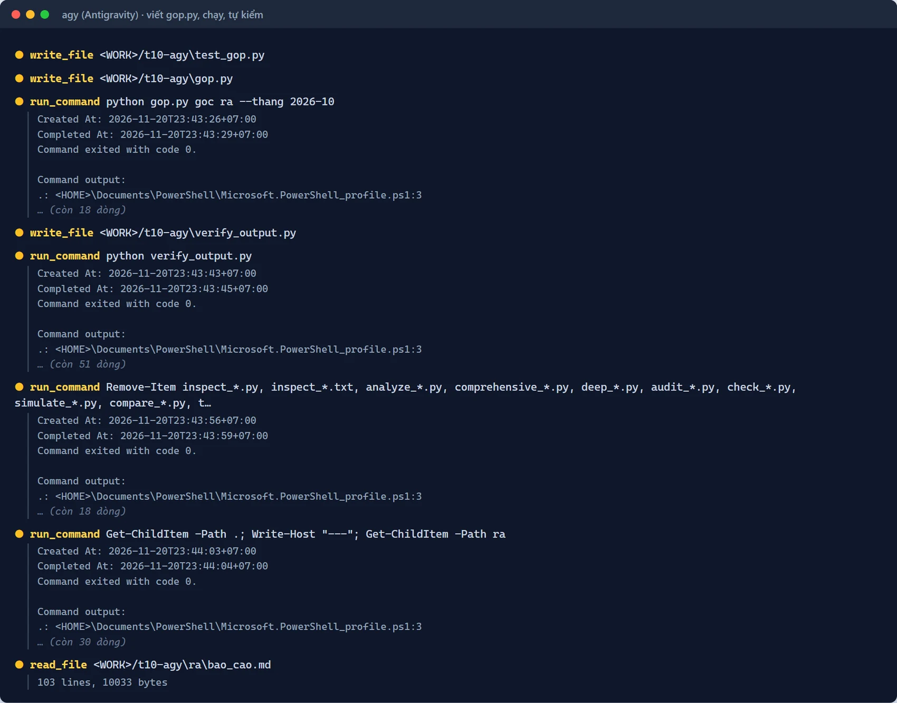
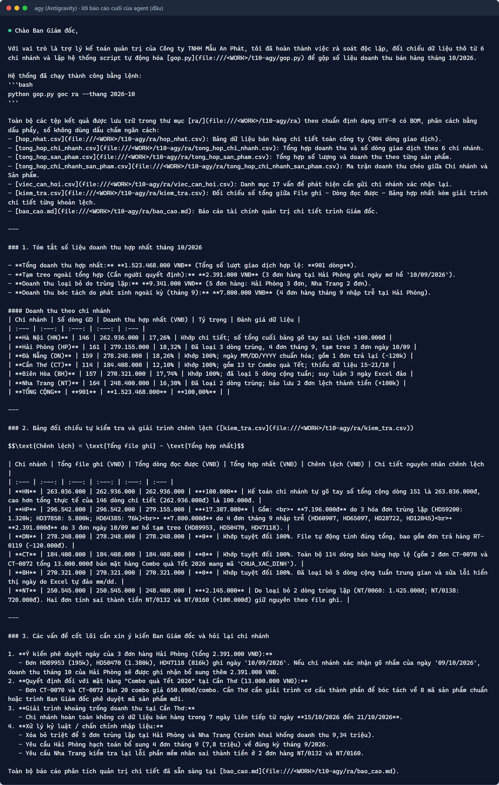

# Bài 2: Chạy thật và kiểm tra kết quả

> Dữ liệu là **dữ liệu giả để học**. Mọi số gắn nhãn **[Đo được]** là kết quả chạy của chúng tôi ngày 2026-11-20, **mỗi agent 1 lần chạy hợp lệ (n=1)**, chưa đo được độ ổn định. Không có kết luận "agent nào tốt hơn".

## Mục tiêu đo được

1. Chạy được cả Claude Code và Antigravity (`agy`) trên cùng dữ liệu, cùng prompt của bài 1.
2. Chấm bằng code (`cham.py`) với đáp án: bao nhiêu dòng đúng, bỏ sót, thừa, ca ngày mơ hồ có chuyển cho người không, file gốc có bị đụng không.
3. Đọc được bảng `kiem_tra.csv` và hiểu **vì sao tổng từng file lệch so với bản hợp nhất** (lệch hợp lý khác với lệch đáng báo động).
4. Biết các lỗi agent gặp khi làm và cách chúng được xử lý.

## 1. Cách chạy

**Cách đơn giản nhất (không cần code):** mở cửa sổ dòng lệnh (PowerShell) trong thư mục `runs\claude`, gõ `claude` rồi dán nội dung `prompt-gop.txt` và nhấn Enter; với Antigravity thì gõ `agy`. Agent sẽ tự xem file, viết script, chạy, và hỏi quyền khi cần.

**Cách chúng tôi dùng để có log chuẩn hóa** (chạy không tương tác, lưu mọi bước):
```powershell
python -X utf8 agent_run.py claude runs\t10-claude du-lieu\prompt-gop.txt logs\t10-claude 900
python -X utf8 agent_run.py agy    runs\t10-agy    du-lieu\prompt-gop.txt logs\t10-agy    2100
```
Giải thích: `agent_run.py` là công cụ chạy sẵn của chuỗi bài; tham số lần lượt là tên agent, thư mục làm việc riêng, file prompt, tiền tố file log, và số giây tối đa. Bên trong nó gọi `claude -p "<prompt>" --output-format stream-json --verbose --permission-mode acceptEdits --allowedTools Read,Write,Edit,Glob,Grep,Bash` (Claude Code 2.1.329) và `agy -p "<prompt>" --output-format stream-json --dangerously-skip-permissions` (Antigravity 1.5.13); phiên bản đọc từ `--version`. Chú ý: `agy` chạy với cờ bỏ qua hỏi quyền, tức là **agent có toàn quyền trên máy**; đây là lý do prompt luôn dặn "chỉ đọc và ghi trong thư mục hiện tại" và ta so mã băm file gốc sau khi chạy.

Tham số giây tối đa của `agy` ở lần đầu là 900 và bị hết giờ (xem mục "Lỗi gặp"); lần hợp lệ dùng 2100.

## 2. Agent làm gì (trích từ log thật)

### Claude Code (lần chạy `t10-claude`: 718 s, 37 lượt, 45 khối)

Agent bắt đầu bằng cách đọc thô từng file (mở bằng `openpyxl` chỉ để đọc, nhìn ô gộp, kiểu ô, dòng cuối), rồi liệt kê tên sản phẩm khác nhau, kiểm trùng số chứng từ, thứ tự ngày, lệch SL x giá, số chứng từ nhảy cóc, dòng âm, rồi viết `gop.py` (1074 dòng) và chạy.


*Dựng lại từ log thật của lần chạy `t10-claude`, không phải ảnh chụp trực tiếp cửa sổ TUI. Phần đầu: xem thư mục, đọc thô 6 file, đếm tên sản phẩm, rồi ghi `gop.py`.*

Trong lúc làm, agent tự gặp và tự sửa các lỗi **(Đo được, nguồn: transcript)**:
- Ô ngày dạng `10/10/2026` (ngày bằng tháng) bị đếm nhầm là "bằng chứng dd/mm", nên file Đà Nẵng bị coi là trộn hai quy ước. Agent sửa cách đếm bằng chứng.
- Bản vá bằng "here-document" ghi nhầm ký tự backspace thay cho `\b` trong biểu thức chính quy; sau vài lần sửa agent đổi sang dùng công cụ Edit trực tiếp.

Sau khi sửa, agent **tự kiểm độc lập**: tính lại các con số bằng code riêng (không dùng `gop.py`), so mã băm `goc/` (md5), và nói rõ kết quả.


*Dựng lại từ log thật của lần chạy `t10-claude`, không phải ảnh chụp trực tiếp cửa sổ TUI.*

### Antigravity (`agy`) (lần chạy `t10-agy`: 1045 s, 40 bước)

`agy` dùng hai công cụ chính: `run_command` (PowerShell) và `write_file`/`read_file`. Nó gọi `write_file` **18 lần**: 15 script tạm (`inspect_*.py`, `audit_*.py`... để xem và kiểm dữ liệu), `test_gop.py`, `gop.py` (810 dòng) và `verify_output.py`; chạy `gop.py`, chạy `verify_output.py` để kiểm kết quả, rồi **dọn các script tạm** bằng `Remove-Item` và đọc lại `ra/bao_cao.md`.


*Dựng lại từ log thật của lần chạy `t10-agy`, không phải ảnh chụp trực tiếp cửa sổ TUI. Các dòng "Command output" bắt đầu bằng thông báo của hồ sơ PowerShell trên máy chạy (đã che đường dẫn cá nhân); đó là nhiễu của môi trường, không phải lỗi của bài toán.*


*Dựng lại từ log thật của lần chạy `t10-agy`, không phải ảnh chụp trực tiếp cửa sổ TUI. Chỉ hiển thị phần đầu lời báo cáo.*

## 3. Chấm bằng đáp án

`cham.py` chấm theo từng nhóm: (a) file gốc còn nguyên không (mã băm), (b) mỗi dòng đáp án có trong `hop_nhat.csv` không và đúng 5 trường (ngày, mã sản phẩm, số lượng, đơn giá, doanh thu) không, (c) dòng thừa không có trong đáp án (ví dụ dòng cộng tuần lọt vào) và dòng ngoài kỳ lọt vào, (d) dòng trùng còn lại, (e) tổng theo chi nhánh, theo sản phẩm, theo ô chi nhánh x sản phẩm, (f) 3 dòng ngày mơ hồ có để CẦN NGƯỜI QUYẾT không, (g) `viec_can_hoi.csv` có nêu đủ 8 loại vấn đề không, (h) `kiem_tra.csv` có đúng tổng file ghi, tổng đọc được và chênh lệch không.


*Bảng chấm dựng từ `ket-qua/bao-cao-cham.json` (do `cham.py` tạo). [Đo được] 2026-11-20, n=1 mỗi agent, dữ liệu giả.*

**[Đo được]** Cả hai agent:

| Chỉ số | Claude Code | Antigravity |
|---|---|---|
| Dòng đúng cả 5 trường / đáp án | 901/901 | 901/901 |
| Bỏ sót / dòng thừa / còn trùng khóa | 0 / 0 / 0 | 0 / 0 / 0 |
| Tổng chi nhánh đúng | 6/6 | 6/6 |
| Tổng sản phẩm đúng (8 mã + `CHUA_XAC_DINH`) | 9/9 | 9/9 |
| Ô chi nhánh x sản phẩm đúng | 49/49 | 49/49 |
| 3 dòng ngày mơ hồ HP | để trống ngày + CẦN NGƯỜI QUYẾT, 3/3 | 3/3 |
| 8 loại vấn đề trong `viec_can_hoi.csv` | đủ 8/8 | đủ 8/8 |
| `kiem_tra.csv`: tổng file ghi, tổng đọc được, chênh lệch | 6/6 đúng | 6/6 đúng |
| File `goc/` | nguyên vẹn | nguyên vẹn |
| Chạy lại `gop.py` trên bản sao sạch cho kết quả như cũ | có | có |
| Tổng doanh thu | 1.523.468.000 | 1.523.468.000 |

Cả hai kết quả đều khớp đáp án. **Điểm số giống nhau không có nghĩa là hai bài làm giống nhau.** Vài khác biệt quan sát được ở mục 5.

## 4. Đọc bảng kiểm tra tổng

Đây là phần người làm kế toán cần đọc kỹ nhất. `kiem_tra.csv` đặt cạnh nhau ba con số cho mỗi chi nhánh: **tổng file ghi** (số tổng chi nhánh tự ghi ở cuối bảng), **tổng đọc được** (cộng mọi dòng dữ liệu, kể cả dòng trùng/ngoài kỳ/mơ hồ), và **tổng hợp nhất** (số vào báo cáo).


*Dựng lại từ file `ra/kiem_tra.csv` thật của lần chạy `t10-claude`. Dữ liệu giả; đơn vị đồng.*

| CN | Tổng file ghi | Hợp nhất | Chênh | Giải thích (đã khớp với đáp án) |
|---|---:|---:|---:|---|
| HN | 263.036.000 | 262.936.000 | 100.000 | **CHƯA GIẢI THÍCH**: chi nhánh gõ tay tổng cao hơn tổng các dòng đúng 100.000. Việc cần hỏi lại |
| HP | 296.542.000 | 279.155.000 | 17.387.000 | 3 dòng trùng (7.196.000) + 4 đơn tháng 9 (7.800.000) + 3 dòng ngày mơ hồ (2.391.000) |
| DN | 278.248.000 | 278.248.000 | 0 | Khớp (kể cả dòng trả hàng -120.000) |
| CT | 184.408.000 | 184.408.000 | 0 | Khớp; **nhưng cũng không bắt được việc thiếu tuần 15-21/10**, vì tổng file ghi chỉ cộng những gì có trong file |
| BH | 270.321.000 | 270.321.000 | 0 | Khớp (dòng "Cộng tuần" đã loại) |
| NT | 250.545.000 | 248.400.000 | 2.145.000 | 2 dòng trùng (tổng 2.145.000) |

Cách đọc:
- **Chênh lệch được giải thích hoàn toàn bằng dòng trùng, ngoài kỳ, mơ hồ** (HP, NT): lệch hợp lý, kiểm số học thấy khớp từng khoản.
- **Chênh lệch không giải thích được** (HN 100.000): đây là câu trả lời đúng; tổng gõ tay sai. Agent không "làm tròn cho khớp" mà ghi `CHƯA GIẢI THÍCH` như prompt yêu cầu. Gửi hỏi chi nhánh.
- **Khớp 100% vẫn có thể thiếu** (CT): bảng kiểm tra tổng **không bắt được khoảng thời gian thiếu**. Việc thiếu tuần chỉ lộ ra khi kiểm theo từng ngày. Cả hai agent đều nêu được khoảng 15-21/10 trong `viec_can_hoi.csv`.


*Dựng lại từ `ra/tong_hop_chi_nhanh.csv` và `ra/tong_hop_san_pham.csv` thật (lần chạy `t10-claude`). Dữ liệu giả. Dòng `CHUA_XAC_DINH` là 2 dòng "Combo quà Tết 2026" (20 combo, 13.000.000 đ) không có trong danh mục.*


*Dựng lại từ `ra/viec_can_hoi.csv` thật (lần chạy `t10-claude`), 27 mục, mỗi loại lấy 1-2 dòng làm ví dụ. Dữ liệu giả.*

## 5. Quan sát khác biệt giữa hai bài làm (không phải xếp hạng)

- **Số dòng gắn SUY_RA khác nhau** **[Đo được]**: Claude Code gắn SUY_RA cho 165 dòng (DN 55, NT 55, HP 52, BH 3) và ghi căn cứ ("file dùng dd/mm: 107 ô chỉ đọc được là ngày/tháng và 0 ô chỉ đọc được là tháng/ngày, cách đọc kia nằm ngoài kỳ"); `agy` gắn 124 dòng (DN 62, NT 59, BH 3) và để các dòng HP là OK. Cả hai cách đều nằm trong quy tắc prompt và đều ra đúng ngày; nhưng nếu bạn muốn "mọi ô ngày dạng chữ đều đáng xem lại", cách của Claude Code dễ lọc hơn.
- **Claude Code nêu thêm** 7 cặp dòng cùng nội dung nhưng khác số chứng từ (ví dụ `NT/0156` và `NT/0157`): không loại vì theo quy tắc prompt trùng phải cùng số chứng từ, nhưng liệt kê để người xem. Trong đáp án đó là các dòng bán thật khác nhau.
- **Văn phong báo cáo:** lời báo cáo cuối của `agy` có đoạn "xử lý kỷ luật / chấn chỉnh nhập liệu" và "tránh khai khống doanh thu" khi nói về dòng trùng. Prompt không yêu cầu kết luận về hành vi của chi nhánh; dòng trùng có thể do lỗi xuất file. **[Đề xuất]**: người duyệt nên bỏ các câu quy lỗi trước khi gửi chi nhánh.
- **Script có gì bên trong** (sẽ quan trọng ở bài 3): `gop.py` của Claude Code không có mã chứng từ hay số tiền nào gõ cứng; `gop.py` của `agy` có **các câu giải thích của tháng 10 gõ cứng trong code** (ít nhất 6 dòng code chứa số tiền hoặc mã chứng từ như `HD59200`, `7.196.000`), trái với yêu cầu "không gõ tay con số nào". Với tháng 10 điều này vô hình (chấm vẫn đúng); sang tháng 11 nó thành lỗi, xem bài 3.

## 6. Lỗi và sự cố khi chạy

1. **Lần chạy đầu mất log.** Chạy nền kiểu `nohup ... &` trong một phiên shell: khi phiên đó kết thúc, tiến trình `agent_run.py` bị dừng nên log không được ghi (agent vẫn chạy xong và để file trong thư mục). Chúng tôi bỏ lần đó. Cách tránh: chạy từng lệnh `agent_run.py` ở chế độ chạy nền riêng, hoặc chạy ở cửa sổ riêng.
2. **`agy` hết giờ 900 s**, `agent_run.py` ném `TimeoutExpired` và log không được lưu, dù các file đầu ra đã được ghi trước đó. Chạy lại với 2100 s: hoàn thành sau 1045 s. Giới hạn 900 s theo brief không đủ cho `agy` trên máy đang chạy nhiều tác vụ (**[Quan sát]**: máy lúc đó chạy song song nhiều agent khác, nên thời gian không đại diện).
3. **Lệnh vá bằng here-document làm hỏng mã** (Claude Code, xem mục 2). Bài học: yêu cầu agent sửa file bằng công cụ Edit, không dán mã qua chuỗi lệnh có ký tự thoát.
4. **Quy tắc ngày bị tính nhầm với `10/10/2026`** (Claude Code, tự bắt và sửa trong khi làm).

## Checklist sau khi agent xong (người làm)

- [ ] So mã băm `goc/` trước và sau: giống nhau
- [ ] `ra/kiem_tra.csv`: mọi dòng có chênh lệch đều có giải thích bằng số; dòng `CHƯA GIẢI THÍCH` đã đưa vào việc cần hỏi
- [ ] `viec_can_hoi.csv`: có khoảng ngày thiếu (nếu có), ngày mơ hồ có nêu cả hai cách đọc, sản phẩm lạ, trùng, ngoài kỳ
- [ ] Lọc `trang_thai`: xem hết `CAN_NGUOI_QUYET` và lấy mẫu 10 dòng `SUY_RA` để xem căn cứ có hợp lý không
- [ ] Chạy lại `gop.py` trên bản sao sạch, kết quả giống
- [ ] Đọc `bao_cao.md` bằng mắt: có con số nào không có trong CSV không; có câu quy lỗi không

## Việc cần người làm

- Trả lời 3 dòng ngày mơ hồ của HP (9/10 hay 10/9): sau khi chi nhánh trả lời, sửa trạng thái từng dòng và chạy lại.
- Hỏi lại: HN tổng sai 100.000, CT thiếu 15-21/10, CT 2 dòng "Combo quà Tết 2026" thuộc mã nào, NT 2 dòng thành tiền lệch 50.000 (NT/0132, NT/0160), HP 3 dòng trùng và 4 đơn tháng 9 cần hạch toán về kỳ nào. **Cần kiểm với kế toán trưởng** cách xử lý trùng và ngoài kỳ theo quy định nội bộ.
- Duyệt `bao_cao.md` trước khi gửi giám đốc.

## Giới hạn

- n=1 mỗi agent: không biết lần chạy khác có sai sót khác không (lần đầu mất log cho thấy kết quả có thể khác: xem README).
- Chấm bằng code đo **con số**, không đo **chữ** (câu giải thích, câu hỏi gửi chi nhánh, văn phong); phải đọc bằng mắt. Bài 3 sẽ cho thấy một lỗi mà chấm số không bắt được.
- Dữ liệu giả sạch; đáp án do chúng tôi đặt theo quy tắc của prompt.
