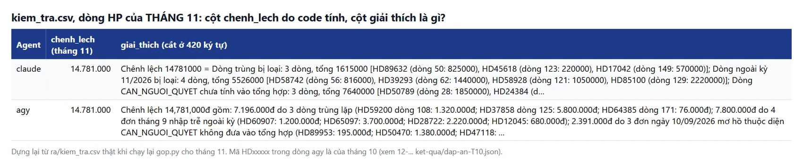

# Bài 3. Dùng hằng tháng: chạy lại script, gọi agent khi chi nhánh đổi định dạng

!!! info "Bài này"
    - **Bạn làm gì:** mỗi tháng chạy lại `gop.py` bằng một lệnh (không gọi agent), kiểm bằng cách quét "chữ của tháng cũ", và chỉ gọi agent khi một chi nhánh đổi định dạng file.
    - **Mất bao lâu:** chạy script vài giây; đọc kiểm tra và hỏi chi nhánh khoảng 30 phút mỗi tháng **[Đề xuất, chưa đo]**. Agent sửa script khi đổi định dạng: 264 giây (Claude Code) và 1.008 giây (`agy`) **[Đo được]**.
    - **Cần có:** thư mục `lan-chay-1` có `gop.py` từ bài 1-2 (hoặc dùng bản lưu `ket-qua/claude-bai1-2/gop.py`), Python 3, dữ liệu tháng 11 trong `du-lieu/thang-11/`.
    - **Kết quả:** quy trình hằng tháng 5 bước, biết vì sao "chấm đúng số" chưa đủ, biết khi nào gọi agent, khi nào không.

> Dữ liệu là **dữ liệu giả để học**. Số gắn **[Đo được]** là kết quả chạy ngày 2026-11-20 (và chấm lại ngày 2026-11-21), n=1 mỗi tình huống. Không có kết luận "agent nào tốt hơn".

Ý tưởng cốt lõi: **agent là thợ sửa script, không phải người tính tiền hằng tháng.** Tính tiền là việc của script (lặp lại được, kiểm được). Agent chỉ vào cuộc khi script gặp thứ nó chưa từng thấy.

## Quy trình mỗi tháng

### Bước 1. Dựng thư mục tháng mới và chụp mã băm

Mỗi tháng một thư mục riêng, gồm `goc/` (6 file chi nhánh mới), hai file danh mục, và `gop.py` chép từ lần chạy đã duyệt. Với dữ liệu mẫu tháng 11, chạy trong thư mục chứa `du-lieu/` và `lan-chay-1/` (Windows):

```lenh
Copy-Item -Recurse du-lieu\thang-11 lan-chay-thang-11
Copy-Item lan-chay-1\gop.py lan-chay-thang-11\
```

macOS hoặc Linux:

```lenh
cp -r du-lieu/thang-11 lan-chay-thang-11
cp lan-chay-1/gop.py lan-chay-thang-11/
```

Hai lệnh chép dữ liệu tháng 11 sang thư mục mới rồi chép script vào. Sau đó chụp mã băm `goc/` bằng lệnh ở bài 1, Bước 3 (đổi `lan-chay-1` thành `lan-chay-thang-11`).

!!! warning "Quy tắc an toàn mỗi tháng"
    - **Không sửa file gốc.** File chi nhánh gửi là chứng cứ: chỉ đọc, không mở rồi Lưu. Cuối tháng so mã băm trước và sau (bài 2, Bước 2).
    - **Dữ liệu thật:** chỉ chạy trên máy của bạn trong thư mục riêng; đừng đưa file doanh thu thật lên dịch vụ AI khi chưa được phép (xem [An toàn dữ liệu và pháp lý](../an-toan-du-lieu-va-phap-ly-vn.md)).
    - **Đáp án và bản cũ để ngoài tầm agent:** không đặt file đáp án hay bản kết quả đã duyệt trong thư mục agent làm việc.

### Bước 2. Chạy script, không gọi agent

```lenh
cd lan-chay-thang-11
python -X utf8 gop.py goc ra --thang 2026-11
```

`python -X utf8` chạy script (và để tiếng Việt không lỗi); `goc` là thư mục file gốc để đọc; `ra` là thư mục sẽ chứa kết quả; `--thang 2026-11` là kỳ báo cáo (script dùng để biết dòng nào "ngoài kỳ").

```ketqua
Đã xử lý 6 file, 889 dòng dữ liệu. Kết quả trong <thư mục>\ra
Tổng doanh thu tháng 11/2026 (OK + SUY_RA): 1.503.750.000
Việc cần hỏi lại: 26 mục
```

*Đầu ra mẫu khi chạy `gop.py` của Claude Code trên dữ liệu tháng 11 (chạy ngày 2026-11-21).*

!!! see "Bạn sẽ thấy"
    Vài dòng thông báo, mã thoát 0, và thư mục `ra/` có đủ 7 file như bài 1. Nếu script **dừng và in lỗi**, đừng sửa tay: xem mục "Chi nhánh đổi định dạng" bên dưới.

### Bước 3. Đọc kiểm tra tổng và gửi hỏi chi nhánh

Mở `ra/kiem_tra.csv`: dòng nào `chenh_lech` khác 0, đọc `giai_thich`; dòng `CHƯA GIẢI THÍCH` đưa vào danh sách hỏi. Mở `ra/viec_can_hoi.csv`, lọc `CAN_NGUOI_QUYET` trong `hop_nhat.csv`, gửi câu hỏi cho chi nhánh. Bài 4 có prompt nhờ agent soạn email hỏi lại.

### Bước 4. Quét chữ của tháng cũ

Chấm "con số đúng" chưa đủ (xem Thử thật 1). Chạy bộ quét: nó lấy mã chứng từ của tháng trước (mà tháng này không có) và tìm trong chữ giải thích của tháng này.

```lenh
python -X utf8 ket-qua\quet_so_cu.py lan-chay-thang-11\ra lan-chay-1\ra
```

Bộ quét so `ra/` tháng này với `ra/` tháng trước; macOS hoặc Linux đổi `\` thành `/`.

```ketqua
kiem_tra.csv: 8 mã của tháng trước còn sót (ví dụ HD37858, HD47118, HD50470)
bao_cao.md: 8 mã của tháng trước còn sót (ví dụ HD37858, HD47118, HD50470)
viec_can_hoi.csv: 0 mã của tháng trước còn sót
KHÔNG ĐẠT: có chữ của tháng cũ
```

*Đầu ra mẫu khi quét kết quả tháng 11 của script do Antigravity viết ở bài 2 (chạy ngày 2026-11-21). Với script của Claude Code, cả ba dòng là "0 mã" và kết luận "ĐẠT".*

### Bước 5. Duyệt, lưu, và giữ bản `gop.py` trước khi sửa

Đọc `bao_cao.md` bằng mắt, duyệt, gửi giám đốc. Lưu cả thư mục tháng: file gốc, mã băm, `ra/`, `gop.py` đã dùng. Trước khi giao agent sửa script, **chép bản `gop.py` hiện tại**:

```lenh
Copy-Item lan-chay-thang-11\gop.py gop_truoc_khi_sua.py
```

macOS hoặc Linux: `cp lan-chay-thang-11/gop.py gop_truoc_khi_sua.py`.

## Thử thật 1: chạy lại script cũ cho tháng 11

Chúng tôi sinh dữ liệu tháng 11/2026 bằng cùng chương trình (hạt giống khác): 6 file **cùng định dạng** với tháng 10, có đáp án riêng `dap-an-T11.json`. Rồi chạy `gop.py` mà agent viết ở bài 2, **nguyên xi, không sửa**, và chấm. Lệnh sau chạy bản của `agy`:

```lenh
python -X utf8 ket-qua\tom_tat_cham.py bai3 ket-qua\agy-bai1-2\gop.py T11
```

Lệnh chép dữ liệu tháng 11 và script vào thư mục tạm, chạy `python gop.py goc ra --thang 2026-11`, chấm bằng đáp án tháng 11 và quét mã tháng 10.

```ketqua
Chạy `python gop.py goc ra --thang 2026-11`: mã thoát 0
Dòng đúng cả 5 trường: 877/877; bỏ sót: 0; dòng thừa: 0; còn trùng khóa: 0
Tổng từng chi nhánh đúng: 6/6
File gốc nguyên vẹn: có
(Thông tin) Dòng ngày mơ hồ để CAN_NGUOI_QUYET và có trong việc cần hỏi: 0/3
Mã chứng từ của THÁNG KHÁC còn trong chữ giải thích: kiem_tra.csv 10 mã, bao_cao.md 6 mã, viec_can_hoi.csv 0 mã
KHÔNG ĐẠT
```


*Bảng dựng từ `ket-qua/bao-cao-cham.json` (do `chay_lai.py` tạo). [Đo được] 2026-11-20, n=1 mỗi script. Dữ liệu giả.*

**[Đo được]** Cả hai script (Claude Code và `agy`) ra **877/877 dòng đúng**, tổng chi nhánh 6/6 đúng, tổng **1.503.750.000 đ**, file gốc nguyên vẹn. Nhưng **chữ thì khác**:

- **Số tháng 10 còn trong báo cáo tháng 11.** Script `agy` in vào `kiem_tra.csv` và `bao_cao.md` của tháng 11 những mã chứng từ và số tiền của tháng 10 (như `HD59200`, `HD89953`, `7.196.000`): các câu giải thích đã bị **gõ cứng trong code** ở bài 2. Cột `chenh_lech` (do code tính) đúng là 14.781.000, nhưng câu giải thích ngay cạnh nói "gồm 7.196.000 trùng + 7.800.000 ngoài kỳ + 2.391.000 mơ hồ" (số tháng 10), mâu thuẫn nhau.
- **Ca ngày mơ hồ của tháng 11** (3 dòng HP `11/10/2026`: có thể 11/10 hoặc 10/11): script Claude Code để trống ngày + CAN_NGUOI_QUYET; script `agy` **không đưa 3 dòng vào `hop_nhat.csv`** mà ghi trong `viec_can_hoi.csv` là `NGOAI_KY` ("ngày 11/10/2026 ngoài kỳ báo cáo") và không nêu cách đọc 10/11. Tổng tiền vẫn đúng, nhưng nhãn khác yêu cầu của prompt. Nguyên nhân (đọc code `agy` trong `ket-qua/agy-bai1-2/gop.py`): nhánh "ngày mơ hồ" của HP chỉ chạy khi tháng đọc ra bằng **9** (số 9 và chữ `10/09/2026` gõ cứng); với tháng 11, ô `11/10/2026` rơi sang nhánh "ngoài kỳ".



*Dựng lại từ `ra/kiem_tra.csv` thật khi chạy lại `gop.py` của hai agent cho tháng 11. Mã `HD59200`, `HD89953`... trong dòng `agy` là của tháng 10. Dữ liệu giả.*

!!! warning "Chấm con số không bắt được lỗi này"
    Số tiền, số dòng đều đúng; chỉ **đọc chữ** hoặc **quét mã tháng cũ** mới thấy. **[Đề xuất, chưa thử]** Thêm vào prompt gốc câu "tháng chạy là tham số; mọi con số và mã chứng từ trong chữ giải thích phải lấy từ dữ liệu của tháng đó" để ngăn lỗi này từ đầu.

## Thử thật 2: chi nhánh đổi định dạng

Tháng 11 chúng tôi cho chi nhánh NT **đổi phần mềm**: tiêu đề chỉ một tầng, thêm cột `Kênh bán`, đổi tên `Chứng từ`→`Mã chứng từ`, `Ngày GD`→`Ngày`, `SL`→`Số lượng`, `Đơn giá`→`Giá niêm yết`, `Thành tiền`→`Doanh số (VNĐ)`, đảo thứ tự cột, ngày thành `2026-11-05`, số thành số thật (bộ `thang-11-doi-dinh-dang`). Chạy script cũ trên bộ này:

```lenh
python -X utf8 ket-qua\tom_tat_cham.py bai3 ket-qua\claude-bai1-2\gop.py T11dd
```

```ketqua
Chạy `python gop.py goc ra --thang 2026-11`: mã thoát 2
  Script dừng, thông báo cuối: LỖI CẤU TRÚC FILE: [NhaTrang_doanhthu_T11.xlsx] Không tìm thấy hàng tiêu đề (cần đủ các cột: ngày, số chứng từ, tên hàng, SL, đơn giá, thành tiền).
KHÔNG ĐẠT
```

**[Đo được]** Cả hai script **dừng**, không ghi kết quả nửa vời: Claude Code mã thoát 2 kèm thông báo tiếng Việt như trên; `agy` mã thoát 1 kèm `ValueError: Không nhận diện được hàng tiêu đề hợp lệ trong file: NhaTrang_doanhthu_T11.xlsx` (có cả dòng `Traceback`, khó đọc hơn với người không rành code nhưng nêu đúng tên file). Đây là hành vi mong muốn, vì prompt bài 1 dặn "báo lỗi rõ khi gặp cấu trúc không nhận ra". Nếu script **đoán thầm** (đọc `Giá niêm yết` làm doanh thu mà không báo), kết quả vẫn ra nhưng sai mà không ai biết.

### Gọi agent sửa script (chỉ lúc này)

Dựng thư mục `lan-chay-sua` gồm: dữ liệu tháng 11 đổi định dạng, `gop.py` cũ, và `thang-truoc/goc/` (6 file tháng 10, định dạng cũ, để agent tự thử hồi quy). Windows, chạy trong thư mục chứa `du-lieu/` và `lan-chay-1/`:

```lenh
Copy-Item -Recurse du-lieu\thang-11-doi-dinh-dang lan-chay-sua
Copy-Item lan-chay-1\gop.py lan-chay-sua\
New-Item -ItemType Directory lan-chay-sua\thang-truoc | Out-Null
Copy-Item -Recurse du-lieu\thang-10\goc lan-chay-sua\thang-truoc\goc
```

macOS hoặc Linux:

```lenh
cp -r du-lieu/thang-11-doi-dinh-dang lan-chay-sua
cp lan-chay-1/gop.py lan-chay-sua/
mkdir -p lan-chay-sua/thang-truoc && cp -r du-lieu/thang-10/goc lan-chay-sua/thang-truoc/
```

Rồi mở agent trong `lan-chay-sua` (`cd lan-chay-sua`, `claude`) và dán prompt này:

```prompt
## 1. Vai trò
Bạn là trợ lý kế toán quản trị đang bảo trì script gộp báo cáo doanh thu chi nhánh của công ty (giả) "Mẫu An Phát".

## 2. Bối cảnh
Hằng tháng 6 chi nhánh (HN, HP, DN, CT, BH, NT) gửi file Excel doanh thu vào thư mục goc/. Script `gop.py` trong thư mục hiện tại đã được viết ở tháng trước và chạy bằng lệnh: `python gop.py goc ra --thang 2026-11`. Tháng 11/2026 chi nhánh NT (Nha Trang) đổi phần mềm bán hàng nên file `goc/NhaTrang_doanhthu_T11.xlsx` có cấu trúc khác tháng trước, và `gop.py` hiện không xử lý được file này (báo lỗi hoặc đọc sai). 5 file còn lại vẫn như cũ. Có sẵn danh_muc_san_pham.csv và danh_muc_chi_nhanh.csv.

## 3. Nhiệm vụ
Sửa `gop.py` để đọc được file NT mới, mà VẪN đọc đúng các định dạng cũ (để tháng sau chi nhánh nào quay lại định dạng cũ hoặc tháng trước chạy lại vẫn đúng).

## 4. Các bước
1. Chạy `python gop.py goc ra --thang 2026-11` để thấy script hiện báo gì.
2. Xem file NT mới ở dạng thô (không sửa nó). Viết ra/ghi_chu_dinh_dang_moi.md: file mới khác file cũ ở điểm nào (hàng tiêu đề, tên cột, kiểu ngày, kiểu số, cột thêm/bớt), và quyết định của bạn cho từng cột mới/ cột đổi tên, nêu lý do. Cột nào bạn không chắc nghĩa là gì thì ghi CẦN NGƯỜI QUYẾT và nói bạn tạm xử lý thế nào.
3. Sửa gop.py (sửa tại chỗ, thêm cách nhận diện định dạng mới, giữ cách nhận diện cũ).
4. Chạy lại `python gop.py goc ra --thang 2026-11`; tự kiểm tổng từng file so với tổng hợp nhất như ra/kiem_tra.csv; giải thích chỗ lệch.
5. Thư mục thang-truoc/ chứa 6 file tháng 10/2026 (định dạng cũ, bản chỉ đọc). Chạy thử gop.py trên đó (ví dụ `python gop.py thang-truoc/goc ra_thu_thang10 --thang 2026-10`) để chắc bản sửa không làm hỏng định dạng cũ; nêu kết quả. Thư mục ra_thu_thang10 do bạn tạo, không phải thư mục ra/.

## 5. Định dạng ra
Giữ NGUYÊN các file đầu ra như tháng trước (ra/hop_nhat.csv, tong_hop_chi_nhanh.csv, tong_hop_san_pham.csv, tong_hop_chi_nhanh_san_pham.csv, viec_can_hoi.csv, kiem_tra.csv, bao_cao.md) và thêm ra/ghi_chu_dinh_dang_moi.md.

## 6. Ràng buộc
- TUYỆT ĐỐI không sửa, xóa, đổi tên, ghi đè file trong goc/. Chỉ đọc.
- Chỉ đọc và ghi trong thư mục hiện tại.
- Số tiền do code tính, không gõ tay con số nào. Không đoán thầm; không chắc thì ghi CẦN NGƯỜI QUYẾT.
- Không đưa vào doanh thu những cột mà bạn không chắc là tiền bán hàng.
```

Điểm chính: giao **sửa tại chỗ** `gop.py` và giữ cách nhận diện cũ; yêu cầu viết `ghi_chu_dinh_dang_moi.md` nêu quyết định từng cột, **cột nào không chắc thì ghi CẦN NGƯỜI QUYẾT**; không đưa vào doanh thu cột nào không chắc là tiền bán hàng.


*Dựng lại từ log thật của lần chạy `p-claude`, không phải ảnh chụp trực tiếp cửa sổ TUI. Đầu phiên: chạy script cũ, thấy mã thoát 2, đọc thô file NT mới và file NT tháng 10 để so.*

**[Đo được]** Claude Code sửa trong **264 giây** (26 lượt); `agy` sửa trong **1.008 giây**. Cả hai nêu khác biệt (hàng tiêu đề, 7 cột thay vì 6, tên cột, ngày ISO, số thật), thêm tên cột mới và giữ tên cũ, **không** đưa `Kênh bán` vào doanh thu, và ghi **CẦN NGƯỜI QUYẾT** về cột `Giá niêm yết` (có phải giá bán thực, hay có chiết khấu ẩn?). Riêng Claude Code còn ghi CẦN NGƯỜI QUYẾT việc `Doanh số (VNĐ)` là số trước hay sau VAT/chiết khấu. Cả hai đều kiểm 155/157 dòng NT có SL x giá = doanh số.

### Kiểm hồi quy sau khi sửa

Sửa script xong, **chạy lại cả tháng cũ** để chắc không hỏng định dạng cũ. Lệnh sau chạy bản đã sửa của Claude Code trên tháng 10 (đổi `T10` thành `T11dd` hoặc `T11` để chạy bộ khác):

```lenh
python -X utf8 ket-qua\tom_tat_cham.py bai3 ket-qua\claude-bai3-sua\gop.py T10
```

```ketqua
Chạy `python gop.py goc ra --thang 2026-10`: mã thoát 0
Dòng đúng cả 5 trường: 901/901; bỏ sót: 0; dòng thừa: 0; còn trùng khóa: 0
Tổng từng chi nhánh đúng: 6/6
File gốc nguyên vẹn: có
(Thông tin) Dòng ngày mơ hồ để CAN_NGUOI_QUYET và có trong việc cần hỏi: 3/3
Mã chứng từ của THÁNG KHÁC còn trong chữ giải thích: kiem_tra.csv 0 mã, bao_cao.md 0 mã, viec_can_hoi.csv 0 mã
ĐẠT
```


*Bảng dựng từ `ket-qua/bao-cao-cham.json`. [Đo được] 2026-11-20, n=1 lần sửa mỗi agent. Dữ liệu giả.*

**[Đo được]** Với `gop.py` **sau khi sửa**, trên ba bộ dữ liệu: tháng 11 NT định dạng mới **877/877**, tháng 11 NT định dạng cũ **877/877**, tháng 10 **901/901**; tổng chi nhánh 6/6 đúng cả ba; file gốc nguyên vẹn; không còn mã chứng từ tháng khác trong chữ giải thích; ca ngày mơ hồ của tháng 11 đều ở CAN_NGUOI_QUYET. Cả hai agent đạt như nhau.

## Khi nào gọi agent, khi nào không

| Tình huống | Làm gì |
|---|---|
| Script chạy xong, `kiem_tra.csv` toàn khớp hoặc lệch có giải thích | Không cần agent. Người đọc, gửi hỏi chi nhánh |
| Script chạy xong nhưng có `CHƯA GIẢI THÍCH` hoặc việc cần hỏi | Không cần agent. Đó là việc của chi nhánh và kế toán trưởng |
| Script **dừng với lỗi cấu trúc** (không thấy tiêu đề, cột lạ) | Giữ bản `gop.py`, gọi agent sửa (prompt trên), rồi **hồi quy** trên tháng cũ |
| Kết quả có số lạ hoặc chữ lạ (mã tháng trước, số không có trong CSV) | Người kiểm; có thể nhờ agent tìm chỗ gõ cứng trong script |
| Chi nhánh đổi *nghĩa* của cột (giá niêm yết thành giá sau chiết khấu) | **Người** quyết; agent chỉ thực hiện sau khi có quyết định |

## Đào sâu: chi tiết hai lần sửa


*Dựng lại từ log thật của lần chạy `p-claude`, không phải ảnh chụp trực tiếp cửa sổ TUI.*

- **Claude Code** bắt được một lỗi mà định dạng mới làm lộ ra: cột A giờ vừa là số chứng từ vừa chứa dòng "Lưu ý: ..." cuối bảng, nên dòng ghi chú bị tính nhầm là dòng dữ liệu; phép tự kiểm đã bắt ở lần chạy đầu và agent sửa. Agent cũng nói thẳng "bản gop.py trước khi sửa không còn bản lưu", chỉ dựng tạm để so sánh tháng 10: **hãy giữ bản sao `gop.py` trước khi giao agent sửa** (hoặc dùng Git).
- **`agy`** trong lời báo cáo cuối nói đã "tham số hóa động" phần giải trình chênh lệch và báo cáo theo `--thang`, "không còn văn bản hay số tiền gõ tay cố định". Kiểm của chúng tôi khớp: `gop.py` sau sửa không còn chuỗi `HD59200`/`7.196.000` (trước sửa có), và quét mã chứng từ tháng 10 trong kết quả tháng 11 cho 0. Việc này không được yêu cầu riêng trong prompt sửa định dạng (chỉ có điều chung "số tiền do code tính, không gõ tay con số nào").
- **Hai cách quét mã tháng cũ cho số khác nhau, cả hai đúng.** Bộ quét trong `tom_tat_cham.py` dùng đáp án và đếm cả mã dòng trùng, ngoài kỳ, mơ hồ của tháng 10 (10 mã trong `kiem_tra.csv`, 6 trong `bao_cao.md`; tổng 16 lượt); `quet_so_cu.py` không cần đáp án, chỉ dò mã có trong `hop_nhat.csv` tháng trước nên thấy 8 mã ở mỗi file.

## Lỗi thường gặp

| Triệu chứng | Cách xử lý |
|---|---|
| Số hoặc chữ của tháng cũ nằm cứng trong script | Quét kết quả tháng mới (Bước 4); nhờ agent tìm và bỏ chỗ gõ cứng |
| Sửa script xong không chạy lại tháng cũ | Luôn giữ một tháng chuẩn + đáp án (hoặc kết quả đã duyệt) làm bộ hồi quy |
| Không giữ bản `gop.py` trước khi sửa | Chép `gop_truoc_khi_sua.py` trước (Bước 5) hoặc dùng Git |
| Script dừng và bạn sửa tay file Excel của chi nhánh cho khớp | Đừng. File gốc là chứng cứ; sửa script, không sửa dữ liệu |
| Để agent chạy toàn quyền trên thư mục có dữ liệu quan trọng (`agy` ở đây chạy với cờ bỏ qua hỏi quyền) | Chỉ giao thư mục làm việc riêng, bản sao dữ liệu |
| Đưa dữ liệu doanh thu thật lên dịch vụ AI chưa được phép | Dừng; xem [An toàn dữ liệu và pháp lý](../an-toan-du-lieu-va-phap-ly-vn.md) |

## Checklist hằng tháng

- [ ] File gốc ở `goc/`, đã chụp mã băm, không ai mở-lưu
- [ ] Chạy `python -X utf8 gop.py goc ra --thang AAAA-MM`, mã thoát 0
- [ ] `kiem_tra.csv`: mọi chênh lệch có giải thích hoặc đã vào danh sách hỏi
- [ ] Đã quét mã chứng từ của tháng trước (Bước 4): không còn sót
- [ ] Đã xem hết `CAN_NGUOI_QUYET` và lấy mẫu `SUY_RA`
- [ ] So mã băm `goc/` sau khi chạy: không đổi
- [ ] Nếu script dừng vì định dạng mới: giữ bản `gop.py` cũ, gọi agent, hồi quy tháng cũ, đọc `ghi_chu_dinh_dang_moi.md`, quyết các mục CẦN NGƯỜI QUYẾT
- [ ] Người duyệt `bao_cao.md`, bỏ câu quy lỗi nếu có

## Việc cần người làm

- **Mỗi tháng:** nhận và lưu file, chạy lệnh, đọc kiểm tra, hỏi chi nhánh, duyệt báo cáo.
- **Quyết định nghiệp vụ** mà agent chỉ đề xuất: `Giá niêm yết` có phải giá thực bán không; `Doanh số (VNĐ)` trước hay sau chiết khấu/VAT; có đưa `Kênh bán` vào báo cáo không; dòng trùng và ngoài kỳ xử lý theo quy định nào. **Cần kiểm với kế toán trưởng**; chúng tôi không viết điều khoản pháp luật nào ở đây vì chưa đọc nguồn.
- **Ghi lại quyết định** cho dòng CAN_NGUOI_QUYET: script chưa có chỗ nhập câu trả lời; cách làm tay là sửa trạng thái trong bản sao `hop_nhat.csv`. **[Đề xuất]** thêm file `quyet-dinh.csv` (chi nhánh, số chứng từ, ngày đúng) để script đọc và áp dụng; chúng tôi chưa làm.
- **[Đề xuất]** Lên lịch nhắc người làm vào ngày chi nhánh gửi file (ví dụ nhắc lịch hoặc Task Scheduler của Windows); chúng tôi **chưa thử** lập lịch tự chạy.

## Giới hạn

- n=1 mỗi tình huống, một bộ dữ liệu giả (hai tháng, một lần đổi định dạng). Không biết agent có sửa đúng nếu định dạng mới khó hơn (nhiều sheet, công thức tham chiếu sheet khác, `.xls` cũ, mật khẩu).
- Chấm đo con số và vài kiểm tra chữ (mã tháng khác); chưa đo chất lượng câu hỏi gửi chi nhánh hay văn phong.
- Chưa thử lập lịch tự chạy, chưa thử đưa quyết định của người vào script, chưa thử trên dữ liệu doanh nghiệp thật.
- Không kết luận "Claude Code tốt hơn Antigravity" hay ngược lại: chỉ là hai lần chạy, thời gian còn phụ thuộc máy đang bận.
