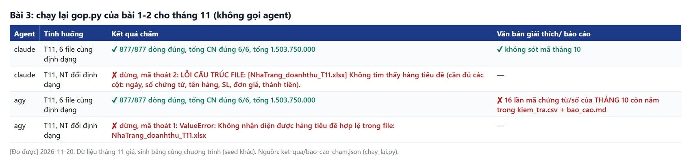
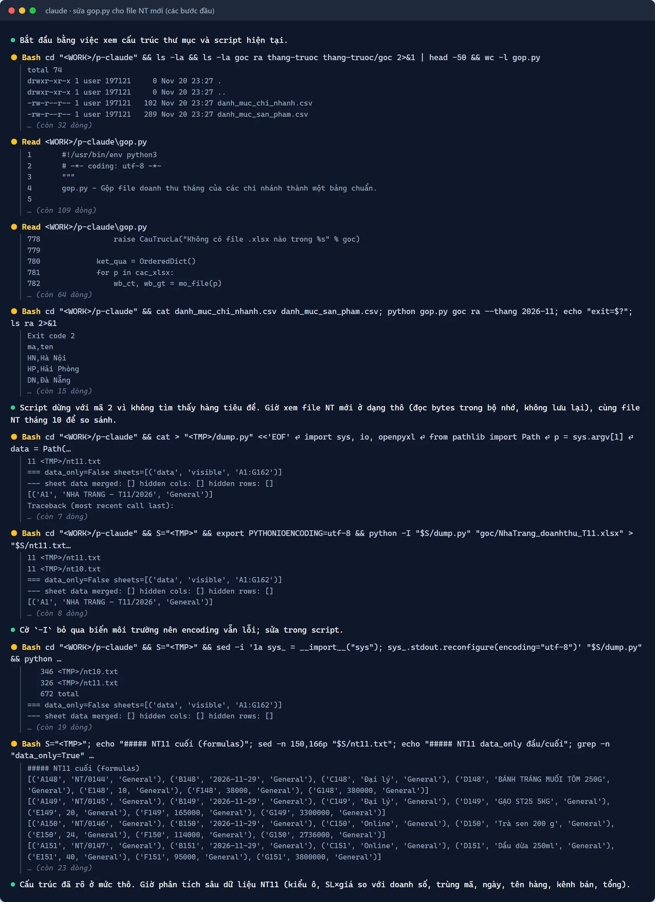
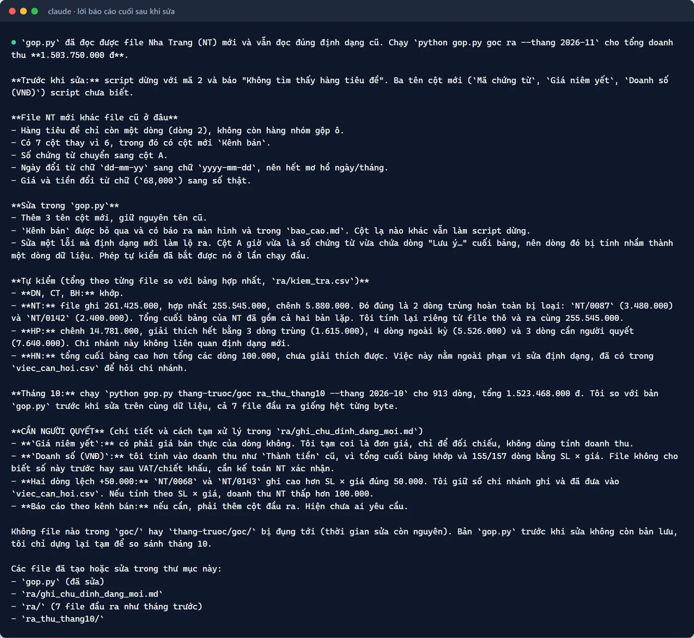
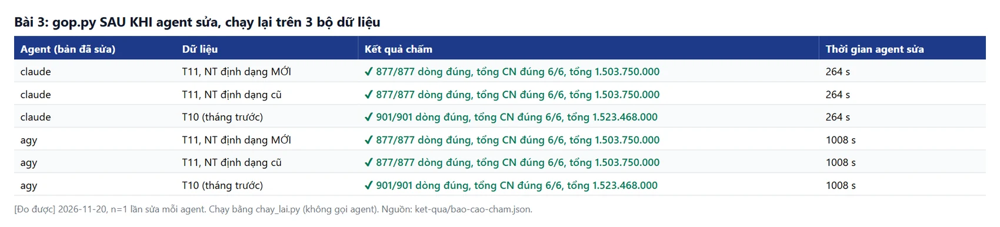

# Bài 3: Đưa vào dùng hằng tháng, script chạy lại, agent chỉ gọi khi có định dạng mới

> Dữ liệu là **dữ liệu giả để học**. Số gắn **[Đo được]** là kết quả chạy ngày 2026-11-20, n=1 mỗi tình huống. Không có kết luận "agent nào tốt hơn".

## Mục tiêu đo được

1. Mỗi tháng chạy **một lệnh** `python gop.py goc ra --thang AAAA-MM` là ra đủ 7 file kết quả, **không gọi agent**.
2. Có cách **phát hiện** script chạy đúng nhưng ghi sai chữ (số tháng cũ còn sót trong lời giải thích).
3. Khi chi nhánh đổi định dạng, script **dừng và báo lỗi** (không đoán thầm); lúc đó mới gọi agent sửa script, rồi chạy lại cả tháng cũ để chắc không hỏng.
4. Biết người cần làm gì mỗi tháng và những gì chưa tự động được.

Ý tưởng cốt lõi: **agent là thợ sửa script, không phải người tính tiền hằng tháng.** Tính tiền là việc của script (lặp lại được, kiểm được). Agent chỉ vào cuộc khi script gặp thứ nó chưa từng thấy.

## 1. Quy trình hằng tháng (người làm)

1. Nhận 6 file chi nhánh, đặt vào `thang-AAAA-MM/goc/`. Chụp mã băm (bài 1, mục 2); bật chỉ-đọc cho file.
2. Chạy (PowerShell, đứng trong thư mục của tháng đó):
   ```powershell
   python -X utf8 gop.py goc ra --thang 2026-11
   ```
   Giải thích: chạy script bằng Python (`-X utf8` để không lỗi tiếng Việt); `goc` là thư mục file gốc để đọc; `ra` là thư mục sẽ chứa kết quả; `--thang 2026-11` là kỳ báo cáo (script dùng để biết dòng nào "ngoài kỳ").
3. Mở `ra/kiem_tra.csv`: dòng nào `chenh_lech` khác 0, đọc `giai_thich`. Dòng `CHƯA GIẢI THÍCH` đưa vào danh sách hỏi.
4. Mở `ra/viec_can_hoi.csv` và lọc `CAN_NGUOI_QUYET` trong `hop_nhat.csv`: gửi câu hỏi cho chi nhánh.
5. Nhận trả lời, ghi lại quyết định (xem mục 6, phần "chưa tự động"), chạy lại.
6. Đọc `bao_cao.md` bằng mắt, duyệt, gửi giám đốc.
7. Lưu cả thư mục tháng (file gốc, mã băm, `ra/`, `gop.py` đã dùng).

**[Đề xuất]**: lên lịch nhắc người làm vào ngày chi nhánh gửi file (ví dụ bằng Task Scheduler của Windows hoặc nhắc lịch); chúng tôi **chưa thử** lập lịch tự chạy.

## 2. Thử thật: chạy lại script của bài 2 cho tháng 11 (không gọi agent)

Chúng tôi sinh dữ liệu tháng 11/2026 bằng cùng chương trình (hạt giống khác): 6 file **cùng định dạng** với tháng 10, có đáp án riêng `dap-an-T11.json`. Rồi chạy `gop.py` mà agent đã viết ở bài 2, **nguyên xi, không sửa**, bằng `ket-qua/chay_lai.py`:

```powershell
python -X utf8 ket-qua\chay_lai.py ket-qua\claude-bai1-2\gop.py du-lieu\thang-11 ket-qua\dap-an-T11.json runs\w-claude-T11 2026-11
```
Giải thích: chép dữ liệu tháng 11 và script vào một thư mục trống, chạy `python gop.py goc ra --thang 2026-11`, rồi chấm bằng đáp án tháng 11.


*Bảng dựng từ `ket-qua/bao-cao-cham.json` (do `chay_lai.py` tạo). [Đo được] 2026-11-20, n=1 mỗi script. Dữ liệu giả.*

**[Đo được]** (hàng "T11, 6 file cùng định dạng"):
- **Con số đúng**: cả hai script ra **877/877 dòng đúng**, tổng chi nhánh 6/6 đúng, tổng **1.503.750.000 đ**, file gốc nguyên vẹn. Cả hai vẫn nêu được CT thiếu tuần 15-21/11, HP có dòng trùng/ngoài kỳ, v.v.
- **Nhưng chữ thì khác.** Script `agy` in vào `kiem_tra.csv` và `bao_cao.md` của **tháng 11** những mã chứng từ và số tiền của **tháng 10** (quét được 16 lượt mã chứng từ của tháng 10 như `HD59200`, `HD89953`: 10 mã khác nhau trong `kiem_tra.csv`, 6 mã trong `bao_cao.md`; kèm số tiền như `7.196.000`): các câu giải thích đã bị gõ cứng trong code ở bài 2. Cột `chenh_lech` (do code tính) đúng là 14.781.000 nhưng câu giải thích ngay cạnh nói "gồm 7.196.000 trùng + 7.800.000 ngoài kỳ + 2.391.000 mơ hồ" (số tháng 10), mâu thuẫn nhau.


*Dựng lại từ `ra/kiem_tra.csv` thật khi chạy lại `gop.py` của hai agent cho tháng 11. Mã `HD59200`, `HD89953`... trong dòng `agy` là của tháng 10. Dữ liệu giả.*

Bài học: **chấm con số không bắt được lỗi này**; chỉ bắt được khi quét văn bản. `chay_lai.py` có tùy chọn `--so-voi-thang-khac dap-an-T10.json` để quét mã chứng từ của tháng khác còn sót trong `kiem_tra.csv`/`bao_cao.md`/`viec_can_hoi.csv`. **[Đề xuất]**: cho thói quen này vào quy trình: sau khi đổi tháng, tìm trong kết quả mã chứng từ hoặc số tiền của tháng trước.
- **Ca ngày mơ hồ của tháng 11** (3 dòng HP `11/10/2026`: có thể 11/10 hoặc 10/11): script Claude Code để trống ngày + CAN_NGUOI_QUYET; script `agy` **không đưa 3 dòng vào `hop_nhat.csv`** mà ghi trong `viec_can_hoi.csv` là `NGOAI_KY` ("ngày 11/10/2026 ngoài kỳ báo cáo") với câu hỏi "xác nhận điều chỉnh?", không nêu cách đọc 10/11. Tổng tiền vẫn đúng (cả hai đều không tính 3 dòng này), nhưng nhãn lý do khác với yêu cầu của prompt (CẦN NGƯỜI QUYẾT, nêu cả hai cách đọc). Nguyên nhân (đọc code `agy` trong `ket-qua/agy-bai1-2/gop.py`): nhánh "ngày mơ hồ" của HP chỉ chạy khi tháng đọc ra bằng **9** (số 9 và câu chữ `10/09/2026` gõ cứng trong code); với tháng 11, ô `11/10/2026` rơi sang nhánh "ngoài kỳ".

Tóm lại: **chạy lại script cho tháng cùng định dạng cho số đúng, nhưng phải đọc chữ.** Script càng ít con số/ chữ gõ cứng càng dùng lại được. Đưa vào prompt gốc câu "tháng chạy là tham số, mọi con số và mã chứng từ trong chữ giải thích phải lấy từ dữ liệu của tháng đó" là một cách ngăn lỗi này **[Đề xuất, chưa thử trong bài]**.

## 3. Khi chi nhánh đổi định dạng: script phải dừng, không đoán thầm

Tháng 11 chúng tôi cho chi nhánh NT **đổi phần mềm**: tiêu đề chỉ một tầng, thêm cột `Kênh bán`, đổi tên `Chứng từ`→`Mã chứng từ`, `Ngày GD`→`Ngày`, `SL`→`Số lượng`, `Đơn giá`→`Giá niêm yết`, `Thành tiền`→`Doanh số (VNĐ)`, đảo thứ tự cột, ngày thành `2026-11-05`, số thành số thật (bộ `thang-11-doi-dinh-dang`). Chạy script cũ:

**[Đo được]** cả hai script **dừng**, không ghi kết quả nửa vời:
- `claude`: mã thoát 2, thông báo "`LỖI CẤU TRÚC FILE: [NhaTrang_doanhthu_T11.xlsx] Không tìm thấy hàng tiêu đề (cần đủ các cột: ngày, số chứng từ, tên hàng, SL, đơn giá, thành tiền)`".
- `agy`: mã thoát 1, kèm lỗi Python `ValueError: Không nhận diện được hàng tiêu đề hợp lệ trong file: NhaTrang_doanhthu_T11.xlsx` (hiện cả dòng `Traceback`: khó đọc hơn với người không rành code nhưng vẫn nêu đúng tên file).

Đây là hành vi mong muốn, vì prompt bài 1 đã dặn "báo lỗi rõ khi gặp cấu trúc không nhận ra". Nếu script **đoán thầm** (đọc cột `Giá niêm yết` làm doanh thu mà không báo), kết quả vẫn ra nhưng sai mà không ai biết.

## 4. Gọi agent sửa script (chỉ lúc này)

Prompt `du-lieu/prompt-dinh-dang-moi.txt` (khung 6 phần). Điểm chính:
- Giao **sửa tại chỗ** `gop.py`, giữ cách nhận diện cũ.
- Yêu cầu viết `ra/ghi_chu_dinh_dang_moi.md`: khác gì, quyết định từng cột, **cột nào không chắc thì ghi CẦN NGƯỜI QUYẾT**.
- Cho thư mục `thang-truoc/` (file tháng 10, định dạng cũ) để agent **tự thử hồi quy**.
- Vẫn: không sửa `goc/`, số do code tính, không đoán thầm.

Thư mục làm việc: dữ liệu tháng 11 đổi định dạng + `gop.py` của chính agent đó ở bài 2 + `thang-truoc/goc` (tháng 10). Mỗi agent sửa script **của mình**.


*Dựng lại từ log thật của lần chạy `p-claude`, không phải ảnh chụp trực tiếp cửa sổ TUI. Đầu phiên: chạy script cũ, thấy mã thoát 2, đọc thô file NT mới và file NT tháng 10 để so.*


*Dựng lại từ log thật của lần chạy `p-claude`, không phải ảnh chụp trực tiếp cửa sổ TUI.*

**[Đo được]**: Claude Code sửa trong **264 s** (26 lượt); `agy` sửa trong **1008 s**. Cả hai làm đúng các việc sau (theo `ghi_chu_dinh_dang_moi.md` và lời báo cáo): nêu khác biệt (hàng tiêu đề, 7 cột thay vì 6, tên cột, ngày ISO, số thật), thêm tên cột mới và giữ tên cũ, **không** đưa `Kênh bán` vào doanh thu, và ghi **CẦN NGƯỜI QUYẾT** về cột `Giá niêm yết` (có phải giá bán thực, hay có chiết khấu ẩn?). Riêng Claude Code còn ghi CẦN NGƯỜI QUYẾT việc `Doanh số (VNĐ)` là số trước hay sau VAT/chiết khấu (ghi chú của `agy` không nêu mục này). Cả hai đều kiểm 155/157 dòng NT có SL x giá = doanh số.

Vài điều đáng ghi riêng, đều từ log/ghi chú thật:
- **Claude Code** bắt được một lỗi mà định dạng mới làm lộ ra: cột A giờ vừa là số chứng từ vừa chứa dòng "Lưu ý: ..." cuối bảng, nên dòng ghi chú bị tính nhầm là dòng dữ liệu; phép tự kiểm đã bắt ở lần chạy đầu và agent sửa. Agent cũng nói thẳng "bản gop.py trước khi sửa không còn bản lưu", chỉ dựng tạm để so sánh tháng 10: **hãy giữ bản sao `gop.py` trước khi giao agent sửa** (hoặc dùng Git).
- **`agy`** trong lời báo cáo cuối nói đã "tham số hóa động" phần giải trình chênh lệch và báo cáo theo `--thang`, "không còn văn bản hay số tiền gõ tay cố định". Kiểm của chúng tôi khớp: `gop.py` sau sửa không còn chuỗi `HD59200`/`7.196.000` (trước sửa có), và quét mã chứng từ tháng 10 trong kết quả tháng 11 cho 0 lần. Việc này không được yêu cầu riêng trong prompt sửa định dạng (prompt chỉ có điều chung "số tiền do code tính, không gõ tay con số nào").

### Kiểm hồi quy sau sửa (chạy bằng `chay_lai.py`, không gọi agent)


*Bảng dựng từ `ket-qua/bao-cao-cham.json`. [Đo được] 2026-11-20, n=1 lần sửa mỗi agent. Dữ liệu giả.*

**[Đo được]** Với `gop.py` **sau khi sửa**, chạy lại trên ba bộ dữ liệu: tháng 11 NT định dạng mới **877/877**, tháng 11 NT định dạng cũ **877/877**, tháng 10 **901/901**; tổng chi nhánh 6/6 đúng cả ba; file gốc nguyên vẹn; không còn mã chứng từ tháng khác trong chữ giải thích; ca ngày mơ hồ của tháng 11 đều ở CAN_NGUOI_QUYET với cả hai script. Cả hai agent đều đạt như nhau trên các kiểm tra này.

## 5. Khi nào gọi agent, khi nào không

| Tình huống | Làm gì |
|---|---|
| Script chạy xong, `kiem_tra.csv` toàn khớp hoặc lệch có giải thích | Không cần agent. Người đọc, gửi hỏi chi nhánh |
| Script chạy xong nhưng `CHƯA GIẢI THÍCH` hoặc có việc cần hỏi | Không cần agent. Đó là việc của chi nhánh/ kế toán trưởng |
| Script **dừng với lỗi cấu trúc** (không thấy tiêu đề, cột lạ) | Gọi agent sửa script (prompt bài 3), rồi **hồi quy** trên tháng cũ |
| Kết quả có số lạ hoặc chữ lạ (mã tháng trước, số không có trong CSV) | Người kiểm; có thể nhờ agent tìm chỗ gõ cứng trong script |
| Chi nhánh đổi *nghĩa* của cột (ví dụ giá niêm yết thành giá sau chiết khấu) | **Người** quyết; agent chỉ thực hiện sau khi có quyết định |

## Lỗi thường gặp

- **Số/chữ của tháng cũ nằm cứng trong script** (xem mục 2). Quét kết quả tháng mới tìm mã tháng trước.
- **Sửa script xong không chạy lại tháng cũ**: hỏng định dạng cũ mà không biết. Luôn giữ ít nhất một tháng chuẩn + đáp án (hoặc kết quả đã duyệt) làm bộ kiểm hồi quy.
- **Không giữ bản `gop.py` trước khi sửa.**
- **Để agent chạy với toàn quyền trên thư mục chứa dữ liệu quan trọng** (`agy` ở đây chạy với cờ bỏ qua hỏi quyền): chỉ giao thư mục làm việc riêng, bản sao dữ liệu.
- **Đưa dữ liệu doanh thu thật lên dịch vụ AI** mà chưa xem quy định nội bộ và pháp lý về dữ liệu (xem bài `an-toan-du-lieu-va-phap-ly-vn.md` trong chuỗi). Dữ liệu trong bài này là giả nên không vướng điều đó.

## Checklist hằng tháng

- [ ] File gốc ở `goc/`, đã chụp mã băm, đã bật chỉ-đọc
- [ ] Chạy `python gop.py goc ra --thang AAAA-MM`, mã thoát 0
- [ ] `kiem_tra.csv`: mọi chênh lệch có giải thích hoặc đã vào danh sách hỏi
- [ ] Quét kết quả tìm mã chứng từ/ số của tháng trước
- [ ] Đã xem hết `CAN_NGUOI_QUYET` và lấy mẫu `SUY_RA`
- [ ] So mã băm `goc/` sau khi chạy: không đổi
- [ ] Nếu script dừng vì định dạng mới: giữ bản `gop.py` cũ, gọi agent, chạy hồi quy tháng cũ, xem `ghi_chu_dinh_dang_moi.md`, quyết các mục CẦN NGƯỜI QUYẾT
- [ ] Người duyệt `bao_cao.md`, bỏ câu quy lỗi nếu có

## Việc cần người làm

- **Mỗi tháng**: nhận và lưu file, chạy lệnh, đọc kiểm tra, hỏi chi nhánh, duyệt báo cáo.
- **Quyết định nghiệp vụ** mà agent chỉ đề xuất: `Giá niêm yết` có phải giá thực bán không; `Doanh số (VNĐ)` trước hay sau chiết khấu/VAT; có đưa `Kênh bán` vào báo cáo không; dòng trùng/ngoài kỳ xử lý theo quy định nào. **Cần kiểm với kế toán trưởng**; không viết điều khoản pháp luật nào ở đây vì chúng tôi chưa đọc nguồn.
- **Ghi lại quyết định** cho dòng CAN_NGUOI_QUYET: hiện script chưa có chỗ nhập câu trả lời; cách làm tay là sửa trạng thái trong bản sao `hop_nhat.csv`. **[Đề xuất]**: thêm file `quyet-dinh.csv` (chi nhánh, số chứng từ, ngày đúng) để script đọc và áp dụng; chúng tôi chưa làm.

## Giới hạn

- n=1 mỗi tình huống, một bộ dữ liệu giả (hai tháng, một lần đổi định dạng). Không biết agent có sửa đúng nếu định dạng mới khó hơn (ví dụ nhiều sheet, công thức tham chiếu sheet khác, `.xls` cũ, mật khẩu).
- Chấm đo con số và vài kiểm tra chữ (mã tháng khác); chưa đo chất lượng câu hỏi gửi chi nhánh hay văn phong.
- Chưa thử lập lịch tự chạy, chưa thử đưa quyết định của người vào script, chưa thử trên dữ liệu doanh nghiệp thật.
- Không kết luận "Claude Code tốt hơn Antigravity" hay ngược lại: chỉ là hai lần chạy, thời gian chạy còn phụ thuộc máy đang bận.
