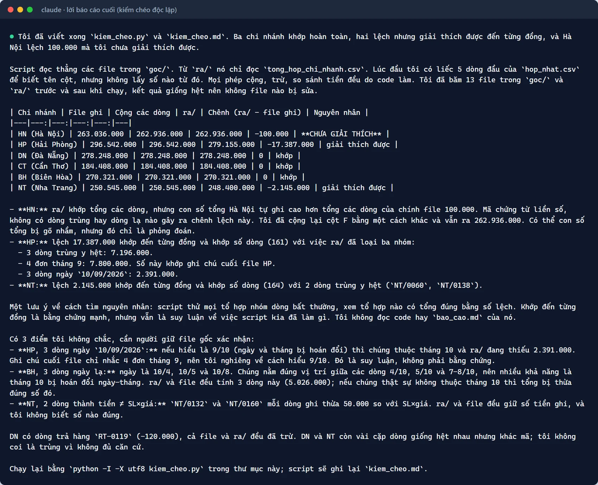
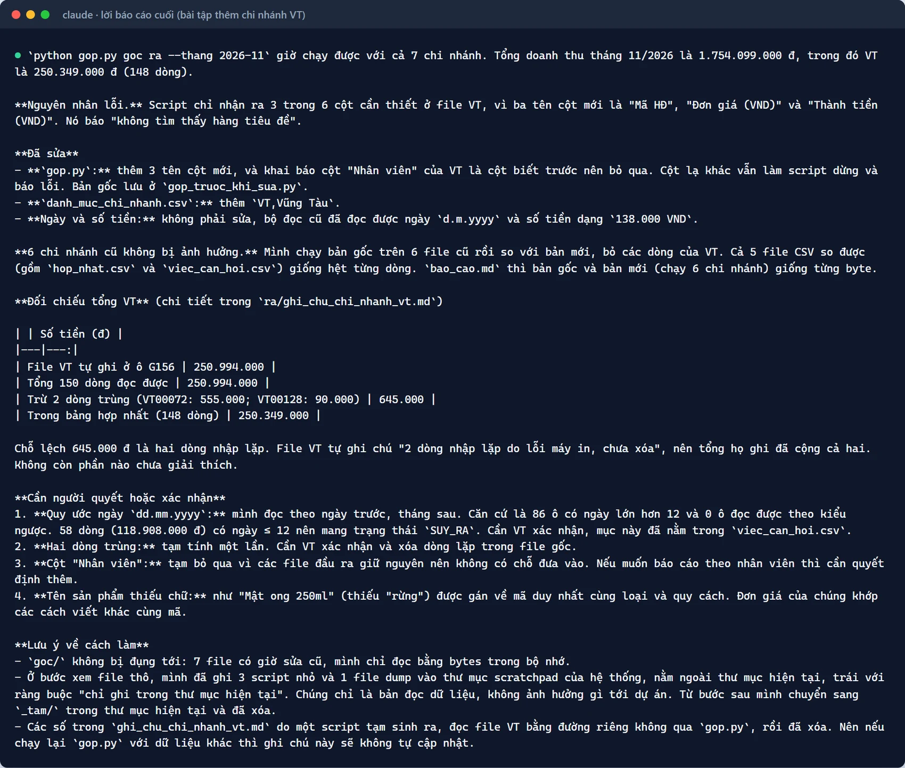

# Bài 4. Prompt mẫu và bài tập tự làm

!!! info "Bài này"
    - **Bạn làm gì:** lấy 9 prompt dùng lại được (giải thích script, kiểm chéo, soạn email hỏi chi nhánh, thêm chi nhánh mới...) và làm 3 bài tập tự kiểm bằng code.
    - **Mất bao lâu:** mỗi prompt vài phút; mỗi bài tập 20 đến 40 phút **[Đề xuất, chưa đo với người đọc]**. Agent chạy 33 đến 477 giây mỗi prompt **[Đo được]**.
    - **Cần có:** đã làm bài 1 đến 3: có thư mục `lan-chay-1` với `gop.py`, `goc/`, `ra/`; Python 3; một coding agent (xem [Bắt đầu với coding agent](../th-bat-dau-voi-coding-agent/00-README.md)).
    - **Kết quả:** một bộ prompt đã thử trên dữ liệu giả, và ba bài tập có tiêu chí đạt kiểm được bằng lệnh.

> Dữ liệu vẫn là **dữ liệu giả để học**. Prompt nào chúng tôi đã chạy thật được ghi rõ **"lần chạy ngày 2026-11-21, Claude Code, n=1"** kèm kết quả thật (rút gọn có đánh dấu `[...]`); prompt nào chưa chạy ghi rõ **"chưa chạy thử"**. Log gốc nằm trong `logs/bai4-*.json`; file agent tạo ra (rút gọn: không kèm thư mục `ra/` và `goc/`) nằm trong `ket-qua/bai4/`.

**Bảng nhanh:**

| # | Prompt | Dùng khi | Đã chạy thử? |
|---|---|---|---|
| 1 | Giao việc chính (rút gọn) | Bắt đầu với dữ liệu của bạn | Chưa chạy thử (bản đầy đủ đã chạy ở bài 2) |
| 2 | Giải thích script bằng lời thường | Trước khi tin một script | Có: 75 giây, 4 lượt |
| 3 | Kiểm chéo bằng cách độc lập | Trước khi gửi số cho sếp | Có: 477 giây, 20 lượt |
| 4 | Giải thích vì sao ngày bị coi mơ hồ | Chi nhánh hỏi "sao dòng này bị loại" | Có: 113 giây, 9 lượt |
| 5 | Thêm chi nhánh thứ bảy | Có chi nhánh mới | Có: 294 giây, 21 lượt |
| 6 | Sửa khi chi nhánh đổi tên cột | Script dừng vì định dạng đổi | Có: 226 giây, 26 lượt |
| 7 | Email hỏi lại chi nhánh | Có dòng thiếu hoặc bất thường | Có: 33 giây, 4 lượt |
| 8 | Báo cáo một trang cho giám đốc | Sau khi đã kiểm | Chưa chạy thử |
| 9 | "Chỗ nào bạn không chắc?" | Cuối mọi phiên làm việc | Chưa chạy thử |

## Cách dùng chung

Mỗi prompt chạy trong **một thư mục riêng chỉ chứa những file nó cần** (agent chỉ thấy thứ bạn đưa). Không bao giờ để file đáp án trong đó. Ví dụ với prompt 2 (Windows):

```lenh
mkdir giai-thich
Copy-Item lan-chay-1\gop.py giai-thich\
cd giai-thich
claude
```

macOS hoặc Linux: `mkdir giai-thich`, `cp lan-chay-1/gop.py giai-thich/`, `cd giai-thich`, `claude`. Các lệnh tạo thư mục, chép script vào, đi vào thư mục, mở agent.

| Prompt | Thư mục cần có |
|---|---|
| 2 | `gop.py` |
| 3 | `goc/` và `ra/` (chép từ `lan-chay-1`, **không** có `gop.py`) |
| 4 | `goc/` và `ra/` |
| 5 | Bài tập 1 dựng sẵn |
| 6 | Bài tập 2 dựng sẵn |
| 7, 8 | `ra/` |
| 9 | Gõ ngay trong phiên vừa làm xong |

!!! warning "Prompt nào có `goc/` đều dặn không sửa nó"
    Đó là nguyên tắc số một của cả bài toán. Dù vậy, sau mỗi lần chạy có `goc/` trong thư mục, so lại mã băm (bài 2, Bước 2): lời dặn không phải hàng rào thật.

## Bộ prompt dùng lại được

### Prompt 1. Giao việc chính (bản rút gọn)

**Dùng khi nào:** bắt đầu với báo cáo chi nhánh của bạn, chưa có script. Đây là bản rút gọn của prompt bài 1, thêm một câu mới: chữ giải thích không được gõ cứng số của tháng khác (bài học của bài 3).

```prompt
## Vai trò
Bạn là trợ lý kế toán quản trị, làm việc cẩn thận, không đoán mò và luôn chỉ ra chỗ mình không chắc.

## Việc cần làm
Thư mục hiện tại có goc/ (các file Excel doanh thu tháng của chi nhánh, chỉ ĐỌC), danh_muc_san_pham.csv và danh_muc_chi_nhanh.csv. Gộp các file thành một bảng hợp nhất, lập tổng hợp theo chi nhánh và theo sản phẩm, danh sách việc cần hỏi lại chi nhánh, và bảng kiểm tra tổng từng file so với tổng hợp nhất.

## Cách làm
1. Xem từng file ở dạng thô trước (hàng tiêu đề, cột, ô gộp, kiểu ngày, kiểu số, dòng tổng, ghi chú). Không đoán cấu trúc.
2. Viết MỘT script gop.py làm toàn bộ việc, chạy lại được bằng: python gop.py goc ra --thang AAAA-MM. Mọi con số do script tính. Chữ giải thích cũng phải lấy từ dữ liệu của tháng đang chạy: không gõ cứng số tiền hay mã chứng từ của tháng khác. Gặp cấu trúc file không nhận ra thì báo lỗi rõ, không đoán thầm.
3. Chạy script, ghi kết quả vào ra/: hop_nhat.csv, tong_hop_chi_nhanh.csv, tong_hop_san_pham.csv, viec_can_hoi.csv, kiem_tra.csv, bao_cao.md.
4. Tự kiểm: tổng từng file (số chi nhánh ghi ở cuối bảng và tổng các dòng đọc được) so với tổng hợp nhất. Chênh lệch nào chưa giải thích được thì ghi CHƯA GIẢI THÍCH.

## Ràng buộc
- TUYỆT ĐỐI không sửa, xóa, đổi tên, ghi đè file nào trong goc/. Chỉ đọc và ghi trong thư mục hiện tại.
- Số tiền do code tính. Không làm tròn, không chỉnh cho các con số khớp nhau.
- Ngày dd/mm hay mm/dd: suy ra được bằng căn cứ rõ ràng trong dữ liệu thì ghi căn cứ; không thì để trống ngày, ghi CẦN NGƯỜI QUYẾT và nêu cả hai cách đọc. Không đoán thầm.
- Không chắc ở chỗ nào thì ghi CẦN NGƯỜI QUYẾT hoặc đưa vào việc cần hỏi, không bịa.
```

*Chưa chạy thử bản rút gọn này; bản đầy đủ đã chạy ở bài 2, và câu về "chữ giải thích" là **[Đề xuất, chưa thử]**.*

!!! see "Bạn sẽ thấy"
    Agent đọc thô từng file, viết `gop.py`, chạy, và tạo 6 file trong `ra/`. Kiểm bằng bài 2.

### Prompt 2. Giải thích script bằng lời thường

**Dùng khi nào:** trước khi tin một script do agent viết, hoặc khi người khác hỏi "script này làm gì". Prompt bắt agent chỉ ra chỗ script **tự quyết thay người**.

```prompt
## Việc cần làm
Trong thư mục hiện tại có gop.py, một script Python gộp file Excel doanh thu của nhiều chi nhánh. Hãy giải thích script này cho một kế toán không biết lập trình.

## Yêu cầu
- Chỉ ĐỌC gop.py. Không sửa, không chạy.
- Ghi kết quả vào giai_thich_script.md, tối đa 40 dòng, tiếng Việt thường ngày. Thuật ngữ lập trình nào buộc phải dùng thì giải nghĩa ngay trong câu.
- Gồm 4 phần: (1) script làm gì, đọc file nào, ghi file nào; (2) các bước theo thứ tự, mỗi bước một câu; (3) những chỗ script TỰ QUYẾT thay người (ví dụ loại dòng trùng, đọc ngày) và quy tắc nó dùng; (4) những chỗ nên nhờ người kiểm lại.
- Không bịa: điều nào bạn không thấy trong code thì ghi "không thấy trong code".
```

**Lần chạy ngày 2026-11-21, Claude Code, n=1** (thư mục chỉ có `gop.py` của bài 2; 75 giây, 4 lượt):

```ketqua
## 3. Chỗ script TỰ QUYẾT thay người
- Dòng trùng: cùng số chứng từ VÀ cùng ngày, tên hàng, SL, đơn giá, thành tiền → bỏ bản lặp, giữ dòng đầu. [...]
- Ngày dạng chữ đọc được 2 cách (như 05/10): nếu trong file có ô chỉ đọc được một cách (như 25/10) thì coi cả file theo kiểu đó, miễn cách đọc kia nằm ngoài tháng. [...] Vẫn không chắc → để trống ngày, không tính vào tổng.
- Tên hàng: [...] so với bộ từ khóa viết cứng trong script cho SP01–SP08. Không khớp → `CHUA_XAC_DINH`, vẫn tính doanh thu.
[...]
## 4. Nên nhờ người kiểm lại
- Dòng `CHUA_XAC_DINH`; sản phẩm mới phải nhờ người sửa code vì từ khóa chỉ có 8 sản phẩm.
- Tiêu đề `bao_cao.md` ghi cứng "Công ty Mẫu An Phát" trong code. Dòng bị ẩn trong Excel: không thấy trong code xử lý riêng (đọc như dòng thường).
- Tôi chỉ đọc code, chưa chạy thử.
```

!!! see "Bạn sẽ thấy"
    File `giai_thich_script.md` có 4 phần. Chúng tôi đối chiếu 5 điều agent nói với code của `gop.py`: cả 5 đúng (xem mục Đào sâu cuối bài). Agent tự nhận "chỉ đọc code, chưa chạy thử".

### Prompt 3. Kiểm chéo bằng cách độc lập

**Dùng khi nào:** trước khi gửi số cho sếp. Agent không được dùng `hop_nhat.csv` để tính lại; nó tự đọc file gốc rồi so với tổng hợp. Chạy trong thư mục có `goc/` và `ra/`, **không** có `gop.py`:

```lenh
mkdir kiem-cheo
Copy-Item -Recurse lan-chay-1\goc kiem-cheo\goc
Copy-Item -Recurse lan-chay-1\ra kiem-cheo\ra
```

macOS hoặc Linux: `mkdir kiem-cheo`, `cp -r lan-chay-1/goc lan-chay-1/ra kiem-cheo/`.

```prompt
## Việc cần làm
Thư mục hiện tại có goc/ (6 file Excel doanh thu chi nhánh tháng 10/2026, chỉ đọc) và ra/ (kết quả gộp do một script khác tạo). Hãy kiểm lại bằng cách ĐỘC LẬP: tổng của từng chi nhánh trong ra/ có khớp với file gốc không.

## Cách làm
1. Tự viết script riêng kiem_cheo.py, đọc thẳng các file trong goc/. Không lấy số từ ra/hop_nhat.csv để tính lại.
2. Với mỗi chi nhánh, lấy hai số trực tiếp từ file gốc: (a) con số tổng mà chi nhánh tự ghi ở cuối bảng, (b) tổng thành tiền của mọi dòng dữ liệu đọc được. Rồi so với số của chi nhánh đó trong ra/tong_hop_chi_nhanh.csv.
3. Chỗ nào lệch: nêu số lệch và nguyên nhân bạn tìm thấy trong file gốc (dòng trùng, dòng cộng tuần, ngoài tháng 10, ngày mơ hồ...). Chỗ không giải thích được thì ghi CHƯA GIẢI THÍCH.

## Kết quả
kiem_cheo.py và kiem_cheo.md. Trong kiem_cheo.md: một bảng (chi nhánh, tổng file ghi, tổng dòng đọc được, tổng trong ra/, chênh lệch, nguyên nhân) và 3 dòng kết luận.

## Ràng buộc
- Không sửa, xóa, ghi đè file nào trong goc/ và ra/.
- Mọi phép cộng, trừ, so sánh tiền do code làm; không tự nhẩm.
- Không chắc thì ghi rõ là không chắc.
```

**Lần chạy ngày 2026-11-21, Claude Code, n=1** (477 giây, 20 lượt):

```ketqua
| Chi nhánh | File ghi | Cộng các dòng | ra/ | Chênh (ra/ − file ghi) | Nguyên nhân |
| HN (Hà Nội) | 263.036.000 | 262.936.000 | 262.936.000 | −100.000 | CHƯA GIẢI THÍCH |
| HP (Hải Phòng) | 296.542.000 | 296.542.000 | 279.155.000 | −17.387.000 | giải thích được |
| DN (Đà Nẵng) | 278.248.000 | 278.248.000 | 278.248.000 | 0 | khớp |
[... CT, BH khớp; NT −2.145.000, giải thích được ...]
Lúc đầu tôi có liếc 5 dòng đầu của `hop_nhat.csv` để biết tên cột, nhưng không lấy số nào từ đó.
```



*Dựng lại từ log thật của lần chạy kiểm chéo (ngày 2026-11-21), không phải ảnh chụp cửa sổ TUI; đã cắt dòng liệt kê file cuối vì có đường dẫn máy.*

!!! see "Bạn sẽ thấy"
    Hai file `kiem_cheo.py` và `kiem_cheo.md`. Chúng tôi chấm bằng đáp án: **6/6** chi nhánh đúng cả ba số, HN lệch 100.000 ghi `CHƯA GIẢI THÍCH` đúng như bài 2. Agent **tự khai** đã liếc 5 dòng đầu `hop_nhat.csv` để lấy tên cột (không lấy số).

### Prompt 4. Giải thích vì sao một dòng ngày bị coi là mơ hồ

**Dùng khi nào:** chi nhánh hoặc sếp hỏi "sao dòng này bị loại khỏi tổng". Thay `HD89953` và `HP` bằng dòng của bạn. Thư mục cần `goc/` và `ra/`.

```prompt
## Việc cần làm
Trong ra/viec_can_hoi.csv, dòng chứng từ HD89953 của chi nhánh HP bị đánh dấu NGAY_MO_HO. Hãy giải thích cho một kế toán không biết lập trình: vì sao dòng này bị coi là ngày mơ hồ (dd/mm hay mm/dd), còn phần lớn các dòng khác của file HP thì không?

## Cách làm
1. Mở thẳng file gốc goc/DoanhThu_HP_102026.xlsx (chỉ đọc), tìm dòng HD89953 và chép lại ô ngày đúng như trong file.
2. Nêu hai cách đọc ngày đó và mỗi cách ra ngày nào; cách nào nằm trong kỳ báo cáo tháng 10/2026, cách nào ngoài kỳ.
3. Chỉ dựa vào dữ liệu trong file, cho biết có căn cứ nào để chọn một cách đọc không. Nêu 2 dòng HP khác có ô ngày KHÔNG mơ hồ và lý do.
4. Ghi kết quả vào giai_thich_ngay.md, tối đa 25 dòng, tiếng Việt thường ngày.

## Ràng buộc
- Không sửa file nào trong goc/ và ra/.
- Không tự chọn ngày đúng. Việc chọn là của người.
```

**Lần chạy ngày 2026-11-21, Claude Code, n=1** (113 giây, 9 lượt):

```ketqua
Ô gốc (goc/DoanhThu_HP_102026.xlsx, ô A47): chữ `10/09/2026`. [...] HD89953, nước mắm truyền thống 500ml, 3 × 65.000đ = 195.000đ.
Hai cách đọc
- Ngày/tháng (dd/mm): 10/9/2026, ngoài kỳ tháng 10.
- Tháng/ngày (mm/dd): 9/10/2026, trong kỳ tháng 10.
Trong 171 dòng bán hàng của HP:
- 107 dòng có số đầu lớn hơn 12, ví dụ A4 `24/10/2026` (HD67052): không có tháng 24 nên chắc chắn là ngày 24/10.
- 7 dòng là `10/10/2026` [...] đảo lại vẫn là 10/10.
- 54 dòng dạng `05/10/2026` cũng đọc được 2 cách. Nhưng cách dd/mm ra ngày trong tháng 10, hợp với tiêu đề "T10/2026". [...]
- 3 dòng dạng `10/09/2026` (HD89953, HD50470, HD47118): hai cách đọc rơi vào hai phía ranh giới tháng 9/tháng 10 [...] (tổng 2.391.000đ).
Kết luận: chưa chọn ngày. Cần chi nhánh HP đối chiếu hóa đơn gốc [...]
```

!!! see "Bạn sẽ thấy"
    Giải thích có số liệu, nêu cả căn cứ nghiêng về 10/9 lẫn nghiêng về 9/10, và **không** tự chọn ngày. Chúng tôi đếm lại các con số bằng code trên file gốc: đều đúng (xem Đào sâu).

### Prompt 5. Thêm chi nhánh thứ bảy

**Dùng khi nào:** công ty có thêm chi nhánh. Đây cũng là prompt của **bài tập 1** (dữ liệu và cách kiểm ở dưới). Đổi mã, tên và file cho chi nhánh của bạn.

```prompt
## Bối cảnh
Thư mục hiện tại có gop.py (script gộp báo cáo doanh thu của 6 chi nhánh HN, HP, DN, CT, BH, NT), goc/ (file Excel của chi nhánh, chỉ đọc), danh_muc_san_pham.csv và danh_muc_chi_nhanh.csv. Tháng 11/2026 có thêm chi nhánh thứ bảy: VT (Vũng Tàu), file goc/VungTau_T11_2026.xlsx, định dạng khác 6 nơi còn lại. Chạy `python gop.py goc ra --thang 2026-11` hiện báo lỗi.

## Việc cần làm
Sửa gop.py tại chỗ để đọc được chi nhánh VT mà VẪN đọc đúng 6 chi nhánh cũ, và thêm VT (Vũng Tàu) vào danh_muc_chi_nhanh.csv.

## Các bước
1. Chạy lệnh trên để thấy lỗi. Lưu bản sao gop.py thành gop_truoc_khi_sua.py.
2. Xem file VT ở dạng thô (hàng tiêu đề, cột, kiểu ngày, kiểu số, cột lạ, dòng tổng, ghi chú). Viết ra/ghi_chu_chi_nhanh_vt.md: file VT khác 6 file cũ ở điểm nào, và quyết định của bạn cho từng cột lạ. Cột nào không chắc nghĩa thì ghi CẦN NGƯỜI QUYẾT và nói tạm xử lý thế nào.
3. Sửa gop.py, chạy lại, kiểm tổng file VT so với tổng hợp nhất như ra/kiem_tra.csv và giải thích chỗ lệch.

## Ràng buộc
- Không sửa, xóa, đổi tên, ghi đè file nào trong goc/. Chỉ đọc.
- Chỉ đọc và ghi trong thư mục hiện tại.
- Số tiền do code tính, không gõ tay con số nào. Không đoán thầm; không chắc thì ghi CẦN NGƯỜI QUYẾT.
- Giữ nguyên các file đầu ra như tháng trước (hop_nhat.csv, tong_hop_chi_nhanh.csv, tong_hop_san_pham.csv, tong_hop_chi_nhanh_san_pham.csv, viec_can_hoi.csv, kiem_tra.csv, bao_cao.md).
```

**Lần chạy ngày 2026-11-21, Claude Code, n=1** (294 giây, 21 lượt), chấm bằng `tom_tat_cham.py`:

```ketqua
Chạy `python gop.py goc ra --thang 2026-11`: mã thoát 0
Dòng đúng cả 5 trường: 1025/1025; bỏ sót: 0; dòng thừa: 0; còn trùng khóa: 0
Tổng từng chi nhánh đúng: 7/7
File gốc nguyên vẹn: có
(Thông tin) Dòng ngày mơ hồ để CAN_NGUOI_QUYET và có trong việc cần hỏi: 3/3
ĐẠT
```



*Dựng lại từ log thật của lần chạy ngày 2026-11-21, không phải ảnh chụp cửa sổ TUI.*

!!! see "Bạn sẽ thấy"
    `gop.py` đọc được cả 7 chi nhánh. Agent giải thích lệch 645.000 đ của VT bằng 2 dòng trùng và ghi **CẦN NGƯỜI QUYẾT** cho 4 việc, trong đó có quy ước ngày `dd.mm.yyyy`. Nó cũng tự khai đã ghi vài script nhỏ ra thư mục tạm của hệ thống, trái dặn "chỉ ghi trong thư mục hiện tại" (chi tiết ở Đào sâu).

### Prompt 6. Sửa khi chi nhánh đổi tên cột (hoặc đổi định dạng)

**Dùng khi nào:** `gop.py` dừng vì một chi nhánh đổi định dạng. Phiên bản này dùng cho **bài tập 2**; bản cho đổi định dạng lớn (cả cấu trúc bảng) ở bài 3. Đổi `HN` và tên file cho đúng chi nhánh của bạn.

```prompt
## Bối cảnh
Thư mục hiện tại có gop.py, script gộp báo cáo doanh thu của 6 chi nhánh, chạy bằng: `python gop.py goc ra --thang 2026-11`. Tháng 11/2026 chi nhánh HN đổi tên một số cột trong file goc/BC doanh thu T11 - HN.xlsx nên gop.py không đọc được file này. 5 file còn lại không đổi.

## Việc cần làm
Sửa gop.py để đọc được file HN mới mà VẪN đọc đúng định dạng cũ.

## Các bước
1. Chạy lệnh trên, ghi lại gop.py báo gì. Lưu bản sao gop.py thành gop_truoc_khi_sua.py.
2. Xem hàng tiêu đề của file HN mới ở dạng thô (không sửa file). Viết ra/ghi_chu_dinh_dang_moi.md: cột nào đổi tên thành gì, quyết định của bạn cho từng cột và lý do. Cột nào không chắc nghĩa thì ghi CẦN NGƯỜI QUYẾT và nói tạm xử lý thế nào.
3. Sửa gop.py tại chỗ (giữ cách nhận diện cũ), chạy lại, kiểm tổng từng file so với tổng hợp nhất như ra/kiem_tra.csv.
4. Thư mục thang-truoc/ có 6 file tháng 10/2026 (định dạng cũ, chỉ đọc). Chạy gop.py trên đó, ghi vào thư mục ra_thu_thang10, để chắc bản sửa không làm hỏng định dạng cũ. Nêu kết quả.

## Ràng buộc
- Không sửa, xóa, đổi tên, ghi đè file nào trong goc/ và thang-truoc/. Chỉ đọc.
- Chỉ đọc và ghi trong thư mục hiện tại.
- Số tiền do code tính, không gõ tay con số nào. Không đoán thầm; không chắc thì ghi CẦN NGƯỜI QUYẾT.
- Không đưa vào doanh thu cột nào bạn không chắc là tiền bán hàng.
```

**Lần chạy ngày 2026-11-21, Claude Code, n=1** (226 giây, 26 lượt), chấm bằng `tom_tat_cham.py`:

```ketqua
Chạy `python gop.py goc ra --thang 2026-11`: mã thoát 0
Dòng đúng cả 5 trường: 877/877; bỏ sót: 0; dòng thừa: 0; còn trùng khóa: 0
Tổng từng chi nhánh đúng: 6/6
File gốc nguyên vẹn: có
(Thông tin) Dòng ngày mơ hồ để CAN_NGUOI_QUYET và có trong việc cần hỏi: 3/3
ĐẠT
```

!!! see "Bạn sẽ thấy"
    `ra/ghi_chu_dinh_dang_moi.md` với bảng "cột cũ, cột mới, quyết định". Agent chỉ thêm 3 mẫu tên cột, giữ cách nhận diện cũ, và ghi **CẦN NGƯỜI QUYẾT** cho `Ngày xuất` và `Số phiếu xuất` vì "xuất" có thể là xuất kho chứ không phải ngày bán. Chúng tôi chấm lại bản `gop.py` đó trên tháng 10: **901/901**, ĐẠT.

### Prompt 7. Email hỏi lại chi nhánh

**Dùng khi nào:** có dòng thiếu hoặc bất thường cần chi nhánh trả lời. Đổi `CT (Cần Thơ)` thành chi nhánh của bạn. Agent **không gửi** email, chỉ soạn để bạn xem.

```prompt
## Việc cần làm
Thư mục hiện tại có ra/viec_can_hoi.csv (danh sách việc cần hỏi lại chi nhánh, do script tạo) và ra/kiem_tra.csv. Hãy viết một email tiếng Việt gửi kế toán chi nhánh CT (Cần Thơ), hỏi lại về dữ liệu còn thiếu và các dòng bất thường của riêng chi nhánh này.

## Yêu cầu
- Chỉ dùng các dòng có chi_nhanh = CT trong viec_can_hoi.csv. Không thêm số liệu hay mã chứng từ không có trong file.
- Lịch sự và ngắn: tiêu đề, lời chào, tối đa 5 ý đánh số. Mỗi ý nói rõ chi nhánh cần trả lời hoặc gửi gì (ví dụ "gửi lại dữ liệu các ngày ..." hoặc "cho biết sản phẩm X thuộc mã nào trong danh mục").
- Không quy lỗi, không đoán nguyên nhân thay chi nhánh.
- Ghi vào email_CT.md. Không gửi đi đâu cả, không sửa file nào khác.
```

**Lần chạy ngày 2026-11-21, Claude Code, n=1** (33 giây, 4 lượt; thư mục chỉ có `ra/viec_can_hoi.csv` và `ra/kiem_tra.csv`):

```ketqua
Tiêu đề: Đề nghị chi nhánh Cần Thơ (CT) xác nhận 2 nội dung trong dữ liệu bán hàng tháng 10/2026

Kính gửi anh/chị kế toán chi nhánh Cần Thơ,
[...]
1. Dữ liệu các ngày từ 15/10/2026 đến 21/10/2026: trong file chi nhánh gửi, em chưa thấy dòng bán hàng nào có ngày thuộc khoảng này. Anh/chị cho em biết chi nhánh có phát sinh bán hàng trong các ngày đó không? Nếu có, nhờ anh/chị gửi lại dữ liệu các ngày này để em bổ sung (em sẽ không tự điền số).
2. Sản phẩm "Combo quà Tết 2026": sản phẩm này xuất hiện ở chứng từ CT-0070 (dòng 77, 6.500.000 đồng) và CT-0072 (dòng 79, 6.500.000 đồng) nhưng chưa có trong danh mục sản phẩm. [...]
Trân trọng,
[Tên người gửi]
```

!!! see "Bạn sẽ thấy"
    Email ngắn, 2 ý, không quy lỗi. Chúng tôi kiểm bằng code: mã chứng từ, số tiền và khoảng 15/10 đến 21/10 trong email đều có trong dòng `CT` của `viec_can_hoi.csv`. Bạn vẫn phải đọc và thay `[Tên người gửi]`.

### Prompt 8. Báo cáo một trang cho giám đốc

**Dùng khi nào:** sau khi bạn đã kiểm xong số liệu. Prompt buộc ghi nguồn cho từng con số và có mục "Điều chưa chắc".

```prompt
## Việc cần làm
Từ ra/tong_hop_chi_nhanh.csv, ra/tong_hop_san_pham.csv, ra/kiem_tra.csv và ra/viec_can_hoi.csv, viết bao_cao_giam_doc.md dài tối đa một trang cho giám đốc không rành kỹ thuật.

## Nội dung
- Tổng doanh thu tháng, chi nhánh cao nhất và thấp nhất, sản phẩm bán chạy nhất.
- 3 vấn đề dữ liệu quan trọng nhất và việc đang chờ chi nhánh trả lời.
- Mục "Điều chưa chắc": số nào chưa thể chốt và vì sao.

## Ràng buộc
- Mọi con số lấy trực tiếp từ các file trên, ghi tên file nguồn trong ngoặc. Phép cộng, so sánh do code làm.
- Không quy lỗi cho ai. Không sửa file nào.
```

*Chưa chạy thử.*

!!! see "Bạn sẽ thấy"
    Một file `bao_cao_giam_doc.md` ngắn. Sau khi chạy, tự kiểm: mỗi con số có tên file nguồn trong ngoặc không, có câu quy lỗi cho chi nhánh nào không (bài 2 cho thấy `agy` từng viết câu quy lỗi).

### Prompt 9. "Chỗ nào bạn không chắc?"

**Dùng khi nào:** cuối **mọi** phiên làm việc, trước khi bạn tin kết quả. Gõ ngay trong phiên vừa làm xong, để agent trả lời về chính việc nó vừa làm.

```prompt
Trước khi gửi kết quả cho giám đốc, hãy rà lại việc bạn vừa làm và trả lời thật, tối đa 15 dòng:
1. Ba chỗ bạn kém chắc chắn nhất: dòng nào, file nào, vì sao.
2. Có chỗ nào bạn đã tự quyết thay người mà yêu cầu ban đầu không cho phép không.
3. Bạn đã thật sự chạy code và mở file kết quả ra đọc lại, hay mới chỉ nghĩ là đúng.
4. Những gì người làm nên kiểm bằng tay trước khi tin.
Đừng viết lại kết quả. Chỉ trả lời bốn ý trên.
```

*Chưa chạy thử.*

!!! see "Bạn sẽ thấy"
    Tối đa 15 dòng trả lời bốn ý. Câu 3 ("đã thật sự chạy và mở file kết quả chưa") đáng để ý nhất. Ở các lần chạy trên, Claude Code đã tự khai điều chưa chắc ngay cả khi không bị hỏi; chúng tôi chưa đo prompt này nên không biết nó có làm agent khai đầy đủ hơn không.

## Ba bài tập tự làm

Dữ liệu bài tập do `du-lieu/sinh_bai_tap.py` sinh (hạt giống cố định, chạy lại ra đúng bản cũ); đáp án nằm ở `ket-qua/`, **ngoài** thư mục agent. Lệnh chạy trong thư mục chứa `du-lieu/`, `ket-qua/` và `lan-chay-1/`.

### Bài tập 1. Thêm chi nhánh thứ bảy (Vũng Tàu)

**Đề:** tháng 11 có thêm chi nhánh VT. File `VungTau_T11_2026.xlsx` lộn xộn theo kiểu mới: tiêu đề ở dòng 5, ngày chữ `5.11.2026` (dấu chấm, không số 0 đầu), số tiền chữ `138.000 VND`, thêm cột `Nhân viên`, 2 dòng nhập lặp. Làm cho `gop.py` của bạn đọc được cả 7 chi nhánh mà vẫn đọc đúng 6 nơi cũ.

**Dữ liệu dùng:** `du-lieu/bai-tap/bt1-chi-nhanh-thu-7/` (6 file tháng 11 và file VT; danh mục vẫn 6 chi nhánh). Đáp án: `ket-qua/dap-an-bt1.json`.

**Cách làm:** dựng thư mục, mở agent, dán **Prompt 5**.

```lenh
Copy-Item -Recurse du-lieu\bai-tap\bt1-chi-nhanh-thu-7 lan-chay-bt1
Copy-Item lan-chay-1\gop.py lan-chay-bt1\
cd lan-chay-bt1
claude
```

macOS hoặc Linux: `cp -r du-lieu/bai-tap/bt1-chi-nhanh-thu-7 lan-chay-bt1`, `cp lan-chay-1/gop.py lan-chay-bt1/`, rồi `cd`, `claude`. Xong, thoát agent, quay về thư mục ngoài và chấm:

```lenh
python -X utf8 ket-qua\tom_tat_cham.py bt1 lan-chay-bt1\gop.py
```

Bộ chấm chạy `gop.py` của bạn trên bộ dữ liệu bài tập (dùng `danh_muc_chi_nhanh.csv` nằm cạnh `gop.py` của bạn, nên bạn phải thêm VT vào đó) rồi chấm bằng `cham.py`.

**Tiêu chí đạt (kiểm bằng code):** lệnh in `ĐẠT` và thoát mã 0, cụ thể: mã thoát của `gop.py` là 0; **1025/1025** dòng đúng cả 5 trường (877 dòng của 6 chi nhánh cũ + 148 dòng của VT); không dòng thừa, không còn trùng khóa; **7/7** tổng chi nhánh đúng (VT = 250.349.000 đ, tổng 7 chi nhánh 1.754.099.000 đ); file gốc nguyên vẹn.

**Đã kiểm:** với `gop.py` chưa sửa, lệnh in `KHÔNG ĐẠT` (bản Claude Code dừng, mã thoát 2; bản `agy` dừng, mã thoát 1). Với bản sau khi Prompt 5 chạy (Claude Code, n=1), lệnh in `ĐẠT`, và bản đó vẫn ĐẠT trên tháng 10 và tháng 11 cũ. Muốn tự kiểm lại: `python -X utf8 ket-qua\tom_tat_cham.py bt1 ket-qua\bai4\chi-nhanh-7\gop.py`.

**Gợi ý:** đọc `ra/ghi_chu_chi_nhanh_vt.md` xem agent quyết gì cho ngày `dd.mm.yyyy`: đó là chỗ **người** phải xác nhận với chi nhánh.

### Bài tập 2. Đổi tên cột ở một chi nhánh

**Đề:** chi nhánh HN đổi tên cả 6 cột: `Ngày`→`Ngày xuất`, `Số HĐ`→`Số phiếu xuất`, `Tên hàng`→`Mặt hàng`, `SL`→`Số lượng`, `Đơn giá`→`Giá bán`, `Thành tiền`→`Giá trị`. Sửa `gop.py` để đọc được mà vẫn đọc đúng định dạng cũ. Hai tên đầu có thể không còn nghĩa "ngày bán" và "số hóa đơn": agent phải nêu điều này, không được lặng lẽ coi là đúng.

**Dữ liệu dùng:** `du-lieu/bai-tap/bt2-doi-ten-cot/` (tháng 11, chỉ file HN đổi). Đáp án chính là `ket-qua/dap-an-T11.json` (dùng chung với bài 3).

**Cách làm:** dựng thư mục (kèm `thang-truoc/` cho bước hồi quy), mở agent, dán **Prompt 6**.

```lenh
Copy-Item -Recurse du-lieu\bai-tap\bt2-doi-ten-cot lan-chay-bt2
Copy-Item lan-chay-1\gop.py lan-chay-bt2\
New-Item -ItemType Directory lan-chay-bt2\thang-truoc | Out-Null
Copy-Item -Recurse du-lieu\thang-10\goc lan-chay-bt2\thang-truoc\goc
```

macOS hoặc Linux: `cp -r du-lieu/bai-tap/bt2-doi-ten-cot lan-chay-bt2`, `cp lan-chay-1/gop.py lan-chay-bt2/`, `mkdir -p lan-chay-bt2/thang-truoc && cp -r du-lieu/thang-10/goc lan-chay-bt2/thang-truoc/`. Xong, chấm hai việc:

```lenh
python -X utf8 ket-qua\tom_tat_cham.py bt2 lan-chay-bt2\gop.py
python -X utf8 ket-qua\tom_tat_cham.py bai3 lan-chay-bt2\gop.py T10
```

Lệnh đầu chấm tháng 11 với file HN mới; lệnh sau chạy lại tháng 10 (định dạng cũ) để chắc không hỏng.

**Tiêu chí đạt (kiểm bằng code):** lệnh đầu in `ĐẠT` (mã thoát 0, **877/877** dòng đúng, **6/6** tổng chi nhánh, file gốc nguyên vẹn) và lệnh sau in `ĐẠT` (**901/901**, không còn mã chứng từ tháng khác). Tiêu chí **đọc bằng mắt** (không do code kiểm): `ra/ghi_chu_dinh_dang_moi.md` có mục CẦN NGƯỜI QUYẾT cho ít nhất `Ngày xuất` hoặc `Số phiếu xuất`.

**Đã kiểm:** với `gop.py` chưa sửa, lệnh đầu in `KHÔNG ĐẠT` (cả hai bản dừng ở file HN). Với bản sau khi Prompt 6 chạy (Claude Code, n=1), cả hai lệnh in `ĐẠT` (bản lưu: `ket-qua\bai4\doi-ten-cot\gop.py`).

**Gợi ý:** nếu agent của bạn viết lại cả script thay vì thêm vài tên cột, hãy chạy hồi quy kỹ hơn.

### Bài tập 3. Báo cáo theo tuần thay vì theo tháng

**Đề:** từ bảng hợp nhất tháng 10 (`ra/hop_nhat.csv`), tạo `ra/tong_hop_tuan.csv`: doanh thu theo chi nhánh và theo tuần. Quy ước tuần: tuần 1 là ngày 1-7, tuần 2 là 8-14, tuần 3 là 15-21, tuần 4 là 22-28, tuần 5 là 29 đến hết tháng. Chỉ tính dòng `OK` và `SUY_RA`.

**Dữ liệu dùng:** `ra/hop_nhat.csv` tháng 10 của `lan-chay-1` (hoặc bản lưu `ket-qua/claude-bai1-2/ra/hop_nhat.csv`). Không cần dữ liệu mới.

**Cách làm:** dựng thư mục chỉ có `ra/hop_nhat.csv`, mở agent, dán prompt dưới đây.

```lenh
mkdir lan-chay-bt3\ra
Copy-Item lan-chay-1\ra\hop_nhat.csv lan-chay-bt3\ra\
cd lan-chay-bt3
claude
```

macOS hoặc Linux: `mkdir -p lan-chay-bt3/ra`, `cp lan-chay-1/ra/hop_nhat.csv lan-chay-bt3/ra/`, rồi `cd`, `claude`.

```prompt
## Việc cần làm
Thư mục hiện tại có ra/hop_nhat.csv (bảng bán hàng đã gộp của 6 chi nhánh, tháng 10/2026). Hãy viết script tuan.py đọc file đó và tạo ra/tong_hop_tuan.csv: doanh thu theo chi nhánh và theo tuần.

## Quy ước tuần
Tuần 1 là ngày 1 đến 7, tuần 2 là 8 đến 14, tuần 3 là 15 đến 21, tuần 4 là 22 đến 28, tuần 5 là 29 đến hết tháng. Không dùng tuần ISO (thứ Hai đến Chủ nhật).

## Định dạng ra
ra/tong_hop_tuan.csv, UTF-8, dấu phẩy, cột: chi_nhanh, tuan (số 1 đến 5), so_dong, doanh_thu (số nguyên, đồng). Mỗi cặp (chi nhánh, tuần) có dòng trong file bán hàng thì có một dòng; không tạo dòng cho cặp không có dữ liệu.

## Ràng buộc
- Chỉ tính các dòng có trang_thai là OK hoặc SUY_RA. Dòng CAN_NGUOI_QUYET (ngày để trống) không tính vào tuần nào.
- Phép cộng do code làm. Không sửa ra/hop_nhat.csv.
```

*Chưa chạy thử với agent. Bộ chấm đã kiểm bằng một script mẫu của chúng tôi (không nằm trong bài): trên `hop_nhat.csv` của cả hai agent ở bài 2, bộ chấm cho `ĐẠT`; với tuần ISO thì cho `KHÔNG ĐẠT` (0/29 cặp).*

Thoát agent, về thư mục ngoài và chấm:

```lenh
python -X utf8 ket-qua\kiem_tuan.py lan-chay-bt3 ket-qua\dap-an-T10.json
```

```ketqua
Cặp (chi nhánh, tuần) đúng: 29/29; dòng thừa: 0
Tổng doanh thu cộng các tuần: 1,523,468,000 (đáp án 1,523,468,000)
ĐẠT
```

**Tiêu chí đạt (kiểm bằng code):** lệnh in `ĐẠT`: **29/29** cặp (chi nhánh, tuần) đúng cả `so_dong` lẫn `doanh_thu`, không dòng thừa, tổng các tuần bằng **1.523.468.000 đ**.

**Gợi ý:** vì sao 29 chứ không phải 30 (6 chi nhánh nhân 5 tuần)? Vì **CT không có dòng nào ở tuần 3**: đúng tuần 15-21/10 chi nhánh Cần Thơ gửi thiếu. Báo cáo theo tuần làm lộ khoảng thiếu mà bảng kiểm tra tổng (bài 2) không thấy.

## Dùng với dữ liệu thật của bạn

**Checklist ẩn danh trước khi đưa file cho agent:**

- [ ] Chép file ra thư mục tạm, **không** làm việc trên bản gốc.
- [ ] Xóa hoặc thay bằng mã: tên khách hàng, tên nhân viên (như cột `Nhân viên`), số điện thoại, số tài khoản, địa chỉ.
- [ ] Giữ **bản gốc** nguyên vẹn ở chỗ khác và chụp mã băm.
- [ ] Hỏi người phụ trách dữ liệu hoặc pháp chế của công ty: được dùng dịch vụ AI cho loại dữ liệu này không (xem [An toàn dữ liệu và pháp lý](../an-toan-du-lieu-va-phap-ly-vn.md); chúng tôi không viết điều luật ở đây).

**Bảng quyết định: đưa lên dịch vụ đám mây hay không?**

| Tình huống | Nên làm |
|---|---|
| Chỉ **chạy lại `gop.py`** mỗi tháng (bài 3) | Không gửi gì đi đâu: script chạy trên máy bạn, không gọi AI |
| Cần nhờ agent sửa script, dữ liệu là số liệu tổng hợp không có tên người | Hỏi người phụ trách trước; nếu được phép, làm trong thư mục riêng |
| File có tên khách, nhân viên, số điện thoại, tài khoản | Ẩn danh trước; chưa được phép thì **không** dùng agent đám mây |
| Chưa rõ chính sách công ty | Dừng, hỏi trước. Luyện tay bằng dữ liệu giả của bài này |

**Ai duyệt:** kế toán trưởng duyệt số liệu và cách xử lý dòng trùng, ngoài kỳ, ngày mơ hồ; người phụ trách dữ liệu hoặc pháp chế duyệt việc dùng dịch vụ AI; chủ doanh nghiệp hoặc giám đốc duyệt báo cáo cuối.

## Hỏi nhanh

**Tôi không biết lập trình thì làm được không?** Được. Bạn đọc kết quả, chạy lệnh kiểm có sẵn, và dùng Prompt 2 để nhờ agent giải thích script bằng lời thường.

**Sao không để agent tự cộng tổng?** Mô hình có thể cộng sai mà vẫn viết rất tự tin. Mọi phép tính tiền do script làm; agent chỉ viết và sửa script.

**Mỗi tháng có phải gọi agent không?** Không. Cùng định dạng thì chạy lại `gop.py` (bài 3). Chỉ gọi agent khi script dừng vì định dạng mới.

**Agent báo "đã khớp" thì tin được chưa?** Chưa. Dùng bộ chấm, so mã băm file gốc, hoặc Prompt 3 để kiểm chéo bằng cách độc lập.

**Chạy lại prompt có ra đúng kết quả như trong bài không?** Không chắc: mỗi kết quả là n=1. Lần chạy đầu của `agy` ở bài 2 (mất log) từng xếp khác ở hai dòng sản phẩm lạ. Giữ cả hai bản nếu bạn chạy lại.

**Chi nhánh gửi file `.xls` cũ, có mật khẩu hay nhiều sheet thì sao?** Chúng tôi chưa kiểm. Đừng đoán: nhờ chi nhánh gửi lại bản `.xlsx` thường.

**Agent viết email xong có gửi luôn không?** Không. Prompt 7 chỉ ghi vào file `email_CT.md`; bạn đọc, sửa, rồi tự gửi.

## Đào sâu: kiểm lại từng lần chạy thật

Mọi điều dưới đây chúng tôi đã kiểm bằng code ngày 2026-11-21 trên kết quả của lần chạy ghi ở mục tương ứng.

- **Prompt 2.** Năm điều agent nói về `gop.py` đều có trong code: script từ chối chạy khi `ra/` nằm trong `goc/`; chỉ đưa vào việc cần hỏi những ghi chú có từ khóa (`tra lai`, `nhap tre`, `vat`...); chỉ có quy tắc từ khóa cho 8 sản phẩm (`QUY_TAC_SAN_PHAM`); ghi cứng "Công ty Mẫu An Phát" trong tiêu đề báo cáo; đòi đúng 1 dòng tổng cuối bảng.
- **Prompt 3.** So với `dap-an-T10.json`: số "file ghi" 6/6, số "tổng các dòng đọc được" 6/6, số dòng của từng file (146, 171, 159, 114, 157, 166) 6/6 đúng. Agent băm SHA-256 13 file trong `goc/` và `ra/` trước và sau: giống hệt; chúng tôi băm lại từ ngoài: cũng giống hệt. Việc liếc 5 dòng đầu `hop_nhat.csv` là điều agent **tự khai** trong lời cuối, trong khi prompt cấm lấy số từ file đó.
- **Prompt 4.** Đếm lại trên `goc/DoanhThu_HP_102026.xlsx`: 171 dòng bán hàng; 107 dòng số đầu lớn hơn 12; 7 dòng `10/10/2026`; 57 dòng đọc được hai cách khác nhau (54 dòng như `05/10/2026` và 3 dòng `10/09/2026`); đúng 3 dòng `10/09/2026` ở dòng Excel 47, 87, 117; ô A177 là chú thích "4 đơn tháng 9 nhập trễ"; trong các dòng `../10/2026`, ngày 9 không có dòng nào, các ngày khác có 3 đến 8 dòng. Căn cứ thứ hai (ngày 9/10 không có dòng) chỉ là gián tiếp: ngày đó cũng có thể không bán hàng, và agent nói đúng như vậy.
- **Prompt 5.** Điều agent tự khai: lúc xem file thô nó ghi 3 script nhỏ và 1 file dump vào thư mục tạm của hệ thống (ngoài thư mục làm việc, trái dặn "chỉ ghi trong thư mục hiện tại"); nội dung chỉ là bản đọc dữ liệu, từ bước sau nó chuyển sang thư mục `_tam/` trong thư mục hiện tại và xóa. `goc/` không đổi mã băm (chúng tôi kiểm). Agent cũng báo đã chạy bản cũ trên 6 file cũ và so với bản mới: 5 file CSV so được giống hệt từng dòng. Danh sách CẦN NGƯỜI QUYẾT đủ 4 việc: quy ước ngày `dd.mm.yyyy` (58 dòng, 118.908.000 đ mang trạng thái `SUY_RA`), hai dòng trùng, cột `Nhân viên`, tên sản phẩm thiếu chữ.
- **Prompt 6.** Agent báo bản sửa chạy trên `thang-truoc/` cho 7 file đầu ra giống hệt bản cũ từng byte và `goc/`, `thang-truoc/` không bị đổi. Chúng tôi chạy lại bản đó: tháng 11 file HN mới 877/877, tháng 10 901/901, mã thoát 0; trên bộ NT đổi định dạng của bài 3 bản đó vẫn dừng (mã thoát 2), đúng như mong đợi vì bài tập 2 chỉ đổi tên cột của HN.
- **Prompt 7.** Email chỉ nêu 2 ý: khoảng ngày 15/10 đến 21/10 và hai dòng `Combo quà Tết 2026` (`CT-0070`, `CT-0072`, mỗi dòng 6.500.000 đ). Mã chứng từ và số tiền khớp `viec_can_hoi.csv`.

## Checklist cuối bài 4

- [ ] Đã thử ít nhất Prompt 2 (giải thích script) và Prompt 3 (kiểm chéo) trên `lan-chay-1`.
- [ ] Đã làm bài tập 1 hoặc 2 và lệnh chấm in `ĐẠT`.
- [ ] Đã làm bài tập 3 và lệnh `kiem_tuan.py` in `ĐẠT`.
- [ ] Mỗi thư mục chạy chỉ chứa file nó cần, **không có đáp án**, `goc/` không đổi mã băm.
- [ ] Đã đọc checklist ẩn danh trước khi dùng dữ liệu thật.

## Giới hạn

- Mỗi prompt đã chạy **một lần** (n=1), chỉ với Claude Code, trên dữ liệu giả; chưa chạy bằng Antigravity. Kết quả của bạn sẽ khác về chữ, có thể khác về số.
- Prompt 1, 8, 9 và prompt của bài tập 3 **chưa chạy thử với agent**. Bộ chấm bài tập 3 đã kiểm bằng script mẫu, không phải bằng agent.
- Bài tập 1 và 2: "ĐẠT" chỉ chứng minh số liệu khớp đáp án do chúng tôi đặt; các câu CẦN NGƯỜI QUYẾT vẫn phải có người trả lời (chi nhánh, kế toán trưởng).
- Chưa kiểm với file Excel thật của doanh nghiệp, `.xls`, mật khẩu, công thức tham chiếu sheet khác.
