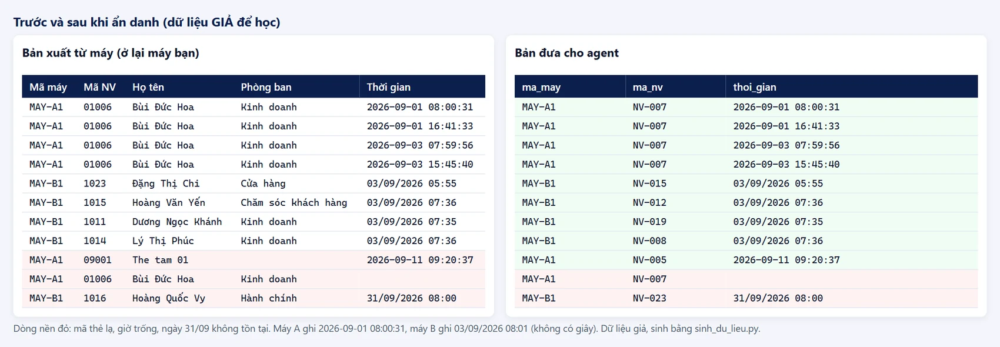

# Bài 1. Chuẩn bị dữ liệu chấm công, ẩn danh, rồi giao việc cho agent

!!! info "Bài này"
    - **Bạn làm gì:** tải bảng chấm công mẫu, **ẩn danh** bằng một script (mã `NV-001`... thay họ tên), mở agent trong một thư mục riêng, dán prompt giao việc kiểm tra chấm công.
    - **Mất bao lâu:** khoảng 30 phút chuẩn bị. Agent chạy thêm vài phút đến 20 phút **[Đo được]** (lần chạy của chúng tôi: Claude Code 247,8 giây, Antigravity 1.217,6 giây, mỗi bên n = 1).
    - **Cần có:** máy đã cài một coding agent (xem [Bắt đầu với coding agent](../th-bat-dau-voi-coding-agent/00-README.md)), Python 3 để chạy script ẩn danh, Excel hoặc Notepad để xem file. Cách sắp xếp thư mục: xem mục "Sắp xếp thư mục" ở [trang tổng quan nhóm bài](00-README.md).
    - **Kết quả:** một thư mục có bảng công từng ngày, danh sách bất thường, tổng hợp theo người, báo cáo ngắn và chương trình `tinh_cong.py`. Cách kiểm đúng sai ở bài 2.

> Dữ liệu trong bài là **dữ liệu giả để học**: công ty, 25 nhân viên, họ tên, mã thẻ, giờ quẹt đều bịa, sinh bằng script có hạt giống cố định. Mọi ngưỡng (đi trễ mấy phút, làm thêm bao nhiêu giờ thì cảnh báo, ngày lễ) là **tham số giả định** của công ty giả, không phải quy định pháp luật. Giờ làm thêm, nghỉ lễ, nghỉ phép: cần kiểm với văn bản hiện hành hoặc chuyên gia nhân sự; bài này không trích điều luật.

## Bài toán trong một phút

Công ty khoảng 25 người, hai chi nhánh, mỗi chi nhánh một máy chấm công. Máy xuất CSV, **mỗi lần quẹt một dòng**: máy nào, mã ai, lúc nào. Trước khi tính lương, người làm lương phải biết: ai thiếu quẹt vào hoặc ra, ai quẹt trùng, ai đi trễ hay về sớm so với ca, ai làm thêm quá ngưỡng, ai vắng mà chưa có đơn nghỉ, ai đi làm ngày lễ, và ai có dấu hiệu bị quẹt hộ.

Tháng có hơn một nghìn dòng quẹt (tháng mẫu: 1.160 dòng cho 750 ô "người x ngày"). Hai máy xuất hai kiểu giờ khác nhau, có dòng giờ trống, có ngày không tồn tại. Làm tay thì dễ sót.

Coding agent (chương trình AI tự đọc file, viết và chạy code) có thể **viết một chương trình Python** tính công và liệt kê bất thường. Các ca không đoán được (ví dụ chỉ có một lần quẹt lúc 12:05) agent phải **đưa cho người quyết**, không tự đoán.

!!! warning "Hai quy tắc của bài này"
    **1. Phép tính giờ do code làm**, mô hình không "tính nhẩm". **2. Dữ liệu chấm công là dữ liệu nhân sự:** agent chỉ được thấy bản đã ẩn danh. Bảng đối chiếu mã với họ tên ở lại máy bạn.

## Các bước làm

### Bước 1. Tải và giải nén dữ liệu mẫu

Tải [du-lieu.zip](du-lieu.zip), bấm chuột phải chọn **Extract All** (Windows) hoặc bấm đúp (macOS). Bạn có thư mục `du-lieu/` gồm:

| Tệp hoặc thư mục | Nội dung |
|---|---|
| `goc/` | Bốn CSV "như xuất từ máy" (có cột Họ tên, Phòng ban, Ghi chú; tên là tên giả). **Chỉ ở máy bạn.** |
| `an-danh/` | Bản đưa cho agent: bốn CSV đã ẩn danh, `quy_dinh_cong_ty.md` và một bản quy định rút gọn (dùng ở bài 2) |
| `an_danh.py` | Script ẩn danh, tự kiểm rò rỉ, gắn lại tên khi cần |
| `sinh_du_lieu.py` | Sinh lại dữ liệu giả (hạt giống cố định). Không cần dùng ở bài này |
| `prompt-giao-viec.txt` | Prompt ở Bước 6, dạng tệp |

### Bước 2. Mở xem bản gốc

Mở `goc/xuat_may_cham_cong.csv` bằng Notepad (CSV có tiếng Việt: đừng bấm đúp nếu Excel hiện vỡ chữ; hoặc dùng *Data > From Text/CSV*, chọn UTF-8). Bạn thấy: máy A ghi `2026-09-01 08:00:31`, máy B ghi `03/09/2026 08:01` (không có giây); mã NV máy A có số 0 đứng đầu (`01012`), máy B thì không (`1012`); có cả tên có dấu lẫn tên IN HOA không dấu.



*Bên trái là bản xuất từ máy (dữ liệu giả), bên phải là bản đưa cho agent. Nền đỏ là các dòng hỏng cố ý: giờ trống, ngày 31/09 không tồn tại, mã thẻ lạ.*

!!! see "Bạn sẽ thấy"
    `xuat_may_cham_cong.csv` có 1.160 dòng quẹt (1.161 dòng kể cả tiêu đề). Định dạng giờ lẫn lộn là **cố ý**: đây là thứ agent phải tự xử lý.

### Bước 3. Ẩn danh: đổi họ tên thành mã

Agent chạy trên đám mây gửi nội dung tệp nó đọc lên máy chủ của nhà cung cấp. Với dữ liệu nhân sự, nguyên tắc là: **agent chỉ làm trên bản ẩn danh**. Script `an_danh.py` làm việc đó và tự kiểm. Windows (PowerShell), chạy trong thư mục chứa `du-lieu/`:

```lenh
cd du-lieu
python -X utf8 an_danh.py
cd ..
```

Lệnh `python -X utf8` chạy script và bảo Python dùng UTF-8 để tiếng Việt không vỡ dấu. Trên macOS hoặc Linux, thay `python` bằng `python3`. Script đọc `goc/`, ghi `an-danh/`, và ghi bảng đối chiếu vào `ket-qua/bang-ma-hoa.csv` (thư mục `ket-qua/` nằm cạnh `du-lieu/`).

```ketqua
đã ẩn danh 26 mã (1 mã lạ ngoài danh sách). Rò rỉ phát hiện: KHÔNG
```

26 mã là 25 nhân viên cộng một thẻ lạ. Script làm 6 việc: đổi tên thành mã `NV-xxx` theo thứ tự xáo trộn; bỏ cột Họ tên và Phòng ban; bỏ cột Ghi chú của đơn nghỉ (hay chứa chuyện sức khỏe, gia đình); cho cả thẻ lạ một mã riêng; **giữ nguyên** định dạng giờ lẫn lộn (ẩn danh không được "làm sạch giúp"); rồi tìm họ tên, mã gốc, từ khóa phòng ban trong bốn tệp đầu ra, thấy là báo lỗi.


*Danh sách nhân viên, lịch ca xoay và đơn nghỉ phép sau ẩn danh. Cột Ghi chú đã bị bỏ.*

!!! see "Bạn sẽ thấy"
    Trong `an-danh/`, mọi người chỉ còn mã dạng `NV-007`; `nhan_vien.csv` chỉ có mã, chi nhánh, loại ca. Dòng "Rò rỉ phát hiện: KHÔNG" là điều kiện để đi tiếp.

!!! stuck "Gặp lỗi?"
    - **`python` không chạy được:** thử `python3`. Vẫn không được thì máy chưa cài Python 3: cài rồi mở lại cửa sổ dòng lệnh.
    - **Script báo "Rò rỉ phát hiện: [...]" và dừng:** còn tên hoặc từ khóa trong bản ẩn danh. Đừng đưa bản đó cho agent; xem Đào sâu bên dưới.
    - **Dữ liệu thật của bạn:** đọc kỹ [An toàn dữ liệu và pháp lý ở Việt Nam](../an-toan-du-lieu-va-phap-ly-vn.md) và mục "Dùng với dữ liệu thật" ở bài 4 trước khi làm.

### Bước 4. Tạo thư mục riêng cho agent

Mỗi lần chạy một thư mục riêng, chỉ chép đúng năm tệp của bản ẩn danh. Windows (PowerShell), chạy trong thư mục chứa `du-lieu/`:

```lenh
mkdir lan-chay-1
copy du-lieu\an-danh\cham_cong.csv, du-lieu\an-danh\nhan_vien.csv, du-lieu\an-danh\lich_ca_xoay.csv, du-lieu\an-danh\nghi_phep.csv, du-lieu\an-danh\quy_dinh_cong_ty.md lan-chay-1\
```

macOS hoặc Linux:

```lenh
mkdir lan-chay-1
cp du-lieu/an-danh/{cham_cong,nhan_vien,lich_ca_xoay,nghi_phep}.csv du-lieu/an-danh/quy_dinh_cong_ty.md lan-chay-1/
```

`mkdir` tạo thư mục, `copy` hoặc `cp` chép tệp. **Không chép** `quy_dinh_cong_ty_rut_gon.md` (bản dành cho thử nghiệm ở bài 2).

!!! warning "Giữ ngoài thư mục agent: bảng đối chiếu mã và đáp án"
    `ket-qua/bang-ma-hoa.csv` (mã với họ tên) và `ket-qua/dap-an.json` **không bao giờ** nằm trong `lan-chay-1`. Agent đọc được là mất cả ẩn danh lẫn bài kiểm.

### Bước 5. Mở agent trong thư mục vừa tạo

Mở Terminal hoặc PowerShell **đúng thư mục `lan-chay-1`**, rồi gõ một trong hai lệnh:

```lenh
cd lan-chay-1
claude
```

hoặc, nếu dùng Antigravity:

```lenh
cd lan-chay-1
agy
```

`cd` là đi vào thư mục, `claude` hoặc `agy` mở agent tại đó. Chưa cài? Xem [Bắt đầu với coding agent](../th-bat-dau-voi-coding-agent/00-README.md).

!!! warning "Agent chạy lệnh trên máy bạn: đừng giao toàn quyền"
    **[Đo được]** Ở bài này, một lần chạy `agy` (chế độ không hỏi xin phép) đã tự chạy `git log` và `dir ..\..` **ngoài** thư mục làm việc, dù prompt ghi "chỉ đọc và ghi trong thư mục hiện tại". Hai lệnh chỉ đọc, nhưng cho thấy câu dặn trong prompt **chỉ là lời dặn, không phải hàng rào**. Cách an toàn: (1) thư mục chạy chỉ chứa bản ẩn danh; (2) để chế độ có hỏi xin phép và đọc kỹ từng câu xin; (3) không bật chế độ toàn quyền trừ khi chạy trong máy ảo hoặc tài khoản riêng; (4) chạy xong thì rà log tìm lệnh có `..`, `git` hay đường dẫn ngoài thư mục.

!!! see "Bạn sẽ thấy"
    Một khung chat trong cửa sổ dòng lệnh, chờ bạn gõ. Nếu agent hỏi có tin tưởng thư mục này không, chỉ đồng ý khi đúng là `lan-chay-1`. Mở nhầm thư mục thì thoát agent (cách thoát: xem [Bắt đầu với coding agent](../th-bat-dau-voi-coding-agent/00-README.md)) rồi `cd` lại.

### Bước 6. Dán prompt giao việc

Bấm **Sao chép**, dán vào khung chat, nhấn Enter. Prompt có 6 phần (vai trò, bối cảnh, nhiệm vụ, các bước, định dạng ra, ràng buộc). **Đừng sửa** nếu bạn muốn đối chiếu với bài 2.

```prompt
# VAI TRÒ
Bạn là trợ lý kiểm tra bảng chấm công trước khi tính lương cho một công ty nhỏ (khoảng 25 nhân viên, 2 chi nhánh). Bạn không quyết định lương hay kỷ luật; bạn chuẩn bị bảng công và danh sách bất thường cho quản lý xác nhận.

# BỐI CẢNH
Thư mục hiện tại có dữ liệu tháng 09/2026 đã ẩn danh (nhân viên chỉ có mã dạng NV-001):
- cham_cong.csv: mỗi lần quẹt máy chấm công một dòng (ma_may, ma_nv, thoi_gian). Hai máy xuất hai định dạng giờ khác nhau.
- nhan_vien.csv: mã, chi nhánh, loại ca (HC hoặc XOAY).
- lich_ca_xoay.csv: lịch ca của nhân viên ca xoay (S, C hoặc OFF).
- nghi_phep.csv: các đơn nghỉ phép đã duyệt.
- quy_dinh_cong_ty.md: quy định ca, các ngưỡng (đây là tham số giả định của công ty) và cách tính. ĐỌC KỸ, làm đúng từng điều, đây là nguồn duy nhất cho mọi ngưỡng.

# NHIỆM VỤ
Kiểm tra chấm công cả tháng và tạo 4 tệp kết quả trong thư mục hiện tại: bảng công ngày, danh sách bất thường, tổng hợp theo người, báo cáo ngắn.

# CÁC BƯỚC
1. Đọc quy_dinh_cong_ty.md, rồi xem nhanh cấu trúc 4 tệp CSV (vài dòng đầu, số dòng, các kiểu định dạng giờ).
2. Viết một chương trình Python tên tinh_cong.py làm MỌI phép tính giờ và phát hiện bất thường theo đúng quy định. Không tính nhẩm, không ước lượng.
3. Chạy tinh_cong.py để sinh 3 tệp CSV.
4. Tự kiểm: chọn vài ngày khác nhau (một ngày bình thường, một ngày có bất thường) và đối chiếu tay với dữ liệu thô; sửa chương trình nếu sai.
5. Viết cột giải thích cho từng bất thường và viết bao_cao.md.

# ĐỊNH DẠNG RA (tất cả CSV mã hóa UTF-8, có dòng tiêu đề đúng tên cột dưới đây)
1. bang_cong_ngay.csv, cột: ma_nv, ngay (YYYY-MM-DD), loai_ngay (HC, S, C, OFF hoặc LE), gio_vao (HH:MM), gio_ra (HH:MM), gio_cong (số giờ, 2 chữ số thập phân), phut_tre, phut_ve_som, ot_phut, trang_thai (OK, PHEP, NGHI hoặc CHO_XAC_NHAN). Một dòng cho MỖI nhân viên MỖI ngày từ 2026-09-01 đến 2026-09-30, kể cả ngày nghỉ. Ô không xác định được thì để trống, không điền số đoán.
2. bat_thuong.csv, cột: ma_nv, ngay (YYYY-MM-DD; với OT_THANG_VUOT ghi THANG; với DU_LIEU_LOI ghi ngày nếu xác định được, không thì để trống), loai (đúng một trong các mã ở mục 7 của quy định), chi_tiet (số liệu do chương trình tính, ví dụ "vào 08:23, trễ 23 phút"), can_nguoi_quyet (CO hoặc KHONG theo mục 7), giai_thich (1 đến 2 câu tiếng Việt cho quản lý: chuyện gì xảy ra và nên hỏi/ kiểm gì; không đoán nguyên nhân). Mỗi (ma_nv, ngay, loai) một dòng.
3. tong_hop_nguoi.csv, cột: ma_nv, ngay_cong, tong_gio_cong, so_lan_tre, tong_phut_tre, so_lan_ve_som, tong_phut_ve_som, tong_ot_gio (giờ, 2 chữ số thập phân), so_ngay_phep, so_ngay_vang_chua_ghi, so_ngay_cho_xac_nhan, so_bat_thuong. Một dòng cho mỗi nhân viên trong nhan_vien.csv. ngay_cong và tong_gio_cong chỉ cộng các ngày trang_thai = OK.
4. bao_cao.md, tối đa một trang: số liệu tóm tắt, danh sách việc quản lý cần xác nhận (gom theo loại), các giả định bạn đã dùng, điều bạn chưa chắc.
Cuối cùng in ra màn hình tóm tắt: số dòng mỗi tệp, số bất thường theo từng loại.

# RÀNG BUỘC
- Chỉ đọc và ghi trong thư mục hiện tại. Không dùng mạng.
- Không bịa. Việc nào không chắc hoặc quy định không nói rõ thì ghi "CẦN NGƯỜI QUYẾT" trong chi_tiet/ bao_cao.md và để trống ô số liệu liên quan, không đoán.
- Không kết luận ai đó gian lận hoặc quẹt hộ; chỉ nêu dấu hiệu và đề nghị người có thẩm quyền xác minh. Không đề xuất kỷ luật hay trừ lương.
- Không trích điều luật. Với giờ làm thêm, nghỉ lễ, nghỉ phép chỉ nói "cần kiểm với văn bản hiện hành hoặc chuyên gia nhân sự".
- Trong mọi câu giải thích chỉ dùng mã NV-xxx, không cố đoán danh tính.
- Mọi số liệu phải do chương trình tính ra từ dữ liệu; không sửa dữ liệu gốc.
```


*Prompt trên, dựng lại từ `prompt-giao-viec.txt` (không phải ảnh chụp cửa sổ terminal).*

!!! see "Bạn sẽ thấy"
    Agent đọc quy định, xem cấu trúc bốn tệp, viết `tinh_cong.py`, chạy, tự kiểm vài ngày rồi báo cáo. Nó có thể **xin quyền** tạo tệp hoặc chạy lệnh: chọn cho phép (chỉ trong `lan-chay-1`). Khi xong, thư mục có thêm `tinh_cong.py`, `bang_cong_ngay.csv`, `bat_thuong.csv`, `tong_hop_nguoi.csv`, `bao_cao.md`.

!!! stuck "Agent xin quyền hoài, hoặc báo lỗi tiếng Việt khi chạy Python?"
    - **Xin quyền nhiều lần:** bình thường. Đọc câu nó xin; việc nằm ngoài `lan-chay-1` hoặc dùng internet thì từ chối.
    - **`UnicodeEncodeError` (cp1252) trên Windows:** **[Đo được]** Claude Code gặp đúng lỗi này khi in tiếng Việt ra màn hình và tự sửa (đặt đầu ra UTF-8). Lỗi nằm ở khâu in, không phải ở số liệu. Nếu agent không tự sửa, gõ: "Chạy lại bằng `python -X utf8`".
    - **Agent chạy lâu:** **[Đo được]** `agy` có lần chạm giới hạn 900 giây của công cụ bọc (đã ghi xong ba CSV, chưa ghi báo cáo). Chưa thấy lỗi thì cứ chờ.

### Bước 7. Xem nhanh rồi sang bài 2

Mở `bao_cao.md` đọc báo cáo, rồi mở `bat_thuong.csv` bằng Excel. Chú ý hai mục cuối của báo cáo: **giả định** và **điều chưa chắc**. **Chưa tin con số nào** cho đến khi chấm ở bài 2: agent có thể báo "đã khớp" mà vẫn sai.

## Vì sao prompt viết như vậy

| Chỗ trong prompt | Để làm gì |
|---|---|
| Vai trò: "không quyết định lương hay kỷ luật" | Giữ agent ở đúng vai chuẩn bị số liệu |
| "quy_dinh_cong_ty.md là nguồn duy nhất cho mọi ngưỡng" | Agent không biết công ty cho trễ mấy phút. Không viết ra thì nó tự chọn một con số hợp lý và kết quả sai mà nhìn vẫn đẹp |
| Bước 2 "viết chương trình, không tính nhẩm" | Hàng chục phép trừ giờ nhân 750 ô: tính nhẩm sẽ có lúc sai và không kiểm được. Code chạy lại được, đọc lại được |
| Định dạng ra có tên cột cố định | Để chấm bằng code được ở bài 2 |
| "Không chắc thì ghi CẦN NGƯỜI QUYẾT, để trống ô" | Phần quan trọng nhất. Không có nó, agent có xu hướng điền số cho "đẹp" |
| "Không kết luận quẹt hộ, không trích điều luật" | Dữ liệu chỉ cho dấu hiệu; kết luận và pháp lý là việc của người |

**Prompt không đổi sau khi thấy kết quả.** Nếu bạn sửa prompt sau lần chạy đầu, giữ cả hai bản và ghi rõ đã sửa gì.

## Đào sâu: dữ liệu mẫu, bẫy đã cài và chi tiết ẩn danh

### Định dạng bám theo tài liệu nào

- **[Nguồn]** ZKTeco, trang FAQ: https://www.zkteco.com/en/faq.html . Mỗi bản ghi quẹt gồm mã người dùng, thời gian, kiểu xác thực và trạng thái vào/ra; máy có thể trả mã người dùng 0 khi mất điện hoặc bấm nút thoát.
- **[Nguồn]** MISA AMIS, tải dữ liệu từ máy chấm công ra Excel: https://amis.misa.vn/80067/tai-du-lieu-tu-may-cham-cong/ . Quy trình thực tế: tải từ máy về phần mềm rồi xuất Excel.
- **[Nguồn]** Hướng dẫn app chấm công ZKTeco (gitbook cộng đồng): https://cyclone-nepal.gitbook.io/user-manual-zkteco-fingerprint-attendance/export-attendance . Tệp xuất ra có thể là CSV, Excel hoặc PDF.

**Chưa tìm được:** bộ dữ liệu chấm công tiếng Việt công khai dùng được (dữ liệu cá nhân, ít ai đăng). Vì vậy dữ liệu được sinh. Bài này cũng không có số liệu nguồn về tỷ lệ doanh nghiệp gặp lỗi chấm công; đây là bài toán mô phỏng.

### Các bẫy đã cài

**[Đo được]** (2026-11-20, `sinh_du_lieu.py`): 25 nhân viên (16 hành chính HC 8:00-17:00 nghỉ trưa 12:00-13:00; 9 ca xoay: S 6:00-14:00, C 14:00-22:00), kỳ 09/2026, 1.160 dòng quẹt, 750 ô, **61 bất thường thuộc 14 loại**. Ngày 01 và 02/09 là ngày lễ (giả định).

| Bẫy | Chi tiết |
|---|---|
| Thiếu quẹt | Chỉ một quẹt: gần giờ vào thì khả năng thiếu quẹt ra, gần giờ ra thì thiếu quẹt vào; quẹt đúng 12:05 giữa ca thì **không ai đoán được**, phải hỏi người |
| Quẹt trùng | Hai lần cách nhau 1-3 phút (cùng máy). Có một ca cách 4 phút: **không** phải quẹt trùng |
| Sát ngưỡng | Trễ đúng 5 phút (không tính) và 6 phút (tính); ra sớm tương tự; làm thêm 29 phút (không tính) và 30 phút (tính) |
| Làm thêm | Ba ngày quá 3 giờ; một người cộng tháng vượt 40 giờ; một người 36,18 giờ (sát ngưỡng, không vượt: để xem agent có báo oan không) |
| Nghỉ phép | 9 đơn đã duyệt: 7 đơn như kỳ vọng, 2 đơn một ngày mà người đó vẫn quẹt; thêm 6 ngày vắng không đơn |
| Ngày lễ, ngày nghỉ | Quẹt vào ngày lễ, thứ Bảy, ngày OFF của ca xoay |
| Nghi quẹt hộ | Cùng mã quẹt máy A rồi vài phút sau máy B |
| Trông giống lỗi mà không phải | Quẹt vào ở chi nhánh nhà, ra ở chi nhánh kia cách nhau cả ngày; quẹt 4 lần vì đi ăn trưa |
| Định dạng lẫn lộn | Hai kiểu giờ; số 0 đứng đầu ở máy A; tên có dấu và IN HOA; dòng không theo thứ tự giờ |
| Dòng hỏng | Một mã thẻ lạ, một giờ trống, một ngày 31/09 |

Đáp án **không do chúng tôi đếm tay**: `sinh_du_lieu.py` có phần cài bẫy (ghi sổ cài gì, ở đâu) và một "bộ tính tham chiếu" đọc lại dữ liệu để tính độc lập. Hai phần phải trùng tuyệt đối, lệch thì script dừng. Lần sinh ngày 2026-11-21 in "đối chiếu bộ tính với sổ bẫy: KHỚP".

### Chi tiết ẩn danh và giới hạn

- Mã `NV-xxx` gán theo thứ tự xáo trộn bằng một "muối" (số bí mật trong `an_danh.py`, đổi số khác khi dùng thật). Không dùng thứ tự bảng chữ cái hay mã thẻ gốc vì có thể tra ra người.
- Phòng ban nhỏ (ví dụ chỉ hai người) cũng đủ để đoán danh tính, nên bỏ cả cột này.
- Bỏ cột mã nhân viên thì mất khả năng nối bảng quẹt với lịch ca: **thay mã, đừng xóa mã**.
- **Giới hạn:** ẩn danh bằng mã chỉ che trường có tên. Nó không chống được việc suy ra người từ chính lịch làm việc (ví dụ chỉ một người có ca đêm ở kho). Tên người trong ô văn bản tự do cần mở rộng script.

### Cách chạy không cần ngồi cạnh (cách chúng tôi dùng để ghi log)

`-p` là chế độ "nhận một prompt, làm xong rồi thoát", `stream-json` ghi từng sự kiện thành một dòng JSON để giữ log gốc.

```lenh
claude -p "<nội dung prompt>" --output-format stream-json --verbose --permission-mode acceptEdits
agy -p "<nội dung prompt>" --output-format stream-json --dangerously-skip-permissions
```

**Cẩn thận:** `--dangerously-skip-permissions` của `agy` cho agent chạy lệnh không hỏi, nghĩa là toàn quyền trên máy bạn. Chỉ dùng trong thư mục riêng, với dữ liệu giả hoặc đã ẩn danh, và đừng đặt gì quan trọng cạnh đó.

## Lỗi thường gặp ở bước chuẩn bị

| Triệu chứng | Cách xử lý |
|---|---|
| Quên ẩn danh một tệp phụ (lịch ca, đơn nghỉ có họ tên ở cột khác tên) | Dùng script có bước tự kiểm rò rỉ; không ẩn danh tay |
| Ẩn danh bằng cách xóa mã nhân viên | Agent không nối được bảng quẹt với lịch ca. Thay mã, đừng xóa |
| Mở CSV bằng Excel rồi lưu lại | Excel đổi `03/09/2026` theo kiểu máy bạn, hỏng định dạng. Chỉ xem, không lưu đè |
| Để đáp án hoặc bảng mã chung thư mục với agent | Đừng. Xem cảnh báo ở Bước 4 |
| Quy định viết lỏng ("đi trễ thì trừ") | Mỗi ngưỡng phải là một con số trong `quy_dinh_cong_ty.md` |
| `UnicodeEncodeError` (cp1252) trên Windows | Thêm `-X utf8` vào lệnh `python` |
| Agent làm việc ở thư mục khác | Mở Terminal đúng thư mục `lan-chay-1` trước khi gõ `claude` hoặc `agy` |

## Checklist cuối bài 1

- [ ] Chạy `an_danh.py` và thấy "Rò rỉ phát hiện: KHÔNG".
- [ ] `bang-ma-hoa.csv` và đáp án nằm ngoài thư mục agent.
- [ ] `lan-chay-1` chỉ có đúng 5 tệp (4 CSV và `quy_dinh_cong_ty.md`).
- [ ] Mọi ngưỡng nằm trong `quy_dinh_cong_ty.md`, ghi rõ là giả định.
- [ ] Đã dán prompt 6 phần, không sửa, và agent đã tạo `tinh_cong.py` cùng 4 tệp kết quả.
- [ ] Biết cách rà log xem agent có chạy lệnh ngoài thư mục không.

## Việc cần người làm

- Chủ doanh nghiệp, kế toán: quyết các ngưỡng (trễ, làm thêm) và ghi vào quy định; cho biết ca nào được trừ nghỉ trưa.
- Người phụ trách nhân sự hoặc pháp chế: xác nhận được phép đưa bản ẩn danh lên dịch vụ đám mây; kiểm quy định giờ làm thêm, nghỉ lễ với văn bản hiện hành.
- Quản lý chi nhánh: giữ bảng đối chiếu mã với tên.

## Giới hạn

- Dữ liệu là sinh theo kịch bản; dữ liệu thật ít sạch hơn và có lỗi chúng tôi chưa cài: ca qua đêm, giờ máy lệch, nhân viên đổi mã thẻ giữa tháng.
- Ẩn danh bằng mã không phải ẩn danh tuyệt đối: ai có bảng đối chiếu, hoặc suy luận được từ lịch làm việc, vẫn nhận ra người.
- Chúng tôi chạy các lệnh trong bài trên Windows (PowerShell, Python 3.13); bản macOS, Linux chưa chạy thử.
- Định dạng bám theo tài liệu công khai của nhà sản xuất và phần mềm; máy của bạn có thể khác.
- Bài này chỉ chuẩn bị. Kết quả chạy thật và cách chấm ở **bài 2**.
