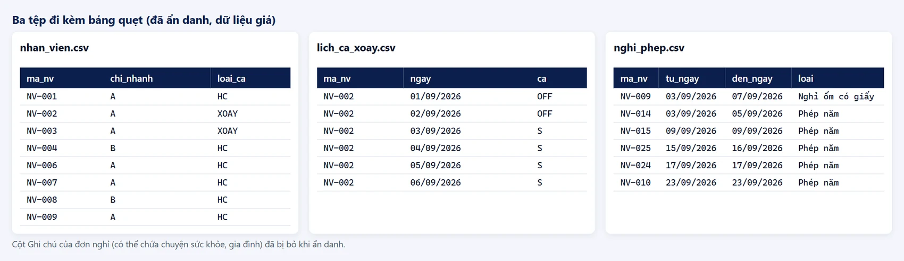
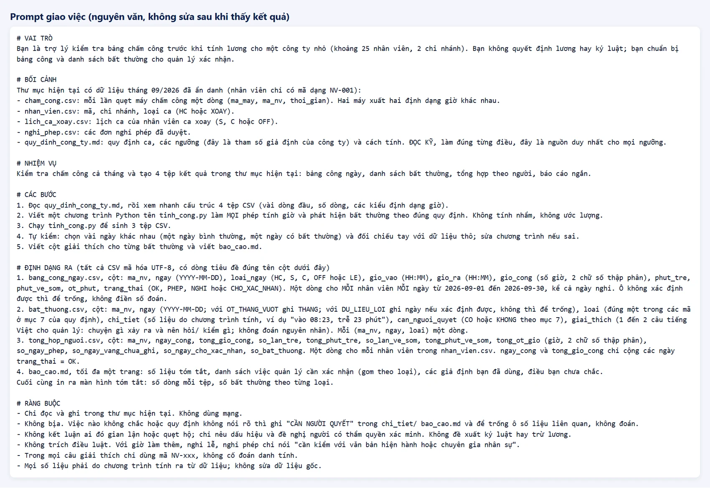

# Bài 1. Chuẩn bị dữ liệu chấm công, ẩn danh, rồi giao việc cho agent

Bài này làm xong ba việc: (1) hiểu bảng chấm công thô trông như thế nào và nó hay hỏng ở đâu, (2) ẩn danh nó trước khi đưa cho agent chạy trên đám mây, (3) viết bản giao việc (prompt) đủ rõ để agent viết code tính công thay bạn.

**Mục tiêu đo được của bài:** cuối bài bạn có một thư mục `an-danh/` gồm 4 tệp CSV và 1 tệp quy định, kiểm tra tự động xác nhận không còn họ tên, phòng ban hay ghi chú đơn nghỉ trong đó; và một tệp prompt theo khung 6 phần. Bài 2 sẽ chạy thật và chấm.

> Toàn bộ dữ liệu trong bài là DỮ LIỆU GIẢ để học: tên, mã, giờ quẹt đều do script `du-lieu/sinh_du_lieu.py` bịa ra (hạt giống cố định). Công ty trong bài không có thật. Mọi ngưỡng (đi trễ bao nhiêu phút, làm thêm bao nhiêu giờ thì cảnh báo) là **tham số giả định** của công ty giả; quy định pháp luật về giờ làm thêm, nghỉ lễ, nghỉ phép cần kiểm với văn bản hiện hành hoặc chuyên gia nhân sự, bài này không trích điều luật nào.

## 1. Bảng chấm công thô trông như thế nào

Máy chấm công vân tay (hoặc app chấm công) ghi một dòng cho mỗi lần quẹt: ai, lúc nào, ở máy nào. Máy không "biết" đó là quẹt vào hay quẹt ra, hoặc có biết thì nhân viên bấm sai cũng nhiều. Vì thế người làm lương phải tự ghép cặp theo thứ tự trong ngày.

Về định dạng, mình tham khảo tài liệu công khai của nhà sản xuất và nhà cung cấp phần mềm, không chép nội dung từ đó:

- **[Nguồn]** Hãng ZKTeco, trang FAQ: https://www.zkteco.com/en/faq.html . Mỗi bản ghi quẹt gồm mã người dùng, thời gian, kiểu xác thực (ví dụ 15 là khuôn mặt, 25 là lòng bàn tay) và trạng thái vào/ra (0 là vào, 1 là ra, 2 là bất thường). Máy này cũng có thể trả mã người dùng bằng 0 khi mất điện hoặc bấm nút thoát.
- **[Nguồn]** MISA AMIS, hướng dẫn xuất dữ liệu từ máy chấm công ra Excel: https://amis.misa.vn/80067/tai-du-lieu-tu-may-cham-cong/ . Cho thấy quy trình thực tế: tải dữ liệu từ máy về phần mềm rồi xuất Excel.
- **[Nguồn]** Hướng dẫn dùng app chấm công ZKTeco (gitbook cộng đồng): https://cyclone-nepal.gitbook.io/user-manual-zkteco-fingerprint-attendance/export-attendance . Tệp xuất ra có thể là CSV, Excel hoặc PDF tùy ứng dụng.

Kết quả tìm kiếm: mình **không tìm được bộ dữ liệu chấm công tiếng Việt công khai** nào dùng được (dữ liệu chấm công là dữ liệu cá nhân, ít ai đăng). Vì vậy dữ liệu trong bài được sinh, bám theo dạng "mỗi lần quẹt một dòng" ở trên, và các lỗi mình cài vào là các lỗi phổ biến mà người làm lương hay gặp (thiếu quẹt, quẹt trùng, quẹt khác máy, giờ lẫn định dạng).

## 2. Bộ dữ liệu mẫu của bài

Công ty giả: 25 nhân viên, hai chi nhánh A và B, mỗi chi nhánh một máy (`MAY-A1`, `MAY-B1`). 16 người làm hành chính (HC: 8:00-17:00, nghỉ trưa 12:00-13:00, thứ Hai đến thứ Sáu), 9 người ca xoay (ca sáng 6:00-14:00, ca chiều 14:00-22:00, theo lịch riêng). Kỳ công: tháng 09/2026. Công ty khai báo ngày 01 và 02/09 là ngày lễ (giả định).

**[Đo được]** (ngày 2026-11-20, từ `sinh_du_lieu.py`): 1160 dòng quẹt, 750 ô (nhân viên x ngày), và một sổ "bẫy đã cài" gồm 61 bất thường thuộc 14 loại. Danh sách các tệp:

| Tệp | Nội dung | Ai được xem |
|-----|----------|-------------|
| `goc/xuat_may_cham_cong.csv` | Mã máy, Mã NV, Họ tên, Phòng ban, Thời gian (tên là tên giả) | Chỉ máy của bạn |
| `goc/lich_ca_xoay.csv` | Họ tên, Ngày, Ca (S, C, OFF) | Chỉ máy của bạn |
| `goc/don_nghi_phep.csv` | Họ tên, Từ ngày, Đến ngày, Loại nghỉ, Ghi chú, Trạng thái | Chỉ máy của bạn |
| `goc/nhan_vien.csv` | Mã NV, Họ tên, Phòng ban, Chi nhánh, Loại ca | Chỉ máy của bạn |
| `an-danh/*.csv` | Bản đã ẩn danh của bốn tệp trên | Đưa cho agent |
| `an-danh/quy_dinh_cong_ty.md` | Ca, ngưỡng, cách tính (giả định) | Đưa cho agent |
| `ket-qua/dap-an.json` | Đáp án để chấm | KHÔNG đưa cho agent |

Các "bẫy" mình cài vào dữ liệu (đây là phần quyết định bài có giá trị hay không, vì dữ liệu sạch thì ai cũng tính đúng):

1. **Thiếu quẹt**: ngày chỉ có một quẹt. Nếu quẹt sớm (gần giờ vào) thì khả năng cao là thiếu quẹt ra; nếu quẹt muộn thì thiếu quẹt vào; nếu quẹt đúng 12:05 giữa ca thì **không ai đoán được**, phải hỏi người.
2. **Quẹt trùng**: bấm hai lần cách nhau 1-3 phút. Có một ca cách 4 phút (không phải quẹt trùng theo ngưỡng 3 phút).
3. **Đi trễ và về sớm ở sát ngưỡng**: trễ đúng 5 phút (không tính) và 6 phút (tính). Ra sớm 5 và 6 phút tương tự.
4. **Làm thêm giờ**: sát ngưỡng 29 phút (không tính) và 30 phút (tính); ba ngày làm thêm quá 3 giờ; một nhân viên cộng cả tháng vượt 40 giờ; một người khác 36,18 giờ (sát ngưỡng nhưng không vượt, để xem agent có báo oan không).
5. **Nghỉ phép**: tệp có 9 đơn nghỉ đã duyệt, trong đó 7 đơn đúng như kỳ vọng (không quẹt, có đơn kéo qua cuối tuần) và 2 đơn một ngày mà người đó vẫn có quẹt; ngoài ra có 6 ngày vắng không đơn.
6. **Ngày lễ và ngày nghỉ**: có người quẹt vào ngày lễ, ngày thứ Bảy, ngày OFF của ca xoay.
7. **Nghi quẹt hộ**: cùng một mã nhân viên quẹt ở máy A rồi vài phút sau quẹt ở máy B. Một người không thể ở hai chi nhánh trong vài phút.
8. **Bẫy "trông giống lỗi mà không phải lỗi"**: người quẹt vào ở chi nhánh nhà rồi quẹt ra ở chi nhánh kia (cách nhau cả ngày, bình thường); người quẹt 4 lần trong ngày vì đi ăn trưa (không phải lỗi).
9. **Định dạng lẫn lộn**: máy A ghi `2026-09-01 08:00:31`, máy B ghi `03/09/2026 08:01` (không giây); mã NV có số 0 đứng đầu ở máy A, không có ở máy B; tên xuất hiện cả dạng có dấu và dạng IN HOA không dấu; thứ tự dòng không theo giờ.
10. **Dòng hỏng**: một mã thẻ lạ không có trong danh sách, một dòng giờ trống, một dòng ghi ngày 31/09/2026 (không tồn tại).

Đáp án **không do mình đếm tay**. `sinh_du_lieu.py` có hai phần độc lập: phần cài bẫy (ghi sổ cài gì, ở đâu) và một "bộ tính tham chiếu" đọc lại dữ liệu đã sinh để tính giờ và phát hiện bất thường. Hai phần phải cho tập kết quả **trùng tuyệt đối**, nếu lệch script dừng báo lỗi. Đáp án lấy từ đó.


*Bên trái là bản xuất từ máy (dữ liệu giả), bên phải là bản đưa cho agent. Nền đỏ là các dòng hỏng.*

## 3. Ẩn danh trước khi gửi agent đám mây

Dữ liệu chấm công là dữ liệu nhân sự: gắn với một người cụ thể, một lịch đi làm cụ thể, nhiều khi kèm lý do nghỉ (ốm, con ốm). Coding agent chạy trên đám mây gửi nội dung tệp mà nó đọc lên máy chủ của nhà cung cấp. Nguyên tắc làm ở đây: **agent chỉ làm trên bản ẩn danh; bảng đối chiếu mã với tên ở lại máy bạn**.

Việc ẩn danh làm bằng một script ngắn, `du-lieu/an_danh.py`, không làm tay. Các quy tắc nó thực hiện:

1. **Thay tên bằng mã ngẫu nhiên.** Mã `NV-001`, `NV-002`... gán theo thứ tự xáo trộn (hạt giống là một con số bí mật, "muối"). Không dùng thứ tự theo bảng chữ cái hay mã gốc, vì mã gốc (ví dụ số thẻ) có thể tra ra người.
2. **Bỏ các cột không cần để tính công:** Họ tên, Phòng ban. Phòng ban nhỏ (ví dụ phòng chỉ có hai người) cũng đủ để đoán danh tính.
3. **Bỏ cột Ghi chú của đơn nghỉ.** Đây là chỗ hay chứa chuyện sức khỏe, gia đình. Agent chỉ cần loại nghỉ và khoảng ngày.
4. **Mã lạ (thẻ không có trong danh sách) cũng được gán mã ẩn danh**, để agent vẫn thấy "mã này không có trong danh sách nhân viên", nhưng không lộ số thẻ gốc.
5. **Giữ nguyên định dạng giờ lẫn lộn.** Đây là cố ý: ẩn danh không được "làm sạch giúp", vì phần làm sạch là việc bài toán cần kiểm tra.
6. **Tự kiểm rò rỉ** sau khi ghi tệp: tìm họ tên đầy đủ (có dấu, không dấu), mã gốc, các từ khóa phòng ban và ghi chú trong bốn tệp đầu ra. Có rò rỉ thì script thoát với mã lỗi.

Chạy:

```
python -X utf8 sinh_du_lieu.py      # sinh dữ liệu giả (chỉ cần trong bài thực hành)
python -X utf8 an_danh.py           # ẩn danh và tự kiểm rò rỉ
```

Giải thích: `python -X utf8` bảo Python dùng UTF-8 để tiếng Việt không vỡ dấu trên Windows; `an_danh.py` đọc thư mục `goc/`, ghi `an-danh/`, và ghi bảng đối chiếu vào `ket-qua/bang-ma-hoa.csv`.

**[Đo được]** (2026-11-20): kết quả chạy: `đã ẩn danh 26 mã (1 mã lạ ngoài danh sách). Rò rỉ phát hiện: KHÔNG`. 26 mã là 25 nhân viên cộng một thẻ lạ.

Sau khi agent trả kết quả, bạn gắn lại tên **trên máy bạn**, trước khi đưa cho quản lý:

```
python -X utf8 an_danh.py --giai-ma bat_thuong.csv bat_thuong_co_ten.csv
```

Lệnh này thêm cột `ho_ten` và thay mọi `NV-xxx` trong câu giải thích bằng họ tên.



*Danh sách nhân viên, lịch ca xoay và đơn nghỉ phép sau ẩn danh. Cột Ghi chú đã bị bỏ.*

**Giới hạn của cách ẩn danh này (nói thẳng):** nó chỉ che trường có tên. Nó không chống được việc suy ra danh tính từ chính lịch đi làm (ví dụ chỉ một người có lịch kho ca đêm). Dữ liệu thật có tên người trong ô văn bản tự do thì script phải mở rộng. Và nếu công ty có quy định riêng về việc đưa dữ liệu nhân sự ra dịch vụ bên ngoài, hay nghĩa vụ bảo vệ dữ liệu cá nhân, cần hỏi chuyên gia pháp lý/nhân sự: bài này không đưa ra kết luận pháp lý.

## 4. Quy định của công ty: viết ra thành tệp, không để trong đầu

Agent không biết công ty bạn cho phép trễ mấy phút. Nếu bạn không viết, nó sẽ tự chọn một con số hợp lý và kết quả sai mà nhìn vẫn đẹp. Vì thế mọi ngưỡng nằm trong `quy_dinh_cong_ty.md`, mỗi ngưỡng là một dòng tham số:

| Tham số (giả định) | Giá trị |
|---------|---------|
| Dung sai đi trễ / về sớm | 5 phút |
| Quẹt trùng (cùng máy) | cách nhau <= 3 phút |
| Nghi quẹt hộ (hai máy khác nhau) | cách nhau <= 10 phút |
| Làm thêm giờ chỉ tính khi | ra muộn hơn giờ ra ca >= 30 phút |
| Cảnh báo làm thêm trong ngày | > 180 phút |
| Cảnh báo làm thêm trong tháng | > 2400 phút (40 giờ) |
| Quẹt đơn lẻ coi là vào/ ra | trong vòng 120 phút quanh giờ vào/ ra ca; còn lại "không rõ" |

Tệp cũng ghi cách tính một ngày công (mục 5 của tệp), danh sách 14 mã bất thường, và quy ước `can_nguoi_quyet`. Một thói quen tốt cho bạn: khi đổi ngưỡng, **chỉ sửa tệp này**, rồi chạy lại.

## 5. Viết prompt theo khung 6 phần

Prompt dùng nguyên văn trong bài (lưu ở `ket-qua/prompt-giao-viec.txt`):



Giải thích ngắn từng phần:

- **Vai trò**: trợ lý chuẩn bị dữ liệu, không quyết định lương hay kỷ luật. Câu này giữ agent ở đúng vai.
- **Bối cảnh**: liệt kê từng tệp và tệp quy định "là nguồn duy nhất cho mọi ngưỡng".
- **Nhiệm vụ**: một câu.
- **Các bước**: bắt agent **viết chương trình Python** để tính, rồi tự kiểm vài ngày bằng tay. Đây là quyết định thiết kế quan trọng nhất của bài: *phép tính giờ do code làm; mô hình chỉ giúp giải thích ngoại lệ* (cột `giai_thich`).
- **Định dạng ra**: tên cột cố định cho 3 tệp CSV và một báo cáo. Tên cột cố định là để bài 2 chấm tự động được.
- **Ràng buộc**: không bịa; không chắc thì ghi "CẦN NGƯỜI QUYẾT" và để trống ô số liệu; không kết luận ai gian lận; không trích điều luật; chỉ dùng mã `NV-xxx`.

Vì sao không bảo agent "tự đọc rồi tính"? Một ngày có hàng chục phép trừ giờ, nhân với 750 ô, mô hình ngôn ngữ làm nhẩm sẽ có lúc sai và bạn không có cách kiểm. Code thì chạy lại được, đọc lại được, và bạn có thể giao tệp `tinh_cong.py` cho người kỹ thuật duyệt.

## 6. Chạy thử trên giao diện hay dòng lệnh?

Với người không rành code: bạn có thể làm bằng giao diện của Claude Code hoặc Antigravity (mở thư mục `an-danh/` làm thư mục làm việc rồi dán prompt). Bài này dùng dòng lệnh để ghi được log, nhưng bản chất giống nhau:

```
cd thu-muc-lam-viec
claude -p "<nội dung prompt>"
```

`-p` nghĩa là chạy một lần, in kết quả rồi thoát (không hội thoại qua lại). Với Antigravity là `agy -p "<nội dung prompt>"`. Bài 2 dùng một script nhỏ (`agent_run.py`) gọi hai lệnh này và lưu log gốc.

## Lỗi thường gặp ở bước chuẩn bị

- **Quên ẩn danh một tệp phụ.** Hay sót lịch ca và đơn nghỉ vì chúng có họ tên ở cột khác tên. Script kiểm rò rỉ ở trên tồn tại vì lý do này.
- **Ẩn danh bằng cách xóa mã nhân viên.** Mất khả năng nối bảng quẹt với lịch ca, agent không tính được gì.
- **Để đáp án trong thư mục agent làm việc.** Agent đọc được là gian lận vô tình; đáp án phải nằm ngoài.
- **Viết quy định lỏng ("đi trễ thì trừ").** Ngưỡng phải là con số.
- **Dùng Excel mở và lưu lại CSV.** Excel đổi `03/09/2026` thành ngày kiểu máy bạn, hỏng định dạng.

## Checklist cuối bài

- [ ] Có thư mục `an-danh/` và chạy `an_danh.py` báo "Rò rỉ phát hiện: KHÔNG".
- [ ] Bảng đối chiếu mã ở ngoài thư mục agent.
- [ ] Mọi ngưỡng nằm trong `quy_dinh_cong_ty.md`, ghi rõ là giả định của công ty.
- [ ] Đáp án (nếu bạn tự dựng bộ thử) nằm ngoài thư mục agent.
- [ ] Prompt đủ 6 phần và có điều "không chắc thì ghi CẦN NGƯỜI QUYẾT".

## Việc cần người làm

- Chủ doanh nghiệp/ kế toán: quyết các ngưỡng (trễ, làm thêm) và ghi vào quy định; cho biết ca nào được trừ nghỉ trưa.
- Người phụ trách nhân sự hoặc pháp chế: xác nhận được phép đưa bản ẩn danh lên dịch vụ đám mây; kiểm quy định giờ làm thêm/ nghỉ lễ với văn bản hiện hành.
- Người quản lý chi nhánh: giữ bảng đối chiếu mã và tên.

## Giới hạn

- Dữ liệu là giả, sinh theo kịch bản; số bất thường trong thực tế thường ít sạch hơn, và có những lỗi mình chưa cài (ca qua đêm, giờ máy bị lệch, nhân viên đổi mã).
- Ẩn danh bằng mã không phải "ẩn danh tuyệt đối": ai có bảng đối chiếu hoặc suy luận được từ lịch làm việc vẫn nhận ra người.
- Mình không tìm được bộ dữ liệu chấm công tiếng Việt công khai; định dạng bám theo tài liệu của nhà sản xuất và phần mềm, có thể khác máy bạn đang dùng.
