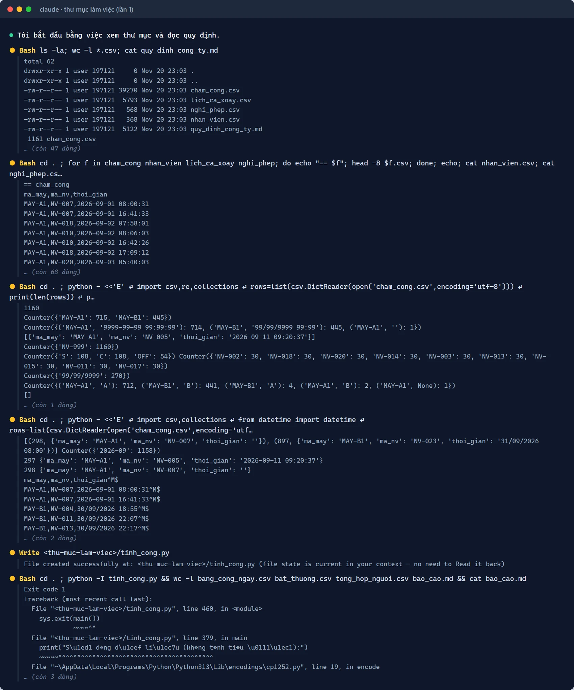
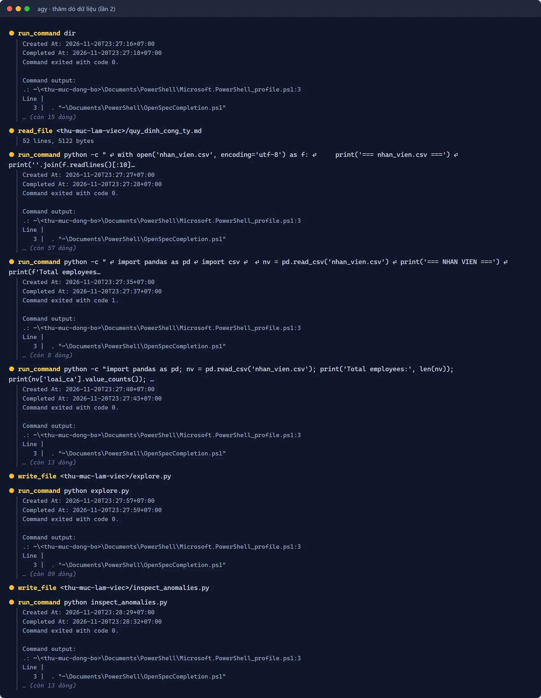
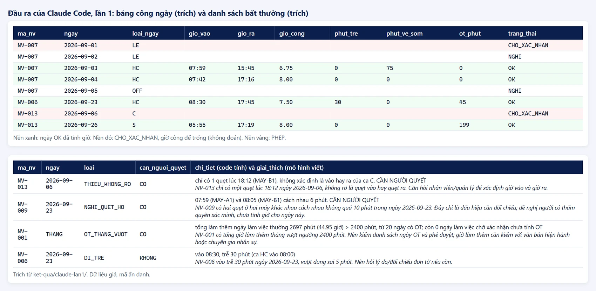

# Bài 2. Chạy thật hai agent, rồi chấm bằng đáp án

Bài 1 đã chuẩn bị bản ẩn danh và prompt. Bài này chạy thật Claude Code và Antigravity (`agy`) trên cùng dữ liệu, cùng prompt, rồi **chấm bằng code** thay vì đọc lướt thấy "có vẻ đúng".

**Mục tiêu đo được:** cuối bài bạn trả lời được bằng số: agent tìm đúng bao nhiêu trong 61 bất thường đã cài, báo oan bao nhiêu, bao nhiêu ô trong bảng công ngày và bảng tổng hợp khớp đáp án, và chỗ nào khác nhau là do lỗi tính hay do quy định chưa rõ.

> Dữ liệu giả (xem bài 1). Mọi số trong bài là kết quả chạy của chúng ta ngày 2026-11-20 và chỉ có 1 đến 2 lần chạy mỗi cấu hình: đây là quan sát, **chưa đo được độ ổn định** và không đủ để xếp hạng agent nào hơn agent nào.

## 1. Cách chạy

Thư mục làm việc của mỗi lần chạy là một thư mục RIÊNG, chép vào đó đúng 5 tệp của `du-lieu/an-danh/` (bốn CSV và `quy_dinh_cong_ty.md`). **Không chép đáp án, không chép `bang-ma-hoa.csv`.**

Lệnh chạy một lần, không tương tác (giải thích: `-p` là chạy một việc rồi thoát):

```
cd runs/claude
claude -p "<nội dung prompt>" --output-format stream-json --verbose --permission-mode acceptEdits --allowedTools "Read,Write,Edit,Glob,Grep,Bash"

cd runs/agy
agy -p "<nội dung prompt>" --output-format stream-json --dangerously-skip-permissions
```

Giải thích các cờ: `--output-format stream-json` bảo agent in từng sự kiện thành một dòng JSON (để lưu log gốc và dựng lại ảnh); `--allowedTools` giới hạn công cụ Claude Code được dùng (đọc, ghi, sửa, tìm, chạy lệnh); `--dangerously-skip-permissions` của `agy` nghĩa là **không hỏi xin phép** khi chạy lệnh, nên chỉ chạy trong thư mục bạn sẵn sàng để agent ghi, và với dữ liệu đã ẩn danh. Trong bài mình bọc hai lệnh này bằng `ket-qua/chay_agent_giu_log.py`, nó ghi log ngay khi chạy nên hết giờ vẫn còn log.

Phiên bản ghi trong log: Claude Code 2.1.329, mô hình `claude-sonnet-5-5`; Antigravity CLI `agy` 1.5.13 (đọc bằng `agy --version`). Log của `agy` không ghi tên mô hình nên bài không nêu.

**[Đo được]** các lần chạy (cùng prompt nguyên văn của bài 1, cùng dữ liệu):

| Lần | Agent | Quy định đưa cho agent | Thời gian | Log |
|-----|-------|------------------------|-----------|-----|
| claude-lan0 | Claude Code | đầy đủ | không đo (khoảng 6 phút theo giờ tệp) | **mất** |
| claude-lan1 | Claude Code | đầy đủ | 247,8 giây, 16 lượt | có |
| claude-rutgon | Claude Code | rút gọn (bỏ mục 5 "cách tính") | 326,1 giây, 20 lượt | có |
| agy-lan0 | agy | đầy đủ | không đo (khoảng 16 phút theo giờ tệp) | **mất** |
| agy-lan1 | agy | đầy đủ | **hết giờ 900 giây** (đã ghi xong 3 CSV, chưa ghi báo cáo) | **mất** |
| agy-lan2 | agy | đầy đủ | 1217,6 giây | có (chạy với giới hạn 1800 giây) |
| agy-rutgon | agy | rút gọn | 1126,8 giây | có (giới hạn 1800 giây) |

Về "mất log": hai lần đầu mình gọi lệnh chạy bằng một cách làm tiến trình bị cắt khi lệnh gọi kết thúc, nên log gốc của `claude-lan0` và `agy-lan0` không được ghi; còn `agy-lan1` chạm giới hạn 900 giây, và công cụ `agent_run.py` khi hết giờ không lưu phần đã chạy. Mình **giữ nguyên các tệp kết quả** của ba lần này và chấm chúng, nhưng không có log để dựng ảnh. Đây là lỗi của người chạy, ghi lại để bạn khỏi lặp lại: luôn ghi log ra tệp ngay khi chạy.

Hai cấu hình "rút gọn" là thử thêm: mình bỏ phần hướng dẫn cách tính chi tiết khỏi `quy_dinh_cong_ty.md` (vẫn giữ bảng ngưỡng ở mục 4 và danh sách mã), **prompt không đổi**, để xem điều gì xảy ra khi quy định viết thiếu.

## 2. Xem agent làm

Cả hai agent đều làm đúng thứ tự mình mong: đọc quy định, xem cấu trúc dữ liệu, viết `tinh_cong.py`, chạy, tự kiểm rồi viết báo cáo.



*Dựng lại từ log thật của lần chạy `claude-lan1`, không phải ảnh chụp trực tiếp cửa sổ TUI. Đường dẫn máy trong log đã được thay bằng `<thu-muc-lam-viec>` hoặc `<user>`.*

Điểm đáng chú ý ở ảnh trên: Claude Code đếm số định dạng giờ trong dữ liệu trước khi viết code (máy A dạng `yyyy-mm-dd`, máy B dạng `dd/mm/yyyy`), tìm ra 2 dòng hỏng (giờ trống, ngày 31/09) và 1 mã lạ. Đây đúng là các bẫy cài ở bài 1. Cuối ảnh là **lỗi thật đầu tiên**: chương trình in tiếng Việt ra console Windows và gặp `UnicodeEncodeError` (bảng mã cp1252 không in được chữ có dấu).


*Dựng lại từ log thật của lần chạy `claude-lan1`, không phải ảnh chụp trực tiếp cửa sổ TUI.*

Agent tự nhận ra lỗi ("chương trình đã tính xong và ghi tệp, nhưng lỗi khi in tiếng Việt ra console"), sửa bằng cách đặt đầu ra sang UTF-8, rồi **kiểm tay 7 ngày** đối chiếu với dữ liệu thô. Lưu ý lỗi này nằm ở khâu in ra màn hình, không phải ở số liệu (tệp CSV đã ghi đúng trước khi lỗi). Nếu người dùng thấy dòng "Exit code 1" và dừng ở đó thì sẽ tưởng cả chương trình hỏng.


*Dựng lại từ log thật của lần chạy `claude-lan1`, không phải ảnh chụp trực tiếp cửa sổ TUI.*

Tóm tắt cuối của Claude Code đưa số dòng từng tệp, số bất thường theo loại, và **các quyết định tự chọn ở chỗ quy định không nói rõ** (ví dụ mọi đơn "đã duyệt" đều ghi PHEP, 6 quẹt ở máy khác chi nhánh được tính bình thường vì quy định không coi là bất thường). Đây là phần rất có giá trị: nó cho người quản lý biết phải xem lại điều gì.

Với `agy`, quá trình dài hơn nhiều và nhiều bước thăm dò hơn:



*Dựng lại từ log thật của lần chạy `agy-lan2`, không phải ảnh chụp trực tiếp cửa sổ TUI.*

Trong `agy-lan2`, agent viết khoảng 14 tệp script thăm dò (`inspect_*.py`, `check_*.py`, `verify_*.py`) trước khi viết `tinh_cong.py`, rồi xóa các tệp tạm ở cuối (log ghi các dòng `Removed:`). Kết quả thời gian chạy chênh nhau rõ (xem bảng), nhưng **không kết luận gì về chất lượng** từ thời gian, vì lúc chạy máy còn nhiều tiến trình khác đang chạy cùng (mình thấy các tiến trình `agy` khác của máy trong lúc chạy), nên thời gian bị nhiễu.

## 3. Một lỗi về phạm vi: agy ra ngoài thư mục làm việc

Prompt ghi: "Chỉ đọc và ghi trong thư mục hiện tại." Trong lần `agy-lan2`, agent chạy hai lệnh ngoài thư mục:


*Dựng lại từ log thật của lần chạy `agy-lan2`, không phải ảnh chụp trực tiếp cửa sổ TUI. Hai dòng đầu mỗi khối là lỗi hồ sơ PowerShell trên máy chạy, không liên quan tới bài.*

`git log -n 5` (báo "not a git repository" vì thư mục làm việc không phải kho git) và `dir ..\..` (liệt kê thư mục cha của thư mục cha). Hai lệnh chỉ đọc, không sửa gì, nhưng **trái ràng buộc trong prompt**. Trong log của Claude Code và `agy-rutgon` mình không thấy lệnh tương tự (đọc bằng cách duyệt các lệnh trong log; hai lần `lan0` và `agy-lan1` không có log nên không kiểm được).

Điều này quan trọng với dữ liệu nhân sự: `agy -p ... --dangerously-skip-permissions` cho agent toàn quyền trên máy. Câu "chỉ đọc và ghi trong thư mục hiện tại" trong prompt chỉ là **lời dặn, không phải hàng rào**. Cách an toàn thật là chạy agent trong một thư mục tách biệt (hoặc máy ảo/ tài khoản riêng) và chỉ để dữ liệu đã ẩn danh ở đó.

## 4. Chấm bằng code

Tệp `ket-qua/cham.py` so ba tệp của agent với `ket-qua/dap-an.json`:

```
python -X utf8 cham.py ket-qua/claude-lan1 claude-lan1 --ghi bao-cao-cham.json
```

Giải thích: tham số 1 là thư mục chứa ba CSV của agent, tham số 2 là nhãn, `--ghi` thêm kết quả vào tệp JSON tổng hợp. Cách chấm:

1. **Bất thường**: khớp theo bộ ba (mã NV, ngày, loại). *Đúng* là có trong cả hai; *bỏ sót* là đáp án có mà agent không báo; *bịa* là agent báo mà đáp án không có. Riêng `OT_THANG_VUOT` khớp theo (mã, loại) vì không có ngày; `DU_LIEU_LOI` khớp theo (mã, loại).
2. **can_nguoi_quyet**: trên các dòng đã khớp, CO/KHONG có đúng quy ước mục 7 không.
3. **Bảng công ngày**: 750 dòng; trạng thái đúng bao nhiêu; với 501 ngày đáp án là OK, so từng cột (giờ vào, giờ ra, giờ công, phút trễ, phút về sớm, làm thêm). Cột `gio_cong` chấp nhận lệch 0,01.
4. **Tổng hợp theo người**: 25 người, 11 cột số.
5. **Đoán số**: ngày đáp án là CHO_XAC_NHAN mà agent vẫn điền giờ công lớn hơn 0.

Chính `cham.py` cũng được thử trước: đưa thẳng đáp án vào làm "đầu ra giả" thì chấm ra đúng tuyệt đối, và sửa tay vài ô thì chấm bắt được (59/61 khi xóa 2 dòng bất thường, 498/501 khi sửa 3 ô phút trễ). Hãy làm bước thử này với bộ chấm của bạn trước khi tin nó.



*Trích đầu ra thật của `claude-lan1` (dữ liệu giả, mã ẩn danh). Cột `chi_tiet` do code tính; cột `giai_thich` do mô hình viết.*

## 5. Kết quả


*Kết quả chạy `cham.py` trên bảy bộ đầu ra, ngày 2026-11-20 (n = 1 mỗi dòng).*

**[Đo được]** (2026-11-20, 1 lần chạy mỗi dòng):

- **Bất thường: cả bảy lần đều 61/61 đúng, 0 bỏ sót, 0 bịa**, và `can_nguoi_quyet` đúng 61/61. Cả các "bẫy giống lỗi mà không phải lỗi" (quẹt cách nhau 4 phút, trễ đúng 5 phút, làm thêm 29 phút, người làm thêm 36,18 giờ sát ngưỡng, quẹt ra ở chi nhánh khác cách xa vài giờ, ngày quẹt 4 lần vì nghỉ trưa) đều **không bị báo oan**.
- **Ba ca mơ hồ** (một quẹt giữa ca) đều được gắn `THIEU_KHONG_RO` và đưa cho người quyết, không đoán vào hay ra.
- **Bảng công ngày**: 5 trong 7 lần đúng 750/750 trạng thái và đúng cả 6 cột trên 501 ngày OK; 25/25 người đúng cả 11 cột tổng hợp. Hai lần của `agy` có khác biệt, xem dưới.
- Chưa cấu hình nào cho thấy lỗi tính số học (cộng trừ giờ phút) trong các ngày OK; hai lần có khác biệt là do **cách hiểu quy định**.

### Hai chỗ khác đáp án, và vì sao

**(a) `agy-lan2`: ngày nghỉ trong đơn nghỉ phép.** Đơn nghỉ ốm của một nhân viên kéo từ thứ Năm 03/09 đến Chủ nhật 07/09, nghĩa là có thứ Bảy 05/09 và Chủ nhật 06/09 nằm giữa. Một đơn khác (29/09 đến 30/09) có một ngày OFF của ca xoay. `agy-lan2` ghi các ngày này là `PHEP`; đáp án và Claude Code ghi `NGHI` (ngày nghỉ sẵn), nên 3 ô trạng thái và 2 ô `so_ngay_phep` lệch (3 so với 5; 1 so với 2). Câu mục 5.7 trong quy định mình viết ("Ngày nằm trong đơn nghỉ phép đã duyệt và không có quẹt: trạng thái PHEP") không nói rõ có tính ngày nghỉ hay không, nên **agy đọc theo nghĩa đen**, và còn ghi vào báo cáo rằng đây là chỗ cần kiểm với chuyên gia nhân sự (về cách tính ngày phép/ chế độ ốm). Chỗ mơ hồ nằm ở quy định mình viết, không phải ở agent. Đây là lý do tên mã `so_ngay_phep` phải do công ty định nghĩa.

**(b) `agy-rutgon`: làm thêm quá 3 giờ.** Khi bỏ phần "cách tính", agent tự suy ra: ngày có OT_VUOT_NGUONG là ngày "cần người quyết" nên để trạng thái `CHO_XAC_NHAN` và **bỏ trống `gio_cong` của cả ngày**. Đáp án giữ trạng thái OK (8 giờ công thường, phần làm thêm được ghi riêng). Hậu quả thực tế: ba ngày bị bỏ trống 8 giờ công (ví dụ NV-010: 17 ngày công thay vì 18, tổng giờ công 136 thay vì 144, tổng làm thêm 0 thay vì 3,78 giờ). Nếu người làm lương dùng thẳng bảng này mà không đọc danh sách bất thường, người lao động sẽ bị thiếu công. Agent ghi rõ quy ước này trong báo cáo ("Nguyên tắc chưa tính giờ cho ngày CHO_XAC_NHAN"), nên không phải bịa; nhưng đây là **ví dụ cho thấy quy định thiếu thì kết quả đổi theo cách hiểu của agent**.

Cũng ở cấu hình rút gọn, Claude Code trả đúng cả 750 ô nhưng **liệt kê giả định** mình bỏ ngỏ (cách tính giờ công, cách tính trễ) trong `bao_cao.md` và đánh dấu hai tình huống "điều chưa chắc" (quẹt ở máy khác chi nhánh; một ngày có quẹt cách nhau 4 phút). Điều này khớp quan sát: quy định chặt thì kết quả giống nhau giữa các lần chạy; quy định thiếu thì ba cách xử lý khác nhau lộ ra, và **người duyệt phải đọc mục "giả định"**.

## 6. Các lỗi và điều bất ngờ khác

- **Lỗi in tiếng Việt trên Windows** ở Claude Code (mục 2): xử lý được bằng UTF-8, nhưng nếu bạn tự viết script hãy đặt `PYTHONIOENCODING=utf-8`.
- **agy hết giờ 900 giây** (lần 1): ba CSV đã đúng nhưng chưa có báo cáo. Nếu dùng timeout cứng, nên đặt 1800 giây cho `agy` với bài này, hoặc yêu cầu agent ghi báo cáo trước khi tinh chỉnh.
- **Báo cáo dài hơn yêu cầu**: prompt ghi "tối đa một trang". **[Đo được]** số từ `bao_cao.md`: Claude Code 616 và 644 (hai lần có log), `agy` 1322 và 1332 (hai lần có log). Dài hơn gần gấp đôi; nếu cần một trang thật thì phải đo bằng số từ trong chính bước tự kiểm.
- **Thêm chi tiết ngoài dữ liệu/ prompt**: trong tóm tắt cuối `agy-lan2` gọi ngày 01 và 02/09 là "ngày Quốc khánh" (quy định chỉ nói "ngày lễ do công ty khai báo"), và đề nghị "trích xuất camera" để xác minh quẹt hộ, nhắc đến trợ cấp ốm đau BHXH. Không phải điều luật, nhưng là những chi tiết agent **tự thêm**, người duyệt cần biết để không tin như thể nằm trong dữ liệu. Prompt dặn "không kết luận quẹt hộ": hai agent đều giữ đúng điều này (chỉ nêu dấu hiệu).
- **Mã lạ** được cả hai gắn `DU_LIEU_LOI` đúng: không ai cố gán nó cho một nhân viên.

## Lỗi thường gặp khi chạy

- Chạy trên thư mục chứa cả đáp án hoặc bảng mã hóa: agent đọc được là chấm vô nghĩa.
- Chỉ đọc "tóm tắt cuối" mà không mở `bat_thuong.csv`: mình thấy tóm tắt cuối của cả hai agent trùng khớp số liệu, nhưng đó là điều phải kiểm bằng `cham.py`.
- Chạy lại với prompt đã chỉnh cho "đẹp hơn" và chỉ giữ lần cuối. Bài này giữ nguyên prompt cho mọi lần.
- Đọc log không ra vì đường dẫn máy: dùng `dung_anh.py` hoặc xem `logs/*.json`.

## Checklist

- [ ] Mỗi lần chạy ở thư mục riêng, không có đáp án.
- [ ] Log gốc ghi ra tệp ngay khi chạy (kể cả khi hết giờ).
- [ ] Đã thử bộ chấm bằng "đầu ra hoàn hảo" và "đầu ra sửa tay" trước.
- [ ] Đã đọc mục "giả định" và "điều chưa chắc" trong `bao_cao.md`.
- [ ] Kiểm xem agent có lệnh ra ngoài thư mục không (tìm `..`, `git`, đường dẫn tuyệt đối trong log).

## Việc cần người làm

- Người làm lương: mở `bat_thuong.csv`, xử lý từng dòng `can_nguoi_quyet = CO`; ngày `CHO_XAC_NHAN` chưa tính giờ nên phải được xác nhận trước khi tính lương.
- Quản lý trực tiếp: xác minh các ca `NGHI_QUET_HO` (chỉ là dấu hiệu, không phải kết luận), các ca vắng chưa ghi, làm ngày lễ/ ngày nghỉ.
- Chủ doanh nghiệp: quyết cách hiểu cho các chỗ quy định chưa rõ (ngày nghỉ trong đơn phép; ngày làm thêm quá ngưỡng có tính giờ thường không) rồi **viết vào quy định**.

## Giới hạn

- n rất nhỏ: mỗi cấu hình 1 lần (hai cấu hình agent có thêm lần mất log). Chưa đo được độ ổn định; không có cơ sở để nói agent nào tốt hơn.
- Dữ liệu sạch hơn thực tế; đáp án và quy định do cùng người (mình) viết, nên có thể đã ngầm làm đề dễ hơn cho agent.
- Bảy lần đều rất sát đáp án vì quy định có ngưỡng và cách tính cụ thể; thất bại có nhiều khả năng hơn khi quy định mơ hồ hoặc khi dữ liệu có lỗi lạ mình chưa cài (giờ máy lệch, ca qua đêm).
- Giá trị `cost_usd` trong log Claude Code (0,746 và 0,976 USD) là con số do công cụ báo trong log, không phải hóa đơn. `agy` báo số token (khoảng 238 nghìn vào, 118 nghìn ra ở lần 2; 230 nghìn và 116 nghìn ở lần rút gọn), không báo tiền.
