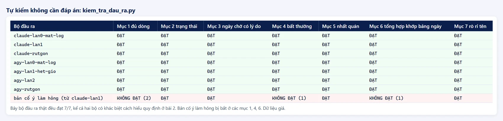

# Bài 3. Dùng hằng tháng: chạy lại, tự kiểm, người duyệt

!!! info "Bài này"
    - **Bạn làm gì:** chạy lại `tinh_cong.py` cho tháng mới **không cần agent**, tự kiểm kết quả khi không có đáp án, rồi chuyển danh sách bất thường cho người duyệt. Làm lần đầu với dữ liệu mẫu để quen quy trình.
    - **Mất bao lâu:** chạy chương trình khoảng 0,3 giây **[Đo được]**; cả quy trình 6 bước dưới 10 phút, chưa tính thời gian người duyệt.
    - **Cần có:** kết quả bài 1 và 2 (có `tinh_cong.py` do agent viết), Python 3, thư mục bài đã giải nén.
    - **Kết quả:** bảng công tháng, bản tự kiểm "7 mục đạt", danh sách bất thường đã ẩn danh cho người duyệt và (chỉ ở máy người có quyền) bản có họ tên.

> Dữ liệu và công ty trong bài là giả; các ngưỡng là tham số giả định. Giờ làm thêm, nghỉ lễ, nghỉ phép: cần kiểm với văn bản hiện hành hoặc chuyên gia nhân sự; bài này không trích điều luật.

## Nguyên tắc: tách "phép tính" khỏi "lời giải thích"

Prompt ở bài 1 giao: phép tính giờ do code làm, mô hình chỉ giúp giải thích. Sau hai bài chạy có thể nói chính xác điều gì đã xảy ra: agent viết `tinh_cong.py` và chạy nó; **mọi con số** trong ba CSV do chương trình này sinh. Các câu `giai_thich` cũng nằm **trong chương trình** dưới dạng câu mẫu theo từng loại bất thường. Nghĩa là mô hình viết lời giải thích **một lần, khi viết code**.

Hai hệ quả. Một, tháng sau bạn chạy lại **không tốn token, không gửi dữ liệu lên đám mây**. Hai, nếu agent đã nhúng một câu bạn không muốn (ví dụ gợi ý "kiểm tra camera"), câu đó lặp lại mọi tháng cho đến khi bạn sửa trong mã: hãy đọc các câu mẫu một lần trước khi chấp nhận chương trình.

!!! warning "Quy tắc an toàn cho dữ liệu hằng tháng"
    - **Chỉ bản ẩn danh** đi vào thư mục chạy (và vào agent nếu bạn dùng agent). Bảng đối chiếu mã với tên và đáp án ở ngoài.
    - **Bản có họ tên** chỉ ở máy người có quyền, không gửi qua hộp thư chung.
    - Chạy `tinh_cong.py` là chạy chương trình trên máy bạn: chỉ chạy bản **người kỹ thuật đã đọc**. Khi nhờ agent sửa chương trình, đừng bật chế độ toàn quyền: **[Đo được]** một lần `agy` đã chạy lệnh ngoài thư mục làm việc dù prompt dặn không (bài 2).

## Quy trình mỗi tháng

### Bước 1. Xuất dữ liệu và ẩn danh

Xuất CSV từ máy chấm công hoặc phần mềm. **Giữ nguyên**, không mở bằng Excel rồi lưu lại (Excel hay đổi định dạng ngày). Ẩn danh bằng `an_danh.py` như bài 1. Chỉ khi thấy "Rò rỉ phát hiện: KHÔNG" mới đi tiếp.

### Bước 2. Cập nhật tham số của tháng

Phần này **do người làm**. Trong `tinh_cong.py` bản của Claude Code có khối "THAM SỐ" ở đầu tệp: kỳ công (`KY_BAT_DAU`, `KY_KET_THUC`), ngày lễ (`NGAY_LE`), giờ các ca (`CA`) và các ngưỡng (`DUNG_SAI`, `TRUNG_PHUT`, `QUET_HO_PHUT`...). Chương trình hiện **ghi cứng kỳ 09/2026 và hai ngày lễ**; mỗi tháng phải sửa khối này, cập nhật lịch ca xoay, đơn nghỉ phép và danh sách nhân viên.

Đổi một ngưỡng chỉ cần sửa một dòng. **[Đo được]** Sửa `DUNG_SAI = 5` thành `DUNG_SAI = 10` rồi chạy lại: `DI_TRE` từ 12 xuống 10, `VE_SOM` từ 6 xuống 5, tổng bất thường từ 61 xuống 58. Sau khi sửa, **sửa cả chú thích bên cạnh** (nếu không nó vẫn ghi "<= 5 phút"), và sửa `quy_dinh_cong_ty.md` cho khớp để tài liệu và code không lệch nhau.

### Bước 3. Chạy `tinh_cong.py` (không cần agent)

Windows (PowerShell), trong thư mục chứa `du-lieu/` và `ket-qua/`. Ở đây dùng dữ liệu mẫu làm ví dụ; tháng thật thì thay bằng bốn CSV ẩn danh của tháng đó.

```lenh
mkdir thang-moi
copy du-lieu\an-danh\cham_cong.csv, du-lieu\an-danh\nhan_vien.csv, du-lieu\an-danh\lich_ca_xoay.csv, du-lieu\an-danh\nghi_phep.csv thang-moi\
copy ket-qua\claude-lan1\tinh_cong.py thang-moi\
cd thang-moi
python -X utf8 tinh_cong.py
cd ..
```

macOS hoặc Linux:

```lenh
mkdir thang-moi
cp du-lieu/an-danh/{cham_cong,nhan_vien,lich_ca_xoay,nghi_phep}.csv ket-qua/claude-lan1/tinh_cong.py thang-moi/
cd thang-moi
python3 -X utf8 tinh_cong.py
cd ..
```

Lệnh `mkdir` tạo thư mục, `copy` hoặc `cp` chép tệp, dòng cuối chạy chương trình.

```ketqua
Số dòng dữ liệu (không tính tiêu đề):
  bang_cong_ngay.csv : 750
  bat_thuong.csv     : 61
  tong_hop_nguoi.csv : 25
Số bất thường theo loại:
  THIEU_RA             5
  THIEU_VAO            3
  ...
  TỔNG                 61
```

!!! see "Bạn sẽ thấy"
    Chạy xong trong chưa tới một giây. Trong `thang-moi/` có ba CSV và `bao_cao.md`. Nội dung ba CSV **giống hệt** bản agent sinh ở bài 2 (so từng ô).

### Bước 4. Tự kiểm: bắt lỗi hình thức, không cần đáp án

Ở bài 2 chúng ta chấm bằng đáp án, nhưng ngoài đời **không có đáp án**. `ket-qua/kiem_tra_dau_ra.py` kiểm bảy việc:

| Mục | Kiểm gì |
|---|---|
| 1 | Đủ dòng: số nhân viên x số ngày, không trùng khóa |
| 2 | Trạng thái hợp lệ; ngày OK có đủ giờ vào, giờ ra, giờ công trong khoảng 0 đến 8 |
| 3 | Mỗi ngày `CHO_XAC_NHAN` có ít nhất một dòng giải thích trong danh sách bất thường |
| 4 | Mã loại hợp lệ; không trùng khóa; giải thích không trống; `can_nguoi_quyet` đúng quy ước |
| 5 | Nhất quán chéo: có phút trễ thì phải có `DI_TRE` và ngược lại; tương tự về sớm |
| 6 | Tổng hợp theo người khớp tổng từ bảng ngày |
| 7 | Không có họ tên nào (từ bảng mã hóa) lọt vào đầu ra |

```lenh
python -X utf8 ket-qua\kiem_tra_dau_ra.py thang-moi du-lieu\an-danh --ten ket-qua\bang-ma-hoa.csv
```

Hai tham số đầu là thư mục kết quả và thư mục ẩn danh; `--ten` trỏ tới bảng mã hóa để mục 7 kiểm rò rỉ (bảng này ở ngoài thư mục agent).

```ketqua
ĐẠT       1 đủ dòng
ĐẠT       2 trạng thái
ĐẠT       3 ngày chờ có lý do
ĐẠT       4 bất thường
ĐẠT       5 nhất quán
ĐẠT       6 tổng hợp khớp bảng ngày
ĐẠT       7 rò rỉ tên
```



*Chạy `kiem_tra_dau_ra.py` ngày 2026-11-20 trên bảy bộ đầu ra thật và một bản cố ý làm hỏng. Dữ liệu giả.*

!!! warning "Điều quan trọng nhất của bài"
    Tự kiểm **đạt cả 7 mục trên cả bảy bộ đầu ra của bài 2**, kể cả hai bộ khác đáp án (ngày nghỉ trong đơn phép bị ghi PHEP; ngày làm thêm quá 3 giờ bị bỏ trống giờ công), vì chúng nhất quán nội bộ. Tự kiểm bắt được lỗi hình thức và mâu thuẫn, **không bắt được cách hiểu quy định khác ý bạn**. Chỗ đó chỉ phát hiện bằng hai cách: người đọc mục "giả định" trong `bao_cao.md`, và quy định viết đủ rõ để không còn chỗ hiểu khác.

!!! stuck "Gặp lỗi?"
    - **Một mục KHÔNG ĐẠT:** đọc dòng lý do dưới mục đó. Trường hợp hay gặp: thiếu dòng (kỳ hoặc danh sách nhân viên sai), giờ công ngoài 0 đến 8.
    - **Ra bảng công toàn ngày nghỉ:** quên cập nhật kỳ hoặc ngày lễ ở Bước 2.
    - **Mục 7 báo có tên:** chương trình hay agent đã nhúng tên vào kết quả; dừng lại, không chuyển cho ai.

### Bước 5. Người duyệt: ai quyết cái gì

Chương trình không có thẩm quyền quyết lương hay kỷ luật. **[Đề xuất]** phân việc (chỉnh theo công ty):

| Loại bất thường | Ai xem | Câu hỏi cần trả lời |
|---|---|---|
| `THIEU_RA`, `THIEU_VAO`, `THIEU_KHONG_RO` | Quản lý trực tiếp | Giờ vào/ra thực tế là mấy giờ, có nhân chứng hay lịch làm việc không |
| `VANG_CHUA_GHI` | Quản lý trực tiếp, nhân sự | Nghỉ có phép chưa ghi, hay vắng không phép |
| `CO_PHEP_NHUNG_QUET` | Nhân sự | Đơn nghỉ còn hiệu lực không, người đó có đi làm không |
| `LAM_NGAY_LE`, `LAM_NGAY_NGHI`, `OT_VUOT_NGUONG`, `OT_THANG_VUOT` | Quản lý và nhân sự | Có được giao làm không; cách tính lương làm thêm: **cần kiểm với văn bản hiện hành hoặc chuyên gia nhân sự** |
| `NGHI_QUET_HO` | Quản lý chi nhánh, nhân sự | Chỉ là dấu hiệu từ dữ liệu; xác minh theo quy trình công ty, **không kết luận từ bảng này** |
| `DU_LIEU_LOI` | Người kỹ thuật | Thẻ không có trong danh sách (nhân viên mới chưa nhập?), giờ máy lỗi |
| `QUET_TRUNG`, `DI_TRE`, `VE_SOM` | Nhân sự (xem lướt) | Đã tính tự động theo quy định; có ngoại lệ miễn trừ không |

Mỗi quyết định ghi lại: ai, ngày, quyết gì, vì sao (một cột `quyet_dinh` trong bản sao của `bat_thuong.csv` là đủ). Riêng ngày `CHO_XAC_NHAN` **chưa được tính giờ**: cột `so_ngay_cho_xac_nhan` trong `tong_hop_nguoi.csv` phải bằng 0 trước khi chốt lương.

### Bước 6. Gắn tên lại và lưu hồ sơ

Chỉ khi cần đưa cho quản lý trực tiếp, và làm **trên máy bạn**. Windows (PowerShell):

```lenh
cd du-lieu
python -X utf8 an_danh.py --giai-ma ..\thang-moi\bat_thuong.csv ..\thang-moi\bat_thuong_co_ten.csv
cd ..
```

```ketqua
đã gắn họ tên -> ..\thang-moi\bat_thuong_co_ten.csv
```

Lệnh thêm cột `ho_ten` và thay mọi `NV-xxx` trong câu giải thích bằng họ tên. Tệp này có tên người: để ở nơi được phép. Cuối cùng **lưu hồ sơ** theo chính sách lưu trữ của công ty: ba CSV, `tinh_cong.py` (kèm phiên bản và tham số), quyết định của người duyệt. Khi có khiếu nại, bạn truy ra được vì sao một ngày bị tính như vậy.

!!! stuck "Mở `bat_thuong_co_ten.csv` bằng Excel bị vỡ chữ?"
    Tệp là UTF-8 không có BOM. Dùng *Data > From Text/CSV*, chọn UTF-8.

## Prompt dùng khi có thay đổi

Khi quy định đổi (thêm quy tắc, đổi cách tính) hoặc máy chấm công đổi định dạng, nhờ agent sửa chương trình. Làm trong một thư mục riêng chỉ có dữ liệu ẩn danh, `tinh_cong.py`, `quy_dinh_cong_ty.md` (bản đã sửa) và thư mục `truoc/` chứa kết quả lần chạy trước. Prompt dưới đây **chưa chạy thử** nguyên văn; phiên bản "đổi dung sai" đã chạy thật ở bài 4.

```prompt
Quy định chấm công đã thay đổi. Trong thư mục này có tinh_cong.py (chương trình tính công hiện tại), các tệp CSV đầu vào, quy_dinh_cong_ty.md (bản mới, đã sửa) và thư mục truoc/ chứa kết quả của lần chạy trước.
1. Đối chiếu quy_dinh_cong_ty.md với tinh_cong.py và liệt kê những điều đã thay đổi so với cách chương trình đang làm. Chưa sửa gì; liệt kê xong thì dừng và hỏi tôi có đồng ý sửa không.
2. Khi tôi đồng ý: chỉ sửa đúng những chỗ đã liệt kê. Mọi ngưỡng nằm trong khối THAM SỐ ở đầu tệp, kèm chú thích cho khớp.
3. Chạy lại tinh_cong.py, rồi cho tôi bảng trước/sau theo từng loại bất thường và danh sách các dòng bất thường mới xuất hiện hoặc biến mất (mã NV, ngày, loại).
Mọi số do code đếm, không tính nhẩm. Không sửa tệp CSV đầu vào. Không kết luận ai gian lận hoặc quẹt hộ. Không trích điều luật. Chỉ đọc và ghi trong thư mục này.
```

Khi cần lời giải thích tự nhiên hơn các câu mẫu cho **một ca lạ**, có thể gọi mô hình chỉ trên dòng bất thường đã ẩn danh. Mô hình **không được tính lại số liệu**, chỉ diễn đạt số đã có. Prompt này cũng **chưa chạy thử**:

```prompt
Dưới đây là một dòng bất thường đã được chương trình phát hiện (mã NV ẩn danh, số liệu do chương trình tính).
Viết 1-2 câu tiếng Việt cho quản lý: chuyện gì xảy ra và nên hỏi/ kiểm gì.
Không đoán nguyên nhân, không kết luận gian lận, không nêu điều luật, không thêm số liệu ngoài dòng này.
```

Các prompt khác (giải thích một ngày bị đánh dấu, viết thông báo cho quản lý, kiểm chéo giờ công) ở [bài 4](cap-03-prompt-mau-va-bai-tap.md).

## Lỗi thường gặp

| Triệu chứng | Cách xử lý |
|---|---|
| Tưởng agent là "người tính lương" | Nó chuẩn bị số liệu; ký duyệt là việc của người |
| Quên cập nhật kỳ, ngày lễ khi chạy tháng sau | Bảng công ra toàn ngày nghỉ. Sửa khối THAM SỐ (Bước 2) |
| Chấp nhận chương trình mà không đọc câu giải thích nhúng sẵn | Đọc các câu mẫu một lần; sửa trong mã nếu có câu bạn không muốn |
| Đổi ngưỡng nhưng quên chú thích và `quy_dinh_cong_ty.md` | Chú thích cũ ("<= 5 phút") là lỗi hay gặp; sửa cả ba chỗ |
| Đưa bản có họ tên vào hộp thư chung | Bản có tên chỉ ở máy người có quyền |
| Tự kiểm đạt rồi tin hết | Tự kiểm không bắt cách hiểu quy định khác ý bạn; vẫn phải đọc mục "giả định" |
| Cho agent sửa chương trình ở thư mục chứa dữ liệu thật | Thư mục riêng, chỉ bản ẩn danh, chế độ có hỏi xin phép |

## Checklist hằng tháng

- [ ] Bản ẩn danh báo "Rò rỉ phát hiện: KHÔNG".
- [ ] Đã cập nhật kỳ công, ngày lễ, lịch ca, đơn nghỉ phép, danh sách nhân viên.
- [ ] `tinh_cong.py` là bản đã duyệt, chạy không lỗi.
- [ ] `kiem_tra_dau_ra.py` đạt cả 7 mục.
- [ ] Đã đọc mục "giả định" và "điều chưa chắc" trong `bao_cao.md`.
- [ ] Mọi dòng `can_nguoi_quyet = CO` có quyết định của người; `so_ngay_cho_xac_nhan` bằng 0.
- [ ] Bản có họ tên chỉ ở nơi được phép; hồ sơ tháng đã lưu.

## Việc cần người làm

- Người kỹ thuật (hoặc đối tác): đọc và duyệt `tinh_cong.py` một lần; giữ khối tham số; chạy thử với dữ liệu tháng cũ đã biết kết quả.
- Nhân sự: giữ danh sách nhân viên, đơn nghỉ phép, lịch ca; quyết các dòng bất thường; kiểm quy định pháp luật về giờ làm thêm, ngày lễ, nghỉ phép với văn bản hiện hành hoặc chuyên gia nhân sự.
- Chủ doanh nghiệp: ký duyệt trước khi chốt lương; quyết chính sách đưa dữ liệu nhân sự (dù đã ẩn danh) lên dịch vụ đám mây.

## Giới hạn

- **Kết quả đẹp vì dữ liệu giả và quy định rõ.** Bảy lần chạy đều 61/61 bất thường, 0 báo oan; điều đó không bảo đảm gì với dữ liệu thật, nơi lỗi lạ hơn, quy định mơ hồ hơn và không có đáp án.
- **Lỗi chưa cài:** ca qua đêm (quẹt vào 22:00, ra 06:00 hôm sau), giờ máy lệch, đổi mã thẻ giữa tháng, hai người dùng chung một thẻ, nghỉ nửa ngày, đi công tác, làm việc từ xa, ngày lễ rơi vào cuối tuần và nghỉ bù. Chương trình hiện tại **chưa được thử** với các tình huống này.
- **Kỳ và ngày lễ ghi cứng** trong chương trình; chúng tôi mới chạy thử tháng 09/2026 (và hai biến thể ở bài 4).
- **n nhỏ:** hai agent, mỗi cấu hình 1 đến 2 lần; không kết luận agent nào tốt hơn.
- **Ẩn danh bằng mã không phải ẩn danh tuyệt đối:** lịch làm việc đặc thù vẫn có thể lộ danh tính; đưa dữ liệu nhân sự ra dịch vụ bên ngoài cần xem quy định nội bộ và pháp lý.
- Lệnh macOS, Linux trong bài chưa chạy thử.

## Đào sâu: chi tiết chạy lại, hai bản chương trình và mở rộng

### Chạy lại bản của hai agent

**[Đo được]** (2026-11-20) chúng tôi lấy `tinh_cong.py` của Claude Code (lần 1) và `agy` (lần 2), chép vào thư mục mới cùng bốn CSV, chạy bằng Python thường:

- Claude Code lần 1: khoảng 0,3 giây; nội dung ba CSV giống hệt bản agent sinh (so từng ô; byte chỉ khác ở ký tự xuống dòng do chép tệp). Chạy `cham.py` lên bản chạy lại: 61/61 bất thường, 750/750 trạng thái, 25/25 người.
- `agy` lần 2: ba CSV giống hệt từng byte.
- Điều kiện: bản Claude Code chỉ dùng thư viện chuẩn của Python; bản `agy` cần thêm `pandas`. Đây là khác biệt thực tế khi giao cho người kỹ thuật bảo trì.
- Độ dài: 418 đến 550 dòng (đếm bằng `wc -l`) trên bảy bộ đầu ra.
- **Đổi ngưỡng:** bản Claude Code (cả ba lần) có khối THAM SỐ nên đổi một dòng. Bản `agy` lần 2 viết dung sai là số 5 thẳng ở nhiều dòng (358, 361, 400, 401), đổi ngưỡng phải sửa nhiều chỗ và dễ sót; chưa kiểm ba bản `agy` còn lại. **[Đề xuất]** thêm vào prompt: "Gom mọi ngưỡng vào một khối tham số ở đầu tệp, ghi chú mục quy định tương ứng". Prompt gốc ở bài 1 không bị sửa; bản mới ở bài 4.
- Các câu `giai_thich` nằm thẳng trong mã: ví dụ "Nên hỏi quản lý trực tiếp xem là nghỉ chưa làm đơn hay chưa ghi nhận quẹt" trong mã của Claude Code lần 1; câu về "kiểm tra camera" trong mã của `agy` lần 2.
- Chạy cố ý làm hỏng một bản (xóa một dòng bảng công, sửa tổng phút trễ thành 999, xóa một câu giải thích): bộ tự kiểm báo đúng ba chỗ (mục 1, 4, 6).

### Mở rộng (đề xuất, chưa thử)

- Xuất bảng công ra Excel có định dạng (tô màu ngày chờ xác nhận) bằng một bước sau `tinh_cong.py`. **[Đề xuất]**
- Giữ bộ dữ liệu giả và đáp án của bài làm bộ test: mỗi lần đổi `tinh_cong.py` thì chạy lại `cham.py`; số đúng giảm là có hồi quy. **[Đề xuất]** (bộ này đã có trong thư mục bài).
- Cho agent thêm dữ liệu ca qua đêm, xem nó phản ứng thế nào, rồi viết thêm bẫy vào đáp án để lần sau chấm được. **[Đề xuất]**
- Nối với phần mềm tính lương: chỉ khi `so_ngay_cho_xac_nhan` bằng 0 và người duyệt đã ký. **[Đề xuất]**
