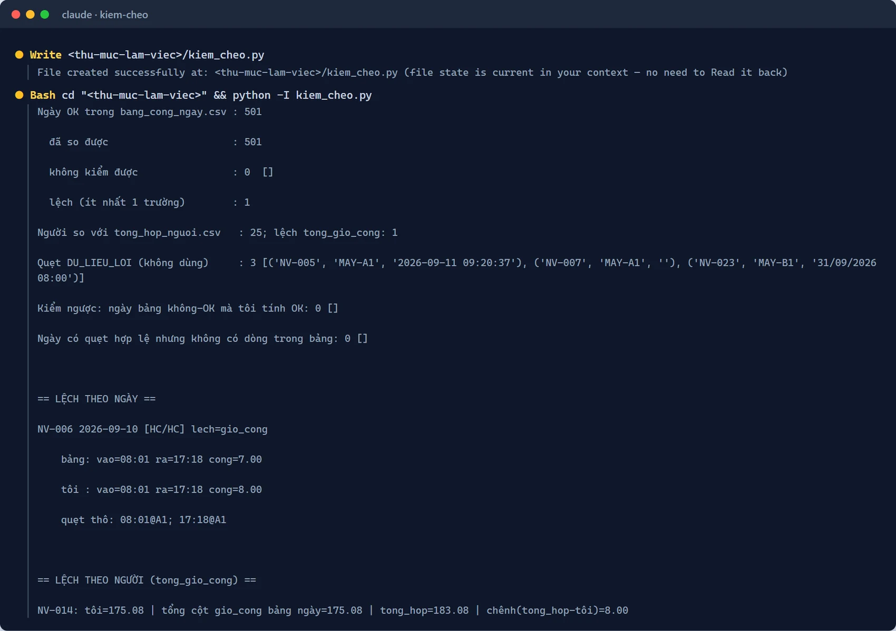

# Bài 4. Prompt mẫu và bài tập tự làm

!!! info "Bài này"
    - **Bạn làm gì:** sao chép các prompt dùng lại được (giải thích, kiểm chéo, đổi ngưỡng, viết thông báo cho quản lý...), rồi tự làm ba bài tập có bộ kiểm bằng code.
    - **Mất bao lâu:** mỗi prompt vài phút; mỗi bài tập 10 đến 20 phút.
    - **Cần có:** kết quả của bài 1 đến 3 (thư mục bài đã giải nén, có `tinh_cong.py` do agent viết), một coding agent (xem [Bắt đầu với coding agent](../th-bat-dau-voi-coding-agent/00-README.md)), Python 3.
    - **Kết quả:** 9 prompt (6 đã chạy thật, kết quả dán dưới prompt) và 3 bài tập tự kiểm được.

> Dữ liệu vẫn là **dữ liệu giả**; mọi ngưỡng là tham số giả định, không phải quy định pháp luật (không trích điều luật nào). Cả sáu lần chạy thật dưới đây: Claude Code 2.1.330, mô hình `claude-sonnet-5-5`, ngày 2026-11-21, **n = 1 mỗi prompt**, chạy một lần không tương tác trong một thư mục riêng chỉ có dữ liệu ẩn danh và đầu ra có sẵn của lần `claude-lan1` (không có đáp án). Một lần chạy không nói được prompt có ổn định hay không.

!!! warning "Trước khi dán bất kỳ prompt nào"
    **Chỉ đưa cho agent dữ liệu đã ẩn danh** (mã `NV-xxx` thay họ tên, bỏ phòng ban và ghi chú đơn nghỉ; cách làm ở bài 1). Prompt nào cũng có câu "chỉ đọc và ghi trong thư mục này", nhưng đó **chỉ là lời dặn**: **[Đo được]** ở bài 2 một lần `agy` chạy lệnh ngoài thư mục dù có câu này. Hãy chạy trong thư mục riêng, để chế độ có hỏi xin phép, và rà log sau khi chạy.

## Bộ prompt dùng lại được

Tên tệp trong prompt là tên tệp của bài này. Mỗi prompt đặt trong một thư mục riêng, có sẵn các tệp nó nhắc tới.

### Prompt 1. Giao việc chính (bản rút gọn)

**Dùng khi nào:** làm lại bài toán với dữ liệu tháng khác, hoặc khi bạn thấy bản 6 phần ở bài 1 quá dài. **Chưa chạy thử**; bản đầy đủ đã chạy ở bài 1 và 2.

```prompt
Bạn là trợ lý kiểm tra bảng chấm công trước khi tính lương, không quyết định lương hay kỷ luật. Thư mục này có cham_cong.csv, nhan_vien.csv, lich_ca_xoay.csv, nghi_phep.csv (đã ẩn danh, nhân viên chỉ có mã NV-xxx) và quy_dinh_cong_ty.md (nguồn duy nhất cho mọi ngưỡng).
Viết chương trình Python tên tinh_cong.py làm mọi phép tính giờ (không tính nhẩm), chạy nó để tạo: bang_cong_ngay.csv (mỗi nhân viên mỗi ngày một dòng; cột ma_nv, ngay, loai_ngay, gio_vao, gio_ra, gio_cong, phut_tre, phut_ve_som, ot_phut, trang_thai), bat_thuong.csv (cột ma_nv, ngay, loai, chi_tiet, can_nguoi_quyet, giai_thich) và tong_hop_nguoi.csv (mỗi người một dòng). Rồi viết bao_cao.md, tối đa một trang.
Gom mọi ngưỡng vào một khối THAM SỐ ở đầu tinh_cong.py. Việc không chắc hoặc quy định không nói rõ: ghi CẦN NGƯỜI QUYẾT và để trống ô số liệu, không đoán. Không kết luận ai gian lận hoặc quẹt hộ. Không trích điều luật. Chỉ đọc và ghi trong thư mục hiện tại.
```

!!! see "Bạn sẽ thấy"
    `tinh_cong.py`, ba CSV và `bao_cao.md`. Muốn so với đáp án thì chấm như bài 2; tên cột ở đây là rút gọn nên có thể lệch tên cột so với bản đầy đủ.

### Prompt 2. Giải thích chương trình bằng lời thường

**Dùng khi nào:** bạn là người làm lương, không biết lập trình, và muốn hiểu `tinh_cong.py` trước khi giao cho người kỹ thuật duyệt. **Đã chạy thật** (68,5 giây, chỉ đọc hai tệp).

```prompt
Tôi là người làm lương, không biết lập trình. Trong thư mục này có tinh_cong.py (chương trình tính công) và quy_dinh_cong_ty.md. Chỉ đọc, không sửa tệp nào.
Hãy giải thích tinh_cong.py bằng lời thường, tối đa 20 dòng, theo bốn phần:
1. Chương trình đọc những tệp nào và ghi ra những tệp nào.
2. Các bước chính theo thứ tự, mỗi bước một câu.
3. Các con số ngưỡng (dung sai trễ, quẹt trùng, làm thêm...) nằm ở đâu trong tệp (nói số dòng); muốn đổi một ngưỡng thì sửa chỗ nào.
4. Ba chỗ nên nhờ người kỹ thuật đọc kỹ nhất, và vì sao.
Chỗ nào bạn không chắc thì nói "không chắc", đừng đoán. Không dùng thuật ngữ lập trình nếu không giải nghĩa ngay.
```

!!! see "Bạn sẽ thấy"
    Bốn phần đúng thứ tự, có số dòng cụ thể. Số dòng agent nêu (dòng 27 là `DUNG_SAI`, dòng 449 là câu "<= 10 phút" trong báo cáo) **chúng tôi đã mở tệp kiểm: đúng**.

```ketqua
Lần chạy ngày 2026-11-21, n=1. Rút gọn, [...] là phần lược.
2. Các bước chính:
- Bước 1: Đọc 4 tệp, chỉ lấy đơn nghỉ có đúng chữ "Đã duyệt" (dòng 68).
- Bước 2: Kiểm từng dòng quẹt thẻ. Dòng sai (máy lạ, giờ trống hoặc sai, mã nhân viên lạ, ngoài tháng 9) bị loại và ghi là DU_LIEU_LOI.
[...]
3. Các ngưỡng nằm ở đâu: Tất cả nằm trong khối "THAM SỐ", dòng 17–34.
- Ngưỡng: dung sai trễ/sớm dòng 27 (5 phút); quẹt trùng dòng 28 (3); [...]
- Có hai chỗ chữ viết sẵn không tự đổi theo: câu "≤ 10 phút" trong bao_cao.md (dòng 449) và chữ "09/2026", "30 ngày" của báo cáo (dòng 413, 418).
4. Ba chỗ nên nhờ người kỹ thuật đọc kỹ:
- Dòng 148–158 và 287–293 (tính giờ công và OT): [...] Ngày "chờ xác nhận" không được cộng OT, nên tổng OT tháng có thể thấp hơn thực tế.
- Dòng 68, 120 và 436–437 (đơn nghỉ và lịch ca): chữ "Đã duyệt" phải khớp từng chữ [...]
[...]
Tôi chỉ đọc code đối chiếu với quy định, chưa chạy và chưa mở các tệp dữ liệu, nên không chắc kết quả khớp số liệu thật.
```

### Prompt 3. Kiểm chéo giờ công bằng cách độc lập

**Dùng khi nào:** trước khi chốt lương, muốn kiểm xem bảng công có sai không mà **không dùng lại chương trình đã tạo ra nó**. **Đã chạy thật** (113,1 giây). Để thử bộ kiểm có bắt được lỗi không, chúng tôi **cố ý sửa hai ô** trong thư mục chạy: giờ công của NV-006 ngày 2026-09-10 từ 8.00 thành 7.00 (bảng ngày), và tổng giờ công của NV-014 cộng thêm 8 (bảng người). Prompt không nhắc gì tới hai ô này.

```prompt
Trong thư mục này có dữ liệu thô (cham_cong.csv, nhan_vien.csv, lich_ca_xoay.csv, nghi_phep.csv, quy_dinh_cong_ty.md) và hai bảng kết quả do một chương trình khác tính: bang_cong_ngay.csv và tong_hop_nguoi.csv. Bạn không có chương trình đó, đừng tìm.
Hãy kiểm chéo bằng cách ĐỘC LẬP:
1. Tự viết một script mới tên kiem_cheo.py, chỉ dùng cham_cong.csv, nhan_vien.csv, lich_ca_xoay.csv và quy_dinh_cong_ty.md, để tính lại giờ vào, giờ ra và giờ công của mọi ngày mà bang_cong_ngay.csv ghi trang_thai = OK.
2. So kết quả của bạn với bang_cong_ngay.csv (từng ngày) và với cột tong_gio_cong của tong_hop_nguoi.csv (từng người).
3. Báo cáo ngắn: bao nhiêu ngày và bao nhiêu người đã so, bao nhiêu lệch; với mỗi chỗ lệch ghi mã NV, ngày, giá trị của hai bên và vì sao lệch.
Mọi phép tính do script làm, không tính nhẩm. Không sửa tệp có sẵn. Chỉ đọc và ghi trong thư mục này. Không bịa: chỗ không kiểm được thì nói rõ.
```

!!! see "Bạn sẽ thấy"
    Agent viết `kiem_cheo.py`, chạy, và báo số ngày, số người đã so cùng từng chỗ lệch. **Kiểm bằng code:** nó bắt đúng **2/2 ô chúng tôi sửa**, không báo thêm chỗ nào.



*Dựng lại từ log thật của lần chạy kiểm chéo ngày 2026-11-21, không phải ảnh chụp trực tiếp cửa sổ TUI. Đường dẫn máy đã được thay bằng `<thu-muc-lam-viec>`.*

```ketqua
Lần chạy ngày 2026-11-21, n=1. Rút gọn.
Đã so: 501 ngày trang_thai = OK, lệch 1 ngày (cột gio_cong); 25 người, lệch 1 người.
Chỗ lệch 1: NV-006, 2026-09-10. bảng ghi gio_cong 7.00, tôi tính 8.00. [...] Tôi không có lý do nào làm tròn xuống 7.00, nên bảng ngày sai ngày này.
Chỗ lệch 2: NV-014. tong_hop_nguoi.csv ghi 183.08, tôi tính 175.08 (lệch +8.00). [...] Chưa xác định được nguyên nhân [...] có thể ngày này bị cộng nhầm 8 giờ, nhưng đây mới là suy đoán, chưa kiểm chứng.
Không kiểm được: [...] không so phut_tre, phut_ve_som, ot_phut [...]
```

!!! warning "Chỗ agent đoán sai"
    Với NV-014, agent đoán nguyên nhân là ngày 24/09 bị cộng nhầm 8 giờ. **Đoán sai:** chúng tôi tự cộng 8 vào ô tổng. Agent có ghi rõ "đây mới là suy đoán", nên không phải bịa, nhưng bạn đừng lấy lời giải thích nguyên nhân làm kết luận. Kiểm chéo chỉ cho biết **chỗ nào lệch**, không cho biết **vì sao**.

### Prompt 4. Sửa chương trình khi máy chấm công đổi định dạng

**Dùng khi nào:** máy mới, phần mềm mới, hoặc nhà cung cấp đổi cách xuất giờ. **Chưa chạy thử.** Dán 2 đến 3 dòng ví dụ thật (đã ẩn danh) vào chỗ có ngoặc vuông.

```prompt
Máy chấm công vừa đổi cách xuất giờ. Trong thư mục này có tinh_cong.py, cham_cong.csv (định dạng cũ, kết quả đã được duyệt) và cham_cong_moi.csv (mẫu định dạng mới).
Định dạng cũ, ví dụ: [DÁN 2 DÒNG CŨ]
Định dạng mới, ví dụ: [DÁN 2 DÒNG MỚI]
1. Sửa tinh_cong.py để đọc được cả hai định dạng. Chỉ sửa phần đọc giờ.
2. Chạy lại với cham_cong.csv cũ: ba tệp kết quả phải giống hệt lần trước (so từng ô, báo số ô khác).
3. Chạy với cham_cong_moi.csv và báo có dòng nào không đọc được giờ không, liệt kê từng dòng.
Không đoán định dạng ngoài các ví dụ. Dòng nào không đọc được thì ghi DU_LIEU_LOI, không bỏ qua im lặng. Mọi số do code đếm. Chỉ đọc và ghi trong thư mục này.
```

!!! see "Bạn sẽ thấy"
    Một báo cáo "trước/sau" với số ô khác nhau của bản cũ bằng 0. Nếu khác 0, chương trình đã bị sửa hỏng: **đừng nhận**.

### Prompt 5. Báo cáo cho giám đốc từ kết quả

**Dùng khi nào:** cần một trang tóm tắt cho người không rành kỹ thuật. **Chưa chạy thử.**

```prompt
Dựa trên bao_cao.md, tong_hop_nguoi.csv và bat_thuong.csv trong thư mục này, viết bao_cao_giam_doc.md, tối đa nửa trang, cho giám đốc không rành kỹ thuật:
- Ba dòng đầu: kết quả chính của tháng (số nhân viên, số ngày công, số bất thường).
- Số ca đang chờ người xác nhận, theo loại, và ai nên xác nhận (quản lý trực tiếp, nhân sự hay người kỹ thuật).
- Điều giám đốc cần quyết trước khi chốt lương.
- Điều chưa chắc.
Mọi con số phải lấy từ ba tệp và ghi tệp nguồn trong ngoặc; cần cộng thì chạy code, không tính nhẩm. Không kết luận ai gian lận hoặc quẹt hộ, không đề xuất kỷ luật hay trừ lương, không trích điều luật. Dùng mã NV-xxx, không đoán tên. Chỉ đọc và ghi trong thư mục này.
```

!!! see "Bạn sẽ thấy"
    Một trang ngắn, mỗi số có tệp nguồn. Hãy mở tệp nguồn kiểm hai ba số ngẫu nhiên trước khi gửi đi.

### Prompt 6. Hỏi "chỗ nào bạn không chắc"

**Dùng khi nào:** sau khi agent viết chương trình, muốn biết quy định thiếu ở đâu và agent đã tự chọn cách hiểu nào. **Đã chạy thật** (104,0 giây; chỉ đọc ba tệp).

```prompt
Trong thư mục này có quy_dinh_cong_ty.md, tinh_cong.py (chương trình tính công theo quy định đó) và bao_cao.md. Chỉ đọc, không sửa và không chạy gì.
Hãy liệt kê những chỗ bạn KHÔNG chắc, hoặc chương trình đã phải tự chọn một cách hiểu vì quy định không nói rõ. Với mỗi chỗ ghi:
(a) tình huống;
(b) chương trình đang xử lý thế nào (kèm số dòng code nếu có);
(c) cách hiểu khác có thể có;
(d) nếu hiểu khác thì kết quả có thể đổi ra sao (không đo được thì nói "không biết", đừng đoán số).
Xếp theo mức ảnh hưởng đến lương, tối đa 8 chỗ. Chỗ nào bạn cũng không chắc thì nói thẳng "không chắc".
```

!!! see "Bạn sẽ thấy"
    Tám mục có đủ (a) đến (d), nhiều chỗ ghi "không biết". Danh sách này là **đầu vào cho chủ doanh nghiệp quyết và viết vào quy định**. Ba chỗ đầu của lần chạy khớp đúng ba điều đã lộ ở bài 2 (ngày lễ có quẹt; ngày chờ xác nhận không tính giờ; mọi đơn nghỉ đều ghi PHEP).

```ketqua
Lần chạy ngày 2026-11-21, n=1. Rút gọn.
Tôi chỉ đọc 3 tệp bạn nêu, không đọc các CSV và không chạy gì. [...] Tôi không chắc thứ tự giữa mục 1 và 2.
1. Ngày lễ/ngày nghỉ mà vẫn có quẹt (7 ngày: LAM_NGAY_LE 3, LAM_NGAY_NGHI 4)
   (c) Có thể coi là làm thêm ngày nghỉ/lễ với hệ số riêng. Cũng có thể coi là quẹt nhầm và không trả gì. [...]
   (d) Lương các ngày này có thể từ 0 đến mức cao hơn ngày thường. Mức nào thì không chắc [...]
2. Ngày thiếu quẹt hoặc có đơn phép mà vẫn quẹt: không tính giờ nào [...]
3. Đơn nghỉ: loại đơn và chuỗi trạng thái (12 ngày PHEP) [...]
[mục 4 đến 8: hai quẹt sát nhau, OT tháng chỉ cộng ngày OK, nghi quẹt hộ, quẹt ở máy chi nhánh khác, điều kiện DU_LIEU_LOI chương trình tự thêm]
Tôi không thấy chỗ nào mơ hồ về dung sai 5 phút, cách trừ nghỉ trưa, ngưỡng OT 30 phút hay các ngưỡng 180 và 2400 phút.
```

### Prompt 7. Giải thích vì sao một ngày bị đánh dấu bất thường

**Dùng khi nào:** quản lý hỏi "sao ngày này của NV-xxx bị đánh dấu?". Thay `NV-009` và `2026-09-23` bằng ca bạn cần. **Đã chạy thật** với đúng hai giá trị này (29,1 giây).

```prompt
Trong thư mục này có cham_cong.csv (các lần quẹt, đã ẩn danh), quy_dinh_cong_ty.md, bang_cong_ngay.csv và bat_thuong.csv (kết quả của chương trình tính công).
Hãy giải thích bằng lời thường vì sao nhân viên NV-009 ngày 2026-09-23 bị đánh dấu bất thường, theo thứ tự:
1. Liệt kê đúng các lần quẹt của người đó trong ngày đó, lấy từ cham_cong.csv (đây là số liệu, không đoán).
2. Trích đúng điều trong quy_dinh_cong_ty.md đã được áp dụng.
3. Nói kết luận theo dữ liệu: ngày đó được tính thế nào trong bang_cong_ngay.csv, và vì sao.
4. Nêu một đến hai câu nên hỏi quản lý.
Chỉ dùng số liệu trong tệp; cần tính thì chạy code. Không kết luận ai gian lận hoặc quẹt hộ, chỉ nêu dấu hiệu. Không trích điều luật. Chỉ đọc, không sửa tệp nào. Chỉ đọc và ghi trong thư mục này.
```

!!! see "Bạn sẽ thấy"
    Bốn phần đúng thứ tự. **Kiểm bằng code:** ba lần quẹt agent liệt kê khớp từng dòng với `cham_cong.csv` (hai quẹt ở máy A, một quẹt ở máy B ghi dạng `23/09/2026 08:05`, tức là agent đã xử lý cả hai kiểu giờ).

```ketqua
Lần chạy ngày 2026-11-21, n=1. Rút gọn.
Ngày 2026-09-23 của NV-009 bị đánh dấu bất thường vì có hai lần quẹt ở hai máy khác nhau, cách nhau chỉ 6 phút. [...]
1. Quẹt: MAY-A1 07:59 | MAY-B1 08:05 | MAY-A1 17:18
2. Mục 4 "Nghi quẹt hộ": "cùng một mã NV có hai quẹt Ở HAI MÁY KHÁC NHAU cách nhau <= 10 phút trong cùng ngày". Mục 5, điểm 9: "Ngày có NGHI_QUET_HO: không tự tính giờ, chờ xác nhận [...]"
3. Trong bang_cong_ngay.csv ngày này là trang_thai = CHO_XAC_NHAN, các cột giờ để trống. [...]
Tôi không có cơ sở để nói ai quẹt hộ. Dữ liệu chỉ cho thấy hai máy ghi nhận cùng một mã nhân viên trong vòng 6 phút.
4. Nên hỏi quản lý: "NV-009 làm ở chi nhánh nào, và sáng 23/09 có thật sự đi qua cả hai chi nhánh trong vòng 6 phút không? Có cách nào kiểm tra, chẳng hạn lịch công tác hoặc camera?" [...]
```

!!! stuck "Gặp lỗi?"
    Agent tự thêm gợi ý "camera" mà quy định không nhắc: **chi tiết agent tự thêm**, giống điều đã gặp ở bài 2. Cứ đọc như gợi ý, không phải quy trình của công ty. Thư mục chạy này không có `nhan_vien.csv`, nên agent nói rõ không đối chiếu được chi nhánh: nếu cần, thêm tệp đó vào.

### Prompt 8. Đổi ngưỡng bằng tham số rồi chạy lại

**Dùng khi nào:** công ty đổi dung sai trễ, ngưỡng làm thêm... và bạn muốn thấy tác động trước khi áp dụng. **Đã chạy thật** (40,0 giây).

```prompt
Trong thư mục này có tinh_cong.py, các tệp CSV đầu vào và quy_dinh_cong_ty.md. Hãy làm theo thứ tự:
1. Chạy tinh_cong.py như hiện tại. Chép ba tệp kết quả (bang_cong_ngay.csv, bat_thuong.csv, tong_hop_nguoi.csv) sang thư mục con truoc/ và đếm số dòng bất thường theo từng loại ("trước").
2. Đổi dung sai đi trễ / về sớm từ 5 phút lên 10 phút. Chỉ sửa trong khối tham số; nếu con số này đang viết rải rác trong code thì gom về một tham số rồi sửa một chỗ. Sửa cả chú thích cho khớp.
3. Chạy lại tinh_cong.py và đếm lại ("sau").
4. Báo cáo: bảng trước/sau theo từng loại bất thường, danh sách các dòng bất thường biến mất (mã NV, ngày, loại), và các dòng bạn đã sửa trong tinh_cong.py.
Không sửa các tệp CSV đầu vào, không đổi quy tắc nào khác. Mọi số do code đếm, không tính nhẩm. Chỉ đọc và ghi trong thư mục này.
```

!!! see "Bạn sẽ thấy"
    Bảng trước/sau, đúng một dòng bị sửa. **Kiểm bằng code:** `DI_TRE` 12 xuống 10, `VE_SOM` 6 xuống 5, tổng 61 xuống 58, **trùng số chúng tôi đo tay ở bài 3**. Ba dòng biến mất đúng là hiệu hai tập kết quả (NV-012 ngày 04/09, NV-023 ngày 03/09, NV-015 ngày 24/09); bốn tệp CSV đầu vào không đổi (so mã băm); khác biệt duy nhất của `tinh_cong.py` là dòng `DUNG_SAI`.

```ketqua
Lần chạy ngày 2026-11-21, n=1. Rút gọn.
Đã xong cả bốn bước. Dung sai giờ là 10 phút và tổng số dòng bất thường giảm từ 61 xuống 58.
| Loại    | Trước | Sau |
| DI_TRE  | 12    | 10  |
| VE_SOM  | 6     | 5   |
[các loại khác không đổi]  | Tổng | 61 | 58 |
Dòng đã sửa: DUNG_SAI = 5 -> DUNG_SAI = 10 (dòng 27, kèm chú thích)
Cần lưu ý: quy_dinh_cong_ty.md mục 4 và mục 5 vẫn ghi "5 phút". Bạn chỉ yêu cầu sửa code nên tôi không đụng vào tệp này. Giờ tài liệu và code đang lệch nhau. Bạn có muốn tôi sửa không?
```

!!! warning "Nhớ sửa quy định cho khớp"
    Agent nhắc đúng điều dễ quên: sau khi đổi con số trong code, `quy_dinh_cong_ty.md` vẫn ghi con số cũ. Hãy sửa tệp quy định (nguồn của mọi ngưỡng) và lưu cả hai bản.

### Prompt 9. Viết thông báo cho quản lý về các ca cần xác nhận

**Dùng khi nào:** gửi danh sách ca cần xác nhận cho quản lý trực tiếp. **Đã chạy thật** (173,1 giây, hơi lâu vì một lệnh bị chặn, xem dưới).

```prompt
Trong thư mục này có bat_thuong.csv, kết quả của chương trình tính công (nhân viên chỉ có mã NV-xxx). Hãy viết tệp thong_bao_quan_ly.md: một thông báo gửi quản lý trực tiếp, nhờ xác nhận các ca có can_nguoi_quyet = CO.
Yêu cầu:
- Gom theo loại bất thường; mỗi ca một dòng gồm mã NV, ngày, chuyện gì xảy ra (theo chi_tiet) và một câu hỏi cụ thể quản lý cần trả lời.
- Không bỏ sót ca nào, không thêm ca nào. Giữ nguyên mã NV-xxx, không đoán tên người.
- Giọng lịch sự, trung lập. Không kết luận ai gian lận hoặc quẹt hộ, không đề xuất kỷ luật hay trừ lương, không trích điều luật.
- Đầu thư ghi tổng số ca cần xác nhận (đếm bằng code); cuối thư để chỗ cho quản lý ghi câu trả lời.
Chỉ đọc bat_thuong.csv và ghi thong_bao_quan_ly.md. Chỉ đọc và ghi trong thư mục này.
```

!!! see "Bạn sẽ thấy"
    Một thư có 37 ca (đúng số dòng `CO` trong `bat_thuong.csv`), gom 11 nhóm. **Kiểm bằng code:** 37/37 ca có đủ mã NV và ngày trong thư (ba ca không có ngày cụ thể chỉ kiểm theo mã NV), không có thêm ca nào; thư **không chứa** các từ "gian lận", "quẹt hộ", "kỷ luật", "trừ lương", "luật".

```ketqua
Lần chạy ngày 2026-11-21, n=1. Rút gọn.
Kính gửi Anh/Chị quản lý trực tiếp,
Chương trình tính công vừa chạy xong và có 37 ca cần Anh/Chị xác nhận trước khi chốt công. [...] nhân viên được nêu theo mã NV và chưa có kết luận nào về từng trường hợp.
## 1. Ngày làm việc không có quẹt và không có đơn nghỉ (6 ca)
- NV-002 | 22/09/2026 | Ngày làm việc (ca C) không có lần quẹt nào và không có đơn nghỉ đã duyệt. Câu hỏi: Ngày này NV-002 nghỉ chưa làm đơn, hay có đi làm nhưng chưa ghi nhận quẹt?
[...]
Cuối thư: bảng 37 dòng, cột "Câu trả lời của quản lý".
```

!!! stuck "Agent báo 'lệnh Python bị chặn'?"
    **[Đo được]** Ở chế độ chạy một lần không tương tác, lệnh Python do agent viết để sinh thư bị chặn (chờ duyệt, mà không có ai duyệt). Agent chuyển sang đếm bằng công cụ tìm kiếm rồi **viết tay** cả 37 dòng, và nói rõ điều đó. Hệ quả: mã NV, ngày chép bằng "tay" của mô hình, dù kết quả của chúng tôi kiểm khớp. Nếu bạn chạy trong chế độ tương tác, hãy cho phép lệnh đó (chỉ khi nó nằm trong thư mục làm việc) để thư được sinh bằng code, hoặc luôn chạy bước kiểm đếm như trên.

## Ba bài tập tự làm

Ba bài tập dùng bản `tinh_cong.py` của Claude Code lần 1 (`ket-qua/claude-lan1/tinh_cong.py`) và dữ liệu có sẵn. Bộ kiểm `ket-qua/bai-tap/kiem_bai_tap.py` do chúng tôi viết và đã chạy thử trên Windows: mỗi bài in `ĐẠT` hoặc `KHÔNG ĐẠT` kèm lý do. Con số kỳ vọng ở bài 1 và 2 là **[Đo được]** (n = 1) với đúng bản chương trình đó; dùng bản của `agy` thì số có thể lệch. Các lệnh dưới chạy trong thư mục bài, nơi có `du-lieu/` và `ket-qua/`.

### Bài tập 1. Đổi giờ ca sáng của ca xoay

**Đề:** công ty dời ca sáng (S) sớm 30 phút: từ 06:00-14:00 thành 05:30-13:30. Sửa chương trình, chạy lại, rồi giải thích vì sao số lượng đi trễ tăng vọt.

**Dữ liệu:** bốn CSV ẩn danh có sẵn. Chuẩn bị:

```lenh
mkdir bai-tap-1
copy du-lieu\an-danh\cham_cong.csv, du-lieu\an-danh\nhan_vien.csv, du-lieu\an-danh\lich_ca_xoay.csv, du-lieu\an-danh\nghi_phep.csv bai-tap-1\
copy ket-qua\claude-lan1\tinh_cong.py bai-tap-1\
```

macOS hoặc Linux: `mkdir bai-tap-1`, rồi `cp du-lieu/an-danh/{cham_cong,nhan_vien,lich_ca_xoay,nghi_phep}.csv ket-qua/claude-lan1/tinh_cong.py bai-tap-1/`. Mở `bai-tap-1\tinh_cong.py` bằng Notepad (lưu giữ mã hóa UTF-8), tìm dòng `"S": (6 * 60, 14 * 60),` trong khối `CA`, đổi thành `"S": (5 * 60 + 30, 13 * 60 + 30),`. Chạy và kiểm:

```lenh
cd bai-tap-1
python -X utf8 tinh_cong.py
cd ..
python -X utf8 ket-qua\bai-tap\kiem_bai_tap.py 1 bai-tap-1
```

**Tiêu chí đạt (kiểm bằng code):** bộ kiểm in `ĐẠT`; cụ thể `DI_TRE` = 108, `VE_SOM` = 3, tổng dòng `bat_thuong.csv` = 154, 501 ngày OK, tổng làm thêm 165,98 giờ.

```ketqua
bài tập 1: bat_thuong 154 dòng; OK 501; DI_TRE 108; VE_SOM 3; LAM_NGAY_LE 3; dòng LE 50; tổng làm thêm 165.98 giờ
ĐẠT
```

**Gợi ý:** dữ liệu quẹt vẫn lúc 06:00, nên người vào đúng giờ cũ nay "trễ 30 phút": đây là cách bảng công báo "đã đổi ca mà dữ liệu chưa đổi". Sửa luôn `quy_dinh_cong_ty.md` mục 2 cho khớp. Có thể nhờ agent làm bằng Prompt 8, đổi nội dung bước 2.

### Bài tập 2. Thêm một ngày lễ

**Đề:** công ty khai báo thêm ngày 15/09/2026 là ngày lễ. Thêm vào chương trình, chạy lại, và đếm xem bao nhiêu người "đi làm ngày lễ".

**Dữ liệu:** như bài tập 1 (thư mục `bai-tap-2`, chuẩn bị bằng lệnh tương tự). Trong khối THAM SỐ, đổi dòng `NGAY_LE = {date(2026, 9, 1), date(2026, 9, 2)}` thành `NGAY_LE = {date(2026, 9, 1), date(2026, 9, 2), date(2026, 9, 15)}`, chạy rồi kiểm:

```lenh
python -X utf8 ket-qua\bai-tap\kiem_bai_tap.py 2 bai-tap-2
```

**Tiêu chí đạt (kiểm bằng code):** `ĐẠT`; cụ thể `LAM_NGAY_LE` = 26, tổng dòng bất thường = 83, số ngày OK = 478, có 75 dòng `loai_ngay = LE` (3 ngày x 25 người), tổng làm thêm 100,25 giờ.

```ketqua
bài tập 2: bat_thuong 83 dòng; OK 478; DI_TRE 12; VE_SOM 5; LAM_NGAY_LE 26; dòng LE 75; tổng làm thêm 100.25 giờ
ĐẠT
```

**Gợi ý:** ngày 15/09 là ngày thường mà gần như mọi người đều đi làm (dữ liệu gốc không biết đó là lễ), nên 23 ca `LAM_NGAY_LE` mới xuất hiện: đúng như phải thế. Cách tính lương ngày lễ: cần kiểm với văn bản hiện hành hoặc chuyên gia nhân sự. Nhớ cập nhật `quy_dinh_cong_ty.md` mục 2.

### Bài tập 3. Tự ẩn danh bảng gốc bằng script nhỏ

**Đề:** viết **script của riêng bạn** (tay hoặc nhờ agent) ẩn danh `du-lieu/goc/` thành bốn CSV có đúng tên tệp và tên cột như bản mẫu trong `du-lieu/an-danh/`. Dùng mã riêng của bạn (không cần giống bản mẫu), bảng đối chiếu ra **tệp riêng ngoài thư mục đó**, rồi chứng minh **kết quả tính công không đổi**.

**Dữ liệu:** `du-lieu/goc/` (bốn CSV, tên giả). Tên tệp và cột cần ra: `cham_cong.csv` (`ma_may, ma_nv, thoi_gian`), `lich_ca_xoay.csv` (`ma_nv, ngay, ca`), `nghi_phep.csv` (`ma_nv, tu_ngay, den_ngay, loai, trang_thai`), `nhan_vien.csv` (`ma_nv, chi_nhanh, loai_ca`); bảng đối chiếu `bang-ma-cua-toi.csv` (`ma_an_danh, ho_ten`). Đặt kết quả ở `bai-tap-3\an-danh-cua-toi\` và bảng đối chiếu ở `bai-tap-3\bang-ma-cua-toi.csv`. Chạy chương trình rồi kiểm:

```lenh
copy ket-qua\claude-lan1\tinh_cong.py bai-tap-3\an-danh-cua-toi\
cd bai-tap-3\an-danh-cua-toi
python -X utf8 tinh_cong.py
cd ..\..
python -X utf8 ket-qua\bai-tap\kiem_bai_tap.py 3 bai-tap-3\an-danh-cua-toi bai-tap-3\bang-ma-cua-toi.csv
```

**Tiêu chí đạt (kiểm bằng code):** `ĐẠT`: (a) bốn tệp không còn cột Họ tên, Phòng ban, Ghi chú; (b) không còn họ tên (có dấu hay không dấu), mã gốc hay từ khóa phòng ban/ghi chú trong bốn tệp; (c) sau khi dịch mã của bạn về họ tên, **61/61 bất thường và 750/750 dòng bảng công ngày** giống bản mẫu.

```ketqua
bài tập 3: bất thường 61/61 giống bản mẫu; bảng công ngày 750/750 giống bản mẫu
ĐẠT
```

**Gợi ý:** (1) mã nhân viên máy A có số 0 đứng đầu (`01012`), máy B không (`1012`): hai dạng là **một người**, hãy chuẩn hóa trước khi gán mã; (2) thẻ lạ không có trong danh sách vẫn phải có mã (để chương trình vẫn báo `DU_LIEU_LOI`); (3) ghép đơn nghỉ và lịch ca theo **họ tên**, vì hai tệp đó không có mã; (4) đừng "làm sạch giúp" giờ lẫn lộn. Chúng tôi có lời giải mẫu `ket-qua/bai-tap/loi-giai-an-danh.py` (đã chạy ra `ĐẠT`); **cố làm trước khi xem**, và đừng đưa nó cho agent nếu bạn muốn tự thử. Nếu bộ kiểm báo `KHÔNG ĐẠT`, đọc dòng lý do: thường là còn lộ tên, hoặc một người bị tách thành hai mã.

## Dùng với dữ liệu thật của bạn

**Checklist ẩn danh trước khi đưa cho agent:**

- [ ] Thay họ tên bằng mã bằng **script có tự kiểm** (bài 1, bài tập 3), không làm tay.
- [ ] Bỏ cột Họ tên, Phòng ban, Ghi chú; bỏ cả số điện thoại, email, số tài khoản nếu bảng có.
- [ ] Thay mã nhân viên, **đừng xóa**: xóa thì không nối được các bảng.
- [ ] Đổi "muối" (số bí mật trong `an_danh.py`) và giữ bí mật cùng bảng đối chiếu.
- [ ] Rà tay ô văn bản tự do (ghi chú, lý do nghỉ): script chỉ che trường có tên.
- [ ] Hỏi: lịch làm việc có đủ đặc biệt để suy ra người không (ví dụ chỉ một người ca đêm)?
- [ ] Bảng đối chiếu, đáp án và bản có họ tên **ở ngoài** thư mục agent.

**Dùng dịch vụ đám mây hay không:**

| Tình huống | Gợi ý **[Đề xuất]** |
|---|---|
| Đã ẩn danh, công ty cho phép dùng dịch vụ ngoài | Dùng agent đám mây trong thư mục riêng, chế độ có hỏi xin phép |
| Đã ẩn danh nhưng chưa rõ quy định nội bộ | Hỏi nhân sự hoặc pháp chế trước; trong lúc chờ, **dùng dữ liệu giả** để dựng và thử chương trình |
| Chưa ẩn danh được, hoặc dữ liệu có chuyện sức khỏe, gia đình | **Không** đưa lên đám mây. Chạy `tinh_cong.py` (đã duyệt) ngay trên máy bạn |
| Chỉ cần chạy lại chương trình đã có | Không cần agent: bài 3 |

Quy định pháp luật về dữ liệu cá nhân và về giờ làm thêm, nghỉ lễ, nghỉ phép: bài này không trích điều luật nào; xem [An toàn dữ liệu và pháp lý ở Việt Nam](../an-toan-du-lieu-va-phap-ly-vn.md) và hỏi chuyên gia nhân sự hoặc pháp lý.

**Ai duyệt:** người làm lương (xử lý từng ca), quản lý trực tiếp (xác nhận giờ thực tế), nhân sự (đơn nghỉ, ngày lễ, làm thêm), chủ doanh nghiệp (ký trước khi chốt lương). Agent chỉ chuẩn bị số liệu.

**Khi agent chạy trên máy bạn:** agent chạy lệnh thật. Chế độ "không hỏi xin phép" (ví dụ `--dangerously-skip-permissions` của `agy`) là toàn quyền; **[Đo được]** một lần `agy` đã chạy `git log` và `dir ..\..` ngoài thư mục làm việc dù prompt dặn không. Cách an toàn: thư mục riêng chỉ có dữ liệu ẩn danh; chế độ có hỏi xin phép; không đặt gì quan trọng gần đó; máy ảo hoặc tài khoản riêng nếu phải bật toàn quyền; rà log sau mỗi lần chạy (lệnh rà ở bài 2).

## Hỏi nhanh

**Em không biết lập trình, có làm được không?** Có: bài 1 đến 3 chỉ cần sao chép lệnh và prompt. Bài tập 3 cần viết hoặc nhờ agent viết một script nhỏ, đã có lời giải mẫu để đối chiếu.

**Bắt buộc dùng Claude Code hay `agy` không?** Không. Prompt dán được vào coding agent khác, nhưng chúng tôi chỉ chạy thật hai agent này; kết quả với agent khác chưa kiểm.

**Agent tính sai thì sao?** Chương trình do agent viết có thể sai, nên luôn kiểm: chấm bằng đáp án nếu có (bài 2), tự kiểm 7 mục khi không có đáp án (bài 3), kiểm chéo độc lập (Prompt 3), và có người đọc mục "giả định".

**Agent báo "lệnh bị chặn" khi chạy một lần, sao vậy?** Ở chế độ không tương tác, lệnh cần duyệt sẽ bị chặn vì không có ai duyệt (xem Prompt 9). Chạy ở chế độ tương tác và cho phép lệnh đó (chỉ khi nó nằm trong thư mục làm việc).

**Mỗi tháng có phải trả tiền cho agent không?** Không nếu chỉ chạy lại `tinh_cong.py` (bài 3). Chỉ khi nhờ agent sửa chương trình hay giải thích. Chi phí cụ thể: chúng tôi không có số liệu giá; các lần chạy ở bài này, log Claude Code báo `cost_usd` từ 0,16 đến 0,61 USD mỗi prompt (con số công cụ báo, không phải hóa đơn).

**Ngưỡng và ngày lễ lấy ở đâu?** Từ quy định công ty bạn, ghi thành con số trong `quy_dinh_cong_ty.md`. Bài này chỉ dùng tham số giả định; quy định pháp luật cần kiểm với văn bản hiện hành.

**Tại sao không bảo agent tự đọc rồi tính luôn?** Hàng chục phép trừ giờ nhân 750 ô, tính nhẩm sẽ có lúc sai và không kiểm được. Code chạy lại được và đọc lại được.

**Agent báo có người quẹt hộ, có phạt được không?** Không từ bảng này. Đó chỉ là dấu hiệu (hai máy trong 10 phút); xác minh theo quy trình của công ty.

## Checklist

- [ ] Biết 9 prompt dùng cho việc gì, và 6 prompt nào đã chạy thật (2, 3, 6, 7, 8, 9).
- [ ] Mỗi prompt chạy trong thư mục riêng, chỉ có dữ liệu ẩn danh.
- [ ] Đã làm ít nhất một bài tập và thấy `ĐẠT` ở bộ kiểm.
- [ ] Quy định luôn cập nhật cùng lúc với mã (Prompt 8, bài tập 1 và 2).
- [ ] Có người duyệt trước khi chốt lương.

## Giới hạn

- Mỗi prompt đã chạy thật chỉ **1 lần** (n = 1), một agent, một mô hình; chưa đo độ ổn định giữa các lần. Ba prompt (1, 4, 5) **chưa chạy thử**.
- Kết quả dùng đầu ra có sẵn của `claude-lan1`; với đầu ra của agent khác, nội dung (số dòng, câu chữ) sẽ khác.
- Số kỳ vọng ở bài tập 1 và 2 chỉ đúng với bản `tinh_cong.py` đã ghi; bộ kiểm không phải chấm điểm "mô hình hiểu đúng", chỉ so với số đã đo.
- Dữ liệu giả, ca tình huống đơn giản; chưa thử ca qua đêm, giờ máy lệch, đổi mã thẻ. Quy định pháp luật không được tra cứu hay trích.
- Lệnh macOS, Linux ghi trong bài chưa chạy thử.
