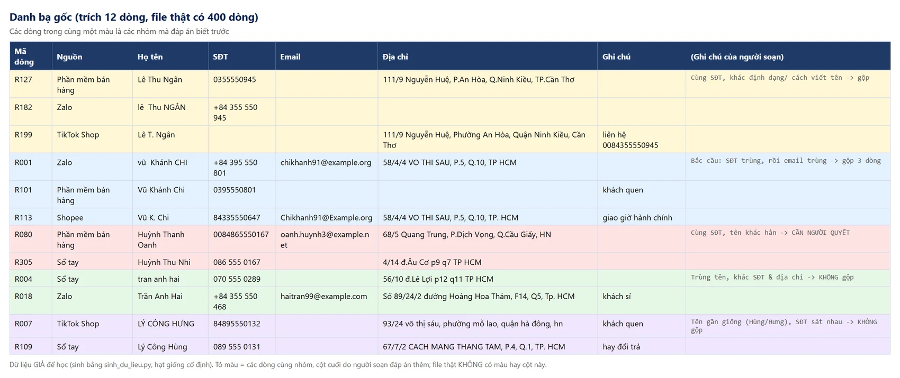
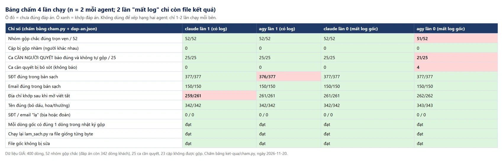

# Làm sạch danh bạ khách hàng bằng coding agent (Claude Code, Antigravity)

> Ngày làm và đo: 2026-11-20. **Toàn bộ dữ liệu trong bài là GIẢ để học** (sinh bằng `du-lieu/sinh_du_lieu.py`, hạt giống cố định). Không có khách hàng, doanh nghiệp hay số điện thoại thật nào ở đây.
> Nhãn dùng trong bài: **[Đo được]** = kết quả chạy và chấm của chúng tôi ngày 2026-11-20; **[Nguồn]** = có link; **[Đề xuất]** = ý kiến của người soạn.

## 1. Bài toán

Một cửa hàng nhỏ bán qua Zalo, Shopee, TikTok Shop, ghi sổ tay và có thêm một phần mềm bán hàng. Cuối quý chủ cửa hàng gom tất cả vào một file Excel khoảng 400 dòng để gửi tin khuyến mãi, và thấy ngay các vấn đề quen thuộc:

- Cùng một người xuất hiện 2-3 lần: `Vũ Khánh Chi` (phần mềm), `vũ  Khánh CHI` (Zalo), `Vũ K. Chi` (Shopee); SĐT viết `0395550801`, `+84 395 550 801`, `84335550647`.
- Email gõ sai: `ly.van@@example.com`, `hoang.do@example`, `mythanh91@example.con`.
- Tên in hoa lộn xộn, không dấu, có "Chị", "Anh", "c", "a" ở đầu; có tên dạng Unicode tổ hợp (NFD) nhìn giống hệt tên thường nhưng so sánh thì khác.
- Địa chỉ viết tắt đủ kiểu: `P.5, Q.10, TP HCM`, `p5 q10 tphcm`, `F5, Q10, HCM`.
- Ô trống, và có những dòng bị nhập nhầm cột: SĐT nằm ở cột Email hoặc Ghi chú, tên và địa chỉ đổi chỗ, hai SĐT trong một ô.

Đầu ra mong muốn:

1. **Danh bạ sạch**, mỗi khách một dòng.
2. **Nhật ký "đã gộp gì và vì sao"**, không xóa dữ liệu, mọi lần gộp có thể hoàn tác (biết dòng gốc nào đã vào khách nào).
3. **Danh sách ca nghi trùng cần người quyết** (cùng SĐT nhưng tên khác hẳn; cùng tên và địa chỉ nhưng khác SĐT...).

**Nguyên tắc xuyên suốt:** quy tắc gộp phải do **code tất định** làm (chuẩn hóa SĐT, so khớp tên, mỗi quyết định có lý do ghi lại, chạy lại ra đúng kết quả cũ). Mô hình/agent chỉ giúp viết code, đọc và gợi ý ở ca mơ hồ; ca mơ hồ chuyển cho người, không tự gộp.

## 2. Vì sao SME Việt Nam hay gặp **[Đề xuất]**

Khách đến từ nhiều kênh, mỗi kênh có "cách ghi" riêng và không kênh nào bắt buộc định dạng. Không có hệ thống CRM thống nhất thì danh bạ sống trong Excel, sổ tay và trong đầu người bán. Việc dọn danh bạ thường bị hoãn đến lúc cần gửi tin hàng loạt hoặc đối soát công nợ, lúc đó trùng lặp và sai SĐT gây tốn tiền (gửi tin hai lần cho một người, gửi nhầm số) và mất lòng khách. Chúng tôi không có số liệu về mức độ phổ biến nên không nêu con số.

## 3. Dữ liệu mẫu (sinh, không phải dữ liệu thật)

- `du-lieu/danh-ba-goc.xlsx` (và bản `.csv`): **400 dòng**, 7 cột `Mã dòng, Nguồn, Họ tên, SĐT, Email, Địa chỉ, Ghi chú`; 5 nguồn: Zalo 95, Phần mềm bán hàng 94, Shopee 85, Sổ tay 66, TikTok Shop 60 dòng.
- `du-lieu/sinh_du_lieu.py`: sinh lại đúng bộ này (`python -X utf8 sinh_du_lieu.py`) và sinh `ket-qua/dap-an.json` (đáp án, **không đưa cho agent**).
- SĐT giả theo dạng `0xx 555 0xxx` (dãy "555" kiểu phim); email dùng tên miền dành riêng `example.com/.org/.net`; tên là ghép ngẫu nhiên họ, chữ đệm, tên phổ biến; địa chỉ là ghép ngẫu nhiên số nhà và tên đường.

**[Đo được] (đếm trực tiếp từ bộ sinh) các bẫy đã cài:**

| Loại | Số lượng |
|---|---|
| Nhóm cùng người, **phải gộp** (cùng SĐT hoặc cùng email, tên viết khác; có 4 nhóm bắc cầu 3 dòng) | 52 nhóm (58 dòng thừa) |
| Cặp **cần người quyết** (cùng SĐT khác tên: 8; cùng SĐT, một bên chỉ có tên một từ như "Chị Lan": 5; cùng tên và địa chỉ, khác SĐT: 8; cùng tên và địa chỉ, một bên không có SĐT/email: 4) | 25 cặp |
| Cặp **không được gộp** (trùng tên khác SĐT, khác địa chỉ: 18; tên gần giống `Hùng`/`Hưng`, SĐT sát nhau: 5) | 23 cặp |
| SĐT viết lẫn nhiều kiểu (`+84…`, `84…`, `0084…`, dấu cách, dấu chấm, gạch ngang, ô số mất số 0 đầu) | hơn 220 ô |
| SĐT sai không sửa được (che `***`, thiếu số, đầu số cũ 11 số) | 13 (7 + 4 + 2) |
| Email sai không tự sửa được (`.con`, `@@`, thiếu `@`, thiếu đuôi, có dấu cách giữa) | 31 |
| Email sửa được bằng quy tắc đơn giản (hoa/thường, dấu cách, dấu phẩy) | 57 |
| Tên có danh xưng ở đầu | 30 |
| Tên dạng NFD (Unicode tổ hợp) | 42 |
| Dòng nhập nhầm cột | 21 (7 SĐT ở Ghi chú, 4 SĐT ở cột Email, 2 email ở cột SĐT, 5 ô hai SĐT, 3 tên-địa chỉ đổi chỗ) |
| Ô trống | SĐT 24, Email 217, Địa chỉ 122 |



*Ảnh dựng từ file `danh-ba-goc.xlsx` bằng HTML, tô màu theo đáp án để người học thấy nhóm; dữ liệu giả.*

## 4. Mục lục 3 bài

| Bài | Nội dung |
|---|---|
| [cap-00-chuan-bi-du-lieu-va-giao-viec.md](cap-00-chuan-bi-du-lieu-va-giao-viec.md) | Làm việc trên bản sao, nhìn dữ liệu, viết quy tắc, viết prompt 6 phần, giao cho `claude` và `agy` |
| [cap-01-chay-that-va-kiem-tra.md](cap-01-chay-that-va-kiem-tra.md) | Chạy thật hai agent, kiểm tra bằng công cụ không cần đáp án và bằng đáp án, các lỗi gặp |
| [cap-02-dung-hang-ngay.md](cap-02-dung-hang-ngay.md) | Chạy lại hằng tuần, người duyệt, hoàn tác, giới hạn và mở rộng |

## 5. Kết quả đo tóm tắt **[Đo được]**

Cùng một prompt (`du-lieu/prompt-giao-viec.txt`), cùng dữ liệu, mỗi agent chạy **2 lần** (một lần có đủ log, một lần chỉ còn file kết quả vì mất log, xem mục 7). n rất nhỏ: chỉ mô tả quan sát, **không kết luận agent nào tốt hơn**.

| | claude lần 1 (có log) | agy lần 1 (có log) | claude lần 0 (mất log) | agy lần 0 (mất log) |
|---|---|---|---|---|
| Nhóm gộp chắc đúng trọn vẹn | 52/52 | 52/52 | 52/52 | **51/52** |
| Cặp bị gộp nhầm | 0 | 0 | 0 | 0 |
| Ca cần người quyết được báo đúng | 25/25 | 25/25 | 25/25 | **21/25** |
| SĐT đúng trong bản sạch | 377/377 | **376/377** | 377/377 | 377/377 |
| Email đúng | 150/150 | 150/150 | 150/150 | 150/150 |
| Địa chỉ khớp sau khi mở viết tắt | **259/261** | 261/261 | 261/261 | 262/262 |
| Chạy lại `lam_sach.py` ra file giống từng byte | đạt | đạt | đạt | đạt |
| Thời gian (giây) | 513,6 | 1031,3 | không có log | không có log |



Quan sát chính:

- Với một prompt **ghi rõ từng quy tắc**, cả hai agent đều viết được script làm đúng gần hết; lỗi còn lại nhỏ nhưng thật (mất 1 SĐT; không mở được `DN` thành Đà Nẵng; bỏ sót 4 ca cần quyết và 1 nhóm gộp ở lần 0 của agy).
- Báo cáo bằng chữ của agent **không đáng tin tuyệt đối**: báo cáo của agy lần 1 ghi "7 khách thiếu SĐT, 99 thiếu địa chỉ" trong khi file sạch của chính nó có 29 và 81 (xem bài 2).
- Công cụ kiểm không cần đáp án (`ket-qua/tu_kiem.py`) bắt được lỗi bỏ sót ca nghi trùng ở lần 0 của agy, nhưng **đạt cả 5 phép đầu** ở đợt dữ liệu mới dù có lỗi; phải xem thêm cảnh báo và soi mẫu bằng mắt.
- **Chạy lại script cũ trên một đợt dữ liệu mới** (bài 3, hạt giống khác, 1 lần mỗi script): vẫn không gộp nhầm ai, nhưng mất 6 (claude) và 10 (agy) SĐT, một nhóm gộp bị sót (agy), một ca cần quyết bị sót (claude). Kết quả tốt ở đợt 1 không cho phép suy ra độ chính xác trên dữ liệu mới.
- Chúng tôi **chưa thử** prompt mơ hồ (không ghi quy tắc): kết quả ở trên chỉ nói về prompt có quy tắc chi tiết.

## 6. Dữ liệu cá nhân: đọc trước khi dùng với dữ liệu thật

Bài này dùng dữ liệu giả. Với danh bạ thật của cửa hàng bạn, tên, SĐT, email, địa chỉ là **dữ liệu cá nhân**. Chỉ nêu nguyên tắc; chi tiết và nguồn nằm ở [an-toan-du-lieu-va-phap-ly-vn.md](../an-toan-du-lieu-va-phap-ly-vn.md) (tài liệu đó cũng ghi rõ không phải tư vấn pháp lý):

1. **Luôn làm trên bản sao** của file danh bạ, trong một thư mục riêng; file gốc để nguyên. Agent chạy trên máy bạn với quyền ghi file, nên một lệnh sai có thể ghi đè.
2. **Agent đám mây gửi nội dung file nó đọc tới máy chủ của nhà cung cấp** để mô hình xử lý. Dùng dữ liệu thật tức là dữ liệu cá nhân đi ra khỏi máy bạn. Trước khi làm, đọc điều khoản dữ liệu của gói bạn đang dùng, hỏi người phụ trách pháp lý/luật sư về việc chuyển dữ liệu, và cân nhắc **giả danh** (thay tên, SĐT, email bằng mã) trước khi đưa cho agent; xem mục 3.2 của tài liệu trên.
3. Cách làm bền hơn: để agent chỉ nhìn **một mẫu đã giả danh** để viết `lam_sach.py`, rồi tự bạn chạy script đó trên dữ liệu thật ngay trên máy mình (script không gọi mạng, không gọi mô hình). Đây là **[Đề xuất]**; chúng tôi chưa đo.

## 7. Sự cố khi chạy (giữ lại, vì là bài học)

Lần phát lệnh đầu tiên, tiến trình chạy nền của chúng tôi bị dừng sớm nên **mất log gốc** của cả hai agent, nhưng hai agent vẫn chạy xong và ghi file kết quả. Chúng tôi giữ các file đó (`ket-qua/claude-0-mat-log/`, `ket-qua/agy-0-mat-log/`) và chấm như bình thường nhưng ghi rõ "mất log", rồi **chạy lại** cả hai để có log đủ (`logs/claude-1.*`, `logs/agy-1.*`). Chạy lại dùng cùng prompt, không sửa một chữ.

Thời gian tối đa mỗi lần là 1500 giây (không phải 900) vì máy đang chạy nhiều tác vụ khác cùng lúc và agy lần 1 mất 1031 giây. Thời gian ở bảng vì vậy **không so sánh được** giữa hai agent.

Log của agy có in lỗi của hồ sơ PowerShell trên máy chạy; chúng tôi đã che tên tổ chức, tên người dùng Windows và đường dẫn máy trong `logs/` và trong ảnh (thay bằng `[đã che]` hoặc `~`), phần còn lại giữ nguyên. Ảnh terminal dựng lại từ log đã che đường dẫn máy và tên tổ chức.

## 8. Cấu trúc thư mục

```
00-README.md
cap-00-chuan-bi-du-lieu-va-giao-viec.md
cap-01-chay-that-va-kiem-tra.md
cap-02-dung-hang-ngay.md
du-lieu/     danh-ba-goc.xlsx, danh-ba-goc.csv, prompt-giao-viec.txt, sinh_du_lieu.py
ket-qua/     dap-an.json (đáp án), cham.py (chấm), tu_kiem.py (tự kiểm, không cần đáp án), hoan_tac.py,
             dung_anh.py (dựng lại toàn bộ ảnh trong anh/), bao-cao-cham.json, và bốn thư mục kết quả thật của agent: claude-1, agy-1, claude-0-mat-log, agy-0-mat-log
             dot-2-du-lieu-moi/ (đợt dữ liệu mới + kết quả chạy lại script cũ, bài 3), bao-cao-cham-dot2.json
logs/        claude-1.raw.jsonl + .json, agy-1.raw.jsonl + .json
anh/         12 ảnh dùng trong bài
```

Chạy lại phần chấm: `cd ket-qua` rồi `python -X utf8 cham.py claude-1=claude-1 agy-1=agy-1`.

## 9. Công cụ và phiên bản

Claude Code `2.1.329` và Antigravity (`agy`) `1.5.13` (đọc từ `--version` trên máy chạy). Log không ghi tên mô hình cụ thể nên chúng tôi không nêu. Python 3.13 với `openpyxl`, `pandas`.

## 10. Nguồn tham chiếu

- **[Nguồn]** Wikipedia, "Telephone numbers in Vietnam" (giấy phép CC BY-SA 4.0): https://en.wikipedia.org/wiki/Telephone_numbers_in_Vietnam. Chúng tôi dùng để xác nhận SĐT di động Việt Nam gồm 10 chữ số, đầu 0 là tiền tố quốc nội, mã quốc gia 84, các đầu số di động hiện hành 03x, 05x, 07x, 08x, 09x; và để biết số 11 chữ số cũ (012x, 016x...) đã được đổi sang 10 chữ số. Trang đó **không** nêu bảng đổi đầu số cũ sang mới, nên bài này coi số 11 chữ số đầu 01x là "không hợp lệ, cần người xử lý" thay vì tự đổi.
- Chúng tôi không dùng bộ dữ liệu danh bạ thật công khai nào (danh bạ thật có dữ liệu cá nhân nên không phù hợp để đưa vào bài).

## Tải về

- [Dữ liệu mẫu (du-lieu.zip)](du-lieu.zip): dữ liệu giả, kèm script sinh dữ liệu và bản giao việc.
- [Bộ chấm và kết quả mẫu (bo-cham.zip)](bo-cham.zip): đáp án, script chấm và đầu ra của các lần chạy. Nếu bạn tự chạy agent, đừng để file này trong thư mục làm việc của agent.

Log gốc của các lần chạy không được đăng ở đây.
