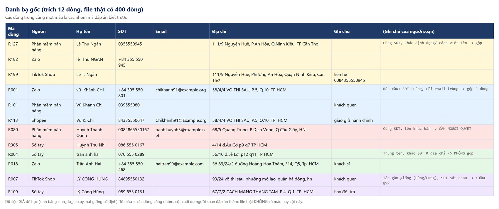
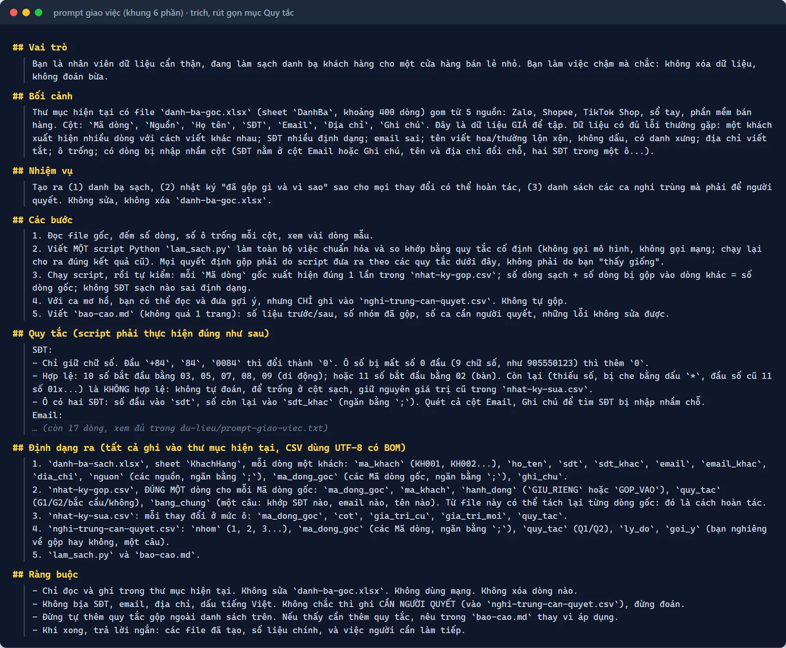

# Bài 1. Chuẩn bị dữ liệu và giao việc cho agent

> Dữ liệu trong bài là **GIẢ để học**. Nhãn: **[Đo được]** = kết quả của chúng tôi ngày 2026-11-20; **[Nguồn]** = có link; **[Đề xuất]** = ý kiến người soạn.
> Quay lại [00-README.md](00-README.md) để xem bức tranh chung.

## 1. Mục tiêu của bài

Sau bài này bạn làm được bốn việc, và mỗi việc kiểm được bằng mắt hoặc bằng lệnh:

1. Có một **bản sao** danh bạ trong thư mục riêng, file gốc không bị động tới (kiểm: so ngày giờ sửa file gốc).
2. Liệt kê được **các loại lỗi** trong danh bạ của bạn và đếm được mỗi loại (kiểm: có bảng đếm giống bảng ở README).
3. Viết được **bộ quy tắc gộp** bằng tiếng Việt, đủ rõ để hai người khác nhau áp dụng ra cùng kết quả (kiểm: cho một đồng nghiệp áp dụng thử lên 10 dòng và so).
4. Giao việc được cho `claude` hoặc `agy` bằng một prompt 6 phần và chạy được nó (kiểm: thư mục có `lam_sach.py`, `danh-ba-sach.xlsx` và ba file nhật ký).

Chưa cần biết lập trình. Bạn cần biết mở một cửa sổ dòng lệnh trong một thư mục và dán văn bản vào đó.

## 2. Bước 0 trước mọi thứ: làm trên bản sao, và nghĩ về dữ liệu cá nhân

**Làm trên bản sao.** Agent chạy trên máy bạn và có quyền ghi file trong thư mục nó làm việc. Nếu bạn đưa thẳng file danh bạ đang dùng, một đoạn mã sai có thể ghi đè nó. Cách làm an toàn:

1. Tạo thư mục mới, ví dụ `lam-sach-danh-ba`.
2. Chép **một bản** file danh bạ vào đó. File gốc ở chỗ cũ, bạn không mở nó khi agent đang chạy.
3. Chỉ chạy agent ở thư mục mới này.

Trong bài, prompt cũng dặn agent "chỉ đọc và ghi trong thư mục hiện tại, không sửa `danh-ba-goc.xlsx`". Lời dặn không phải là rào chắn: agent mà chúng tôi chạy có toàn quyền trên máy (xem mục 7), nên bản sao mới là rào chắn thật.

**Dữ liệu cá nhân.** Danh bạ thật chứa họ tên, SĐT, email, địa chỉ: đó là dữ liệu cá nhân. Khi dùng agent đám mây (Claude Code, Antigravity), nội dung file mà agent đọc sẽ được gửi tới mô hình chạy ở máy chủ của nhà cung cấp. Nguyên tắc (chi tiết và nguồn xem [an-toan-du-lieu-va-phap-ly-vn.md](../an-toan-du-lieu-va-phap-ly-vn.md), tài liệu đó nói rõ không phải tư vấn pháp lý):

- Với dữ liệu thật, hỏi người phụ trách pháp lý hoặc luật sư trước khi gửi ra ngoài; chúng tôi không tự viết điều luật nào ở đây.
- Ưu tiên **giả danh**: thay tên, SĐT, email bằng mã (`KH_001`...) trước khi đưa agent, giữ bảng tra ngược ở máy bạn **[Đề xuất]**.
- Hoặc để agent chỉ thấy **một mẫu nhỏ đã giả danh** để viết script, rồi bạn chạy script trên dữ liệu thật ngay trên máy bạn (script này không gọi mạng) **[Đề xuất]**.

Bài này dùng dữ liệu giả nên bỏ qua được các lo ngại đó, nhưng hãy tập thói quen ngay từ đầu.

## 3. Nhìn dữ liệu trước khi nhờ agent

Mở `du-lieu/danh-ba-goc.xlsx` bằng Excel. Dành 10 phút xem, bạn sẽ thấy hầu hết các loại lỗi ở bảng dưới. Đây là bảng đếm cho bộ dữ liệu giả của chúng tôi (đếm từ bộ sinh, **[Đo được]**). Với danh bạ thật của bạn, hãy tự lập bảng tương tự bằng bộ lọc (Filter) của Excel.

| Loại lỗi | Ví dụ trong file | Số lượng |
|---|---|---|
| Một khách, nhiều dòng | `Lê Thu Ngân` / `lê  Thu NGÂN` / `Lê T. Ngân` | 52 nhóm |
| SĐT nhiều định dạng | `+84 355 550 945`, `0084865550167`, `0705.550.292`, `795550811` (mất số 0) | hơn 220 ô |
| SĐT không dùng được | `0885 *** 291`, `081555039`, `01295550449` | 13 |
| Email sai | `ly.van@@example.com`, `hoang.do@example`, `x@example.con` | 31 |
| Danh xưng trong tên | `Cô Nguyễn Hoài Giang`, `a Tran Minh Hung` | 30 |
| Tên viết hoa/thường, không dấu | `LÝ CÔNG HƯNG`, `tran anh hai` | rất nhiều |
| Nhập nhầm cột | SĐT ở cột Email, tên và địa chỉ đổi chỗ, hai SĐT một ô | 21 |
| Ô trống | SĐT 24, Email 217, Địa chỉ 122 | |


*Ảnh dựng từ `danh-ba-goc.xlsx` bằng HTML (HTML sang PNG), dữ liệu giả. Cột ghi chú bên phải là của người soạn đáp án, file thật không có.*

Có ba điều nên ghi lại khi nhìn:

- **Những cặp dòng nhìn giống nhau mà thật ra khác.** Ví dụ `tran anh hai` (SĐT 070..., Sổ tay) và `Trần Anh Hai` (SĐT 035..., Zalo) cùng tên, khác SĐT, khác địa chỉ: hai người khác nhau. Hoặc `Lý Công Hưng` và `Lý Công Hùng` (SĐT sát nhau): hai người khác nhau dù tên gần giống.
- **Những cặp nhìn khác nhau mà thật ra là một.** `Vũ Khánh Chi` và `Vũ K. Chi` nối với nhau qua email, dù SĐT khác.
- **Những cặp không đủ thông tin để biết.** Cùng SĐT nhưng một dòng tên `Huỳnh Thanh Oanh`, một dòng tên `Huỳnh Thu Nhi`: có thể hai chị em dùng chung số. Đây là chỗ máy không được tự quyết.



*Dòng cùng màu là cùng nhóm theo đáp án. Dựng từ file dữ liệu giả; file thật không có màu.*

## 4. Chia việc: cái gì để code làm, cái gì để người, cái gì cho mô hình

Đây là quyết định quan trọng nhất của cả chuỗi bài.

| Việc | Ai làm | Vì sao |
|---|---|---|
| Chuẩn hóa SĐT (bỏ dấu cách, `+84` thành `0`), chuẩn hóa email, chuẩn hóa Unicode tên | **Code** | Có quy tắc rõ, phải ra cùng kết quả mỗi lần chạy |
| So khớp "cùng SĐT + tên tương thích" để gộp | **Code** | Quyết định gộp phải truy ra được lý do và chạy lại được |
| Ghi nhật ký mọi thay đổi, đảm bảo hoàn tác | **Code** | Máy không "quên" ghi |
| Ca mơ hồ (cùng SĐT khác tên; cùng tên và địa chỉ khác SĐT) | **Người quyết**; mô hình chỉ nêu lý do và gợi ý | Sai ở đây là gộp nhầm hai khách thật, khó sửa |
| Viết `lam_sach.py` theo quy tắc, tự kiểm | **Agent** (mô hình viết code) | Việc viết code lặp lại là thế mạnh của agent |
| Đoán dấu cho tên không dấu, đoán SĐT bị che | **Không ai** (ghi "không sửa được") | Đoán là bịa dữ liệu |

Câu thần chú: **mô hình viết quy tắc thành code, code mới là thứ chạy trên dữ liệu.** Nếu bạn để mô hình "tự thấy" hai dòng giống nhau rồi gộp, lần chạy sau có thể ra khác, và bạn không giải thích được với chủ cửa hàng vì sao khách A bị gộp với khách B.

## 5. Viết quy tắc trước khi giao việc

Prompt của chúng tôi ghi quy tắc ra từng dòng. Đọc kỹ vì đây là phần quyết định chất lượng.

**SĐT.** Chỉ giữ chữ số; đầu `+84`, `84`, `0084` đổi thành `0`; ô số bị Excel làm mất số 0 đầu (9 chữ số) thì thêm `0`. Hợp lệ khi có 10 chữ số bắt đầu 03/05/07/08/09 (di động) hoặc 11 chữ số bắt đầu 02 (điện thoại bàn). Còn lại là "không hợp lệ", để trống ở bản sạch và giữ giá trị cũ trong nhật ký sửa. Cơ sở: SĐT di động Việt Nam có 10 chữ số, `0` là tiền tố quốc nội, `84` là mã quốc gia, các đầu số hiện hành 03x, 05x, 07x, 08x, 09x **[Nguồn: Wikipedia, "Telephone numbers in Vietnam", CC BY-SA 4.0, https://en.wikipedia.org/wiki/Telephone_numbers_in_Vietnam]**. Số 11 chữ số cũ (01x) không tự đổi vì trang đó không có bảng đổi đầu số; muốn đổi cần bảng của cơ quan quản lý hoặc nhà mạng.

**Email.** Chỉ sửa những thứ chắc chắn: cắt dấu cách hai đầu, đổi chữ thường, dấu phẩy trong tên miền thành dấu chấm. Thiếu `@`, hai `@`, đuôi lạ như `.con`: **không tự sửa** (`.con` có thể là gõ nhầm `.com` nhưng cũng có thể là gì khác; đoán là bịa).

**Họ tên.** Chuẩn Unicode NFC, Viết Hoa Chữ Đầu, bỏ danh xưng đầu tên và ghi vào cột ghi chú, không đoán dấu cho tên không dấu.

**Địa chỉ.** Mở viết tắt (P., Q., TP.; HCM, HN, ĐN...), không đoán dấu.

**Tên tương thích** (để quyết định gộp): bỏ danh xưng, bỏ dấu, bỏ hoa/thường rồi giống hệt; hoặc chỉ khác ở chữ đệm viết tắt bằng chữ cái đầu (`Nguyễn V. An` và `Nguyễn Văn An`). Tên một từ như `Lan` không coi là tương thích với tên đầy đủ. `Hùng` và `Hưng` là khác nhau.

**Ba kết cục khi so hai dòng:**

- **GỘP:** SĐT trùng và tên tương thích (G1); hoặc email trùng và tên tương thích (G2); gộp bắc cầu (A-B và B-C thì A, B, C một khách).
- **CẦN NGƯỜI QUYẾT:** SĐT trùng mà tên không tương thích (Q1); tên giống và địa chỉ giống nhưng SĐT/email khác hoặc thiếu (Q2).
- **KHÔNG GỘP, không báo:** chỉ trùng tên mà SĐT và địa chỉ đều khác.

Mẹo viết quy tắc: với mỗi quy tắc, tự tìm một ví dụ trong file khớp quy tắc, và một ví dụ **gần khớp mà không khớp**. Ví dụ gần khớp là chỗ agent hay làm sai.

## 6. Prompt 6 phần

Khung 6 phần: **Vai trò, Bối cảnh, Nhiệm vụ, Các bước, Định dạng ra, Ràng buộc**. Chúng tôi chèn thêm mục **Quy tắc** vì bài này cần. Toàn văn nằm ở `du-lieu/prompt-giao-viec.txt`. Ảnh dưới là trích.



*Dựng từ `du-lieu/prompt-giao-viec.txt` bằng HTML; mục Quy tắc được rút gọn trong ảnh, file thật đầy đủ. Đây là bản đã dùng cho cả hai agent, không sửa sau khi thấy kết quả.*

Vài điểm đáng học:

- **Vai trò** ngắn, nhấn tính cách ("chậm mà chắc, không xóa dữ liệu, không đoán bừa").
- **Bối cảnh** cho biết file nào, cột nào, lỗi gì, và nói rõ đây là dữ liệu giả.
- **Các bước** ép thứ tự: đọc, viết script, chạy, tự kiểm, báo cáo. Bước 2 ghi: "mọi quyết định gộp phải do script đưa ra theo các quy tắc dưới đây, không phải do bạn thấy giống".
- **Định dạng ra** đặt tên file và tên cột chính xác, để sau này chấm bằng code được.
- **Ràng buộc** có câu then chốt: "Không chắc thì ghi CẦN NGƯỜI QUYẾT, đừng đoán" và "Đừng tự thêm quy tắc gộp ngoài danh sách; nếu thấy cần, nêu trong `bao-cao.md`".

Định dạng ra có ba file nhật ký, mỗi file một việc:

| File | Mỗi dòng là | Dùng để |
|---|---|---|
| `nhat-ky-gop.csv` | một dòng gốc → khách nào, vì sao | **Hoàn tác**: biết khách `KH001` gồm những dòng gốc nào |
| `nhat-ky-sua.csv` | một thay đổi ở một ô (giá trị cũ, giá trị mới, quy tắc) | Kiểm lại từng sửa, khôi phục giá trị cũ |
| `nghi-trung-can-quyet.csv` | một nhóm nghi trùng | Việc của người duyệt |

## 7. Thao tác chạy

### 7.1 Cách đơn giản (nên dùng khi bạn mới bắt đầu)

1. Mở thư mục `lam-sach-danh-ba` trong File Explorer, bấm vào thanh địa chỉ, gõ `powershell` rồi Enter: cửa sổ dòng lệnh mở ngay tại thư mục đó.
2. Gõ `claude` rồi Enter (hoặc `agy`). Agent mở ra ở chế độ hội thoại.
3. Dán toàn văn `prompt-giao-viec.txt` rồi Enter. Trong chế độ hội thoại, agent sẽ hỏi quyền khi muốn ghi file hoặc chạy lệnh; bạn đọc và chọn cho phép.

Chúng tôi **không** thử chế độ hội thoại trong bài này (chúng tôi chạy chế độ không tương tác, mục 7.2); mô tả trên là cách dùng thông thường của hai công cụ, **[Đề xuất]** bạn tự thử trên dữ liệu giả trước.

### 7.2 Cách chúng tôi chạy (để lấy log thật)

Chúng tôi dùng một script nhỏ (`agent_run.py`) gọi agent ở chế độ không tương tác, ghi lại log gốc từng sự kiện. Lệnh thực chất mà nó chạy:

```
claude -p "<prompt>" --output-format stream-json --verbose --permission-mode acceptEdits --allowedTools "Read,Write,Edit,Glob,Grep,Bash"
agy -p "<prompt>" --output-format stream-json --dangerously-skip-permissions
```

Giải thích: `-p` chạy một lượt từ prompt rồi thoát (không hội thoại); `--output-format stream-json` in từng sự kiện thành một dòng JSON để ghi log; `--permission-mode acceptEdits` và `--allowedTools` cho `claude` tự sửa file và chạy các công cụ liệt kê, không hỏi; `--dangerously-skip-permissions` bỏ qua mọi câu hỏi quyền của `agy`. **Hai cờ cuối nghĩa là agent làm tùy ý trên máy**: chỉ dùng trong thư mục sao riêng, với dữ liệu giả, như bài này. Mỗi lần chạy dùng một thư mục riêng chứa đúng một file `danh-ba-goc.xlsx`; **đáp án nằm ở thư mục khác**, agent không thấy.

Kết quả lần chạy thật xem ở bài 2.

## 8. Lỗi thường gặp ở bước chuẩn bị

1. **Excel làm mất số 0 đầu SĐT.** Ô định dạng Số hiển thị `795550811` thay vì `0795550811`. Cách phòng: đặt cột SĐT là Văn bản (Text) khi nhập; khi làm sạch, quy tắc "9 chữ số thì thêm 0" xử lý được phần đã mất (chúng tôi cài 17 ô như vậy).
2. **Mở CSV bằng Excel bị vỡ dấu tiếng Việt.** Vì file không có BOM. Prompt yêu cầu CSV "UTF-8 có BOM" để Excel đọc đúng.
3. **Đưa luôn file đang dùng cho agent.** Xem mục 2: luôn bản sao.
4. **Prompt không ghi quy tắc, chỉ nói "làm sạch giúp tôi".** Agent sẽ tự chọn quy tắc, và mỗi lần chọn một kiểu. Chúng tôi chưa đo mức độ tệ hại ở bài này, nhưng đó là lý do bài dành cả mục 5 cho quy tắc.
5. **Không có đáp án để kiểm.** Với dữ liệu thật bạn không có đáp án; hãy tự chọn tay 20-30 dòng, ghi đúng kết quả mong muốn, rồi dùng làm "bộ thử" (bài 3 nói thêm).
6. **Cho agent quyền tự gộp ca mơ hồ "cho nhanh".** Sai ở đây là mất khách hoặc gửi nhầm người; để người quyết.

## 9. Checklist cuối bài

- [ ] Có thư mục riêng, chỉ chứa bản sao danh bạ; file gốc nằm chỗ khác.
- [ ] Đã xem 20-50 dòng và lập bảng đếm lỗi.
- [ ] Quy tắc gộp viết thành ba kết cục: GỘP / CẦN NGƯỜI QUYẾT / KHÔNG GỘP, mỗi cái có ví dụ khớp và ví dụ gần khớp.
- [ ] Prompt có đủ 6 phần, có tên file và tên cột đầu ra, có câu "không chắc thì ghi CẦN NGƯỜI QUYẾT".
- [ ] Đã quyết dữ liệu có phải dữ liệu thật không; nếu thật thì đã hỏi người phụ trách và đã giả danh hoặc dùng mẫu.
- [ ] Đã lưu nguyên văn prompt (để chạy lại và để không "sửa cho đẹp" sau khi thấy kết quả).

## 10. Việc cần người làm

- Quyết định quy tắc gộp phù hợp cửa hàng bạn: ví dụ có coi "cùng tên + cùng địa chỉ" là đủ để gộp không. Máy không quyết hộ.
- Quyết định dữ liệu nào được đưa ra ngoài máy, và hỏi người có thẩm quyền về điều đó.
- Chọn 20-30 dòng làm bộ thử với đáp án tay.

## 11. Giới hạn

- Bài này dùng dữ liệu **giả** do chúng tôi sinh. Dữ liệu thật có kiểu lỗi chúng tôi không nghĩ tới (ví dụ tên có dấu gạch, tên nước ngoài, số điện thoại quốc tế, hai người cùng tên cùng nhà).
- Quy tắc SĐT chỉ theo mô tả ở trang Wikipedia nêu trên; đầu số có thể thay đổi theo thời gian. **[Đề xuất]** đối chiếu với nhà mạng hoặc cơ quan quản lý khi dùng thật.
- Chúng tôi chưa thử chạy với dữ liệu quá lớn (hàng chục nghìn dòng) hay nhiều bảng.
- Không có điều khoản pháp lý nào được viết ở đây; mọi điểm pháp lý cần kiểm với luật sư và với tài liệu `an-toan-du-lieu-va-phap-ly-vn.md`.

Bài tiếp theo: [cap-01-chay-that-va-kiem-tra.md](cap-01-chay-that-va-kiem-tra.md).
