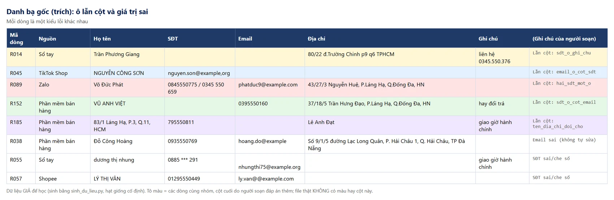

# Bài 1. Chuẩn bị danh bạ và giao việc cho agent

!!! info "Bài này"
    - **Bạn làm gì:** tải danh bạ mẫu, tập làm bản giả danh (ẩn danh), mở agent trong một thư mục riêng, dán prompt giao việc làm sạch danh bạ.
    - **Mất bao lâu:** khoảng 30 phút chuẩn bị. Agent chạy thêm vài phút đến vài chục phút **[Đo được]** (lần chạy có log của chúng tôi: Claude Code 513,6 giây, Antigravity 1.031,3 giây).
    - **Cần có:** máy đã cài một coding agent (xem [Bắt đầu với coding agent](../th-bat-dau-voi-coding-agent/00-README.md)), Python 3 với thư viện `openpyxl` (cho bước giả danh; thiếu thì gõ `pip install openpyxl`), Excel để xem file. Cách sắp xếp thư mục: xem mục "Sắp xếp thư mục" ở [trang tổng quan nhóm bài](00-README.md).
    - **Kết quả:** một thư mục có danh bạ sạch (mỗi khách một dòng), nhật ký "đã gộp gì và vì sao", danh sách ca nghi trùng để người quyết. Cách kiểm đúng sai ở bài 2.

> Dữ liệu trong bài là **dữ liệu giả để học**: tên, số điện thoại, email, địa chỉ đều bịa, sinh bằng script có hạt giống cố định. Không có khách hàng thật nào.

## Bài toán trong một phút

Một cửa hàng nhỏ bán qua Zalo, Shopee, TikTok Shop, ghi sổ tay, và có thêm một phần mềm bán hàng. Cuối quý chủ cửa hàng gom hết vào một file Excel khoảng 400 dòng để gửi tin khuyến mãi, rồi thấy ngay:

- Một người xuất hiện 2-3 lần: `Vũ Khánh Chi`, `vũ  Khánh CHI`, `Vũ K. Chi`. SĐT viết `0395550801`, `+84 395 550 801`, `84335550647`.
- Email gõ sai: `ly.van@@example.com`, `hoang.do@example`, `mythanh91@example.con`.
- Tên in hoa lộn xộn, không dấu, có "Chị", "Anh" ở đầu. Địa chỉ viết tắt đủ kiểu: `P.5, Q.10, TP HCM`, `p5 q10 tphcm`.
- Ô trống, và có dòng nhập nhầm cột (SĐT nằm ở cột Email, tên và địa chỉ đổi chỗ).

Làm tay thì mất cả buổi và dễ gộp nhầm hai khách thật. Một coding agent (chương trình AI tự đọc file, viết và chạy code) có thể **viết một script Python** làm phần máy móc. Ca không chắc, agent phải **đưa cho người quyết**, không tự gộp.

!!! warning "Quy tắc xuyên suốt, và lưu ý về dữ liệu cá nhân"
    **Quy tắc gộp do code làm, không để mô hình "thấy giống thì gộp".** Code chạy lại ra đúng kết quả cũ và giải thích được vì sao khách A gộp với khách B.
    **Danh bạ thật là dữ liệu cá nhân.** Agent đám mây gửi nội dung file nó đọc tới máy chủ của nhà cung cấp. Bước 3 dưới đây nói cách giả danh trước khi đưa cho agent.

## Các bước làm

### Bước 1. Tải và giải nén dữ liệu mẫu

Tải [du-lieu.zip](du-lieu.zip), bấm chuột phải chọn **Extract All** (Windows) hoặc bấm đúp (macOS). Bạn có thư mục `du-lieu/` gồm:

| File | Nội dung |
|---|---|
| `danh-ba-goc.xlsx` (và `.csv`) | 400 dòng, 7 cột: Mã dòng, Nguồn, Họ tên, SĐT, Email, Địa chỉ, Ghi chú |
| `prompt-giao-viec.txt` | Prompt ở Bước 6, dạng file |
| `quy-tac.txt` | Riêng phần quy tắc gộp của prompt (dùng ở bài 4) |
| `sinh_du_lieu.py` | Script sinh lại bộ dữ liệu, hạt giống 20261120 |
| `an_danh.py` | Script giả danh ở Bước 3 |

Các file khác trong `du-lieu/` (`dot-moi-20261217`, `bai-tap-email`, `them_ca_email.py`) dùng cho bài tập ở bài 4.

### Bước 2. Mở xem dữ liệu

Bấm đúp `danh-ba-goc.xlsx` để mở bằng Excel. Dành 10 phút lướt 50 dòng đầu. Với file CSV, **đừng bấm đúp** nếu Excel hiện tiếng Việt vỡ chữ: dùng *Data > From Text/CSV* và chọn UTF-8.



*Ảnh dựng từ `danh-ba-goc.xlsx` bằng HTML (HTML sang PNG), dữ liệu giả. Cột ghi chú bên phải là của người soạn đáp án, file thật không có.*

Ghi lại ba kiểu cặp dòng khi nhìn:

- **Giống mà thật ra khác:** `tran anh hai` (SĐT 070..., Sổ tay) và `Trần Anh Hai` (SĐT 035..., Zalo) cùng tên, khác SĐT, khác địa chỉ. `Lý Công Hưng` và `Lý Công Hùng` khác người dù tên gần giống.
- **Khác mà thật ra là một:** `Vũ Khánh Chi` và `Vũ K. Chi` nối với nhau qua email.
- **Không đủ thông tin để biết:** cùng SĐT nhưng tên `Huỳnh Thanh Oanh` và `Huỳnh Thu Nhi`: có thể hai chị em dùng chung số. Đây là chỗ máy không được tự quyết.


*Dòng cùng màu là cùng nhóm theo đáp án. Dựng từ file dữ liệu giả; file thật không có màu.*

!!! see "Bạn sẽ thấy"
    400 dòng, 5 nguồn (Zalo 95, Phần mềm bán hàng 94, Shopee 85, Sổ tay 66, TikTok Shop 60). Ô trống: SĐT 24, Email 217, Địa chỉ 122. Ghi nhớ ba số này, bài 2 dùng để đối chiếu.

### Bước 3. Tập thói quen: làm bản giả danh trước khi đưa cho agent

Với danh bạ **thật**, bước này không bỏ qua được. Rủi ro cần nghĩ tới trước:

- Nội dung file mà agent đọc được gửi tới máy chủ của nhà cung cấp để mô hình xử lý. Dữ liệu cá nhân của khách đi ra khỏi máy bạn.
- Chúng tôi chưa kiểm điều khoản lưu trữ hay huấn luyện của từng gói dịch vụ. Hãy đọc điều khoản của gói bạn đang dùng.
- Việc có được gửi dữ liệu ra ngoài hay không là câu hỏi cho người phụ trách pháp lý hoặc luật sư. Bài này không viết điều luật nào. Nguyên tắc và nguồn: [An toàn dữ liệu và pháp lý khi dùng AI](../an-toan-du-lieu-va-phap-ly-vn.md).

Hai cách an toàn hơn **[Đề xuất]**: (a) giả danh cả file (thay tên, SĐT, email, địa chỉ bằng giá trị bịa, giữ bảng tra ngược ở máy bạn) rồi mới đưa agent; (b) chỉ cho agent thấy **một mẫu nhỏ đã giả danh** để viết `lam_sach.py`, rồi bạn chạy script trên dữ liệu thật ngay trên máy mình (script không gọi mạng).

Thử với dữ liệu giả của bài. Chạy trong thư mục chứa `du-lieu/`:

```lenh
python -X utf8 du-lieu\an_danh.py du-lieu\danh-ba-goc.xlsx an-danh
```

macOS hoặc Linux: `python3 du-lieu/an_danh.py du-lieu/danh-ba-goc.xlsx an-danh`. Lệnh đọc file gốc, ghi bản giả danh và bảng tra ngược vào thư mục `an-danh`.

```ketqua
Đã ghi an-danh\danh-ba-goc.xlsx (400 dòng) và an-danh\bang-tra-nguoc.csv (761 cặp)
CHỈ đưa danh-ba-goc.xlsx cho agent. bang-tra-nguoc.csv ở lại máy bạn.
```

!!! see "Bạn sẽ thấy"
    Cùng 400 dòng, cùng Mã dòng, nhưng chữ đã đổi. Ví dụ R001 từ `vũ  Khánh CHI` / `+84 395 550 801` / `chikhanh91@example.org` thành `vcaba  Kdaba CFABA` / `+84 301 007 922` / `ucaba1@example.org`. R113 (`Vũ K. Chi`) thành `Vcaba K. Cfaba`: cùng người vẫn ra cùng từ giả, chữ viết tắt `K.` vẫn khớp chữ cái đầu. Cách chấm bản giả danh có đạt hay không: bài 4, bài tập 3.

!!! warning "Giả danh chưa phải là an toàn tuyệt đối"
    Cột Ghi chú chỉ được đổi SĐT và email, chữ còn lại giữ nguyên. Địa chỉ còn tên thành phố và vài từ trùng. Ghi chú thật có thể chứa thông tin riêng. **Mở bản giả danh ra đọc** trước khi đưa cho agent. Bảng `bang-tra-nguoc.csv` ở máy bạn, không đưa lên đâu cả.

### Bước 4. Tạo thư mục riêng cho agent

Mỗi lần chạy dùng **một thư mục riêng**, chỉ chép đúng một file dữ liệu vào. Đây là hàng rào đơn giản nhất để agent không động vào bản gốc.

Windows (PowerShell), chạy trong thư mục chứa `du-lieu/`:

```lenh
mkdir lan-chay-1
copy du-lieu\danh-ba-goc.xlsx lan-chay-1\
```

macOS hoặc Linux:

```lenh
mkdir lan-chay-1
cp du-lieu/danh-ba-goc.xlsx lan-chay-1/
```

`mkdir` tạo thư mục, `copy` hoặc `cp` chép file. Với danh bạ thật, chép **bản giả danh** (hoặc một bản sao) vào đây, không chép file đang dùng.

!!! warning "Đừng để file đáp án trong thư mục này"
    Ở bài 2 bạn dùng file đáp án để chấm. File đó **không bao giờ** nằm trong `lan-chay-1`. Agent liệt kê và mở được file trong thư mục của nó. **[Đo được]** Ở bài toán báo giá của chuỗi này, một lần Antigravity đã đi mở file đáp án nằm ngoài thư mục làm việc.

### Bước 5. Mở agent trong thư mục vừa tạo

Mở Terminal hoặc PowerShell **đúng thư mục `lan-chay-1`**, rồi gõ một trong hai lệnh:

```lenh
cd lan-chay-1
claude
```

hoặc, nếu dùng Antigravity:

```lenh
cd lan-chay-1
agy
```

`cd` là đi vào thư mục. `claude` hoặc `agy` mở agent tại thư mục đó. Chưa cài? Xem [Bắt đầu với coding agent](../th-bat-dau-voi-coding-agent/00-README.md).

!!! see "Bạn sẽ thấy"
    Một khung chat trong cửa sổ dòng lệnh, chờ bạn gõ. Nếu agent hỏi bạn có tin tưởng thư mục này không, chỉ đồng ý khi đúng là `lan-chay-1`. Mở nhầm thư mục thì thoát agent (cách thoát: xem [Bắt đầu với coding agent](../th-bat-dau-voi-coding-agent/00-README.md)) rồi `cd` lại.

### Bước 6. Dán prompt giao việc

Bấm **Sao chép**, dán vào khung chat của agent, nhấn Enter. Prompt có 6 phần (vai trò, bối cảnh, nhiệm vụ, các bước, định dạng ra, ràng buộc) cộng một mục **Quy tắc** vì bài này cần. **Đừng sửa** nếu bạn muốn đối chiếu kết quả với bài 2.

```prompt
# Vai trò
Bạn là nhân viên dữ liệu cẩn thận, đang làm sạch danh bạ khách hàng cho một cửa hàng bán lẻ nhỏ. Bạn làm việc chậm mà chắc: không xóa dữ liệu, không đoán bừa.

# Bối cảnh
Thư mục hiện tại có file `danh-ba-goc.xlsx` (sheet `DanhBa`, khoảng 400 dòng) gom từ 5 nguồn: Zalo, Shopee, TikTok Shop, sổ tay, phần mềm bán hàng. Cột: `Mã dòng`, `Nguồn`, `Họ tên`, `SĐT`, `Email`, `Địa chỉ`, `Ghi chú`. Đây là dữ liệu GIẢ để tập. Dữ liệu có đủ lỗi thường gặp: một khách xuất hiện nhiều dòng với cách viết khác nhau; SĐT nhiều định dạng; email sai; tên viết hoa/thường lộn xộn, không dấu, có danh xưng; địa chỉ viết tắt; ô trống; có dòng bị nhập nhầm cột (SĐT nằm ở cột Email hoặc Ghi chú, tên và địa chỉ đổi chỗ, hai SĐT trong một ô...).

# Nhiệm vụ
Tạo ra (1) danh bạ sạch, (2) nhật ký "đã gộp gì và vì sao" sao cho mọi thay đổi có thể hoàn tác, (3) danh sách các ca nghi trùng mà phải để người quyết. Không sửa, không xóa `danh-ba-goc.xlsx`.

# Các bước
1. Đọc file gốc, đếm số dòng, số ô trống mỗi cột, xem vài dòng mẫu.
2. Viết MỘT script Python `lam_sach.py` làm toàn bộ việc chuẩn hóa và so khớp bằng quy tắc cố định (không gọi mô hình, không gọi mạng; chạy lại cho ra đúng kết quả cũ). Mọi quyết định gộp phải do script đưa ra theo các quy tắc dưới đây, không phải do bạn "thấy giống".
3. Chạy script, rồi tự kiểm: mỗi `Mã dòng` gốc xuất hiện đúng 1 lần trong `nhat-ky-gop.csv`; số dòng sạch + số dòng bị gộp vào dòng khác = số dòng gốc; không SĐT sạch nào sai định dạng.
4. Với ca mơ hồ, bạn có thể đọc và đưa gợi ý, nhưng CHỈ ghi vào `nghi-trung-can-quyet.csv`. Không tự gộp.
5. Viết `bao-cao.md` (không quá 1 trang): số liệu trước/sau, số nhóm đã gộp, số ca cần người quyết, những lỗi không sửa được.

# Quy tắc (script phải thực hiện đúng như sau)
SĐT:
- Chỉ giữ chữ số. Đầu `+84`, `84`, `0084` thì đổi thành `0`. Ô số bị mất số 0 đầu (9 chữ số, như 905550123) thì thêm `0`.
- Hợp lệ: 10 số bắt đầu bằng 03, 05, 07, 08, 09 (di động); hoặc 11 số bắt đầu bằng 02 (bàn). Còn lại (thiếu số, bị che bằng dấu `*`, đầu số cũ 11 số 01x...) là KHÔNG hợp lệ: không tự đoán, để trống ở cột sạch, giữ nguyên giá trị cũ trong `nhat-ky-sua.csv`.
- Ô có hai SĐT: số đầu vào `sdt`, số còn lại vào `sdt_khac` (ngăn bằng `;`). Quét cả cột Email, Ghi chú để tìm SĐT bị nhập nhầm chỗ.
Email:
- Cắt khoảng trắng hai đầu, đổi sang chữ thường; dấu phẩy trong tên miền (`example,com`) đổi thành dấu chấm. Quét cả cột SĐT, Ghi chú để tìm email nhập nhầm chỗ.
- Còn sai cú pháp (thiếu `@`, thiếu đuôi tên miền, có hai `@`, có khoảng trắng giữa, đuôi lạ như `.con`...) thì KHÔNG tự sửa: để trống `email` sạch, giữ giá trị cũ trong `nhat-ky-sua.csv`.
Họ tên:
- Chuẩn Unicode NFC (nhiều tên Zalo ở dạng NFD), bỏ khoảng trắng thừa, Viết Hoa Chữ Đầu Mỗi Từ. Bỏ danh xưng ở đầu (anh, chị, cô, chú, bác; a, c viết tắt; cả dạng không dấu) và ghi danh xưng vào `ghi_chu`. Không đoán dấu cho tên không dấu.
- Nếu tên và địa chỉ bị đổi chỗ thì đổi lại.
Địa chỉ:
- Mở viết tắt về dạng `<số nhà> <đường>, Phường X, Quận Y, <thành phố>`: P./p/F → Phường, Q./q → Quận, TP./Tp. → Thành phố; HCM/TPHCM → Thành phố Hồ Chí Minh, HN → Hà Nội, ĐN → Đà Nẵng, CT → Cần Thơ, HP → Hải Phòng. Bỏ chữ "Số", "đường", "đ." trước tên đường. Viết Hoa Chữ Đầu Mỗi Từ. Không đoán dấu cho địa chỉ không dấu.
Tên tương thích (dùng để quyết định gộp): sau khi bỏ danh xưng, bỏ dấu, bỏ hoa/thường, hai tên giống hệt; hoặc chỉ khác nhau ở chữ đệm viết tắt bằng chữ cái đầu (`Nguyễn V. An` và `Nguyễn Văn An`). Tên chỉ có một từ (như `Lan`) KHÔNG coi là tương thích với tên đầy đủ. Hai tên khác chữ (`Hùng` và `Hưng`) là khác nhau, kể cả khi gần giống.
Gộp tự động (GỘP):
- G1: SĐT hợp lệ (sau chuẩn hóa) trùng nhau VÀ tên tương thích.
- G2: email hợp lệ trùng nhau VÀ tên tương thích.
- Gộp bắc cầu: A-B đủ điều kiện và B-C đủ điều kiện thì A, B, C là một khách.
Không gộp, chuyển người quyết (CẦN NGƯỜI QUYẾT):
- Q1: SĐT trùng nhưng tên không tương thích (khác hẳn, hoặc một bên chỉ có tên một từ).
- Q2: tên giống nhau (sau khi bỏ dấu, hoa/thường, danh xưng) VÀ địa chỉ giống nhau (sau khi mở viết tắt), nhưng SĐT/email khác nhau hoặc một bên thiếu.
Không gộp, không cần báo: chỉ trùng tên mà SĐT và địa chỉ đều khác.
Khi gộp: giữ cả giá trị khác nhau; giá trị tốt nhất (tên có dấu đầy đủ, không viết tắt) vào cột chính, giá trị còn lại vào cột `*_khac`. Không làm mất thông tin nào.

# Định dạng ra (tất cả ghi vào thư mục hiện tại, CSV dùng UTF-8 có BOM)
1. `danh-ba-sach.xlsx`, sheet `KhachHang`, mỗi dòng một khách: `ma_khach` (KH001, KH002...), `ho_ten`, `sdt`, `sdt_khac`, `email`, `email_khac`, `dia_chi`, `nguon` (các nguồn, ngăn bằng `;`), `ma_dong_goc` (các Mã dòng gốc, ngăn bằng `;`), `ghi_chu`.
2. `nhat-ky-gop.csv`, ĐÚNG MỘT dòng cho mỗi Mã dòng gốc: `ma_dong_goc`, `ma_khach`, `hanh_dong` (`GIU_RIENG` hoặc `GOP_VAO`), `quy_tac` (G1/G2/bắc cầu/không), `bang_chung` (một câu: khớp SĐT nào, email nào, tên nào). Từ file này có thể tách lại từng dòng gốc: đó là cách hoàn tác.
3. `nhat-ky-sua.csv`: mỗi thay đổi ở mức ô: `ma_dong_goc`, `cot`, `gia_tri_cu`, `gia_tri_moi`, `quy_tac`.
4. `nghi-trung-can-quyet.csv`: `nhom` (1, 2, 3...), `ma_dong_goc` (các Mã dòng, ngăn bằng `;`), `quy_tac` (Q1/Q2), `ly_do`, `goi_y` (bạn nghiêng về gộp hay không, một câu).
5. `lam_sach.py` và `bao-cao.md`.

# Ràng buộc
- Chỉ đọc và ghi trong thư mục hiện tại. Không sửa `danh-ba-goc.xlsx`. Không dùng mạng. Không xóa dòng nào.
- Không bịa SĐT, email, địa chỉ, dấu tiếng Việt. Không chắc thì ghi CẦN NGƯỜI QUYẾT (vào `nghi-trung-can-quyet.csv`), đừng đoán.
- Đừng tự thêm quy tắc gộp ngoài danh sách trên. Nếu thấy cần thêm quy tắc, nêu trong `bao-cao.md` thay vì áp dụng.
- Khi xong, trả lời ngắn: các file đã tạo, số liệu chính, và việc người cần làm tiếp.
```

!!! tip "Dùng với dữ liệu của bạn: đổi gì trong prompt?"
    - Tên file và sheet (`danh-ba-goc.xlsx`, `DanhBa`), "khoảng 400 dòng", "5 nguồn" và tên các cột (`Mã dòng`...).
    - Loại cửa hàng ("bán lẻ nhỏ") và mọi quy tắc gộp riêng của bạn (ví dụ có gộp theo email hay không).
    - **Dữ liệu thật có thông tin cá nhân:** ẩn danh trước (Bước 3 của bài này).


*Dựng từ `du-lieu/prompt-giao-viec.txt` bằng HTML; mục Quy tắc được rút gọn trong ảnh, file thật đầy đủ (không phải ảnh chụp cửa sổ terminal). Đây là bản đã dùng cho cả hai agent, không sửa sau khi thấy kết quả.*

!!! see "Bạn sẽ thấy"
    Agent đọc file, viết `lam_sach.py`, chạy, tự kiểm, rồi báo cáo. Nó có thể **xin quyền** tạo file hoặc chạy lệnh: chọn cho phép (chỉ trong `lan-chay-1`). Khi xong, thư mục có thêm `lam_sach.py`, `danh-ba-sach.xlsx`, `nhat-ky-gop.csv`, `nhat-ky-sua.csv`, `nghi-trung-can-quyet.csv`, `bao-cao.md`.

!!! stuck "Agent xin quyền hoài, hoặc báo lỗi tiếng Việt khi chạy Python?"
    - **Xin quyền nhiều lần:** bình thường, mỗi lần là một việc khác nhau. Đọc câu nó xin, chỉ đồng ý nếu nằm trong `lan-chay-1`. Nó đòi sửa file ngoài thư mục hoặc dùng internet thì từ chối.
    - **`UnicodeEncodeError` (cp1252) trên Windows:** Python in tiếng Việt lỗi. Gõ: "Chạy lại bằng `python -X utf8`".
    - **Agent chạy lâu:** hai lần chạy có log của chúng tôi mất 8,6 và 17,2 phút. Chưa thấy lỗi thì cứ chờ.

### Bước 7. Xem nhanh rồi sang bài 2

Chưa cần chấm. Mở `bao-cao.md` đọc báo cáo, rồi mở `danh-ba-sach.xlsx` và `nghi-trung-can-quyet.csv` bằng Excel. **Chưa tin con số nào** cho đến khi kiểm ở bài 2: agent có thể báo "đã khớp" mà số liệu trong báo cáo vẫn lệch với file.

## Vì sao prompt viết như vậy

| Chỗ trong prompt | Để làm gì |
|---|---|
| Vai trò: "chậm mà chắc, không xóa, không đoán" | Đặt tính cách ngay câu đầu |
| Bối cảnh liệt kê đủ loại lỗi và nói rõ dữ liệu giả | Agent biết cần soi những gì, và biết đây là tập |
| Bước 2: "mọi quyết định gộp do script, không phải do bạn thấy giống" | Gộp phải truy ra được lý do và chạy lại được |
| Mục Quy tắc có ví dụ (`Hùng`/`Hưng`, `Nguyễn V. An`) | Ví dụ gần khớp là chỗ agent hay làm sai |
| Định dạng ra có tên file và tên cột chính xác | Để kiểm và chấm bằng code. Chỉ nói "làm sạch giúp" thì mỗi lần ra một kiểu |
| Ba kết cục GỘP / CẦN NGƯỜI QUYẾT / không báo | Phần quan trọng nhất: không có "cần người quyết", agent gộp cho đẹp |
| "Đừng tự thêm quy tắc gộp" | Quy tắc mới nêu trong báo cáo, người duyệt rồi mới vào |

**Prompt không đổi sau khi thấy kết quả.** Nếu bạn sửa prompt sau lần chạy đầu, giữ cả hai bản và ghi đã sửa gì.

## Đào sâu: chia việc giữa code, người và mô hình

| Việc | Ai làm | Vì sao |
|---|---|---|
| Chuẩn hóa SĐT, email, Unicode tên | **Code** | Quy tắc rõ, mỗi lần chạy ra cùng kết quả |
| So khớp "cùng SĐT + tên tương thích" để gộp | **Code** | Quyết định gộp phải truy ra lý do |
| Ghi nhật ký mọi thay đổi, đảm bảo hoàn tác | **Code** | Máy không "quên" ghi |
| Ca mơ hồ (cùng SĐT khác tên; cùng tên và địa chỉ khác SĐT) | **Người quyết**; mô hình chỉ nêu lý do, gợi ý | Sai ở đây là gộp nhầm hai khách thật, khó sửa |
| Viết `lam_sach.py`, tự kiểm | **Agent** | Viết code lặp lại là thế mạnh của agent |
| Đoán dấu cho tên không dấu, đoán SĐT bị che | **Không ai** | Đoán là bịa dữ liệu |

## Đào sâu: bộ quy tắc và cơ sở

- **SĐT.** Di động Việt Nam có 10 chữ số, `0` là tiền tố quốc nội, `84` là mã quốc gia, các đầu số hiện hành 03x, 05x, 07x, 08x, 09x **[Nguồn: Wikipedia, "Telephone numbers in Vietnam", CC BY-SA 4.0, https://en.wikipedia.org/wiki/Telephone_numbers_in_Vietnam]**. Số 11 chữ số cũ (01x) không tự đổi vì trang đó không có bảng đổi đầu số; muốn đổi cần bảng của cơ quan quản lý hoặc nhà mạng.
- **Email.** Chỉ sửa điều chắc chắn: cắt dấu cách, chữ thường, dấu phẩy trong tên miền. Thiếu `@`, hai `@`, đuôi lạ như `.con`: không tự sửa (`.con` có thể là `.com` gõ nhầm, đoán là bịa).
- **Tên tương thích:** bỏ danh xưng, bỏ dấu, bỏ hoa/thường rồi giống hệt; hoặc chỉ khác chữ đệm viết tắt. Tên một từ như `Lan` không tương thích với tên đầy đủ. `Hùng` và `Hưng` khác nhau.
- **Ba file nhật ký:** `nhat-ky-gop.csv` (mỗi dòng gốc đi về khách nào, vì sao: để hoàn tác), `nhat-ky-sua.csv` (mỗi thay đổi ở một ô), `nghi-trung-can-quyet.csv` (mỗi nhóm nghi trùng một dòng: việc của người duyệt).
- Mẹo viết quy tắc: với mỗi quy tắc, tìm một ví dụ khớp và một ví dụ **gần khớp mà không khớp**.

## Đào sâu: dữ liệu mẫu được dựng thế nào

`sinh_du_lieu.py` ghép ngẫu nhiên họ, chữ đệm, tên phổ biến; SĐT dạng `0xx 555 0xxx` (dãy "555" kiểu phim, quy ước là số giả); email dùng tên miền dành riêng `example.com/.org/.net`; địa chỉ ghép ngẫu nhiên số nhà và tên đường. Chúng tôi không dùng bộ danh bạ thật công khai nào.

**[Đo được] (đếm trực tiếp từ bộ sinh) các bẫy đã cài:**

| Loại | Số lượng |
|---|---|
| Nhóm cùng người, **phải gộp** (cùng SĐT hoặc email, tên viết khác; có 4 nhóm bắc cầu 3 dòng) | 52 nhóm (58 dòng thừa) |
| Cặp **cần người quyết** (cùng SĐT khác tên: 8; cùng SĐT, một bên tên một từ: 5; cùng tên và địa chỉ khác SĐT: 8; cùng tên và địa chỉ, một bên thiếu SĐT/email: 4) | 25 cặp |
| Cặp **không được gộp** (trùng tên khác SĐT khác địa chỉ: 18; `Hùng`/`Hưng` SĐT sát nhau: 5) | 23 cặp |
| SĐT viết lẫn nhiều kiểu (`+84…`, `84…`, `0084…`, dấu cách, chấm, gạch, mất số 0 đầu) | hơn 220 ô |
| SĐT sai không sửa được (che `***` 7, thiếu số 4, đầu số cũ 11 số 2) | 13 |
| Email sai không tự sửa được (`.con`, `@@`, thiếu `@`, thiếu đuôi, có dấu cách giữa) | 31 |
| Email sửa được bằng quy tắc đơn giản | 57 |
| Tên có danh xưng ở đầu / tên dạng NFD | 30 / 42 |
| Dòng nhập nhầm cột (7 SĐT ở Ghi chú, 4 SĐT ở cột Email, 2 email ở cột SĐT, 5 ô hai SĐT, 3 tên-địa chỉ đổi chỗ) | 21 |

Tự sinh lại bộ dữ liệu (cần Python 3 và `openpyxl`), chạy trong thư mục `du-lieu`:

```lenh
python -X utf8 sinh_du_lieu.py
```

Hạt giống cố định nên luôn ra đúng bản cũ. Thêm một số nguyên và một thư mục (`python -X utf8 sinh_du_lieu.py 20261217 ..\dot-khac`) để sinh đợt mới kèm `dap-an.json` ở đó.

## Đào sâu: chạy không cần ngồi cạnh (cách chúng tôi dùng để ghi log)

`-p` là chế độ "nhận một prompt, làm xong rồi thoát", `stream-json` ghi từng sự kiện thành một dòng JSON để giữ log gốc. Script `agent_run.py` của chúng tôi gọi:

```lenh
claude -p "<nội dung prompt>" --output-format stream-json --verbose --permission-mode acceptEdits --allowedTools "Read,Write,Edit,Glob,Grep,Bash"
agy -p "<nội dung prompt>" --output-format stream-json --dangerously-skip-permissions
```

**Cẩn thận:** `--dangerously-skip-permissions` của `agy` cho agent chạy lệnh không hỏi, và `acceptEdits` cho `claude` tự sửa file. Chỉ dùng trong thư mục riêng, với dữ liệu giả. **[Đo được]** Lời dặn "chỉ ghi trong thư mục hiện tại" không phải rào chắn: ở bài 4 có hai lần Claude Code vẫn viết script kiểm vào thư mục tạm của phiên.

## Lỗi thường gặp ở bước chuẩn bị

| Triệu chứng | Cách xử lý |
|---|---|
| Excel làm mất số 0 đầu SĐT (`795550811`) | Đặt cột SĐT là Văn bản (Text) khi nhập. Quy tắc "9 chữ số thì thêm 0" xử lý phần đã mất (có 17 ô như vậy) |
| Chữ tiếng Việt vỡ khi mở CSV bằng Excel | Dùng *Data > From Text/CSV*, chọn UTF-8. Prompt yêu cầu CSV "UTF-8 có BOM" nên thường mở đúng |
| `UnicodeEncodeError` (cp1252) trên Windows | Thêm `-X utf8` vào lệnh `python` |
| Đưa luôn file đang dùng cho agent | Luôn làm trên bản sao, trong thư mục riêng |
| Prompt chỉ nói "làm sạch giúp" | Agent tự chọn quy tắc, mỗi lần một kiểu. Chúng tôi chưa đo mức độ tệ hại, đó là lý do prompt ghi cả mục Quy tắc |
| Cho agent quyền tự gộp ca mơ hồ "cho nhanh" | Sai ở đây là mất khách hoặc nhắn nhầm người: để người quyết |
| Đưa danh bạ thật nguyên bản lên agent đám mây | Dừng. Đọc Bước 3 và hỏi người phụ trách pháp lý |

## Checklist cuối bài 1

- [ ] Mở được `danh-ba-goc.xlsx` và thấy 400 dòng, 5 nguồn.
- [ ] Đã chạy `an_danh.py` và mở bản giả danh ra xem; hiểu bảng tra ngược ở lại máy bạn.
- [ ] Thư mục `lan-chay-1` chỉ có một file `danh-ba-goc.xlsx`; file đáp án nằm ngoài.
- [ ] Đã dán prompt, không sửa nội dung, và agent tạo đủ 6 file kết quả.
- [ ] Đã nghĩ trước: ai duyệt `nghi-trung-can-quyet.csv`.

## Việc cần người làm

- Quyết định quy tắc gộp phù hợp cửa hàng bạn: ví dụ "cùng tên và địa chỉ" có đủ để gộp không. Máy không quyết hộ.
- Quyết định dữ liệu nào được đưa ra ngoài máy, và hỏi người có thẩm quyền.
- Chọn 20-30 dòng khó với đáp án ghi tay làm "bộ thử" (bài 3).

## Giới hạn

- Dữ liệu là **giả**, bẫy do chúng tôi nghĩ ra. Danh bạ thật có kiểu lộn xộn khác (tên có dấu gạch, tên nước ngoài, số quốc tế, hai người cùng nhà).
- Quy tắc SĐT chỉ theo mô tả ở trang Wikipedia nêu trên; đầu số có thể đổi theo thời gian. **[Đề xuất]** đối chiếu với nhà mạng khi dùng thật.
- Bản giả danh của `an_danh.py` mất dấu tiếng Việt trong tên và dạng NFD; chúng tôi mới đo nó trên một script (kết quả bài 4).
- Không có điều khoản pháp lý nào được viết ở đây.

Bài tiếp theo: [cap-01-chay-that-va-kiem-tra.md](cap-01-chay-that-va-kiem-tra.md).
