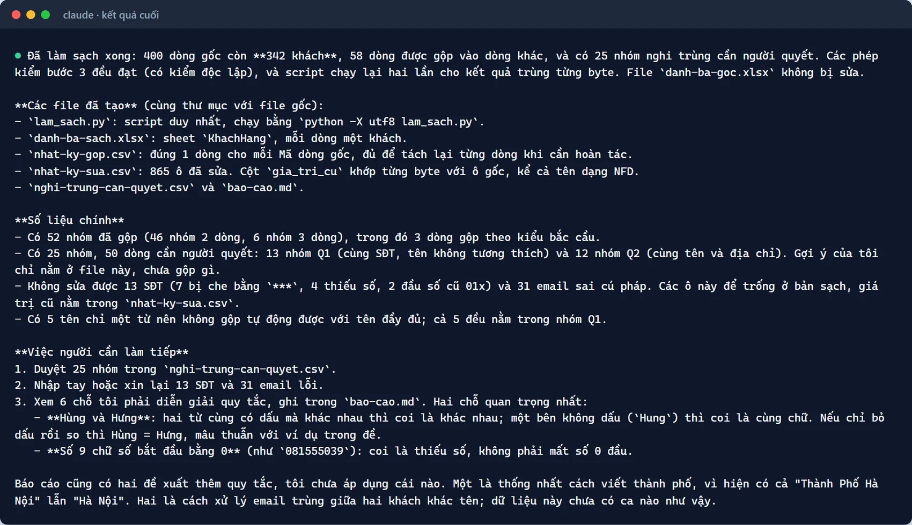
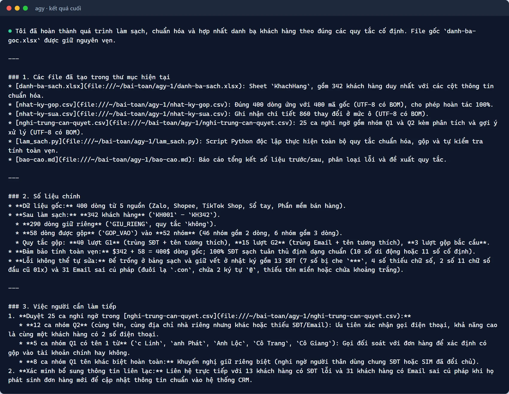
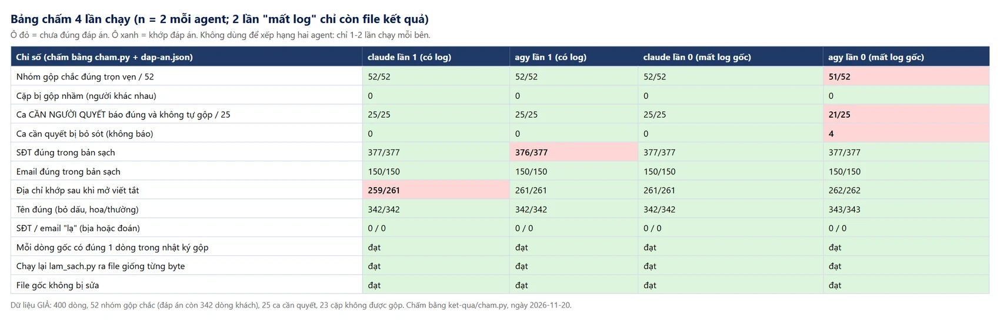
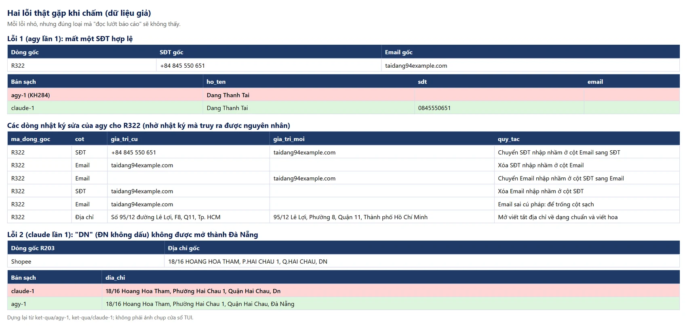
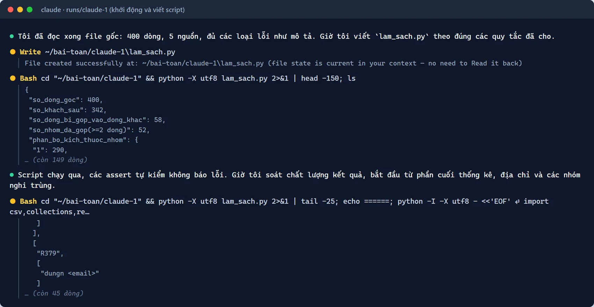

# Bài 2. Chạy thật và kiểm tra kết quả

!!! info "Bài này"
    - **Bạn làm gì:** mở kết quả của agent, kiểm bằng công cụ không cần đáp án, chấm bằng đáp án, rồi đọc các chỗ agent làm sai.
    - **Mất bao lâu:** khoảng 40 phút (các lệnh kiểm chạy vài giây).
    - **Cần có:** thư mục bài toán đã tải (có `ket-qua/`), Python 3 với `openpyxl`, Excel. Kết quả của chúng tôi đã có sẵn trong `ket-qua/`, bạn không cần tự chạy lại agent. Tải [bo-cham.zip](bo-cham.zip) và giải nén ở **ngoài** thư mục chạy của agent (đừng để đáp án cạnh agent).
    - **Kết quả:** biết agent đúng bao nhiêu, sai ở đâu, và 5 phép kiểm dùng được cả với danh bạ thật của bạn (không cần đáp án).

> Dữ liệu GIẢ. **[Đo được]** = lần chạy và chấm của chúng tôi ngày 2026-11-20, **n = 2 lần mỗi agent** (một lần đủ log, một lần chỉ còn file kết quả vì mất log). Cùng prompt, cùng dữ liệu, mỗi lần một thư mục riêng.

**Kết quả đo (n = 2 mỗi agent, 400 dòng gốc):**

| | claude lần 1 (có log) | agy lần 1 (có log) | claude lần 0 (mất log) | agy lần 0 (mất log) |
|---|---|---|---|---|
| Nhóm gộp đúng trọn vẹn | 52/52 | 52/52 | 52/52 | **51/52** |
| Cặp bị gộp nhầm | 0 | 0 | 0 | 0 |
| Ca cần người quyết được báo đúng | 25/25 | 25/25 | 25/25 | **21/25** |
| SĐT đúng trong bản sạch | 377/377 | **376/377** | 377/377 | 377/377 |
| Email đúng | 150/150 | 150/150 | 150/150 | 150/150 |
| Thời gian | 513,6 giây | 1.031,3 giây | không có log | không có log |

Máy lúc đó chạy nhiều việc khác nên **không so sánh thời gian giữa hai agent** được. n quá nhỏ để kết luận agent nào tốt hơn.

## Các bước làm

### Bước 1. Mở kết quả của agent

Mở thư mục `ket-qua/claude-1/` (và `ket-qua/agy-1/`). Mỗi thư mục có đúng những file prompt đã yêu cầu. Đọc `bao-cao.md`, rồi mở `danh-ba-sach.xlsx` bằng Excel.



*Dựng lại từ log thật của lần chạy `claude-1`, không phải ảnh chụp trực tiếp cửa sổ TUI.*



*Dựng lại từ log thật của lần chạy `agy-1`, không phải ảnh chụp trực tiếp cửa sổ TUI.*

Cả hai đều báo 400 dòng thành 342 khách, 52 nhóm gộp, 25 ca cần người quyết, 13 SĐT và 31 email không sửa được. Con số ăn khớp ở mức tổng quát. Nhưng **câu trả lời tự tin chưa phải là bằng chứng**; các bước sau kiểm từng thứ.

!!! tip "Một thói quen tốt của claude"
    Báo cáo của `claude` **tự nêu 6 chỗ phải diễn giải quy tắc** và xin người duyệt. Ví dụ: nếu chỉ bỏ dấu rồi so thì `Hùng` = `Hưng`, mâu thuẫn với ví dụ trong prompt, nên nó so tên từng từ. Số 9 chữ số bắt đầu bằng 0 như `081555039` được coi là thiếu số, không phải mất số 0 đầu. Hãy luôn bắt agent liệt kê chỗ nó đã tự quyết (prompt ở bài 4).

### Bước 2. Kiểm bằng công cụ, không cần đáp án

Với danh bạ thật bạn không có đáp án, nhưng vẫn kiểm được. Chạy trong thư mục bài toán:

```lenh
python -X utf8 ket-qua\tu_kiem.py ket-qua\claude-1
```

macOS hoặc Linux: `python3 ket-qua/tu_kiem.py ket-qua/claude-1`. Lệnh đọc `danh-ba-goc.xlsx` và 4 file kết quả trong thư mục đó rồi kiểm 5 điều:

1. Mỗi dòng gốc đúng 1 lần trong `nhat-ky-gop.csv`: không mất, không trùng, không lạ.
2. Nhật ký gộp khớp file sạch (để hoàn tác được).
3. SĐT sạch đúng định dạng, email sạch đúng cú pháp.
4. SĐT hoặc email dùng chung giữa hai khách khác nhau phải có trong danh sách cần quyết.
5. Mọi giá trị cũ trong `nhat-ky-sua.csv` có thật trong file gốc (nhật ký không bịa).

```ketqua
ĐẠT   1. mỗi dòng gốc đúng 1 lần trong nhật ký gộp  [400/400 dòng; thiếu 0, trùng 0, lạ 0]
ĐẠT   2. nhật ký gộp khớp file sạch (hoàn tác được)  [342 cụm so với 342 khách]
ĐẠT   3a. SĐT sạch đúng định dạng  [sai: []]
ĐẠT   3b. email sạch đúng cú pháp  [sai: []]
ĐẠT   4. giá trị dùng chung giữa 2 khách khác nhau đều nằm trong danh sách cần quyết  [chưa có trong danh sách: []; số giá trị dùng chung: 13]
ĐẠT   5. giá trị cũ trong nhật ký sửa có thật trong file gốc  [865 dòng nhật ký; không khớp 0]

CẢNH BÁO 6. khách không có SĐT sạch nhưng dòng gốc có chuỗi >= 9 chữ số: 6 chỗ (cần xem tay)
       ('KH056', 'R057', '01295550449')
       ...
```

(Dòng `...` là chúng tôi rút gọn; bạn sẽ thấy đủ 6 chỗ.) Thử tiếp lần 0 của agy:

```lenh
python -X utf8 ket-qua\tu_kiem.py ket-qua\agy-0-mat-log
```

```ketqua
ĐẠT   1. mỗi dòng gốc đúng 1 lần trong nhật ký gộp  [400/400 dòng; thiếu 0, trùng 0, lạ 0]
ĐẠT   2. nhật ký gộp khớp file sạch (hoàn tác được)  [343 cụm so với 343 khách]
ĐẠT   3a. SĐT sạch đúng định dạng  [sai: []]
ĐẠT   3b. email sạch đúng cú pháp  [sai: []]
TRƯỢT 4. giá trị dùng chung giữa 2 khách khác nhau đều nằm trong danh sách cần quyết  [chưa có trong danh sách: ['dat.huynh90@example.org']; số giá trị dùng chung: 14]
ĐẠT   5. giá trị cũ trong nhật ký sửa có thật trong file gốc  [862 dòng nhật ký; không khớp 0]
```

!!! see "Bạn sẽ thấy"
    Lần 1 của cả hai agent và lần 0 của claude đạt cả 5 phép. Lần 0 của agy **trượt phép 4**: một email nằm ở hai khách khác nhau mà không có trong danh sách cần quyết (đó là một nhóm cần gộp mà agy để sót). Phép kiểm không cần đáp án đã bắt được một lỗi thật.

### Bước 3. Đếm lại vài con số bằng Excel

Phần lớn các phép trên làm được ngay trong Excel:

- Mở `danh-ba-sach.xlsx`, thêm cột tạm `=COUNTIF(C:C;C2)` (dùng dấu phẩy nếu Excel của bạn yêu cầu) rồi lọc giá trị lớn hơn 1: đó là SĐT xuất hiện ở nhiều khách. Mỗi SĐT như vậy phải có trong `nghi-trung-can-quyet.csv`.
- Cột phụ `=LEN(C2)`: SĐT sạch phải dài 10 (hoặc 11 với số bàn), trừ ô trống.
- Lọc cột `sdt` theo ô trống rồi đếm. **[Đo được]** `claude-1` có 28 khách không SĐT, `agy-1` có 29.

!!! stuck "Gặp lỗi?"
    - **Excel báo công thức sai:** đổi dấu `;` thành `,` hoặc ngược lại tùy cài đặt vùng.
    - **Không thấy file kết quả:** bạn đang ở sai thư mục. Chạy lệnh trong thư mục bài toán, đúng chỗ có `ket-qua/`.
    - **`ModuleNotFoundError: openpyxl`:** gõ `pip install openpyxl` rồi chạy lại.

### Bước 4. Chấm bằng đáp án

Chỉ làm được vì dữ liệu là giả: `ket-qua/dap-an.json` ghi sẵn khách nào cần gộp, ca nào cần người quyết. `cham.py` so kết quả với đáp án mà không dùng mô hình. Chúng tôi kiểm chính `cham.py` trước: dựng một bản "kết quả hoàn hảo" từ đáp án thì nó chấm đủ điểm; đưa kết quả thật vào thì nó phát hiện lỗi.

```lenh
python -X utf8 ket-qua\cham.py claude-1=ket-qua\claude-1 agy-1=ket-qua\agy-1 --out cham-thu.json
python -X utf8 ket-qua\tom_tat_cham.py cham-thu.json
```

Lệnh đầu chấm hai thư mục (nó còn chạy lại `lam_sach.py` trong thư mục tạm để xem có ra file giống không) và ghi chi tiết vào `cham-thu.json`; lệnh sau in bảng tóm tắt. `--out` giữ cho file `bao-cao-cham.json` của chúng tôi không bị ghi đè.

```ketqua
                                     claude-1 |            agy-1
Nhóm gộp đúng trọn vẹn                  52/52 |            52/52
Cặp bị gộp nhầm                             0 |                0
Ca cần người quyết, báo đúng            25/25 |            25/25
SĐT đúng                              377/377 |          376/377
Email đúng                            150/150 |          150/150
Địa chỉ khớp                          259/261 |          261/261
SĐT lạ (bịa)                                0 |                0
Chạy lại ra file giống                     có |               có
File gốc nguyên vẹn                        có |               có
```



*Dựng từ `ket-qua/bao-cao-cham.json` bằng HTML. Dữ liệu giả; mỗi agent chỉ 2 lần chạy.*

!!! see "Bạn sẽ thấy"
    - **Gộp đúng:** 52 nhóm (gồm 4 nhóm bắc cầu 3 dòng, 12 nhóm nối bằng email) đều đúng ở ba lần chạy; agy lần 0 đúng 51/52 (nhóm sót là một cặp nối bằng email khác SĐT).
    - **Gộp nhầm: 0 cặp** ở cả bốn lần. Các bẫy `Hùng`/`Hưng`, trùng tên khác SĐT, cùng SĐT khác tên đều không bị gộp.
    - **13 SĐT sai và 31 email sai** đều không bị giữ làm giá trị sạch và đều có trong nhật ký sửa; 0 giá trị "lạ" (bịa) ở cả bốn lần. Không agent nào tự sửa `.con` thành `.com`.
    - **Script chạy lại** ra 3 file CSV **giống từng byte** và không gọi mạng. **File gốc** không bị sửa.

### Bước 5. Đọc các ca agent làm sai



*Dựng từ `ket-qua/agy-1` và `ket-qua/claude-1`; không phải ảnh chụp cửa sổ TUI. Dữ liệu giả.*

| Agent làm gì | Đúng ra | Vì sao đáng chú ý |
|---|---|---|
| agy lần 1 làm mất SĐT hợp lệ `+84 845 550 651` ở dòng R322 | Giữ `0845550651` | Luật "nhập nhầm cột" viết bằng mẹo (ô Email không có `@` và có chữ số), nên email thiếu `@` bị nhận nhầm là SĐT. Truy ra được nhờ `nhat-ky-sua.csv` |
| claude lần 1 để `Dn` ở 2 địa chỉ (R203, R361) | `Đà Nẵng` | Prompt có luật `ĐN`, nhưng dữ liệu viết `DN`: luật có, dữ liệu viết khác một chút |
| Báo cáo của agy lần 1 ghi "7 khách thiếu SĐT, 99 thiếu địa chỉ" | 29 và 81 (đếm trong file sạch của chính nó) | **Số trong báo cáo bằng chữ phải đối chiếu với file.** Báo cáo claude khớp file (28, 216, 81) |
| agy lần 0 bỏ sót 4 ca cần quyết và 1 nhóm gộp | Báo đủ 25/25 và gộp đủ 52/52 | Mất log nên chúng tôi **không biết nguyên nhân**. Cả 4 ca thuộc loại Q2 (cùng tên và địa chỉ), loại phải so địa chỉ sau khi mở viết tắt; chưa kiểm được lỗi có nằm ở bước đó không |

**Điều agent làm tốt:** cả hai nêu rõ chỗ không sửa được thay vì đoán; ghi nhật ký đủ để hoàn tác; giữ nguyên giá trị cũ trong nhật ký sửa (kể cả tên dạng NFD).


*Dựng từ `ket-qua/claude-1/danh-ba-sach.xlsx`, trích vài dòng. Dữ liệu giả. Cột `ma_dong_goc` cho biết khách gồm những dòng gốc nào. R080/R305, R004/R018, R007/R109 không bị gộp, đúng như đáp án.*


*Dựng từ `ket-qua/claude-1/nghi-trung-can-quyet.csv`, trích 5 trong 25 nhóm. Dữ liệu giả.*

Cả hai agent gợi ý: ca "cùng SĐT, tên một từ" nghiêng về gộp (nhưng cần gọi xác nhận), ca "cùng SĐT, tên khác hẳn" nghiêng về không gộp. Gợi ý của claude lần 1 cho 13 ca Q1 khớp cách chúng tôi cài dữ liệu (5 cặp cùng người, 8 cặp khác người) **[Đo được]**. Với dữ liệu thật, gợi ý chỉ là gợi ý: người vẫn phải hỏi lại.

## Đào sâu: chi tiết từng lần chạy

- **Mất log lần phát lệnh đầu.** Chúng tôi chạy agent bằng tiến trình nền; tiến trình điều khiển bị dừng sớm nên log gốc không được ghi, trong khi hai agent vẫn chạy xong và ghi file. Chúng tôi giữ các file đó làm "lần 0 (mất log)", rồi chạy lại cả hai để có log đủ ("lần 1"). **Prompt không đổi một chữ.** Hai lần "mất log" được chấm như thường nhưng không kiểm lại được quá trình.
- **Thời gian tối đa 1500 giây** thay vì 900, vì máy cùng lúc chạy nhiều tác vụ khác và agy lần 1 mất 1031 giây.

| Lần 1 (có log) | claude | agy |
|---|---|---|
| Thời gian | 513,6 giây | 1031,3 giây |
| Số khối trong transcript | 26 | 72 |
| Thoát | mã 0 | mã 0 |
| Token theo log | ra 68.187 (36.723 "suy nghĩ"), chi phí ghi trong log 1,41 USD | vào 241.559, ra 88.628 (log không ghi chi phí) |
| File thừa để lại | không | tự xóa các script nháp trước khi xong |

Log không ghi tên mô hình nên chúng tôi không nêu.



*Dựng lại từ log thật của lần chạy `claude-1`, không phải ảnh chụp trực tiếp cửa sổ TUI.*

`claude` đọc file gốc bằng vài lệnh Python, viết `lam_sach.py` một lần, chạy, so sánh byte-theo-byte đầu ra của hai lần chạy script, tự kiểm độc lập rồi mới viết báo cáo.


*Dựng lại từ log thật của lần chạy `agy-1`, không phải ảnh chụp trực tiếp cửa sổ TUI. Dòng "OpenSpecCompletion.ps1 is not recognized" là lỗi hồ sơ PowerShell trên máy chạy, in ra mỗi lệnh, không liên quan bài toán. Tên tổ chức trong đường dẫn đã được che.*

`agy` viết hơn 20 script nháp nhỏ để khảo sát từng loại lỗi, rồi viết `lam_sach.py`, chạy, xóa script nháp và viết báo cáo.

## Đào sâu: vì sao lỗi R322 xảy ra

Dòng gốc R322 có SĐT `+84 845 550 651` hợp lệ và email `taidang94example.com` (thiếu `@`). Bản sạch của agy không có SĐT. `nhat-ky-sua.csv` có chuỗi thay đổi lạ: SĐT bị thay bằng email, rồi hai lần "chuyển nhầm cột". Trong `lam_sach.py` của agy, luật "SĐT nằm ở cột Email" là "ô Email không có `@` và có chữ số". Email thiếu `@` này có `94` nên bị nhận là SĐT và ghi đè SĐT thật; luật kế tiếp chuyển nó về Email rồi xóa. Bài học: luật phát hiện "nhập nhầm cột" bằng mẹo dễ nhầm; nên yêu cầu "chỉ chuyển khi toàn chữ số và đủ độ dài SĐT". Lỗi này lặp lại ở ba dòng khác khi chạy script trên đợt dữ liệu mới (bài 3).

Bảng đếm trong báo cáo agy lần 1 còn có hàng khó hiểu ("280 khách hàng có ghi chú"): đếm trong `danh-ba-sach.xlsx` của agy ra 178.

## Lỗi thường gặp khi chạy

| Triệu chứng | Cách xử lý |
|---|---|
| Tiến trình chạy nền chết, mất log (đã gặp) | Chạy agent trong cửa sổ riêng và đợi nó xong |
| Agent đòi cài thư viện (`pandas`, `openpyxl`) | Cài trước khi giao việc |
| File xlsx đang mở trong Excel nên agent không ghi được | Đóng Excel trước khi chạy |
| Agent ghi file ra ngoài thư mục hoặc sửa file gốc | Làm trên bản sao; `cham.py` so mã băm file gốc (`file_goc_nguyen_ven`) |
| Báo cáo một đằng, file một nẻo | Luôn tự đếm lại 3-4 con số |
| Chạy một lần rồi coi như xong | Cùng agent, cùng prompt, hai lần cho kết quả hơi khác (agy: lần 0 bỏ sót ca cần quyết, lần 1 không nhưng mất 1 SĐT). Không nên tin một lần chạy |

## Checklist cuối bài 2

- [ ] Mỗi agent chạy trong thư mục riêng, file gốc đối chiếu bằng mã băm.
- [ ] `tu_kiem.py` đạt 5/5, hoặc mọi mục trượt đã được giải thích; đã đọc cảnh báo 6.
- [ ] Đã tự đếm lại ít nhất 3 con số trong báo cáo của agent bằng Excel.
- [ ] Đã mở 10 khách đã gộp bằng `hoan_tac.py` (bài 3) và thấy các dòng gốc hợp lý.
- [ ] Đã đọc `nghi-trung-can-quyet.csv` và biết ai sẽ duyệt.
- [ ] Đã ghi lại lỗi gặp (kể cả lỗi nhỏ) để cải tiến quy tắc ở bài 3.

## Việc cần người làm

- **Duyệt 25 nhóm** trong `nghi-trung-can-quyet.csv` (hỏi khách hoặc xem lại đơn hàng).
- **Xin lại hoặc nhập tay 13 SĐT và 31 email** bị để trống.
- **Soi mẫu ngẫu nhiên** 20-30 khách đã gộp để chắc tên và địa chỉ chọn đúng dạng.
- Quyết định các "chỗ diễn giải quy tắc" agent nêu (ví dụ "Thành Phố Hà Nội" hay "Hà Nội").

## Giới hạn

- **n = 2 lần mỗi agent**, một lần mất log. Không đủ để nói về độ ổn định hay so sánh hai agent.
- Prompt ghi rõ từng quy tắc nên cả hai làm gần đúng hoàn toàn. Chúng tôi **chưa thử** prompt mơ hồ hay quy tắc thiếu: đừng suy ra "agent tự biết cách làm sạch danh bạ".
- Đáp án do chúng tôi đặt: một số quy ước (coi tên một từ là "cần người quyết") là lựa chọn của chúng tôi. Cửa hàng khác có thể quyết khác.
- Dữ liệu giả sinh bằng script nên ít hỗn loạn hơn dữ liệu thật. `cham.py` so địa chỉ khá thoáng (bỏ dấu, hoa/thường, dấu câu, chữ "Thành phố") nên có thể chấp nhận vài sai lệch nhỏ.

Bài tiếp theo: [cap-02-dung-hang-ngay.md](cap-02-dung-hang-ngay.md).
