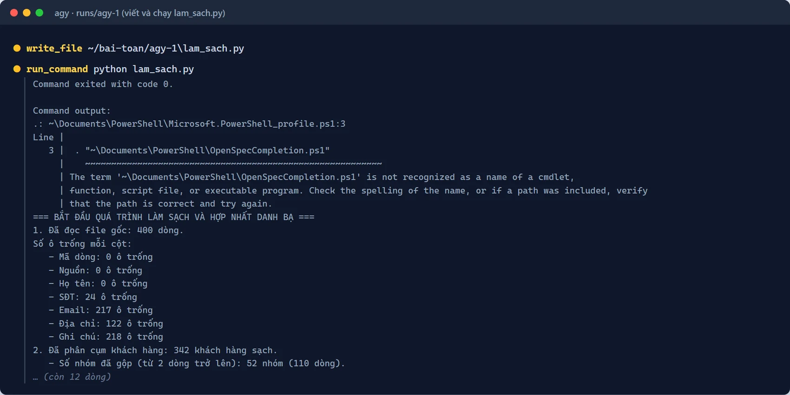
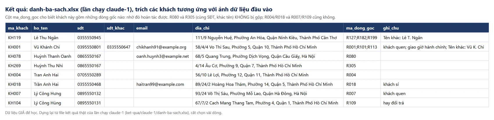
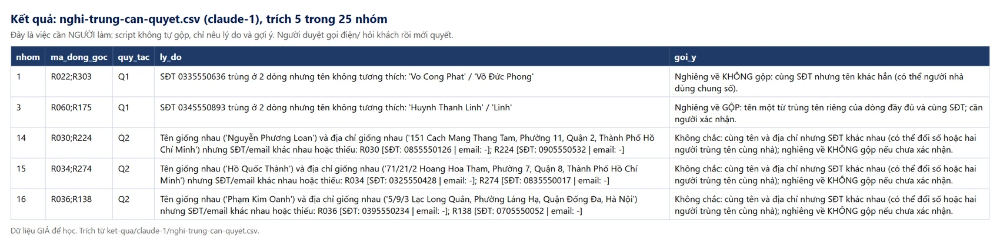

# Bài 2. Chạy thật và kiểm tra kết quả

> Dữ liệu GIẢ. Nhãn: **[Đo được]** = lần chạy và chấm của chúng tôi ngày 2026-11-20, **n = 2 lần mỗi agent** (một lần đủ log, một lần chỉ còn file kết quả); **[Nguồn]** = có link; **[Đề xuất]** = ý kiến người soạn.
> Cần đọc [bài 1](cap-00-chuan-bi-du-lieu-va-giao-viec.md) trước: prompt và quy tắc nằm ở đó.

## 1. Mục tiêu của bài

1. Chạy `claude` và `agy` với **cùng prompt, cùng dữ liệu**, lấy được 6 file đầu ra mỗi bên.
2. Kiểm kết quả bằng **5 phép kiểm không cần đáp án** (dùng được với dữ liệu thật của bạn).
3. Chấm kết quả bằng **đáp án** (chỉ làm được vì dữ liệu là giả): đúng/sai/bỏ sót/bịa.
4. Biết các kiểu lỗi agent thật sự mắc, để biết chỗ nào phải soi khi dùng với dữ liệu của mình.

Việc đo được: thời gian chạy, số nhóm gộp đúng trên 52, số ca cần người quyết được báo trên 25, số SĐT/email/địa chỉ đúng, số giá trị "lạ" (bịa), và script có chạy lại ra đúng kết quả cũ không.

## 2. Chạy thật

Mỗi agent chạy trong thư mục riêng chứa **đúng một** file `danh-ba-goc.xlsx`, prompt giống hệt `du-lieu/prompt-giao-viec.txt`, đáp án (`dap-an.json`) để ở thư mục khác.

Hai chuyện ngoài ý muốn, ghi lại để bạn khỏi mắc:

- **Mất log lần phát lệnh đầu.** Chúng tôi chạy agent bằng tiến trình nền; tiến trình điều khiển bị dừng sớm nên log gốc không được ghi, trong khi hai agent vẫn chạy xong và ghi file. Chúng tôi giữ các file kết quả đó làm "lần 0 (mất log)", rồi chạy lại cả hai để có log đủ ("lần 1"). **Prompt không đổi một chữ giữa hai lần.** Hai lần "mất log" được chấm như thường nhưng bạn không thể kiểm lại quá trình của chúng.
- **Thời gian tối đa đặt 1500 giây** thay vì 900, vì máy cùng lúc chạy nhiều tác vụ khác và agy lần 1 mất 1031 giây.

**[Đo được] lần 1 (có log):**

| | claude | agy |
|---|---|---|
| Thời gian | 513,6 giây | 1031,3 giây |
| Số khối trong transcript | 26 | 72 |
| Thoát | mã 0 | mã 0 |
| Token theo log | đầu ra 68.187 (trong đó 36.723 "suy nghĩ"), chi phí ghi trong log 1,41 USD | vào 241.559, ra 88.628 (log không ghi chi phí) |
| File thừa để lại | không | tự xóa các script nháp trước khi xong (còn `lam_sach.py`) |

Máy bận nên **không so sánh thời gian giữa hai agent** được. Log không ghi tên mô hình nên chúng tôi không nêu.

### 2.1 Xem agent làm việc


*Dựng lại từ log thật của lần chạy `claude-1`, không phải ảnh chụp trực tiếp cửa sổ TUI.*

`claude` đọc file gốc bằng vài lệnh Python, viết `lam_sach.py` bằng một lần ghi file, chạy, soát thêm, so sánh byte-theo-byte đầu ra của hai lần chạy script, tự kiểm độc lập từ file kết quả rồi mới viết báo cáo.



*Dựng lại từ log thật của lần chạy `agy-1`, không phải ảnh chụp trực tiếp cửa sổ TUI. Đoạn "The term ... OpenSpecCompletion.ps1 is not recognized" là lỗi của hồ sơ PowerShell trên máy chạy, in ra mỗi lệnh; không liên quan bài toán. Một đoạn tên tổ chức trong đường dẫn đã được che.*

`agy` viết hơn 20 script nháp nhỏ để khảo sát từng loại lỗi (SĐT, email, danh xưng, địa chỉ, nhóm trùng), rồi viết `lam_sach.py`, chạy, xóa các script nháp và viết báo cáo.

### 2.2 Câu trả lời cuối của từng agent


*Dựng lại từ log thật của lần chạy `claude-1`, không phải ảnh chụp trực tiếp cửa sổ TUI.*


*Dựng lại từ log thật của lần chạy `agy-1`, không phải ảnh chụp trực tiếp cửa sổ TUI.*

Cả hai đều báo 400 dòng → 342 khách, 52 nhóm gộp, 25 ca cần người quyết, 13 SĐT và 31 email không sửa được. Con số ăn khớp nhau ở mức tổng quát. Nhưng **câu trả lời tự tin chưa phải là bằng chứng**; phần dưới kiểm từng thứ.

Lưu ý cách `claude` báo cáo: nó **tự nêu 6 chỗ phải diễn giải quy tắc** và xin người duyệt, ví dụ: nếu chỉ bỏ dấu rồi so thì `Hùng` = `Hưng`, mâu thuẫn với ví dụ trong đề, nên nó so tên từng từ; số 9 chữ số bắt đầu bằng 0 như `081555039` được coi là thiếu số chứ không phải mất số 0 đầu. Đây là thói quen tốt để yêu cầu: **bắt agent liệt kê chỗ nó đã tự quyết**.

## 3. Kiểm bằng công cụ, không cần đáp án

Với dữ liệu thật bạn không có đáp án. Bốn lớp kiểm vẫn làm được. Chạy bằng một lệnh:

```
cd ket-qua
python -X utf8 tu_kiem.py claude-1
```

(Thay `claude-1` bằng thư mục kết quả bất kỳ có `danh-ba-goc.xlsx` và 4 file đầu ra.) `tu_kiem.py` kiểm:

1. **Mỗi dòng gốc đúng 1 lần** trong `nhat-ky-gop.csv`: không mất dòng, không dòng trùng, không dòng lạ.
2. **Nhật ký gộp khớp file sạch**: các cụm trong `nhat-ky-gop.csv` trùng với cột `ma_dong_goc` của `danh-ba-sach.xlsx`. Nếu khớp thì hoàn tác được.
3. **SĐT sạch đúng định dạng, email sạch đúng cú pháp.**
4. **Cùng SĐT/email mà nằm ở hai khách khác nhau thì phải có trong danh sách cần quyết.** Đây là phép kiểm "không bỏ sót ca mơ hồ".
5. **Mỗi giá trị cũ trong `nhat-ky-sua.csv` có thật trong file gốc**: nhật ký không bịa.

**[Đo được]** Lần 1 của cả hai agent và lần 0 của claude đạt cả 5. Lần 0 của agy **trượt phép 4**: email `dat.huynh90@example.org` xuất hiện ở hai khách khác nhau mà không có trong danh sách cần quyết (đó là một nhóm cần gộp mà agy để sót). Tức là phép kiểm không cần đáp án đã bắt được một lỗi thật.

Bạn có thể làm phần lớn các phép này **ngay trong Excel**, không cần code:

- Mở `danh-ba-sach.xlsx`, thêm cột tạm có công thức `=COUNTIF(C:C;C2)` (dùng dấu phẩy thay dấu chấm phẩy nếu Excel của bạn yêu cầu) rồi lọc giá trị lớn hơn 1: đó là SĐT xuất hiện ở nhiều khách. Mỗi SĐT như vậy phải có mặt trong `nghi-trung-can-quyet.csv`.
- Cột phụ `=LEN(C2)` rồi lọc: SĐT sạch phải dài 10 (hoặc 11 với số bàn), trừ ô trống.
- Lọc cột Email theo ô trống để đếm bao nhiêu khách không có email; so với báo cáo của agent.

## 4. Chấm bằng đáp án

`ket-qua/cham.py` so kết quả với `dap-an.json` mà không dùng mô hình. Nó chấm: phủ dòng và khả năng hoàn tác; số nhóm gộp đúng trọn vẹn; số cặp bị gộp nhầm (chia theo loại bẫy); với 25 ca cần quyết: được báo và không bị gộp / bị gộp / bỏ sót; số SĐT, email, tên, địa chỉ đúng; SĐT/email "lạ" (bịa hoặc đoán); chạy lại `lam_sach.py` trong một thư mục sạch xem có ra đúng 3 file CSV cũ không; file gốc có bị sửa không.

Chạy: `python -X utf8 cham.py claude-1=claude-1 agy-1=agy-1` (sinh `bao-cao-cham.json`).

Chúng tôi kiểm chính `cham.py` trước: dựng một bản "kết quả hoàn hảo" từ đáp án thì nó chấm đủ điểm; đưa kết quả thật của agent vào thì nó phát hiện lỗi (nên không phải luôn cho điểm tối đa).


*Dựng từ `ket-qua/bao-cao-cham.json` bằng HTML. Dữ liệu giả; mỗi agent chỉ 2 lần chạy.*

**[Đo được] (n = 2 mỗi agent):**

- **Gộp đúng.** 52 nhóm cần gộp (gồm 4 nhóm bắc cầu 3 dòng, 12 nhóm nối bằng email) đều được cả hai agent ở lần 1 và claude ở lần 0 gộp đúng trọn vẹn. Lần 0 của agy đúng 51/52: nhóm sót là một cặp nối bằng email khác SĐT.
- **Gộp nhầm.** 0 cặp ở cả bốn lần chạy. Các bẫy `Hùng`/`Hưng`, trùng tên khác SĐT, cùng SĐT khác tên đều không bị gộp.
- **Ca cần người quyết.** Lần 1 của cả hai: 25/25 báo đúng, không ca nào bị tự gộp. Lần 0 của agy: 21/25; 4 ca cùng tên và địa chỉ (3 ca khác SĐT, 1 ca thiếu SĐT) **không được báo** (không gộp, nhưng cũng không nhờ người xem).
- **SĐT, email.** 377/377 SĐT và 150/150 email đúng ở ba lần chạy; agy lần 1 mất 1 SĐT (lỗi 1 dưới đây). 13 SĐT sai và 31 email sai đều **không** bị giữ làm giá trị sạch và đều có trong nhật ký sửa; 0 SĐT/email "lạ" (bịa) ở cả bốn lần. Không agent nào tự sửa `.con` thành `.com`.
- **Tên.** Đúng ở mọi khách (so theo chữ không dấu; các khách gộp chọn dạng có dấu đầy đủ).
- **Script chạy lại.** Cả bốn script chạy lại trong thư mục sạch ra 3 file CSV **giống từng byte** file cũ, và không gọi mạng/mô hình.
- **File gốc** không bị sửa ở cả bốn lần.

## 5. Các lỗi thật gặp


*Dựng từ `ket-qua/agy-1` và `ket-qua/claude-1`; không phải ảnh chụp cửa sổ TUI. Dữ liệu giả.*

**Lỗi 1: agy lần 1 làm mất một SĐT hợp lệ (dòng R322).** Dòng gốc có SĐT `+84 845 550 651` hợp lệ và email `taidang94example.com` (thiếu `@`). Bản sạch của agy không có SĐT. Đọc `nhat-ky-sua.csv` thấy chuỗi thay đổi lạ: SĐT bị thay bằng email, rồi hai lần "chuyển nhầm cột". Nguyên nhân nằm trong `lam_sach.py` của agy: luật "SĐT nằm ở cột Email" được viết là "ô Email không có `@` và có chữ số"; email thiếu `@` này có `94` nên bị nhận nhầm là SĐT và ghi đè SĐT thật; luật kế tiếp lại chuyển nó về Email rồi xóa. Nhờ có nhật ký sửa nên truy ra được. 376/377 SĐT đúng là hệ quả. Bài học: **luật phát hiện "nhập nhầm cột" bằng mẹo (có chữ số, không có `@`) dễ nhầm**; nên yêu cầu "chỉ chuyển khi toàn chữ số và đủ độ dài SĐT".

**Lỗi 2: claude lần 1 không mở `DN` thành Đà Nẵng (2 địa chỉ, dòng R203 và R361, nguồn Shopee).** Địa chỉ gốc viết hoa không dấu `... Q.HAI CHAU, DN`. Prompt có luật `ĐN → Đà Nẵng` nhưng chữ ở đây là `DN` (ĐN bỏ dấu). Bản sạch của claude còn `Dn`; agy mở đúng. Hai ô đúng loại lỗi "luật có, dữ liệu viết khác một chút".

**Lỗi 3 (ở báo cáo, không ở dữ liệu): số liệu trong `bao-cao.md` của agy lần 1 không khớp file sạch của chính nó.** Báo cáo ghi "7 khách hàng khuyết SĐT" và "99 khách hàng khuyết Địa chỉ". Đếm trong `danh-ba-sach.xlsx` của agy: **29** khách không có SĐT và **81** không có địa chỉ. Báo cáo của claude ghi 28 SĐT, 216 email, 81 địa chỉ; đếm trong file của nó ra đúng 28, 216, 81. Bảng "số liệu trước/sau" trong báo cáo agy còn có hàng khó hiểu ("280 khách hàng có ghi chú"). Bài học: **số liệu trong báo cáo bằng chữ của agent phải đối chiếu với file**, không tin nguyên văn.

**Lỗi 4 (lần 0 của agy): bỏ sót 4 ca cần quyết và 1 nhóm gộp.** Vì mất log nên chúng tôi **không biết nguyên nhân**; chỉ biết kết quả qua file. Lưu ý các ca bị bỏ sót đều thuộc loại Q2 (cùng tên và địa chỉ), loại phải so địa chỉ **sau khi mở viết tắt**; có thể lỗi nằm ở bước đó nhưng chúng tôi chưa kiểm được.

**Điều agent làm tốt (quan sát):** cả hai nêu rõ chỗ không sửa được thay vì đoán; cả hai ghi nhật ký đủ để hoàn tác; cả hai giữ nguyên giá trị cũ trong nhật ký sửa (kể cả tên dạng NFD).

### 5.1 Xem kết quả



*Dựng từ `ket-qua/claude-1/danh-ba-sach.xlsx`, trích vài dòng. Dữ liệu giả. Cột `ma_dong_goc` cho biết khách gồm những dòng gốc nào. R080/R305, R004/R018, R007/R109 không bị gộp, đúng như đáp án.*



*Dựng từ `ket-qua/claude-1/nghi-trung-can-quyet.csv`, trích 5 trong 25 nhóm. Dữ liệu giả.*

Cả hai agent đều gợi ý ở file này: với các ca "cùng SĐT, tên một từ" thì nghiêng về gộp (nhưng cần gọi xác nhận), với các ca "cùng SĐT, tên khác hẳn" thì nghiêng về không gộp. Gợi ý của claude lần 1 cho 13 ca Q1 khớp cách chúng tôi cài dữ liệu (5 cặp cùng người, 8 cặp khác người) **[Đo được]**; nhưng với dữ liệu thật, gợi ý chỉ là gợi ý, người vẫn phải hỏi lại.

## 6. Lỗi thường gặp khi chạy (và cách xử)

1. **Tiến trình chạy nền chết, mất log** (đã gặp): chạy agent trong cửa sổ riêng và đợi nó xong; hoặc lưu log ngay từng sự kiện thay vì cuối lần chạy.
2. **Agent đòi cài thư viện** (`pandas`, `openpyxl`): cài trước khi giao việc, hoặc để agent tự cài trong môi trường ảo.
3. **File xlsx đang mở trong Excel** nên agent không ghi được: đóng Excel trước khi chạy.
4. **Agent ghi file ra ngoài thư mục** hoặc sửa file gốc: đã ngăn bằng bản sao và kiểm `file_goc_nguyen_ven` trong `cham.py` (so mã băm).
5. **Báo cáo một đằng, file một nẻo**: xem lỗi 3; luôn tự đếm lại 3-4 con số.
6. **Chạy một lần rồi coi như xong.** Chúng tôi thấy cùng agent, cùng prompt, hai lần cho kết quả hơi khác (ví dụ agy: lần 0 bỏ sót ca cần quyết, lần 1 thì không nhưng mất 1 SĐT). n quá nhỏ để nói về độ ổn định, nhưng đủ để thấy **không nên tin một lần chạy**.

## 7. Checklist cuối bài

- [ ] Mỗi agent chạy trong thư mục riêng, file gốc đối chiếu bằng mã băm.
- [ ] `tu_kiem.py` đạt 5/5, hoặc mọi mục trượt đã được giải thích.
- [ ] Đã tự đếm lại ít nhất 3 con số trong báo cáo của agent bằng Excel.
- [ ] Đã mở 10 khách đã gộp bằng `hoan_tac.py` và thấy các dòng gốc hợp lý.
- [ ] Đã đọc `nghi-trung-can-quyet.csv` và biết ai sẽ duyệt.
- [ ] Đã chạy lại `lam_sach.py` ở thư mục sạch, ra file giống.
- [ ] Đã ghi lại lỗi gặp (kể cả lỗi nhỏ) để cải tiến quy tắc ở bài 3.

## 8. Việc cần người làm

- **Duyệt 25 nhóm** trong `nghi-trung-can-quyet.csv` (hỏi khách hoặc xem lại đơn hàng).
- **Xin lại hoặc nhập tay 13 SĐT và 31 email** bị để trống.
- **Soi mẫu ngẫu nhiên** 20-30 khách đã gộp để chắc tên và địa chỉ chọn đúng dạng.
- Quyết định các "chỗ diễn giải quy tắc" mà agent nêu (ví dụ thành phố "Thành Phố Hà Nội" hay "Hà Nội").

## 9. Giới hạn

- **n = 2 lần mỗi agent**, trong đó một lần mất log. Không đủ để nói gì về độ ổn định hay so sánh hai agent; chúng tôi **không** kết luận agent nào tốt hơn.
- Prompt đã ghi rõ từng quy tắc; ở mức đó cả hai làm gần đúng hoàn toàn. Chúng tôi **chưa thử** prompt mơ hồ hoặc quy tắc thiếu, nên đừng suy ra "agent tự biết cách làm sạch danh bạ".
- Đáp án do chúng tôi tự đặt: một số quy ước (ví dụ coi tên một từ là "cần người quyết") là lựa chọn của chúng tôi. Cửa hàng khác có thể quyết khác.
- Dữ liệu giả sinh bằng script nên có "mùi" của script: các biến thể lỗi hữu hạn, ít hỗn loạn hơn dữ liệu thật.
- `cham.py` so địa chỉ khá thoáng (bỏ dấu, hoa/thường, dấu câu, chữ "Thành phố") và so tên theo chữ không dấu; có thể chấp nhận vài sai lệch nhỏ.

Bài tiếp theo: [cap-02-dung-hang-ngay.md](cap-02-dung-hang-ngay.md).
