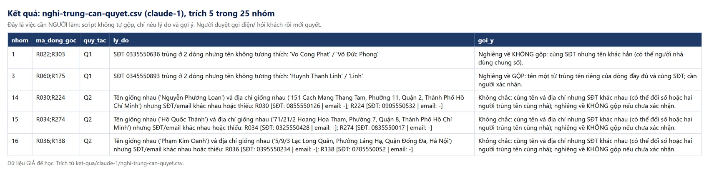

# Bài 3. Đưa vào dùng hằng ngày: lặp lại, tự kiểm, người duyệt, giới hạn

> Dữ liệu GIẢ. Nhãn: **[Đo được]** = chúng tôi chạy và chấm ngày 2026-11-20; **[Nguồn]** = có link; **[Đề xuất]** = ý kiến người soạn.
> Đọc [bài 1](cap-00-chuan-bi-du-lieu-va-giao-viec.md) và [bài 2](cap-01-chay-that-va-kiem-tra.md) trước.

## 1. Mục tiêu của bài

Một lần làm sạch xong chưa phải là xong: tuần sau có thêm đơn mới, khách mới, export mới từ Zalo và sàn. Sau bài này bạn có:

1. Một **quy trình hằng tuần** rõ từng bước, ai làm gì (đo bằng: một người mới làm theo được trong một buổi).
2. **Cách hoàn tác** một lần gộp bằng một lệnh (đo bằng: chọn một khách đã gộp, tách lại đúng các dòng gốc).
3. **Một bộ kiểm tự động** chạy sau mỗi lần làm sạch, và hiểu nó **bắt được gì, bỏ lọt gì**.
4. Hiểu vì sao phải **thử script cũ trên dữ liệu mới** trước khi tin, qua một thử nghiệm thật.
5. Biết giới hạn và hướng mở rộng.

## 2. Thử nghiệm quan trọng nhất: chạy lại script cũ trên đợt dữ liệu mới

Ưu điểm lớn của cách làm "agent viết script, script chạy trên dữ liệu" là lần sau **không tốn lượt gọi mô hình**: chỉ chạy lại `lam_sach.py`. **[Đo được]** cả bốn script (của hai agent, hai lần) chạy lại trên chính dữ liệu cũ ra 3 file CSV giống từng byte, không gọi mạng. Nhưng câu hỏi thật là: script viết cho đợt 1 có đúng trên đợt 2 không?

Chúng tôi sinh một **đợt mới** từ cùng bộ sinh nhưng hạt giống khác (`python -X utf8 sinh_du_lieu.py 20261201 <thư_mục>`), cùng cấu trúc lỗi nhưng khác tên, SĐT, và cách các lỗi rơi vào từng dòng. Rồi chạy **nguyên script cũ** (`lam_sach.py` của `claude-1` và `agy-1`), không sửa một chữ, không gọi lại agent. Kết quả trong `ket-qua/dot-2-du-lieu-moi/`.


*Dựng từ `ket-qua/bao-cao-cham.json` và `ket-qua/bao-cao-cham-dot2.json` bằng HTML; dữ liệu giả; mỗi script chạy 1 lần trên đợt 2.*

**[Đo được] (1 đợt mới, mỗi script chạy 1 lần):**

| | claude (script cũ) | agy (script cũ) |
|---|---|---|
| Nhóm gộp đúng / 52 | 52 | **51** |
| Cặp gộp nhầm | 0 | 0 |
| Ca cần người quyết được báo / 25 | **24** | 25 |
| SĐT đúng / 372 | **366** | **362** |
| Địa chỉ khớp / 268 | **264** | 268 |
| SĐT/email lạ (bịa) | 0 | 0 |

Ba loại lỗi lộ ra, đều **chưa xuất hiện hoặc chưa gây lỗi ở đợt 1**:

1. **Dấu phân cách hai SĐT.** Có ô ghi `0975550835 hoặc 0975 550 146`. Cả hai script đều **mất cả hai số** ở ba dòng như vậy (6 SĐT, đều có trong kết quả của hai agent). Prompt chỉ nói "ô có hai SĐT" mà không liệt kê chữ nối; script đợt 1 chỉ biết các chữ nối đã thấy.
2. **Luật "email lẫn cột" sai tay.** Script của `agy` coi mọi ô Email không có `@` mà có chữ số là SĐT. Ở đợt 1 điều này đã làm mất SĐT của dòng R322 (bài 2). Ở đợt 2 nó lặp lại ở **ba dòng** (email thiếu `@` có chữ số như `vinhpham1example.net`, ghi đè SĐT thật). Cộng một dòng có `liên hệ 036-555-0550` trong Ghi chú mà script không nhận ra, kéo theo một nhóm 3 dòng không được gộp (51/52).
3. **`DN` chưa được mở thành Đà Nẵng** (script của `claude`): 4 địa chỉ còn `Dn`; hậu quả dây chuyền: hai dòng cùng tên và cùng địa chỉ (một viết `tp đà nẵng`, một viết `DN`) **không so khớp được**, nên một ca cần người quyết không được báo (24/25).

Bài học: **script là thứ "đóng băng" quy tắc ở thời điểm viết**. Không có gì sai khi quy tắc chưa phủ hết, nhưng bạn cần biết nó phủ đến đâu trước khi tin vào kết quả. Cách làm cụ thể ở các mục sau.

## 3. Quy trình hằng tuần **[Đề xuất]**

Dành cho cửa hàng có người phụ trách dữ liệu, không nhất thiết biết lập trình.

1. **Chép export mới vào thư mục đợt mới** (ví dụ `2026-12-04`), **làm trên bản sao**. Đặt tên file `danh-ba-goc.xlsx` đúng cột cũ. Không chép dữ liệu thật vào thư mục dùng chung hoặc dịch vụ đám mây khi chưa kiểm tra theo [an-toan-du-lieu-va-phap-ly-vn.md](../an-toan-du-lieu-va-phap-ly-vn.md).
2. **Chạy `lam_sach.py`** (ở máy bạn, không cần agent):
   ```
   cd 2026-12-04
   python -X utf8 lam_sach.py
   ```
   Lệnh `cd` đổi vào thư mục đợt mới; lệnh `python` chạy script. Script đọc `danh-ba-goc.xlsx` trong thư mục hiện tại và ghi 4 file kết quả cùng thư mục.
3. **Chạy bộ kiểm** `tu_kiem.py` (mục 5). Phải đạt 5/5, rồi xem **cảnh báo 6**.
4. **Duyệt tay** danh sách `nghi-trung-can-quyet.csv` (mục 4).
5. **Soi mẫu**: lấy 20 khách ngẫu nhiên (cả đã gộp lẫn chưa), đối chiếu `danh-ba-goc.xlsx`.
6. **Nhập vào hệ thống thật** (CRM, phần mềm bán hàng) chỉ khi bước 3-5 xong. Lưu nguyên thư mục đợt làm bằng chứng.
7. **Ghi lỗi mới** gặp được vào một file `loi-gap.md` (ngày, dòng, mô tả). Cuối tháng đưa danh sách đó cho agent kèm `lam_sach.py` để bổ sung quy tắc (mục 7).

## 4. Người duyệt: việc người làm, máy không làm hộ

`nghi-trung-can-quyet.csv` có mỗi nhóm một dòng, kèm `ly_do` và `goi_y` (gợi ý của mô hình hoặc của script).



*Dựng từ `ket-qua/claude-1/nghi-trung-can-quyet.csv`, trích 5 nhóm; dữ liệu giả.*

Cách duyệt **[Đề xuất]**:

1. Mở file bằng Excel, thêm cột `quyet_dinh`. Với mỗi nhóm điền một trong ba giá trị: `GOP`, `KHONG`, `HOI_KHACH`.
2. Với `HOI_KHACH`, ghi cách hỏi (gọi số nào, nhắn Zalo nào) và người phụ trách.
3. Giữ lại file đã điền như nhật ký quyết định. Lần sau, nếu cùng cặp dòng xuất hiện lại thì không phải hỏi lại.
4. Với các nhóm `GOP`: **chưa có công cụ trong bài này** áp dụng quyết định đó vào bản sạch (xem mục 8, "chưa làm"). Tạm thời, người gộp tay trong hệ thống thật và ghi vào nhật ký quyết định.

Nguyên tắc nên giữ: gợi ý của mô hình là **một ý kiến**, không phải quyết định. Ví dụ ở dữ liệu giả, với ca cùng SĐT mà một bên chỉ có tên `Linh`, cả hai agent nghiêng về gộp nhưng đều dặn cần gọi xác nhận; người duyệt nên làm đúng như dặn.

## 5. Tự kiểm sau mỗi lần chạy

`ket-qua/tu_kiem.py` không cần đáp án. Chạy: `python -X utf8 tu_kiem.py <thư_mục_đợt>`. Nó kiểm 5 điều rồi in thêm 1 cảnh báo:

1. Mỗi dòng gốc đúng 1 lần trong `nhat-ky-gop.csv`.
2. Nhật ký gộp khớp file sạch (bảo đảm hoàn tác được).
3. SĐT sạch đúng định dạng; email sạch đúng cú pháp.
4. SĐT/email dùng chung giữa hai khách khác nhau phải có mặt trong danh sách cần quyết.
5. Mọi giá trị cũ trong `nhat-ky-sua.csv` có thật trong file gốc.
6. **Cảnh báo (không tính trượt):** khách không có SĐT sạch nhưng dòng gốc của họ có chuỗi từ 9 chữ số trở lên. Danh sách này chứa cả SĐT sai thật (bị che, thiếu số) lẫn SĐT bị bỏ sót, nên cần **mắt người** xem.

**[Đo được] Nó bắt được gì và bỏ lọt gì:**

- Ở đợt 1, `lần 0` của agy trượt phép 4 (bỏ sót một nhóm nối bằng email): bắt được, không cần đáp án.
- Ở đợt 2, script của cả hai agent **đạt cả 5 phép đầu** dù mất 6 đến 10 SĐT và còn `Dn` trong địa chỉ. Tức là 5 phép đầu **chỉ bảo đảm cấu trúc và tính nhất quán**, không bảo đảm đúng.
- **Cảnh báo 6** thì có ích: ở đợt 2 nó liệt kê 13 chỗ (claude) và 17 chỗ (agy), trong đó có đủ các dòng `hoặc` và các dòng mất SĐT vì luật email; ở đợt 1 nó liệt kê dòng R322 của agy giữa 6 số sai thật. Giá phải trả: người phải đọc từng dòng.

Vì vậy cần thêm một lớp mà máy không có: **bộ thử có đáp án tay**.

### 5.1 Bộ thử có đáp án tay **[Đề xuất]**

1. Chọn 20-30 dòng khó từ dữ liệu thật của bạn (trùng, đổi chỗ cột, sai định dạng).
2. Tự viết kết quả đúng của chúng vào một file `bo-thu.csv` (khách nào gồm dòng nào, SĐT sạch là gì).
3. Mỗi lần sửa `lam_sach.py` hoặc nhận đợt mới, chạy script trên bộ thử và so. `cham.py` là một ví dụ về cách so, nhưng chỉ dùng được với dữ liệu giả có `dap-an.json`.
4. Mỗi lỗi gặp ở thực tế **thêm một dòng vào bộ thử** (như dòng `R322` hay `hoặc` ở trên).

## 6. Hoàn tác: một lệnh

Mọi lần gộp có thể hoàn tác vì `nhat-ky-gop.csv` ghi từng dòng gốc đi đâu. Công cụ `ket-qua/hoan_tac.py` in ra các dòng gốc của một khách và lý do gộp:

```
python -X utf8 hoan_tac.py claude-1 KH001
```

**[Đo được]** Kết quả thực trên bản chạy `claude-1` (dữ liệu giả; chúng tôi rút gọn bớt cột ở hai dòng cho vừa trang):

```
KH001 gồm 3 dòng gốc:
  R001  [GIU_RIENG, không]  Zalo | vũ  Khánh CHI  | +84 395 550 801 | chikhanh91@example.org | 58/4/4 VO THI SAU, P.5, Q.10, TP HCM |
      vì sao gộp: Giữ làm dòng đại diện của KH001, nhận thêm 2 dòng: R101, R113.
  R101  [GOP_VAO, G1]  Phần mềm bán hàng | Vũ Khánh Chi | 0395550801 | | | khách quen
      vì sao gộp: Gộp vào R001: khớp SĐT 0395550801 giữa R001 và R101 (tên 'Vũ Khánh Chi' ~ 'Vũ Khánh Chi').
  R113  [GOP_VAO, G2]  Shopee | Vũ K. Chi | 84335550647 | Chikhanh91@Example.org | ... | giao giờ hành chính
      vì sao gộp: Gộp vào R001: khớp email chikhanh91@example.org giữa R001 và R113 (tên 'Vũ Khánh Chi' ~ 'Vũ K. Chi').
```

Thêm `--ghi tach.csv` để lưu các dòng gốc ra CSV rồi dán lại thành các khách riêng. Điểm cần nhớ: hoàn tác chỉ làm được khi **file gốc còn nguyên**; vì thế bài 1 nhấn mạnh làm trên bản sao và giữ file gốc của mỗi đợt.

## 7. Cập nhật quy tắc: nhờ agent sửa script, kiểm bằng bộ thử

Khi `loi-gap.md` có vài lỗi mới (ví dụ "ô hai SĐT dùng chữ `hoặc`", "`DN` là Đà Nẵng", "email thiếu `@` không phải SĐT"), giao lại việc cho agent **theo khung 6 phần**, nhưng ngắn:

- **Vai trò, Bối cảnh:** "Đây là `lam_sach.py` hiện có, nó đang sai ở các dòng sau."
- **Nhiệm vụ:** "Sửa script để các dòng này ra đúng, **không đổi hành vi với các dòng khác**."
- **Các bước:** sửa, chạy trên bộ thử, chạy `tu_kiem.py`, so kết quả cũ-mới trên cả đợt thật và báo **các dòng nào đổi kết quả**.
- **Ràng buộc:** không đổi tên cột; không bỏ quy tắc cũ; không chắc thì ghi CẦN NGƯỜI QUYẾT.

Điểm mấu chốt là "báo các dòng nào đổi kết quả": một sửa nhỏ có thể làm đổi kết quả ở nơi bạn không ngờ. Bạn duyệt danh sách thay đổi đó rồi mới dùng bản script mới. Chúng tôi **chưa chạy** bước cập nhật này bằng agent trong bài (ở đây chỉ chạy lại script cũ), nên không có số đo.

Về mô hình ở ca mơ hồ: nếu muốn mô hình đọc `nghi-trung-can-quyet.csv` để gợi ý kỹ hơn, hãy chạy nó trên **bản đã giả danh** (không còn tên, SĐT, email thật), chỉ để lấy gợi ý, và người vẫn quyết **[Đề xuất]**. Chúng tôi chưa đo chất lượng gợi ý của mô hình trên dữ liệu khác ngoài bộ giả này.

## 8. Giới hạn và những việc chưa làm

- **Dữ liệu giả.** Hai đợt dữ liệu đều do cùng một bộ sinh tạo ra nên các biến thể lỗi có hạn. Dữ liệu thật phong phú và lộn xộn hơn. Việc script mất 6-10 SĐT trên đợt 2 dù đợt 1 gần như hoàn hảo là cảnh báo rằng kết quả ở đợt 1 **không** cho phép đoán độ chính xác trên dữ liệu thật.
- **Cỡ mẫu rất nhỏ.** Mỗi agent 2 lần chạy ở đợt 1, mỗi script 1 lần ở đợt 2. Không đo được độ ổn định giữa các lần chạy; không kết luận agent nào tốt hơn.
- **Chưa làm: áp dụng quyết định của người** vào bản sạch (gộp theo `quyet_dinh`) và cập nhật tăng dần khi có đợt mới (khách cũ đã có mã `KH` thì đợt sau phải giữ mã). Đây là bước nên làm tiếp: lưu một bảng khách chuẩn và so khớp dòng mới với nó.
- **Chưa làm: so khớp mờ** (khác một chữ cái vì gõ nhầm). Cố tình không làm vì dễ gộp nhầm (`Hùng`/`Hưng`); nếu thêm, chỉ nên đưa vào danh sách cần người quyết.
- **Địa chỉ:** script chỉ mở viết tắt, không đối chiếu với danh mục hành chính. Tên đơn vị hành chính có thể thay đổi theo thời gian; muốn chuẩn hóa thật cần danh mục chính thức **[Đề xuất]**.
- **Đầu số cũ 11 số** (01x): để "không hợp lệ". Muốn đổi sang số mới cần bảng đổi đầu số của cơ quan quản lý hoặc nhà mạng; trang tham khảo của chúng tôi (Wikipedia, "Telephone numbers in Vietnam", CC BY-SA 4.0, https://en.wikipedia.org/wiki/Telephone_numbers_in_Vietnam) không có bảng đó.
- **Dữ liệu cá nhân.** Dữ liệu thật phải được xử lý theo quy định; bài này không viết điều khoản pháp lý nào. Xem nguyên tắc ở [an-toan-du-lieu-va-phap-ly-vn.md](../an-toan-du-lieu-va-phap-ly-vn.md) và hỏi luật sư.
- **Agent chạy với toàn quyền** trên máy (`--dangerously-skip-permissions`, `acceptEdits`). Dùng trong thư mục sao riêng; với dữ liệu thật hãy cân nhắc chạy trong máy hoặc tài khoản tách biệt.

## 9. Lỗi thường gặp khi dùng hằng ngày

1. **Tin kết quả vì "kiểm đạt 5/5".** Xem mục 5: đạt không có nghĩa đúng. Đọc cảnh báo 6 và soi mẫu.
2. **Chạy script đợt cũ lên đợt mới có cột khác tên.** Export Shopee đổi tên cột sẽ làm script lỗi hoặc đọc sai; kiểm tên cột trước khi chạy.
3. **Sửa tay file sạch rồi chạy lại script.** Script ghi đè file sạch; sửa tay của bạn mất. Hãy sửa vào file quyết định, không sửa vào file kết quả.
4. **Mất file gốc của đợt cũ** nên không hoàn tác được. Lưu mỗi đợt trong thư mục riêng.
5. **Để agent "thêm quy tắc cho nhanh".** Quy tắc mới đi qua bộ thử và duyệt danh sách dòng đổi, rồi mới vào.
6. **Gửi dữ liệu thật cho agent đám mây** chỉ để "nhờ chạy giúp". Xem nguyên tắc ở bài 1, mục 2.

## 10. Checklist

- [ ] Có thư mục theo đợt, mỗi đợt có `danh-ba-goc.xlsx` nguyên vẹn.
- [ ] `lam_sach.py` chạy được bằng một lệnh trên máy bạn, không cần agent và không gọi mạng.
- [ ] `tu_kiem.py` đạt, và đã xem cảnh báo 6.
- [ ] Có bộ thử 20-30 dòng với đáp án tay, và chạy được sau mỗi lần sửa script.
- [ ] Có người duyệt `nghi-trung-can-quyet.csv` và file quyết định được lưu.
- [ ] Biết cách hoàn tác bằng `hoan_tac.py` và đã thử trên ít nhất 3 khách.
- [ ] Có `loi-gap.md` để gom lỗi và cuối tháng cập nhật quy tắc.
- [ ] Đã quyết dữ liệu nào được đưa ra ngoài máy và ai đồng ý.

## 11. Việc cần người làm

- Người phụ trách dữ liệu: duyệt danh sách cần quyết hằng tuần, giữ file quyết định.
- Chủ cửa hàng: quyết quy ước (cùng tên và địa chỉ có đủ để gộp không; tên một từ xử lý ra sao).
- Người phụ trách pháp lý/luật sư: xác nhận cách xử lý dữ liệu cá nhân của khách và việc dùng dịch vụ đám mây.
- Người am hiểu kỹ thuật (hoặc agent có người duyệt): cập nhật `lam_sach.py` khi có lỗi mới, giữ bộ thử.

## 12. Giới hạn của bài

Mọi số đo trong bài đến từ dữ liệu giả, hai đợt, hai agent, số lần chạy rất ít. Chúng tôi không có số liệu về dữ liệu của doanh nghiệp thật và không nêu con số về thời gian hay chi phí tiết kiệm. Điều bài chứng minh được chỉ là: (1) cách làm "agent viết script tất định, người duyệt ca mơ hồ" cho kết quả kiểm tra được và hoàn tác được; (2) script đóng băng quy tắc, cần thử lại và cập nhật khi dữ liệu đổi.
