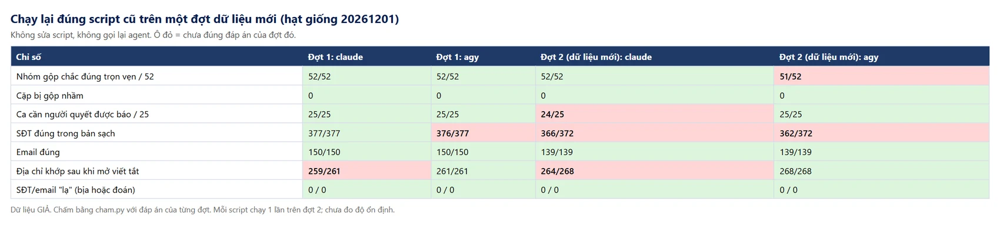

# Bài 3. Dùng hằng ngày: chạy lại, tự kiểm, người duyệt, hoàn tác

!!! info "Bài này"
    - **Bạn làm gì:** lập quy trình hằng tuần cho danh bạ: chạy lại script cũ trên export mới, tự kiểm, người duyệt ca nghi trùng, hoàn tác khi cần, cập nhật quy tắc khi dữ liệu đổi.
    - **Mất bao lâu:** khoảng 30 phút để đọc và thử; mỗi tuần sau đó 20-40 phút tùy số ca cần duyệt.
    - **Cần có:** kết quả bài 2 (`lam_sach.py` của một agent, thư mục `ket-qua/`), Python 3 với `openpyxl`, Excel.
    - **Kết quả:** một quy trình 6 bước, cách hoàn tác bằng một lệnh, và hiểu **vì sao không được tin script cũ trên dữ liệu mới** khi chưa thử lại.

> Dữ liệu GIẢ. **[Đo được]** = chúng tôi chạy và chấm ngày 2026-11-20 (n nhỏ, ghi ở từng chỗ). Đọc [bài 1](cap-00-chuan-bi-du-lieu-va-giao-viec.md) và [bài 2](cap-01-chay-that-va-kiem-tra.md) trước.

Một lần làm sạch xong chưa phải là xong: tuần sau có thêm khách mới, export mới từ Zalo và sàn. Ưu điểm của cách "agent viết script, script chạy trên dữ liệu" là lần sau **không tốn lượt gọi mô hình**, chỉ chạy lại `lam_sach.py`. **[Đo được]** cả bốn script (hai agent, hai lần) chạy lại trên chính dữ liệu cũ ra 3 file CSV giống từng byte, không gọi mạng.

## Vì sao phải thử script cũ trên dữ liệu mới

Câu hỏi thật là: script viết cho đợt 1 có đúng trên đợt 2 không? Chúng tôi sinh một **đợt mới** từ cùng bộ sinh nhưng hạt giống khác (20261201): cùng cấu trúc lỗi nhưng khác tên, SĐT, và cách lỗi rơi vào từng dòng. Rồi chạy **nguyên script cũ** của `claude-1` và `agy-1`, không sửa một chữ, không gọi lại agent.



*Dựng từ `ket-qua/bao-cao-cham.json` và `ket-qua/bao-cao-cham-dot2.json` bằng HTML; dữ liệu giả; mỗi script chạy 1 lần trên đợt 2.*

**[Đo được] (1 đợt mới, mỗi script chạy 1 lần):**

| | claude (script cũ) | agy (script cũ) |
|---|---|---|
| Nhóm gộp đúng / 52 | 52 | **51** |
| Cặp gộp nhầm | 0 | 0 |
| Ca cần người quyết được báo / 25 | **24** | 25 |
| SĐT đúng / 372 | **366** | **362** |
| Địa chỉ khớp / 268 | **264** | 268 |
| SĐT/email lạ (bịa) | 0 | 0 |

Vẫn không gộp nhầm ai, nhưng script mất 6 đến 10 SĐT, sót một nhóm gộp (agy) và một ca cần quyết (claude). **Kết quả tốt ở đợt 1 không cho phép suy ra độ chính xác ở đợt mới.** Lý do từng lỗi nằm ở phần Đào sâu cuối bài.

!!! warning "Quy tắc an toàn cho danh bạ thật"
    - **Luôn làm trên bản sao** trong thư mục riêng của đợt; giữ `danh-ba-goc.xlsx` nguyên vẹn (hoàn tác chỉ làm được khi file gốc còn).
    - **Chạy script ở máy bạn.** Đừng gửi danh bạ thật lên agent đám mây chỉ để "nhờ chạy giúp". Khi cần agent sửa script, chỉ đưa **bản giả danh** (bài 1, Bước 3). Nguyên tắc và nguồn: [An toàn dữ liệu và pháp lý khi dùng AI](../an-toan-du-lieu-va-phap-ly-vn.md); việc đưa dữ liệu ra ngoài là câu hỏi cho người phụ trách pháp lý, bài này không viết điều luật.
    - **Đáp án để ngoài tầm agent.** Danh bạ thật không có đáp án; bộ thử của bạn (Bước 3) cũng để ngoài thư mục agent làm việc.

## Quy trình mỗi tuần

Dành cho cửa hàng có người phụ trách dữ liệu, không nhất thiết biết lập trình **[Đề xuất]**.

### Bước 1. Chép export mới vào thư mục của đợt

Tạo thư mục theo ngày (ví dụ `2026-12-04`), chép export vào, đặt tên `danh-ba-goc.xlsx` với đúng cột cũ, chép thêm `lam_sach.py` đang dùng. Kiểm tên cột trước: export Shopee đổi tên cột sẽ làm script lỗi hoặc đọc sai.

### Bước 2. Chạy script, không cần agent

```lenh
cd 2026-12-04
python -X utf8 lam_sach.py
```

`cd` đổi vào thư mục đợt; `python` chạy script. Script đọc `danh-ba-goc.xlsx` trong thư mục hiện tại và ghi 4 file kết quả cùng thư mục. macOS hoặc Linux: `python3 lam_sach.py`.

!!! see "Bạn sẽ thấy"
    Một bảng số liệu in ra (số dòng gốc, số khách sau gộp, số nhóm gộp, số ca cần quyết) và 4 file mới: `danh-ba-sach.xlsx`, `nhat-ky-gop.csv`, `nhat-ky-sua.csv`, `nghi-trung-can-quyet.csv`.

### Bước 3. Tự kiểm rồi đọc cảnh báo

```lenh
python -X utf8 ket-qua\tu_kiem.py 2026-12-04
```

Lệnh chạy từ thư mục chứa cả `ket-qua/` và `2026-12-04/`. Phải đạt 5 phép (xem bài 2). **[Đo được] nó bắt được gì và bỏ lọt gì:**

- Ở đợt 1, lần 0 của agy trượt phép 4 (bỏ sót một nhóm nối bằng email): bắt được, không cần đáp án.
- Ở đợt 2, script của cả hai agent **đạt cả 5 phép** dù mất 6 đến 10 SĐT và còn `Dn` trong địa chỉ. Năm phép đầu **chỉ bảo đảm cấu trúc và nhất quán**, không bảo đảm đúng.
- **Cảnh báo 6** (khách không có SĐT sạch nhưng dòng gốc có chuỗi từ 9 chữ số) có ích: ở đợt 2 nó liệt kê 13 chỗ (claude) và 17 chỗ (agy), trong đó có các dòng `hoặc` và các dòng mất SĐT vì luật email. Giá phải trả: người phải đọc từng dòng.

Vì vậy cần thêm lớp máy không có: **bộ thử có đáp án tay** **[Đề xuất]**. Chọn 20-30 dòng khó từ dữ liệu thật (trùng, đổi chỗ cột, sai định dạng), tự viết kết quả đúng vào `bo-thu.csv`, chạy script trên bộ thử sau mỗi lần sửa. Mỗi lỗi gặp ở thực tế **thêm một dòng vào bộ thử**. `cham.py` là ví dụ cách so, nhưng chỉ dùng được với dữ liệu giả có `dap-an.json`.

### Bước 4. Người duyệt danh sách cần quyết

`nghi-trung-can-quyet.csv` mỗi nhóm một dòng, kèm `ly_do` và `goi_y`.


*Dựng từ `ket-qua/claude-1/nghi-trung-can-quyet.csv`, trích 5 nhóm; dữ liệu giả.*

1. Mở bằng Excel, thêm cột `quyet_dinh`, điền `GOP`, `KHONG` hoặc `HOI_KHACH` cho từng nhóm (bài 4, prompt 7 nhờ agent dựng sẵn file có danh sách thả xuống).
2. Với `HOI_KHACH`, ghi cách hỏi (gọi số nào, nhắn Zalo nào) và người phụ trách.
3. Giữ file đã điền làm nhật ký quyết định: lần sau cùng cặp dòng xuất hiện lại thì không phải hỏi lại.
4. Nhóm `GOP`: **chưa có công cụ trong bài này** áp quyết định vào bản sạch. Tạm thời người gộp tay trong hệ thống thật và ghi vào nhật ký quyết định.

Gợi ý của mô hình là **một ý kiến**, không phải quyết định. Ví dụ ở ca cùng SĐT mà một bên chỉ có tên `Linh`, cả hai agent nghiêng về gộp nhưng đều dặn cần gọi xác nhận; người duyệt nên làm đúng như dặn.

### Bước 5. Soi mẫu và hoàn tác thử

Lấy 20 khách ngẫu nhiên (cả đã gộp lẫn chưa), đối chiếu `danh-ba-goc.xlsx`. Mọi lần gộp hoàn tác được vì `nhat-ky-gop.csv` ghi từng dòng gốc đi đâu. `hoan_tac.py` in các dòng gốc của một khách và lý do gộp:

```lenh
python -X utf8 ket-qua\hoan_tac.py ket-qua\claude-1 KH001
```

```ketqua
KH001 gồm 3 dòng gốc:
  R001  [GIU_RIENG, không]  Zalo | vũ  Khánh CHI  | +84 395 550 801 | chikhanh91@example.org | 58/4/4 VO THI SAU, P.5, Q.10, TP HCM | 
      vì sao gộp: Giữ làm dòng đại diện của KH001, nhận thêm 2 dòng: R101, R113.
  R101  [GOP_VAO, G1]  Phần mềm bán hàng | Vũ Khánh Chi | 0395550801 |  |  | khách quen
      vì sao gộp: Gộp vào R001: khớp SĐT 0395550801 giữa R001 và R101 (tên 'Vũ Khánh Chi' ~ 'Vũ Khánh Chi').
  R113  [GOP_VAO, G2]  Shopee | Vũ K. Chi | 84335550647 | Chikhanh91@Example.org | 58/4/4 VO THI SAU, P.5, Q.10, TP. HCM | giao giờ hành chính
      vì sao gộp: Gộp vào R001: khớp email chikhanh91@example.org giữa R001 và R113 (tên 'Vũ Khánh Chi' ~ 'Vũ K. Chi').
```

Thêm `--ghi tach.csv` để lưu các dòng gốc ra CSV rồi dán lại thành các khách riêng. Thử trên ít nhất 3 khách.

### Bước 6. Nhập vào hệ thống thật và ghi lỗi mới

Chỉ nhập vào CRM hoặc phần mềm bán hàng khi Bước 3-5 xong. Lưu nguyên thư mục đợt làm bằng chứng. Mọi lỗi mới gặp ghi vào `loi-gap.md` (ngày, Mã dòng, giá trị gốc, kết quả đúng mong muốn). Cuối tháng đưa danh sách đó cho agent để cập nhật quy tắc.

## Khi dữ liệu đổi: cập nhật quy tắc bằng agent

Khi `loi-gap.md` có vài lỗi mới (ví dụ "ô hai SĐT dùng chữ `hoặc`", "`DN` là Đà Nẵng", "email thiếu `@` không phải SĐT"), giao lại việc theo khung 6 phần nhưng ngắn. Điểm mấu chốt là bắt agent **báo các dòng nào đổi kết quả**: một sửa nhỏ có thể làm đổi kết quả ở nơi bạn không ngờ.

```prompt
Thư mục này có `lam_sach.py` (đang dùng), `danh-ba-goc.xlsx`, `loi-gap.md` (các dòng script xử lý sai: Mã dòng, giá trị gốc, kết quả đúng mong muốn) và thư mục `cu/` chứa 4 file kết quả của lần chạy hiện tại.
Sửa `lam_sach.py` để các dòng trong `loi-gap.md` ra đúng, KHÔNG đổi hành vi với các dòng khác.
1. Sửa tối thiểu. Không đổi tên cột, không bỏ quy tắc cũ, không thêm quy tắc gộp ngoài những gì `loi-gap.md` nêu.
2. Chép script đã sửa vào thư mục `moi/` cùng `danh-ba-goc.xlsx`, chạy ở đó.
3. So `moi/` với `cu/` bằng code và liệt kê CHÍNH XÁC những ô nào đổi (Mã dòng, cột, giá trị cũ, giá trị mới). Ô đổi ngoài các dòng trong `loi-gap.md` phải được nêu riêng và giải thích.
4. Không chắc thì ghi CẦN NGƯỜI QUYẾT, đừng đoán.
Chỉ đọc và ghi trong thư mục hiện tại.
```

Chưa chạy thử đúng bản này. Bản gọn cho một quy tắc (`DN` thành `Đà Nẵng`) **đã chạy thật** ở bài 4, prompt 5: 2 ô đổi, đúng 2 địa chỉ cần đổi.

## Đào sâu: ba loại lỗi lộ ra ở đợt dữ liệu mới

Cả ba đều **chưa xuất hiện hoặc chưa gây lỗi ở đợt 1**:

1. **Dấu phân cách hai SĐT.** Có ô ghi `0975550835 hoặc 0975 550 146`. Cả hai script **mất cả hai số** ở ba dòng như vậy (6 SĐT). Prompt chỉ nói "ô có hai SĐT" mà không liệt kê chữ nối; script đợt 1 chỉ biết các chữ nối đã thấy.
2. **Luật "email lẫn cột" sai tay.** Script của agy coi mọi ô Email không có `@` mà có chữ số là SĐT. Ở đợt 1 điều này làm mất SĐT dòng R322 (bài 2); ở đợt 2 lặp lại ở **ba dòng** (email thiếu `@` có chữ số như `vinhpham1example.net` ghi đè SĐT thật). Thêm một dòng có `liên hệ 036-555-0550` trong Ghi chú mà script không nhận ra, kéo theo một nhóm 3 dòng không được gộp (51/52).
3. **`DN` chưa được mở thành Đà Nẵng** (script của claude): 4 địa chỉ còn `Dn`; hai dòng cùng tên và địa chỉ (một viết `tp đà nẵng`, một viết `DN`) không so khớp được, nên một ca cần người quyết không được báo (24/25).

Bài học: **script "đóng băng" quy tắc ở thời điểm viết.** Quy tắc chưa phủ hết không phải lỗi, nhưng bạn cần biết nó phủ đến đâu trước khi tin kết quả.

## Đào sâu: giới hạn và việc chưa làm

- **Chưa làm: áp quyết định của người** vào bản sạch (gộp theo `quyet_dinh`) và cập nhật tăng dần khi có đợt mới (khách cũ đã có mã `KH` thì đợt sau phải giữ mã). Nên làm tiếp: lưu một bảng khách chuẩn và so khớp dòng mới với nó.
- **Chưa làm: so khớp mờ** (khác một chữ cái vì gõ nhầm). Cố tình không làm vì dễ gộp nhầm (`Hùng`/`Hưng`); nếu thêm, chỉ nên đưa vào danh sách cần người quyết.
- **Địa chỉ:** script chỉ mở viết tắt, không đối chiếu danh mục hành chính. Tên đơn vị hành chính có thể thay đổi theo thời gian; chuẩn hóa thật cần danh mục chính thức **[Đề xuất]**.
- **Đầu số cũ 11 số (01x):** để "không hợp lệ". Muốn đổi sang số mới cần bảng của cơ quan quản lý hoặc nhà mạng; trang tham khảo của chúng tôi (Wikipedia, "Telephone numbers in Vietnam", CC BY-SA 4.0) không có bảng đó.
- Về mô hình ở ca mơ hồ: nếu muốn mô hình đọc `nghi-trung-can-quyet.csv` để gợi ý kỹ hơn, chạy nó trên **bản đã giả danh**, chỉ để lấy gợi ý, người vẫn quyết **[Đề xuất]**. Chất lượng gợi ý trên dữ liệu ngoài bộ giả này chưa đo.

## Lỗi thường gặp khi dùng hằng ngày

| Triệu chứng | Cách xử lý |
|---|---|
| Tin kết quả vì "kiểm đạt 5/5" | Đạt không có nghĩa đúng. Đọc cảnh báo 6, soi mẫu, chạy bộ thử |
| Chạy script đợt cũ lên export đổi tên cột | Kiểm tên cột trước; script có thể lỗi hoặc đọc sai |
| Sửa tay file sạch rồi chạy lại script | Script ghi đè file sạch, sửa tay mất. Sửa vào file quyết định, không sửa vào file kết quả |
| Mất file gốc của đợt cũ nên không hoàn tác được | Lưu mỗi đợt trong thư mục riêng |
| Để agent "thêm quy tắc cho nhanh" | Quy tắc mới đi qua bộ thử và danh sách ô đổi, rồi mới vào |
| Gửi danh bạ thật cho agent đám mây | Chỉ đưa bản giả danh; xem bài 1, Bước 3 |

## Checklist cuối bài 3

- [ ] Có thư mục theo đợt, mỗi đợt có `danh-ba-goc.xlsx` nguyên vẹn.
- [ ] `lam_sach.py` chạy được bằng một lệnh trên máy bạn, không cần agent, không gọi mạng.
- [ ] `tu_kiem.py` đạt, và đã đọc cảnh báo 6.
- [ ] Có bộ thử 20-30 dòng với đáp án tay, chạy được sau mỗi lần sửa script.
- [ ] Có người duyệt `nghi-trung-can-quyet.csv`; file quyết định được lưu.
- [ ] Đã hoàn tác thử ít nhất 3 khách bằng `hoan_tac.py`.
- [ ] Có `loi-gap.md` để gom lỗi và cuối tháng cập nhật quy tắc.

## Việc cần người làm

- **Người phụ trách dữ liệu:** duyệt danh sách cần quyết hằng tuần, giữ file quyết định.
- **Chủ cửa hàng:** quyết quy ước (cùng tên và địa chỉ có đủ để gộp không; tên một từ xử lý ra sao).
- **Người phụ trách pháp lý hoặc luật sư:** xác nhận cách xử lý dữ liệu cá nhân của khách và việc dùng dịch vụ đám mây.
- **Người am hiểu kỹ thuật (hoặc agent có người duyệt):** cập nhật `lam_sach.py` khi có lỗi mới, giữ bộ thử.

## Giới hạn

- Hai đợt dữ liệu đều do cùng một bộ sinh tạo ra nên biến thể lỗi có hạn. Script mất 6-10 SĐT trên đợt 2 dù đợt 1 gần như hoàn hảo là cảnh báo rằng kết quả ở đợt 1 **không** cho phép đoán độ chính xác trên dữ liệu thật.
- Mỗi agent 2 lần chạy ở đợt 1, mỗi script 1 lần ở đợt 2. Không đo được độ ổn định giữa các lần; không kết luận agent nào tốt hơn.
- **Agent chạy với toàn quyền** trên máy (`--dangerously-skip-permissions`, `acceptEdits`). Dùng trong thư mục sao riêng; với dữ liệu thật hãy cân nhắc chạy trong máy hoặc tài khoản tách biệt.
- Chúng tôi không có số liệu về doanh nghiệp thật và không nêu con số tiết kiệm thời gian hay chi phí. Điều bài chứng minh được chỉ là: (1) cách "agent viết script tất định, người duyệt ca mơ hồ" cho kết quả kiểm được và hoàn tác được; (2) script đóng băng quy tắc, cần thử lại và cập nhật khi dữ liệu đổi.

Bài tiếp theo: [cap-03-prompt-mau-va-bai-tap.md](cap-03-prompt-mau-va-bai-tap.md).
