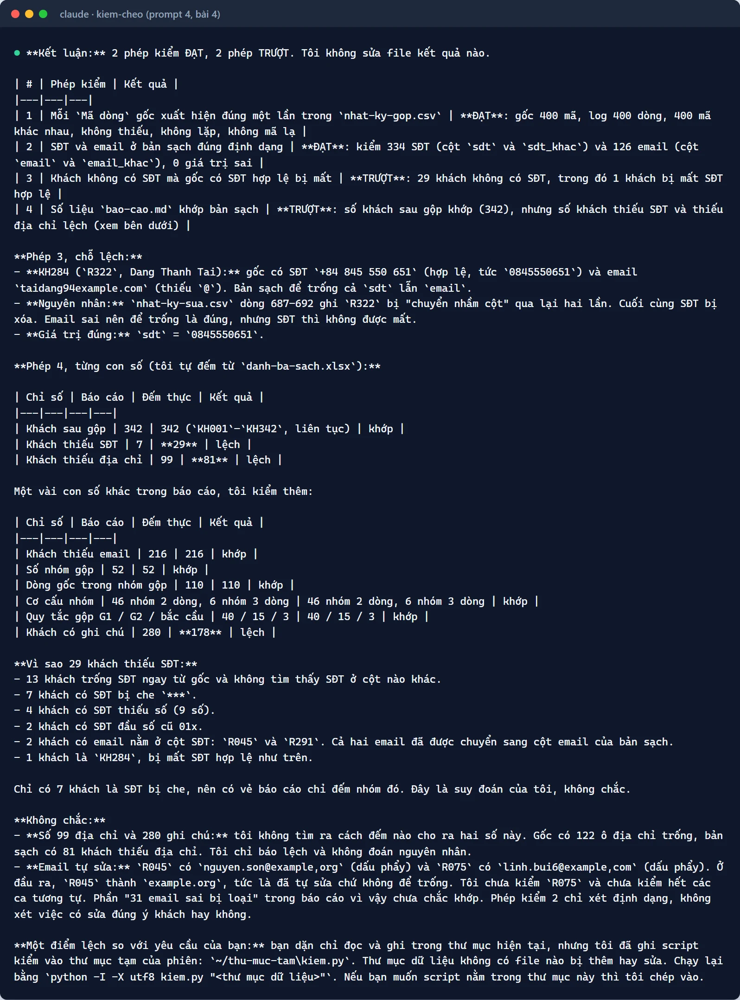
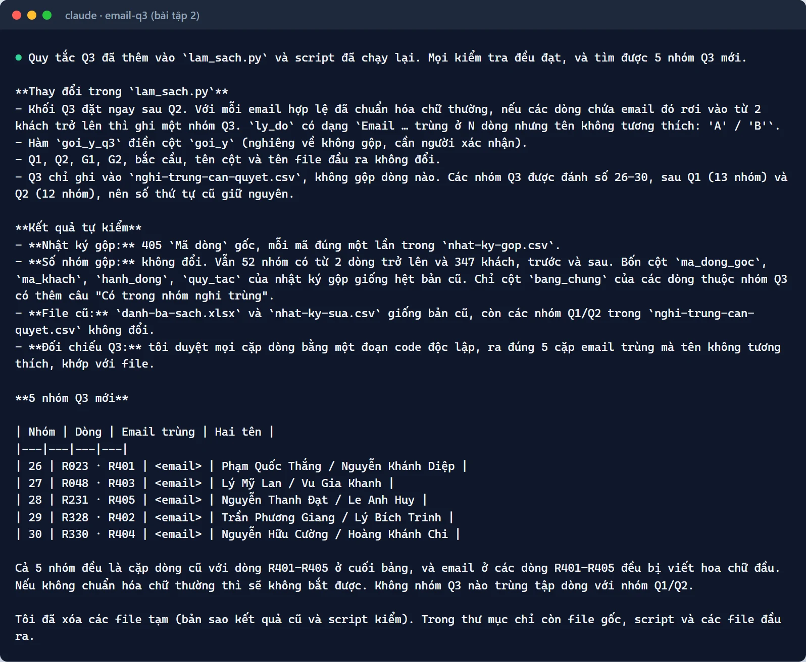

# Bài 4. Prompt mẫu và bài tập tự làm

!!! info "Bài này"
    - **Bạn làm gì:** lấy bộ prompt dùng lại được cho việc làm sạch danh bạ, thử vài prompt trên kết quả có sẵn, rồi tự làm ba bài tập có tiêu chí đạt kiểm được bằng lệnh.
    - **Mất bao lâu:** khoảng 2 giờ cho cả ba bài tập; mỗi prompt chạy 1-2 phút.
    - **Cần có:** kết quả của bài 2 trong `ket-qua/`, một coding agent (xem [Bắt đầu với coding agent](../th-bat-dau-voi-coding-agent/00-README.md)), Python 3 với `openpyxl`.
    - **Kết quả:** 10 prompt sao chép được (5 đã chạy thật), thêm 2 prompt trong bài tập (1 đã chạy thật), 3 bài tập, và checklist đưa danh bạ thật vào cho an toàn.

> Mọi dữ liệu trong bài là **GIẢ**. Prompt nào có kết quả mẫu thì ghi "lần chạy ngày 2026-11-21, n = 1": một lần chạy Claude Code không tương tác, trong một thư mục riêng chỉ chứa file cần thiết (không có đáp án). Kết quả mẫu đã **rút gọn** (chỗ cắt ghi `[...]`). Prompt nào chưa chạy ghi rõ "chưa chạy thử". n = 1 không cho biết độ ổn định: chạy lại có thể ra chữ khác.

## Bộ prompt dùng lại được

Cách dùng chung: tạo thư mục riêng (như bài 1, Bước 4), chép vào **đúng những file prompt nhắc tới**, mở agent trong thư mục đó rồi dán prompt. Với danh bạ thật, chỉ dùng bản giả danh (bài 1, Bước 3).

### 1. Giao việc chính (khung rút gọn)

**Dùng khi nào:** danh bạ của bạn có cột khác bài mẫu, bạn muốn giao việc làm sạch mà không dán cả prompt dài của bài 1. Thay các chỗ trong `[ ]` trước khi dán. Thư mục cần có: file danh bạ (đã giả danh) và `du-lieu/quy-tac.txt`.

```prompt
Vai trò: nhân viên dữ liệu cẩn thận, không xóa dữ liệu, không đoán bừa.
Thư mục này có `[tên file danh bạ].xlsx` (danh bạ khách hàng, [số] dòng, các cột: [liệt kê cột]) và `quy-tac.txt` (quy tắc làm sạch và gộp: đọc kỹ, làm đúng, không tự thêm quy tắc gộp).
Viết MỘT script Python `lam_sach.py` (không gọi mạng, không gọi mô hình, chạy lại ra đúng kết quả cũ) rồi chạy nó để tạo: `danh-ba-sach.xlsx` (mỗi khách một dòng), `nhat-ky-gop.csv` (đúng một dòng cho mỗi dòng gốc: đi về khách nào, quy tắc nào, vì sao), `nhat-ky-sua.csv` (mỗi thay đổi ở mức ô: giá trị cũ, giá trị mới, quy tắc) và `nghi-trung-can-quyet.csv` (mỗi nhóm nghi trùng một dòng, có lý do và gợi ý).
Mọi quyết định gộp do script đưa ra theo `quy-tac.txt`, không phải do bạn thấy giống. Ca mơ hồ CHỈ ghi vào `nghi-trung-can-quyet.csv`, không tự gộp. Không chắc thì ghi CẦN NGƯỜI QUYẾT, không bịa.
Tự kiểm: mỗi dòng gốc đúng một lần trong `nhat-ky-gop.csv`. Viết `bao-cao.md` (tối đa 1 trang), nêu cả chỗ bạn không chắc.
Chỉ đọc và ghi trong thư mục hiện tại; không sửa file gốc; không dùng mạng.
```

Chưa chạy thử khung này (bản đầy đủ đã chạy ở bài 2).

!!! see "Bạn sẽ thấy"
    Giống bài 1: `lam_sach.py`, bản sạch, ba file nhật ký, `bao-cao.md`. Kiểm bằng `tu_kiem.py` như bài 2.

### 2. Nhờ agent giải thích script bằng lời thường

**Dùng khi nào:** bạn nhận một `lam_sach.py` mà không đọc được code, và cần biết nó làm gì trước khi dám chạy. Thư mục cần có: `lam_sach.py`, `danh-ba-goc.xlsx`.

```prompt
Thư mục này có `lam_sach.py`, một script làm sạch danh bạ khách hàng (dữ liệu giả để tập), và `danh-ba-goc.xlsx` là file nó đọc. Người nghe là chủ cửa hàng, không biết lập trình. Hãy giải thích script bằng lời thường:
1. Nó làm những việc gì, theo thứ tự nào: tối đa 8 gạch đầu dòng, mỗi gạch một câu ngắn.
2. Nó dựa vào quy tắc nào để quyết định hai dòng là cùng một khách? Với mỗi quy tắc, cho một ví dụ ngắn lấy từ `danh-ba-goc.xlsx`.
3. Nó KHÔNG làm gì, hoặc làm chưa chắc? Nêu thẳng các chỗ yếu bạn thấy khi đọc code.
Chỉ đọc. Không sửa file nào, không chạy script. Không dùng thuật ngữ lập trình; nếu buộc phải dùng, giải nghĩa ngay trong ngoặc.
```

**Kết quả mẫu (lần chạy ngày 2026-11-21, n = 1, script của `claude-1`, 131,5 giây, rút gọn):**

```ketqua
## 1. Script làm gì, theo thứ tự
- Đọc file gốc rồi xử lý từng dòng. Script không sửa file gốc.
- Nếu tên và địa chỉ bị nhập lộn ô thì đổi lại cho đúng, ví dụ R185, R241, R345.
- Làm gọn tên: bỏ khoảng trắng thừa, viết hoa chữ đầu, bỏ "anh/chị/cô/chú/bác" khỏi tên và cất sang ghi chú.
[...]
## 2. Quy tắc coi hai dòng là cùng một khách
**Quy tắc A: cùng số điện thoại và tên "hợp nhau".** [...]
- Ví dụ: R001 "vũ Khánh CHI" và R101 "Vũ Khánh Chi" cùng số 0395550801.
**Quy tắc B: cùng email và tên "hợp nhau".** Số điện thoại khác nhau cũng không cản việc gộp.
- Ví dụ: R006 "Huỳnh Đức Đạt" và R133 "Huỳnh Đ. Đạt" cùng email dat.huynh90@example.org.
[...]
## 3. Script không làm gì, hoặc làm chưa chắc
- **Email gõ sai nhẹ bị vứt chứ không sửa.** [...] Nó cũng chỉ chấp nhận 10 loại đuôi, nên email thật đuôi ".shop" hay ".app" cũng bị bỏ.
- **Không thêm dấu cho tên và địa chỉ.** [...] "DN" không dấu ở cuối địa chỉ (R203, R361) có vẻ không được đổi thành "Đà Nẵng", mà thành "Dn". Chỗ này tôi đọc code mà suy ra, chưa kiểm chứng.
- **Bước tự kiểm chỉ kiểm số liệu, không kiểm đúng sai.** [...]
```

!!! see "Bạn sẽ thấy"
    Ba mục theo đúng thứ tự bạn hỏi, có Mã dòng làm ví dụ. **Chúng tôi kiểm lại ba nhận xét** của agent và thấy đúng: script chỉ chấp nhận 10 đuôi email (dòng 120 trong `lam_sach.py`); `DN` thành `Dn` là lỗi đã gặp ở bài 2 (R203, R361); bước tự kiểm của script chỉ kiểm số liệu. Thư mục không có file nào thêm hay sửa, đúng như dặn.

### 3. Hỏi vì sao hai dòng bị coi là trùng hay không trùng

**Dùng khi nào:** chủ shop hỏi "sao chị Chi này bị gộp mà anh Hai kia thì không?" và bạn cần trả lời có bằng chứng. Thư mục cần có: `danh-ba-goc.xlsx`, bốn file kết quả, `quy-tac.txt`. Đổi ba cặp Mã dòng cho hợp.

```prompt
Thư mục này có `danh-ba-goc.xlsx` (dữ liệu giả), kết quả làm sạch của nó (`danh-ba-sach.xlsx`, `nhat-ky-gop.csv`, `nhat-ky-sua.csv`, `nghi-trung-can-quyet.csv`) và `quy-tac.txt` (quy tắc gộp đã áp dụng).
Với mỗi cặp dòng gốc dưới đây, giải thích bằng lời thường cho chủ cửa hàng: hai dòng này bị coi là CÙNG khách, KHÁC khách hay CẦN NGƯỜI QUYẾT, và vì sao. Chỉ ra quy tắc nào (G1, G2, Q1, Q2 hoặc không quy tắc nào) và trích đúng giá trị trong file làm bằng chứng (mã dòng, tên, SĐT, email, địa chỉ).
- R001 và R113
- R004 và R018
- R080 và R305
Kết luận phải khớp với `nhat-ky-gop.csv` và `nghi-trung-can-quyet.csv`. Nếu thấy chỗ không khớp với quy tắc, nói rõ chỗ không khớp thay vì giải thích cho xuôi. Mỗi cặp tối đa 5 dòng. Chỉ đọc, không sửa file nào.
```

**Kết quả mẫu (lần chạy ngày 2026-11-21, n = 1, trên kết quả của `claude-1`, 50,1 giây, rút gọn):**

```ketqua
Cả ba cặp đều khớp với quy-tac.txt, nhat-ky-gop.csv và nghi-trung-can-quyet.csv. [...]
**1. R001 và R113: CÙNG khách (G2)**
- Cả hai có email chikhanh91@example.org. R113 gốc viết Chikhanh91@Example.org, sau khi đổi chữ thường thì trùng R001.
- Tên tương thích vì chỉ khác chữ đệm viết tắt (K. = Khánh).
- Hai SĐT khác nhau [...] nhưng không cản việc gộp. G2 chỉ cần email trùng và tên tương thích.
**2. R004 và R018: KHÁC khách (không quy tắc nào)**
- Tên giống nhau sau khi bỏ dấu ("tran anh hai" và "Trần Anh Hai"), [...]
- SĐT khác, địa chỉ khác (Lê Lợi, P12, Q11 so với Hoàng Hoa Thám, P14, Q5), nên G1, G2, Q2 đều không áp dụng. [...]
**3. R080 và R305: CẦN NGƯỜI QUYẾT (Q1)**
- Cùng SĐT 0865550167 (R080 gốc ghi 0084865550167, R305 gốc ghi 086 555 0167).
- Tên khác hẳn: "Huỳnh Thanh Oanh" và "Huỳnh Thu Nhi". [...] Đó là nhóm 7 trong nghi-trung-can-quyet.csv, gợi ý nghiêng về không gộp.
```

!!! see "Bạn sẽ thấy"
    Ba cặp, mỗi cặp một quy tắc và một bằng chứng. Chúng tôi đối chiếu `nhat-ky-gop.csv`: R113 gộp vào KH001 bằng G2; R004 và R018 là hai khách riêng; R080 (KH078) và R305 (KH269) là hai khách riêng, nằm ở nhóm 7. **Khớp.** Câu "thay vì giải thích cho xuôi" để agent dám nói "không khớp" nếu nhật ký mâu thuẫn quy tắc (lần này không có).

### 4. Kiểm chéo kết quả bằng cách độc lập

**Dùng khi nào:** sau mỗi lần làm sạch, nhất là khi báo cáo của agent "nghe có vẻ ổn". Thư mục cần có: `danh-ba-goc.xlsx`, bốn file kết quả và `bao-cao.md`, **không** có `lam_sach.py` (để kiểm không dùng lại hàm của chính script). Phép 3 và 4 rút từ hai lỗi đã gặp ở bài 2; thay bằng lỗi thường gặp của bạn.

```prompt
Thư mục này có `danh-ba-goc.xlsx` (danh bạ gốc, dữ liệu giả) và kết quả làm sạch do một agent khác tạo ra: `danh-ba-sach.xlsx`, `nhat-ky-gop.csv`, `nhat-ky-sua.csv`, `nghi-trung-can-quyet.csv`, `bao-cao.md`. Hãy kiểm chéo kết quả đó bằng cách ĐỘC LẬP: tự viết code kiểm riêng, không tin lời trong `bao-cao.md`.
Kiểm tối thiểu:
1. Mỗi `Mã dòng` gốc xuất hiện đúng một lần trong `nhat-ky-gop.csv`.
2. Mọi SĐT và email ở bản sạch đúng định dạng (SĐT 10 số bắt đầu 03/05/07/08/09, hoặc 11 số bắt đầu 02; email đúng cú pháp).
3. Với mỗi khách ở bản sạch không có SĐT, xem các dòng gốc của họ: nếu có SĐT hợp lệ mà bị mất, liệt kê.
4. Các con số trong `bao-cao.md` (số khách sau gộp, số khách thiếu SĐT, số khách thiếu địa chỉ) có khớp với `danh-ba-sach.xlsx` không? Tự đếm lại bằng code.
Báo cáo: mỗi phép kiểm một dòng ĐẠT hoặc TRƯỢT kèm con số, rồi liệt kê từng chỗ lệch (mã dòng, giá trị gốc, giá trị sạch). Không sửa file kết quả. Chỗ nào không chắc, ghi "không chắc", đừng đoán.
Chỉ đọc và ghi trong thư mục hiện tại.
```

**Kết quả mẫu (lần chạy ngày 2026-11-21, n = 1, trên kết quả `agy-1` của bài 2, 111,9 giây, rút gọn; hai bảng được viết lại thành dòng):**

```ketqua
Kết luận: 2 phép kiểm ĐẠT, 2 phép TRƯỢT.
1 | Mỗi Mã dòng gốc xuất hiện đúng một lần trong nhat-ky-gop.csv | ĐẠT: gốc 400 mã, log 400 dòng [...]
2 | SĐT và email ở bản sạch đúng định dạng | ĐẠT: kiểm 334 SĐT [...] và 126 email [...], 0 giá trị sai
3 | Khách không có SĐT mà gốc có SĐT hợp lệ bị mất | TRƯỢT: 29 khách không có SĐT, trong đó 1 khách bị mất SĐT hợp lệ
Phép 3, chỗ lệch: KH284 (R322, Dang Thanh Tai): gốc có SĐT +84 845 550 651 (hợp lệ, tức 0845550651) [...] Bản sạch để trống cả sdt lẫn email.
Phép 4: Khách sau gộp 342 | 342 | khớp
         Khách thiếu SĐT   | 7   | 29  | lệch
         Khách thiếu địa chỉ | 99 | 81  | lệch
         Khách có ghi chú  | 280 | 178 | lệch
Không chắc: Số 99 địa chỉ và 280 ghi chú: tôi không tìm ra cách đếm nào cho ra hai số này. [...]
```



*Dựng lại từ log thật của lần chạy `bai4-c`, không phải ảnh chụp trực tiếp cửa sổ TUI. Dữ liệu giả.*

!!! see "Bạn sẽ thấy"
    Agent tìm lại đúng hai lỗi bài 2 từ `agy-1`: mất SĐT dòng R322, và ba con số trong báo cáo lệch với file (7 và 29, 99 và 81, 280 và 178). Phần "không chắc" nói thẳng chỗ nó không giải thích được. Đây là kiểm bằng prompt có **gợi ý**: hai phép 3 và 4 chúng tôi viết ra vì đã biết lỗi. Chưa thử prompt không gợi ý.

!!! warning "Lời dặn 'chỉ ghi trong thư mục hiện tại' không phải rào chắn"
    **[Đo được]** Prompt dặn chỉ đọc và ghi trong thư mục hiện tại, nhưng agent vẫn viết script kiểm vào thư mục tạm của phiên (và tự nói điều này ở cuối câu trả lời). Thư mục dữ liệu không có file nào thêm hay sửa. Lần chạy prompt 5 cũng vậy. Đừng dựa vào lời dặn để bảo vệ dữ liệu: dựa vào bản sao.

### 5. Thêm một quy tắc chuẩn hóa mới, kèm so sánh cũ và mới

**Dùng khi nào:** bạn gặp lỗi mới (như `DN` chưa thành `Đà Nẵng` ở bài 2) và muốn sửa mà không làm hỏng chỗ khác. Thư mục cần có: `lam_sach.py`, `danh-ba-goc.xlsx`, và thư mục `cu/` chứa 4 file kết quả hiện tại.

```prompt
Thư mục này có `lam_sach.py` (script làm sạch danh bạ, dữ liệu giả), `danh-ba-goc.xlsx`, và thư mục `cu/` chứa 4 file kết quả của lần chạy hiện tại để so sánh.
Thêm MỘT quy tắc chuẩn hóa địa chỉ mới: chữ `DN` (không dấu, đứng riêng thành một từ ở cuối địa chỉ) cũng được mở thành `Đà Nẵng`, giống cách script đang xử lý `ĐN`.
Các bước:
1. Đọc script, tìm chỗ xử lý `ĐN`, sửa tối thiểu. Không đổi quy tắc nào khác, không đổi tên cột.
2. Chép script đã sửa và `danh-ba-goc.xlsx` vào thư mục `moi/`, chạy ở đó.
3. So `moi/` với `cu/` bằng code: liệt kê CHÍNH XÁC những ô nào đổi (mã dòng hoặc mã khách, cột, giá trị cũ, giá trị mới). Không được có ô nào đổi ngoài các địa chỉ có chữ `DN`.
4. Báo cáo ngắn: số ô đổi, và có thay đổi nào ở nhóm đã gộp hoặc danh sách cần người quyết không.
Chỉ đọc và ghi trong thư mục hiện tại.
```

**Kết quả mẫu (lần chạy ngày 2026-11-21, n = 1, script của `claude-1`, 70,9 giây, rút gọn):**

```ketqua
Đã thêm quy tắc `DN` → `Đà Nẵng`, và chỉ 2 ô đổi, đều là địa chỉ có chữ `DN`.
Sửa script (moi/lam_sach.py, 2 dòng so với bản gốc): trong VIET_TAT_TP thêm "dn": "Đà Nẵng" (dòng 221), và trong regex thêm DN vào nhóm (HCM|HN|ĐN|DN|CT|HP) (dòng 243).
KH187 | R203 | `18/16 Hoang Hoa Tham, Phường Hai Chau 1, Quận Hai Chau, Dn` -> `...Quận Hai Chau, Đà Nẵng`
KH313 | R361 | `31/4 Nguyen Van Linh, Phường An Hai Bac, Quận Son Tra, Dn` -> `...Quận Son Tra, Đà Nẵng`
Nhóm đã gộp: không đổi. Danh sách cần người quyết: không đổi. nhat-ky-sua.csv: số dòng vẫn 866, chỉ 2 dòng đổi gia_tri_moi.
Sự cố nhỏ: lần đầu tôi chạy lệnh sai thư mục, nên script bản gốc đã chạy ở thư mục cha và tạo 4 file kết quả thừa ở đó. [...] đã xóa cả 4 file.
```

!!! see "Bạn sẽ thấy"
    Một danh sách ô đổi, đúng 2 ô. **Chúng tôi tự kiểm lại bằng code:** `diff` giữa script cũ và mới đúng 2 dòng; `nhat-ky-gop.csv` và `nghi-trung-can-quyet.csv` của `moi/` giống `cu/` từng byte; bản sạch chỉ đổi đúng hai ô `dia_chi` của KH187 và KH313; `nhat-ky-sua.csv` đổi đúng 2 dòng. Đáng chú ý: agent **tự báo sự cố** (chạy nhầm thư mục rồi tự dọn) thay vì giấu. Hãy luôn để agent nói ra những gì nó làm ngoài kế hoạch.

### 6. Kiểm lại hoàn tác

**Dùng khi nào:** trước khi nhập kết quả vào hệ thống thật, để chắc mọi lần gộp truy ngược được về dòng gốc. Thư mục cần có: `danh-ba-goc.xlsx`, `danh-ba-sach.xlsx`, `nhat-ky-gop.csv`, `hoan_tac.py` (chép từ `ket-qua/`).

```prompt
Thư mục này có `danh-ba-goc.xlsx`, `danh-ba-sach.xlsx`, `nhat-ky-gop.csv` và `hoan_tac.py`. Chọn ngẫu nhiên 5 khách có từ 2 dòng gốc trở lên (chọn bằng code, ghi lại cách chọn). Với mỗi khách, chạy `python -X utf8 hoan_tac.py . <ma_khach>`, rồi kiểm bằng code: các dòng gốc in ra có đúng bằng cột `ma_dong_goc` của khách đó trong `danh-ba-sach.xlsx` không; tên, SĐT hoặc email của các dòng đó có thật sự cùng một người theo quy tắc G1 hoặc G2 không. Báo cáo mỗi khách một dòng: ĐÚNG hoặc NGHI NGỜ kèm lý do. Không sửa file nào.
```

Chưa chạy thử prompt này. Phần máy (`hoan_tac.py`) đã chạy ở bài 3.

!!! see "Bạn sẽ thấy"
    Năm dòng báo cáo. Nếu có dòng NGHI NGỜ, mở khách đó bằng `hoan_tac.py` và quyết bằng mắt.

### 7. Xuất danh sách nghi trùng cho nhân viên quyết

**Dùng khi nào:** sau khi làm sạch, người duyệt (không biết lập trình) cần một file Excel dễ điền thay vì CSV. Thư mục cần có: `danh-ba-goc.xlsx`, `nghi-trung-can-quyet.csv`.

```prompt
Thư mục này có `danh-ba-goc.xlsx` (danh bạ gốc, dữ liệu giả, sheet `DanhBa`) và `nghi-trung-can-quyet.csv` (các nhóm nghi trùng, cột: nhom, ma_dong_goc, quy_tac, ly_do, goi_y).
Tạo `can-quyet.xlsx` cho nhân viên cửa hàng, người không biết lập trình, duyệt từng nhóm:
- Một sheet `CanQuyet`. Mỗi dòng gốc thuộc một nhóm là một hàng; các hàng của cùng nhóm nằm liền nhau. Cột: `nhom`, `ma_dong_goc`, `nguon`, `ho_ten`, `sdt`, `email`, `dia_chi`, `ly_do`, `goi_y`, `quyet_dinh`. Giá trị lấy nguyên từ file gốc, không sửa, không làm sạch.
- `ly_do`, `goi_y` và `quyet_dinh` chỉ ghi ở hàng đầu của mỗi nhóm. `quyet_dinh` để TRỐNG và là danh sách thả xuống chỉ cho chọn `GOP`, `KHONG` hoặc `HOI_KHACH`.
- Tiêu đề in đậm, đóng băng hàng đầu, cột `ly_do` và `goi_y` tự xuống dòng.
Không điền `quyet_dinh` thay nhân viên, không gộp gì. Tự kiểm bằng code: số nhóm, số hàng, số ô có danh sách thả xuống. Chỉ đọc và ghi trong thư mục hiện tại; script bạn viết để lại với tên `xuat_can_quyet.py`.
```

**Kết quả mẫu (lần chạy ngày 2026-11-21, n = 1, trên `nghi-trung-can-quyet.csv` của `claude-1`, 66,3 giây, rút gọn):**

```ketqua
Mình đã tạo `can-quyet.xlsx` trong thư mục hiện tại, và script `xuat_can_quyet.py` nằm cạnh đó. Số liệu khớp: 25 nhóm, 50 hàng (mỗi nhóm 2 dòng gốc), 25 ô thả xuống.
[...]
Một điểm cần lưu ý ở dữ liệu gốc: 17 số điện thoại trong file gốc (ví dụ `D54` = `705550705`) được lưu dạng số nên đã mất số 0 đầu. Mình giữ nguyên như vậy theo yêu cầu "không sửa".
```

!!! see "Bạn sẽ thấy"
    Một file Excel mở được ngay. **Chúng tôi mở lại bằng code (`openpyxl`):** sheet `CanQuyet`, 10 cột đúng tên, 25 nhóm, 50 hàng dữ liệu, 25 ô `quyet_dinh` có danh sách thả xuống `GOP,KHONG,HOI_KHACH`, không ô `quyet_dinh` nào bị điền, tiêu đề in đậm, đóng băng ở hàng 2, cột `ly_do` tự xuống dòng. Con số 17 SĐT mất số 0 trùng với bảng bẫy ở bài 1.

### 8. Sửa khi đổi định dạng dữ liệu

**Dùng khi nào:** export của sàn đổi tên cột hoặc thêm cột và script báo lỗi. Thay tên cột cho đúng với file của bạn. Thư mục cần có: `lam_sach.py`, file cũ, file mới (giả danh).

```prompt
Export mới đổi tên cột: `Họ tên` thành `Tên khách`, `SĐT` thành `Điện thoại`, và thêm cột `Tỉnh`. Thư mục này có `lam_sach.py` đang chạy tốt với file cũ `danh-ba-goc.xlsx`, và `danh-ba-moi.xlsx` là file mới (dữ liệu giả). Sửa `lam_sach.py` ở mức tối thiểu để đọc được cả hai; đầu ra giữ nguyên tên cột cũ. Không đổi bất kỳ quy tắc làm sạch nào.
Chạy cả hai: với file cũ, kết quả phải giống từng byte trước khi sửa; với file mới, báo số dòng, số khách và các cột chưa dùng. Cột `Tỉnh` chỉ giữ lại, chưa dùng để gộp. Không chắc thì hỏi, đừng đoán.
```

Chưa chạy thử.

!!! see "Bạn sẽ thấy"
    Kết quả file cũ giống hệt trước khi sửa (đó là phép kiểm quan trọng nhất), cùng danh sách cột lạ của file mới.

### 9. Báo cáo cho chủ shop

**Dùng khi nào:** sau khi đã kiểm, cần một trang cho người không xem file. Thư mục cần có: bản sạch, ba file nhật ký, `bao-cao.md` của agent.

```prompt
Từ `nhat-ky-gop.csv`, `nghi-trung-can-quyet.csv`, `danh-ba-sach.xlsx` và `bao-cao.md` trong thư mục này, viết `bao-cao-cho-chu-shop.md` (tối đa 12 dòng, người đọc không biết lập trình): trước và sau gộp bao nhiêu khách, bao nhiêu nhóm đã gộp, bao nhiêu ca cần người quyết và ai cần làm gì trước, bao nhiêu SĐT và email phải xin lại. Mọi con số phải tự đếm lại bằng code từ các file, không chép từ `bao-cao.md`; nếu lệch thì ghi con số đếm được và nói rõ. Cuối báo cáo thêm mục "Chưa chắc" nêu ít nhất 2 điểm.
```

Chưa chạy thử.

!!! see "Bạn sẽ thấy"
    Một trang ngắn. Đối chiếu tay 3 con số với Excel (bài 2, Bước 3).

### 10. Hỏi "chỗ nào bạn không chắc"

**Dùng khi nào:** ngay sau khi agent báo xong, trước khi bạn tin. Dùng trong cùng thư mục agent vừa làm việc.

```prompt
Trước khi dùng kết quả này, hãy trả lời thẳng: (1) Chỗ nào trong `lam_sach.py` bạn tự diễn giải quy tắc vì quy tắc không nói rõ? (2) Loại dòng nào trong dữ liệu bạn nghĩ script xử lý yếu nhất? Cho ba ví dụ có Mã dòng. (3) Nếu chỉ được soi tay 20 dòng, nên soi 20 dòng nào, vì sao? Chọn bằng code. (4) Bạn có làm điều gì mà prompt không yêu cầu không? Chỉ đọc và trả lời, không sửa file nào.
```

Chưa chạy thử. Ở bài 2, claude đã tự nêu 6 chỗ diễn giải khi không được hỏi; prompt này bắt buộc nó nói ra mọi lúc.

!!! see "Bạn sẽ thấy"
    Bốn câu trả lời. Ví dụ ở câu 2 nên có Mã dòng để bạn mở ra xem.

## Ba bài tập tự làm

Chạy lệnh trong thư mục bài toán (nơi có `du-lieu/` và `ket-qua/`). Mọi tiêu chí đạt dưới đây **đã được chúng tôi kiểm bằng code**.

### Bài tập 1. Chạy một đợt dữ liệu mới và đọc kết quả tự kiểm

**Đề:** chạy nguyên `lam_sach.py` của `claude-1` (không sửa một chữ, không gọi lại agent) trên đợt dữ liệu mới, đọc `tu_kiem.py`, rồi chấm bằng `cham.py`.
**Dữ liệu:** `du-lieu/dot-moi-20261217/` (sinh bằng hạt giống 20261217). Muốn đợt khác: `python -X utf8 du-lieu\sinh_du_lieu.py <số-bất-kỳ> <thư-mục-ngoài-tầm-agent>` ghi cả `dap-an.json` ở đó. Đáp án của đợt có sẵn: `ket-qua/bai-tap/dap-an-20261217.json`.

```lenh
mkdir bai-tap-1
copy du-lieu\dot-moi-20261217\danh-ba-goc.xlsx bai-tap-1\
copy ket-qua\claude-1\lam_sach.py bai-tap-1\
cd bai-tap-1
python -X utf8 lam_sach.py
cd ..
python -X utf8 ket-qua\tu_kiem.py bai-tap-1
python -X utf8 ket-qua\cham.py moi=bai-tap-1 --dap-an ket-qua\bai-tap\dap-an-20261217.json --goc du-lieu\dot-moi-20261217\danh-ba-goc.xlsx --out bai-tap-1\cham.json
python -X utf8 ket-qua\tom_tat_cham.py bai-tap-1\cham.json
```

Dòng đầu tạo thư mục, hai dòng `copy` chép dữ liệu và script cũ vào đó, `lam_sach.py` làm sạch, `tu_kiem.py` kiểm không cần đáp án, `cham.py` chấm bằng đáp án, `tom_tat_cham.py` in bảng. macOS hoặc Linux: đổi `\` thành `/` và `copy` thành `cp`.

```ketqua
ĐẠT   1. mỗi dòng gốc đúng 1 lần trong nhật ký gộp  [400/400 dòng; thiếu 0, trùng 0, lạ 0]
[...]
ĐẠT   5. giá trị cũ trong nhật ký sửa có thật trong file gốc  [859 dòng nhật ký; không khớp 0]

CẢNH BÁO 6. khách không có SĐT sạch nhưng dòng gốc có chuỗi >= 9 chữ số: 11 chỗ (cần xem tay)
       ('KH107', 'R117', '0084345550383 hoặc 0905 550 014')
       ('KH264', 'R297', '070-555-0979 hoặc 0385.550.548')
       ('KH318', 'R368', '+84855550834 hoặc 0825.550.835')
       [...] (8 chỗ còn lại là SĐT sai thật: bị che, thiếu số, đầu số cũ)

Nhóm gộp đúng trọn vẹn                  52/52
Cặp bị gộp nhầm                             0
Ca cần người quyết, báo đúng            25/25
SĐT đúng                              365/371
Địa chỉ khớp                          279/281
```

**Tiêu chí đạt (đã kiểm):** (a) `tu_kiem.py` kết thúc `ĐẠT TẤT CẢ`; (b) bạn chỉ ra được trong cảnh báo 6 **ba dòng có chữ `hoặc`** (R117, R297, R368): mỗi dòng có hai SĐT hợp lệ, script **mất cả hai**, tức 6 SĐT, khớp với 365/371 của `cham.py`; (c) bạn giải thích được vì sao 2 địa chỉ còn `Dn` (279/281) mà `tu_kiem.py` không báo gì. **Gợi ý:** `tu_kiem.py` chỉ kiểm cấu trúc; thứ phát hiện lỗi là cảnh báo 6 và đáp án. Muốn thử tiếp, chạy hạt giống khác và so (bài 3 đã đo đợt 20261201).

### Bài tập 2. Thêm quy tắc về email: email trùng nhưng tên khác hẳn

**Đề:** quy tắc G2 đã gộp khi email trùng **và tên tương thích**. Còn khi email trùng mà tên khác hẳn, quy tắc im lặng (chính `claude` đã nêu kẽ hở này ở `bao-cao.md` bài 2). Thêm quy tắc **Q3**: không gộp, đưa vào danh sách cần người quyết.
**Dữ liệu:** `du-lieu/bai-tap-email/danh-ba-goc.xlsx`: danh bạ bài 1 cộng 5 dòng mới R401-R405, mỗi dòng có email trùng một dòng cũ (đổi hoa/thường) nhưng tên và SĐT khác. Sinh bằng `du-lieu/them_ca_email.py` (hạt giống 20261221); đáp án ở `ket-qua/bai-tap/ca-email-dap-an.json`, **để ngoài thư mục agent**.

Bước 1. Dựng thư mục và đo trước khi sửa (script cũ chưa có Q3):

```lenh
mkdir bai-tap-2
copy du-lieu\bai-tap-email\danh-ba-goc.xlsx bai-tap-2\
copy ket-qua\claude-1\lam_sach.py bai-tap-2\
cd bai-tap-2
python -X utf8 lam_sach.py
cd ..
python -X utf8 ket-qua\bai-tap\kiem_email.py bai-tap-2
```

```ketqua
TRƯỢT 1. cả 5 cặp email trùng nằm trong danh sách cần quyết  [0/5]
ĐẠT   2. không cặp nào bị gộp  [bị gộp: []]
ĐẠT   3. nhóm gộp cũ giữ nguyên  [52 nhóm gộp, 347 khách, 405 dòng]
TRƯỢT 4. danh sách cần quyết còn đủ nhóm cũ  [25 nhóm cũ, 25 nhóm tổng]

TỔNG: TRƯỢT 2 mục
```

Bước 2. Mở agent trong `bai-tap-2` và dán prompt này (trước đó xóa các file kết quả cũ trong thư mục, chỉ để lại `danh-ba-goc.xlsx` và `lam_sach.py`):

```prompt
Thư mục này có `lam_sach.py` (script làm sạch danh bạ khách hàng, dữ liệu giả) và `danh-ba-goc.xlsx`.
Thêm quy tắc về EMAIL mà script chưa có:
- Q3: hai dòng có email hợp lệ trùng nhau (sau khi chuẩn hóa chữ thường) nhưng tên KHÔNG tương thích thì KHÔNG gộp. Đưa cả hai vào `nghi-trung-can-quyet.csv` với `quy_tac` là `Q3`, `ly_do` nêu email trùng và hai tên.
- Giữ nguyên mọi quy tắc cũ (G1, G2, Q1, Q2, bắc cầu). Không đổi tên cột, không đổi tên file đầu ra.
Các bước: sửa script tối thiểu, chạy lại ngay trong thư mục này, tự kiểm bằng code (mỗi `Mã dòng` gốc đúng một lần trong `nhat-ky-gop.csv`; số nhóm gộp có đổi không; liệt kê các nhóm Q3 mới tìm được).
Chỉ đọc và ghi trong thư mục hiện tại.
```

Bước 3. Chấm lại:

```lenh
python -X utf8 ket-qua\bai-tap\kiem_email.py bai-tap-2
python -X utf8 ket-qua\tu_kiem.py bai-tap-2
```

**Tiêu chí đạt (đã kiểm):** `kiem_email.py` in `ĐẠT TẤT CẢ` (5/5 cặp nằm trong danh sách cần quyết, không cặp nào bị gộp, vẫn 52 nhóm gộp và 347 khách, tổng 30 nhóm cần quyết) **và** phép 4 của `tu_kiem.py` đạt. Trước khi sửa, phép 4 trượt đúng 5 email này.
**Đã chạy thử:** lần chạy ngày 2026-11-21, n = 1, prompt đúng như trên, 72,0 giây: cả hai lệnh chấm đều đạt. Agent nêu thêm: email ở R401-R405 bị viết hoa chữ đầu, nên không chuẩn hóa chữ thường thì không bắt được.



*Dựng lại từ log thật của lần chạy `bai4-f`, không phải ảnh chụp trực tiếp cửa sổ TUI. Email đã được che trong ảnh. Dữ liệu giả.*

**Gợi ý:** nếu script của agent gộp luôn các cặp này, `kiem_email.py` trượt phép 2. Chạy lại một lần nữa: n = 1 không nói được agent làm đúng mỗi lần.

### Bài tập 3. Làm bản giả danh trước khi đưa cho agent

**Đề:** tạo một bản giả danh của danh bạ và chứng minh nó vừa **không lộ** dữ liệu thật, vừa **không làm đổi kết quả gộp**.
**Dữ liệu:** `du-lieu/danh-ba-goc.xlsx`. Coi như đây là danh bạ thật. Công cụ: `du-lieu/an_danh.py` (có sẵn); hoặc tự viết, hoặc nhờ agent viết bằng prompt dưới đây **mà không cho nó xem dữ liệu thật** (chỉ mô tả cột).

```prompt
Viết script Python `an_danh.py` giả danh một danh bạ khách hàng Excel (sheet `DanhBa`, cột: Mã dòng, Nguồn, Họ tên, SĐT, Email, Địa chỉ, Ghi chú). Đầu ra: file Excel cùng cấu trúc với dữ liệu đã đổi, và `bang-tra-nguoc.csv` (giá trị thật, giá trị giả).
Yêu cầu: giữ nguyên Mã dòng và Nguồn. Cùng một SĐT hoặc email thật (không phân biệt hoa/thường) phải ra cùng một giá trị giả. Giữ "hình dạng" SĐT (+84, dấu cách, độ dài) và tên miền email. Họ tên: cùng một từ ra cùng một từ giả, giữ chữ cái đầu và các chữ viết tắt một chữ cái. Không dùng số ngẫu nhiên không cố định hạt giống. Chỉ đọc và ghi trong thư mục hiện tại.
```

Chưa chạy thử prompt này; bài tập dưới đây dùng `an_danh.py` do chúng tôi viết.

```lenh
python -X utf8 du-lieu\an_danh.py du-lieu\danh-ba-goc.xlsx an-danh
python -X utf8 ket-qua\bai-tap\kiem_an_danh.py du-lieu\danh-ba-goc.xlsx an-danh\danh-ba-goc.xlsx
mkdir chay-that, chay-an
copy du-lieu\danh-ba-goc.xlsx chay-that\
copy an-danh\danh-ba-goc.xlsx chay-an\
copy ket-qua\claude-1\lam_sach.py chay-that\
copy ket-qua\claude-1\lam_sach.py chay-an\
cd chay-that
python -X utf8 lam_sach.py
cd ..\chay-an
python -X utf8 lam_sach.py
cd ..
python -X utf8 ket-qua\bai-tap\so_nhom.py chay-that chay-an
```

macOS hoặc Linux: đổi `\` thành `/`, `copy` thành `cp`, `python` thành `python3`, và `mkdir chay-that chay-an` (không có dấu phẩy). Lệnh 1 làm bản giả danh; lệnh 2 kiểm có lộ không; các lệnh sau chạy cùng một script trên bản thật và bản giả danh; lệnh cuối so các nhóm gộp và nhóm cần quyết theo Mã dòng.

```ketqua
ĐẠT   1. hình dạng giữ nguyên (cột, số dòng, Mã dòng, Nguồn)  [400 dòng thật, 400 dòng giả]
ĐẠT   2. không lộ từ nào của họ tên thật  [lộ 0: []]
ĐẠT   3. không lộ SĐT thật  [328 số thật, lộ 0]
ĐẠT   4. không lộ phần tên của email thật  [153 email thật, lộ 0]
ĐẠT   5. không lộ tên đường/phường thật trong địa chỉ  [lộ 0: []]

TỔNG: ĐẠT TẤT CẢ
[...]
nhóm đã gộp: A 52, B 52, giống nhau 52, chỉ ở A 0, chỉ ở B 0
nhóm cần người quyết: A 25, B 25, giống nhau 25, chỉ ở A 0, chỉ ở B 0
KẾT LUẬN: giống hệt
```

**Tiêu chí đạt (đã kiểm):** `kiem_an_danh.py` in `ĐẠT TẤT CẢ` **và** `so_nhom.py` in `giống hệt` (52 nhóm gộp, 25 nhóm cần quyết, trùng từng nhóm). Để chắc bộ kiểm không "dễ dãi": đưa chính file thật vào làm "bản giả danh" thì `kiem_an_danh.py` trượt 4 phép trên 5.
**Gợi ý và lưu ý:** bản giả danh cố tình giữ "quan hệ" (cùng người ra cùng từ giả, chữ viết tắt vẫn khớp chữ cái đầu) nên script gộp vẫn chạy được. Đổi lại, bản này mất dấu tiếng Việt trong tên. Với một script khác hoặc quy tắc khác, kết quả có thể không giống hệt: chúng tôi mới đo trên **một** script (của `claude-1`) và một bộ dữ liệu. `kiem_an_danh.py` **không** kiểm cột Ghi chú chữ thường: đọc tay.

## Dùng với dữ liệu thật của bạn

Đừng dùng bài này làm lý do để đưa danh bạ thật lên agent. Nguyên tắc và nguồn: [An toàn dữ liệu và pháp lý khi dùng AI](../an-toan-du-lieu-va-phap-ly-vn.md). Bài này không viết điều luật nào.

**Checklist giả danh trước khi đưa cho agent:**

- [ ] Đã hỏi người phụ trách pháp lý (hoặc luật sư) về việc dùng agent đám mây với danh bạ.
- [ ] Tên, SĐT, email, địa chỉ đã được thay; bảng tra ngược ở máy bạn, không chép lên đâu.
- [ ] Đã **đọc tay** cột Ghi chú và mọi cột khác (số tài khoản, link mạng xã hội, ngày sinh).
- [ ] Tên file và tên thư mục không chứa tên khách hay tên bạn (log của agent ghi cả đường dẫn).
- [ ] Làm trên bản sao, trong thư mục riêng; agent không thấy file gốc.

| Tình huống | Nên làm |
|---|---|
| Danh bạ thật, chưa hỏi ai | Dừng. Hỏi người phụ trách pháp lý trước |
| Muốn agent viết hoặc sửa `lam_sach.py` | Chỉ đưa **bản giả danh** hoặc mẫu 20-30 dòng giả danh |
| Có script rồi, cần làm sạch đợt mới | Chạy `lam_sach.py` ở máy bạn, không cần agent (bài 3) |
| Muốn mô hình gợi ý ca nghi trùng | Chạy trên bản giả danh; người quyết |
| Không được gửi bất cứ gì ra ngoài | Không dùng agent đám mây. Mô hình chạy trên máy: chúng tôi chưa kiểm trong bài này |

**Ai duyệt:** người phụ trách dữ liệu duyệt `nghi-trung-can-quyet.csv`; chủ cửa hàng quyết quy ước gộp; người phụ trách pháp lý quyết việc dùng dịch vụ đám mây.

## Hỏi nhanh

**Prompt dài hay ngắn thì tốt?** Dài ở chỗ quy tắc và định dạng ra, ngắn ở chỗ còn lại. Bài 1 dài vì ghi rõ từng quy tắc; chúng tôi chưa thử prompt mơ hồ.

**Agent làm sai thì sao?** Đúng như bài 2: có lỗi nhỏ thật (mất 1 SĐT, `Dn`). Vì vậy luôn chạy `tu_kiem.py`, đọc cảnh báo 6 và soi mẫu.

**Cần đáp án mới kiểm được à?** Không. `tu_kiem.py` và bộ thử 20-30 dòng tay không cần đáp án đầy đủ. Đáp án chỉ có vì dữ liệu là giả.

**Có nên cho agent tự gộp ca mơ hồ cho nhanh?** Không. Gộp nhầm hai khách thật khó sửa hơn là hỏi lại một cuộc gọi.

**Chạy lại prompt có ra y hệt không?** Không chắc. Mỗi prompt trong bài chỉ chạy một lần. Script (`lam_sach.py`) thì chạy lại ra đúng từng byte.

**Tốn bao nhiêu lượt gọi mô hình mỗi tuần?** Nếu chỉ chạy lại script: không lượt nào. Chỉ khi sửa quy tắc mới gọi agent.

**Excel mở CSV bị vỡ chữ?** Dùng *Data > From Text/CSV*, chọn UTF-8.

## Đào sâu: sáu lần chạy agent của bài này

Cùng ngày 2026-11-21, Claude Code chạy không tương tác (`claude -p`), mỗi lần một thư mục riêng, log ở `logs/bai4-*.json` và `logs/bai4-*.raw.jsonl` (đã che đường dẫn máy). Log không ghi tên mô hình nên chúng tôi không nêu.

| Việc | Prompt | Thời gian | Số lượt | Chi phí ghi trong log |
|---|---|---|---|---|
| Giải thích script | 2 | 131,5 giây | 7 | 0,51 USD |
| Giải thích hai dòng | 3 | 50,1 giây | 7 | 0,21 USD |
| Kiểm chéo (kết quả `agy-1`) | 4 | 111,9 giây | 10 | 0,36 USD |
| Thêm quy tắc `DN` | 5 | 70,9 giây | 10 | 0,26 USD |
| Xuất danh sách cho nhân viên | 7 | 66,3 giây | 9 | 0,25 USD |
| Quy tắc email Q3 (bài tập 2) | trong bài tập | 72,0 giây | 10 | 0,34 USD |

Hai lần (prompt 4 và 5) agent ghi script phụ vào thư mục tạm của phiên dù được dặn chỉ ghi trong thư mục hiện tại; một lần (prompt 5) chạy nhầm thư mục rồi tự dọn và nói ra.

## Checklist cuối bài 4

- [ ] Đã thử ít nhất 2 prompt trên kết quả có sẵn và tự kiểm lại điều agent nói.
- [ ] Bài tập 1: `tu_kiem.py` đạt mà bạn vẫn chỉ ra được 6 SĐT bị mất.
- [ ] Bài tập 2: `kiem_email.py` in `ĐẠT TẤT CẢ`.
- [ ] Bài tập 3: `kiem_an_danh.py` đạt và `so_nhom.py` in `giống hệt`.
- [ ] Đã đọc checklist giả danh trước khi nghĩ tới dữ liệu thật.

## Giới hạn

- Mỗi prompt có kết quả mẫu chỉ chạy **1 lần** (Claude Code, một ngày). Không đo được độ ổn định; không so sánh agent. Antigravity không dùng ở bài này.
- Sáu prompt (1, 6, 8, 9, 10 và prompt viết `an_danh.py`) **chưa chạy thử**; chúng tôi viết theo cùng khung với prompt đã chạy.
- Prompt 4 có gợi ý do chúng tôi đã biết lỗi; chưa thử prompt kiểm chéo không gợi ý.
- Bài tập 2 chạy thử 1 lần với script của `claude-1`; bài tập 3 đo trên một script và một bộ dữ liệu giả.
- Giả danh chưa phải an toàn tuyệt đối (xem bài 1, Bước 3). Không có điều khoản pháp lý nào được viết ở đây.
