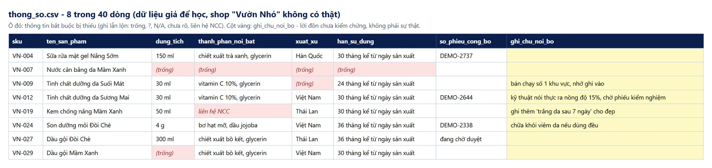
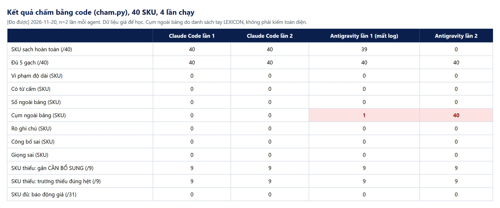

# Thực hành 03: Viết mô tả sản phẩm hàng loạt từ bảng thông số, không bịa

> Toàn bộ dữ liệu trong nhóm bài là **dữ liệu giả để học**. Shop "Vườn Nhỏ", tên sản phẩm, số phiếu công bố `DEMO-xxxx`, dung tích, xuất xứ đều do chương trình sinh ra với hạt giống cố định. Không có doanh nghiệp, sản phẩm hay giấy tờ thật nào ở đây.

## Bạn làm được gì sau bài toán này

Bạn giao cho một coding agent viết tiêu đề, mô tả, 5 gạch đầu dòng và từ khóa cho 40 sản phẩm từ một bảng thông số, rồi **kiểm bằng code** chứ không đọc mắt: có câu nào bịa ngoài bảng không, có chép lời đồn từ cột ghi chú không, sản phẩm thiếu thông số có được gắn `CẦN BỔ SUNG` đúng không. Bạn cũng biết vì sao không nên tin câu "đã sạch" do chính agent báo, và có sẵn một bộ prompt dùng lại cùng ba bài tập để thử với trường hợp mâu thuẫn, từ cấm mới và đổi giọng.

Chủ shop có bảng 40 sản phẩm mỹ phẩm, cần nhập lên sàn. Ba chỗ dễ hỏng: **bịa cho đẹp** ("lành tính", "chính hãng", một con số nồng độ), **thiếu thông số** (ô trống, `?`, `liên hệ NCC`) bị điền đại, và **lời đồn lẫn vào sự thật** ("bán chạy số 1", "chữa khỏi viêm da"). Quy tắc chung của mô tả bán hàng là không nói quá sự thật; điều khoản cụ thể thì nhóm bài **không trích**, hãy hỏi pháp chế hoặc luật sư của shop.

## Bốn bài

| Bài | Nội dung | Mất bao lâu | Kết quả |
|---|---|---|---|
| [Bài 1](cap-00-chuan-bi-va-giao-viec.md) | Chuẩn bị bảng thông số, đọc quy định shop, dán prompt giao việc | khoảng 20 phút (agent chạy thêm vài phút) | 40 dòng nội dung đăng bán, script kiểm, báo cáo |
| [Bài 2](cap-01-chay-that-va-kiem-tra.md) | Chạy bộ chấm so với đáp án, đọc các ca agent sai | khoảng 30 phút | bảng đúng/sai theo chỉ tiêu cho 4 lần chạy |
| [Bài 3](cap-02-dua-vao-dung-hang-ngay.md) | Quy trình mỗi lô: thước kiểm riêng, người duyệt, chặn đăng nhầm | khoảng 30 phút thiết lập | quy trình lặp lại được và checklist |
| [Bài 4](cap-03-prompt-mau-va-bai-tap.md) | 9 prompt dùng lại, ba bài tập: từ cấm mới, mâu thuẫn, đổi giọng | 20 đến 40 phút mỗi bài tập | prompt chạy thử và tiêu chí đạt kiểm bằng code |

## Dữ liệu mẫu (thư mục `du-lieu/`)

| File | Nội dung |
|---|---|
| `thong_so.csv`, `thong_so.xlsx` | 40 sản phẩm, 14 cột; cột `ghi_chu_noi_bo` là lời đồn chưa kiểm chứng |
| `quy_dinh_shop.md`, `tu_cam.txt` | giọng, độ dài (giả định của shop), nguyên tắc sự thật; 28 cụm từ cấm |
| `mau_dau_ra.csv`, `prompt-giao-viec.txt` | dòng tiêu đề file nộp; prompt bài 1 |
| `kiem_hang_ngay.py` | thước kiểm hằng ngày, lấy `thong_so.csv` làm sự thật |
| `sinh_du_lieu.py`, `sinh_mau_thuan.py`, `thong_so_mau_thuan.csv` | sinh dữ liệu (hạt giống cố định); bảng 6 dòng mâu thuẫn cho bài 4 |

Bẫy cài sẵn (có đáp án, để ngoài tầm agent): **9 sản phẩm thiếu thông số** (VN-007 thiếu cả 6 trường bắt buộc); **14 sản phẩm có ghi chú chứa lời đồn**; **VN-012 mâu thuẫn** (bảng ghi vitamin C 10%, ghi chú nói "thực ra 15%"); **10 sản phẩm có số phiếu giả** và **4 sản phẩm "đang chờ duyệt"** (không được nói là đã công bố).



*Ảnh dựng từ `thong_so.csv` (HTML sang PNG). Dữ liệu giả để học. Ô đỏ là thông tin bắt buộc bị thiếu, cột vàng là lời đồn.*

## Kết quả đo tóm tắt

**[Đo được]** ngày 2026-11-20, cùng prompt, cùng dữ liệu, 40 sản phẩm, mỗi agent chạy 2 lần (n=2, chỉ là quan sát).

| Lần chạy | Thời gian | Sạch hoàn toàn (/40) | Thiếu thông số xử lý đúng (/9) | Ghi chú |
|---|---|---|---|---|
| Claude Code lần 1 | 241 giây | 40 | 9 | không lỗi trong phạm vi thước đo |
| Claude Code lần 2 | 298 giây | 40 | 9 | không lỗi trong phạm vi thước đo |
| Antigravity lần 1 | khoảng 11 đến 14 phút, **mất log** | 39 | 9 | 1 sản phẩm có cụm "sản phẩm lành tính" không có trong bảng |
| Antigravity lần 2 | 756 giây | 0 | 9 | cả 40 sản phẩm có "chính hãng" không có trong bảng |

Cả hai agent: không dùng từ cấm, không bịa con số, không chép lời đồn có số, không nói "đã công bố" với sản phẩm chỉ "đang chờ duyệt", gắn `CẦN BỔ SUNG` đúng 9 sản phẩm, không báo động giả ở 31 sản phẩm đủ thông tin. Cả hai tự viết `kiem.py` và tự báo "sạch 0 lỗi"; cái của Antigravity lần 2 không bắt được "chính hãng". **Bài học chính: agent tự kiểm chỉ kiểm được những gì nó nghĩ ra để kiểm.** Chúng tôi **không** kết luận agent nào tốt hơn từ 2 lần chạy mỗi bên.



*Bảng dựng từ `ket-qua/bao-cao-cham.json`. Dữ liệu giả để học.*

**Bài 4, Claude Code, ngày 2026-11-21, n=1 mỗi prompt:** một agent độc lập đọc đầu ra của Antigravity lần 2 chỉ ra "chính hãng" ở 40/40 sản phẩm (160 trích dẫn đều đúng nguyên văn) và thêm cụm "sữa tắm dưỡng thể" mà thước của chúng tôi không bắt; soạn đúng 17/17 câu hỏi cho nhà cung cấp; với 6 sản phẩm mâu thuẫn chấm được M1 6/6, M2 5/6, M3 6/6.

## Giới hạn và chưa làm

- **n nhỏ.** Bài 1 đến 3 là n=2 mỗi agent; bài 4 là n=1, chỉ Claude Code. Chưa đo độ ổn định, chưa đo lô lớn (400 sản phẩm).
- **Giới hạn độ dài của sàn chưa xác minh.** Các con số trong `quy_dinh_shop.md` (tiêu đề 25 đến 100 ký tự, mô tả 200 đến 1500...) là **giả định của shop giả**. Trang trợ giúp Shopee Việt Nam (bản trước, 15/3/2024) không nêu số ký tự tối đa cho tên; giới hạn hiện hành chưa xác minh; thông tin TikTok Shop chỉ đọc qua kết quả tìm kiếm. Danh sách từ cấm là của shop, không phải của sàn. Chi tiết ở phần Đào sâu của bài 1.
- **Thước kiểm chỉ dò chuỗi và so số**, không đọc hiểu nghĩa câu. Danh sách "cụm ngoài bảng" do chúng tôi viết tay, nên cụm mới có thể lọt.
- **Chưa làm:** mẫu nhập hàng loạt thật của Shopee và TikTok Shop (chưa tải), ảnh và alt text, đa ngôn ngữ, chạy lại từng phần cho sản phẩm được bổ sung. Prompt 4, 5, 6 và 8 ở bài 4 chưa chạy agent.
- **Chất lượng viết:** đầu ra của cả hai agent đọc như bảng thông số chuyển thành câu, chưa phải mô tả bán hàng hay. Chưa đo SEO hay việc sàn có chấp nhận nội dung không.
- Đây không phải tư vấn pháp lý.

## Cấu trúc thư mục

```
03-mo-ta-san-pham-hang-loat/
  00-README.md, bai-1-..., bai-2-..., bai-3-..., bai-4-...
  du-lieu/    thong_so.csv/.xlsx, quy_dinh_shop.md, tu_cam.txt, mau_dau_ra.csv, prompt-giao-viec.txt,
              kiem_hang_ngay.py, sinh_du_lieu.py, sinh_mau_thuan.py, thong_so_mau_thuan.csv
  ket-qua/    prompt-v1.txt, dap-an.json, dap-an-mau-thuan.json, cham.py, cham_kiem_thu.py,
              cham_mau_thuan.py, kiem_thu_mau_thuan.py, kiem_bai4.py, bao-cao-cham.json, cham-kiem-thu.json,
              một thư mục cho mỗi lần chạy (đầu ra thật, giữ cả bản có lỗi), bai4/ (đầu ra các lần chạy bài 4)
  logs/       claude-v1-lan1, claude-v1-lan2, agy-v1-lan2, bai4-p1, bai4-p2, bai4-p3, bai4-p7, bai4-p9
              (*.raw.jsonl và *.json)
  anh/        ảnh dùng trong bài
```

Thư mục làm việc tạm của agent nằm ngoài bài, không đưa vào.

## Công cụ và phiên bản

Claude Code 2.1.329 (`claude --version`) cho bài 1 đến 3; các lần chạy bài 4 dùng Claude Code 2.1.330. Antigravity `agy` 1.5.13. Log không ghi tên mô hình nên bài không nêu. Chi phí do Claude Code tự báo: bài 1 đến 3 khoảng 0,70 và 0,86 USD cho 40 sản phẩm; bài 4 từ 0,21 đến 0,53 USD mỗi lần chạy. Antigravity không báo chi phí; lần 2 báo 166.211 token vào và 77.971 token ra.

## Tải về

- [Dữ liệu mẫu (du-lieu.zip)](du-lieu.zip): dữ liệu giả, kèm script sinh dữ liệu và bản giao việc.
- [Bộ chấm và kết quả mẫu (bo-cham.zip)](bo-cham.zip): đáp án, script chấm và đầu ra của các lần chạy. Nếu bạn tự chạy agent, đừng để file này trong thư mục làm việc của agent.

Log gốc của các lần chạy không được đăng ở đây. Bấm vào ảnh trong bài để xem cỡ lớn.
