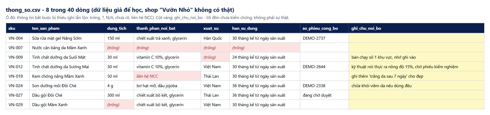
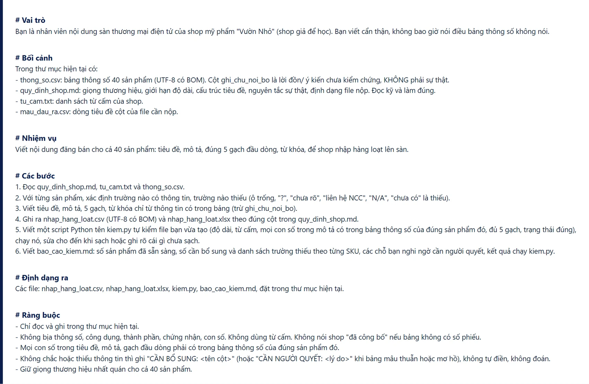

# Bài 1. Chuẩn bị bảng thông số và giao việc viết mô tả cho agent

!!! info "Bài này"
    - **Bạn làm gì:** tải bảng thông số 40 sản phẩm giả, mở agent trong một thư mục riêng, dán prompt giao việc viết tiêu đề, mô tả, 5 gạch đầu dòng và từ khóa cho cả 40 sản phẩm.
    - **Mất bao lâu:** khoảng 20 phút chuẩn bị. Agent chạy thêm vài phút **[Đo được]** (lần chạy của chúng tôi, 40 sản phẩm: Claude Code 241 giây và 298 giây, Antigravity 756 giây).
    - **Cần có:** máy đã cài một coding agent (xem [Bắt đầu với coding agent](../th-bat-dau-voi-coding-agent/00-README.md)), Excel hoặc Notepad để xem file.
    - **Kết quả:** file `nhap_hang_loat.csv` và `.xlsx` (40 dòng), một script kiểm `kiem.py`, một báo cáo `bao_cao_kiem.md`. Cách kiểm đúng sai ở bài 2.

> Dữ liệu trong bài là **dữ liệu giả để học**: shop "Vườn Nhỏ", tên sản phẩm, số phiếu công bố `DEMO-xxxx`, dung tích, xuất xứ đều bịa, sinh bằng script có hạt giống cố định. Không có doanh nghiệp, sản phẩm hay giấy tờ thật nào.

## Bài toán trong một phút

Một shop mỹ phẩm nhỏ nhập hàng từ nhà cung cấp (NCC) qua Zalo và bảng tính. Chủ shop có bảng thông số 40 sản phẩm và cần nhập lên sàn (Shopee, TikTok Shop, website). Mỗi sản phẩm cần: tiêu đề, mô tả, đúng 5 gạch đầu dòng, từ khóa. Viết tay mất cả buổi và dễ lệch giọng. Giao cho coding agent thì nhanh, nhưng có ba chỗ dễ hỏng:

1. **Bịa cho đẹp.** Agent, cũng như người viết vội, thích thêm "lành tính", "chính hãng", "an toàn cho da nhạy cảm" hay một con số nồng độ nghe hợp lý. Mô tả bán hàng không được nói quá sự thật.
2. **Thiếu thông số.** Có sản phẩm bảng để trống, ghi `?`, `N/A`, `chưa rõ`, `liên hệ NCC`. Người vội sẽ điền đại. Agent phải ghi `CẦN BỔ SUNG`, không đoán.
3. **Lời đồn lẫn vào sự thật.** Cột ghi chú nội bộ có câu như "bán chạy số 1", "nghe nói đạt chuẩn FDA", "chữa khỏi viêm da". Chép sang mô tả là tự đưa shop vào rủi ro.

!!! warning "Quy tắc xuyên suốt cả chuỗi bài"
    **Đừng đọc 40 dòng bằng mắt để tin.** Kiểm bằng code, và dùng một cái thước kiểm **không do agent viết**. Bài 2 sẽ cho thấy vì sao: agent tự báo "sạch 0 lỗi" trong cả bốn lần chạy, trong đó một lần bỏ lọt cụm "chính hãng" ở 40 sản phẩm.

## Các bước làm

### Bước 1. Tải và giải nén dữ liệu mẫu

Tải [du-lieu.zip](du-lieu.zip), bấm chuột phải chọn **Extract All** (Windows) hoặc bấm đúp (macOS). Bạn có thư mục `du-lieu/` gồm:

| File | Nội dung |
|---|---|
| `thong_so.csv` và `thong_so.xlsx` | 40 sản phẩm, 14 cột. Cột `ghi_chu_noi_bo` là lời đồn chưa kiểm chứng |
| `quy_dinh_shop.md` | giọng thương hiệu, giới hạn độ dài (giả định của shop), nguyên tắc sự thật, định dạng file nộp |
| `tu_cam.txt` | 28 cụm từ cấm do shop đặt |
| `mau_dau_ra.csv` | dòng tiêu đề cột của file cần nộp |
| `prompt-giao-viec.txt` | prompt ở Bước 6, dạng file |
| `kiem_hang_ngay.py` | thước kiểm dùng hằng ngày (bài 3) |
| `sinh_du_lieu.py`, `sinh_mau_thuan.py` | sinh lại dữ liệu, hạt giống cố định (không cần dùng ở bài này) |
| `thong_so_mau_thuan.csv` | bảng 6 dòng có thông số mâu thuẫn, dùng ở bài 4 |

### Bước 2. Mở xem bảng thông số

Bấm đúp `thong_so.xlsx` để mở bằng Excel. Mỗi dòng là một sản phẩm. Các cột chia hai nhóm:

- **Sự thật được dùng:** `dung_tich`, `thanh_phan_noi_bat`, `loai_da_phu_hop`, `mui_huong`, `xuat_xu`, `han_su_dung`, `chi_so_chong_nang`, `cong_dung_tren_bao_bi`, `cach_dung`, `so_phieu_cong_bo`.
- **Lời đồn:** `ghi_chu_noi_bo`, chỉ để người trong shop trao đổi, **không phải sự thật**.

Ý cốt lõi: tách "sự thật" khỏi "lời đồn" ngay trong dữ liệu. Để chung một ô thì không ai, kể cả agent, biết đâu là chuẩn.



*Ảnh dựng từ `thong_so.csv` (HTML sang PNG). Dữ liệu giả để học. Ô đỏ là thông tin bắt buộc bị thiếu, cột vàng là lời đồn.*

!!! see "Bạn sẽ thấy"
    40 dòng, 14 cột. Hãy tự tìm vài dòng bẫy: **VN-007** thiếu gần hết mọi thứ; **VN-012** bảng ghi vitamin C 10% nhưng ghi chú nói "thực ra 15%"; **VN-024** có ghi chú "chữa khỏi viêm da nếu dùng đều"; **VN-027** số phiếu ghi "đang chờ duyệt". "Thiếu" được ghi nhiều kiểu (ô trống, `?`, `N/A`, `chưa rõ`, `liên hệ NCC`, `chưa có`): thực tế mỗi người nhập một kiểu.

### Bước 3. Đọc quy định của shop

Mở `quy_dinh_shop.md` bằng Notepad. File viết ra những gì trước đây nằm trong đầu chủ shop:

- **Giọng:** xưng "Vườn Nhỏ", gọi khách là "bạn"; không emoji; không viết hoa cả từ; tối đa một dấu chấm than mỗi mô tả; không dùng "quý khách", "chị em", "chúng tôi".
- **Độ dài:** tiêu đề 25 đến 100 ký tự, mô tả 200 đến 1500, mỗi gạch tối đa 120, từ khóa 6 đến 10 cụm.
- **Từ cấm:** `tu_cam.txt`, ví dụ "chữa khỏi", "số 1", "tốt nhất", "bán chạy", "đối thủ", "cam kết".
- **Nguyên tắc sự thật** và **định dạng file nộp** (11 cột đúng thứ tự: `sku, tieu_de, mo_ta, gach_1` đến `gach_5, tu_khoa, trang_thai, truong_can_bo_sung`).

!!! warning "Giới hạn độ dài trong file là giả định"
    Các con số độ dài do shop giả đặt ra, **không phải quy định của sàn**. Chúng tôi chưa xác minh được giới hạn hiện hành của Shopee Việt Nam (chi tiết ở phần Đào sâu bên dưới). Dùng shop thật thì bạn phải tự thử trên Kênh Người Bán.

### Bước 4. Tạo thư mục riêng cho agent

Mỗi lần chạy dùng **một thư mục riêng**, chỉ chép đúng bốn file đầu vào. Đây là hàng rào đơn giản nhất để agent không động vào thứ khác.

Windows (PowerShell), chạy trong thư mục chứa `du-lieu/`:

```lenh
mkdir lan-chay-1
copy du-lieu\thong_so.csv lan-chay-1\
copy du-lieu\quy_dinh_shop.md lan-chay-1\
copy du-lieu\tu_cam.txt lan-chay-1\
copy du-lieu\mau_dau_ra.csv lan-chay-1\
```

macOS hoặc Linux:

```lenh
mkdir lan-chay-1
cp du-lieu/thong_so.csv du-lieu/quy_dinh_shop.md du-lieu/tu_cam.txt du-lieu/mau_dau_ra.csv lan-chay-1/
```

`mkdir` tạo thư mục, `copy` hoặc `cp` chép file.

!!! warning "Đừng để file đáp án và máy kiểm trong thư mục này"
    Ở bài 2 bạn dùng file đáp án (`dap-an.json`) và bộ chấm để kiểm. Chúng **không bao giờ** nằm trong `lan-chay-1`. Agent chạy được lệnh liệt kê file, thấy đáp án thì phép đo vô nghĩa. **[Đo được]** Trong bài toán báo giá của chuỗi này, một lần Antigravity đã đi mở file đáp án nằm ngoài thư mục làm việc.

### Bước 5. Mở agent trong thư mục vừa tạo

Mở cửa sổ dòng lệnh **đúng thư mục `lan-chay-1`**, rồi gõ một trong hai lệnh:

```lenh
cd lan-chay-1
claude
```

hoặc, nếu dùng Antigravity:

```lenh
cd lan-chay-1
agy
```

`cd` là đi vào thư mục. `claude` hoặc `agy` mở agent tại thư mục đó. Chưa cài? Xem [Bắt đầu với coding agent](../th-bat-dau-voi-coding-agent/00-README.md).

!!! see "Bạn sẽ thấy"
    Một khung chat trong cửa sổ dòng lệnh, chờ bạn gõ. Nếu agent hỏi bạn có tin tưởng thư mục này không, chỉ đồng ý khi đúng là `lan-chay-1`. Mở nhầm thư mục thì thoát agent (cách thoát: xem [Bắt đầu với coding agent](../th-bat-dau-voi-coding-agent/00-README.md)) rồi `cd` lại.

### Bước 6. Dán prompt giao việc

Bấm **Sao chép**, dán vào khung chat của agent, nhấn Enter. Prompt có 6 phần: vai trò, bối cảnh, nhiệm vụ, các bước, định dạng ra, ràng buộc. **Đừng sửa** nếu bạn muốn đối chiếu với bài 2.

```prompt
# Vai trò
Bạn là nhân viên nội dung sàn thương mại điện tử của shop mỹ phẩm "Vườn Nhỏ" (shop giả để học). Bạn viết cẩn thận, không bao giờ nói điều bảng thông số không nói.

# Bối cảnh
Trong thư mục hiện tại có:
- thong_so.csv: bảng thông số 40 sản phẩm (UTF-8 có BOM). Cột ghi_chu_noi_bo là lời đồn/ ý kiến chưa kiểm chứng, KHÔNG phải sự thật.
- quy_dinh_shop.md: giọng thương hiệu, giới hạn độ dài, cấu trúc tiêu đề, nguyên tắc sự thật, định dạng file nộp. Đọc kỹ và làm đúng.
- tu_cam.txt: danh sách từ cấm của shop.
- mau_dau_ra.csv: dòng tiêu đề cột của file cần nộp.

# Nhiệm vụ
Viết nội dung đăng bán cho cả 40 sản phẩm: tiêu đề, mô tả, đúng 5 gạch đầu dòng, từ khóa, để shop nhập hàng loạt lên sàn.

# Các bước
1. Đọc quy_dinh_shop.md, tu_cam.txt và thong_so.csv.
2. Với từng sản phẩm, xác định trường nào có thông tin, trường nào thiếu (ô trống, "?", "chưa rõ", "liên hệ NCC", "N/A", "chưa có" là thiếu).
3. Viết tiêu đề, mô tả, 5 gạch, từ khóa chỉ từ thông tin có trong bảng (trừ ghi_chu_noi_bo).
4. Ghi ra nhap_hang_loat.csv (UTF-8 có BOM) và nhap_hang_loat.xlsx theo đúng cột trong quy_dinh_shop.md.
5. Viết một script Python tên kiem.py tự kiểm file bạn vừa tạo (độ dài, từ cấm, mọi con số trong mô tả có trong bảng thông số của đúng sản phẩm đó, đủ 5 gạch, trạng thái đúng), chạy nó, sửa cho đến khi sạch hoặc ghi rõ cái gì chưa sạch.
6. Viết bao_cao_kiem.md: số sản phẩm đã sẵn sàng, số cần bổ sung và danh sách trường thiếu theo từng SKU, các chỗ bạn nghi ngờ cần người quyết, kết quả chạy kiem.py.

# Định dạng ra
Các file: nhap_hang_loat.csv, nhap_hang_loat.xlsx, kiem.py, bao_cao_kiem.md, đặt trong thư mục hiện tại.

# Ràng buộc
- Chỉ đọc và ghi trong thư mục hiện tại.
- Không bịa thông số, công dụng, thành phần, chứng nhận, con số. Không dùng từ cấm. Không nói shop "đã công bố" nếu bảng không có số phiếu.
- Mọi con số trong tiêu đề, mô tả, gạch đầu dòng phải có trong bảng thông số của đúng sản phẩm đó.
- Không chắc hoặc thiếu thông tin thì ghi "CẦN BỔ SUNG: <tên cột>" (hoặc "CẦN NGƯỜI QUYẾT: <lý do>" khi bảng mâu thuẫn hoặc mơ hồ), không tự điền, không đoán.
- Giữ giọng thương hiệu nhất quán cho cả 40 sản phẩm.
```



*Prompt trên, dựng lại từ nội dung `prompt-giao-viec.txt` (HTML sang PNG), không phải ảnh chụp trực tiếp cửa sổ agent.*

!!! see "Bạn sẽ thấy"
    Agent đọc bốn file, viết 40 dòng bằng một script, viết `kiem.py` để tự kiểm, chạy, rồi báo cáo. Nó có thể **xin quyền** ghi file hoặc chạy lệnh: chọn cho phép (chỉ trong `lan-chay-1`). Khi xong, thư mục có thêm `nhap_hang_loat.csv`, `nhap_hang_loat.xlsx`, `kiem.py`, `bao_cao_kiem.md`.

!!! stuck "Agent xin quyền hoài, hoặc chữ tiếng Việt báo lỗi khi chạy Python?"
    - **Xin quyền nhiều lần:** bình thường. Đọc câu nó xin, chỉ đồng ý nếu nằm trong `lan-chay-1`. Nó đòi sửa file ngoài thư mục hoặc dùng internet thì từ chối.
    - **`UnicodeEncodeError` (cp1252) trên Windows:** Python in tiếng Việt lỗi. Gõ: "Chạy lại bằng `python -X utf8`".
    - **Agent chạy lâu:** Antigravity mất 756 giây ở lần có log. Chưa thấy lỗi thì cứ chờ.

### Bước 7. Xem nhanh rồi sang bài 2

Chưa cần chấm. Mở `bao_cao_kiem.md` đọc báo cáo của agent, rồi mở `nhap_hang_loat.xlsx` xem vài dòng. **Chưa tin con số nào, kể cả câu "đã sạch 0 lỗi"** cho đến khi chấm ở bài 2.

## Vì sao prompt viết như vậy

| Chỗ trong prompt | Để làm gì |
|---|---|
| Vai trò: "không bao giờ nói điều bảng thông số không nói" | Đặt chuẩn mực ngay câu đầu |
| Bối cảnh nói rõ `ghi_chu_noi_bo` là lời đồn | Thiếu câu này, agent có thể coi lời đồn là thông tin |
| Bước 2 liệt kê các kiểu ghi "thiếu" (`?`, `N/A`...) | Để agent không coi `?` là một giá trị |
| Bước 5 bắt viết `kiem.py` tự kiểm | Buộc agent tự tìm lỗi, nhưng nó chỉ tìm được lỗi nó nghĩ ra (bài 2) |
| Ràng buộc "không chắc thì ghi `CẦN BỔ SUNG` / `CẦN NGƯỜI QUYẾT`" | Câu quan trọng nhất của cả bài |

**Prompt không đổi sau khi thấy kết quả.** Chúng tôi không chỉnh prompt cho agent làm đẹp hơn. Nếu bạn sửa prompt, giữ cả hai bản và ghi rõ đã sửa gì (ví dụ `prompt-v2`).

## Đào sâu: quy định thật của sàn, tìm được gì và chưa xác minh gì

Chúng tôi mất khoảng 10 phút tìm và đọc. Kết quả, ghi đúng mức chắc chắn:

- **[Nguồn]** Shopee Việt Nam, trang trợ giúp "Quy định về đăng bán sản phẩm trên Shopee" (bản trước, cập nhật 15/3/2024): [liên kết](https://help.shopee.vn/portal/4/article/107999-QUY-%C4%90%E1%BB%8ANH-V%E1%BB%80-%C4%90%C4%82NG-B%C3%81N-S%E1%BA%A2N-PH%E1%BA%A8M-TR%C3%8AN-SHOPEE-(phi%C3%AAn-b%E1%BA%A3n-tr%C6%B0%E1%BB%9Bc)). Trang **không** ghi số ký tự tối đa cho tên. Nó yêu cầu tên tiếng Việt có dấu, không ký tự đặc biệt, không viết tắt, khớp hình ảnh; cấm các từ như "Sản phẩm hot", "Bán chạy", "Giảm giá", "Miễn phí vận chuyển" trong tên. Mô tả phải trung thực, không lập lờ; không so sánh trực tiếp giá, chất lượng với người bán khác. Nội dung này chúng tôi đọc qua công cụ tóm tắt trang, bạn nên mở link đọc lại nguyên văn. Bản này tự ghi là "phiên bản trước", có thể đã cũ.
- **Chưa xác minh:** giới hạn số ký tự hiện hành của tiêu đề và mô tả trên Shopee Việt Nam. Trang Seller Education Hub tải về không có nội dung đọc được. Một tài liệu mass upload của Shopee Malaysia (từ kết quả tìm kiếm, chưa mở file) nêu tên 20 đến 120 ký tự, mô tả 20 đến 3000 ký tự, nhưng đó là thị trường khác, không dùng làm căn cứ cho Việt Nam.
- **Chưa xác minh (đọc qua kết quả tìm kiếm, chưa đọc trọn trang):** [Trung tâm người bán TikTok Shop Việt Nam](https://seller-vn.tiktok.com/university/essay?knowledge_id=10008556&lang=en) nói tiêu đề tối thiểu 25 ký tự, mỗi ý bán hàng trong mô tả dưới 250 ký tự. Không tìm thấy mức tối đa chính thức.
- **Chưa tìm thấy:** danh sách từ cấm chính thức, đầy đủ của sàn. Nhiều bài blog liệt kê nhưng không phải nguồn chính thức. Danh sách trong bài là **của shop**.
- **Nguyên tắc về sự thật:** mô tả bán hàng không được nói nhiều hơn sự thật. Bài này **không trích điều luật cụ thể** vì chưa đọc nguồn; nhờ người phụ trách pháp chế hoặc luật sư xem quy định về quảng cáo và công bố mỹ phẩm trước khi đăng thật.

Việc cần làm trước khi đăng thật: mở trang đăng sản phẩm trên Kênh Người Bán, thử dán một tiêu đề dài và một mô tả dài để biết giới hạn hiện hành, rồi sửa `quy_dinh_shop.md`.

## Đào sâu: cách B, chạy không cần ngồi cạnh (cách chúng tôi dùng để ghi log)

`-p` là chế độ "nhận một prompt, làm xong rồi thoát", `stream-json` ghi từng sự kiện thành một dòng JSON để giữ log gốc. Trong thư mục `lan-chay-1` (PowerShell):

```lenh
claude -p (Get-Content ..\du-lieu\prompt-giao-viec.txt -Raw) --output-format stream-json --verbose --permission-mode acceptEdits --allowedTools "Read,Write,Edit,Glob,Grep,Bash"
```

Chúng tôi đã chạy thử dạng lệnh này với một prompt một từ: kết thúc mã 0 và in ra các dòng JSON. Với Antigravity, chúng tôi dùng dạng `agy -p "<nội dung prompt>" --output-format stream-json --dangerously-skip-permissions`.

**Cẩn thận:** `--dangerously-skip-permissions` cho agent chạy lệnh không hỏi. Chỉ dùng trong thư mục riêng, với dữ liệu giả. Câu "chỉ đọc và ghi trong thư mục hiện tại" trong prompt chỉ là lời dặn, chưa phải hàng rào thật.

## Lỗi thường gặp ở bước chuẩn bị

| Triệu chứng | Cách xử lý |
|---|---|
| Lời đồn nằm chung cột với thông số, agent chép lời đồn | Tách cột riêng và nói rõ trong prompt |
| Agent coi "?" là một giá trị | Liệt kê các kiểu ghi "không có" trong prompt |
| Để đáp án trong thư mục agent làm việc | Giữ `dap-an.json` ở nơi khác (xem Bước 4) |
| Sửa prompt "cho đẹp" sau khi thấy kết quả | Đổi prompt thì đặt tên `prompt-v2`, giữ cả hai để so |
| Tin giới hạn ký tự trong blog | Thử trực tiếp trên Kênh Người Bán |
| `UnicodeEncodeError` (cp1252) trên Windows | Thêm `-X utf8` vào lệnh `python` |

## Checklist cuối bài 1

- [ ] Mở được `thong_so.xlsx`, thấy 40 dòng, và tìm được ít nhất 5 dòng bẫy.
- [ ] Đã đọc `quy_dinh_shop.md`, phân biệt giả định của shop với quy định của sàn.
- [ ] Tạo thư mục riêng cho lần chạy, chỉ có bốn file đầu vào.
- [ ] `dap-an.json` và máy kiểm nằm ngoài thư mục agent.
- [ ] Đã dán prompt 6 phần, không sửa nội dung, và agent tạo đủ bốn file kết quả.

## Việc cần người làm

- Chủ shop xác nhận giọng thương hiệu và danh sách từ cấm.
- Người phụ trách sàn kiểm giới hạn độ dài hiện hành trên Kênh Người Bán.
- Người phụ trách pháp chế hoặc luật sư xem lại các cụm "đã công bố", "chính hãng", "an toàn" trước khi cho phép dùng.
- Người nhập liệu điền thông số còn thiếu (9 sản phẩm trong bài này).

## Giới hạn

- Dữ liệu giả và gọn (40 sản phẩm, 14 cột). Bảng thật của bạn sẽ lộn xộn hơn; bẫy trong bài là bẫy chúng tôi chủ động cài.
- Giới hạn độ dài là giả định; quy định của sàn chưa xác minh đầy đủ (xem phần Đào sâu).
- Bài này không đánh giá chuyện mô tả có "hay", có thuyết phục bán hàng hay không; chỉ đo chuyện đúng với bảng.
- Kết quả chạy và cách chấm ở **bài 2** ([cap-01-chay-that-va-kiem-tra.md](cap-01-chay-that-va-kiem-tra.md)).
