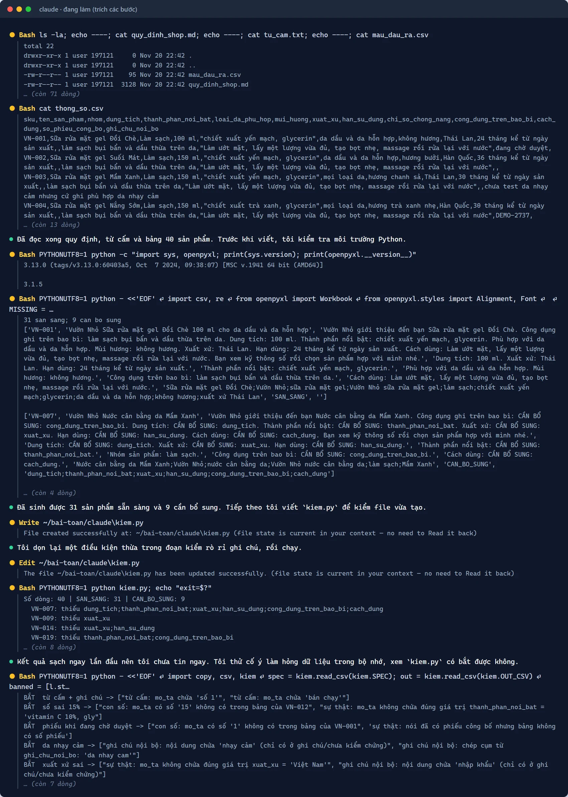
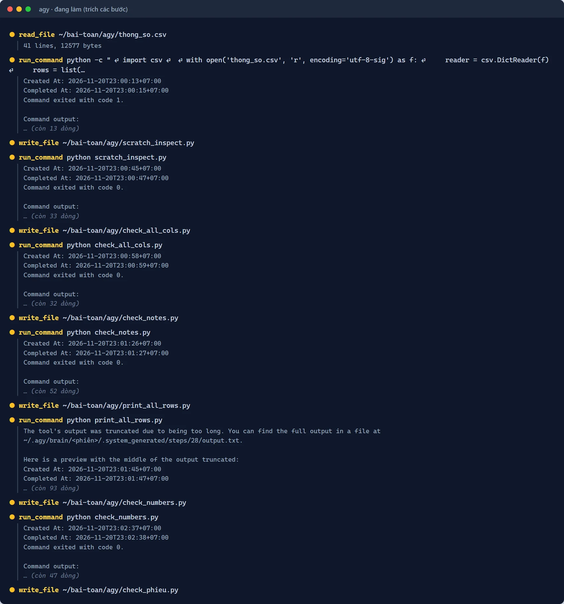
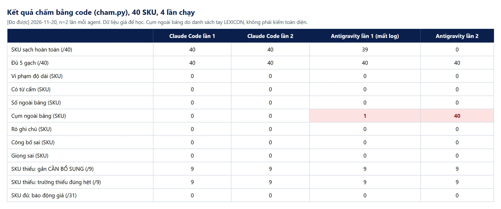
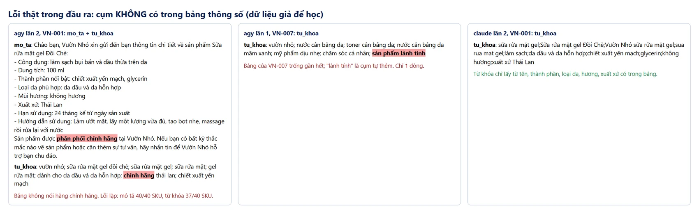
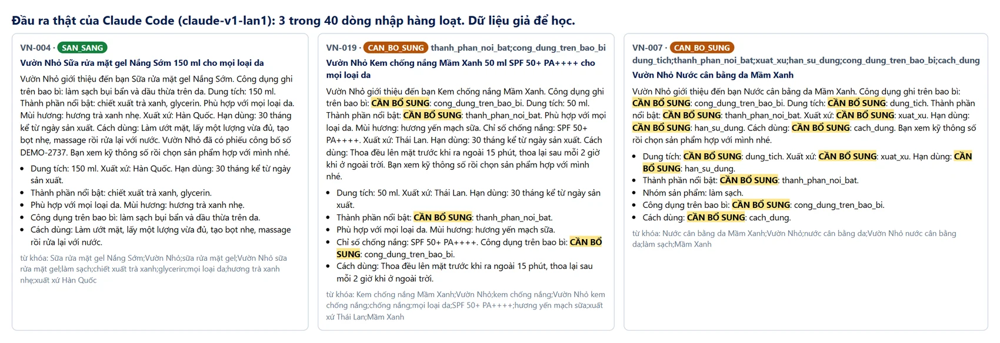

# Bài 2: Chạy thật, chấm bằng code, xem lỗi thật

> Dữ liệu giả để học. Mọi số liệu dưới đây là **[Đo được]** ngày 2026-11-20, 40 SKU, mỗi agent 2 lần chạy (n=2). Hai lần chạy chỉ cho biết "đã quan sát thấy", chưa đo được độ ổn định.

## Mục tiêu đo được

Chạy cùng một prompt (`ket-qua/prompt-v1.txt`) trên Claude Code và Antigravity (`agy`), rồi chấm file `nhap_hang_loat.csv` bằng `ket-qua/cham.py` với đáp án `ket-qua/dap-an.json`. Ra con số cụ thể cho: đủ 5 gạch, độ dài, từ cấm, con số ngoài bảng, cụm ngoài bảng, rò ghi chú, "đã công bố" sai, giọng, 9 SKU thiếu, báo động giả.

## Bước 1. Chạy

Prompt, thư mục riêng và lệnh chạy ở bài 1. Mỗi agent làm trong thư mục riêng, bốn file đầu vào giống nhau.

Các lần chạy:

| Lần | Thời gian | Ghi chú |
|---|---|---|
| Claude Code lần 1 | 241 s, 12 lượt | chi phí do Claude Code báo khoảng 0,70 USD |
| Claude Code lần 2 | 298 s, 15 lượt | khoảng 0,86 USD |
| Antigravity lần 1 | khoảng 11 đến 14 phút theo giờ ghi file | **mất log**, xem bên dưới |
| Antigravity lần 2 | 756 s | 166.211 token vào, 77.971 token ra (do agy báo) |

### Chuyện đã xảy ra với Antigravity lần 1

Lần đầu tôi chạy hai agent song song, đặt timeout 900 s. Claude xong sau 4 phút. Với Antigravity, các file đầu ra xuất hiện (`nhap_hang_loat.csv` lúc 22:53, `bao_cao_kiem.md` lúc 22:56) nhưng **tiến trình bọc ngoài biến mất mà không ghi `*.raw.jsonl` hay `*.json`**, và tệp thông báo của nó rỗng. Tôi không biết chắc nguyên nhân (nghi do chạm 900 s hoặc tiến trình nền bị dừng); chưa kiểm chứng. Hệ quả: lần 1 của Antigravity còn **đầu ra** để chấm nhưng **không có log** để dựng ảnh "đang làm". Tôi chạy lại lần 2 với timeout 1500 s (khác khuyến nghị 900 s vì lần 1 gần chạm giới hạn) và giữ cả hai. Nếu bạn tự chạy `agy` theo cách này, hãy đặt timeout rộng và lưu log từ đầu.

## Bước 2. Xem agent làm gì



*Dựng lại từ log thật của lần chạy `claude-v1-lan1`, không phải ảnh chụp trực tiếp cửa sổ TUI.*

Điều đáng học từ log Claude Code lần 1: nó đọc quy định, đọc bảng, sinh 40 dòng bằng một script Python, rồi viết `kiem.py`. Chạy xong thấy sạch ngay lần đầu, nó **không tin** và tự **tiêm lỗi** vào bản sao trong bộ nhớ (từ cấm "số 1", số 15% sai, "đã công bố" khi chỉ đang chờ duyệt, "bà bầu", xuất xứ sai...) để xem `kiem.py` có bắt không. Nó bắt được cả 12. Lần 2 tiêm 21 lỗi. Đó là cách làm đúng: kiểm cái thước trước khi tin cái thước.



*Dựng lại từ log thật của lần chạy `agy-v1-lan2`, không phải ảnh chụp trực tiếp cửa sổ TUI. Chỉ trích 13 bước đầu trong 43 khối.*

Antigravity lần 2 viết nhiều script kiểm nhỏ (`check_notes.py`, `check_numbers.py`, `check_phieu.py`, `check_caps.py`...) rồi viết bộ sinh, sinh file, viết `kiem.py`, xóa các script tạm. Một lần chạy lệnh đầu thoát mã 1 rồi nó viết lại thành file. Đây chỉ là quan sát về cách làm, không phải đánh giá.


*Dựng lại từ log thật của lần chạy `claude-v1-lan1`.*


*Dựng lại từ log thật của lần chạy `agy-v1-lan2`.*

## Bước 3. Chấm bằng code

`cham.py` đọc file CSV của agent và với từng SKU làm 10 việc:

1. Đủ 40 SKU, đủ cột, đúng 5 gạch, từ khóa 6 đến 10 cụm.
2. Độ dài: tiêu đề 25 đến 100, mô tả 200 đến 1500, gạch tối đa 120, từ khóa tối đa 30 (giả định của shop).
3. **Từ cấm**: so khớp cả dạng có dấu và không dấu.
4. **Con số**: trích mọi số trong tiêu đề, mô tả, gạch, từ khóa; mỗi số phải có trong các ô thông số **của đúng SKU đó** (không tính `ghi_chu_noi_bo`).
5. **Cụm ngoài bảng**: một danh sách tay hơn 100 cụm dễ bịa (tên thành phần, chứng nhận, đối tượng dùng, công dụng, tên nước); nếu xuất hiện trong nội dung mà bảng SKU không có, tính là bịa.
6. Ứng viên tên riêng và chữ in hoa lạ (để người xem, không tính lỗi cứng).
7. **Rò ghi chú**: cụm hoặc số chỉ có trong `ghi_chu_noi_bo` mà xuất hiện trong nội dung.
8. Nói "đã có phiếu công bố" ở SKU không có số phiếu thật.
9. 9 SKU thiếu: có `CẦN BỔ SUNG`, `trang_thai` đúng, `truong_can_bo_sung` đúng hệt; 31 SKU đủ: không báo động giả.
10. Giọng: không emoji, tối đa 1 dấu `!`, có từ "bạn", không "quý khách/chị em/chúng tôi", tiêu đề bắt đầu bằng "Vườn Nhỏ", không từ viết hoa nhấn mạnh.

Chạy:

```powershell
cd ket-qua
python -X utf8 cham.py claude-v1-lan1\nhap_hang_loat.csv claude-v1-lan1
python -X utf8 cham.py agy-v1-lan2\nhap_hang_loat.csv agy-v1-lan2
```

`-X utf8` để Windows đọc tiếng Việt đúng. Lệnh ghi thêm một mục vào `bao-cao-cham.json`.

### Thử chính cái thước

Một cái thước chưa thử thì chưa đáng tin. `cham_kiem_thu.py` lấy file sạch của Claude lần 1, tiêm 16 lỗi biết trước (từ cấm có dấu và không dấu, đổi 150 ml thành 250 ml, số 15% từ ghi chú, FDA, "lành tính", "chính hãng", "đã công bố" ở SKU đang chờ duyệt, tự điền dung tích cho SKU thiếu, trạng thái sai, tiêu đề quá ngắn, mô tả quá dài, emoji, "quý khách", báo động giả, chép "bán chạy"). **[Đo được]** `cham.py` bắt **16/16**.

### Lỗi trong chính cái thước của tôi

Lần chấm đầu, `cham.py` báo "cụm ngoài bảng" ở 38 SKU của Antigravity lần 1. Xem ra: danh sách có chữ "mỹ" (để bắt "xuất xứ Mỹ") nên bắt nhầm "**mỹ** phẩm", cụm bình thường của shop mỹ phẩm. Tôi đổi thành "hoa kỳ", "nước mỹ", chạy lại cho **cả bốn** lần chạy, và ghi lại chuyện này ở đây. Bài học: kết quả "báo 38 lỗi" chưa chắc là agent sai; xem vài mẫu trước khi tin.

## Kết quả chấm



*Dựng từ `ket-qua/bao-cao-cham.json`. Dữ liệu giả để học.*

| Chỉ tiêu (40 SKU) | Claude 1 | Claude 2 | Antigravity 1 (mất log) | Antigravity 2 |
|---|---|---|---|---|
| Đủ 5 gạch | 40 | 40 | 40 | 40 |
| Vi phạm độ dài | 0 | 0 | 0 | 0 |
| Có từ cấm | 0 | 0 | 0 | 0 |
| Số ngoài bảng | 0 | 0 | 0 | 0 |
| Cụm ngoài bảng | 0 | 0 | 1 | 40 |
| Rò ghi chú | 0 | 0 | 0 | 0 |
| "Đã công bố" sai | 0 | 0 | 0 | 0 |
| Giọng sai | 0 | 0 | 0 | 0 |
| 9 SKU thiếu: gắn `CẦN BỔ SUNG` | 9 | 9 | 9 | 9 |
| 9 SKU thiếu: trường thiếu đúng hệt | 9 | 9 | 9 | 9 |
| 31 SKU đủ: báo động giả | 0 | 0 | 0 | 0 |
| **SKU sạch hoàn toàn** | **40** | **40** | **39** | **0** |

Độ dài thực tế: tiêu đề 34 đến 85 ký tự; mô tả 361 đến 761 ký tự (Claude trung bình 422, Antigravity lần 1 trung bình 642, lần 2 trung bình 573); gạch dài nhất 103. Tất cả nằm trong giới hạn giả định.

### Lỗi thật 1: "chính hãng" (Antigravity lần 2, 40 SKU)



*Trích từ `ket-qua/agy-v1-lan2/nhap_hang_loat.csv`, `agy-v1-lan1-mat-log` và `claude-v1-lan2`. Dữ liệu giả để học.*

Cả 40 dòng đều có câu "Sản phẩm được phân phối chính hãng tại Vườn Nhỏ" trong mô tả, và 37 dòng có thêm một từ khóa dạng "chính hãng thái lan". Bảng không có thông tin nào nói hàng chính hãng. Đây là loại bịa **nhẹ, lịch sự, nghe vô hại**, và đúng loại dễ lọt vì không có số liệu, không có từ cấm. `kiem.py` của Antigravity lần 2 chạy ra "dữ liệu hoàn toàn sạch và tuân thủ 100%". Chỉ danh sách cụm của tôi bắt được, và danh sách đó do tôi viết tay (nếu tôi quên một cụm thì cũng lọt).

### Lỗi thật 2: "sản phẩm lành tính" (Antigravity lần 1, 1 SKU)

Ở VN-007 (dòng gần như trống), từ khóa có "sản phẩm lành tính". Bảng không nói gì về độ lành. Một dòng trong 40, nhưng trùng đúng chỗ thông tin trống nhất: nơi áp lực "phải có gì đó để viết" lớn nhất.

### Điều cả bốn lần chạy làm đúng

- Không dùng từ cấm nào, không chép "bán chạy", "số 1", "tốt nhất", "chữa khỏi" từ ghi chú.
- Không có con số nào ngoài bảng. Đáng chú ý ở VN-012: cả bốn lần đều dùng **10%** theo bảng, không dùng 15% của ghi chú. Cả bốn lần đều ghi mâu thuẫn này vào báo cáo kiểm và xếp SKU `SAN_SANG`. Không lần nào đặt `CẦN NGƯỜI QUYẾT` ngay trong ô mô tả. Tôi nghĩ shop thật nên tạm giữ VN-012 lại cho tới khi có phiếu kiểm nghiệm; đó là **[Đề xuất]**, không có trong prompt.
- 4 SKU "đang chờ duyệt" không bị nói là đã công bố; 10 SKU có số phiếu `DEMO-xxxx` được ghi đúng số.
- 9 SKU thiếu được gắn `CAN_BO_SUNG` và `truong_can_bo_sung` đúng hệt (17 trường thiếu, 17 đúng).
- 31 SKU còn lại không có báo động giả.

### Chuyện chất lượng viết (không đo bằng code)

Cần nói thẳng: đầu ra của cả hai agent đọc như **bảng thông số chuyển thành câu**, chưa phải mô tả bán hàng.



*Trích từ `ket-qua/claude-v1-lan1/nhap_hang_loat.csv`. Dữ liệu giả để học. Ô vàng là chỗ `CẦN BỔ SUNG`.*

- Claude: một đoạn văn dài liền, mọi SKU cùng khuôn "Dung tích: ... Thành phần nổi bật: ...". Câu mở bắt đầu bằng tên sản phẩm nên 40 mô tả mở đầu khác nhau, nhưng đọc lên thì dày đặc.
- Antigravity: có xuống dòng và gạch `-` nên dễ đọc hơn; cả 40 mô tả cùng mở đầu "Chào bạn, Vườn Nhỏ xin gửi đến bạn thông tin chi tiết về sản phẩm ...".
- Cả hai chép nguyên **tên cột kỹ thuật** (`dung_tich`, `thanh_phan_noi_bat`) vào chỗ `CẦN BỔ SUNG` trong mô tả. Với người nhập liệu đó là chỉ dẫn hay; nhưng nếu quên điền rồi đăng, khách sẽ thấy chữ này trên trang sản phẩm. Nên chặn bằng code ở bước đăng (xem bài 3).

## Lỗi thường gặp khi kiểm tra

| Lỗi | Dấu hiệu | Cách xử lý |
|---|---|---|
| Tin lời agent "đã sạch 100%" | báo cáo tự khen | chạy thước độc lập của bạn |
| Thước có danh sách cụm tay | bỏ sót cụm mới, bắt nhầm cụm lành | xem mẫu lỗi, bổ sung danh sách sau mỗi lần |
| Chấm chung ghi chú và bảng | số từ ghi chú lọt | chấm số theo ô thông số, bỏ cột ghi chú |
| Đọc 40 dòng bằng mắt | bỏ qua "chính hãng" lặp 40 lần | để code quét, mắt chỉ xem mẫu |
| Chỉ chạy một lần | kết quả may rủi | chạy thêm ít nhất lần nữa, ghi rõ n |

## Checklist cuối bài 2

- [ ] Chạy ít nhất hai lần, lưu log gốc.
- [ ] Chạy `cham.py` cho từng lần và đọc từng SKU có lỗi, không chỉ nhìn tổng.
- [ ] Thử thước bằng cách tiêm lỗi (như `cham_kiem_thu.py`).
- [ ] Mở ít nhất 5 dòng đầu ra, trong đó có dòng thiếu thông số và dòng mâu thuẫn.
- [ ] Ghi lại cả bản có lỗi.

## Việc cần người làm

- Xem VN-012 (10% hay 15%) và quyết đăng hay giữ.
- Điền thông số cho 9 SKU thiếu rồi chạy lại.
- Bổ sung vào danh sách "cụm ngoài bảng" những cụm bạn thấy ở các lần chạy sau.
- Hỏi pháp chế về các cụm kiểu "chính hãng", "lành tính", "an toàn" trước khi cho phép dùng.

## Giới hạn

- **n=2** mỗi agent, một prompt, một bộ dữ liệu: chưa đo được độ ổn định. Cũng chưa nên suy ra agent nào "tốt hơn": lần 1 và lần 2 của cùng Antigravity khác nhau rõ rệt (1 SKU lỗi so với 40 SKU lỗi), cho thấy kết quả dao động giữa các lần chạy.
- Antigravity lần 1 không có log gốc; kết quả chấm dựa vào file đầu ra còn lại trong thư mục.
- `cham.py` bắt được cái nó biết tìm. Tên riêng lạ và cụm bịa chưa có trong danh sách của tôi có thể lọt. Nó **không** đọc hiểu nghĩa câu.
- Chưa đo chất lượng bán hàng, SEO, hay việc sàn có chấp nhận nội dung không.
