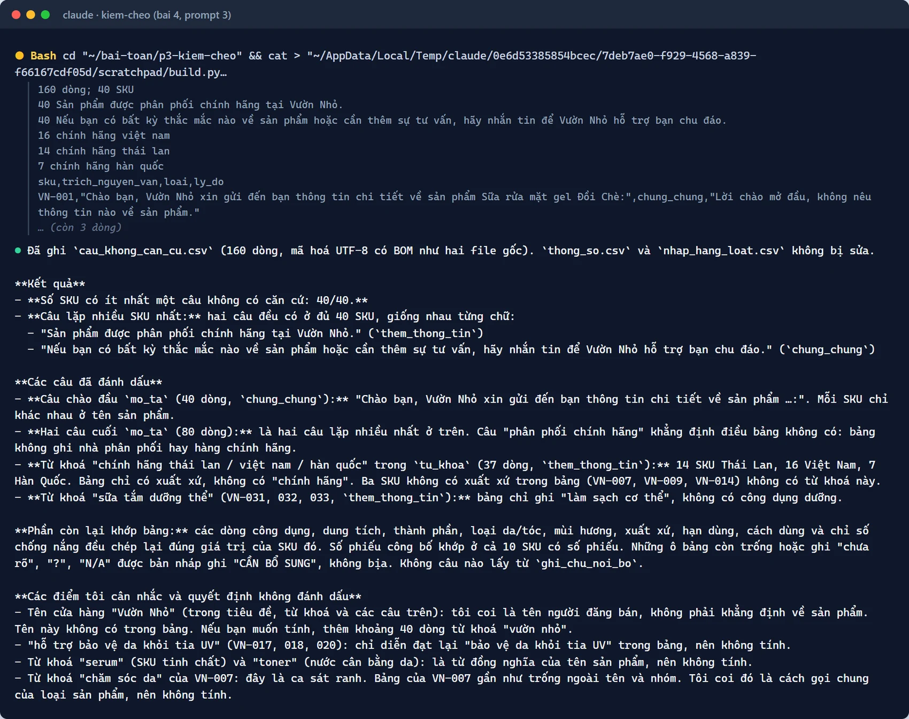

# Bài 4. Bộ prompt dùng lại và ba bài tập tự làm

!!! info "Bài này"
    - **Bạn làm gì:** lấy 9 prompt dùng lại được (viết mô tả, giải thích script, kiểm chéo, xử lý thiếu thông số...) và làm ba bài tập tự kiểm bằng code.
    - **Mất bao lâu:** mỗi prompt vài phút; mỗi bài tập khoảng 20 đến 40 phút.
    - **Cần có:** kết quả bài 1 đến 3, một coding agent ([Bắt đầu với coding agent](../th-bat-dau-voi-coding-agent/00-README.md)), Python 3. Bộ bài giải nén với `du-lieu/` và `ket-qua/` cạnh nhau.
    - **Kết quả:** biết agent xử lý thế nào khi bảng mâu thuẫn, khi đổi từ cấm, khi đổi giọng, và có thước đo bằng code cho từng việc.

> Dữ liệu giả để học (shop "Vườn Nhỏ"). Các prompt dưới đây đã chạy thật bằng Claude Code (`claude -p`) **lần chạy ngày 2026-11-21, n=1**; log ở `logs/bai4-*.json`, đầu ra ở `ket-qua/bai4/`. Prompt nào không có khung "Kết quả mẫu" là **chưa chạy thử**. Một lần chạy chỉ cho biết "đã quan sát thấy", không đo được độ ổn định.

## Bộ prompt dùng lại được

Mỗi prompt chạy trong **thư mục riêng của agent**, chỉ có những file prompt nhắc tới. Đừng để `dap-an.json` và máy kiểm trong đó (xem bài 1).

### 1. Giao việc chính (bản rút gọn)

**Dùng khi nào:** có bảng thông số mới, cần viết mô tả cho mọi sản phẩm. Bản rút gọn của prompt bài 1, vẫn giữ các ràng buộc quan trọng.

```prompt
# Vai trò
Bạn là nhân viên nội dung sàn thương mại điện tử của một shop mỹ phẩm. Bạn viết cẩn thận, không bao giờ nói điều bảng thông số không nói.

# Việc cần làm
Trong thư mục hiện tại có: thong_so.csv (bảng thông số; cột ghi_chu_noi_bo là lời đồn, ý kiến chưa kiểm chứng, KHÔNG phải sự thật), quy_dinh_shop.md (giọng, độ dài, định dạng file nộp), tu_cam.txt (từ cấm), mau_dau_ra.csv (dòng tiêu đề của file nộp).
Đọc quy_dinh_shop.md, rồi viết tiêu đề, mô tả, đúng 5 gạch đầu dòng và từ khóa cho MỌI sản phẩm trong thong_so.csv. Ghi ra nhap_hang_loat.csv (UTF-8 có BOM) theo đúng cột trong quy_dinh_shop.md. Viết thêm bao_cao_kiem.md: SKU nào cần bổ sung, SKU nào cần người quyết, điều bạn không chắc.

# Ràng buộc
- Chỉ đọc và ghi trong thư mục hiện tại.
- Không bịa thông số, công dụng, thành phần, chứng nhận, con số. Không dùng từ cấm. Mọi con số trong tiêu đề, mô tả, gạch đầu dòng phải có trong bảng thông số của đúng sản phẩm đó.
- Không chắc hoặc thiếu thông tin thì ghi "CẦN BỔ SUNG: <tên cột>" (hoặc "CẦN NGƯỜI QUYẾT: <lý do>" khi bảng mâu thuẫn hoặc mơ hồ), không tự điền, không đoán.
```

**Bạn sẽ thấy:** `nhap_hang_loat.csv` và `bao_cao_kiem.md` trong thư mục. **[Đo được]** (chạy trên bảng 6 dòng ở Bài tập 2, 183 giây, n=1) agent giữ cả 6 sản phẩm ở `CAN_BO_SUNG` và liệt kê từng cặp giá trị mâu thuẫn:

```ketqua
Cả 6 SKU đều ở trạng thái CAN_BO_SUNG, nên chưa SKU nào đăng được ngay.
…
| VN-012 | thanh_phan_noi_bat (nồng độ vitamin C) | 10% | 15%, chờ phiếu kiểm nghiệm |
| VN-042 | chi_so_chong_nang | SPF 30 PA+++ | bao bì in SPF 50 |
| VN-043 | dung_tich | 300 ml | lô mới 500 ml |
…
```

*(rút gọn; chấm chi tiết ở Bài tập 2)*

### 2. Giải thích script đã viết bằng lời thường

**Dùng khi nào:** agent đã viết một script kiểm (như `kiem.py`) mà bạn không đọc được code, nhưng cần biết nó kiểm gì và bỏ sót gì trước khi tin nó.

```prompt
Trong thư mục này có file kiem.py, một script Python do một agent viết để kiểm file nhập hàng loạt của shop. Tôi không biết lập trình.
Hãy giải thích bằng lời thường, không dùng thuật ngữ lập trình (nếu buộc phải dùng thì giải nghĩa ngay):
1. Script này kiểm những gì? Liệt kê từng việc kiểm, mỗi việc một dòng, kèm một ví dụ cụ thể dạng "nếu file có ... thì script báo ...".
2. Script này KHÔNG kiểm những gì? Nêu loại lỗi mà một người đọc có thể thấy nhưng script sẽ bỏ qua.
3. Có chỗ nào script dựa vào một danh sách do người viết tự đặt (danh sách từ, danh sách cụm) không? Danh sách đó nằm ở đâu trong file?
Chỉ dựa vào nội dung kiem.py, không đoán. Không sửa file nào. Ghi kết quả vào giai_thich.md, tối đa 300 từ.
```

**Bạn sẽ thấy:** file `giai_thich.md` ngắn, có ví dụ "nếu... thì báo...". Chạy trên `kiem.py` của Claude lần 1 (100 giây, n=1), một số dòng của kết quả (rút gọn):

```ketqua
## 1. Script kiểm gì
- Số dòng: file có 39 sản phẩm thì báo "cần 40".
- Con số: mô tả ghi "50" mà bảng sản phẩm không có số 50 thì báo.
- Phiếu công bố: nói "đã công bố" mà bảng không có số phiếu thì báo.
…
## 2. Script KHÔNG kiểm
- Số đúng nhưng sai chỗ: "hạn dùng 50 tháng" vẫn qua nếu dung tích là 50.
- Lời khoe, thành phần bịa bằng chữ, nếu không nằm trong danh sách cấm.
- `quy_dinh_shop.md`: được nhắc tới, nhưng code không mở.
```

**[Đo được]** Chúng tôi đối chiếu từng ý với `kiem.py` (271 dòng): các ý trên đều đúng; danh sách `LEAK_TERMS` ở dòng 35 đến 38 đúng là 17 cụm; số dòng nó nêu đúng. Điểm đáng chú ý: agent nói đúng rằng phần mở đầu của `kiem.py` nhắc `quy_dinh_shop.md` nhưng code không hề mở file đó. Agent cũng tự ghi rõ các ví dụ là do nó nghĩ ra.

### 3. Kiểm chéo bằng một agent độc lập

**Dùng khi nào:** sau khi agent viết xong, bạn muốn một "cặp mắt thứ hai" tìm câu không có căn cứ. Đưa cho agent kiểm **chỉ bảng và file nộp**, không đưa `kiem.py` hay báo cáo "sạch" của agent trước.

```prompt
Trong thư mục này có thong_so.csv (bảng thông số; cột ghi_chu_noi_bo là lời đồn, KHÔNG phải sự thật) và nhap_hang_loat.csv (nội dung đăng bán do một agent khác viết). Bạn là người kiểm tra độc lập, bạn không biết agent kia đã tự kiểm thế nào.
Hãy chỉ ra MỌI câu hoặc cụm trong các cột mo_ta, gach_1 đến gach_5 và tu_khoa mà bảng thông số của đúng sản phẩm đó không làm căn cứ (không tính ghi_chu_noi_bo). Câu chỉ lặp lại hoặc diễn đạt lại thông tin có trong bảng thì không tính.
Ghi ra cau_khong_can_cu.csv, cột: sku, trich_nguyen_van (chép đúng từng chữ), loai (them_thong_tin: nêu điều bảng không có; chung_chung: lời mời gọi không mang thông tin), ly_do (một câu).
Cuối cùng in ra: số SKU có ít nhất một câu không có căn cứ, và câu nào lặp lại ở nhiều SKU nhất.
Không sửa thong_so.csv và nhap_hang_loat.csv. Chỉ đọc và ghi trong thư mục hiện tại.
```

**Bạn sẽ thấy:** `cau_khong_can_cu.csv` và một bản tóm tắt. Chúng tôi chạy trên đầu ra của Antigravity lần 2, bản mà `kiem.py` của chính nó báo "sạch" nhưng có "chính hãng" ở 40 sản phẩm (100 giây, n=1).

```ketqua
160 dòng; 40 SKU
40 Sản phẩm được phân phối chính hãng tại Vườn Nhỏ.
40 Nếu bạn có bất kỳ thắc mắc nào về sản phẩm hoặc cần thêm sự tư vấn, hãy nhắn tin để Vườn Nhỏ hỗ trợ bạn chu đáo.
16 chính hãng việt nam
14 chính hãng thái lan
7 chính hãng hàn quốc
…
Số SKU có ít nhất một câu không có căn cứ: 40/40.
Từ khoá "sữa tắm dưỡng thể" (VN-031, 032, 033, them_thong_tin): bảng chỉ ghi "làm sạch cơ thể", không có công dụng dưỡng.
```

*(rút gọn: bỏ các dòng chào mở đầu và một số dòng khác)*



*Dựng lại từ log thật của lần chạy `bai4-p3` (n=1), trích phần cuối của log. Dữ liệu giả để học.*

Kiểm bằng code, trong thư mục `ket-qua`:

```lenh
python -X utf8 kiem_bai4.py kiem-cheo agy-v1-lan2\nhap_hang_loat.csv bai4\p3-kiem-cheo\cau_khong_can_cu.csv
```

```ketqua
dòng agent báo: 160; SKU có ít nhất một dòng: 40/40
trích dẫn KHÔNG chép đúng nguyên văn: 0 []
SKU có dòng chứa 'chính hãng': 40/40
loại: {'chung_chung': 80, 'them_thong_tin': 80}
```

**[Đo được]** Kết quả: agent báo đúng "chính hãng" ở 40/40 sản phẩm (cả 37 từ khóa "chính hãng + nước"); 160 trích dẫn đều **chép đúng nguyên văn** (0 trích sai). Nó còn nêu thêm từ khóa "sữa tắm dưỡng thể" ở VN-031, 032, 033, một cụm mà máy kiểm của chúng tôi (`kiem_hang_ngay.py`) **không báo**. Cụm này đáng để người quyết, chưa chắc là bịa, vì bảng ghi nhóm "Chăm sóc cơ thể" và công dụng "làm sạch cơ thể". 80 dòng loại `chung_chung` là lời chào và lời mời nhắn tin, không phải khẳng định sai. Chúng tôi chỉ thử trên **một** bản đầu ra có lỗi, không có bản đối chứng sạch, nên chưa biết agent này báo nhầm nhiều hay ít khi file không có lỗi.

### 4. Sửa khi đổi định dạng dữ liệu

**Dùng khi nào:** NCC gửi bảng theo mẫu mới (đổi tên cột, thêm cột, đổi cách ghi "không có"). Prompt bắt agent **so sánh và hỏi trước khi viết lại**. **Chưa chạy thử.**

```prompt
NCC vừa gửi bảng thông số theo mẫu mới: file thong_so_moi.csv. So với thong_so.csv cũ, bảng mới có thể đổi tên cột, thêm cột, bỏ cột hoặc đổi cách ghi dữ liệu. Đừng viết lại gì khi chưa so sánh.
Bước 1. So sánh hai file và liệt kê: cột đổi tên (nêu cột cũ tương ứng và nói rõ chỗ bạn đoán), cột mới, cột mất, kiểu dữ liệu hoặc cách ghi "không có" đã đổi.
Bước 2. Dừng lại và hỏi tôi xác nhận từng chỗ bạn đoán.
Bước 3. Sau khi tôi xác nhận, sửa cách đọc bảng trong script của bạn cho khớp bảng mới, rồi chạy lại trên bảng cũ để chắc kết quả cũ không đổi ngoài ý muốn.
Không sửa thong_so.csv và thong_so_moi.csv.
```

**Bạn sẽ thấy:** một danh sách khác biệt giữa hai bảng, kèm câu hỏi xác nhận. Chưa có dữ liệu mẫu "bảng mới" nên chúng tôi chưa thử.

### 5. Báo cáo cho chủ shop từ kết quả

**Dùng khi nào:** chủ shop không đọc CSV, chỉ cần biết đăng được bao nhiêu và còn chờ gì. **Chưa chạy thử.**

```prompt
Bạn là trợ lý của chủ shop. Từ kết quả trong thư mục này (bao_cao_kiem.md và nhap_hang_loat.csv), viết một trang báo cáo cho chủ shop, người không biết kỹ thuật, gồm:
1. Một câu kết luận: lô này đăng được bao nhiêu sản phẩm, còn bao nhiêu sản phẩm phải chờ.
2. Bảng các sản phẩm phải chờ: mã, tên, thiếu gì hoặc cần quyết gì, ai cần làm gì.
3. Ba rủi ro lớn nhất nếu đăng ngay, mỗi rủi ro một câu, dẫn đúng mã sản phẩm.
Chỉ dùng số liệu có trong hai file; đếm bằng code, không nhẩm. Không thêm lời khuyên pháp lý. Ghi vào bao_cao_chu_shop.md, tối đa một trang.
```

**Bạn sẽ thấy:** một trang `bao_cao_chu_shop.md` có một câu kết luận, bảng các sản phẩm phải chờ và ba rủi ro. Số liệu nên đối chiếu với bài 2 (31 đăng được, 9 phải chờ ở lần chạy của Claude).

### 6. Hỏi "chỗ nào bạn không chắc"

**Dùng khi nào:** dán ngay sau khi agent báo xong, trong cùng cuộc trò chuyện. **Chưa chạy thử.**

```prompt
Trước khi tôi dùng kết quả này, hãy đọc lại những gì bạn vừa tạo và nói thẳng.
1. Chỗ nào bạn không chắc hoặc đã phải đoán? Mỗi chỗ ghi: mã sản phẩm, câu bạn viết, vì sao không chắc.
2. Có câu nào bạn viết mà bảng thông số không có căn cứ trực tiếp không? Trích nguyên văn.
3. Bạn đã kiểm bằng cách nào, và cách kiểm đó bỏ sót loại lỗi nào?
Nếu bạn thấy mình không có chỗ nào không chắc, hãy nói rõ vì sao, đừng chỉ trả lời "không có".
```

**Bạn sẽ thấy:** danh sách chỗ đoán, trích nguyên văn. Đối chiếu câu trả lời với thước kiểm: bài 2 cho thấy agent có thể tự tin "không có chỗ nào" khi thật ra có.

### 7. Viết lại một mô tả theo giọng khác, không thêm thông số

**Dùng khi nào:** shop đổi giọng thương hiệu (trẻ hơn, trang trọng hơn). Việc này **tăng rủi ro** thêm lời khen vượt sự thật, nên phải kiểm lại bằng code (Bài tập 3).

```prompt
Trong thư mục này có thong_so.csv (bảng thông số; cột ghi_chu_noi_bo là lời đồn, KHÔNG phải sự thật), tu_cam.txt (từ cấm) và nhap_hang_loat.csv (nội dung đang đăng bán).
Hãy viết lại CHỈ cột mo_ta của mọi dòng trong nhap_hang_loat.csv theo giọng mới: trẻ trung, thân mật, xưng "mình" và gọi khách là "bạn", câu ngắn. Ghi ra nhap_giong_moi.csv (UTF-8 có BOM), giữ nguyên mọi cột khác, thứ tự dòng và trang_thai.
Quy tắc: không thêm bất kỳ thông số, con số, thành phần, công dụng, chứng nhận hay lời khen nào mà bảng không có; không dùng từ cấm trong tu_cam.txt; chỗ đã ghi "CẦN BỔ SUNG" thì giữ nguyên.
Cuối cùng chạy một đoạn code so sánh hai file và báo: số dòng, cột nào có thay đổi, mô tả nào dài ra hoặc ngắn đi nhiều nhất.
```

**Bạn sẽ thấy:** `nhap_giong_moi.csv` cùng bản so sánh. Lần chạy trên đầu ra của Claude lần 1 (112 giây, n=1):

```ketqua
Mẫu giọng mới (VN-001): "Chào bạn! Mình giới thiệu Sữa rửa mặt gel Đồi Chè nè. Công dụng ghi trên bao bì: … Phù hợp với da dầu và da hỗn hợp nha. … Bạn xem kỹ thông số rồi chọn nhé!"
- Cột thay đổi: chỉ mo_ta, đổi ở cả 40 dòng. 10 cột còn lại, gồm trang_thai, giữ nguyên.
- Độ dài: cả 40 mô tả đều ngắn đi, không dòng nào dài ra.
- Cả 9 dòng CAN_BO_SUNG giữ nguyên đúng chuỗi "CẦN BỔ SUNG: tên_cột".
```

*(rút gọn)* Đáng chú ý: "giọng mới" thực chất chỉ thêm "Chào bạn!", "nè", "nha", "nhé!" vào một mô tả vốn là bảng thông số chuyển thành câu. Kết quả đo ở Bài tập 3.

### 8. Thêm từ cấm mới và nhờ agent sửa các dòng vi phạm

**Dùng khi nào:** shop thêm từ cấm. Bạn chạy máy kiểm **của bạn** trước (Bài tập 1) để có `loi_tu_cam.txt`, rồi đưa file đó cho agent. **Chưa chạy agent với prompt này.** Phần kiểm đo được ở Bài tập 1.

```prompt
Shop vừa thêm từ cấm mới. File loi_tu_cam.txt là kết quả kiểm: mỗi dòng nêu một sản phẩm và từ cấm bị phát hiện trong nội dung đang đăng (nhap_hang_loat.csv).
1. Với mỗi sản phẩm trong loi_tu_cam.txt, tìm các câu có từ cấm đó (kể cả viết không dấu) trong tiêu đề, mô tả, gạch đầu dòng và từ khóa.
2. Viết lại đúng những câu đó bằng cách diễn đạt khác, chỉ dùng thông tin có trong thong_so.csv (trừ cột ghi_chu_noi_bo). Không thêm thông tin mới, không đổi trang_thai, không đụng tới sản phẩm không có trong loi_tu_cam.txt.
3. Ghi ra nhap_hang_loat_v2.csv (UTF-8 có BOM) và liệt kê mỗi câu trước và sau khi sửa.
Không sửa nhap_hang_loat.csv, thong_so.csv và tu_cam_moi.txt. Chỉ đọc và ghi trong thư mục hiện tại.
```

**Bạn sẽ thấy:** `nhap_hang_loat_v2.csv` và danh sách câu trước/sau. Sau đó **bạn** chạy lại máy kiểm, không tin lời agent.

### 9. Câu hỏi gửi nhà cung cấp cho sản phẩm thiếu thông số

**Dùng khi nào:** có sản phẩm `CAN_BO_SUNG` và người nhập liệu cần biết hỏi NCC những gì, cho từng sản phẩm.

```prompt
Trong thư mục này có thong_so.csv (bảng thông số 40 sản phẩm) và quy_dinh_shop.md (mục 5 nói trường nào là bắt buộc và thế nào là "thiếu").
Với MỖI sản phẩm thiếu thông tin ở một trường bắt buộc, soạn câu hỏi để gửi nhà cung cấp (NCC). Ghi ra cau_hoi_ncc.csv (UTF-8 có BOM), cột: sku, ten_cot, cau_hoi.
Quy tắc: mỗi dòng là một trường thiếu của một sản phẩm; câu hỏi ngắn, lịch sự, hỏi mở, nhắc tên sản phẩm; KHÔNG gợi ý đáp án và không có con số trong câu hỏi; không hỏi gì về sản phẩm đã đủ thông tin.
Xác định "thiếu" bằng code (đọc bảng, so với danh sách trường bắt buộc), không đọc bằng mắt. Cuối cùng in ra số sản phẩm thiếu và tổng số câu hỏi.
Chỉ đọc và ghi trong thư mục hiện tại.
```

**Bạn sẽ thấy:** `cau_hoi_ncc.csv`, mỗi dòng một trường thiếu. Lần chạy trên `thong_so.csv` của bài 1 (57 giây, n=1), ba dòng đầu:

```ketqua
sku,ten_cot,cau_hoi
VN-007,dung_tich,"Chào bạn, nhờ bạn cho Vườn Nhỏ biết dung tích hoặc khối lượng của sản phẩm ""Nước cân bằng da Mầm Xanh"" là bao nhiêu và đơn vị tính thế nào. Cảm ơn bạn."
VN-007,thanh_phan_noi_bat,"Chào bạn, nhờ bạn cho Vườn Nhỏ biết sản phẩm ""Nước cân bằng da Mầm Xanh"" có những thành phần nổi bật nào. Cảm ơn bạn."
…
```

Kiểm bằng code, trong thư mục `ket-qua`:

```lenh
python -X utf8 kiem_bai4.py hoi-ncc bai4\p9-hoi-ncc\cau_hoi_ncc.csv
```

```ketqua
cặp (SKU, cột thiếu) đúng đáp án: 17; agent nêu: 17; trùng: 17; thừa: []; thiếu: []
SKU thiếu: đáp án 9, agent 9
câu hỏi có chữ số (có thể gợi ý đáp án): 0 []
```

**[Đo được]** Agent nêu đúng **17 cặp (sản phẩm, cột thiếu) của 9 sản phẩm**, trùng đáp án 17/17, không thừa, không thiếu; 0 câu hỏi có chữ số (không gợi ý đáp án).

## Ba bài tập tự làm

Làm trong thư mục **ngoài** bộ bài (ví dụ `$HOME\bai-tap-1` trên Windows, `~/bai-tap-1` trên macOS hoặc Linux) để agent không thấy `dap-an.json`. Lệnh PowerShell dưới đây đã chạy thử; macOS hoặc Linux đổi `\` thành `/`, `copy` thành `cp`, `python` thành `python3`.

### Bài tập 1. Thêm từ cấm mới và kiểm bằng bộ chấm

**Đề:** shop quyết định cấm thêm cụm "phù hợp với" (vì dễ bị hiểu là cam kết). Tìm các dòng vi phạm trong đầu ra của Claude lần 1, nhờ agent sửa, rồi kiểm lại.

**Dữ liệu:** `ket-qua/claude-v1-lan1/nhap_hang_loat.csv` và `du-lieu/`. Trong thư mục `du-lieu`:

```lenh
copy tu_cam.txt tu_cam_moi.txt
Add-Content -Path tu_cam_moi.txt -Value "phù hợp với" -Encoding utf8
python -X utf8 kiem_hang_ngay.py ..\ket-qua\claude-v1-lan1\nhap_hang_loat.csv thong_so.csv tu_cam_moi.txt --ghi loi_tu_cam.txt
```

Ba lệnh: chép danh sách từ cấm, thêm một dòng, chạy máy kiểm với danh sách mới và ghi kết quả vào `loi_tu_cam.txt`. Đầu ra mẫu (rút gọn):

```ketqua
LỖI CỨNG VN-001 {'tu_cam': ['phù hợp với']}
LỖI CỨNG VN-002 {'tu_cam': ['phù hợp với']}
…
40 SKU: 1 sạch, 39 có lỗi cứng; thiếu thông số 9 (gắn cờ đúng 9), báo động giả 0.
```

Rồi tạo thư mục agent, chép vào đó `nhap_hang_loat.csv`, `thong_so.csv`, `tu_cam_moi.txt`, `loi_tu_cam.txt` (không chép máy kiểm), mở agent trong thư mục đó (xem bài 1, Bước 5) và dán prompt 8:

```lenh
mkdir $HOME\bai-tap-1
copy ..\ket-qua\claude-v1-lan1\nhap_hang_loat.csv $HOME\bai-tap-1\
copy thong_so.csv $HOME\bai-tap-1\
copy tu_cam_moi.txt $HOME\bai-tap-1\
copy loi_tu_cam.txt $HOME\bai-tap-1\
```

**Tiêu chí đạt (kiểm bằng code):** quay lại thư mục `du-lieu`, chạy lại `python -X utf8 kiem_hang_ngay.py $HOME\bai-tap-1\nhap_hang_loat_v2.csv thong_so.csv tu_cam_moi.txt` phải thoát mã 0 và in `40 SKU: 40 sạch, 0 có lỗi cứng; thiếu thông số 9 (gắn cờ đúng 9), báo động giả 0.` Phần "39 dòng lỗi trước khi sửa" **chúng tôi đã đo**; **phần agent sửa chưa chạy**, nên chưa biết agent cần mấy lượt.

**Gợi ý:** máy kiểm so khớp cả dạng không dấu, nên "phu hop voi" cũng bị bắt. Câu bị bắt phần lớn là "Phù hợp với <loại da>", lấy từ cột `loai_da_phu_hop` của bảng: sửa sao cho vẫn chỉ nêu đúng giá trị trong bảng.

### Bài tập 2. Thêm sản phẩm có thông số mâu thuẫn

**Đề:** xem agent xử lý ra sao khi bảng ghi một đằng, ghi chú nội bộ ghi một nẻo (ví dụ vitamin C 10% và 15%).

**Dữ liệu:** `du-lieu/thong_so_mau_thuan.csv`, 6 dòng do `sinh_mau_thuan.py` sinh (hạt giống 20261121, chạy lại ra y hệt): VN-012 có sẵn và 5 sản phẩm mới VN-041 đến VN-045. Mỗi dòng có đúng một mâu thuẫn:

| SKU | Cột | Bảng ghi | Ghi chú nội bộ nói |
|---|---|---|---|
| VN-012, VN-041 | `thanh_phan_noi_bat` | vitamin C 10% | nồng độ 15% |
| VN-042 | `chi_so_chong_nang` | SPF 30 PA+++ | bao bì in SPF 50 |
| VN-043 | `dung_tich` | 300 ml | lô mới 500 ml |
| VN-044 | `xuat_xu` | Hàn Quốc | NCC báo sản xuất ở Thái Lan |
| VN-045 | `han_su_dung` | 24 tháng | bản cũ ghi 36 tháng |

Chuẩn bị thư mục agent (trong `du-lieu`), rồi mở agent trong thư mục đó và dán prompt 1:

```lenh
mkdir $HOME\bai-tap-2
copy thong_so_mau_thuan.csv $HOME\bai-tap-2\thong_so.csv
copy quy_dinh_shop.md $HOME\bai-tap-2\
copy tu_cam.txt $HOME\bai-tap-2\
copy mau_dau_ra.csv $HOME\bai-tap-2\
```

Chấm bằng `cham_mau_thuan.py` (trong thư mục `ket-qua`), chấm 3 mức cho từng sản phẩm:

```lenh
python -X utf8 cham_mau_thuan.py $HOME\bai-tap-2\nhap_hang_loat.csv $HOME\bai-tap-2\bao_cao_kiem.md
```

- **M1 không bịa:** nội dung không chứa giá trị của ghi chú (15%, SPF 50, 500 ml, Thái Lan, 36 tháng).
- **M2 có báo:** báo cáo nhắc đúng mã sản phẩm **và** giá trị của ghi chú trong cùng một đoạn.
- **M3 có giữ lại:** `trang_thai` khác `SAN_SANG`, hoặc dòng có chữ `CẦN NGƯỜI QUYẾT`.

**Tiêu chí đạt:** cả ba mức 6/6, lệnh thoát mã 0. Chúng tôi đã thử cái thước bằng 3 đầu ra tự dựng (tốt, bịa, im lặng): `python -X utf8 kiem_thu_mau_thuan.py` cho `đúng 3/3 mẫu thử`.

**Kết quả lần chạy của chúng tôi** (Claude Code, prompt 1, 183 giây, n=1):

```ketqua
VN-012 M1_khong_bia=ĐẠT  M2_co_bao=ĐẠT  M3_co_giu_lai=ĐẠT
VN-041 M1_khong_bia=ĐẠT  M2_co_bao=HỎNG  M3_co_giu_lai=ĐẠT
VN-042 M1_khong_bia=ĐẠT  M2_co_bao=ĐẠT  M3_co_giu_lai=ĐẠT
VN-043 M1_khong_bia=ĐẠT  M2_co_bao=ĐẠT  M3_co_giu_lai=ĐẠT
VN-044 M1_khong_bia=ĐẠT  M2_co_bao=ĐẠT  M3_co_giu_lai=ĐẠT
VN-045 M1_khong_bia=ĐẠT  M2_co_bao=ĐẠT  M3_co_giu_lai=ĐẠT

6 SKU mâu thuẫn trong file: M1_khong_bia 6/6, M2_co_bao 5/6, M3_co_giu_lai 6/6
```

Tức là chưa đạt tiêu chí (5/6 ở M2). Ba điều đáng đọc:

- **VN-041 "hỏng" M2 vì cách viết, không vì bỏ sót:** báo cáo ghi ghi chú của VN-041 là "giống VN-012" thay vì nhắc lại 15%. Thước chỉ dò chuỗi nên chấm hỏng; người đọc thấy báo cáo vẫn nêu đúng việc. Thước nghiêm hơn người, nên người vẫn phải xem ca "hỏng".
- **Khác với bài 2:** ở bài 2 cả bốn lần chạy xếp VN-012 là `SAN_SANG`; lần này agent giữ cả 6 dòng lại và để `CẦN NGƯỜI QUYẾT` ngay trong mô tả. Hai thiết lập không giống nhau (prompt rút gọn, 6 dòng có cả 6 mâu thuẫn, n=1), nên **không kết luận** được rằng prompt này tốt hơn.
- **Đừng dùng máy kiểm hằng ngày cho việc này:** `kiem_hang_ngay.py` báo `trang_thai_sai` ở cả 6 dòng, vì nó chỉ biết "thiếu", không biết "mâu thuẫn". Nó cũng báo `khong_goi_ban`: mô tả của agent không gọi khách là "bạn" như quy định giọng của shop, dù prompt rút gọn có bảo đọc `quy_dinh_shop.md`.

**Gợi ý:** nếu M2 hoặc M3 chưa đạt, thử thêm vào prompt một câu như "trong bao_cao_kiem.md, với mỗi sản phẩm mâu thuẫn ghi mã, giá trị trong bảng và giá trị trong ghi chú". Câu này **chưa chạy thử**; giữ cả hai bản prompt và chấm lại.

### Bài tập 3. Đổi giọng thương hiệu và đo bằng kiểm số

**Đề:** đổi giọng mô tả sang giọng trẻ trung, xưng "mình", rồi chứng minh bằng code là **không thêm thông số nào**.

**Dữ liệu:** đầu ra của Claude lần 1. Chuẩn bị thư mục agent rồi dán prompt 7:

```lenh
mkdir $HOME\bai-tap-3
copy thong_so.csv $HOME\bai-tap-3\
copy tu_cam.txt $HOME\bai-tap-3\
copy ..\ket-qua\claude-v1-lan1\nhap_hang_loat.csv $HOME\bai-tap-3\
```

Khi agent xong, đo bằng hai lệnh (trong `du-lieu`). Lệnh đầu dùng luật giọng **cũ** của shop; lệnh sau bỏ riêng luật giọng nhưng giữ mọi kiểm số và từ cấm:

```lenh
python -X utf8 kiem_hang_ngay.py $HOME\bai-tap-3\nhap_giong_moi.csv
python -X utf8 kiem_hang_ngay.py $HOME\bai-tap-3\nhap_giong_moi.csv --bo-qua giong
```

Đầu ra mẫu của lần chạy chúng tôi (n=1; lệnh đầu rút gọn):

```ketqua
LỖI CỨNG VN-001 {'giong': ['nhieu_cham_than']}
LỖI CỨNG VN-002 {'giong': ['nhieu_cham_than']}
…
40 SKU: 0 sạch, 40 có lỗi cứng; thiếu thông số 9 (gắn cờ đúng 9), báo động giả 0.
40 SKU: 40 sạch, 0 có lỗi cứng; thiếu thông số 9 (gắn cờ đúng 9), báo động giả 0.
```

Kiểm thêm là agent chỉ đổi cột `mo_ta` (trong `ket-qua`, với bản gốc là file ở `claude-v1-lan1`):

```lenh
python -X utf8 kiem_bai4.py doi-giong claude-v1-lan1\nhap_hang_loat.csv $HOME\bai-tap-3\nhap_giong_moi.csv
```

```ketqua
số dòng: gốc 40, mới 40
số dòng có thay đổi theo từng cột: {'mo_ta': 40}
độ dài mô tả đổi từ -21 (VN-004) đến -17 ký tự (VN-040); số mô tả dài ra: 0
```

**Tiêu chí đạt (kiểm bằng code):** lệnh có `--bo-qua giong` thoát mã 0 (`40 sạch`) **và** `doi-giong` chỉ thấy cột `mo_ta` đổi. Lần chạy của chúng tôi đạt cả hai. Lệnh không có `--bo-qua` báo 40 lỗi giọng: mỗi mô tả có 2 dấu `!` ("Chào bạn!" và "chọn nhé!") trong khi quy định cũ cho tối đa 1. **Đổi giọng thì quy định giọng cũng phải đổi**, đừng coi đó là lỗi của agent.

**Gợi ý:** máy kiểm số không đọc hiểu câu: một tính từ khen mới không có trong danh sách của máy vẫn lọt. Sau khi đo, hãy tự đọc ít nhất 5 mô tả mới. Trong 4 mô tả chúng tôi đọc (VN-001, 007, 012, 034), chỉ thấy thêm "nè", "nha", "nhé!"; chưa đủ để nói cho cả 40.

## Dùng với dữ liệu thật của bạn

**Checklist trước khi chạy:**

- [ ] Chạy trên thư mục riêng chỉ có bảng thông số, quy định, từ cấm.
- [ ] Bỏ giá nhập, giá NCC, hợp đồng khỏi bảng gửi agent.
- [ ] Cột ghi chú nội bộ có tên người, điện thoại: ẩn danh hoặc bỏ cột. Xem [An toàn dữ liệu và pháp lý](../an-toan-du-lieu-va-phap-ly-vn.md).
- [ ] Tải mẫu nhập hàng loạt của sàn và kiểm giới hạn độ dài trên Kênh Người Bán, rồi sửa `quy_dinh_shop.md` (bài chưa xác minh các giới hạn này).
- [ ] Có người duyệt đã được chọn **trước** khi chạy.

| Loại dữ liệu | Đưa cho agent chạy trên dịch vụ đám mây? **[Đề xuất]** |
|---|---|
| Thông số in trên bao bì (dung tích, thành phần, cách dùng) | Thường được; hỏi chủ shop và đọc điều khoản dịch vụ của agent |
| Giá nhập, giá NCC, hợp đồng, tên NCC kèm số điện thoại | Không đưa; bỏ khỏi bảng |
| Ghi chú nội bộ có tên người | Ẩn danh hoặc bỏ cột trước |
| Số phiếu công bố, giấy chứng nhận thật | Hỏi pháp chế trước; **không để agent tự khẳng định** "đã công bố" |

**Ai duyệt:** chủ shop quyết các dòng mâu thuẫn; người phụ trách sàn kiểm độ dài và mẫu nhập; pháp chế xem các cụm "chính hãng", "đã công bố", "an toàn". Bài không trích điều luật.

## Hỏi nhanh

**Có phải dùng đúng nguyên văn các prompt không?** Không. Sửa tự do, nhưng giữ các ràng buộc "chỉ dùng thông tin trong bảng" và "không chắc thì ghi CẦN BỔ SUNG", rồi đo lại bằng code.

**Dùng chatbot thường (không phải coding agent) được không?** Chúng tôi chưa thử trong bài này. Các prompt ở đây cần agent đọc được file, chạy được code và ghi được file.

**Kiểm chéo bằng agent thứ hai có thay được thước kiểm bằng code không?** Không. Prompt 3 bắt thêm một cụm mà thước của chúng tôi bỏ sót, nhưng nó chỉ chạy một lần, không đo được báo nhầm. Dùng cả hai.

**Nếu bảng có mâu thuẫn nhưng agent vẫn ghi `SAN_SANG` thì sao?** Đó là chuyện đã thấy ở bài 2 (VN-012). Dùng `cham_mau_thuan.py` hoặc xem tay các dòng có ghi chú chứa con số.

**Vì sao có lúc thước báo "hỏng" mà bạn thấy ổn?** Thước chỉ dò chuỗi (ví dụ VN-041 ở Bài tập 2). Ca hỏng cần người xem, đừng sửa thước cho vừa.

**Làm 400 sản phẩm được không?** Chưa đo. Số liệu ở bài chỉ cho 40 sản phẩm (và 6 dòng ở Bài tập 2).

**Chạy mỗi prompt tốn bao nhiêu?** Chúng tôi chỉ có số của Claude Code: khoảng 0,21 đến 0,53 USD mỗi lần chạy ở bài này (do Claude Code tự báo, n=1); bài 1 đến 3 là khoảng 0,70 và 0,86 USD cho 40 sản phẩm.

## Checklist cuối bài 4

- [ ] Đã chạy ít nhất prompt 9 hoặc prompt 3 trên dữ liệu bài, và kiểm bằng `kiem_bai4.py`.
- [ ] Bài tập 1: máy kiểm báo 39 dòng với từ cấm mới, và sau khi agent sửa thoát mã 0.
- [ ] Bài tập 2: `cham_mau_thuan.py` cho 6/6 ở cả ba mức, hoặc bạn đã đọc từng ca "hỏng".
- [ ] Bài tập 3: `--bo-qua giong` thoát mã 0 và chỉ cột `mo_ta` đổi.
- [ ] Máy kiểm và `dap-an.json` luôn nằm ngoài thư mục của agent.

## Giới hạn

- Mọi kết quả "chạy thật" ở bài này là **n=1**, một agent (Claude Code), dữ liệu giả. Chưa đo độ ổn định.
- Prompt 4, 5, 6 và 8 chưa chạy agent. Bài tập 1 chỉ đo phần "trước khi sửa"; Bài tập 2 và 3 đo trên một lần chạy của chúng tôi.
- Prompt 3 chỉ thử trên một đầu ra có lỗi; chưa có đối chứng trên đầu ra sạch.
- Các máy kiểm chỉ dò chuỗi và so số; chúng không đọc hiểu nghĩa câu. Giới hạn độ dài và mẫu nhập của sàn chưa xác minh.
- Đây không phải tư vấn pháp lý.
