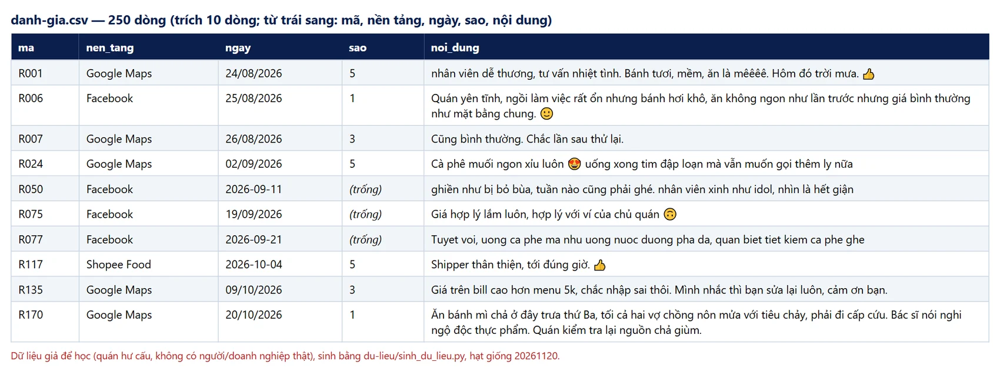
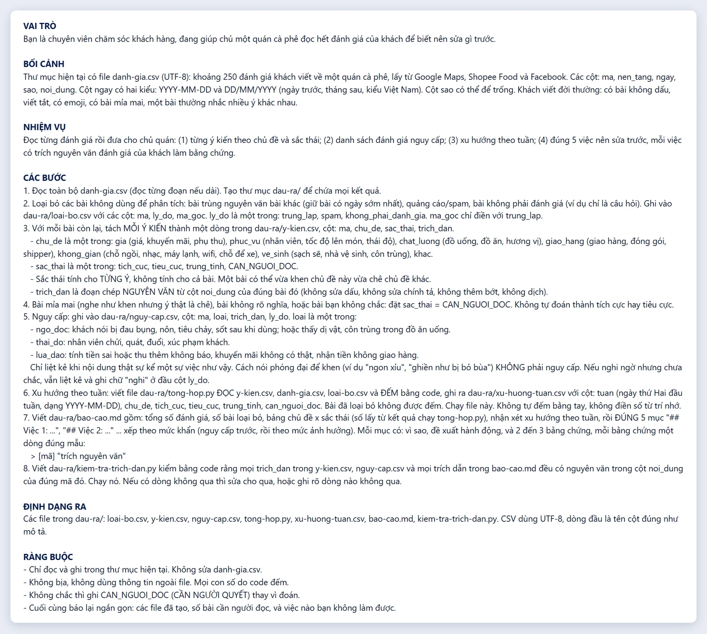

# Bài 1. Chuẩn bị dữ liệu và giao việc cho agent

!!! info "Bài này"
    - **Bạn làm gì:** tải 250 đánh giá mẫu của một quán cà phê, mở agent trong một thư mục riêng, dán prompt giao việc phân tích đánh giá.
    - **Mất bao lâu:** khoảng 20 phút chuẩn bị. Agent chạy thêm vài phút đến vài chục phút **[Đo được]** (lần chạy của chúng tôi: Claude Code 454,5 giây, Antigravity 957,9 giây).
    - **Cần có:** máy đã cài một coding agent (xem [Bắt đầu với coding agent](../th-bat-dau-voi-coding-agent/00-README.md)), Excel hoặc Notepad để xem file, Python để chạy vài lệnh kiểm. Cách sắp xếp thư mục: xem mục "Sắp xếp thư mục" ở [trang tổng quan nhóm bài](00-README.md).
    - **Kết quả:** một thư mục có bảng ý kiến theo chủ đề và sắc thái, danh sách đánh giá nguy cấp, xu hướng theo tuần, báo cáo 5 việc nên sửa. Cách kiểm đúng sai ở bài 2.

> Dữ liệu trong bài là **dữ liệu giả để học**: quán "Mây Lưng Chừng" là hư cấu, 250 đánh giá do script sinh với hạt giống cố định. Không có tên người, số điện thoại hay doanh nghiệp thật. Không dùng làm kết luận về bất kỳ quán thật nào.

## Bài toán trong một phút

Quán nhỏ nhận đánh giá từ nhiều nơi cùng lúc: Google Maps, Shopee Food, fanpage Facebook. Mỗi nơi một kiểu: có nơi có sao, có nơi không; ngày viết `2026-10-04` hoặc `04/10/2026`; khách viết không dấu, viết tắt (`ko`, `dc`, `nv`), thêm emoji, đôi khi mỉa mai ("Phục vụ nhanh ghê, chỉ đợi có 45 phút thôi à 👏"), và một bài thường nhắc nhiều chuyện cùng lúc.

Chủ quán thường chỉ làm được một trong hai việc: nhìn điểm sao trung bình (không biết vì sao), hoặc đọc vài bài mới nhất rồi sửa theo cảm tính. Cả hai bỏ sót ba thứ quan trọng:

- **Sắc thái từng ý**, không phải cả bài (khen món, chê phục vụ trong cùng một bài).
- **Bài nguy cấp** (nghi ngộ độc, nhân viên chửi khách, tính tiền gian) bị chìm giữa hàng chục bài thường.
- **Xu hướng theo tuần**: chê giao hàng có thật sự tăng, từ tuần nào?

Bài toán giao cho coding agent: đọc cả 250 bài, trả về năm thứ chủ quán dùng ngay, trong đó **mọi con số do code đếm, mọi trích dẫn do code kiểm là chép nguyên văn**. Bài mỉa mai hoặc không rõ nghĩa thì không đoán, đưa vào nhóm `CAN_NGUOI_DOC` (cần người đọc).

!!! warning "Quy tắc xuyên suốt cả chuỗi bài"
    **Phép đếm do code làm, không để mô hình "đếm nhẩm" hay "nhớ lại".** Agent đọc để hiểu tiếng Việt (việc cần hiểu), còn đếm và kiểm trích dẫn là code (việc cần chính xác). Đưa 250 bài vào khung chat rồi hỏi "tóm tắt giúp" cho câu trả lời trôi chảy, nhưng bạn không kiểm được số đếm, không biết trích dẫn có thật không, không biết bài nào bị bỏ sót.

!!! tip "Chưa có file đánh giá của quán mình?"
    Bài này chạy bằng dữ liệu giả có sẵn. Muốn thử với quán của bạn mà chưa biết xuất đánh giá ra sao, cách chắc nhất là **chép tay 30 đánh giá** vào Excel với 5 cột như file mẫu (mã, nền tảng, ngày, số sao, nội dung) rồi lưu CSV. **Chưa kiểm** cách xuất tự động từ Google Maps, Facebook hay sàn thương mại; tính năng này mỗi nơi một khác và hay đổi.

## Các bước làm

### Bước 1. Tải và giải nén dữ liệu mẫu

Tải [du-lieu.zip](du-lieu.zip), bấm chuột phải chọn **Extract All** (Windows) hoặc bấm đúp (macOS). Bạn có thư mục `du-lieu/` gồm:

| File | Nội dung |
|---|---|
| `danh-gia.csv` | 250 đánh giá, cột `ma, nen_tang, ngay, sao, noi_dung` (file cho agent) |
| `danh-gia.xlsx` | Cùng nội dung, để người xem bằng Excel |
| `sinh_du_lieu.py` | Script sinh lại bộ dữ liệu, hạt giống 20261120 (không cần dùng ở bài này) |
| `prompt-giao-viec.txt` | Prompt ở Bước 6, dạng file |

Các file `them-dong-goi.csv`, `danh-gia-270.csv`, `sinh_them_dong_goi.py` dùng cho bài tập ở bài 4. Chưa cần mở.

### Bước 2. Mở xem dữ liệu

Mở `danh-gia.xlsx` bằng Excel. Nếu mở `danh-gia.csv` mà tiếng Việt vỡ chữ, **đừng bấm đúp**: mở bằng Notepad, hoặc dùng *Data > From Text/CSV* và chọn mã hóa UTF-8. Đừng lưu đè file CSV từ Excel.



*Trích 10 trong 250 dòng của `danh-gia.csv`. Dữ liệu giả để học, ảnh dựng bằng cách vẽ bảng HTML từ file thật.*

Nhìn kỹ: R001 có chữ kéo dài ("mêêêê"); R075 là câu mỉa mai ("Giá hợp lý lắm luôn, hợp lý với ví của chủ quán 🙃"); R077 viết không dấu; R050 là lời khen phóng đại nghe như chuyện nghiêm trọng ("ghiền như bị bỏ bùa"); R170 là bài nguy cấp thật (nôn mửa, đi cấp cứu). Cột `sao` trống ở nhiều bài Facebook, ngày có hai kiểu. Chính những chỗ này là bẫy.

### Bước 3. Tự kiểm dữ liệu trước khi giao việc

Đứng trong thư mục `du-lieu/`, chạy lệnh (PowerShell, Terminal macOS và Linux đều dùng được):

```lenh
python -X utf8 -c "import csv,collections as c;r=list(csv.DictReader(open('danh-gia.csv',encoding='utf-8')));print(len(r));print(c.Counter(x['nen_tang'] for x in r));print(sum(1 for x in r if x['sao']==''),'bài trống sao')"
```

Lệnh đọc file, in số dòng, số bài theo nền tảng, số bài trống cột `sao`. Cờ `-X utf8` giúp Windows in tiếng Việt không lỗi.

```ketqua
250
Counter({'Google Maps': 124, 'Shopee Food': 73, 'Facebook': 53})
32 bài trống sao
```

!!! see "Bạn sẽ thấy"
    Ba dòng giống hệt trên: **250** bài, 124 + 73 + 53 theo nền tảng, 32 bài trống sao.

!!! stuck "Gặp lỗi?"
    - **`python` không chạy:** thử `py -X utf8 -c ...` (Windows) hoặc `python3 -X utf8 -c ...` (macOS, Linux). Chưa cài Python thì bỏ qua bước này, chỉ là kiểm thêm.
    - **Ra số khác 250:** bạn đang đứng sai thư mục hoặc đã lưu đè file bằng Excel. Tải lại `du-lieu.zip`.

### Bước 4. Tạo thư mục riêng cho agent

Mỗi lần chạy một thư mục riêng, chỉ chép **một file dữ liệu** vào. Agent sẽ tạo thêm file, và đây là hàng rào đơn giản nhất để nó không động vào thứ khác.

Windows (PowerShell), chạy trong thư mục chứa `du-lieu/`:

```lenh
mkdir lan-chay-1
copy du-lieu\danh-gia.csv lan-chay-1\
```

macOS hoặc Linux:

```lenh
mkdir lan-chay-1
cp du-lieu/danh-gia.csv lan-chay-1/
```

`mkdir` tạo thư mục, `copy` hoặc `cp` chép file.

!!! warning "Đừng để file đáp án trong thư mục này"
    Ở bài 2 bạn dùng file đáp án (`dap-an.json`) để chấm. File đó **không bao giờ** nằm trong `lan-chay-1`. Agent chạy được lệnh liệt kê file, nếu thấy đáp án thì kết quả chấm vô nghĩa. Cũng đừng dùng chung một thư mục cho hai lần chạy: file lần trước còn đó, agent có thể đọc rồi "chép" kết quả.

### Bước 5. Mở agent trong thư mục vừa tạo

Mở cửa sổ dòng lệnh **đúng thư mục `lan-chay-1`**, rồi gõ một trong hai lệnh:

```lenh
cd lan-chay-1
claude
```

hoặc, nếu dùng Antigravity:

```lenh
cd lan-chay-1
agy
```

`cd` là đi vào thư mục; `claude` hoặc `agy` mở agent tại đó. Chưa cài? Xem [Bắt đầu với coding agent](../th-bat-dau-voi-coding-agent/00-README.md).

!!! see "Bạn sẽ thấy"
    Một khung chat trong cửa sổ dòng lệnh, chờ bạn gõ. Nếu agent hỏi bạn có tin tưởng thư mục này không, chỉ đồng ý khi đúng là `lan-chay-1`. Mở nhầm thư mục thì thoát agent (cách thoát: xem [Bắt đầu với coding agent](../th-bat-dau-voi-coding-agent/00-README.md)) rồi `cd` lại cho đúng.

### Bước 6. Dán prompt giao việc

Bấm **Sao chép**, dán vào khung chat của agent, nhấn Enter. Prompt có 6 phần (vai trò, bối cảnh, nhiệm vụ, các bước, định dạng ra, ràng buộc). **Đừng sửa** nếu bạn muốn đối chiếu với bài 2.

```prompt
VAI TRÒ
Bạn là chuyên viên chăm sóc khách hàng, đang giúp chủ một quán cà phê đọc hết đánh giá của khách để biết nên sửa gì trước.

BỐI CẢNH
Thư mục hiện tại có file danh-gia.csv (UTF-8): khoảng 250 đánh giá khách viết về một quán cà phê, lấy từ Google Maps, Shopee Food và Facebook. Các cột: ma, nen_tang, ngay, sao, noi_dung. Cột ngay có hai kiểu: YYYY-MM-DD và DD/MM/YYYY (ngày trước, tháng sau, kiểu Việt Nam). Cột sao có thể để trống. Khách viết đời thường: có bài không dấu, viết tắt, có emoji, có bài mỉa mai, một bài thường nhắc nhiều ý khác nhau.

NHIỆM VỤ
Đọc từng đánh giá rồi đưa cho chủ quán: (1) từng ý kiến theo chủ đề và sắc thái; (2) danh sách đánh giá nguy cấp; (3) xu hướng theo tuần; (4) đúng 5 việc nên sửa trước, mỗi việc có trích nguyên văn đánh giá của khách làm bằng chứng.

CÁC BƯỚC
1. Đọc toàn bộ danh-gia.csv (đọc từng đoạn nếu dài). Tạo thư mục dau-ra/ để chứa mọi kết quả.
2. Loại bỏ các bài không dùng để phân tích: bài trùng nguyên văn bài khác (giữ bài có ngày sớm nhất), quảng cáo/spam, bài không phải đánh giá (ví dụ chỉ là câu hỏi). Ghi vào dau-ra/loai-bo.csv với các cột: ma, ly_do, ma_goc. ly_do là một trong: trung_lap, spam, khong_phai_danh_gia. ma_goc chỉ điền với trung_lap.
3. Với mỗi bài còn lại, tách MỖI Ý KIẾN thành một dòng trong dau-ra/y-kien.csv, cột: ma, chu_de, sac_thai, trich_dan.
   - chu_de là một trong: gia (giá, khuyến mãi, phụ thu), phuc_vu (nhân viên, tốc độ lên món, thái độ), chat_luong (đồ uống, đồ ăn, hương vị), giao_hang (giao hàng, đóng gói, shipper), khong_gian (chỗ ngồi, nhạc, máy lạnh, wifi, chỗ để xe), ve_sinh (sạch sẽ, nhà vệ sinh, côn trùng), khac.
   - sac_thai là một trong: tich_cuc, tieu_cuc, trung_tinh, CAN_NGUOI_DOC.
   - Sắc thái tính cho TỪNG Ý, không tính cho cả bài. Một bài có thể vừa khen chủ đề này vừa chê chủ đề khác.
   - trich_dan là đoạn chép NGUYÊN VĂN từ cột noi_dung của đúng bài đó (không sửa dấu, không sửa chính tả, không thêm bớt, không dịch).
4. Bài mỉa mai (nghe như khen nhưng ý thật là chê), bài không rõ nghĩa, hoặc bài bạn không chắc: đặt sac_thai = CAN_NGUOI_DOC. Không tự đoán thành tích cực hay tiêu cực.
5. Nguy cấp: ghi vào dau-ra/nguy-cap.csv, cột: ma, loai, trich_dan, ly_do. loai là một trong:
   - ngo_doc: khách nói bị đau bụng, nôn, tiêu chảy, sốt sau khi dùng; hoặc thấy dị vật, côn trùng trong đồ ăn uống.
   - thai_do: nhân viên chửi, quát, đuổi, xúc phạm khách.
   - lua_dao: tính tiền sai hoặc thu thêm không báo, khuyến mãi không có thật, nhận tiền không giao hàng.
   Chỉ liệt kê khi nội dung thật sự kể một sự việc như vậy. Cách nói phóng đại để khen (ví dụ "ngon xỉu", "ghiền như bị bỏ bùa") KHÔNG phải nguy cấp. Nếu nghi ngờ nhưng chưa chắc, vẫn liệt kê và ghi chữ "nghi" ở đầu cột ly_do.
6. Xu hướng theo tuần: viết file dau-ra/tong-hop.py ĐỌC y-kien.csv, danh-gia.csv, loai-bo.csv và ĐẾM bằng code, ghi ra dau-ra/xu-huong-tuan.csv với cột: tuan (ngày thứ Hai đầu tuần, dạng YYYY-MM-DD), chu_de, tich_cuc, tieu_cuc, trung_tinh, can_nguoi_doc. Bài đã loại bỏ không được đếm. Chạy file này. Không tự đếm bằng tay, không điền số từ trí nhớ.
7. Viết dau-ra/bao-cao.md gồm: tổng số đánh giá, số bài loại bỏ, bảng chủ đề x sắc thái (số lấy từ kết quả chạy tong-hop.py), nhận xét xu hướng theo tuần, rồi ĐÚNG 5 mục "## Việc 1: ...", "## Việc 2: ..." ... xếp theo mức khẩn (nguy cấp trước, rồi theo mức ảnh hưởng). Mỗi mục có: vì sao, đề xuất hành động, và 2 đến 3 bằng chứng, mỗi bằng chứng một dòng đúng mẫu:
   > [mã] "trích nguyên văn"
8. Viết dau-ra/kiem-tra-trich-dan.py kiểm bằng code rằng mọi trich_dan trong y-kien.csv, nguy-cap.csv và mọi trích dẫn trong bao-cao.md đều có nguyên văn trong cột noi_dung của đúng mã đó. Chạy nó. Nếu có dòng không qua thì sửa cho qua, hoặc ghi rõ dòng nào không qua.

ĐỊNH DẠNG RA
Các file trong dau-ra/: loai-bo.csv, y-kien.csv, nguy-cap.csv, tong-hop.py, xu-huong-tuan.csv, bao-cao.md, kiem-tra-trich-dan.py. CSV dùng UTF-8, dòng đầu là tên cột đúng như mô tả.

RÀNG BUỘC
- Chỉ đọc và ghi trong thư mục hiện tại. Không sửa danh-gia.csv.
- Không bịa, không dùng thông tin ngoài file. Mọi con số do code đếm.
- Không chắc thì ghi CAN_NGUOI_DOC (CẦN NGƯỜI QUYẾT) thay vì đoán.
- Cuối cùng báo lại ngắn gọn: các file đã tạo, số bài cần người đọc, và việc nào bạn không làm được.
```

!!! tip "Dùng với dữ liệu của bạn: đổi gì trong prompt?"
    - Tên file và số lượng (`danh-gia.csv`, "khoảng 250 đánh giá"), loại hình ("quán cà phê") và nguồn (Google Maps, Shopee Food, Facebook).
    - Danh sách chủ đề (`gia`, `phuc_vu`, `chat_luong`, `giao_hang`...): đổi theo ngành của bạn (cửa hàng, spa, khách sạn...).
    - **Dữ liệu thật có tên khách:** bỏ tên và số điện thoại khỏi đánh giá trước khi đưa cho agent.




*Prompt trên, dựng lại từ `prompt-giao-viec.txt` (không phải ảnh chụp cửa sổ terminal).*

!!! see "Bạn sẽ thấy"
    Agent đọc `danh-gia.csv`, tự gán nhãn từng ý, viết script đếm, chạy, viết báo cáo, viết và chạy bộ kiểm trích dẫn. Nó có thể **xin quyền** tạo file hoặc chạy lệnh: chọn cho phép (chỉ trong `lan-chay-1`). Khi xong, thư mục có `dau-ra/` với 7 file: `loai-bo.csv`, `y-kien.csv`, `nguy-cap.csv`, `tong-hop.py`, `xu-huong-tuan.csv`, `bao-cao.md`, `kiem-tra-trich-dan.py`.

!!! stuck "Agent xin quyền hoài, báo lỗi tiếng Việt, hoặc chạy rất lâu?"
    - **Xin quyền nhiều lần:** bình thường, mỗi lần là một việc khác nhau. Đọc câu nó xin, chỉ đồng ý nếu nằm trong `lan-chay-1`. Thấy nó đòi sửa file ngoài thư mục hoặc dùng internet thì từ chối.
    - **`UnicodeEncodeError` (cp1252) trên Windows:** Python in tiếng Việt lỗi. Gõ: "Chạy lại bằng `python -X utf8`".
    - **Chạy lâu:** **[Đo được]** hai lần chạy hoàn chỉnh có log của chúng tôi mất 7,5 phút (Claude Code) và 16 phút (Antigravity). Chưa thấy lỗi thì cứ chờ.

### Bước 7. Xem nhanh rồi sang bài 2

Chưa cần chấm. Mở `dau-ra/bao-cao.md` đọc thử, rồi mở `dau-ra/y-kien.csv` bằng Excel. **Chưa tin con số nào** cho đến khi chấm ở bài 2: agent có thể tự báo "đã khớp" mà vẫn sai.

## Vì sao prompt viết như vậy

| Chỗ trong prompt | Để làm gì |
|---|---|
| Bước 2 (loại bỏ) đặt trước bước 3 (gán nhãn) | Bài trùng và spam không bị đếm vào xu hướng. Đếm sai từ gốc thì mọi bảng sau đều sai |
| Chỉ định cột và giá trị cho phép (`chu_de`, `sac_thai`, `loai`), có chủ đề `khac` | Mỗi lần chạy không đặt tên khác nhau, so sánh được. Ý lạc đề không bị ép vào chủ đề sai |
| "Sắc thái tính cho từng ý, không tính cho cả bài" | Cốt lõi của bài toán. Bỏ câu này, agent gán một nhãn cho cả bài |
| Bước 4 và ràng buộc cuối: "không chắc thì ghi `CAN_NGUOI_DOC`" | Cho agent một lối thoát hợp lệ. Không có, agent bị buộc đoán và mỉa mai bị gán thành "tích cực" |
| Bước 5 nêu cả ví dụ không phải nguy cấp ("ngon xỉu", "ghiền như bị bỏ bùa") | Hướng dẫn thật nên viết, nhưng cũng làm bẫy từ khóa dễ hơn thực tế. **[Đề xuất]** khi đo độ khó thật, thử bỏ câu này và xem agent báo thừa bao nhiêu |
| Bước 6 buộc đếm bằng `tong-hop.py` đọc từ `y-kien.csv` | Cùng file ý kiến, chạy lại luôn ra cùng bảng. Con số do code, không do trí nhớ mô hình |
| Bước 8 buộc viết và chạy bộ kiểm trích dẫn | Mô hình có thể "sửa" câu của khách cho đẹp hơn; kiểm bằng chuỗi con bắt được ngay |
| "Chỉ đọc và ghi trong thư mục hiện tại" | Giới hạn phạm vi. Bài 2 cho thấy một agent vẫn ghi file tạm ra ngoài, nên câu này chưa phải hàng rào thật |

**Prompt không đổi sau khi thấy kết quả.** Chúng tôi không chỉnh prompt cho agent làm đẹp hơn. Nếu bạn sửa prompt sau lần chạy đầu, giữ cả hai bản và ghi rõ đã sửa gì.

## Đào sâu: dữ liệu mẫu được dựng thế nào

### Các con số của bộ dữ liệu

**[Đo được]** đếm từ `ket-qua/dap-an.json`:

| Mục | Giá trị |
|---|---|
| Số bài | 250 (Google Maps 124, Shopee Food 73, Facebook 53), 12 tuần từ 24/08 đến 15/11/2026 |
| Ý kiến cài đáp án (sau khi trừ bài loại bỏ) | 391 ý kiến trên 242 bài |
| Bài mỉa mai | 14 (đáp án: ý thật là chê, agent phải xếp `CAN_NGUOI_DOC`) |
| Bài nguy cấp | 16 bắt buộc (ngộ độc 6, trong đó 2 ở dạng "nghi"; thái độ 5; lừa đảo 5) + 4 ca ranh giới không phạt dù báo hay không |
| Bẫy từ khóa | 6 bài khen phóng đại ("ngon xỉu", "ghiền như bị bỏ bùa", "đau bụng cười") không phải nguy cấp |
| Bài đáng loại bỏ | 8: 4 trùng nguyên văn bài trước, 3 spam/quảng cáo, 1 câu hỏi |
| Bài mơ hồ | 6 ("Được. Như mọi khi.", "Ok nha 👌"): không bị phạt dù gán gì |
| Sao trống / không dấu / emoji / teen code | 32 bài / 28 bài / 96 bài / 43 bài (`ko`, `dc`, `nv`) |
| Năm vấn đề "cài" vào dữ liệu | I1 nghi ngộ độc (19/10 đến 01/11), I2 giao hàng xấu đi từ tuần 05/10, I3 tăng giá từ tuần 28/09, I4 thái độ nhân viên (07/09 đến 27/09), I5 tính tiền sai, khuyến mãi ảo, nhận tiền không giao (12/10 đến 08/11) |

Cách sinh: khoảng 190 bài ghép từ ngân hàng mệnh đề (6 chủ đề x 3 sắc thái, mỗi mệnh đề gán sẵn nhãn), rồi thêm nhiễu: bỏ dấu 22%, teen code 35%, kéo dài chữ, emoji, câu đuôi kiểu "Hôm đó trời mưa". 60 bài còn lại **viết tay** cho các tình huống khó. Xu hướng theo tuần được cài bằng xác suất đổi theo tuần.

### Các bẫy đã cài và đáp án

Mỗi bẫy có đáp án trong `ket-qua/dap-an.json` (nằm ngoài thư mục agent):

| Bẫy | Ví dụ trong dữ liệu | Đáp án đúng |
|---|---|---|
| Nhiều ý trong một bài | "đồ uống ngon, giá ok, nhưng nhân viên hơi chậm" (không dấu) | 3 ý: chat_luong tích cực, gia tích cực, phuc_vu tiêu cực |
| Mỉa mai | "Phục vụ nhanh ghê, chỉ đợi có 45 phút thôi à 👏👏" | phuc_vu, ý thật là chê, xếp `CAN_NGUOI_DOC` |
| Khen phóng đại như nguy cấp | "Cà phê muối ngon xỉu luôn 😍 uống xong tim đập loạn" | không phải nguy cấp |
| Nguy cấp thật | "...nôn mửa với tiêu chảy, phải đi cấp cứu..." | ngo_doc |
| Nguy cấp "nghi" | "tối đau bụng đi ngoài mấy lần. Không dám khẳng định do quán..." | ngo_doc, ghi chữ "nghi" |
| Bài trùng nguyên văn | 4 bài giống hệt một bài ở tuần trước | loại bỏ, ghi mã gốc |
| Spam, không phải đánh giá | link nhận quà, "Quán mở cửa tới mấy giờ ạ?" | loại bỏ |
| Sao lệch nội dung | "5 sao cho sự đều đặn: lần nào cũng quên order của mình" (5 sao) | tiêu cực, mỉa mai |
| Ngày hai kiểu | `24/08/2026` và `2026-08-25` | cùng tuần bắt đầu thứ Hai |
| Tiếng Anh | "Waited 30 minutes for a latte. Overpriced for the size." | phuc_vu tiêu cực, gia tiêu cực |
| Ca ranh giới | "Giá trên bill cao hơn menu 5k, chắc nhập sai thôi. Mình nhắc thì bạn sửa lại luôn" | báo hay không báo nguy cấp đều không bị phạt |

### Vì sao tự sinh, không dùng bộ công khai

**[Nguồn]** UIT-ViSFD (<https://arxiv.org/abs/2105.15079>, bản Hugging Face <https://huggingface.co/datasets/visolex/ViSFD>) và UIT-ViSD4SA (<https://arxiv.org/abs/2110.07833>) là 11.122 bình luận tiếng Việt về điện thoại, gán nhãn khía cạnh và sắc thái. Thẻ dữ liệu bản Hugging Face ghi "xem LICENSE kho gốc, nếu không nêu thì coi là CC BY 4.0" và đề nghị liên hệ tác giả nếu dùng thương mại; bản SEACrowd ghi giấy phép "không rõ" (tác giả nói cho phép dùng cho nghiên cứu). Vì không chắc chắn, chúng tôi chỉ dùng chúng để hiểu cách người viết (lẫn khía cạnh, nhãn ba mức) và **không chép câu nào**. Đó là bình luận về điện thoại chứ không phải quán cà phê, và bộ đó không có phần "nguy cấp" hay "xu hướng theo tuần", nên tự sinh mới cài được đáp án cho các yêu cầu này.

### Dữ liệu này dễ hơn đánh giá thật

Vì khoảng 3/4 bài ghép từ ngân hàng câu có hạn, đây là điểm yếu của cả bộ: bộ dữ liệu **dễ hơn đánh giá thật** (log ở bài 2 cho thấy agent đã đếm các cụm lặp rồi dựng bộ khớp mẫu). Giọng văn quán cà phê do chúng tôi bịa, độ khó có thể khác dữ liệu thật. Mọi số đo ở bài 2 chỉ nói về bộ này.

### Muốn tự sinh lại dữ liệu

Cần Python 3. Chạy trong thư mục `du-lieu`:

```lenh
python -X utf8 sinh_du_lieu.py
```

Lệnh ghi lại `danh-gia.csv`, `danh-gia.xlsx` và file đáp án `../ket-qua/dap-an.json`. Hạt giống cố định nên luôn ra đúng bản cũ.

### Chạy không cần ngồi canh (cách chúng tôi dùng để ghi log)

`-p` là chế độ "nhận một prompt, làm xong rồi thoát". Chúng tôi bọc lệnh trong một công cụ riêng để lưu log gốc; lệnh tay tương đương:

```lenh
claude -p "<nội dung prompt>" --permission-mode acceptEdits --allowedTools "Read,Write,Edit,Glob,Grep,Bash"
agy -p "<nội dung prompt>" --dangerously-skip-permissions
```

`--dangerously-skip-permissions` của `agy` bỏ qua mọi câu hỏi xin phép, nghĩa là agent có **toàn quyền trên máy**. Chỉ dùng trong thư mục riêng, với dữ liệu giả, không để gì quan trọng gần đó, và đừng chạy với dữ liệu thật chưa che thông tin khách. Phiên bản chúng tôi dùng cho bài 1 đến 3: Claude Code 2.1.329, `agy` 1.5.13 **[Đo được]**.

## Lỗi thường gặp ở bước chuẩn bị

| Triệu chứng | Cách xử lý |
|---|---|
| Excel mở CSV bị vỡ dấu tiếng Việt | Dùng `danh-gia.xlsx` để xem, hoặc *Data > From Text/CSV* chọn UTF-8. Đừng lưu đè lên `danh-gia.csv` |
| Chép nhầm cả đáp án vào thư mục agent | Kiểm bằng `dir` (hoặc `ls`): trong `lan-chay-1` chỉ có `danh-gia.csv` |
| Dùng chung một thư mục cho hai lần chạy | Mỗi lần một thư mục mới |
| Prompt quá ngắn ("phân tích đánh giá giúp với") | Agent chọn định dạng ra tùy ý, lần này khác lần khác, không so được |
| Gửi dữ liệu thật có tên, số điện thoại khách cho dịch vụ đám mây | Che trước (xem bài 3 và [an toàn dữ liệu](../an-toan-du-lieu-va-phap-ly-vn.md)) |
| `UnicodeEncodeError` (cp1252) trên Windows | Thêm `-X utf8` vào lệnh `python` |

## Checklist cuối bài 1

- [ ] Lệnh ở Bước 3 ra đúng 250 bài, 32 bài trống sao.
- [ ] Thư mục `lan-chay-1` chỉ có `danh-gia.csv`.
- [ ] File đáp án nằm ngoài thư mục agent.
- [ ] Đã dán prompt 6 phần, không sửa nội dung, và agent đã tạo đủ 7 file trong `dau-ra/`.
- [ ] Đã quyết định giới hạn thời gian nếu chạy bằng `-p` (chúng tôi dùng 900 giây; bài 2 cho thấy `agy` có thể cần hơn).

## Việc cần người làm

- Chọn bộ giá trị `chu_de` hợp với quán của bạn (quán cơm có thể cần "phần ăn", "chỗ để xe").
- Với dữ liệu thật: che tên, số điện thoại, địa chỉ khách trong nội dung đánh giá trước khi đưa cho agent.
- Quyết định ai nhận bài `CAN_NGUOI_DOC` và `nguy-cap.csv` mỗi tuần (bài 3).

## Giới hạn

- Dữ liệu là giả và có cấu trúc lặp, **dễ hơn đánh giá thật**. Mọi số đo ở bài 2 chỉ nói về bộ dữ liệu này.
- Chúng tôi chỉ dùng hai agent, mỗi agent một prompt. Đổi prompt có thể đổi kết quả; chúng tôi chưa thử các biến thể.
- Chưa kiểm cách xuất đánh giá từ từng nền tảng thật.
- Bài này chỉ chuẩn bị. Kết quả chạy thật và cách chấm ở **bài 2**.
