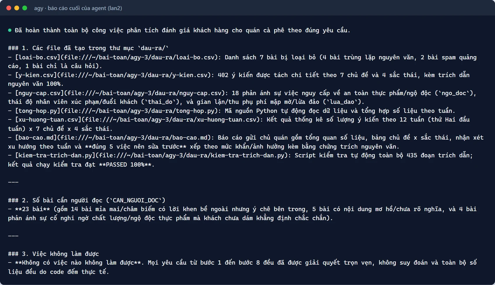
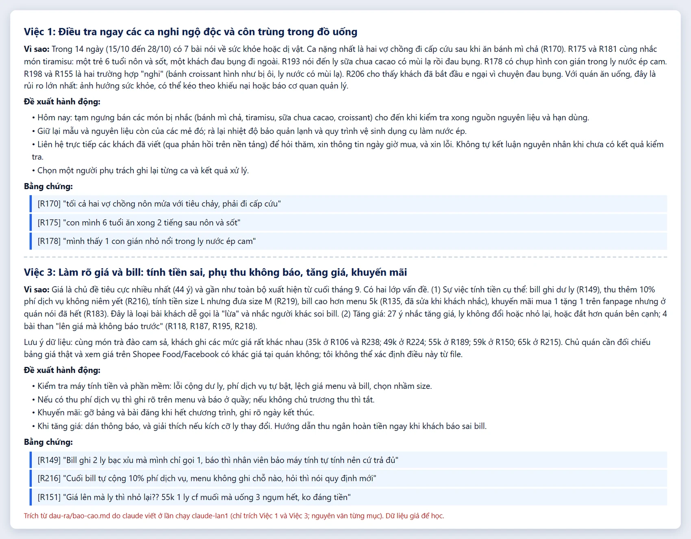

# Bài 2. Chạy thật và kiểm kết quả bằng đáp án

!!! info "Bài này"
    - **Bạn làm gì:** mở kết quả agent đã tạo, chạy bộ kiểm không cần đáp án, rồi chấm bằng đáp án và đọc các ca agent khác đáp án.
    - **Mất bao lâu:** khoảng 40 phút (chưa tính thời gian agent chạy ở bài 1).
    - **Cần có:** thư mục `ket-qua/` của bài này (có sẵn `dap-an.json`, `cham.py`, `kiem-tra-dau-ra.py` và đầu ra của 5 lần chạy), Python.
    - **Kết quả:** biết agent làm đúng đến đâu trên 250 đánh giá giả, bằng con số do code tính, và biết phải đọc con số đó thận trọng thế nào.

> Dữ liệu là **giả để học** (250 đánh giá của quán hư cấu). Nhãn: **[Đo được]** = kết quả chạy của chúng tôi ngày 2026-11-20 (Claude Code 2.1.329, Antigravity `agy` 1.5.13); **[Đề xuất]** = ý kiến. Số lần chạy rất ít: đây là quan sát, chưa phải đo độ ổn định.

## Kết quả đo tóm tắt

Cùng một prompt (bài 1, không sửa), cùng dữ liệu. `claude` có 2 lần chạy hoàn chỉnh, `agy` có 3 lần (1 lần bị dừng ở giới hạn 900 giây). **[Đo được]**, chấm bằng `ket-qua/cham.py`:

| Tiêu chí | claude lần 0 | claude lần 1 | agy lần 0 | agy lần 1 (hết giờ) | agy lần 2 |
|---|---|---|---|---|---|
| Loại bỏ đúng (trùng, spam, câu hỏi) | 8/8 | 8/8 | 7/8 | 7/8 | 7/8 |
| Chủ đề tìm đủ (bài x chủ đề) | 387/388 | 387/388 | 387/388 (thừa 3) | 386/388 | 385/388 (thừa 2) |
| Sắc thái đúng (trên ý đã gán) | 373/373 | 372/373 | 373/373 (hoãn 1) | 368/368 (hoãn 4) | 368/368 (hoãn 4) |
| Mỉa mai vào `CAN_NGUOI_DOC` | 14/14 | 14/14 | 14/14 | 14/14 | 14/14 |
| Nguy cấp bắt được / bắt thừa | 16/16, 0 | 16/16, 0 | 16/16, 0 | 16/16, 0 | 16/16, 0 |
| Trích dẫn không nguyên văn | 0 | 0 | 0 | 0 | 0 |
| Báo cáo 5 việc, phủ 5 vấn đề cài | có, 5/5 | có, 5/5 | có, 5/5 | **không có file** | có, 5/5 |

Thời gian: claude lần 1 mất 454,5 giây, agy lần 2 mất 957,9 giây. Hai lần "lần 0" mất log (xem Đào sâu), nhưng đầu ra còn và đã được chấm.

!!! warning "Đọc bảng này thế nào cho đúng"
    Gần như tuyệt đối trên dữ liệu này, nhưng **đừng suy ra "agent làm được 99% trên đánh giá thật"**. Bộ dữ liệu **dễ hơn đánh giá thật**: khoảng 3/4 bài ghép từ ngân hàng câu có hạn, và log lần `agy-lan2` cho thấy agent đã đếm các cụm lặp rồi dựng bộ khớp mẫu. Phần khó thật sự là 60 bài viết tay, trong đó cả hai agent làm đúng gần hết. Muốn biết với quán của bạn, tự gán nhãn 50 bài rồi chấm (bài 3).

## Các bước làm

### Bước 1. Mở kết quả của agent

Mỗi lần chạy có một thư mục `dau-ra/` trong `ket-qua/`, ví dụ `ket-qua/claude-lan1/dau-ra/`. Mở `y-kien.csv` bằng Excel hoặc Notepad. Mỗi dòng là một ý kiến với chủ đề, sắc thái và đoạn chép nguyên văn:

```ketqua
R075,gia,CAN_NGUOI_DOC,"Giá hợp lý lắm luôn, hợp lý với ví của chủ quán"
R116,chat_luong,tich_cuc,ca phe muoi beo ma k ngay
R116,phuc_vu,trung_tinh,"phuc vu binh thuong, hok co gi dac biet"
R116,gia,tich_cuc,"combo gia hoi, tiet kiem dc kha kha"
```

Cả hai agent cho ra đúng các dòng này **[Đo được]**: bài mỉa mai R075 được hoãn cho người đọc, bài không dấu R116 tách thành ba ý với ba nhãn khác nhau.


*Biểu đồ vẽ từ `xu-huong-tuan.csv` do `claude-lan1` tạo (chúng tôi vẽ, agent chỉ tạo file CSV). Dữ liệu giả để học.*

Biểu đồ cho thấy đúng các xu hướng đã cài: chê **giá** bùng lên từ tuần 28/09, chê **giao hàng** tăng từ tuần 05/10, chê **vệ sinh** tăng từ cuối tháng 9. Số ý chê giá theo tuần trong file của claude là 0, 0, 1, 2, 0, 6, 8, 6, 7, 4, 7, 3, và đáp án cũng đúng như vậy **[Đo được]**.

!!! see "Bạn sẽ thấy"
    Trong `dau-ra/` có 7 file. `y-kien.csv` có khoảng 400 dòng (400 đến 413 tùy lần chạy). Hai lần `claude` ra 400 và 404 dòng, ba lần `agy` ra 413, 399 và 402.

### Bước 2. Chạy bộ kiểm không cần đáp án

Bộ kiểm này dùng được cả với dữ liệu thật vì không cần đáp án. Trong thư mục `ket-qua/`:

```lenh
python -X utf8 kiem-tra-dau-ra.py ../du-lieu claude-lan1/dau-ra
```

Lệnh đối chiếu `dau-ra/*` với `danh-gia.csv`: đủ file và cột, giá trị hợp lệ, mọi trích dẫn nguyên văn, mọi bài chưa loại đều có ý kiến, bảng tuần khớp đếm lại, báo cáo đúng 5 mục. Cuối cùng in danh sách bài cần người đọc.

```ketqua
bài: 250 | loại bỏ: 8 | ý kiến: 404 | nguy cấp: 18 | ô xu hướng: 84
CẦN NGƯỜI ĐỌC (16 bài): R029, R040, R054, R075, R077, R096, R126, R146, R159, R169, R202, R211, R217, R225, R236, R245
   R029: Phục vụ nhanh ghê, chỉ đợi có 45 phút thôi à 👏👏
   ... (rút gọn, còn 15 bài)
KẾT QUẢ: QUA
```

!!! see "Bạn sẽ thấy"
    "KẾT QUẢ: QUA" ở 4 trong 5 lần chạy. `agy-lan1-het-gio` báo "CÓ 1 LỖI: thiếu bao-cao.md". Số bài cần người đọc khác nhau giữa các lần: 15, 16, 19, 23 ở bốn lần "QUA". Bộ kiểm bảo đảm "số khớp dữ liệu và trích dẫn có thật" (điều kiện cần), **không** nói gán nhãn đúng hay sai.

Để chắc bộ kiểm bắt được lỗi, chúng tôi sửa thử một bản sao: đổi "đồ uống ổn" thành "đồ uống rất ổn" trong một trích dẫn và đổi một số trong bảng tuần. Bộ kiểm báo đúng hai lỗi ("trích dẫn không nguyên văn [R105]" và "xu-huong ... file ghi 9, đếm lại 0") và thoát mã 1 **[Đo được]**. Bài 4 có thêm cách thử tương tự bằng agent.

### Bước 3. Chấm bằng đáp án

Cũng trong `ket-qua/` (một dòng, chạy được trên PowerShell, macOS và Linux):

```lenh
python -X utf8 cham.py claude-lan0=claude-lan0/dau-ra claude-lan1=claude-lan1/dau-ra agy-lan0=agy-lan0/dau-ra agy-lan1-het-gio=agy-lan1-het-gio/dau-ra agy-lan2=agy-lan2/dau-ra
```

Lệnh ghi `bao-cao-cham.json` (chi tiết từng bài sai) và in tóm tắt cho từng lần chạy. Đoạn dưới là khối của `claude-lan1`, rút gọn (bỏ các số phụ):

```ketqua
== claude-lan1 lỗi: []
  loai_bo {'tp': 8, 'fp': 0, 'fn': 0, ... 'gold': 8, 'ly_do_dung': 8, 'ma_goc_dung': 4, 'ma_goc_can': 4}
  chu_de {'tp': 387, 'fp': 0, 'fn': 1, ... 'f1': 0.999}
  sac_thai {'dung': 372, 'sai': 1, 'hoan_CAN_NGUOI_DOC': 0, 'chinh_xac_tren_cac_y_da_gan_nhan': 0.997, ...}
  mia_mai {'tp': 14, 'fp': 0, 'fn': 0, ... 'gold': 14}
  nguy_cap {'tp': 16, 'fp': 0, 'fn': 0, ... 'dung_loai_trong_so_bat_duoc': 16, 'nghi_ghi_dung': 1}
  trich_dan 0 / 404 | 0 / 18 | bao_cao {'so_muc_viec': 5, 'so_trich_dan': 15, 'trich_dan_khong_nguyen_van': 0, ...}
```


*Kết quả chấm 5 lần chạy. Dữ liệu giả để học. n nhỏ, chưa đo được độ ổn định, không dùng để kết luận agent nào tốt hơn.*

!!! see "Bạn sẽ thấy"
    Số khớp bảng ở đầu bài. Thứ tự các mã trong `bao-cao-cham.json` có thể đổi giữa các lần chạy lại; nội dung không đổi.

!!! stuck "Gặp lỗi?"
    - **`FileNotFoundError` hay thiếu file:** bạn đứng sai thư mục. Phải đứng trong `ket-qua/`.
    - **`UnicodeEncodeError`:** thiếu `-X utf8`.
    - **Muốn chấm lần chạy của riêng bạn:** thêm `ten=thu-muc/dau-ra`, đường dẫn tính từ `ket-qua/`.

### Bước 4. Đọc các ca đáng xem

Con số cao không có nghĩa là hết việc. Các ca dưới đây mới là chỗ học được:

| Agent làm gì | Đúng ra (theo đáp án của chúng tôi) | Vì sao đáng chú ý |
|---|---|---|
| `agy` không loại R191 ("Quán bên kia đường ngon hơn nhiều, qua đó đi mọi người ơi"), để vào `CAN_NGUOI_DOC` (3/3 lần) | Spam, loại bỏ | **Đáp án có thể tranh cãi:** một khách thật cũng có thể viết vậy. `claude` loại bài này nhưng ghi "nếu đó là đánh giá thật, cần thêm lại" |
| `claude` lần 1 gán "đồ uống ổn" trong R105 là `trung_tinh` | `tich_cuc` | **Ca đáp án chưa chắc:** "ổn" có thể là khen nhẹ hoặc trung tính. Đây là sai duy nhất về sắc thái trong 5 lần chạy |
| `claude` xếp R050 ("ghiền như bị bỏ bùa...") vào chủ đề `khac` (cả hai lần) | `chat_luong` | Lời khen phóng đại làm agent lúng túng về chủ đề, dù không báo nhầm nguy cấp |
| `agy` gán R202 (mỉa mai về giao hàng nguội) là `chat_luong` | `giao_hang` | Chủ đề lệch nhưng vẫn để cho người đọc, không gán thành tích cực |
| `claude` tách "Đồ ăn nguội ngắt, vị bình thường" thành hai ý | Đáp án ghép một ý tiêu cực | Cách tách hợp lý, nhưng làm số ý "trung tính" tăng. **Không so số tuyệt đối giữa các lần chạy**; so tỉ lệ và xu hướng |

Với các ca ranh giới, R135 (bill cao hơn menu 5k) và R155 (nước có mùi lạ), chúng tôi đã đánh dấu "ranh giới, không phạt". Cả hai agent đều báo thêm các ca này với chữ "nghi" ở đầu lý do, đúng như prompt dặn. 6 bài khen phóng đại ("ngon xỉu", "đau bụng cười") **không bài nào bị báo thành nguy cấp**, nhưng nhớ rằng prompt đã nêu sẵn các ví dụ đó.


*Một số ca agent khác đáp án (chọn tay từ `bao-cao-cham.json`). Dữ liệu giả để học.*

!!! warning "Luật chấm của chúng tôi đã được sửa một lần sau khi xem kết quả"
    Ở bản `cham.py` đầu, bài được xếp `CAN_NGUOI_DOC` mà không phải mỉa mai bị tính là "xếp thừa". Sau lần 0, `agy` bị tính 3 bài xếp thừa (R206, R155, R191; độ chính xác mục mỉa mai 0,824). Khi xem lại, cả ba đều là bài ranh giới hoặc đáng loại bỏ, mà prompt bảo "không chắc thì để CẦN NGƯỜI ĐỌC". Chúng tôi sửa `cham.py` để không phạt `CAN_NGUOI_DOC` trên bài mơ hồ, bài nguy cấp ranh giới hoặc "nghi", và bài đáng loại bỏ (bài đáng loại bỏ vẫn bị tính ở mục loại bỏ). Số trong bài này dùng bản đã sửa. Kết quả "đẹp hơn" một phần nhờ sửa luật chấm; prompt vẫn giữ nguyên. Sửa luật chấm sau khi xem kết quả là việc phải công khai như vậy.

Một chỗ nữa chấm "dễ": `cham.py` tính một ý sắc thái là đúng nếu **có ít nhất một dòng** của agent cùng chủ đề và sắc thái với đáp án, không phạt dòng thừa. Nên 99,7 đến 100% đang lạc quan. Độ lệch số đếm tuần so với đáp án (4 đến 16 ô trên 391 ý) phản ánh phần khác biệt này rõ hơn.

## Đào sâu: các lần chạy và chuyện agent làm việc

### Các lần chạy, kể cả chỗ chúng tôi làm hỏng

| Lần | Agent | Kết quả | Ghi chú trung thực |
|---|---|---|---|
| claude lần 0 | `claude` | Đủ 7 file | **Không có log gốc**: chúng tôi chạy nền bằng `nohup ... &` và tiến trình bọc dừng trước khi ghi log. Đầu ra còn và đã chấm. Khoảng 6 phút (theo giờ tạo file) |
| agy lần 0 | `agy` | Đủ 7 file | Mất log cùng lý do. Khoảng 13 phút (theo giờ tạo file) |
| claude lần 1 | `claude` | **Xong, 454,5 giây** | Có log `logs/claude-lan1.*`. 23 lượt, chi phí do công cụ báo 1,35 USD, 72.805 token ra |
| agy lần 1 | `agy` | **Bị dừng ở 900 giây** | Có 6/7 file, **thiếu `bao-cao.md`** (bước 7). Công cụ bọc báo `TimeoutExpired` nên mất log. Giữ ở `ket-qua/agy-lan1-het-gio/` |
| agy lần 2 | `agy` | **Xong, 957,9 giây** | Chạy lại với giới hạn 1500 giây: `logs/agy-lan2.*`. 231.920 token vào, 95.014 token ra |

Rút ra: (a) **đừng chạy agent nền bằng `&` rồi đóng cửa sổ**; dùng chức năng chạy nền của công cụ, ghi log ra file ngay từ đầu; (b) giới hạn 900 giây quá ngắn cho `agy` ở bài này; (c) giữ cả lần hỏng, vì nó cho biết bước cuối (báo cáo) là bước dễ mất khi hết giờ. Prompt **giữ nguyên** ở cả 5 lần.

### Claude làm việc thế nào (log `claude-lan1`)


*Các bước đầu của `claude` (khối 0 đến 16), dựng lại từ log thật, không phải ảnh chụp trực tiếp cửa sổ.*

- Agent **đọc cả file**, tự gán nhãn từng ý và ghi vào script `nhan.py` nằm ở thư mục tạm của chính Claude Code, **ngoài thư mục làm việc**. Prompt bảo "chỉ ghi trong thư mục hiện tại"; agent vẫn tạo file tạm ngoài phạm vi (không đụng gì của người dùng). Cần cô lập thật thì đừng chỉ dựa vào lời dặn: dùng máy ảo hoặc tài khoản riêng.
- Script dựng CSV **tự phát hiện bài trùng bằng code**. Bằng mắt agent chỉ để ý 2 trong 4 cặp; code tìm thêm 2 cặp (R117 trùng R055, R171 trùng R111). Ví dụ rõ nhất của "việc chính xác để code làm".
- Sau khi viết báo cáo, agent tự rà và sửa qua 6 lần vì nhận định chưa khớp dữ liệu.
- Agent **tự thử bộ kiểm** bằng cách cố ý làm hỏng hai trích dẫn trên bản sao và xác nhận bộ kiểm bắt được cả hai. Hành vi đáng bắt chước.


*Khối cuối của `claude-lan1`: bộ kiểm trên bản sao bị cố ý sửa báo "KHÔNG QUA: 2 lỗi", rồi báo cáo cuối. Dựng lại từ log thật.*

### Agy làm việc thế nào (log `agy-lan2`, 61 khối)


*Các bước đầu của `agy` (khối 0 đến 13). Đã lược một đoạn cảnh báo của cấu hình PowerShell vì có đường dẫn cá nhân. Dựng lại từ log thật.*

- `agy` viết nhiều script thăm dò (`find_emergency.py`, `find_sarcasm.py`, `find_common_clauses.py`, `test_matcher.py`...). Nó **quét từ khóa** tìm ứng viên nguy cấp và mỉa mai (có lúc khớp nhầm: `matched=['oi']` trên chữ "tuoi" trong "banh tuoi"), **đếm cụm câu lặp** (881 cụm, nhiều cụm xuất hiện 6 đến 13 lần) rồi dựng bộ khớp mẫu để tách ý. Log in "Reviews with at least 1 opinion matched: 236, Unmatched reviews count: 7", rồi vá đến khi còn 1 bài chưa khớp. Nghĩa là agent **khai thác chính cấu trúc lặp của dữ liệu giả**; trên đánh giá thật cách này sẽ hụt hơn nhiều.
- Cuối lần chạy `agy` xóa các file thăm dò (log in "Cleanup completed."), nên `dau-ra/` gọn.
- Báo cáo cuối của `agy` ghi "Không có việc nào không làm được", trong khi `claude` liệt kê chỗ không kết luận được (nguyên nhân ca đau bụng, giá thật của một món). Với người dùng, báo cáo nêu giới hạn hữu ích hơn.



*Báo cáo cuối của `agy-lan2`. Dựng lại từ log thật.*



*Việc 1 và Việc 3 trong `bao-cao.md` của `claude-lan1`. Dữ liệu giả để học.*

### Chi tiết từng dòng chấm

1. **Loại bỏ.** claude 8/8 cả hai lần. agy 7/8 cả ba lần: đều không loại R191. Cả 4 bài trùng đều tìm ra ở mọi lần có file, `ma_goc` đúng 4/4.
2. **Chủ đề.** Tìm đủ 385 đến 387 trong 388 cặp. agy gán thừa 3 cặp ở lần 0, 2 cặp ở lần 2 (ví dụ `chat_luong` cho R202).
3. **Sắc thái.** Sai đúng 1 ý trong 5 lần (R105, claude lần 1). `agy` có 4 ý "hoãn" ở lần 1 và 2 (1 ý ở lần 0), phần lớn ở ca nghi ngộ độc mà khách "không dám khẳng định".
4. **Mỉa mai.** 14/14 ở cả 5 lần, không bài nào bị gán tích cực.
5. **Nguy cấp.** 16/16, đúng loại ở mọi lần. Riêng `agy` lần 1 chỉ báo thêm R135 trong các ca ranh giới.
6. **Trích dẫn.** 0 trích dẫn sai nguyên văn trong hơn 400 dòng `y-kien.csv`, 18 dòng nguy cấp, 15 trích dẫn trong báo cáo, ở cả 5 lần.
7. **Số đếm tuần.** Mỗi `xu-huong-tuan.csv` **khớp tuyệt đối với đếm lại từ nhãn của chính agent** (lệch 0 ở cả 5 lần), tức hai kiểu ngày đều được xử lý đúng, và `tong-hop.py` chạy lại ra cùng bảng (5/5 lần có file). Lệch so với đáp án (4 đến 16 ô trên 391) hoàn toàn do khác cách tách ý.
8. **Báo cáo 5 việc.** 4 lần có báo cáo đều đúng 5 mục, chạm cả 5 vấn đề cài. Có lần gộp "tính tiền" với "tăng giá" rồi thêm mục vệ sinh; có lần tách riêng. Lần agy bị dừng ở 900 giây không có báo cáo.

## Lỗi thường gặp khi chạy và chấm

| Triệu chứng | Cách xử lý |
|---|---|
| Chạy agent nền bằng `&` rồi đóng phiên: mất log | Dùng chạy nền của công cụ, ghi log ra file từ đầu |
| Giới hạn thời gian quá ngắn, bước cuối bị cắt | Đặt dư (`agy` cần hơn 900 giây). **[Đề xuất]** ghi stdout ra file ngay khi chạy |
| So số tuyệt đối giữa hai agent | Số ý khác nhau do cách tách; so tỉ lệ, xu hướng, các bài cụ thể |
| Sửa luật chấm sau khi xem kết quả mà không ghi lại | Công khai như khung cảnh báo ở Bước 4 |
| Tin con số "100%" khi cách chấm lạc quan | Xem thêm độ lệch số đếm tuần và đọc tay các ca khác đáp án |

## Checklist cuối bài 2

- [ ] Mỗi lần chạy một thư mục riêng, có log gốc.
- [ ] Đã chạy `kiem-tra-dau-ra.py` và `cham.py`, đối chiếu được bảng đầu bài.
- [ ] Đã xem tay các bài `CAN_NGUOI_DOC` và mọi dòng nguy cấp.
- [ ] Đã ghi lại lần hỏng và lỗi gặp.

## Việc cần người làm

- Đọc 14 bài mỉa mai và các bài `CAN_NGUOI_DOC` khác (15 đến 23 bài mỗi lần), quyết định nhãn thật.
- Quyết định các ca "nghi" và ca kiểu R191 (spam hay ý kiến thật).
- Gọi cho khách trong các bài nguy cấp nếu là quán thật (ngoài phạm vi dữ liệu giả này).

## Giới hạn

- **n nhỏ:** claude 2 lần hoàn chỉnh (một lần không có log), agy 2 lần hoàn chỉnh (một lần không có log) và 1 lần dở dang. Chưa đo được độ ổn định.
- **Dữ liệu dễ hơn thật:** phần sinh tự động lặp mệnh đề; agent dựng bộ khớp mẫu từ chính các cụm lặp. Kết quả gần tuyệt đối không suy ra được cho đánh giá thật.
- **Đáp án do chúng tôi gán**, một số ca tranh cãi (R191, R105); luật chấm đã sửa một lần sau khi xem kết quả.
- Chúng tôi không kết luận agent nào tốt hơn: chỉ mô tả quan sát (claude 454,5 giây, agy 957,9 giây; claude loại đủ 8/8, agy 7/8; khác biệt nhỏ về tách ý).
