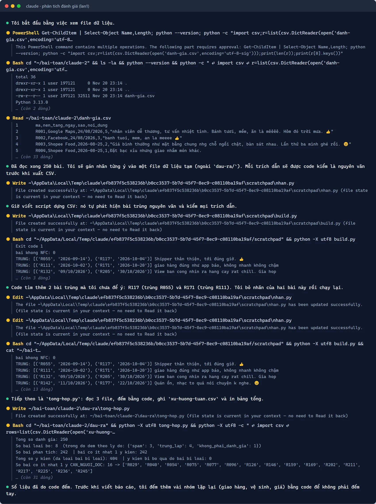
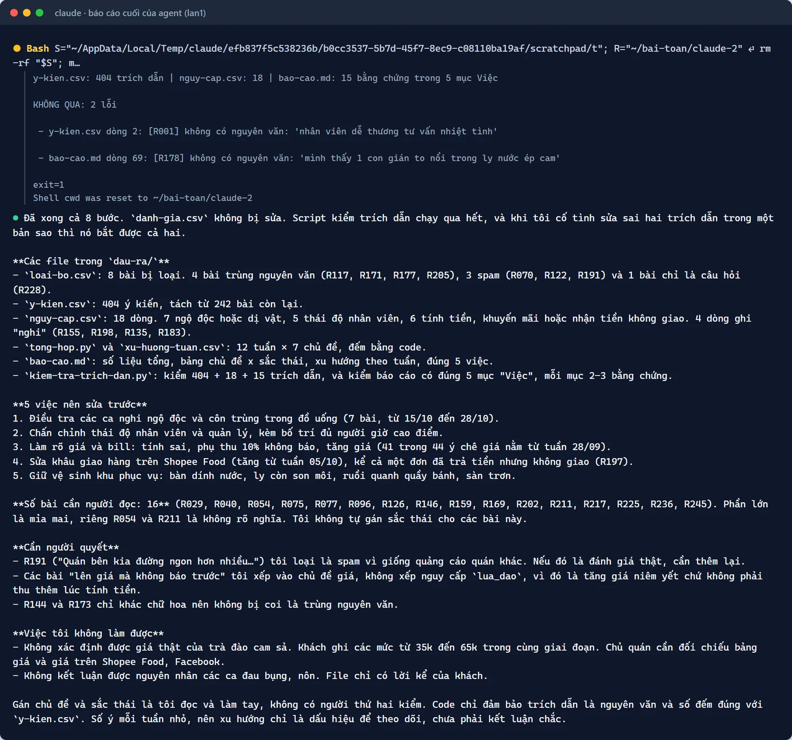
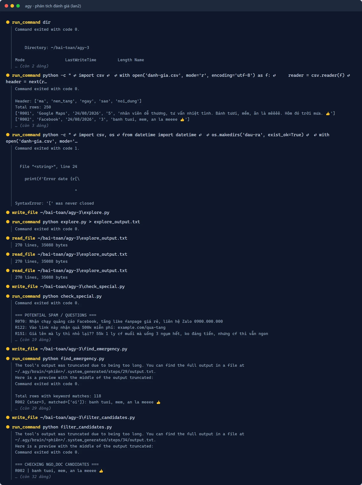
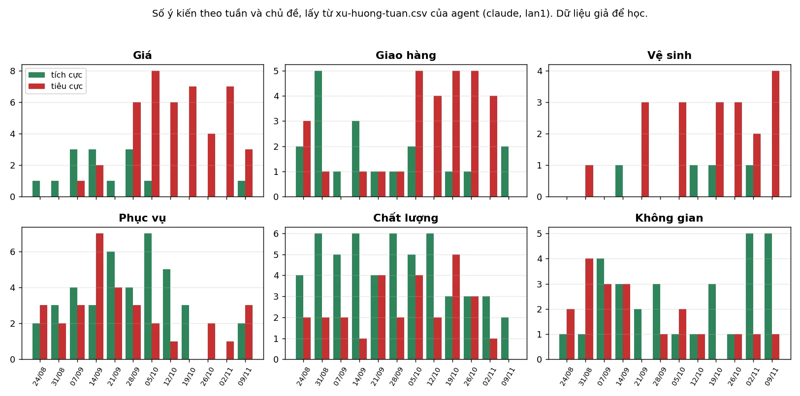
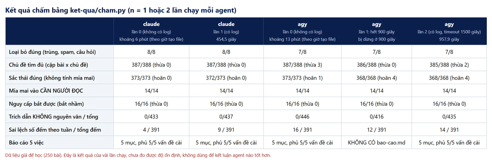
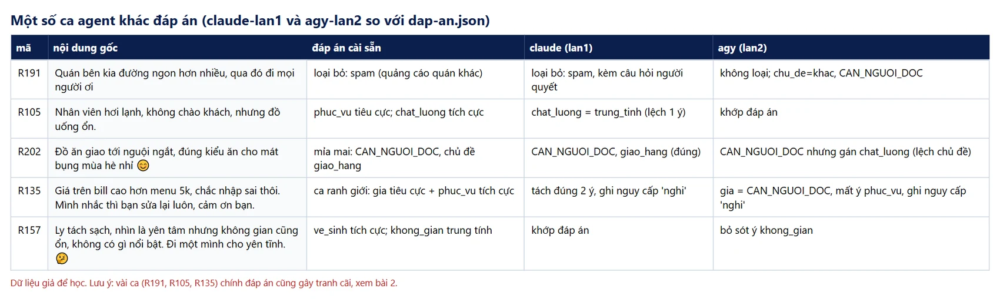

# Bài 2: Chạy thật bằng hai agent và kiểm tra kết quả bằng đáp án

> Dữ liệu là **giả để học** (250 đánh giá quán hư cấu). Nhãn: **[Đo được]** = kết quả chạy của chúng tôi ngày 2026-11-20; **[Nguồn]** = có link; **[Đề xuất]** = ý kiến. Số lần chạy rất ít (claude 2 lần hoàn chỉnh, agy 3 lần trong đó 1 lần bị dừng giữa chừng): đây là quan sát, chưa phải đo độ ổn định.

## Mục tiêu đo được

Giao đúng prompt ở bài 1 cho `claude` và `agy`, rồi trả lời bằng **code**, không bằng cảm giác, năm câu hỏi: (1) mỗi agent loại đúng bao nhiêu trong 8 bài trùng/spam? (2) chủ đề và sắc thái từng ý đúng bao nhiêu? (3) bao nhiêu trong 14 bài mỉa mai được xếp vào `CAN_NGUOI_DOC` thay vì bị đoán? (4) bao nhiêu trong 16 bài nguy cấp bị bắt, bao nhiêu báo thừa? (5) có trích dẫn nào không phải nguyên văn không? Tiêu chí qua: chạy `ket-qua/cham.py` ra `bao-cao-cham.json` cho từng lần chạy.

## 1. Các lần chạy (kể cả chỗ chúng tôi làm hỏng)

| Lần | Agent | Kết quả chạy | Ghi chú trung thực |
|---|---|---|---|
| claude lần 0 | `claude` | Đủ 7 file trong `dau-ra/` | **Không có log gốc**: chúng tôi chạy nền bằng `nohup ... &` và tiến trình bọc bị dừng trước khi ghi log. File đầu ra vẫn còn và được chấm. Thời gian khoảng 6 phút (theo giờ tạo file). |
| agy lần 0 | `agy` | Đủ 7 file | Cũng mất log vì cùng lý do. Khoảng 13 phút (theo giờ tạo file). |
| claude lần 1 | `claude` | **Xong, 454,5 giây** | Có log: `logs/claude-lan1.raw.jsonl` và `.json`. 23 lượt, chi phí CLI báo 1,35 USD, 72.805 token ra [Đo được]. |
| agy lần 1 | `agy` | **Bị dừng ở 900 giây** | Đã có 6/7 file, **thiếu `bao-cao.md`** (bước 7). Công cụ bọc `agent_run.py` bị lỗi `TimeoutExpired` nên mất luôn log. Giữ lại ở `ket-qua/agy-lan1-het-gio/`. |
| agy lần 2 | `agy` | **Xong, 957,9 giây** | Chạy lại với giới hạn 1500 giây để có log: `logs/agy-lan2.*`. 231.920 token vào, 95.014 token ra [Đo được]. |

Rút ra cho người dùng: (a) **đừng chạy agent nền bằng `&` rồi đóng cửa sổ**, hãy dùng chức năng chạy nền của công cụ hoặc `nohup` kèm ghi log ra file ngay từ đầu; (b) giới hạn 900 giây là quá ngắn cho `agy` ở bài này (lần 2 mất 957,9 giây); (c) giữ lại cả lần hỏng, vì nó cho biết bước cuối (báo cáo) là bước dễ mất khi hết giờ. Prompt **giữ nguyên** ở cả 5 lần chạy, không sửa sau khi thấy kết quả.

## 2. Agent làm việc thế nào (từ log thật)



*Ảnh 3: các bước đầu của `claude` (khối 0 đến 16). Dựng lại từ log thật của lần chạy `claude-lan1`, không phải ảnh chụp trực tiếp cửa sổ TUI.*

Quan sát từ log `claude-lan1` [Đo được]:

- Agent **đọc cả file** bằng một lệnh đọc, rồi tự gán nhãn từng ý và ghi vào một script `nhan.py`. Script này nằm ở thư mục tạm của chính Claude Code (`...\Temp\claude\...\scratchpad`), **ngoài thư mục làm việc**. Prompt bảo "chỉ ghi trong thư mục hiện tại"; agent đã tạo file tạm ngoài phạm vi, tuy không đụng vào thứ gì của người dùng. Nếu bạn cần cô lập thật sự, đừng chỉ dựa vào lời dặn trong prompt: dùng máy ảo/tài khoản riêng.
- Agent chạy script dựng CSV, script này **tự phát hiện bài trùng nguyên văn bằng code**. Khi đọc bằng mắt agent chỉ để ý 2 trong 4 cặp; code tìm thêm 2 cặp (R117 trùng R055, R171 trùng R111) và agent sửa lại. Đây là ví dụ rõ nhất cho nguyên tắc "việc chính xác để code làm".
- Sau khi viết báo cáo, agent tự rà lại và chỉnh báo cáo qua 6 lần sửa vì nhận định chưa khớp dữ liệu (log: "Tôi rà lại các nhận định trong báo cáo với dữ liệu và thấy vài chỗ sai. Tôi sửa ngay.").
- Agent **tự thử bộ kiểm** bằng cách cố ý làm hỏng hai trích dẫn trên một bản sao và xác nhận bộ kiểm bắt được cả hai (xem ảnh 4). Hành vi này đáng bắt chước khi bạn tự viết kiểm tra.



*Ảnh 4: khối cuối của `claude-lan1`: bộ kiểm trên bản sao bị cố ý sửa báo "KHÔNG QUA: 2 lỗi", sau đó là báo cáo cuối của agent. Dựng lại từ log thật của lần chạy `claude-lan1`, không phải ảnh chụp trực tiếp cửa sổ TUI.*

Với `agy` (log `agy-lan2`, 61 khối):



*Ảnh 5: các bước đầu của `agy` (khối 0 đến 13). Đã lược bỏ một đoạn cảnh báo của cấu hình PowerShell trên máy chạy, vì có đường dẫn cá nhân. Dựng lại từ log thật của lần chạy `agy-lan2`, không phải ảnh chụp trực tiếp cửa sổ TUI.*

- `agy` viết rất nhiều script thăm dò (`find_emergency.py`, `find_sarcasm.py`, `find_common_clauses.py`, `test_matcher.py`...). Nó **quét từ khóa** để tìm ứng viên nguy cấp và bài mỉa mai (có lúc khớp nhầm: `matched=['oi']` trên chữ "tuoi" trong "banh tuoi"), **đếm các cụm câu lặp lại** (881 cụm, nhiều cụm xuất hiện 6 đến 13 lần) rồi dựng bộ khớp mẫu để tách ý. Log in ra: "Reviews with at least 1 opinion matched: 236, Unmatched reviews count: 7" rồi vá cho đến khi chỉ còn 1 bài chưa khớp. Nghĩa là agent đã **khai thác chính cấu trúc lặp của dữ liệu giả**. Trên đánh giá thật, cách này sẽ hụt hơn nhiều (xem Giới hạn).
- Cuối lần chạy `agy` chạy một lệnh xóa các file thăm dò trong thư mục (log in "Cleanup completed."), nên thư mục `dau-ra/` gọn.
- Báo cáo cuối của `agy` ghi "Không có việc nào không làm được" (xem ảnh 6), trong khi `claude` liệt kê rõ chỗ không kết luận được (nguyên nhân ca đau bụng, giá thật của một món). Hai cách báo cáo khác nhau; với người dùng, báo cáo nêu giới hạn thường hữu ích hơn.


*Ảnh 6: báo cáo cuối của `agy-lan2`. Dựng lại từ log thật của lần chạy `agy-lan2`, không phải ảnh chụp trực tiếp cửa sổ TUI.*

## 3. Đầu ra trông thế nào

Mẫu `y-kien.csv` (cùng bài, hai agent) [Đo được]:

```
R075,gia,CAN_NGUOI_DOC,"Giá hợp lý lắm luôn, hợp lý với ví của chủ quán"
R116,chat_luong,tich_cuc,ca phe muoi beo ma k ngay
R116,phuc_vu,trung_tinh,"phuc vu binh thuong, hok co gi dac biet"
R116,gia,tich_cuc,"combo gia hoi, tiet kiem dc kha kha"
```

Cả hai agent cho ra đúng các dòng này: bài mỉa mai R075 bị hoãn cho người đọc, bài không dấu R116 tách thành ba ý với ba nhãn khác nhau. Mỗi `trich_dan` là một đoạn chép nguyên văn.



*Ảnh 7: biểu đồ vẽ từ `xu-huong-tuan.csv` do `claude-lan1` tạo. Dữ liệu giả để học; biểu đồ do chúng tôi vẽ, agent chỉ tạo file CSV.*

Biểu đồ cho thấy đúng các xu hướng đã cài: ý kiến chê **giá** bùng lên từ tuần 28/09, chê **giao hàng** tăng từ tuần 05/10, chê **vệ sinh** tăng từ cuối tháng 9. Đối chiếu với đáp án: số ý chê giá theo tuần trong file của claude là 0, 0, 1, 2, 0, 6, 8, 6, 7, 4, 7, 3 và đáp án cũng đúng như vậy [Đo được].


*Ảnh 8: Việc 1 và Việc 3 trong `bao-cao.md` của `claude-lan1` (nguyên văn từng mục). Dữ liệu giả để học.*

## 4. Chấm bằng code

Chạy lại tại thư mục `ket-qua/`:

```bash
cd ket-qua
python -X utf8 cham.py claude-lan0=claude-lan0/dau-ra claude-lan1=claude-lan1/dau-ra \
    agy-lan0=agy-lan0/dau-ra agy-lan1-het-gio=agy-lan1-het-gio/dau-ra agy-lan2=agy-lan2/dau-ra
```

Lệnh ghi `bao-cao-cham.json` (chi tiết từng bài sai) và in tóm tắt. `cham.py` chấm theo cặp (mã bài, chủ đề); đáp án có chỗ chấp nhận hai chủ đề (ví dụ ca nghi ngộ độc chấp nhận `chat_luong` hoặc `ve_sinh`).



*Ảnh 9: kết quả chấm 5 lần chạy. Dữ liệu giả để học. n nhỏ, chưa đo được độ ổn định, không dùng để kết luận agent nào tốt hơn.*

Đọc từng dòng của ảnh 9 [Đo được]:

1. **Loại bỏ.** claude loại đúng 8/8 trong cả hai lần. agy loại 7/8 ở cả ba lần: cả ba lần đều **không** loại bài R191 ("Quán bên kia đường ngon hơn nhiều, qua đó đi mọi người ơi") mà để vào `CAN_NGUOI_DOC` (chủ đề `khac`). Chúng tôi ghi bài này là spam; claude làm đúng như vậy nhưng hỏi lại người ("nếu đó là đánh giá thật, cần thêm lại"). Đáp án của chúng tôi ở đây **có thể tranh cãi**: một khách thật cũng có thể viết vậy. Cả 4 bài trùng đều được tìm ra ở mọi lần có file, và `ma_goc` đúng 4/4.
2. **Chủ đề.** Tìm đủ 385 đến 387 trong 388 cặp; sót tối đa 3. Bài claude sót ở cả hai lần là R050 ("ghiền như bị bỏ bùa...", agent xếp chủ đề `khac` thay vì `chat_luong`). Agent `agy` thỉnh thoảng gán thừa (3 cặp ở lần 0, 2 cặp ở lần 2) như `chat_luong` cho một bài mỉa mai về giao hàng nguội (R202).
3. **Sắc thái.** Trong các ý agent đã gán nhãn, sai đúng 1 ý trong 5 lần chạy: claude lần 1 gán "đồ uống ổn" trong R105 là `trung_tinh`, đáp án ghi `tich_cuc`. Đây cũng là ca đáp án chưa chắc: "ổn" có thể là khen nhẹ hoặc trung tính. `agy` có 4 ý "hoãn" ở lần 1 và lần 2 (1 ý ở lần 0), tức xếp `CAN_NGUOI_DOC` thay vì gán, phần lớn ở ca nghi ngộ độc mà khách "không dám khẳng định".
4. **Mỉa mai.** Cả 14/14 bài mỉa mai vào `CAN_NGUOI_DOC` ở cả 5 lần chạy, và không bài nào bị gán thành tích cực. Với bài R202, claude gán đúng chủ đề `giao_hang`, agy gán lệch `chat_luong` nhưng vẫn để cho người đọc.
5. **Nguy cấp.** 16/16 bắt được, đúng loại (ngộ độc, thái độ, lừa đảo) ở mọi lần. Cả hai agent đều **báo thêm các ca ranh giới** (R135 bill cao hơn menu 5k, R155 nước có mùi lạ; riêng `agy` lần 1 chỉ báo R135) với chữ "nghi" ở đầu lý do, đúng như prompt dặn. 6 bài khen phóng đại ("ngon xỉu", "đau bụng cười") **không bài nào bị báo thành nguy cấp**. Chú ý: prompt đã nêu sẵn ví dụ "ngon xỉu" và "bỏ bùa", nên không biết agent sẽ báo thừa bao nhiêu nếu prompt không nhắc.
6. **Trích dẫn.** 0 trích dẫn không nguyên văn trong hơn 400 dòng `y-kien.csv`, 18 dòng nguy cấp và 15 trích dẫn trong báo cáo, ở cả 5 lần.
7. **Số đếm tuần.** Mỗi bảng `xu-huong-tuan.csv` **khớp tuyệt đối với đếm lại từ nhãn của chính agent** (độ lệch 0 ở cả 5 lần, tính bằng cách đếm lại với tuần đúng). Tức là hai kiểu ngày `04/10/2026` và `2026-10-04` đều được xử lý đúng, và `tong-hop.py` chạy lại ra cùng bảng (5/5 lần có file). Độ lệch so với đáp án (4 đến 16 trên 391 ý) hoàn toàn do khác nhau ở **cách tách ý**, xem mục 5.
8. **Báo cáo 5 việc.** 4 lần có báo cáo đều có đúng 5 mục và các trích dẫn chạm cả 5 vấn đề đã cài (nghi ngộ độc, giao hàng, tăng giá, thái độ, tính tiền gian). Có lần agent gộp "tính tiền" và "tăng giá" vào một mục rồi thêm mục vệ sinh; có lần tách riêng. Lần agy bị dừng ở 900 giây **không có báo cáo**.

## 5. Chỗ agent khác đáp án, và chỗ đáp án tranh cãi



*Ảnh 10: một số ca agent khác đáp án (chọn tay từ `bao-cao-cham.json`). Dữ liệu giả để học.*

Điều đáng học nhất nằm ở đây:

- **Khác về độ mịn của "ý".** Đáp án ghép "Đồ ăn nguội ngắt, vị bình thường" thành một ý tiêu cực. `claude` tách thành hai: nguội (tiêu cực) và "vị bình thường" (trung tính). Cách của agent hợp lý, nhưng làm số "ý trung tính" tăng. Vì vậy **không so sánh số tuyệt đối giữa các lần chạy**; so tỉ lệ và xu hướng.
- **Đáp án có ca chưa chắc.** R191 (spam hay đánh giá thật), R105 ("ổn" là tích cực hay trung tính), R135 và R155 (ranh giới nguy cấp). Chúng tôi đã đánh dấu R135, R155 là "ranh giới, không phạt". Nhưng R191 và R105 vẫn bị tính là agent sai. Đây là lý do cần người duyệt ở bài 3.
- **Chính cách chấm của chúng tôi được sửa giữa chừng.** Ở bản `cham.py` đầu tiên, bài được xếp `CAN_NGUOI_DOC` mà không phải mỉa mai bị tính là "xếp thừa". Sau lần 0, `agy` bị tính 3 bài xếp thừa (R206, R155, R191; độ chính xác mục mỉa mai 0,824) và khi xem lại thì cả ba đều là bài ranh giới/đáng loại bỏ mà prompt bảo "không chắc thì để CẦN NGƯỜI ĐỌC". Chúng tôi sửa `cham.py` để không phạt `CAN_NGUOI_DOC` trên bài mơ hồ, bài nguy cấp ranh giới hoặc "nghi", và bài đáng loại bỏ (bài đáng loại bỏ vẫn bị tính ở mục loại bỏ). Số trong ảnh 9 dùng bản đã sửa. Bạn nên biết là kết quả "đẹp hơn" một phần nhờ sửa luật chấm; chúng tôi giữ nguyên prompt.
- **Chấm sắc thái còn "dễ".** `cham.py` tính một ý là đúng nếu **có ít nhất một dòng** của agent cùng chủ đề và sắc thái với đáp án. Cách này không phạt dòng thừa, nên độ chính xác 99,7 đến 100% đang bị lạc quan. Độ lệch số đếm tuần (4 đến 16 ô trên 391) mới phản ánh phần khác biệt này.

## 6. Tự kiểm không cần đáp án

Với dữ liệu thật bạn không có `dap-an.json`. Dùng `ket-qua/kiem-tra-dau-ra.py`, kiểm những thứ máy kiểm được: đủ file/cột, giá trị hợp lệ, mọi trích dẫn nguyên văn, mọi bài chưa loại có ít nhất một ý, bảng tuần khớp đếm lại, báo cáo đúng 5 mục và 2 đến 3 trích dẫn mỗi mục:

```bash
python -X utf8 kiem-tra-dau-ra.py ../du-lieu claude-lan1/dau-ra
```

Kết quả [Đo được]: 4 trong 5 lần chạy ra "QUA"; `agy-lan1-het-gio` báo "CÓ 1 LỖI: thiếu bao-cao.md". Để chắc bộ kiểm bắt được lỗi, chúng tôi sửa thử bản sao: đổi "đồ uống ổn" thành "đồ uống rất ổn" trong một trích dẫn và đổi một số trong bảng tuần. Bộ kiểm báo đúng hai lỗi: "trích dẫn không nguyên văn [R105]" và "xu-huong ... file ghi 9, đếm lại 0", thoát mã 1. Bộ kiểm **không** nói gán nhãn có đúng hay không: bốn bản "QUA" vẫn khác nhau về `CAN_NGUOI_DOC` (15, 16, 19, 23 bài). Nó đảm bảo "số khớp dữ liệu và trích dẫn có thật", đó là điều kiện cần chứ chưa đủ.

## Lỗi thường gặp khi chạy và chấm

1. Chạy agent nền bằng `&` rồi đóng phiên: mất log (chúng tôi mất log 2 lần chạy).
2. Đặt giới hạn thời gian quá ngắn: bước cuối bị cắt (agy lần 1), công cụ bọc không lưu gì khi hết giờ. [Đề xuất] ghi stdout ra file ngay khi chạy, không đợi hết lệnh.
3. So sánh số tuyệt đối giữa hai agent: số ý khác nhau do cách tách; hãy so tỉ lệ, xu hướng, các bài cụ thể.
4. Sửa luật chấm sau khi xem kết quả mà không ghi lại: như mục 5, phải công khai.
5. Tin con số "100%" khi cách chấm lạc quan.

## Checklist

- [ ] Mỗi lần chạy một thư mục riêng, có log gốc.
- [ ] Chạy `cham.py` (nếu có đáp án) và `kiem-tra-dau-ra.py`.
- [ ] Xem tay các bài `CAN_NGUOI_DOC` và mọi dòng nguy cấp.
- [ ] Ghi lại lần hỏng và lỗi gặp.

## Việc cần người làm

- Đọc 14 bài mỉa mai và các bài `CAN_NGUOI_DOC` khác (15 đến 23 bài mỗi lần chạy), quyết định nhãn thật.
- Quyết định các ca "nghi" và R191-kiểu (spam hay ý kiến thật).
- Gọi cho khách trong các bài nguy cấp nếu là quán thật (ngoài phạm vi dữ liệu giả này).

## Giới hạn

- **n nhỏ**: claude 2 lần hoàn chỉnh (một lần không có log), agy 2 lần hoàn chỉnh (một lần không có log) và 1 lần dở dang. Chưa đo được độ ổn định giữa các lần chạy.
- **Dữ liệu dễ hơn thật**: phần sinh tự động lặp mệnh đề; log `agy-lan2` cho thấy agent dựng bộ khớp mẫu từ chính các cụm lặp. Kết quả gần tuyệt đối không suy ra được cho đánh giá thật.
- **Đáp án do chúng tôi gán**, một số ca tranh cãi (R191, R105); luật chấm đã sửa một lần sau khi xem kết quả.
- Chúng tôi không kết luận agent nào tốt hơn: chỉ mô tả quan sát (claude 454,5 giây, agy 957,9 giây; claude loại đủ 8/8, agy 7/8; khác biệt nhỏ về tách ý).
