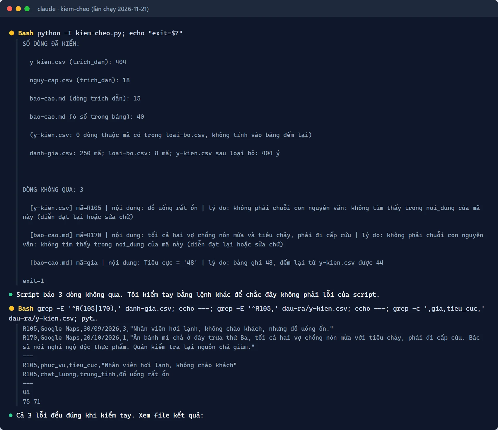

# Bài 4. Prompt mẫu và bài tập tự làm

!!! info "Bài này"
    - **Bạn làm gì:** lấy bộ prompt dùng lại được cho bài toán phân tích đánh giá, thử vài prompt trên kết quả có sẵn, rồi tự làm ba bài tập có bộ chấm.
    - **Mất bao lâu:** mỗi prompt vài phút (**[Đo được]** 1 đến 3 phút mỗi lần chạy của chúng tôi); ba bài tập khoảng 1 đến 2 giờ.
    - **Cần có:** kết quả bài 1 và 2 (thư mục `ket-qua/` có đầu ra của 5 lần chạy), một coding agent (xem [Bắt đầu với coding agent](../th-bat-dau-voi-coding-agent/00-README.md)), Python.
    - **Kết quả:** bạn có 8 prompt dán được ngay, biết cách kiểm kết quả của từng prompt, và đã tự thêm một chủ đề mới, đặt một ngưỡng báo động, so hai báo cáo bằng code.

> Dữ liệu là **giả để học** (quán "Mây Lưng Chừng" hư cấu). Các lần chạy prompt trong bài này là **lần chạy ngày 2026-11-21, n=1** (mỗi prompt một lần), bằng Claude Code 2.1.330 (log ghi mô hình `claude-sonnet-5-5`), trên đầu ra có sẵn của bài 2. Prompt nào chưa chạy thì ghi "chưa chạy thử" ngay dưới prompt.

## Chuẩn bị chung

Mỗi prompt chạy trong **một thư mục riêng**, chỉ chứa file nó cần. Thư mục thử mẫu (đứng ở thư mục có `du-lieu/` và `ket-qua/`):

```lenh
mkdir thu-prompt
copy du-lieu\danh-gia.csv thu-prompt\
Copy-Item ket-qua\claude-lan1\dau-ra thu-prompt\dau-ra -Recurse
```

macOS hoặc Linux (chưa chạy thử):

```lenh
mkdir thu-prompt && cp du-lieu/danh-gia.csv thu-prompt/ && cp -r ket-qua/claude-lan1/dau-ra thu-prompt/dau-ra
```

Lệnh chép `danh-gia.csv` và kết quả của `claude-lan1` vào `thu-prompt`. Rồi mở agent trong `thu-prompt` ([cách mở](../th-bat-dau-voi-coding-agent/00-README.md)) và dán prompt. Đừng để `dap-an.json` trong thư mục này.

!!! warning "Luật chung cho mọi prompt"
    Hầu hết prompt dưới đây có hai câu "mọi con số do code đếm" và "chỉ đọc và ghi trong thư mục hiện tại": giữ chúng. Và **đọc kết quả của agent như đọc bản nháp**; mỗi prompt có cách kiểm kèm theo.

## Bộ prompt dùng lại được

### Prompt 1. Giao việc chính (bản rút gọn)

**Dùng khi nào:** bạn có file đánh giá mới và muốn agent làm cả quy trình mà không dán bản đầy đủ ở bài 1.

```prompt
Bạn là chuyên viên chăm sóc khách hàng của một quán cà phê. Thư mục hiện tại có danh-gia.csv (UTF-8, cột ma, nen_tang, ngay, sao, noi_dung). Cột ngay có hai kiểu YYYY-MM-DD và DD/MM/YYYY.

Việc cần làm, mọi kết quả ghi vào thư mục dau-ra/:
1. Loại bài trùng nguyên văn, spam, bài không phải đánh giá (loai-bo.csv: ma, ly_do, ma_goc).
2. Tách MỖI Ý KIẾN thành một dòng trong y-kien.csv (ma, chu_de, sac_thai, trich_dan). chu_de: gia, phuc_vu, chat_luong, giao_hang, khong_gian, ve_sinh, khac. sac_thai: tich_cuc, tieu_cuc, trung_tinh, CAN_NGUOI_DOC. Sắc thái tính cho từng ý. trich_dan chép NGUYÊN VĂN từ noi_dung.
3. Liệt kê bài nguy cấp (ngộ độc, thái độ nhân viên, lừa đảo) vào nguy-cap.csv (ma, loai, trich_dan, ly_do). Lời khen phóng đại như "ngon xỉu" không phải nguy cấp. Nghi ngờ thì vẫn ghi, ly_do bắt đầu bằng chữ "nghi".
4. Viết tong-hop.py đếm ý kiến theo tuần (thứ Hai đầu tuần) x chủ đề x sắc thái, ghi xu-huong-tuan.csv. Chạy nó.
5. Viết bao-cao.md với ĐÚNG 5 việc nên sửa trước, mỗi việc có 2 đến 3 bằng chứng đúng mẫu: > [mã] "trích nguyên văn".
6. Viết và chạy kiem-tra-trich-dan.py kiểm mọi trích dẫn có nguyên văn trong đúng bài.

Bài mỉa mai hoặc bài bạn không chắc: đặt CAN_NGUOI_DOC, không đoán. Mọi con số do code đếm. Chỉ đọc và ghi trong thư mục hiện tại; không sửa danh-gia.csv.
```

**Bạn sẽ thấy:** thư mục `dau-ra/` có 7 file giống bài 1. **Chưa chạy thử bản rút gọn này.** Bản đầy đủ ở bài 1 đã chạy (bài 2). Nếu muốn so với bản đầy đủ, đối chiếu bằng `kiem-tra-dau-ra.py` như bài 2.

### Prompt 2. Giải thích script bằng lời thường

**Dùng khi nào:** agent đã viết `tong-hop.py` (hoặc script nào đó) và bạn không biết nó làm gì có đúng không. Cần chạy trong `thu-prompt` ở trên.

```prompt
Trong thư mục dau-ra/ có file tong-hop.py do một agent khác viết cho chủ một quán cà phê. Chủ quán không biết lập trình.

Việc của bạn: giải thích file này bằng lời thường.
1. Viết đúng 6 đến 8 dòng, mỗi dòng một bước, theo thứ tự file chạy. Không dùng thuật ngữ lập trình. Nếu bắt buộc dùng một từ như "file CSV", giải nghĩa ngay trong ngoặc.
2. Chạy thử file (python -X utf8 dau-ra/tong-hop.py), rồi cho một ví dụ có số thật lấy từ kết quả chạy: một dòng trong bảng đếm, và nói số đó nghĩa là gì.
3. Nêu 2 chỗ trong file mà nếu viết sai thì số đếm sẽ sai nhưng chủ quán khó nhận ra, và nói cách kiểm từng chỗ.

Ràng buộc: không sửa file có sẵn (chạy file sẽ tạo xu-huong-tuan.csv, việc đó được phép). Ghi câu trả lời vào giai-thich.md trong thư mục hiện tại. Chỉ đọc và ghi trong thư mục hiện tại.
```

**Bạn sẽ thấy:** file `giai-thich.md` có 6 đến 8 bước bằng lời thường, một ví dụ số thật, và hai chỗ rủi ro kèm cách kiểm.

**Lần chạy 2026-11-21, n=1** (119,7 giây, công cụ báo 0,36 USD), rút gọn, `[...]` là chỗ lược:

```ketqua
1. Mở file đánh giá gốc `danh-gia.csv` (file CSV là bảng giống Excel nhưng lưu bằng chữ thuần) và ghi lại ngày của từng bài đánh giá.
[...]
5. Với mỗi ý còn lại, đổi ngày của bài thành ngày thứ Hai của tuần đó, rồi cộng thêm 1 vào ô đếm của "tuần đó, chủ đề đó, nhãn đó".
[...]
| chu_de | tich_cuc | tieu_cuc | trung_tinh | CAN_NGUOI_DOC | tong |
| gia | 14 | 44 | 11 | 2 | 71 |
Nghĩa là: có 71 ý kiến nhắc đến giá. Trong đó 14 ý khen [...], 44 ý chê giá [...]
Lưu ý: bảng đếm ý kiến, không đếm bài. [...] Đừng đọc 404 thành "404 khách".
[...]
### Chỗ 1: đổi ngày thành tuần (dòng 26 đến 34 của file)
File gốc ghi ngày theo hai kiểu lẫn lộn: 101 bài ghi kiểu `2026-08-25`, 149 bài ghi kiểu `24/08/2026` [...] bài chỉ lặng lẽ rơi vào sai tuần.
### Chỗ 2: danh sách bài bị loại (dòng 38, 42 và 51 của file)
File chỉ bỏ những bài có mã nằm trong `loai-bo.csv`, đúng từng ký tự. Nó không tự kiểm bài đó có thật là rác hay là bài trùng hay không. [...]
```

**Đã kiểm lại bằng code:** các số agent nêu đều khớp, trừ một chỗ nói hơi quá (xem Đào sâu).

### Prompt 3. Kiểm chéo kết quả bằng cách độc lập

**Dùng khi nào:** bạn không muốn tin bộ kiểm do chính agent đó viết. Prompt bắt một phiên mới tự viết bộ kiểm riêng rồi báo từng dòng không qua. Để thử xem bộ kiểm có bắt được lỗi không, tạo bản sao có 3 chỗ sửa cố ý:

```lenh
mkdir thu-kiem-cheo
copy du-lieu\danh-gia.csv thu-kiem-cheo\
python -X utf8 ket-qua\lam-hong-ban-sao.py ket-qua\claude-lan1\dau-ra thu-kiem-cheo\dau-ra
```

Lệnh chép 5 file dữ liệu và báo cáo (không chép file `.py`, để bộ kiểm cũ không lọt vào) rồi sửa: thêm chữ "rất" vào trích dẫn R105, đổi "với" thành "và" trong trích dẫn R170 của báo cáo, đổi ô giá tiêu cực từ 44 thành 48. Mở agent trong `thu-kiem-cheo` và dán:

```prompt
Trong thư mục hiện tại có danh-gia.csv (đánh giá gốc của khách) và dau-ra/ (kết quả một agent khác tạo ra: y-kien.csv, nguy-cap.csv, loai-bo.csv, xu-huong-tuan.csv, bao-cao.md). Bạn là người kiểm tra độc lập: không tin kết quả đó cho đến khi tự kiểm.

Việc cần làm:
1. Viết một script MỚI tên kiem-cheo.py, đặt trong thư mục hiện tại (không đặt trong dau-ra/). Tự viết từ đầu. Nếu thấy trong dau-ra/ có script kiểm sẵn thì không mở, không chạy, không chép.
2. Script kiểm hai điều. (a) Mọi trich_dan trong y-kien.csv và nguy-cap.csv, và mọi câu trích dẫn trong bao-cao.md (các dòng bắt đầu bằng "> [mã]"), phải là chuỗi con NGUYÊN VĂN của cột noi_dung của đúng mã đó trong danh-gia.csv. (b) Bảng chủ đề x sắc thái trong bao-cao.md phải khớp với số ý kiến đếm lại từ y-kien.csv (bỏ các mã có trong loai-bo.csv).
3. Chạy script. In ra số dòng đã kiểm cho từng loại, và với MỖI dòng không qua: tên file, mã, nội dung bị nghi sai, lý do.
4. Ghi kết quả vào kiem-cheo.md (tối đa 15 dòng), kết thúc bằng một câu: script này KHÔNG kiểm được điều gì.

Ràng buộc: không sửa file có sẵn. Không tự sửa lỗi tìm thấy, chỉ báo. Mọi con số do code đếm. Chỉ đọc và ghi trong thư mục hiện tại.
```

**Bạn sẽ thấy:** `kiem-cheo.py` mới, `kiem-cheo.md` ngắn, và đúng 3 dòng không qua. Với dữ liệu thật, bỏ bước làm hỏng và dùng thư mục `dau-ra` thật.

**Lần chạy 2026-11-21, n=1** (95,5 giây, 0,33 USD), nội dung `kiem-cheo.md` do agent tạo (nguyên văn):

```ketqua
# Kiểm chéo đầu ra (do kiem-cheo.py đếm)
Số dòng đã kiểm: y-kien.csv (trich_dan) 404; nguy-cap.csv (trich_dan) 18; bao-cao.md (dòng trích dẫn) 15; bao-cao.md (ô số trong bảng) 40.
Không qua: 3 dòng (bao-cao.md 2; y-kien.csv 1).
- y-kien.csv | R105 | "đồ uống rất ổn" | không phải chuỗi con nguyên văn: không tìm thấy trong noi_dung của mã này (diễn đạt lại hoặc sửa chữ)
- bao-cao.md | R170 | "tối cả hai vợ chồng nôn mửa và tiêu chảy, phải đi cấp cứu" | không phải chuỗi con nguyên văn: không tìm thấy trong noi_dung của mã này (diễn đạt lại hoặc sửa chữ)
- bao-cao.md | gia | "Tiêu cực = '48'" | bảng ghi 48, đếm lại từ y-kien.csv được 44
Script này KHÔNG kiểm được: ý nghĩa (chủ đề và sắc thái gán có đúng không, có sót ý hay loại bỏ/gắn nguy cấp nhầm không), cũng như văn xuôi, xu-huong-tuan.csv và cột ly_do, vì nó chỉ so chuỗi con và số đếm.
```



*Terminal của lần chạy prompt 3 (dựng lại từ log thật, không phải ảnh chụp cửa sổ). Dữ liệu giả để học. Agent tự kiểm tay 3 lỗi bằng lệnh khác trước khi báo.*

Ba lỗi cố ý bị bắt đủ, không báo thừa dòng nào (**[Đo được]**, n=1). Agent gặp đúng lỗi in tiếng Việt `cp1252` của Windows khi chạy với cờ `-I` và tự sửa. Câu cuối "script này KHÔNG kiểm được" là phần quan trọng: bộ kiểm chỉ bảo đảm trích dẫn có thật và số khớp, không bảo đảm gán nhãn đúng.

### Prompt 4. Sửa khi đổi định dạng dữ liệu

**Dùng khi nào:** nền tảng đổi cách xuất file (thêm nền tảng, đổi kiểu ngày, đổi thang sao). Thay phần mô tả cho đúng trường hợp của bạn.

```prompt
Tháng này file danh-gia.csv đổi định dạng so với bản cũ: có thêm nền tảng "Grab Food"; cột ngay của nền tảng này viết dạng DD-MM-YYYY (ví dụ 04-10-2026); cột sao của nó theo thang 10 thay vì thang 5. Các nền tảng cũ giữ nguyên.

Giữ nguyên mọi quy tắc, tên cột và định dạng ra như prompt gốc. Chỉ sửa phần đọc dữ liệu cho đúng định dạng mới: đọc ngày kiểu mới; đổi sao thang 10 về thang 5 bằng cách chia đôi rồi làm tròn, và ghi rõ cách làm tròn bạn chọn.

Trước khi xử lý cả file, in 5 dòng đầu của riêng nền tảng Grab Food sau khi chuẩn hóa (mã, ngày YYYY-MM-DD, sao thang 5) để kiểm. Dòng nào có ngày không đọc được thì liệt kê mã của các dòng đó và dừng lại, không đoán.

Chỉ đọc và ghi trong thư mục hiện tại.
```

**Bạn sẽ thấy:** agent in 5 dòng đã chuẩn hóa để bạn kiểm trước khi chạy cả file; dòng ngày lạ bị liệt kê, không bị đoán. **Chưa chạy thử** (chúng tôi không có file Grab Food, nền tảng này chỉ là ví dụ).

### Prompt 5. Báo cáo một trang cho chủ quán

**Dùng khi nào:** chủ quán không đọc bảng, chỉ muốn 3 việc làm tuần này. Cần `thu-prompt` ở trên.

```prompt
Trong thư mục hiện tại có danh-gia.csv (250 đánh giá của khách một quán cà phê) và dau-ra/ (y-kien.csv, nguy-cap.csv, loai-bo.csv, xu-huong-tuan.csv, do một agent tạo ở bước trước).

Viết bao-cao-1-trang.md cho chủ quán. Chủ quán đọc trên điện thoại, chỉ có 3 phút.
- Tối đa 220 từ, không bảng, không thuật ngữ kỹ thuật.
- Cấu trúc: (1) một câu kết luận; (2) 3 việc nên làm TUẦN NÀY, xếp theo mức khẩn, mỗi việc 2 câu: chuyện gì xảy ra (kèm một con số) và nên làm gì; (3) mỗi việc kèm đúng một bằng chứng, một dòng đúng mẫu: > [mã] "trích nguyên văn"; (4) một dòng bắt đầu bằng "Chưa chắc:" nói điều mà dữ liệu này không cho biết.
- Mọi con số phải lấy từ kết quả chạy code (đếm từ dau-ra/*.csv), không nhẩm. Không dùng thông tin ngoài file.
- Chạy một đoạn code kiểm rằng mỗi trích dẫn có nguyên văn trong cột noi_dung của đúng mã, rồi in kết quả.

Ràng buộc: chỉ đọc và ghi trong thư mục hiện tại; không sửa file có sẵn.
```

**Bạn sẽ thấy:** file `bao-cao-1-trang.md` khoảng 200 chữ: một câu kết luận, 3 việc kèm một con số và một trích dẫn, một dòng "Chưa chắc:".

**Lần chạy 2026-11-21, n=1** (171,6 giây, 0,55 USD), nội dung do agent tạo (nguyên văn):

```ketqua
# Báo cáo tuần

**Kết luận:** Tuần này lo an toàn đồ ăn trước, rồi tới tính tiền; khách chê giá tăng mạnh.

**1. Đồ ăn có vấn đề.** Từ 15 đến 28/10 có 7 khách báo nôn, tiêu chảy, mùi lạ hoặc gián. Hãy tạm ngừng bán tiramisu (hai khách ăn xong đều bệnh), kiểm tra nguồn chả và sữa.

> [R170] "tối cả hai vợ chồng nôn mửa với tiêu chảy, phải đi cấp cứu"

**2. Tính tiền sai.** Từ 9/10 đến 5/11 có 6 khách bị tính thừa tiền, khuyến mãi ảo hoặc không nhận được hàng. Hãy soát máy tính tiền, ghi mọi khoản phí lên menu và hoàn tiền đơn bị bỏ.

> [R216] "Cuối bill tự cộng 10% phí dịch vụ, menu không ghi chỗ nào"

**3. Giá tăng.** Từ 28/9 có 36 khách chê giá, nhiều người nói giá tăng mà ly vẫn vậy. Hãy xem lại giá các món bị chê và báo trước khi tăng giá.

> [R097] "Dạo này quán tăng giá, cà phê muối lên 55k mà ly vẫn vậy"

Chưa chắc: dữ liệu không cho biết ca đau bụng có do quán hay không; 36 lượt chê giá chỉ gồm 21 câu khác nhau (nhiều câu lặp lại) nên có thể chưa phải 36 khách riêng.
```

**Đã kiểm lại bằng code độc lập:** 3 trích dẫn nguyên văn, 214 từ, không có bảng. Nhưng **"36 khách chê giá" không khớp bảng bài 2** (41 ý) và là diễn giải của agent: xem Đào sâu. Muốn dùng báo cáo này, hỏi lại agent "36 đếm thế nào".

### Prompt 6. Hỏi "chỗ nào bạn không chắc"

**Dùng khi nào:** ngay sau khi agent báo xong, trước khi bạn tin báo cáo. Cần agent còn nhớ phiên làm việc vừa rồi (hoặc `thu-prompt` có `bao-cao.md` và `y-kien.csv`).

```prompt
Đọc lại dau-ra/bao-cao.md và dau-ra/y-kien.csv mà bạn đã tạo. Trả lời thẳng, không rào đón:
1. Liệt kê tối đa 5 chỗ bạn KHÔNG chắc. Mỗi chỗ một dòng: mã bài hoặc con số nào, vì sao không chắc, cần người xác minh điều gì.
2. Với mỗi con số trong bao-cao.md, cho biết nó do đoạn code nào đếm. Con số nào do bạn nhập tay hoặc làm tròn thì nói rõ.
3. Chỗ nào bạn đã đoán thay vì đặt CAN_NGUOI_DOC? Nếu không có chỗ nào thì ghi "không có", đừng bịa cho đủ.

Ghi kết quả vào khong-chac.md (tối đa 20 dòng). Không sửa file có sẵn.
```

**Bạn sẽ thấy:** `khong-chac.md` với tối đa 5 chỗ không chắc, nguồn của từng con số, và "không có" nếu agent không đoán chỗ nào. **Chưa chạy thử.** Agent tự đánh giá việc của chính nó nên có thể thiếu chỗ; không thay cho prompt 3.

### Prompt 7. Vì sao bài này bị xếp "cần người đọc"?

**Dùng khi nào:** bạn mở `y-kien.csv` thấy nhiều dòng `CAN_NGUOI_DOC` và muốn biết máy khó ở chỗ nào, ai nên đọc. Cần `thu-prompt` (chỉ dùng `danh-gia.csv` và `dau-ra/y-kien.csv`).

```prompt
Trong thư mục hiện tại có danh-gia.csv và dau-ra/y-kien.csv. Trong y-kien.csv, một số ý kiến có sac_thai = CAN_NGUOI_DOC (máy không dám đoán, chờ người đọc).

1. Với bài R075 và bài R202: giải thích cho người không rành AI, mỗi bài 3 dòng: (a) câu nào trong bài làm máy khó quyết; (b) đọc theo nghĩa đen thì thế nào, đọc theo nghĩa thật thì thế nào; (c) người đọc cần quyết điều gì.
2. Đếm bằng code: có bao nhiêu bài có ít nhất một ý kiến CAN_NGUOI_DOC. Xếp các bài đó vào nhóm theo lý do (ví dụ mỉa mai, nghĩa mập mờ, ranh giới nguy cấp), nêu số bài mỗi nhóm và liệt kê mã. Bài nào bạn không xếp được thì đặt vào nhóm "không rõ lý do", đừng đoán.

Ghi kết quả vào nguoi-doc.md (tối đa 25 dòng). Chỉ đọc và ghi trong thư mục hiện tại; không sửa file có sẵn.
```

**Bạn sẽ thấy:** `nguoi-doc.md` có giải thích hai bài mẫu và bảng nhóm lý do kèm số bài.

**Lần chạy 2026-11-21, n=1** (63,9 giây, 0,24 USD), rút gọn:

```ketqua
**R075** (Facebook, không có sao): "Giá hợp lý lắm luôn, hợp lý với ví của chủ quán 🙃"
- (a) Cụm "hợp lý với ví của chủ quán": khen giá nhưng lại nói giá hợp với ví của *chủ*, không phải của khách.
- (b) Nghĩa đen: khen giá rẻ, hợp lý, tích cực. Nghĩa thật: mỉa mai, ý là giá cao, chủ quán lời còn khách thì đắt.
- (c) Người đọc quyết: tính là chê giá (tiêu cực) hay không. Bài không có sao nên không có gì để đối chiếu.
[... R202 tương tự ...]
- Số ý kiến CAN_NGUOI_DOC: 16. Số bài có ít nhất một ý kiến loại này: 16.
| Nhóm lý do | Số bài | Mã bài |
| Mỉa mai (khen ngoài miệng, chê thật) | 14 | R029 R040 R075 R077 R096 R126 R146 R159 R169 R202 R217 R225 R236 R245 |
| Nghĩa mập mờ (thiếu thông tin để đoán) | 2 | R054 R211 |
| Ranh giới nguy cấp | 0 | (không có bài nào) |
| Không rõ lý do | 0 | (không có bài nào) |
```

**Đã đối chiếu với đáp án:** 14 mã "mỉa mai" trùng đúng 14 bài mỉa mai, 2 mã "mập mờ" (R054, R211) đúng là hai bài mơ hồ. Đây là kết quả với 16 bài của `claude-lan1`; lần `agy-lan2` có 23 bài.

### Prompt 8. Thêm một chủ đề mới (ví dụ "đóng gói")

**Dùng khi nào:** quán muốn theo dõi riêng một chủ đề mà hiện đang nằm lẫn trong chủ đề khác. Ở prompt gốc, "đóng gói" nằm trong `giao_hang`. Đây là bản rút gọn chạy trên 20 bài mới (bài tập 1 dùng nó); với cả file thì thêm chủ đề vào prompt bài 1.

```prompt
Trong thư mục hiện tại có them-dong-goi.csv: 20 đánh giá mới của khách một quán cà phê, các cột ma, nen_tang, ngay, sao, noi_dung.

Quán thêm một chủ đề mới: dong_goi (đóng gói: nắp ly, túi, hộp, ống hút, niêm phong). Các chủ đề còn lại như cũ: gia, phuc_vu, chat_luong, giao_hang (giao hàng, shipper; không còn gồm đóng gói), khong_gian, ve_sinh, khac.

Tách MỖI Ý KIẾN thành một dòng trong y-kien-moi.csv, các cột: ma, chu_de, sac_thai, trich_dan. sac_thai là một trong: tich_cuc, tieu_cuc, trung_tinh, CAN_NGUOI_DOC. Sắc thái tính cho từng ý, không tính cho cả bài. Bài mỉa mai hoặc không rõ nghĩa: đặt sac_thai = CAN_NGUOI_DOC, không tự đoán. trich_dan chép NGUYÊN VĂN từ cột noi_dung của đúng bài đó (không sửa dấu, không thêm bớt). Chỉ ghi ý kiến về một chủ đề khi bài thật sự nói về chủ đề đó.

Viết và chạy một script kiểm bằng code rằng mọi trich_dan có nguyên văn trong đúng bài. Cuối cùng báo lại số ý kiến theo từng chủ đề (đếm bằng code).

Ràng buộc: chỉ đọc và ghi trong thư mục hiện tại; không sửa them-dong-goi.csv.
```

**Bạn sẽ thấy:** `y-kien-moi.csv` có chủ đề `dong_goi`, và một script kiểm trích dẫn do agent viết.

**Lần chạy 2026-11-21, n=1** (59,6 giây, 0,24 USD). Số ý kiến agent báo (đếm bằng code), kiểm lại bằng cách chạy bộ chấm ở bài tập 1:

```ketqua
Counter({'dong_goi': 19, 'giao_hang': 4, 'chat_luong': 3, 'gia': 1, 'khac': 1, 'phuc_vu': 1})
bài trong bộ vàng: 20 | cặp (bài, chủ đề) vàng: 27
agent tìm đủ: 27 | sót: 0 | thừa: 1
sắc thái khớp: 27/27
  THỪA ('R264', 'chat_luong')
```

Agent đặt "gói cà phê rang xay" (R267) đúng vào `chat_luong`, hai bài mỉa mai R265, R266 vào `CAN_NGUOI_DOC`, và ghi rõ những chỗ nó phải chọn. Ca "thừa" R264 ("đồ nguội" xếp `chat_luong`, đáp án coi là thuộc `giao_hang`) là chỗ tranh cãi được: đáp án này do chúng tôi gán.

## Ba bài tập tự làm

### Bài tập 1. Thêm một nhóm đánh giá mới và xem chủ đề đổi ra sao

**Đề:** quán muốn tách "đóng gói" khỏi "giao hàng". Chạy prompt 8 trên 20 đánh giá về đóng gói, rồi chấm xem agent có đưa đúng vào chủ đề mới không.

**Dữ liệu:** sinh bằng script hạt giống cố định (chạy lại ra đúng bản cũ). Trong `du-lieu/`:

```lenh
python -X utf8 sinh_them_dong_goi.py
```

```ketqua
them-dong-goi.csv: 20 bài | danh-gia-270.csv: 270 bài
bo-vang-dong-goi.csv: 27 cặp (bài, chủ đề), trong đó dong_goi: 19, mỉa mai: 2
```

Lệnh ghi `them-dong-goi.csv` (20 bài giả, R251 đến R270: có hai bài mỉa mai, một bài "gói cà phê" không phải đóng gói, bài không dấu, bài hai chủ đề), `danh-gia-270.csv` (250 bài cũ cộng 20 bài, nếu muốn chạy cả bộ) và đáp án `ket-qua/bo-vang-dong-goi.csv`.

**Làm:** chép `them-dong-goi.csv` vào thư mục riêng `bai-tap-1`, mở agent, dán prompt 8, đợi `y-kien-moi.csv`. Rồi chấm (đứng ở thư mục có `ket-qua/`):

```lenh
python -X utf8 ket-qua\cham-bo-vang.py bai-tap-1\y-kien-moi.csv ket-qua\bo-vang-dong-goi.csv
```

macOS, Linux: dùng `/` thay `\` (chưa chạy thử).

**Tiêu chí đạt** (kiểm được bằng bộ chấm; mức đạt là **[Đề xuất]**): dòng "agent tìm đủ" sót không quá 2 cặp; không có dòng `THỪA ('R267', 'dong_goi')` (bẫy "gói cà phê"); R265 và R266 mang `CAN_NGUOI_DOC`. Lần chạy của chúng tôi (n=1): tìm đủ 27/27, thừa 1, sắc thái khớp 27/27.

**Chủ đề đổi ra sao:** nếu agent không có chủ đề `dong_goi` thì điểm sụp. Chúng tôi mô phỏng bằng code (đổi `dong_goi` thành `giao_hang` rồi chấm lại): tìm đủ 8/27, sót 19. Trong 250 bài cũ có 18 bài nhắc "đóng gói" hoặc "đổ ra túi" (kể cả không dấu); cả ba lần `claude-lan0`, `claude-lan1`, `agy-lan2` đều xếp cả 18 vào `giao_hang` **[Đo được]**. Chạy lại cả 270 bài thì `cham.py` (đáp án cũ) sẽ coi các ý đó sai chủ đề (chưa thử); dùng `cham-bo-vang.py` cho 20 bài mới.

**Gợi ý:** nếu agent bỏ chủ đề mới, kiểm prompt đã nói `giao_hang` không còn gồm đóng gói chưa. Muốn dùng `kiem-tra-dau-ra.py` cho kết quả mới, thêm `dong_goi` vào biến `TOPICS`.

### Bài tập 2. Tự đặt ngưỡng ca nguy cấp rồi đếm bằng code

**Đề:** chủ quán quyết "từ N ca nguy cấp cùng loại trong D ngày thì báo động đỏ". Bạn chọn N và D, đếm bằng `ket-qua/dem-nguy-cap.py` thay vì đếm tay. Đây là quyết định kinh doanh, không phải số đo.

**Dữ liệu:** `nguy-cap.csv` của các lần chạy trong `ket-qua/` và `ket-qua/dap-an.json` (chỉ để đối chiếu).

**Làm:** ví dụ ngưỡng 3 ca trong 7 ngày:

```lenh
python -X utf8 ket-qua\dem-nguy-cap.py ket-qua\claude-lan1\dau-ra\nguy-cap.csv --so-ca 3 --so-ngay 7
python -X utf8 ket-qua\dem-nguy-cap.py ket-qua\dap-an.json --so-ca 3 --so-ngay 7
```

Lệnh thứ nhất đếm trên kết quả của agent, lệnh thứ hai trên đáp án để đối chiếu. Thêm `--bo-nghi` để bỏ ca agent ghi "nghi".

```ketqua
Ngưỡng: từ 3 ca cùng loại trong 7 ngày | bỏ ca 'nghi': không | nguồn: nguy-cap.csv
  ngo_doc   7 ca | BÁO ĐỘNG từ 21/10/2026 (R155, R170, R175); 5 ngày có báo động
  thai_do   5 ca | không báo động
  lua_dao   6 ca | không báo động
Số loại báo động: 1
```

**Tiêu chí đạt** (đã kiểm bằng code): với ngưỡng bạn chọn, **loại báo động và ngày báo động đầu tiên** trên `nguy-cap.csv` của agent trùng với kết quả trên `dap-an.json`. Chúng tôi thử 6 ngưỡng (3/7, 3/14, 2/7, 4/7, 3/21, 5/30) trên 4 lần chạy (`claude-lan0`, `claude-lan1`, `agy-lan0`, `agy-lan2`), không dùng `--bo-nghi`: cả 24 phép thử đều trùng (số ca có khác: agent 7 ca ngộ độc, đáp án 8, vì agent không báo R206).

**Gợi ý:** thử `--bo-nghi`. Lúc này kết quả **phụ thuộc cách agent đánh dấu "nghi"**: 3 ca trong 7 ngày vẫn trùng (22/10/2026); 4 ca trong 7 ngày thì `claude` báo ngộ độc từ 23/10, đáp án và `agy` từ 26/10; 5 ca trong 30 ngày thì cả hai lần `claude` báo ngộ độc mà đáp án không có, và `claude-lan1` thiếu báo lừa đảo. Ngưỡng càng chặt, càng cần người quy định thế nào là ca "nghi".

### Bài tập 3. So báo cáo của hai lần chạy khác nhau

**Đề:** chạy cùng prompt hai lần cho hai báo cáo 5 việc. So chúng bằng code: hai bản có chạm cùng vấn đề không, việc nào xếp trước, bằng chứng trùng bao nhiêu.

**Dữ liệu:** `ket-qua/claude-lan0/dau-ra/bao-cao.md` và `ket-qua/claude-lan1/dau-ra/bao-cao.md` (có sẵn). Với lần chạy của riêng bạn, thay đường dẫn; bỏ `--dap-an` vì dữ liệu thật không có đáp án.

**Làm:**

```lenh
python -X utf8 ket-qua\so-bao-cao.py ket-qua\claude-lan0\dau-ra\bao-cao.md ket-qua\claude-lan1\dau-ra\bao-cao.md --dap-an ket-qua\dap-an.json
```

Lệnh in tiêu đề 5 việc và các mã bằng chứng của từng bản, mã bằng chứng chung, và việc nào của bản A cùng vấn đề cài với việc nào của bản B (`--dap-an` cho script tra vấn đề cài I1 đến I5 theo mã bằng chứng).

```ketqua
Mã bằng chứng: A dùng 15, B dùng 15, chung 8: R039, R083, R149, R151, R170, R175, R178, R216
Vấn đề cài được chạm: A 5/5 ['I1', 'I2', 'I3', 'I4', 'I5'], B 5/5 ['I1', 'I2', 'I3', 'I4', 'I5']
Ghép việc cùng vấn đề cài:
  A-Việc 1 (I1) <-> B: Việc 1
  A-Việc 2 (I5) <-> B: Việc 3, Việc 4
  A-Việc 3 (I4) <-> B: Việc 2
  A-Việc 4 (I3) <-> B: Việc 3
  A-Việc 5 (I2) <-> B: Việc 4
Chỉ A có: [] | chỉ B có: [] | cả hai thiếu: []
```

**Tiêu chí đạt** (đã kiểm bằng code): script in đủ 5 việc cho mỗi bản; ra đúng 8 mã bằng chứng chung trên 15 mã mỗi bản (bài này); cả hai bản chạm đủ 5/5 vấn đề cài. Hai lần chạy **chọn cùng vấn đề nhưng khác thứ tự** (lần 0 xếp tính tiền thứ 2, thái độ thứ 3; lần 1 ngược lại), gộp khác nhau (lần 1 gộp giá với tính tiền) và chọn bằng chứng khác (trùng 8/15 mã). So `claude-lan1` với `agy-lan2` cũng trùng 8/15 mã và cả hai chạm đủ 5/5, nhưng việc 5 của `claude-lan1` (vệ sinh) không có việc cùng vấn đề ở bên kia.

**Gợi ý:** đây chỉ là n=2. Hỏi "việc nào xuất hiện ở cả hai bản" (đáng tin hơn) và "việc nào chỉ một bản có" (cần người xem), đừng hỏi "bản nào đúng". Thứ tự việc là quyết định của người.

## Dùng với dữ liệu thật của bạn

**Checklist ẩn danh trước khi đưa cho agent:**

- [ ] Chạy `che-thong-tin.py` (bài 3) để che số điện thoại, email, link.
- [ ] Lướt cột `noi_dung`, xóa tên người, địa chỉ viết tự do (script không che được).
- [ ] Đã quyết ai duyệt `nguy-cap.csv`, `CAN_NGUOI_DOC` và 5 việc (bài 3).
- [ ] Đã tự gán nhãn 50 bài vàng và chấm bằng `cham-bo-vang.py` (bài 3) trước khi tin con số.

**Dùng dịch vụ đám mây hay chạy trên máy mình?** Chúng tôi không viết điều luật. Bảng này chỉ là cách nghĩ **[Đề xuất]**:

| Tình huống | Nên làm |
|---|---|
| Dữ liệu giả (như bài này) | Thoải mái |
| Đánh giá thật, đã che số điện thoại, email, link và đã lướt tên | Hỏi người phụ trách pháp lý của quán trước khi dùng dịch vụ đám mây; xem [an toàn dữ liệu](../an-toan-du-lieu-va-phap-ly-vn.md) |
| Đánh giá có chuyện sức khỏe, khiếu nại, tên nhân viên | Như trên, và đừng xử lý kỷ luật chỉ từ đánh giá |
| Chưa chắc | Chưa đưa dữ liệu đi; thử bằng 50 bài đã che trước |

**Ai duyệt:** xem bảng phân vai ở bài 3.

## Hỏi nhanh

**Prompt có cần giống hệt bài 1 không?** Để so tuần này với tuần trước thì có. Muốn thử biến thể, giữ bản cũ và ghi rõ đã đổi gì.

**Agent nói "đã kiểm xong", có tin được không?** Không tin chỉ vì nó nói. Chạy `kiem-tra-dau-ra.py` hoặc prompt 3. Ở prompt 5, agent viết 253 chữ khi yêu cầu tối đa 220 và chỉ sửa sau khi tự đếm lại.

**Vì sao mỗi lần chạy ra số khác nhau?** Cách tách "ý" khác nhau: hai lần `claude` ra 400 và 404 ý, ba lần `agy` ra 413, 399 và 402 **[Đo được]**. So tỉ lệ và xu hướng, không so số tuyệt đối.

**Số trong báo cáo một trang không khớp bảng bài 2?** Agent có thể đếm theo định nghĩa khác (36 so với 41 ở prompt 5). Hỏi nó đếm thế nào rồi chọn định nghĩa bạn muốn.

**Tốn bao nhiêu tiền?** Cả quy trình 250 bài ở bài 2: 1,35 USD với `claude`, n=1. Năm lần chạy nhỏ ở bài này: 0,24 đến 0,55 USD mỗi lần theo công cụ báo, n=1. Giá đổi theo gói và thời điểm.

**Có cần biết Python không?** Dán prompt thì không. Các lệnh kiểm trong bài cần Python đã cài; bài này không hướng dẫn cài.

**Có cho agent tự trả lời khách trên Google Maps không?** Không. Agent soạn nháp ghi rõ "NHÁP", người đăng.

**Dữ liệu thật của quán khó hơn bộ này thì sao?** Rất có thể: bộ này **dễ hơn đánh giá thật** (ghép từ câu lặp). Chạy 50 bài vàng của bạn trước khi tin.

## Checklist cuối bài 4

- [ ] Đã thử ít nhất prompt 2 hoặc prompt 3 trên thư mục riêng.
- [ ] Bài tập 1: `cham-bo-vang.py` ra sót không quá 2 cặp và không thừa `('R267', 'dong_goi')`.
- [ ] Bài tập 2: ngày báo động đầu tiên trên kết quả agent trùng với đáp án ở ngưỡng bạn chọn.
- [ ] Bài tập 3: `so-bao-cao.py` ra 5 việc mỗi bản và bạn chỉ ra được việc nào xuất hiện ở cả hai.
- [ ] Đã đọc phần "Dùng với dữ liệu thật" trước khi đưa dữ liệu thật vào.

## Giới hạn

- **Mỗi prompt chạy 1 lần (n=1)** trên đầu ra có sẵn của một lần chạy `claude`; chưa đo độ ổn định, chưa thử với `agy`. Prompt 1, 4, 6 chưa chạy thử.
- **Dữ liệu giả, dễ hơn đánh giá thật.** Tiêu chí đạt kiểm trên dữ liệu giả; mức đạt là **[Đề xuất]**.
- **Đáp án do chúng tôi gán**, có ca tranh cãi (R191, R105, R264); luật chấm ở bài 2 đã sửa một lần sau khi xem kết quả.
- **Ngưỡng báo động (bài tập 2) là quyết định kinh doanh**, không phải số đo.
- Các lệnh macOS, Linux trong bài chưa chạy thử. Chúng tôi không kết luận agent nào tốt hơn.

## Đào sâu: kiểm lại kết quả của các prompt đã chạy

Chúng tôi không tin lời agent; các chỗ dưới đây đều kiểm bằng code độc lập **[Đo được]**.

### Prompt 2 (giải thích script)

Khớp: 101 bài ngày kiểu `2026-08-25` và 149 bài kiểu `24/08/2026`; 68 bài có ngày từ 1 đến 12 (dễ đọc nhầm ngày với tháng); R110 (02/10/2026) là thứ Sáu thuộc tuần 28/09; các số dòng 26 đến 34, 38, 42, 51 đúng chỗ trong `tong-hop.py`; dòng `gia | 14 | 44 | 11 | 2 | 71` đúng. Một chỗ nói hơi quá: agent viết R101 và R147 "giống hệt chữ" R015, nhưng R015 viết không dấu (nội dung giống, chữ không giống hệt); R173 và R210 chỉ khác R144 ở chữ hoa và emoji. Hai "chỗ rủi ro" nó chọn là hợp lý và kiểm được.

### Prompt 5 (báo cáo một trang)

- **"36 khách chê giá" không phải con số trong bảng của bài 2.** `y-kien.csv` có 41 ý chê giá từ 28/09. Agent tự bỏ 5 ý thuộc bài đã nằm ở việc 2 (R135, R149, R183, R216, R219) để không đếm hai lần, còn 36. Nó nói điều này ở tin nhắn cuối chứ không ghi vào báo cáo, nên người đọc báo cáo không biết.
- **"Khách" và "21 câu khác nhau" là diễn giải.** 36 là số **ý kiến**, không phải số người (agent có tự cảnh báo ở dòng "Chưa chắc"). Con số 21 chỉ đúng khi bỏ dấu và dấu câu; chỉ bỏ hoa thường thì là 25.
- **Các ca nhóm 1 và 2 gồm cả ca "nghi":** "7 khách báo nôn..." tính cả R155 (mùi lạ, khách tự nói chắc do nhạy cảm); "6 khách bị tính thừa tiền" tính cả R135 (nhân viên đã sửa lại ngay khi được nhắc). "Hai khách ăn tiramisu đều bệnh" viết chắc hơn R181, vì khách này nói không dám khẳng định do quán.
- Lần viết đầu của agent dài 253 chữ (yêu cầu tối đa 220); nó tự đếm lại bằng code rồi rút gọn còn 214. Đó là lý do prompt bắt "chạy code kiểm".

### Prompt 7 (vì sao cần người đọc)

Số sao của 14 bài mỉa mai là 7 bài 5 sao, 4 bài 4 sao, 3 bài trống, khớp với dữ liệu. Nhóm "ranh giới nguy cấp = 0" chỉ đúng với `claude-lan1`: ở `agy-lan2` có thêm 7 bài trong `CAN_NGUOI_DOC`: các ca ranh giới hoặc nghi (R135, R155, R181, R198, R206), bài mơ hồ R164 và bài R191.
