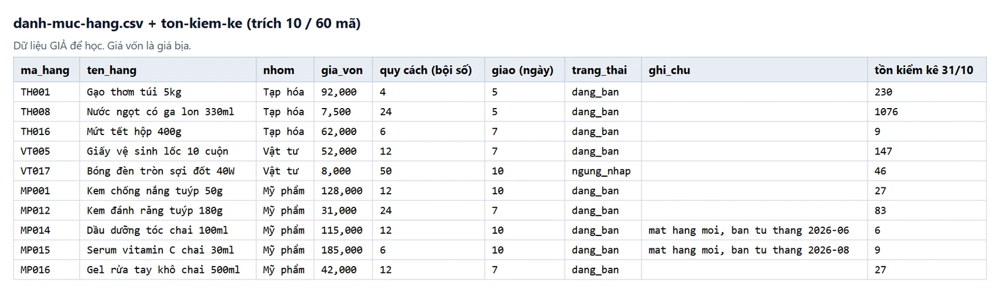

# Bài 1. Chuẩn bị dữ liệu và giao việc cho agent

!!! info "Bài này"
    - **Bạn làm gì:** tải dữ liệu giả của một cửa hàng 60 mã hàng, xem bằng Excel, mở agent trong thư mục riêng và dán prompt đề xuất nhập hàng cho tháng 11/2026.
    - **Mất bao lâu:** khoảng 30 phút chuẩn bị. Agent chạy thêm vài phút đến vài chục phút **[Đo được]** (lần chạy của chúng tôi: Claude Code 660 giây, Antigravity 1.525 giây).
    - **Cần có:** máy đã cài một coding agent (xem [Bắt đầu với coding agent](../th-bat-dau-voi-coding-agent/00-README.md)), Python 3 (agent sẽ viết và chạy script Python; cách kiểm và cài: [Bài 1 của nhóm Bắt đầu](../th-bat-dau-voi-coding-agent/cap-00-lam-quen-cua-so-dong-lenh.md)), Excel hoặc Notepad để xem file.
    - **Kết quả:** một thư mục có bảng đề xuất nhập hàng kèm tổng tiền vốn, bảng cảnh báo hàng sắp hết, danh sách lỗi nhập liệu và báo cáo cho chủ cửa hàng. Cách kiểm đúng sai ở bài 2.

> Dữ liệu trong bài là **dữ liệu giả để học**: tên hàng, giá vốn, nhà cung cấp, số lượng đều bịa, sinh bằng script có hạt giống cố định. Không có dữ liệu của doanh nghiệp thật. Con số tiền ngân sách (30.000.000 đ) cũng chỉ là tham số học tập.

## Bài toán trong một phút

Một cửa hàng tạp hóa, vật tư và mỹ phẩm có 60 mã hàng. Cuối tháng chủ cửa hàng cần biết: mã nào đem lại phần lớn tiền, mã nào sắp hết hoặc đã hết, tháng tới nên nhập bao nhiêu mỗi mã, và **tổng tiền vốn phải bỏ ra có vượt số tiền mặt đang có không**.

Việc khó nằm ở dữ liệu nhập tay: gõ thừa số 0, số âm không rõ là khách trả hàng hay gõ nhầm, dòng bị nhập hai lần, ngày viết ba kiểu. Và có một cái bẫy tinh vi: **mã hết hàng thì doanh số về 0, nhưng 0 đó không có nghĩa là khách không mua**. Lấy trung bình "ngây thơ" thì mã vừa hết hàng bị đề xuất nhập ít đi, rồi lại hết hàng tiếp.

Một coding agent (chương trình AI tự đọc file, viết và chạy code) có thể viết script làm phần máy móc trong vài phút. Phần còn lại, những ca không chắc, agent phải **đưa cho người quyết**.

!!! warning "Quy tắc xuyên suốt cả chuỗi bài"
    **Công thức do chủ cửa hàng đặt, phép tính do code làm, số cuối cùng do chủ cửa hàng quyết.** Mô hình ngôn ngữ có thể cộng sai một con số mà vẫn viết rất tự tin. Báo cáo của agent chỉ là đề xuất. Ngân sách nhập hàng là một **tham số** của chủ cửa hàng, không phải con số agent tự biết.

## Các bước làm

### Bước 1. Tải và giải nén dữ liệu mẫu

Tải [du-lieu.zip](du-lieu.zip), bấm chuột phải chọn **Extract All** (Windows) hoặc bấm đúp (macOS). Bạn có thư mục `du-lieu/`. **Bảy file** đầu tiên trong bảng là thứ agent được xem:

| File | Nội dung |
|---|---|
| `nhat-ky-xuat-nhap.csv` | 11.128 dòng xuất, nhập, điều chỉnh từ 2025-11 đến 2026-10 (có lỗi cài sẵn) |
| `danh-muc-hang.csv` | 60 mã: giá vốn, bội số đặt, thời gian giao (ngày), trạng thái |
| `ton-dau-ky-2025-11-01.csv`, `ton-kiem-ke-2026-10-31.csv` | tồn đầu kỳ và tồn kiểm kê cuối kỳ |
| `hang-dang-ve.csv` | 10 dòng đơn đang trên đường về |
| `tham-so.json` | mức phục vụ 95%, các ngưỡng cảnh báo, **ngân sách nhập tháng 2026-11** |
| `quy-uoc.md` | công thức cố định của chủ cửa hàng |
| `sinh_du_lieu.py`, `prompt-giao-viec.txt` và các file `.py` khác | **không** đưa cho agent (xem Bước 4) |

### Bước 2. Mở xem dữ liệu bằng Excel

Mở `danh-muc-hang.csv` bằng Excel: mỗi mã có **bội số đặt hàng** (gạo đặt theo bộ 4 túi) và **thời gian giao**. Rồi mở `nhat-ky-xuat-nhap.csv`, bật bộ lọc (Ctrl+Shift+L) và thử ba việc:

1. Lọc cột `so_luong` lấy số **âm**: có dòng ghi chú `khach tra` (trả hàng hợp lệ) và dòng không ghi chú (nghi gõ nhầm).
2. Sắp xếp `so_luong` giảm dần: số rất lớn có thể là gõ thừa số 0 hoặc là đơn sỉ thật.
3. Lọc `ghi_chu` chứa `huy` hoặc `noi bo`: là xuất kho nhưng **không phải bán hàng**.



*Ảnh dựng từ `du-lieu/danh-muc-hang.csv` và `ton-kiem-ke-2026-10-31.csv`. Dữ liệu giả để học.*


*Ảnh dựng từ `du-lieu/nhat-ky-xuat-nhap.csv`. Cột cuối là chú thích của chúng tôi, file thật không có. Dữ liệu giả để học.*

!!! see "Bạn sẽ thấy"
    Nhật ký có 11.128 dòng. **[Đo được]** (đếm bằng code): 7.787 dòng ngày kiểu `2026-03-13`, 2.240 dòng `13/03/2026`, 1.101 dòng `13/3/26`; 809 dòng có mã hàng viết thường, có dấu gạch hoặc thừa khoảng trắng; 4 dòng thiếu mã hàng. Hãy ghi lại những lỗi bạn thấy vào một file **ngoài** thư mục của agent. Đó là đáp án của riêng bạn để so sau.

!!! stuck "Gặp lỗi?"
    Chữ tiếng Việt bị vỡ dấu khi mở CSV bằng Excel: dùng *Data > From Text/CSV* và chọn mã hóa UTF-8. File của chúng tôi có dấu BOM nên thường mở thẳng được.

### Bước 3. Đọc công thức trong quy-uoc.md

Agent **không** được tự nghĩ ra công thức. Mở `quy-uoc.md` và hiểu năm điểm:

1. **Dự báo tháng tới** = trung bình 3 tháng hợp lệ gần nhất. "Hợp lệ" nghĩa là tháng đó mặt hàng có bán và **không hết hàng từ 7 ngày trở lên**.
2. **Vì sao bỏ tháng hết hàng?** Mã bình thường bán 100 mỗi tháng, tháng 5 hết hàng 3 tuần nên chỉ bán 30. Tính 30 vào trung bình thì dự báo thấp, nhập ít, lại hết hàng. Bỏ tháng đó đi mới đúng.
3. **Tồn an toàn** = Z × độ lệch chuẩn × √(thời gian giao / 30), với Z = 1,645 cho mức phục vụ 95%. Nhu cầu càng dao động và hàng về càng chậm thì cần dự phòng càng nhiều.
4. **Điểm đặt lại** = dự báo / 30 × thời gian giao + tồn an toàn. Tồn xuống bằng hoặc dưới mức này là phải đặt.
5. **Số cần nhập** = dự báo + tồn an toàn − tồn kiểm kê − hàng đang về, làm tròn **lên** theo bội số đặt, không âm.

Để biết công thức có đáng tin không, ta so với cách đơn giản nhất: **"tháng này bán bằng tháng trước"** (mốc ngây thơ). Ta giấu hai tháng cuối (2026-09 và 2026-10) khi dự báo rồi xem dự báo cách thực tế bao nhiêu. Phần nguồn tham chiếu của công thức nằm ở mục Đào sâu bên dưới.

### Bước 4. Tạo thư mục riêng cho agent

Mỗi lần chạy dùng **một thư mục riêng**, chỉ chép **bảy file** đầu vào. Đây là hàng rào đơn giản nhất để agent không động vào thứ khác.

Windows (PowerShell), chạy trong thư mục chứa `du-lieu/`:

```lenh
mkdir kho-lan-1
copy du-lieu\*.csv kho-lan-1\
copy du-lieu\tham-so.json kho-lan-1\
copy du-lieu\quy-uoc.md kho-lan-1\
```

macOS hoặc Linux:

```lenh
mkdir kho-lan-1
cp du-lieu/*.csv du-lieu/tham-so.json du-lieu/quy-uoc.md kho-lan-1/
```

`mkdir` tạo thư mục, `copy` hoặc `cp` chép file. Lệnh `*.csv` chép đúng năm file CSV, hai lệnh sau chép nốt `tham-so.json` và `quy-uoc.md`.

!!! see "Bạn sẽ thấy"
    Thư mục `kho-lan-1` có đúng 7 file: 5 file `.csv`, `tham-so.json`, `quy-uoc.md`.

!!! warning "Đừng chép file sinh dữ liệu hay đáp án vào thư mục này"
    `sinh_du_lieu.py` chứa cả logic cài lỗi và đáp án. Agent chạy được lệnh liệt kê file, nếu thấy thì bài kiểm vô nghĩa. Ở bài 2 bạn dùng file đáp án để chấm, file đó **không bao giờ** nằm trong `kho-lan-1`.

### Bước 5. Mở agent và dán prompt giao việc

Mở Terminal hoặc PowerShell **đúng thư mục `kho-lan-1`**, rồi gõ một trong hai lệnh:

```lenh
cd kho-lan-1
claude
```

hoặc, nếu dùng Antigravity:

```lenh
cd kho-lan-1
agy
```

`cd` là đi vào thư mục, `claude` hoặc `agy` mở agent tại đó. Chưa cài? Xem [Bắt đầu với coding agent](../th-bat-dau-voi-coding-agent/00-README.md). Bấm **Sao chép** ở khung dưới, dán vào khung chat của agent, nhấn Enter. Prompt có 6 phần (vai trò, bối cảnh, nhiệm vụ, các bước, định dạng ra, ràng buộc). **Đừng sửa** nếu bạn muốn đối chiếu với bài 2.

```prompt
# Vai trò
Bạn là trợ lý kho cho một cửa hàng nhỏ (tạp hóa, vật tư, mỹ phẩm). Bạn làm việc cẩn thận với số liệu, không bịa, và để người chủ quyết định số cuối cùng.

# Bối cảnh
Thư mục hiện tại có dữ liệu GIẢ để học, 60 mã hàng, 12 tháng (2025-11 đến 2026-10):
- nhat-ky-xuat-nhap.csv: nhật ký xuất nhập (có lỗi nhập liệu, định dạng lẫn lộn)
- danh-muc-hang.csv: giá vốn, bội số đặt hàng, thời gian giao, trạng thái
- ton-dau-ky-2025-11-01.csv, ton-kiem-ke-2026-10-31.csv, hang-dang-ve.csv
- tham-so.json: mức phục vụ, ngưỡng cảnh báo, NGÂN SÁCH nhập tháng 2026-11
- quy-uoc.md: các công thức và định nghĩa CỐ ĐỊNH (trung bình trượt, tồn an toàn, điểm đặt lại, ABC, cảnh báo, dự báo ngây thơ, giữ lại 2 tháng cuối). Công thức là của người chủ, bạn không được đổi.
Chủ cửa hàng cần biết: tháng 2026-11 nên nhập gì, bao nhiêu, tốn bao nhiêu tiền vốn, và hàng nào đáng lo.

# Nhiệm vụ
Làm sạch dữ liệu, chạy đúng công thức trong quy-uoc.md bằng CODE (không tính tay), tạo các file kết quả bên dưới, rồi viết báo cáo ngắn cho chủ cửa hàng.

# Các bước
1. Đọc quy-uoc.md và tham-so.json. Xem các file dữ liệu (cột, dòng đầu, định dạng ngày/mã hàng).
2. Tìm lỗi trong nhat-ky-xuat-nhap.csv và ghi vào loi-du-lieu.csv. Với mỗi lỗi chọn cách xử lý: BO, SUA, GIU hoặc CAN_NGUOI_QUYET. Không chắc thì CAN_NGUOI_QUYET, không tự bịa số.
3. Viết tinh_ton_kho.py (Python) chạy được từ đầu đến cuối trong thư mục này, rồi chạy nó để sinh toàn bộ file kết quả.
4. Tự kiểm: tổng tiền không vượt ngân sách, số lượng đề xuất là bội số quy cách, tồn hệ thống chạy so với kiểm kê (liệt kê chênh lệch), mã nào thiếu dữ liệu.
5. Viết bao-cao.md.

# Định dạng ra (tên cột đúng như dưới, CSV UTF-8, dấu phẩy)
- loi-du-lieu.csv: ma_phieu, loai_loi (một trong: trung_dong, so_am_khong_ghi_chu, so_luong_bat_thuong, thieu_so_luong, don_si_mot_lan, ngay_o_tuong_lai, khong_phai_ban_hang, khac), ma_hang, xu_ly, ly_do
- phan-loai-tinh-toan.csv, mỗi mã một dòng: ma_hang, lop_abc, gia_tri_tieu_thu_nam, so_thang_hop_le, thang_cut_hang (các tháng yyyy-mm cách nhau dấu ;), nhu_cau_du_bao_thang, do_lech_chuan, ton_an_toan, diem_dat_lai, ton_kiem_ke, ton_he_thong, chenh_kiem_ke, hang_dang_ve, so_ngay_ton, cung_ky_nam_truoc_2025_11, canh_bao (HET_HANG, SAP_HET, TON_LAU, BAN_CHAM hoặc OK)
- de-xuat-nhap.csv, mỗi mã một dòng: ma_hang, sl_can_chua_xet_ngan_sach, sl_de_xuat, quy_cach, don_gia_von, thanh_tien, uu_tien, can_nguoi_quyet (CO/KHONG), ly_do
- giu-lai-do-loi.csv: ma_hang, thang (2026-09 hoặc 2026-10), thuc_te, du_bao, moc_thang_truoc, tinh_duoc (CO/KHONG)
- bao-cao.md (tiếng Việt, cho người không rành code): (1) tóm tắt 5 dòng; (2) tổng tiền vốn đề xuất so với ngân sách, phần bị cắt vì ngân sách và cách ưu tiên; (3) bảng hàng sắp hết, hết hàng, tồn lâu, bán chậm; (4) kết quả giữ lại 2 tháng cuối: MAE và WAPE của công thức so với mốc ngây thơ, nói rõ n nhỏ và những gì chưa đo được; (5) danh sách lỗi dữ liệu và cách xử lý; (6) giả định đã dùng; (7) danh sách CẦN NGƯỜI QUYẾT.

# Ràng buộc
- Chỉ đọc và ghi trong thư mục hiện tại. Không sửa file dữ liệu gốc.
- Công thức, ngưỡng, ngân sách lấy đúng từ quy-uoc.md và tham-so.json. Không đổi.
- Không chắc thì ghi CẦN NGƯỜI QUYẾT, không bịa. Không giấu kết quả xấu (ví dụ công thức thua mốc ngây thơ thì ghi thẳng).
- Đề xuất nhập luôn kèm tổng tiền vốn. Không vượt ngân sách. Nếu phải cắt, nói rõ cắt mã nào và vì sao.
- Chủ cửa hàng là người quyết định số cuối cùng; báo cáo chỉ là đề xuất.
```


*Dựng lại từ log thật của lần chạy `claude-1`, không phải ảnh chụp trực tiếp cửa sổ terminal.*

!!! see "Bạn sẽ thấy"
    Agent đọc `quy-uoc.md`, xem định dạng ngày và mã hàng, viết `tinh_ton_kho.py`, chạy, rồi viết báo cáo. Nó có thể **xin quyền** tạo file hoặc chạy lệnh: chọn cho phép, chỉ trong thư mục `kho-lan-1`. Khi xong, thư mục có thêm `tinh_ton_kho.py`, `loi-du-lieu.csv`, `phan-loai-tinh-toan.csv`, `de-xuat-nhap.csv`, `giu-lai-do-loi.csv` và `bao-cao.md`.

!!! stuck "Agent xin quyền hoài, chạy lâu, hoặc báo lỗi tiếng Việt?"
    - **Xin quyền nhiều lần:** bình thường. Đọc câu nó xin, chỉ đồng ý nếu nằm trong `kho-lan-1`. Nó đòi sửa file ngoài thư mục hoặc dùng internet thì từ chối.
    - **`UnicodeEncodeError` (cp1252) trên Windows:** gõ "Chạy lại bằng `python -X utf8`".
    - **Chạy lâu:** **[Đo được]** 11 phút (Claude Code) và 25 phút (Antigravity). Chưa thấy lỗi thì cứ chờ. Nếu bạn chạy bằng script có giới hạn thời gian, đặt giới hạn rộng: lần đầu của `agy` bị cắt ở 900 giây.

### Bước 6. Xem nhanh rồi sang bài 2

Chưa cần chấm. Mở `bao-cao.md` đọc báo cáo, rồi mở `de-xuat-nhap.csv` bằng Excel. **Chưa tin con số nào** cho đến khi chấm ở bài 2: agent có thể báo "khớp" mà vẫn sai.

## Vì sao prompt viết như vậy

| Chỗ trong prompt | Để làm gì |
|---|---|
| "Công thức là của người chủ, bạn không được đổi" | Không khóa, agent có thể "cải tiến" công thức, kết quả không so được giữa các lần |
| Tên cột của mọi file kết quả ghi sẵn | Để chấm bằng code được. Chỉ nói "lập bảng" thì mỗi lần ra một kiểu |
| "Không chắc thì CẦN NGƯỜI QUYẾT, không bịa" | Phần quan trọng nhất. Thiếu nó, agent tự bịa số cho dòng thiếu số lượng |
| "Không giấu kết quả xấu" | Để agent không lờ đi chuyện công thức thua mốc ngây thơ |
| "Đề xuất nhập luôn kèm tổng tiền vốn, không vượt ngân sách" | Đề xuất đẹp mà không ai có đủ tiền thì vô ích |
| "Chủ cửa hàng là người quyết định số cuối cùng" | Giữ đúng vai: agent đề xuất, người quyết |

**Prompt không đổi sau khi thấy kết quả.** Nếu bạn sửa prompt sau lần chạy đầu, giữ cả hai bản và ghi rõ đã sửa gì.

## Đào sâu: nguồn tham chiếu của công thức

- **Tồn kho an toàn, điểm đặt lại, z-score.** **[Nguồn]** NC State University, Supply Chain Resource Cooperative, "Safety Stock": <https://scm.ncsu.edu/scm-articles/article/safety-stock>. Trang trả mã 403 khi tải trực tiếp nên chúng tôi **chỉ đọc qua tóm tắt tìm kiếm**: z = 1,29 / 1,65 / 2,33 cho mức phục vụ 90% / 95% / 99%.
- **[Nguồn]** Shopify, "Safety stock": <https://www.shopify.com/blog/safety-stock> (đã đọc). Các công thức ở đó nói về **biến động thời gian giao**; công thức của chúng tôi (Z × σ nhu cầu × √(T/30)) là bản **biến động nhu cầu**.
- **[Nguồn]** Zoho Inventory, "Safety stock formula": <https://zoho.com/inventory/tour/safety-stock-formula.pdf> (chỉ đọc qua tóm tắt tìm kiếm), gần nhất với công thức của chúng tôi.
- **Phân loại ABC.** **[Nguồn]** Wikipedia, "ABC analysis": <https://en.wikipedia.org/wiki/ABC_analysis> (đã đọc): không có ngưỡng cố định. Ngưỡng 80% và 95% của chúng tôi là **[Đề xuất]**.
- **Định dạng lỗi dữ liệu bán lẻ.** **[Nguồn]** UCI Machine Learning Repository, "Online Retail" (CC BY 4.0, DOI 10.24432/C5BW33): <https://archive.ics.uci.edu/dataset/352/online+retail>. Chỉ tham chiếu dạng lỗi (hóa đơn hủy số lượng âm), không dùng dữ liệu của họ.
- **Hold-out và WAPE.** Hold-out là giấu hai tháng cuối khi dự báo. WAPE = tổng |dự báo − thực tế| / tổng thực tế. Định nghĩa trong `quy-uoc.md`, là cách làm của chúng tôi.

## Đào sâu: các bẫy đã cài trong dữ liệu

Đáp án nằm ở `ket-qua/dap-an.json`, **không** đưa cho agent.

| Bẫy | Số lượng |
|---|---|
| Mùa vụ: hàng Tết, mùa nóng, mùa mưa, tựu trường | nhiều mã |
| Hàng bán chậm (1 đến 3 đơn vị/tháng), hàng ngừng nhập còn tồn, 3 mặt hàng mới (2 đến 5 tháng dữ liệu) | vài mã |
| Hết hàng làm doanh số về 0 giả tạo | 10 mã, 33 mã-tháng "cụt" |
| Lỗi nhập liệu cần phát hiện: 11 trùng, 6 số âm không ghi chú, 6 số lượng gấp 10, 3 thiếu số lượng, 2 phiếu nhập ngày 12/2026 (sau ngày cuối dữ liệu) | 28 dòng |
| Hợp lệ nhưng dễ nhầm: 30 số âm có ghi chú "khách trả", 16 hủy hàng hết hạn, 18 xuất dùng tại quán, 55 điều chỉnh kiểm kê, 5 đơn sỉ một lần | 124 dòng |
| Định dạng lẫn lộn: 3 kiểu ngày, mã `th017`, `TH-017`, `TH017 `, 4 dòng thiếu mã chỉ có tên không dấu | cả file |
| **Bẫy MP002:** hết hàng, đơn đang về nhưng ngày dự kiến là **2026-12-27**, tức sau tháng đề xuất. Công thức vẫn trừ số hàng đang về nên ra 0 | 1 mã |
| 5 dòng bị xóa khỏi nhật ký (chỉ lộ ra qua chênh lệch tồn hệ thống và kiểm kê) | 5 dòng |

## Đào sâu: chạy không cần ngồi cạnh (cách chúng tôi ghi log)

`-p` là chế độ "nhận một prompt, làm xong rồi thoát"; `stream-json` ghi từng sự kiện thành một dòng JSON để giữ log gốc. Phiên bản đo ngày 2026-11-20: Claude Code 2.1.329, Antigravity 1.5.13.

```lenh
claude -p "<nội dung prompt>" --output-format stream-json --verbose --permission-mode acceptEdits --allowedTools Read,Write,Edit,Glob,Grep,Bash
agy -p "<nội dung prompt>" --output-format stream-json --dangerously-skip-permissions
```

**Cẩn thận:** `--dangerously-skip-permissions` của `agy` cho agent chạy lệnh không hỏi, tức toàn quyền trên máy bạn. Chỉ dùng trong thư mục riêng, với dữ liệu giả. Câu "Chỉ đọc và ghi trong thư mục hiện tại" trong prompt **chưa phải rào chắn thật** (xem bài 2).

## Lỗi thường gặp ở bước chuẩn bị

| Triệu chứng | Cách xử lý |
|---|---|
| Chép cả `sinh_du_lieu.py` vào thư mục agent | Agent đọc được logic cài lỗi và đáp án. Chỉ chép 7 file |
| Không ghi bội số đặt hàng | Agent đề xuất 7 túi gạo trong khi chỉ đặt theo bộ 4. File danh mục phải có cột bội số |
| Không dặn "không chắc thì hỏi" | Agent tự bịa số cho dòng thiếu số lượng |
| Không khóa công thức | Agent "cải tiến" bằng cách thêm mùa vụ, kết quả không so được |
| Không có thông số ngân sách | Đề xuất là con số đẹp mà không ai có đủ tiền |
| `UnicodeEncodeError` (cp1252) trên Windows | Thêm `-X utf8` vào lệnh `python` |
| Agent làm việc ở thư mục khác | Mở terminal đúng `kho-lan-1` trước khi gõ `claude` hoặc `agy` |

## Checklist cuối bài 1

- [ ] Mở được `danh-muc-hang.csv` và `nhat-ky-xuat-nhap.csv`, thấy 60 mã và 11.128 dòng.
- [ ] Tự tìm ít nhất 5 loại lỗi trong nhật ký, ghi lại **ngoài** thư mục agent.
- [ ] Hiểu vì sao tháng hết hàng bị loại khỏi trung bình và mốc ngây thơ là gì.
- [ ] Thư mục `kho-lan-1` có đúng 7 file, không có file sinh dữ liệu hay đáp án.
- [ ] Đã dán prompt 6 phần, không sửa, và agent đã tạo đủ 5 file kết quả cùng `tinh_ton_kho.py`.

## Việc cần người làm

- **Quyết ngân sách tháng tới** (`ngan_sach_nhap_vnd` trong `tham-so.json`). Đây là quyết định tiền mặt của chủ cửa hàng, không phải của agent.
- Xác nhận thời gian giao của từng nhà cung cấp trong `danh-muc-hang.csv` (nếu là dữ liệu thật).
- Quyết mức phục vụ 95% có hợp với cửa hàng không: mức cao hơn cần tồn an toàn nhiều hơn, tốn vốn hơn.
- Ghi đáp án của bạn ra ngoài thư mục agent **trước** khi xem kết quả.

## Giới hạn

- Dữ liệu là giả; mùa vụ và nhu cầu do chúng tôi tự đặt, không phản ánh một cửa hàng cụ thể.
- Công thức giả định thời gian giao cố định và nhu cầu các tháng độc lập; không xét hạn dùng (sữa, trứng, mỹ phẩm) và chi phí đặt hàng.
- Chưa đo được việc chạy lại nhiều lần có cho kết quả giống nhau không: mỗi agent chỉ có 1 lần chạy đầy đủ log.
- Bài này chỉ chuẩn bị. Kết quả chạy thật và cách chấm ở **bài 2**.
