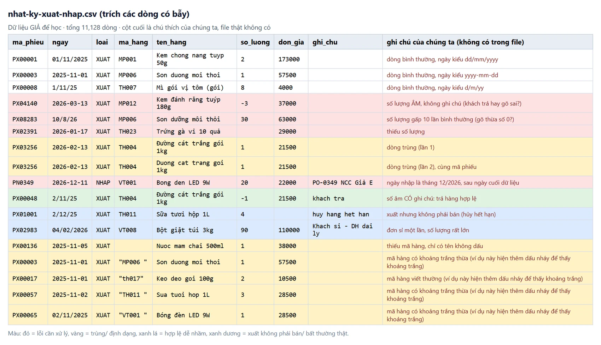
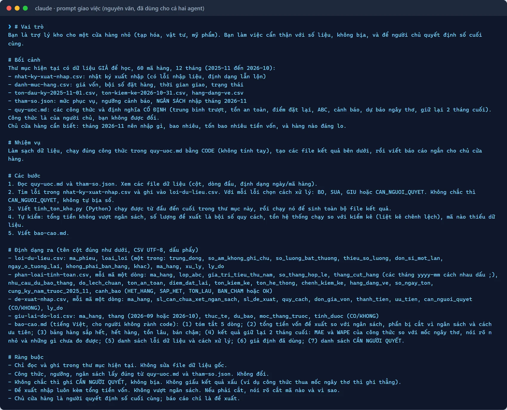

# Bài 1: Chuẩn bị dữ liệu và giao việc cho agent

> Dữ liệu GIẢ để học. Nhãn: **[Đo được]** kết quả chạy của chúng tôi 2026-11-20, **[Nguồn]** có link, **[Đề xuất]** ý kiến người viết.

## Mục tiêu đo được

Sau bài này bạn có:

1. Một thư mục làm việc sạch gồm 7 file đầu vào, mở được bằng Excel, và bạn **tự tìm ra ít nhất 5 loại lỗi** trong nhật ký bằng mắt hoặc bộ lọc trước khi nhờ agent.
2. Một bản prompt 6 phần dùng được thật (nguyên văn ở dưới, chúng tôi đã dùng đúng bản này cho cả hai agent).
3. Hai lệnh chạy được: một cho Claude Code (`claude`), một cho Antigravity (`agy`), kèm giải thích từng phần của lệnh.
4. Một danh sách "đáp án" của riêng bạn (để chấm agent sau này), giữ **ngoài** thư mục agent làm việc.

Thời gian ước tính: 30 đến 45 phút nếu chưa từng dùng agent.

## Bước 1. Tải dữ liệu và xem bằng mắt

Dữ liệu mẫu nằm trong thư mục `du-lieu/`. Tạo một thư mục mới cho lần chạy, ví dụ `kho-lan-1`, và chép **7 file** sau vào đó (đừng chép `sinh_du_lieu.py`, vì file đó chứa cả logic cài lỗi và đáp án):

```
danh-muc-hang.csv   nhat-ky-xuat-nhap.csv   ton-dau-ky-2025-11-01.csv
ton-kiem-ke-2026-10-31.csv   hang-dang-ve.csv   tham-so.json   quy-uoc.md
```

Mở `danh-muc-hang.csv` bằng Excel: mỗi mã có giá vốn, **bội số đặt hàng** (ví dụ gạo đặt theo bộ 4 túi), **thời gian giao** (ngày) và trạng thái. Hai mã trạng thái `ngung_nhap` là hàng đã ngừng nhập; ba mã có ghi chú "mặt hàng mới".


*Ảnh dựng từ file `du-lieu/danh-muc-hang.csv` và `ton-kiem-ke-2026-10-31.csv`. Dữ liệu giả để học.*

> Nếu mở CSV bằng Excel thấy chữ tiếng Việt bị vỡ dấu: dùng **Data > From Text/CSV** và chọn mã hóa **UTF-8**. File của chúng tôi có dấu BOM nên thường mở thẳng được.

Giờ mở `nhat-ky-xuat-nhap.csv` (11.128 dòng). Bật bộ lọc (Ctrl+Shift+L) và thử ba thao tác:

1. Lọc cột `so_luong` lấy số **âm**. Bạn sẽ thấy hai loại: có ghi chú `khach tra` (trả hàng hợp lệ) và **không** ghi chú (nghi gõ nhầm dấu).
2. Sắp xếp `so_luong` giảm dần. Số rất lớn có thể là gõ thừa số 0 hoặc là đơn sỉ thật (cột `ghi_chu` đôi khi có `Khach si`).
3. Lọc `ghi_chu` chứa `huy` hoặc `noi bo`: đây là xuất kho nhưng **không phải bán hàng**.



*Ảnh dựng từ file `du-lieu/nhat-ky-xuat-nhap.csv`. Cột cuối là chú thích của chúng tôi, file thật không có. Dữ liệu giả để học.*

Những gì **[Đo được]** về định dạng (đếm bằng code, 11.128 dòng): 7.787 dòng ngày kiểu `yyyy-mm-dd`, 2.240 dòng `dd/mm/yyyy`, 1.101 dòng `d/m/yy`; 809 dòng có mã hàng viết thường, có dấu gạch hoặc thừa khoảng trắng; 4 dòng thiếu mã hàng.

**Việc cần làm ngay ở bước này:** ghi vào một file riêng (ngoài thư mục `kho-lan-1`) những lỗi bạn thấy. Đó là đáp án của bạn. Sau này bạn so với báo cáo của agent.

## Bước 2. Hiểu công thức trước khi giao việc

Agent **không** được tự nghĩ ra công thức. Công thức do chủ cửa hàng đặt, viết trong `quy-uoc.md`. Đọc file đó và hiểu năm điểm:

1. **Dự báo tháng tới F** = trung bình 3 tháng hợp lệ gần nhất. "Hợp lệ" nghĩa là tháng đó mặt hàng có bán và **không bị hết hàng quá 7 ngày**.
2. **Vì sao bỏ tháng hết hàng?** Giả sử mã A bình thường bán 100 mỗi tháng, tháng 5 hết hàng 3 tuần nên chỉ bán 30. Nếu tính 30 vào trung bình thì dự báo giảm, nhập ít đi, rồi lại hết hàng. Bỏ tháng đó đi mới đúng.
3. **Tồn an toàn** SS = Z × σ × √(T/30). σ là độ lệch chuẩn của nhu cầu theo tháng, T là thời gian giao (ngày), Z = 1,645 ứng với mức phục vụ 95%. Ý nghĩa: nhu cầu càng dao động và hàng về càng chậm thì cần dự phòng càng nhiều.
4. **Điểm đặt lại** = F/30 × T + SS. Khi tồn xuống bằng hoặc dưới mức này thì phải đặt.
5. **Số cần nhập** = F + SS − tồn kiểm kê − hàng đang về, làm tròn **lên** theo bội số đặt, và không âm.

**[Nguồn]** Các công thức tồn an toàn và điểm đặt lại là kiến thức quản trị tồn kho thông dụng; chúng tôi đối chiếu với NC State (<https://scm.ncsu.edu/scm-articles/article/safety-stock>, chỉ đọc qua tóm tắt vì trang trả 403), Shopify (<https://www.shopify.com/blog/safety-stock>) và Zoho (<https://zoho.com/inventory/tour/safety-stock-formula.pdf>, qua tóm tắt). Có nhiều biến thể (biến động nhu cầu, biến động thời gian giao, cả hai); **chúng tôi chọn biến thể chỉ có biến động nhu cầu** và ghi rõ giả định thời gian giao cố định. ABC tham khảo Wikipedia (<https://en.wikipedia.org/wiki/ABC_analysis>), nơi ghi rõ không có ngưỡng cố định. Ngưỡng 80%/95% là **[Đề xuất]** của chúng tôi.

**Dự báo ngây thơ làm mốc.** Để biết công thức có đáng tin không, ta so với cách đơn giản nhất: "tháng này bán bằng tháng trước". Nếu công thức không hơn mốc này thì không có lý do dùng nó. Mốc "cùng kỳ năm trước" chỉ làm được cho tháng 2026-11 (có 2025-11), **không** làm được cho hai tháng giữ lại vì chỉ có 12 tháng dữ liệu.

**Hold-out (giữ lại 2 tháng cuối).** Ta giấu tháng 2026-09 và 2026-10 khi dự báo, rồi xem dự báo cách thực tế bao nhiêu. Đo bằng **WAPE** = tổng sai lệch tuyệt đối chia tổng bán thực tế. Chú ý **n nhỏ**: chỉ 2 tháng và khoảng 54 mã mỗi tháng.

## Bước 3. Viết prompt theo khung 6 phần

Khung: **Vai trò, Bối cảnh, Nhiệm vụ, Các bước, Định dạng ra, Ràng buộc.** Điểm đáng chú ý trong prompt dưới:

- Ràng buộc "không chắc thì CẦN NGƯỜI QUYẾT, không bịa".
- Ràng buộc "Công thức, ngưỡng, ngân sách lấy đúng từ quy-uoc.md. Không đổi."
- Ràng buộc "Không giấu kết quả xấu" (để agent không lờ đi chuyện công thức thua mốc ngây thơ).
- Tên cột của mọi file kết quả được ghi sẵn để chấm bằng code được.

Đây là **nguyên văn** prompt đã dùng cho cả hai agent (lưu ở `logs/prompt.txt`). **Prompt không được sửa sau khi thấy kết quả.**

```text
# Vai trò
Bạn là trợ lý kho cho một cửa hàng nhỏ (tạp hóa, vật tư, mỹ phẩm). Bạn làm việc cẩn thận với số liệu, không bịa, và để người chủ quyết định số cuối cùng.

# Bối cảnh
Thư mục hiện tại có dữ liệu GIẢ để học, 60 mã hàng, 12 tháng (2025-11 đến 2026-10):
- nhat-ky-xuat-nhap.csv: nhật ký xuất nhập (có lỗi nhập liệu, định dạng lẫn lộn)
- danh-muc-hang.csv: giá vốn, bội số đặt hàng, thời gian giao, trạng thái
- ton-dau-ky-2025-11-01.csv, ton-kiem-ke-2026-10-31.csv, hang-dang-ve.csv
- tham-so.json: mức phục vụ, ngưỡng cảnh báo, NGÂN SÁCH nhập tháng 2026-11
- quy-uoc.md: các công thức và định nghĩa CỐ ĐỊNH (trung bình trượt, tồn an toàn, điểm đặt lại, ABC, cảnh báo, dự báo ngây thơ, giữ lại 2 tháng cuối). Công thức là của người chủ, bạn không được đổi.
Chủ cửa hàng cần biết: tháng 2026-11 nên nhập gì, bao nhiêu, tốn bao nhiêu tiền vốn, và hàng nào đáng lo.

# Nhiệm vụ
Làm sạch dữ liệu, chạy đúng công thức trong quy-uoc.md bằng CODE (không tính tay), tạo các file kết quả bên dưới, rồi viết báo cáo ngắn cho chủ cửa hàng.

# Các bước
1. Đọc quy-uoc.md và tham-so.json. Xem các file dữ liệu (cột, dòng đầu, định dạng ngày/mã hàng).
2. Tìm lỗi trong nhat-ky-xuat-nhap.csv và ghi vào loi-du-lieu.csv. Với mỗi lỗi chọn cách xử lý: BO, SUA, GIU hoặc CAN_NGUOI_QUYET. Không chắc thì CAN_NGUOI_QUYET, không tự bịa số.
3. Viết tinh_ton_kho.py (Python) chạy được từ đầu đến cuối trong thư mục này, rồi chạy nó để sinh toàn bộ file kết quả.
4. Tự kiểm: tổng tiền không vượt ngân sách, số lượng đề xuất là bội số quy cách, tồn hệ thống chạy so với kiểm kê (liệt kê chênh lệch), mã nào thiếu dữ liệu.
5. Viết bao-cao.md.

# Định dạng ra (tên cột đúng như dưới, CSV UTF-8, dấu phẩy)
- loi-du-lieu.csv: ma_phieu, loai_loi (một trong: trung_dong, so_am_khong_ghi_chu, so_luong_bat_thuong, thieu_so_luong, don_si_mot_lan, ngay_o_tuong_lai, khong_phai_ban_hang, khac), ma_hang, xu_ly, ly_do
- phan-loai-tinh-toan.csv, mỗi mã một dòng: ma_hang, lop_abc, gia_tri_tieu_thu_nam, so_thang_hop_le, thang_cut_hang (các tháng yyyy-mm cách nhau dấu ;), nhu_cau_du_bao_thang, do_lech_chuan, ton_an_toan, diem_dat_lai, ton_kiem_ke, ton_he_thong, chenh_kiem_ke, hang_dang_ve, so_ngay_ton, cung_ky_nam_truoc_2025_11, canh_bao (HET_HANG, SAP_HET, TON_LAU, BAN_CHAM hoặc OK)
- de-xuat-nhap.csv, mỗi mã một dòng: ma_hang, sl_can_chua_xet_ngan_sach, sl_de_xuat, quy_cach, don_gia_von, thanh_tien, uu_tien, can_nguoi_quyet (CO/KHONG), ly_do
- giu-lai-do-loi.csv: ma_hang, thang (2026-09 hoặc 2026-10), thuc_te, du_bao, moc_thang_truoc, tinh_duoc (CO/KHONG)
- bao-cao.md (tiếng Việt, cho người không rành code): (1) tóm tắt 5 dòng; (2) tổng tiền vốn đề xuất so với ngân sách, phần bị cắt vì ngân sách và cách ưu tiên; (3) bảng hàng sắp hết, hết hàng, tồn lâu, bán chậm; (4) kết quả giữ lại 2 tháng cuối: MAE và WAPE của công thức so với mốc ngây thơ, nói rõ n nhỏ và những gì chưa đo được; (5) danh sách lỗi dữ liệu và cách xử lý; (6) giả định đã dùng; (7) danh sách CẦN NGƯỜI QUYẾT.

# Ràng buộc
- Chỉ đọc và ghi trong thư mục hiện tại. Không sửa file dữ liệu gốc.
- Công thức, ngưỡng, ngân sách lấy đúng từ quy-uoc.md và tham-so.json. Không đổi.
- Không chắc thì ghi CẦN NGƯỜI QUYẾT, không bịa. Không giấu kết quả xấu (ví dụ công thức thua mốc ngây thơ thì ghi thẳng).
- Đề xuất nhập luôn kèm tổng tiền vốn. Không vượt ngân sách. Nếu phải cắt, nói rõ cắt mã nào và vì sao.
- Chủ cửa hàng là người quyết định số cuối cùng; báo cáo chỉ là đề xuất.
```



*Dựng lại từ log thật của lần chạy `claude-1`, không phải ảnh chụp trực tiếp cửa sổ TUI.*

## Bước 4. Chạy agent

Hai cách: gõ trực tiếp trong terminal, hoặc dùng script `agent_run.py` của chúng tôi để lưu log. Dưới đây là cách thứ nhất (đơn giản, dành cho người mới).

**Claude Code.** Mở terminal, đi vào thư mục làm việc rồi gõ `claude`. Dán nguyên văn prompt vào và Enter. Claude Code sẽ hỏi quyền khi đọc, ghi file và chạy lệnh; chấp nhận từng việc trong thư mục này. Lệnh không tương tác mà chúng tôi dùng để lưu log:

```bash
cd kho-lan-1
claude -p "<prompt>" --output-format stream-json --verbose \
  --permission-mode acceptEdits --allowedTools Read,Write,Edit,Glob,Grep,Bash
```

Giải thích: `-p` chạy một lần rồi thoát; `--output-format stream-json --verbose` in từng sự kiện ra để lưu log; `--permission-mode acceptEdits` tự chấp nhận sửa file; `--allowedTools` giới hạn các công cụ được dùng. Phiên bản đọc từ `claude --version` ngày 2026-11-20: **Claude Code 2.1.329**.

**Antigravity (`agy`).**

```bash
cd kho-lan-1
agy -p "<prompt>" --output-format stream-json --dangerously-skip-permissions
```

Giải thích: `--dangerously-skip-permissions` **bỏ qua mọi hỏi quyền**, tức agent có toàn quyền trên máy. Chỉ dùng trên thư mục thử, dữ liệu giả, và đã sao lưu. Phiên bản `agy --version`: **1.5.13**.

**Cảnh báo an toàn [Đề xuất]:** cả hai agent chạy toàn quyền trên máy bạn. Với dữ liệu thật, hãy chạy trong thư mục riêng, **chỉ chép vào những cột cần thiết** (nhật ký xuất nhập thường chứa tên khách hoặc số điện thoại trong cột ghi chú; xóa trước khi giao), và không để file đáp án trong thư mục đó.

Cách thứ hai (lưu log): `python -X utf8 agent_run.py <claude|agy> <thư_mục_làm_việc> prompt.txt <tiền_tố_log> <giây_tối_đa>`. Script ghi `<tiền_tố>.raw.jsonl` (log gốc) và `<tiền_tố>.json` (đã chuẩn hóa).

**Bài học thực tế [Đo được]:** giới hạn 900 giây là **quá ngắn** cho bài này. Lượt `claude-1` mất 660 giây. Lượt `agy` đầu bị cắt ở 900 giây trước khi ghi log (script chỉ ghi log khi tiến trình xong), lượt `agy-2` với giới hạn 1.800 giây xong sau 1.525 giây. Nếu bạn dùng script lưu log, hãy đặt giới hạn rộng.

## Bước 5. Chuẩn bị chấm (làm trước khi xem kết quả)

Đáp án của chúng tôi nằm trong `ket-qua/dap-an.json` (có 28 lỗi nhập liệu cài sẵn, ABC, cảnh báo, các tháng cụt hàng, kết quả tham chiếu từng mã). Bạn tự làm dữ liệu thật thì cần đáp án tối thiểu gồm:

- Danh sách vài mã bạn biết chắc đang hết hoặc sắp hết.
- Danh sách vài dòng nhật ký bạn biết là gõ sai.
- Tổng tiền tối đa bạn chịu bỏ ra.

Đừng cho agent xem. Chấm tự động: xem `ket-qua/cham.py` ở bài 2.

## Lỗi thường gặp ở bước chuẩn bị

1. **Chép cả file sinh dữ liệu vào thư mục agent.** Agent sẽ đọc được logic cài lỗi và đáp án, kết quả mất giá trị. Chỉ chép 7 file.
2. **Không ghi bội số đặt hàng.** Agent đề xuất 7 túi gạo trong khi chỉ đặt được theo bộ 4. Bắt buộc có cột bội số.
3. **Không nói "không chắc thì hỏi".** Agent sẽ tự bịa số cho dòng thiếu số lượng.
4. **Để agent đổi công thức.** Nếu không khóa, agent có thể "cải tiến" bằng cách thêm mùa vụ, làm kết quả không so sánh được giữa các tháng.
5. **Không có thông số ngân sách.** Đề xuất nhập sẽ là con số đẹp nhưng không ai có đủ tiền.

## Checklist cuối bài

- [ ] Thư mục làm việc có đúng 7 file, không có đáp án.
- [ ] Bạn đã tự tìm được ít nhất 5 loại lỗi trong nhật ký và ghi lại ngoài thư mục.
- [ ] Bạn hiểu vì sao tháng hết hàng bị loại khỏi trung bình.
- [ ] Bạn biết mốc ngây thơ là gì và vì sao cần nó.
- [ ] Prompt có đủ 6 phần, có tên cột kết quả, có câu "không chắc thì CẦN NGƯỜI QUYẾT".
- [ ] Bạn đã sao lưu thư mục trước khi chạy agent với quyền rộng.

## Việc cần người làm

- Quyết ngân sách tháng tới (tham số `ngan_sach_nhap_vnd`). Đây là quyết định tiền mặt của chủ cửa hàng, không phải của agent.
- Xác nhận thời gian giao của từng nhà cung cấp trong `danh-muc-hang.csv` (nếu dữ liệu thật).
- Quyết mức phục vụ 95% có hợp với cửa hàng của bạn không (mức cao hơn cần tồn an toàn nhiều hơn, tốn vốn hơn).

## Giới hạn

- Dữ liệu là giả; mô hình mùa vụ và nhu cầu do chúng tôi tự đặt, không phản ánh một cửa hàng cụ thể.
- Công thức có giả định thời gian giao cố định và nhu cầu các tháng độc lập; thực tế có thể khác.
- Công thức không xét hạn dùng (sữa, trứng, mỹ phẩm) và chi phí đặt hàng.
- Chưa đo được việc chạy lại nhiều lần có cho kết quả giống nhau hay không (mỗi agent chỉ 1 lần có log).
