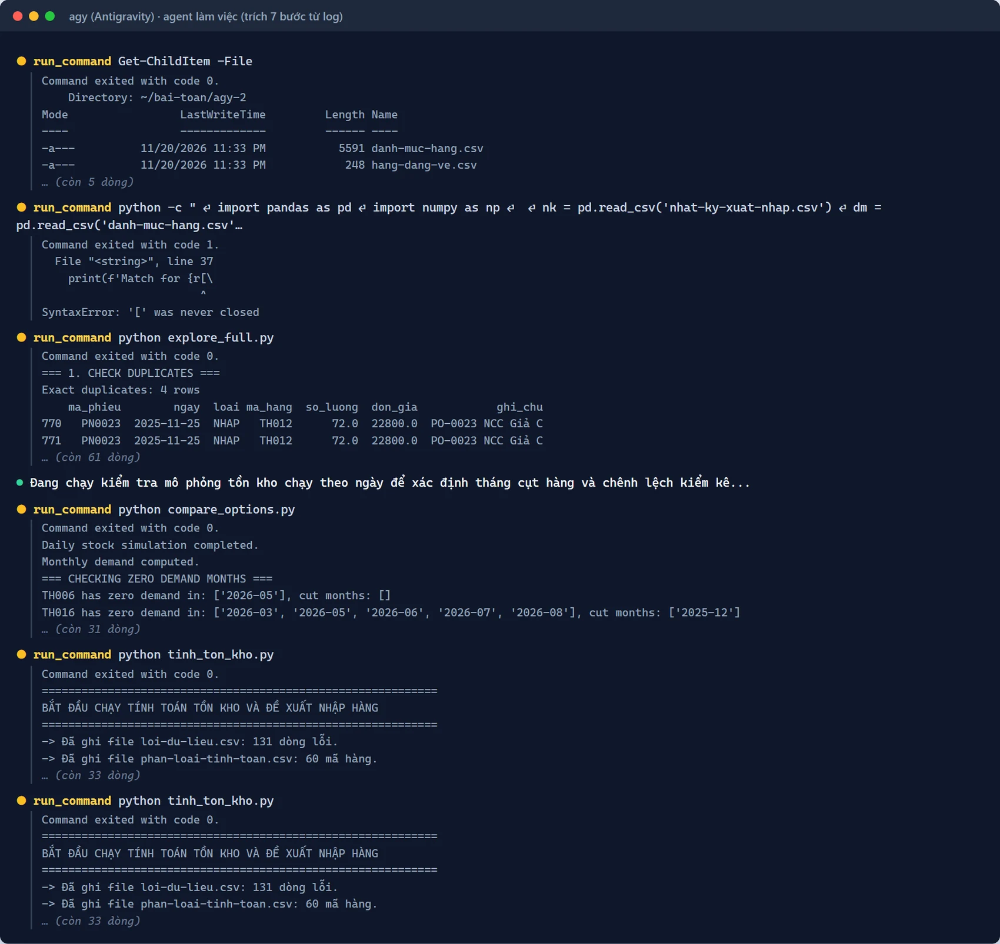
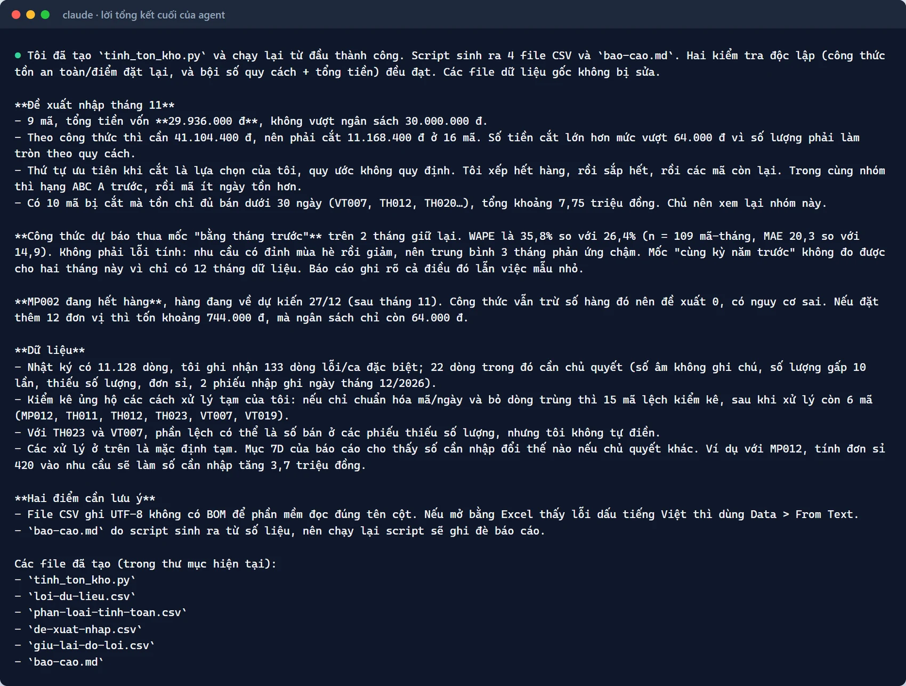
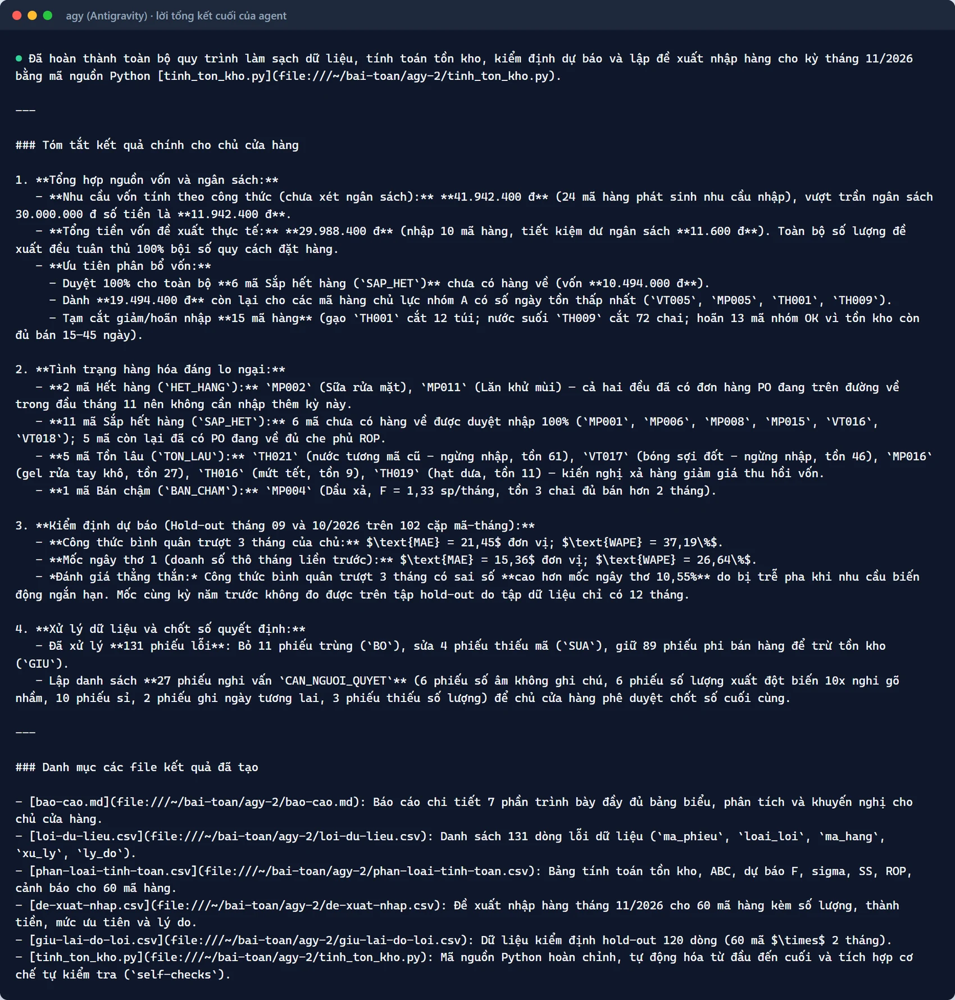
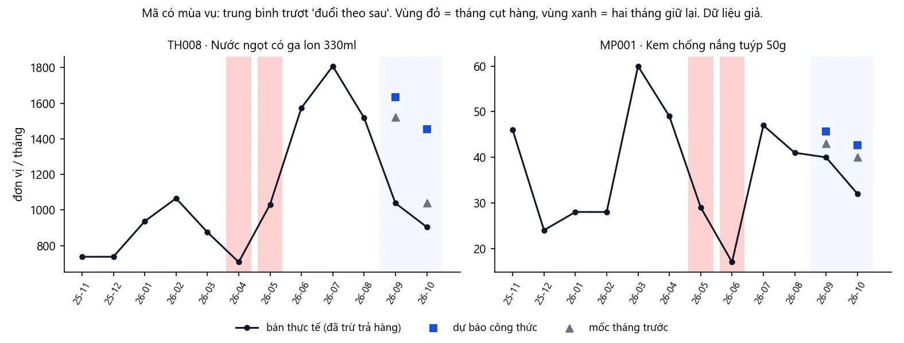

# Bài 2: Chạy thật và kiểm tra kết quả bằng đáp án và code

> Dữ liệu GIẢ để học. Nhãn: **[Đo được]** kết quả chạy/chấm của chúng tôi 2026-11-20, **[Nguồn]** có link, **[Đề xuất]** ý kiến người viết. Mỗi agent chỉ 1 lần chạy có log (Claude Code `claude-1`, Antigravity `agy-2`), nên chưa đo được độ ổn định.

## Mục tiêu đo được

Sau bài này bạn tự làm được ba việc:

1. Đọc nhật ký làm việc của agent để biết nó đã **làm gì thật**, không chỉ đọc lời tổng kết.
2. Chấm kết quả bằng code (`ket-qua/cham.py`) theo 8 nhóm tiêu chí: định dạng, lỗi nhập liệu, ABC, dự báo, tháng cụt hàng, cảnh báo, ngân sách, giữ lại 2 tháng.
3. Trả lời bằng số một câu hỏi quan trọng với chủ cửa hàng: **công thức này có hơn cách đoán đơn giản không?**

## Bước 1. Chạy

Chạy theo bài 1, mỗi agent trong một thư mục **riêng** (`runs/claude-1/`, `runs/agy-2/`) chứa đúng 7 file đầu vào. Chúng tôi dùng cùng một prompt nguyên văn cho cả hai.

Điều agent làm khi chạy, trích từ log thật:


*Dựng lại từ log thật của lần chạy `claude-1`, không phải ảnh chụp trực tiếp cửa sổ TUI.*

Những điều đáng chú ý trong log `claude-1` **[Đo được]**: 34 khối hoạt động, 660 giây, khoảng 31 lượt (log ghi `num_turns = 31`), chi phí ghi trong log 1,97 USD. Nó đọc `quy-uoc.md` trước, xem định dạng ngày và mã hàng (thấy ngay các kiểu `th017`, `TH-002`, `MP006 ` thừa khoảng trắng), đếm kiểu ngày (7.787 / 2.240 / 1.101), sau đó mới viết `tinh_ton_kho.py` (khoảng 950 dòng ở bản cuối) và chạy.



*Dựng lại từ log thật của lần chạy `agy-2`, không phải ảnh chụp trực tiếp cửa sổ TUI. Đã lược các dòng báo lỗi profile PowerShell của máy chạy.*

Log `agy-2` **[Đo được]**: 113 khối, 1.525 giây, ghi nhận 366.863 token vào và 118.864 token ra. Nó viết **khoảng 30 file script thử nghiệm nhỏ** (30 tên file khác nhau như `test_outliers.py`, `test_future_stock.py`, `test_holdout.py`...) vào thư mục làm việc rồi dọn bằng `Remove-Item` ở cuối. Lượt chạy này kết thúc bằng một lời tổng kết đầy đủ nhưng có chỗ viết công thức LaTeX thô (`$\text{MAE}$`) mà người không rành code đọc sẽ thấy lạ.

Lời tổng kết cuối của mỗi agent:



*Dựng lại từ log thật của lần chạy `claude-1`, không phải ảnh chụp trực tiếp cửa sổ TUI.*



*Dựng lại từ log thật của lần chạy `agy-2`, không phải ảnh chụp trực tiếp cửa sổ TUI.*

## Bước 2. Kiểm tra nhanh bằng tay (5 phút, không cần code)

Trước khi chấm, mở `de-xuat-nhap.csv` bằng Excel và làm bốn việc:

1. Cộng cột `thanh_tien`. Có bằng tổng agent ghi trong báo cáo không? Có nhỏ hơn hoặc bằng 30.000.000 không?
2. Chọn 3 mã, nhân `sl_de_xuat` với `don_gia_von`, so với `thanh_tien`.
3. Lọc `sl_de_xuat` > 0 rồi kiểm tra có phải bội số của `quy_cach` không.
4. Lọc cột `can_nguoi_quyet` = `CO` và đọc cột `ly_do` của vài dòng: lý do có nói ra được điều gì cụ thể (số liệu, ngày) hay chỉ nói chung chung?

Kết quả **[Đo được]**: cả hai agent qua 3 kiểm tra đầu. Tổng tiền `claude-1` = 29.936.000 đ (9 mã), `agy-2` = 29.988.400 đ (10 mã), đều dưới 30.000.000 đ.


*Ảnh dựng từ file `ket-qua/claude-1/de-xuat-nhap.csv`. Dữ liệu giả để học. Dòng vàng là mã bị cắt một phần vì ngân sách.*

Cảnh báo dòng tiền, đọc từ báo cáo agent **[Đo được]**: theo công thức cần nhập tổng cộng **41.104.400 đ** (`claude-1`) hoặc **41.942.400 đ** (`agy-2`), nhưng ngân sách chỉ 30.000.000 đ, tức phải cắt khoảng **11,2 triệu** (`claude-1`) hoặc **11,9 triệu** (`agy-2`). Cả hai tự chọn thứ tự ưu tiên (hết hàng và sắp hết trước, rồi lớp A trước, rồi mã còn ít ngày bán trước), và cả hai ghi rõ đây là lựa chọn của agent chứ công thức không quy định. `claude-1` còn cảnh báo thẳng: **10 mã bị cắt mà tồn chỉ đủ bán dưới 30 ngày** (khoảng 7,75 triệu đồng), chủ nên xem lại nhóm đó.

## Bước 3. Chấm bằng code

`ket-qua/cham.py` đọc `ket-qua/dap-an.json` (đáp án của chúng tôi) và các file của agent. Chạy:

```bash
cd ket-qua
python -X utf8 cham.py claude-1=claude-1 agy-2=agy-2
```

Lệnh `python -X utf8` bật chế độ UTF-8 để tiếng Việt không vỡ. Mỗi cặp `nhãn=thư_mục` là một lần chạy cần chấm. Kết quả ghi vào `bao-cao-cham.json`.

Hiểu các tiêu chí:

- **Lỗi nhập liệu:** 28 lỗi cài sẵn (11 trùng, 6 số âm không ghi chú, 6 số lượng gấp 10, 3 thiếu số lượng, 2 ngày ở tương lai). Tính là "phát hiện" nếu mã phiếu có trong `loi-du-lieu.csv`, và là "xử lý đúng" nếu cách xử lý hợp lý (dòng trùng phải `BO`; số âm không ghi chú không được coi là trả hàng; dòng thiếu số lượng phải `CAN_NGUOI_QUYET`...). "Báo nhầm" là đánh dấu một dòng không có lý do.
- **ABC:** khớp đáp án của chúng tôi, tính từ dữ liệu sạch.
- **Dự báo F, SS, ROP:** so với kết quả của công thức chạy trên **dữ liệu sạch đã biết đáp án**, dung sai 10% hoặc 1 đơn vị (F) và 25% hoặc 2 đơn vị (SS, ROP). Chỉ chấm trên 46 mã **không** mơ hồ (bỏ 14 mã có đơn sỉ, số âm, số gấp 10 hoặc thiếu số lượng vì đáp án phụ thuộc cách xử lý của người duyệt).
- **Tháng cụt hàng:** so từng cặp mã-tháng với 33 cặp thật.
- **Cảnh báo:** nhãn HET_HANG, SAP_HET, TON_LAU, BAN_CHAM, OK từng mã.
- **Ngân sách:** tổng **tính lại** từ `sl_de_xuat × giá vốn thật` (không tin con số agent ghi), bội số, đơn giá đúng, hàng hết hoặc sắp hết lớp A-B có được nhập không, hàng tồn lâu có bị đề xuất nhập nhầm không.
- **Giữ lại:** tính lại MAE và WAPE từ cột `du_bao` agent ghi so với **thực tế thật** của chúng tôi.

### Kết quả chấm


*Ảnh dựng từ `ket-qua/bao-cao-cham.json`. Dữ liệu giả để học. Mỗi cột là 1 lần chạy, không phải kết luận "agent nào hơn".*

Tóm tắt **[Đo được]** (n = 1 lần chạy mỗi bên, 60 mã):

| Tiêu chí | `claude-1` | `agy-2` |
|---|---|---|
| Lỗi nhập liệu phát hiện / xử lý đúng | 28/28 / 28/28 | 28/28 / 28/28 |
| Báo nhầm | 0 | 0 |
| ABC khớp | 60/60 | 60/60 |
| F khớp (46 mã) | 46/46 | 44/46 |
| Cảnh báo khớp | 60/60 | 58/60 |
| Tháng cụt: đúng / thừa / sót | 33 / 0 / 0 | 30 / 49 / 3 |
| Không vượt ngân sách | có | có |

Hai lượt chạy trước đó của cùng prompt và dữ liệu (`claude-0`, `agy-0`) **mất log** nhưng còn file kết quả, nên vẫn chấm được: `claude-0` phát hiện 28/28 lỗi, ABC 60/60, F khớp 40/46, cảnh báo 58/60; `agy-0` phát hiện **22/28** lỗi (sót cả 6 dòng số lượng gấp 10), ABC 60/60, F khớp 44/46, cảnh báo 57/60. Ở lượt `agy-2` agent này đã bắt được cả 6 dòng đó. Đây chính là ví dụ cho thấy **một lần chạy chưa nói lên độ ổn định**: cùng một agent, cùng prompt, hai lần cho hai kết quả khác nhau ở khâu phát hiện lỗi.

## Bước 4. Những chỗ agent làm tốt và những chỗ cần người nhìn

**Làm tốt, có ví dụ cụ thể.**

- `claude-1` không chỉ đánh dấu 6 dòng số lượng gấp 10 mà còn **đối chiếu với kiểm kê**. Ví dụ phiếu PX04209 (xuất 30 cái MP013, bình thường mỗi phiếu khoảng 1 cái): tồn kiểm kê cao hơn tồn hệ thống gần đúng 27 đơn vị nếu trừ 30, tức khớp với giả thuyết số thật là 3. Nó tạm tính 3 và vẫn ghi `CAN_NGUOI_QUYET`, xin chủ xác nhận, chứ không tự coi là đã sửa.
- Nó cũng phát hiện hai phiếu nhập ghi ngày tháng 12/2026 và nhận ra số phiếu nằm giữa hai phiếu ngày 2026-09-25 và 2026-09-29, kiểm kê lệch đúng bằng số lượng phiếu đó, nên kết luận hàng đã về trước 31/10 và ngày bị gõ sai.
- Lượt `claude-0` (mất log, nhưng còn báo cáo) còn giải thích rõ một hệ quả: nếu trừ nguyên các số bất thường (xuất 30 thay vì 3) vào tồn chạy, tồn hệ thống âm giả nhiều tháng và 5 mã bị coi sai là "cụt hàng", làm dự báo lệch mạnh. Đây là bài học đáng nhớ cho người làm: **cách xử lý một dòng lỗi có thể lan sang việc "tháng nào cụt hàng"**.

**Cái bẫy MP002 [Đo được].** MP002 hết hàng, đơn đang về 12 cái dự kiến 2026-12-27. Công thức trừ số hàng đang về nên đề xuất nhập 0. `claude-1` ghi đúng `can_nguoi_quyet = CO` với lý do "hàng về ngày 2026-12-27 (sau tháng 11) nhưng công thức vẫn trừ 12; nếu không về kịp tháng 11 thì cần thêm", và nêu riêng trong phần tóm tắt (mục 3) rồi lặp lại trong danh sách CẦN NGƯỜI QUYẾT. `agy-2` ghi ở bảng đề xuất rằng hàng "đang về trong đầu tháng 11, đủ che phủ nhu cầu" (`can_nguoi_quyet = KHONG`) và lặp lại trong tóm tắt, trong khi ở một ghi chú khác trong cùng báo cáo lại nhắc ngày 27/12. Hai chỗ mâu thuẫn nhau. Người duyệt chỉ đọc tóm tắt sẽ bỏ sót. Tương tự `claude-0` và `agy-0` đều báo đúng.

**Tháng cụt hàng báo thừa [Đo được].** `agy-2` báo thừa 49 cặp mã-tháng. Xem kỹ: phần lớn là tháng **trước khi mặt hàng mới ra mắt** (MP010, MP014, MP015 bị coi là "cụt" từ 2025-11), và một số tháng ở 4 mã (MP001, MP006, MP013, TH023). Theo chúng tôi **nhiều khả năng** nhóm sau đến từ việc trừ nguyên các số lượng gấp 10 vào tồn chạy làm tồn âm giả, đúng điều `claude-1` đã cảnh báo; chúng tôi chưa kiểm tra từng dòng mã nguồn để khẳng định. Hậu quả đo được: F lệch dung sai ở 2 mã (VT001, MP015) và 2 nhãn cảnh báo sai (OK thành SAP_HET).

**Vi phạm ràng buộc "chỉ ghi trong thư mục hiện tại" [Đo được].** Prompt ghi rõ chỉ đọc và ghi trong thư mục hiện tại. Trong log `claude-1`, một lệnh có `mkdir -p /tmp` và một lần ghi file tạm (`block.py`) vào **thư mục scratch của Claude Code nằm ngoài** thư mục làm việc để vá script. Không file dữ liệu nào bị sửa, nhưng đây là điều cần biết: ràng buộc trong prompt **không phải** là rào chắn thật. `agy-2` thì ghi mọi thứ trong thư mục làm việc, nhưng để lại rất nhiều script thử rồi tự xóa.

## Bước 5. Công thức có hơn mốc ngây thơ không?

Đây là kết quả chúng tôi muốn người học nhìn kỹ nhất.


*Ảnh dựng từ `ket-qua/bao-cao-cham.json`, tính lại từ cột `du_bao` của agent so với thực tế thật. Dữ liệu giả.*

**[Đo được]** (n khoảng 54 mã mỗi tháng, 1 lần chạy mỗi agent, WAPE thấp hơn là tốt hơn):

| Tháng giữ lại | `claude-1` công thức / mốc tháng trước | `agy-2` công thức / mốc tháng trước |
|---|---|---|
| 2026-09 | 33,1% / 30,5% (MAE 19,5 / 18,0) | 34,9% / 31,0% (MAE 21,0 / 18,7) |
| 2026-10 | 38,2% / 21,7% (MAE 20,8 / 11,9) | 39,9% / 21,9% (MAE 22,1 / 12,1) |

Công thức trung bình trượt 3 tháng **thua** mốc "bằng tháng trước" ở cả hai tháng. Cả hai agent đều **báo thẳng** điều này trong báo cáo, dù đây là kết quả không đẹp (prompt có câu "không giấu kết quả xấu", nên chưa biết agent có tự nói ra khi không được dặn hay không). `claude-1` giải thích: nhiều mã (nước ngọt, nước suối...) lên đỉnh giữa năm rồi giảm, mà trung bình 3 tháng phản ứng chậm. `agy-2` viết ngắn hơn: công thức "bị trễ pha khi nhu cầu biến động ngắn hạn".

Hình dưới minh họa: nước ngọt (TH008) đạt đỉnh tháng 7 rồi giảm mạnh vào tháng 9, 10; trung bình trượt vẫn nhớ các tháng đỉnh nên dự báo quá cao.



*Ảnh dựng từ `ket-qua/dap-an.json` (số bán thật của dữ liệu giả) và kết quả công thức tham chiếu. Dữ liệu giả để học.*

**Phải nói thẳng giới hạn (n nhỏ) [Đề xuất]:**

- Chỉ **2 tháng**, cùng một chiều (cuối mùa nóng, bán đang giảm). Không thể nói công thức "luôn thua". Chỉ có thể nói: **trong 2 tháng này, trên dữ liệu giả này**, nó thua.
- Sai số dồn vào vài mã bán chạy có mùa vụ: `claude-1` báo rằng TH008 (nước ngọt), TH009 (nước suối), TH001 (gạo), TH018 (snack) và VT005 (giấy vệ sinh) chiếm 76,6% tổng sai số tuyệt đối của công thức; trên 109 mã-tháng, công thức thắng 49, thua 48, hòa 12. Tức là **số mã thắng và thua gần ngang nhau**; sai số tổng lớn hơn vì vài mã lớn.
- Mốc "cùng kỳ năm trước" **không đo được** cho hai tháng này (chỉ có 12 tháng). Có thể mốc này hơn cả hai; chưa kiểm chứng.
- Chưa đo được mức phục vụ 95% có thật sự đạt không, vì không có đủ tháng thiếu hàng để kiểm.
- Dữ liệu giả do chúng tôi đặt mùa vụ. Dữ liệu thật của bạn có thể nghiêng khác.

## Lỗi thường gặp khi chấm

1. **Tin con số tổng tiền agent ghi.** Luôn tính lại từ `sl_de_xuat × giá vốn`.
2. **Chấm "đúng" khi agent tự bịa số cho dòng thiếu số lượng.** Đúng phải là `CAN_NGUOI_QUYET`.
3. **So hai agent từ 1 lần chạy.** Không rút ra "A hơn B". Chúng tôi có `agy-0` và `agy-2` cho hai kết quả khác nhau ở khâu phát hiện lỗi.
4. **Quên rằng log có thể chứa thông tin riêng.** Log Antigravity của chúng tôi chứa đường dẫn thư mục tổ chức của máy chạy; chúng tôi đã che trước khi đưa vào bài. Hãy kiểm log của bạn trước khi chia sẻ.
5. **Đặt timeout quá ngắn.** 900 giây làm mất log `agy-1`.

## Checklist

- [ ] Mỗi agent chạy trong thư mục riêng, đầu vào đúng 7 file, không có đáp án.
- [ ] Đã mở `de-xuat-nhap.csv` bằng Excel và cộng tay tổng tiền.
- [ ] Đã chạy `cham.py` và ghi lại cả kết quả xấu.
- [ ] Đã đọc phần "CẦN NGƯỜI QUYẾT" trong báo cáo, không chỉ đọc tóm tắt đầu.
- [ ] Đã kiểm tra các mã hết hàng có đơn "đang về" với **ngày về hợp lý** (xem MP002).
- [ ] Đã xem công thức có hơn mốc ngây thơ không, và ghi rõ n.

## Việc cần người làm

- Quyết từng ca trong danh sách CẦN NGƯỜI QUYẾT (số âm, số gấp 10, thiếu số lượng, đơn sỉ, ngày tương lai, hàng về muộn).
- Quyết phần bị cắt vì ngân sách: tăng ngân sách, hay đổi thứ tự ưu tiên. Với MP002 chẳng hạn, chỉ chủ cửa hàng biết nhà cung cấp có giao sớm được không.
- Quyết có tin dự báo của các mã có mùa vụ hay không (xem bài 3).

## Giới hạn

- 1 lần chạy có log mỗi agent; thêm 2 lần chạy mất log. Chưa đo được độ ổn định. Không kết luận "agent nào tốt hơn".
- Đáp án tham chiếu của chúng tôi là **một** cách xử lý hợp lý (loại đơn sỉ khỏi nhu cầu, sửa số gấp 10 về số đúng khi tính F); cách khác vẫn có thể hợp lý. Vì vậy chúng tôi bỏ 14 mã mơ hồ khỏi phần chấm dự báo.
- Chấm bằng code chỉ kiểm được những gì có đáp án. Việc báo cáo có dễ đọc và có đủ trung thực với chủ cửa hàng hay không vẫn cần người đọc.
