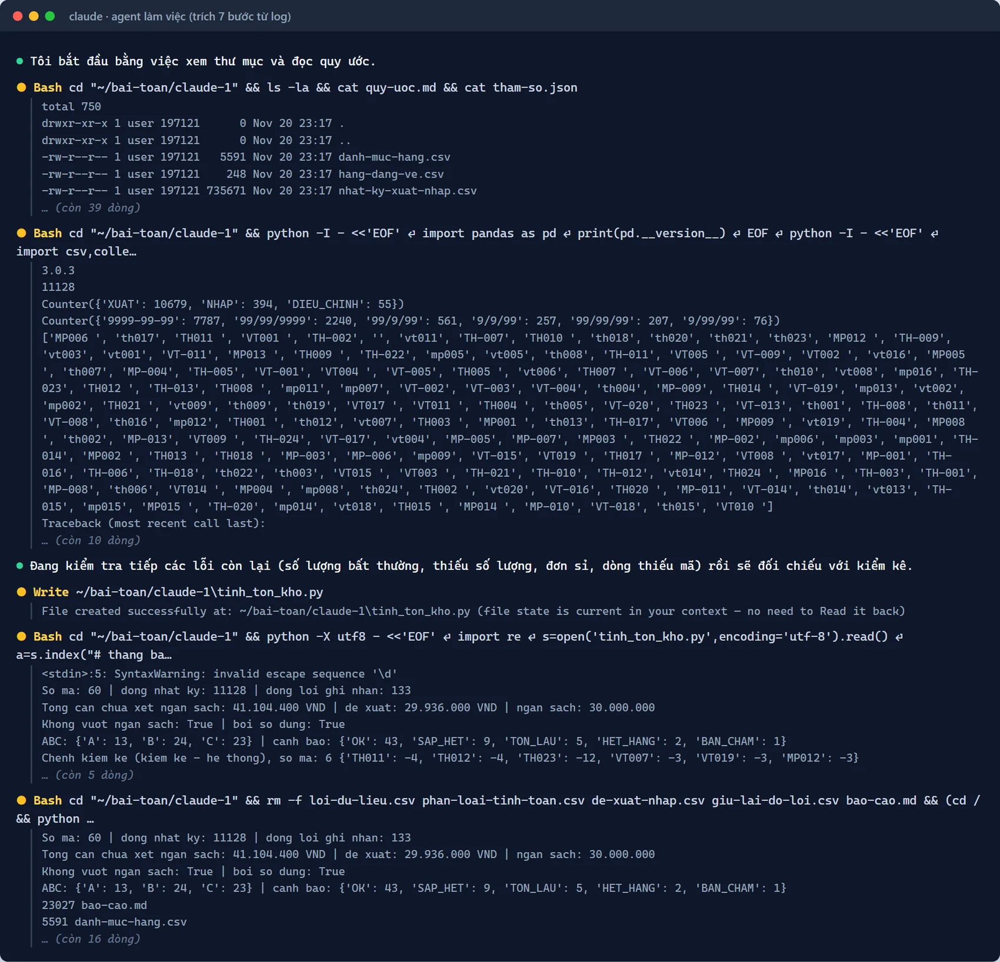
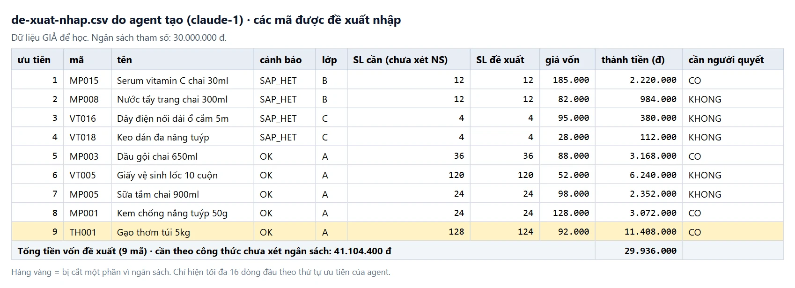
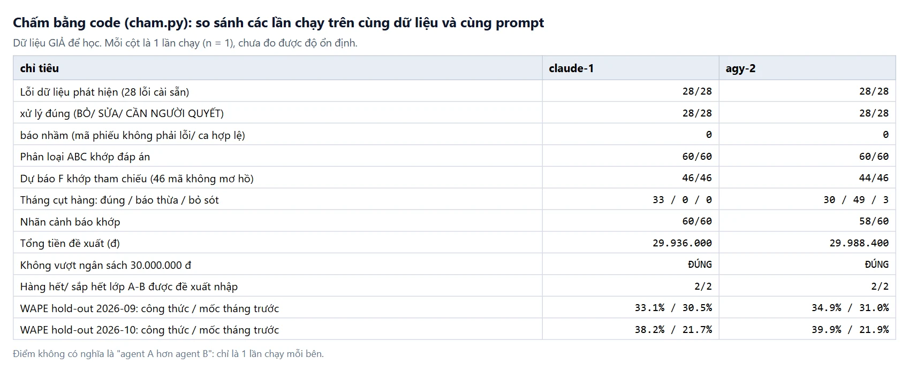
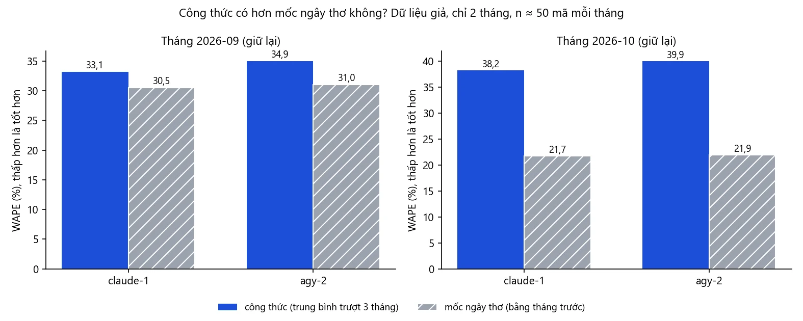

# Bài 2. Chạy thật và kiểm tra kết quả bằng đáp án và code

!!! info "Bài này"
    - **Bạn làm gì:** mở kết quả của agent, cộng tay tổng tiền bằng Excel, chấm bằng bộ chấm `cham.py`, đọc các ca agent làm sai hoặc đáng ngờ, rồi trả lời bằng số: **công thức có hơn cách đoán "bằng tháng trước" không?**
    - **Mất bao lâu:** khoảng 40 phút (5 phút kiểm tay, 5 phút chấm, phần còn lại để đọc).
    - **Cần có:** kết quả của bài 1 (hoặc thư mục `ket-qua/` có sẵn trong bộ bài), Excel, Python 3.
    - **Kết quả:** bảng chấm đúng/sai theo 8 nhóm tiêu chí và kết luận có số, có ghi n, về công thức dự báo.

> Dữ liệu GIẢ để học. Mọi số **[Đo được]** là kết quả chạy và chấm của chúng tôi ngày 2026-11-20, 60 mã hàng. Mỗi agent chỉ có **1 lần chạy đầy đủ log** (Claude Code `claude-1`, Antigravity `agy-2`), nên **chưa đo được độ ổn định** và không rút ra "agent nào tốt hơn".

| Chỉ tiêu (n = 1 lần chạy mỗi bên) | `claude-1` | `agy-2` |
|---|---|---|
| Phát hiện 28 lỗi nhập liệu cài sẵn, xử lý hợp lý | 28/28 | 28/28 |
| ABC khớp đáp án | 60/60 | 60/60 |
| Dự báo khớp tham chiếu (46 mã không mơ hồ) | 46/46 | 44/46 |
| Nhãn cảnh báo khớp | 60/60 | 58/60 |
| Tháng cụt hàng: đúng / báo thừa / bỏ sót (trên 33) | 33 / 0 / 0 | 30 / 49 / 3 |
| Tổng tiền đề xuất (ngân sách 30.000.000 đ) | 29.936.000 đ | 29.988.400 đ |
| Báo người duyệt về MP002 (hàng về 27/12) | có | không (ghi "đầu tháng 11" ở bảng đề xuất) |
| Thời gian chạy | 660 giây | 1.525 giây |

## Các bước làm

### Bước 1. Mở kết quả và nhật ký của agent

Mỗi lần chạy nằm trong một thư mục riêng (`ket-qua/claude-1/`, `ket-qua/agy-2/`). Mở `bao-cao.md` trước, rồi xem agent đã làm gì, **đừng chỉ đọc lời tổng kết**.



*Dựng lại từ log thật của lần chạy `claude-1`, không phải ảnh chụp trực tiếp cửa sổ terminal.*

Điều đáng nhìn trong log `claude-1`: nó đọc `quy-uoc.md` **trước**, xem định dạng ngày và mã hàng (thấy ngay `th017`, `TH-002`, `MP006 ` thừa khoảng trắng), đếm kiểu ngày, rồi mới viết `tinh_ton_kho.py` và chạy. Log `agy-2` cho thấy nó thăm dò dữ liệu bằng nhiều script thử nhỏ rồi dọn đi (chi tiết ở mục Đào sâu).


*Dựng lại từ log thật của lần chạy `claude-1`, không phải ảnh chụp trực tiếp cửa sổ terminal.*

### Bước 2. Kiểm nhanh bằng tay (5 phút, không cần code)

Mở `de-xuat-nhap.csv` bằng Excel và làm bốn việc:

1. Cộng cột `thanh_tien`. Có bằng tổng agent ghi trong báo cáo không? Có nhỏ hơn hoặc bằng 30.000.000 không?
2. Chọn 3 mã, nhân `sl_de_xuat` với `don_gia_von`, so với `thanh_tien`.
3. Lọc `sl_de_xuat` > 0, kiểm tra có là bội số của `quy_cach` không.
4. Lọc `can_nguoi_quyet` = `CO`, đọc cột `ly_do`: có nói được điều cụ thể (số liệu, ngày) hay chỉ nói chung chung?



*Ảnh dựng từ `ket-qua/claude-1/de-xuat-nhap.csv`. Dữ liệu giả để học. Dòng vàng là mã bị cắt một phần vì ngân sách.*

!!! see "Bạn sẽ thấy"
    **[Đo được]** Cả hai agent qua 3 kiểm tra đầu. Theo công thức cần nhập **41.104.400 đ** (`claude-1`) hoặc **41.942.400 đ** (`agy-2`), nhưng ngân sách chỉ 30.000.000 đ: phải cắt khoảng 11,2 hoặc 11,9 triệu. Cả hai tự chọn thứ tự ưu tiên (hết hàng và sắp hết trước, rồi lớp A, rồi mã còn ít ngày bán) và ghi rõ **đó là lựa chọn của agent, công thức không quy định**. `claude-1` còn cảnh báo thẳng: 10 mã bị cắt mà tồn chỉ đủ bán dưới 30 ngày (khoảng 7,75 triệu đồng).

### Bước 3. Chấm bằng code

`cham.py` đọc `dap-an.json` (đáp án của chúng tôi) và các file của agent, **không dùng mô hình để chấm**. Chạy trong thư mục `ket-qua` (Windows PowerShell, macOS và Linux giống nhau):

```lenh
cd ket-qua
python -X utf8 cham.py claude-1=claude-1 agy-2=agy-2
```

`-X utf8` để tiếng Việt không vỡ. Mỗi cặp `nhãn=thư_mục` là một lần chạy cần chấm. Lệnh in khoảng 330 dòng JSON mỗi lần và ghi vào `bao-cao-cham.json`. Dưới đây là các mục chính của `claude-1`, **rút gọn**: mỗi mục gộp lại một dòng, giữ nguyên tên mục và giá trị.

```ketqua
"phat_hien": "28/28",
"xu_ly_dung": "28/28",
"abc": { "khop": "60/60" }
"F_khop_tham_chieu": { "dung_dung_sai": "46/46" }
"thang_cut_hang": { "dung": 33, "bao_thua": 0, "bo_sot": 0, "tong_tham_chieu": 33 }
"canh_bao": { "khop": "60/60" }
"tong_tien_tinh_lai_tu_sl_x_gia_dung": 29936000.0,
"khong_vuot_ngan_sach": true,
"hang_het/sap_het_lop_A_B_can_nhap": "2/2",
"bay_MP002_hang_ve_27/12_duoc_bao_can_nguoi_quyet": true,
"MP002_sl_de_xuat": "0"
"2026-09": "WAPE_agent(tinh lai)": 0.3313, "WAPE_moc_thang_truoc(tinh lai)": 0.3051
"2026-10": "WAPE_agent(tinh lai)": 0.382,  "WAPE_moc_thang_truoc(tinh lai)": 0.2172
```

Cách đọc từng nhóm tiêu chí nằm ở mục Đào sâu bên dưới. Điều cần nhớ: tổng tiền được **tính lại** từ `sl_de_xuat × giá vốn thật`, không tin con số agent ghi.



*Ảnh dựng từ `ket-qua/bao-cao-cham.json`. Dữ liệu giả để học. Mỗi cột là 1 lần chạy, không phải kết luận "agent nào hơn".*

!!! stuck "Gặp lỗi?"
    - `FileNotFoundError ... du-lieu/nhat-ky-xuat-nhap.csv`: `cham.py` cần thư mục `du-lieu` nằm cạnh `ket-qua`. Đừng chuyển riêng `ket-qua` đi nơi khác.
    - Bộ chấm chỉ chấm được file đúng tên cột đã ghi trong prompt. Thiếu cột thì nó báo ở mục `dinh_dang`.

### Bước 4. Đọc các ca agent sai hoặc đáng ngờ

Điểm số cao không có nghĩa là hết việc. Bốn ca đáng xem **[Đo được]**:

| Agent làm gì | Đúng ra | Vì sao đáng chú ý |
|---|---|---|
| **MP002** (hết hàng, đơn 12 cái dự kiến về **2026-12-27**): `agy-2` ghi "đang về đầu tháng 11, đủ che phủ" (`can_nguoi_quyet = KHONG`), trong khi một ghi chú khác cùng báo cáo nhắc ngày 27/12 | Báo người duyệt: hàng về sau tháng 11, công thức vẫn trừ 12 cái đang về nên ra 0, thực tế tháng 11 hết hàng. `claude-1` ghi đúng `CO` và nêu cả ở tóm tắt | Hai chỗ trong cùng báo cáo mâu thuẫn nhau. Người chỉ đọc tóm tắt sẽ bỏ sót |
| `agy-2` báo thừa **49** cặp mã-tháng "cụt hàng" (MP010, MP014, MP015 bị coi là cụt từ 2025-11 dù chưa ra mắt; thêm vài tháng ở 4 mã khác) | Chỉ 33 cặp thật | Hậu quả đo được: dự báo lệch dung sai ở 2 mã (VT001, MP015), 2 nhãn cảnh báo sai (OK thành SAP_HET). Nhiều khả năng một phần do trừ nguyên số lượng gấp 10 vào tồn, chúng tôi chưa kiểm từng dòng mã nguồn |
| `claude-1` ghi một file tạm (`block.py`) vào thư mục scratch của Claude Code, ngoài thư mục làm việc | Prompt dặn "chỉ đọc và ghi trong thư mục hiện tại" | Không file dữ liệu nào bị sửa, nhưng **lời dặn trong prompt không phải rào chắn thật** |
| Lượt `agy-0` (mất log) sót cả **6** dòng số lượng gấp 10: phát hiện 22/28 | 28/28 | Cùng agent, cùng prompt, lượt sau (`agy-2`) bắt được cả 6. **Một lần chạy chưa nói lên độ ổn định** |

Điều agent làm **tốt**: `claude-1` không chỉ đánh dấu số lượng gấp 10 mà còn đối chiếu với kiểm kê. Phiếu PX04209 (xuất 30 cái MP013, bình thường khoảng 1 cái): tồn kiểm kê cao hơn tồn hệ thống gần đúng 27 nếu trừ 30, khớp với giả thuyết số thật là 3. Nó tạm tính 3 và vẫn ghi `CAN_NGUOI_QUYET`, không tự coi là đã sửa.

### Bước 5. Công thức có hơn mốc ngây thơ không?

Đây là kết quả chúng tôi muốn bạn nhìn kỹ nhất. **[Đo được]** WAPE (sai số tương đối, thấp hơn là tốt hơn), khoảng 54 mã mỗi tháng, tính lại từ cột `du_bao` của agent so với thực tế thật:

| Tháng giữ lại | `claude-1`: công thức / mốc tháng trước | `agy-2`: công thức / mốc tháng trước |
|---|---|---|
| 2026-09 | 33,1% / 30,5% | 34,9% / 31,0% |
| 2026-10 | 38,2% / 21,7% | 39,9% / 21,9% |



*Ảnh dựng từ `ket-qua/bao-cao-cham.json`, tính lại từ cột `du_bao` của agent so với thực tế thật. Dữ liệu giả.*

**Công thức trung bình trượt 3 tháng thua mốc "bằng tháng trước" ở cả hai tháng giữ lại, ở cả hai agent.** Cả hai đều báo thẳng điều này trong báo cáo. Nước ngọt (TH008) đạt đỉnh tháng 7 rồi giảm mạnh vào tháng 9 và 10; trung bình trượt vẫn nhớ các tháng đỉnh nên dự báo quá cao.


*Ảnh dựng từ `ket-qua/dap-an.json` (số bán thật của dữ liệu giả) và kết quả công thức tham chiếu. Dữ liệu giả để học.*

!!! warning "Đừng đọc quá mức: n rất nhỏ"
    Chỉ **2 tháng**, cùng một chiều (cuối mùa nóng, bán đang giảm), khoảng 54 mã mỗi tháng. Chỉ có thể nói: **trong 2 tháng này, trên dữ liệu giả này**, công thức thua. Chưa đủ để kết luận nó "luôn kém". Mốc "cùng kỳ năm trước" **không đo được** cho hai tháng này (dữ liệu chỉ có 12 tháng). Ở bài 4 (bài tập 3) bạn tự đo lại trên các cặp tháng khác và sẽ thấy kết quả không còn một chiều.

## Đào sâu: chi tiết từng lần chạy

**`claude-1`** **[Đo được]**: 34 khối hoạt động, 660 giây, `num_turns = 31`, chi phí ghi trong log 1,97 USD, script `tinh_ton_kho.py` khoảng 950 dòng ở bản cuối. Đếm kiểu ngày: 7.787 / 2.240 / 1.101.

**`agy-2`** **[Đo được]**: 113 khối, 1.525 giây, 366.863 token vào và 118.864 token ra. Viết khoảng 30 file script thử nhỏ (`test_outliers.py`, `test_future_stock.py`, `test_holdout.py`...) vào thư mục làm việc rồi xóa bằng `Remove-Item` ở cuối. Lời tổng kết cuối đầy đủ nhưng có chỗ viết công thức LaTeX thô (`$\text{MAE}$`) mà người không rành code sẽ thấy lạ.


*Dựng lại từ log thật của lần chạy `agy-2`, không phải ảnh chụp trực tiếp cửa sổ terminal. Đã lược các dòng báo lỗi profile PowerShell của máy chạy.*


*Dựng lại từ log thật của lần chạy `agy-2`, không phải ảnh chụp trực tiếp cửa sổ terminal.*

**Hai lượt mất log.** `claude-0` và `agy-0` mất log vì chúng tôi khởi chạy sai cách (log chỉ ghi khi tiến trình kết thúc bình thường). File kết quả vẫn chấm được: `claude-0` phát hiện 28/28 lỗi, ABC 60/60, dự báo khớp 40/46, cảnh báo 58/60; `agy-0` phát hiện 22/28 (sót cả 6 dòng gấp 10), ABC 60/60, dự báo khớp 44/46, cảnh báo 57/60. Lượt `agy-1` chạy quá 900 giây và bị cắt trước khi ghi log; `agy-2` chạy lại với giới hạn 1.800 giây.

**Bài học từ `claude-0`:** nó giải thích rõ rằng nếu trừ nguyên các số bất thường (xuất 30 thay vì 3) vào tồn chạy, tồn hệ thống âm giả nhiều tháng và 5 mã bị coi sai là "cụt hàng", làm dự báo lệch mạnh. **Cách xử lý một dòng lỗi có thể lan sang việc "tháng nào cụt hàng".**

**Hai phiếu nhập ngày 12/2026:** `claude-1` nhận ra số phiếu nằm giữa hai phiếu ngày 2026-09-25 và 2026-09-29, kiểm kê lệch đúng bằng số lượng phiếu đó, nên kết luận hàng đã về trước 31/10 và ngày bị gõ sai.

**Sai số dồn vào vài mã.** `claude-1` báo TH008 (nước ngọt), TH009 (nước suối), TH001 (gạo), TH018 (snack), VT005 (giấy vệ sinh) chiếm 76,6% tổng sai số tuyệt đối của công thức. Trên 109 mã-tháng, công thức thắng 49, thua 48, hòa 12: **số mã thắng và thua gần ngang nhau**, sai số tổng lớn hơn vì vài mã lớn. `agy-2` giải thích ngắn hơn: công thức "bị trễ pha khi nhu cầu biến động ngắn hạn".

**Cách đọc từng nhóm tiêu chí của `cham.py`:**

- **Lỗi nhập liệu:** 28 lỗi cài sẵn. "Phát hiện" nếu mã phiếu có trong `loi-du-lieu.csv`; "xử lý đúng" nếu cách xử lý hợp lý (dòng trùng phải `BO`; số âm không ghi chú không được coi là trả hàng; dòng thiếu số lượng phải `CAN_NGUOI_QUYET`). "Báo nhầm" là đánh dấu dòng không có lý do.
- **Dự báo, tồn an toàn, điểm đặt lại:** so với công thức chạy trên dữ liệu sạch đã biết đáp án; dung sai 10% hoặc 1 đơn vị (dự báo), 25% hoặc 2 đơn vị (hai chỉ số kia). Chỉ chấm 46 mã không mơ hồ (bỏ 14 mã có đơn sỉ, số âm, số gấp 10 hoặc thiếu số lượng vì đáp án phụ thuộc cách xử lý của người duyệt).
- **Tháng cụt hàng:** so từng cặp mã-tháng với 33 cặp thật.
- **Ngân sách:** tổng tính lại, bội số quy cách, đơn giá đúng, hàng hết hoặc sắp hết lớp A-B có được nhập không, hàng tồn lâu có bị nhập nhầm không.
- **Giữ lại:** tính lại MAE và WAPE từ cột `du_bao` so với thực tế thật.

**Chưa đo được:** mức phục vụ 95% có thật sự đạt không (không đủ tháng thiếu hàng để kiểm); mốc "cùng kỳ năm trước" cho hai tháng giữ lại.

## Lỗi thường gặp khi chấm

| Triệu chứng | Cách xử lý |
|---|---|
| Tin con số tổng tiền agent ghi | Luôn tính lại từ `sl_de_xuat × giá vốn` |
| Chấm "đúng" khi agent tự bịa số cho dòng thiếu số lượng | Đúng phải là `CAN_NGUOI_QUYET` |
| So hai agent từ 1 lần chạy rồi kết luận "A hơn B" | Đừng. Chúng tôi có `agy-0` và `agy-2` cho hai kết quả khác nhau ở khâu phát hiện lỗi |
| Chia sẻ log mà không kiểm | Log có thể chứa đường dẫn máy và tên thư mục tổ chức. Chúng tôi đã che trước khi đưa vào bài. Hãy kiểm log của bạn |
| Đặt giới hạn thời gian quá ngắn khi chạy bằng script | 900 giây làm mất log `agy-1`. Đặt rộng |

## Checklist

- [ ] Mỗi agent chạy trong thư mục riêng, đầu vào đúng 7 file, không có đáp án.
- [ ] Đã mở `de-xuat-nhap.csv` bằng Excel và cộng tay tổng tiền.
- [ ] Đã chạy `cham.py` và ghi lại cả kết quả xấu.
- [ ] Đã đọc phần CẦN NGƯỜI QUYẾT trong báo cáo, không chỉ đọc tóm tắt đầu.
- [ ] Đã kiểm các mã hết hàng có đơn "đang về" với **ngày về hợp lý** (xem MP002).
- [ ] Đã xem công thức có hơn mốc ngây thơ không, và ghi rõ n.

## Việc cần người làm

- Quyết từng ca trong danh sách CẦN NGƯỜI QUYẾT (số âm, số gấp 10, thiếu số lượng, đơn sỉ, ngày tương lai, hàng về muộn).
- Quyết phần bị cắt vì ngân sách: tăng ngân sách hay đổi thứ tự ưu tiên. Với MP002, chỉ chủ cửa hàng biết nhà cung cấp có giao sớm được không.
- Quyết có tin dự báo của các mã có mùa vụ hay không (xem bài 3).

## Giới hạn

- 1 lần chạy có log mỗi agent, thêm 2 lần chạy mất log. Chưa đo được độ ổn định. Không kết luận "agent nào tốt hơn".
- Đáp án của chúng tôi là **một** cách xử lý hợp lý (loại đơn sỉ khỏi nhu cầu, sửa số gấp 10 về số đúng khi tính dự báo); cách khác vẫn có thể hợp lý. Vì vậy 14 mã mơ hồ bị bỏ khỏi phần chấm dự báo.
- Chấm bằng code chỉ kiểm được những gì có đáp án. Báo cáo có dễ đọc và đủ trung thực với chủ cửa hàng hay không vẫn cần người đọc.
- Kết luận "công thức thua mốc ngây thơ" chỉ đúng cho **hai tháng 2026-09 và 2026-10** của dữ liệu giả này.
