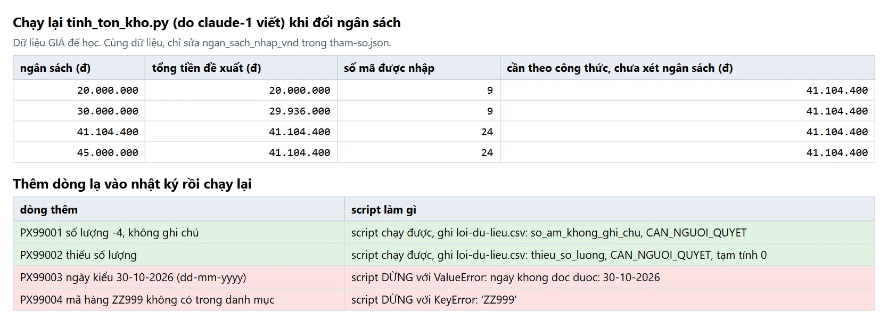

# Bài 3: Đưa vào dùng hằng ngày, hằng tháng

> Dữ liệu GIẢ để học. Nhãn: **[Đo được]** kết quả chạy/thử của chúng tôi 2026-11-20, **[Nguồn]** có link, **[Đề xuất]** ý kiến người viết.

## Mục tiêu đo được

Sau bài này bạn có một **quy trình hằng tháng** 6 bước, trong đó:

1. Phần tính toán chạy bằng **một lệnh**, ra kết quả giống hệt nhau mỗi lần với cùng dữ liệu (chúng tôi đã đo).
2. Mọi con số tiền đều có thể kiểm lại trong 5 phút bằng Excel.
3. Có người duyệt ở đúng chỗ cần: ca không chắc, hàng về muộn, phần bị cắt vì ngân sách.
4. Bạn biết khi nào **không** nên tin đề xuất (và vì sao ở bài này công thức thua mốc ngây thơ).

## Bước 1. Giữ lại cái agent đã làm: script chạy lại được

Ở bài 2, agent không chỉ trả lời, nó **viết ra một chương trình** `tinh_ton_kho.py`. Đó là thứ đáng giữ nhất: lần sau bạn không cần nhờ agent làm lại từ đầu, chỉ cần chạy chương trình. Điều này khớp với nguyên tắc ở đầu bài: **công thức do code tất định tính**, agent chỉ giúp làm sạch và giải thích.

Chúng tôi thử chạy lại script của `claude-1` trên một bản sao dữ liệu, trong thư mục mới:

```bash
mkdir kho-thu-lai
# chép 7 file đầu vào + tinh_ton_kho.py vào đó
cd kho-thu-lai
python -X utf8 tinh_ton_kho.py
```

Giải thích: `python` chạy chương trình, `-X utf8` để tiếng Việt không vỡ, `tinh_ton_kho.py` là tệp agent viết. Chương trình đọc các file CSV trong thư mục hiện tại và ghi ra bốn file CSV cộng `bao-cao.md`.

**[Đo được]** (chạy 2026-11-20): chạy lại với dữ liệu **không đổi** cho kết quả **giống từng byte** ở cả 5 file (`loi-du-lieu.csv`, `phan-loai-tinh-toan.csv`, `de-xuat-nhap.csv`, `giu-lai-do-loi.csv`, `bao-cao.md`), và chạy dưới 1 giây. Đây là điều agent tự chạy lại mỗi lần thì **không** đảm bảo được: hai lượt `agy` cho hai kết quả khác nhau ở khâu phát hiện lỗi (bài 2). Khi tính bằng script thì mọi lần chạy giống nhau; chỗ còn dao động là **lúc viết script**.

## Bước 2. Đổi ngân sách, xem tác động lên dòng tiền

Ngân sách nằm trong `tham-so.json`, trường `ngan_sach_nhap_vnd`. Sửa số đó rồi chạy lại script. **[Đo được]** (script `claude-1`, cùng dữ liệu):



*Ảnh dựng từ `ket-qua/thu-chay-lai.json`, kết quả thử của chúng tôi. Dữ liệu giả để học.*

Đọc bảng: ngân sách 20 triệu và 30 triệu đều chỉ nhập được 9 mã (30 triệu dùng gần hết: 29.936.000 đ). Phải có ít nhất 41.104.400 đ thì mới nhập đủ 24 mã công thức yêu cầu; từ đó trở lên tổng tiền không đổi. Con số 41,1 triệu chính là câu trả lời cho câu hỏi "tháng này cần tối đa bao nhiêu vốn nhập hàng theo công thức". Nếu tiền mặt của bạn thấp hơn, phần cắt là **quyết định của chủ cửa hàng**, không phải của agent. Cả hai agent đều tự chọn một thứ tự ưu tiên (hết hàng, sắp hết, lớp A, ít ngày tồn), và cả hai ghi rõ rằng đó là lựa chọn của agent.

**[Đề xuất]** Khi đọc phần bị cắt, nhìn vào **số ngày tồn còn lại** của từng mã. `claude-1` nêu 10 mã bị cắt mà tồn chỉ đủ bán dưới 30 ngày (khoảng 7,75 triệu đồng). Đó là nhóm bạn phải quyết trước, vì sau 30 ngày chúng sẽ hết.

## Bước 3. Cho Excel đọc kết quả

Chủ cửa hàng thường quen Excel hơn CSV. Chúng tôi viết sẵn `du-lieu/xuat_excel.py` (cần `pip install openpyxl`) gom 4 file CSV thành một file `.xlsx`:

```bash
python -X utf8 xuat_excel.py . bao-cao-nhap-hang.xlsx
```

Giải thích: dấu `.` là thư mục hiện tại chứa các CSV; tham số thứ hai là tên file Excel. File có 4 trang: đề xuất nhập (dòng nào cần người quyết được tô vàng, cuối trang có ô **tổng tiền bằng công thức SUM**, ngân sách và số còn lại), ABC và cảnh báo (hết hàng và sắp hết tô đỏ), giữ lại 2 tháng, lỗi dữ liệu. **[Đo được]** chạy trên kết quả `claude-1` tạo file 4 trang (`ket-qua/claude-1/bao-cao-nhap-hang.xlsx`); chúng tôi **chưa mở bằng Excel thật để xác nhận ô SUM tính ra đúng**, chỉ kiểm bằng code rằng công thức được ghi đúng ô. Hãy mở và xem ô đó khi dùng.

## Bước 4. Quy trình hằng tháng (6 bước)

**[Đề xuất]** cho cửa hàng thật:

1. **Ngày 1 hằng tháng:** xuất nhật ký xuất nhập của tháng vừa qua; kiểm kê hàng thực tế (ít nhất các mã lớp A); nhập đơn đang về.
2. **Làm sạch có người nhìn:** chạy script, mở `loi-du-lieu.csv`. Dòng `CAN_NGUOI_QUYET` phải do người trả lời (số âm là trả hàng hay gõ nhầm, số gấp 10 là bao nhiêu, đơn sỉ có lặp lại không).
3. **Chạy lại sau khi sửa nguồn:** sửa dòng sai **trong nhật ký gốc** (đừng sửa kết quả), rồi chạy lại.
4. **Đọc đề xuất bằng ba câu hỏi:** (a) tổng tiền có vượt ngân sách không; (b) mã hết hoặc sắp hết, **hàng đang về** có kịp không (xem ngày về); (c) mã bị cắt vì ngân sách còn đủ bán bao nhiêu ngày.
5. **Đặt hàng:** người quyết số cuối, ghi lại những chỗ mình sửa so với đề xuất.
6. **Cuối tháng sau:** ghi lại thực tế bán và so với dự báo, để biết công thức đúng tới đâu.

## Bước 5. Tự kiểm: script có đáng tin khi dữ liệu thay đổi không?

Chúng tôi thử "đầu độc" nhật ký bằng 4 dòng lạ rồi chạy lại script `claude-1` **[Đo được]** (xem ảnh ở bước 2):

- Dòng số lượng **âm không ghi chú**: script chạy tiếp, ghi vào `loi-du-lieu.csv` loại `so_am_khong_ghi_chu`, xử lý `CAN_NGUOI_QUYET`, lý do nói rõ "có thể khách trả quên ghi chú, hoặc gõ nhầm dấu".
- Dòng **thiếu số lượng**: script chạy tiếp, `CAN_NGUOI_QUYET`, tạm tính 0 và nói rõ không biết số thật.
- Dòng có **ngày kiểu mới** (`30-10-2026`): script **dừng** với thông báo `ngay khong doc duoc: 30-10-2026`.
- Dòng có **mã hàng không có trong danh mục** (`ZZ999`): script **dừng** với lỗi `KeyError: 'ZZ999'`.

Bài học: script **dừng ồn ào** khi gặp dạng dữ liệu nó chưa biết là tốt hơn im lặng chạy sai, nhưng người dùng không rành code sẽ không biết làm gì khi thấy chữ `KeyError`. **[Đề xuất]** Khi gặp lỗi như vậy, quay lại agent với đúng thông báo lỗi và dòng dữ liệu làm lỗi, nhờ sửa script để (a) đọc thêm kiểu ngày đó, (b) ghi mã lạ vào `loi-du-lieu.csv` thay vì dừng, **rồi chạy lại để kiểm bản cũ vẫn ra kết quả y hệt** (so file với bản trước bằng Excel hoặc lệnh `fc`).

Một giới hạn khác **[Đo được]** đọc từ mã nguồn: script `claude-1` **gắn cứng** cửa sổ 12 tháng 2025-11 đến 2026-10 và vài tên file. Sang tháng 12 bạn không chỉ thay dữ liệu mà còn phải nhờ agent cập nhật script. Chúng tôi **chưa thử** việc này. Cách kiểm hợp lý **[Đề xuất]**: cho script mới chạy lại trên dữ liệu cũ, kết quả phải giống kết quả cũ.

## Bước 6. Kiểm soát rủi ro khi giao dữ liệu thật

1. **Quyền.** `agy` chạy với `--dangerously-skip-permissions` là toàn quyền. Claude Code với `acceptEdits` tự chấp nhận sửa file. Cả hai đều chạy được lệnh trên máy bạn. Trong lần chạy `claude-1` chúng tôi thấy một file tạm được ghi ra ngoài thư mục làm việc dù prompt dặn "chỉ ghi trong thư mục hiện tại" (bài 2). **Lời dặn trong prompt không phải rào chắn.** Dùng thư mục riêng, sao lưu, và nếu có thể thì máy hoặc tài khoản riêng.
2. **Dữ liệu cá nhân.** Nhật ký thật thường có tên khách, số điện thoại trong cột ghi chú. Xóa hoặc thay bằng mã trước khi giao. Log của agent cũng có thể chứa đường dẫn thư mục của máy bạn (chúng tôi đã phải che một đoạn đường dẫn trong log Antigravity trước khi đưa vào bài). Kiểm log trước khi chia sẻ.
3. **Giữ đáp án ngoài thư mục agent.** Bài này có `dap-an.json`; trong cửa hàng thật, "đáp án" là kiểm kê thực tế và quyết định cuối của bạn.

## Giới hạn: khi nào KHÔNG nên tin đề xuất

- **Công thức này thua mốc "bằng tháng trước" ở cả hai tháng giữ lại** (bài 2: WAPE Sep 33,1% so với 30,5%, Oct 38,2% so với 21,7% với `claude-1`). Đây là bằng chứng **đo được trên dữ liệu giả, n nhỏ** rằng với mã có mùa vụ, trung bình 3 tháng phản ứng chậm. Với mã mùa vụ (nước giải khát, hàng Tết, đồ mùa mưa) hãy so với **cùng kỳ năm trước** khi bạn có đủ 24 tháng; trong bài này chỉ làm được cho tháng 2026-11. **[Đề xuất]** Với tháng cận mùa, người duyệt nên nhìn cột `cung_ky_nam_truoc_2025_11`; ví dụ báo cáo `claude-0` chỉ ra mã nước ngọt có dự báo cao hơn hẳn năm trước.
- **Mã mới ít tháng dữ liệu:** độ lệch chuẩn chỉ là giả định (0,5 × dự báo), kết quả kém chắc chắn (MP010 chỉ có 2 tháng).
- **Thời gian giao cố định** là giả định. Nhà cung cấp trễ thì tồn an toàn thật không đủ (công thức biến thể có xét độ lệch thời gian giao tồn tại, xem Shopify <https://www.shopify.com/blog/safety-stock>, nhưng bài này không dùng).
- **Hàng đang về với ngày về sau tháng đề xuất** (như MP002) bị công thức trừ như thể đã tới. Người duyệt phải nhìn thấy.
- **Hạn sử dụng, chi phí đặt hàng, ưu đãi theo số lượng** chưa được xét.
- **n nhỏ:** 1 lần chạy có log mỗi agent; chưa đo độ ổn định giữa các lần viết script.
- Ngưỡng ABC 80/95, mức phục vụ 95%, ngưỡng tồn lâu 120 ngày là **tham số đề xuất** của chúng tôi, không phải quy định. Cần kiểm với kế toán nếu liên quan đến sổ sách.

## Mở rộng [Đề xuất]

1. **Hệ số mùa vụ** khi có 24 tháng dữ liệu: dự báo = trung bình gần đây × hệ số mùa của tháng cần dự báo. Phải đo lại bằng hold-out; **không** thêm khi chưa đo.
2. **Thời gian giao thay đổi:** thêm độ lệch chuẩn thời gian giao vào tồn an toàn.
3. **Nhiều nhà cung cấp:** gộp đơn theo nhà cung cấp để đạt mức giao hàng tối thiểu.
4. **Hạn sử dụng:** thêm cột ngày hết hạn cho sữa, trứng, mỹ phẩm và cảnh báo hàng cận hạn.
5. **Báo cáo gửi tự động:** đặt lịch chạy script cuối tháng và gửi file Excel cho chủ cửa hàng; vẫn phải có người duyệt trước khi đặt hàng.

## Checklist

- [ ] Có script chạy lại được bằng một lệnh và tôi đã thử chạy lần hai (kết quả giống nhau).
- [ ] Tôi biết tổng tiền cần theo công thức, ngân sách của tôi, và phần bị cắt là mã nào.
- [ ] Tôi đã nhìn ngày về của hàng đang về, nhất là mã đang hết hàng.
- [ ] Mọi dòng `CAN_NGUOI_QUYET` đã được người trả lời và sửa ở nhật ký gốc.
- [ ] Tôi đã so với cùng kỳ năm trước cho mã có mùa vụ (khi có dữ liệu).
- [ ] Tôi đã che dữ liệu cá nhân trước khi giao cho agent và kiểm log trước khi chia sẻ.

## Việc cần người làm

- Duyệt số cuối cùng và chịu trách nhiệm đặt hàng; đề xuất của agent hoặc script chỉ là tham khảo.
- Quyết ngân sách, thứ tự ưu tiên khi bị cắt, mức phục vụ.
- Xác nhận ngày về của hàng đang về với nhà cung cấp.
- Ghi lại thực tế bán để lần sau đo lại công thức.

## Giới hạn của chính bài này

Dữ liệu giả; một cửa hàng giả với mùa vụ do chúng tôi đặt; mỗi agent 1 lần chạy có log; chưa thử cập nhật script sang tháng mới; chưa mở file Excel xuất ra trong Excel thật. Chưa có đánh giá nào về việc agent này hay agent kia "tốt hơn".
