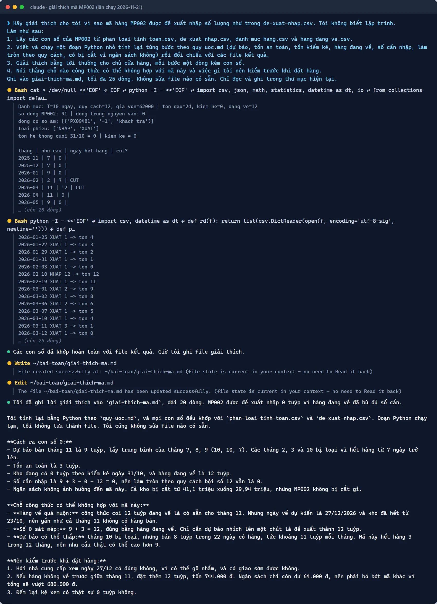
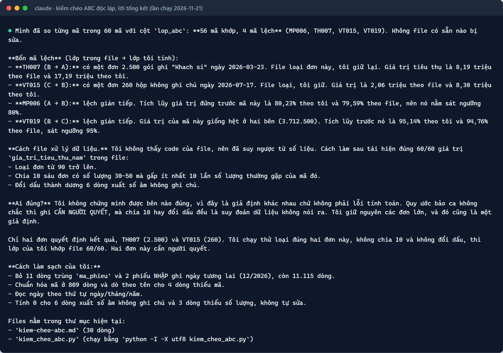

# Bài 4. Prompt mẫu và bài tập tự làm

!!! info "Bài này"
    - **Bạn làm gì:** lấy bộ 8 prompt dùng lại được cho bài toán tồn kho, xem kết quả thật của 5 prompt chúng tôi đã chạy, rồi tự làm 3 bài tập có tiêu chí kiểm bằng code.
    - **Mất bao lâu:** đọc bộ prompt khoảng 20 phút; mỗi bài tập 20 đến 40 phút.
    - **Cần có:** thư mục `kho-lan-1` và `kho-thu-lai` từ bài 1 và 3 (có `tinh_ton_kho.py`), Python 3, một coding agent ([Bắt đầu với coding agent](../th-bat-dau-voi-coding-agent/00-README.md)).
    - **Kết quả:** bạn biết nhờ agent giải thích, kiểm chéo, thử kịch bản và tóm tắt cho chủ cửa hàng; biết agent hay sai ở đâu; tự đo lại được kết luận "công thức thua mốc ngây thơ".

> Dữ liệu GIẢ để học. Các prompt 2 đến 6 chúng tôi **chạy thật bằng Claude Code ngày 2026-11-21, n = 1 lần mỗi prompt**, trong thư mục riêng chứa dữ liệu và kết quả của `claude-1` (không có đáp án). Log nằm ở `logs/bai4-*.json`. Một lần chạy chưa nói lên độ ổn định: lần của bạn có thể khác. Số liệu nào chúng tôi tự kiểm lại bằng code thì ghi **[Đo được]**; điều agent nói mà chưa kiểm thì ghi "agent nói".

## Bộ prompt dùng lại được

Dán vào agent đã mở trong thư mục chứa dữ liệu và kết quả (xem bài 1 để mở agent). Với prompt 2 đến 6, thư mục cần có các file kết quả của bài 2.

### Prompt 1. Giao việc chính (bản rút gọn)

**Dùng khi nào:** bạn đã có dữ liệu ẩn danh của riêng mình và muốn bắt đầu nhanh. Bản nguyên văn, có tên cột đầy đủ để chấm bằng code, nằm ở bài 1.

```prompt
Bạn là trợ lý kho cho một cửa hàng nhỏ. Thư mục này có nhật ký xuất nhập, danh mục hàng, tồn đầu kỳ, tồn kiểm kê, hàng đang về, tham-so.json và quy-uoc.md (công thức của người chủ, không được đổi).
Hãy viết tinh_ton_kho.py, chạy nó, và tạo: loi-du-lieu.csv (lỗi nhập liệu và cách xử lý), phan-loai-tinh-toan.csv (ABC, dự báo, tồn an toàn, điểm đặt lại, cảnh báo của từng mã), de-xuat-nhap.csv (số lượng đề xuất, thành tiền, ưu tiên, can_nguoi_quyet) và bao-cao.md cho chủ cửa hàng.
Mọi phép tính do code làm. Tổng tiền không vượt ngân sách trong tham-so.json; phần bị cắt phải nói rõ. Ca không chắc ghi CẦN NGƯỜI QUYẾT, không bịa. Không giấu kết quả xấu. Chỉ đọc và ghi trong thư mục hiện tại.
```

**Bạn sẽ thấy:** đủ 5 file và `tinh_ton_kho.py`, nhưng tên cột có thể khác bản bài 1. **Chưa chạy thử** (bản rút gọn là prompt mới).

### Prompt 2. Giải thích script bằng lời thường

**Dùng khi nào:** agent vừa viết xong một script dài mà bạn không đọc được, và bạn sắp dựa vào nó để đặt hàng.

```prompt
Trong thư mục này có tinh_ton_kho.py, một script tính tồn kho do một agent khác viết cho cửa hàng của tôi. Tôi không biết lập trình.
Hãy đọc script (không sửa, không chạy) rồi giải thích bằng tiếng Việt thường, ghi vào giai-thich-script.md, tối đa 40 dòng:
1. Script đọc những file nào và ghi ra những file nào.
2. Các bước nó làm theo thứ tự (tối đa 8 bước, mỗi bước 1-2 câu).
3. Những chỗ nó tự quyết mà quy-uoc.md không quy định.
4. Những tình huống nó sẽ dừng hoặc tính sai nếu dữ liệu đổi dạng (ví dụ ngày kiểu mới, mã hàng lạ, sang tháng mới), nêu rõ phần nào của script gây ra.
Không dùng thuật ngữ lập trình; nếu buộc phải dùng thì giải nghĩa trong ngoặc. Chỉ nói những gì bạn thấy trong script; chỗ nào chưa chắc thì ghi "chưa chắc".
Chỉ đọc và ghi trong thư mục hiện tại.
```

**Bạn sẽ thấy:** một file giải thích dưới 40 dòng. **Đã chạy thật** (2026-11-21, n=1, 134 giây, 951 dòng script đã đọc). Trích, rút gọn (bỏ bớt dòng và đoạn, giữ nguyên chữ của phần còn lại):

```ketqua
- File quy-uoc.md chỉ được nhắc trong ghi chú đầu script, script KHÔNG mở nó: các công thức đã được gõ sẵn trong script.
- Thiếu số lượng thì tính 0. Số âm không ghi chú thì tính là bán số dương.
- Thứ tự ưu tiên khi cắt ngân sách: hết hàng > sắp hết > còn lại; rồi hạng A > B > C; rồi mã ít ngày tồn hơn trước.
- hàng đang về bị trừ hết, kể cả hàng về sau tháng 11
- DỪNG, ngày lạ: phần đọc ngày (dòng 102-114) chỉ biết yyyy-mm-dd, d/m/yyyy, d/m/yy.
- SAI KHÔNG BÁO, mã hàng lạ (không có trong danh mục): dòng đó bị bỏ qua khi tính tồn và nhu cầu
- SAI/DỪNG khi sang tháng mới: ngày bắt đầu (dòng 45), danh sách 12 tháng (dòng 50-57), tên file tồn đầu/kiểm kê (dòng 91-92) và chữ "2026-11" trong báo cáo đều viết cứng.
- Trong tham-so.json, muc_phuc_vu không được đọc [...]; chỉ z_tuong_ung có tác dụng.
- Chưa chắc: tôi chỉ đọc script, chưa mở file dữ liệu nên không biết dữ liệu hiện tại có rơi vào các trường hợp trên không.
```

Chúng tôi kiểm lại bằng cách mở mã nguồn và chạy thử **[Đo được]**:

| Agent nói | Kiểm lại |
|---|---|
| Script không mở `quy-uoc.md`; `muc_phuc_vu` không được đọc | **Đúng** (tìm trong mã nguồn). Đây là điều người dùng dễ không ngờ: sửa mức phục vụ ở `tham-so.json` không đổi gì, phải sửa `z_tuong_ung` |
| Ngày bắt đầu và 12 tháng viết cứng | **Đúng** (dòng 45 và 50-57) |
| Mã hàng lạ "bị bỏ qua, không báo" | **Sai ở chi tiết.** Thêm một dòng nhật ký mã `ZZ999`, script **dừng** với `KeyError: 'ZZ999'` ở dòng 646. Ý chính "xử lý mã lạ không tốt" đúng, nhưng chi tiết "im lặng" thì sai |

Bài học: giải thích của agent hữu ích để biết **đâu là chỗ cần thử**, nhưng từng khẳng định cụ thể vẫn phải kiểm. Ghi chú: agent nhận xét "chưa có `bao-cao.md` trong thư mục" vì chúng tôi cố ý bỏ file đó khỏi thư mục thử.

### Prompt 3. Giải thích vì sao một mã được đề xuất nhập số lượng đó

**Dùng khi nào:** một con số trong `de-xuat-nhap.csv` làm bạn ngạc nhiên (đề xuất 0 cho mã đang hết hàng, hoặc đề xuất rất lớn). Thay `MP002` bằng mã của bạn.

```prompt
Hãy giải thích cho tôi vì sao mã hàng MP002 được đề xuất nhập số lượng như trong de-xuat-nhap.csv. Tôi không biết lập trình.
Làm như sau:
1. Lấy các con số của MP002 từ phan-loai-tinh-toan.csv, de-xuat-nhap.csv, danh-muc-hang.csv và hang-dang-ve.csv.
2. Viết và chạy một đoạn Python nhỏ tính lại từng bước theo quy-uoc.md (dự báo, tồn an toàn, tồn kiểm kê, hàng đang về, số cần nhập, làm tròn theo quy cách, có bị cắt vì ngân sách không) rồi đối chiếu với các file kết quả.
3. Giải thích bằng lời thường cho chủ cửa hàng, mỗi bước một dòng kèm con số.
4. Nói thẳng chỗ nào công thức có thể không hợp với mã này và việc gì tôi nên kiểm trước khi đặt hàng.
Ghi vào giai-thich-ma.md, tối đa 25 dòng. Không sửa file nào có sẵn. Chỉ đọc và ghi trong thư mục hiện tại.
```

**Bạn sẽ thấy:** từng bước có số, rồi phần "chỗ công thức có thể không hợp". **Đã chạy thật** (2026-11-21, n=1, 107 giây). Agent tính lại bằng Python, báo "mọi con số đều khớp" với hai file kết quả, và **tự nêu** chuyện hàng về ngày 27/12 dù prompt không nhắc:



*Dựng lại từ log thật của lần chạy ngày 2026-11-21, không phải ảnh chụp trực tiếp cửa sổ terminal. Dữ liệu giả.*

```ketqua
5. Tồn an toàn = 1,645 × 2,25 × √(10/30) = 2,14 → làm tròn lên 3 tuýp (nhà cung cấp giao trong 10 ngày).
6. Tồn kiểm kê 31/10 = 0 (khớp tồn hệ thống: hết hàng từ 23/10).
7. Hàng đang về = 12 tuýp (dự kiến 27/12/2026).
8. Số cần nhập = 9 + 3 − 0 − 12 = 0 → làm tròn theo quy cách (bội số 12) vẫn là 0.
- Công thức coi 12 tuýp đang về là "có sẵn" cho tháng 11, nhưng hàng dự kiến về 27/12, tức là cả tháng 11 gần như không có hàng để bán.
- Nếu không về trước giữa tháng 11: đặt thêm 12 tuýp (744.000 đ). Ngân sách hiện còn dư 64.000 đ nên phải bỏ bớt mã khác, vì tổng sẽ vượt 680.000 đ.
```

**[Đo được]** Chúng tôi kiểm các số này: dự báo 9, tồn an toàn 3, kiểm kê 0, hàng về 12 khớp `phan-loai-tinh-toan.csv`; các tháng cụt hàng của MP002 là 2026-02, 2026-03, 2026-10 (7, 12 và 9 ngày hết hàng) khớp lời agent; 12 × 62.000 = 744.000 đ; 30.000.000 − 29.936.000 = 64.000 đ.

### Prompt 4. Đổi mức phục vụ hoặc thời gian giao rồi chạy lại

**Dùng khi nào:** bạn muốn biết "nếu nhà cung cấp trễ thêm 3 ngày, hoặc muốn ít hết hàng hơn, thì tốn thêm bao nhiêu vốn". Phép tính chạy bằng script cũ, agent chỉ đổi tham số và so sánh.

```prompt
Chép toàn bộ file trong thư mục này sang thư mục con thu-nghiem. Mọi thay đổi chỉ làm trong thu-nghiem, không sửa file gốc.
Chạy tinh_ton_kho.py cho ba kịch bản, mỗi kịch bản trong một thư mục riêng và bắt đầu từ dữ liệu gốc:
A. Giữ nguyên (để đối chiếu).
B. Mức phục vụ 99%: đổi z_tuong_ung thành 2.326 trong tham-so.json.
C. Mọi nhà cung cấp giao chậm hơn 3 ngày: cộng 3 vào cột thoi_gian_giao_ngay trong danh-muc-hang.csv, mức phục vụ vẫn 95%.
Với mỗi kịch bản ghi lại bằng code: tổng tiền cần nhập khi chưa xét ngân sách, số mã cần nhập, 3 mã tăng nhiều nhất so với A (theo số lượng cần nhập).
Ghi bảng so sánh và 3 câu nhận xét cho chủ cửa hàng vào so-sanh.md (tối đa 20 dòng). Mọi con số lấy từ file kết quả, không tính nhẩm. Nếu một kịch bản làm script báo lỗi, ghi rõ lỗi và đừng đoán kết quả.
Chỉ đọc và ghi trong thư mục hiện tại.
```

**Bạn sẽ thấy:** một bảng 3 dòng. **Đã chạy thật** (2026-11-21, n=1, 87 giây, cả ba kịch bản chạy không lỗi). Trích:

```ketqua
| Kịch bản | Tổng tiền cần nhập (chưa xét ngân sách) | Số mã cần nhập |
| A. Giữ nguyên (Z=1,645) | 41.104.400 đ | 24 |
| B. Phục vụ 99% (Z=2,326) | 46.462.000 đ | 28 |
| C. Giao chậm +3 ngày (Z=1,645) | 43.201.200 đ | 25 |
```

**[Đo được]** Chúng tôi tự chạy lại hai kịch bản B và C bằng script riêng: tổng tiền 46.462.000 đ (28 mã) và 43.201.200 đ (25 mã), khớp bảng; mã tăng nhiều nhất ở cả hai là TH008 (nước ngọt, +96 và +72) rồi TH009. Lưu ý: B đổi `z_tuong_ung`, còn `muc_phuc_vu` trong file vẫn ghi 0,95 vì script không đọc nó.

### Prompt 5. Kiểm chéo bằng cách độc lập

**Dùng khi nào:** bạn muốn biết một cột trong kết quả (ở đây là phân loại ABC) có đáng tin không, mà không chỉ nhờ chính script đó kiểm lại chính nó.

Điểm mấu chốt: thư mục thử **không có script**, nên agent không thể chép lại cách tính. Bạn chỉ để lại dữ liệu gốc và file kết quả cần kiểm.

```prompt
File phan-loai-tinh-toan.csv trong thư mục này là kết quả của một script khác. Hãy kiểm chéo cột lop_abc bằng cách ĐỘC LẬP: không có script nào sẵn, bạn tự làm sạch nhật ký và tự tính lại phân loại ABC theo mục 8 của quy-uoc.md bằng code Python của riêng bạn. Tự xử lý ngày viết lẫn lộn, mã hàng viết sai, dòng trùng, số âm có ghi chú khách trả; hủy hàng và xuất dùng nội bộ không tính vào nhu cầu.
Rồi so với cột lop_abc trong file: bao nhiêu mã khớp, mã nào lệch, và với mỗi mã lệch nói vì sao (cách làm sạch khác nhau hay sai ở bên nào).
Ghi kết quả vào kiem-cheo-abc.md (tối đa 30 dòng) và code vào kiem_cheo_abc.py. Không sửa file có sẵn. Không ghi "khớp" nếu chưa so từng mã. Chỉ đọc và ghi trong thư mục hiện tại.
```

**Bạn sẽ thấy:** số mã khớp, danh sách mã lệch và lý do. **Đã chạy thật** (2026-11-21, n=1, 204 giây, 26 lượt). Kết quả: **56 mã khớp, 4 mã lệch** (MP006, TH007, VT015, VT019).



*Dựng lại từ log thật của lần chạy ngày 2026-11-21, không phải ảnh chụp trực tiếp cửa sổ terminal. Dữ liệu giả.*

```ketqua
TH007 (B → A): có một đơn 2.500 gói ghi "Khach si" ngày 2026-03-23. File loại đơn này, tôi giữ lại. Giá trị tiêu thụ là 8,19 triệu theo file và 17,19 triệu theo tôi.
VT015 (C → B): có một đơn 260 hộp không ghi chú ngày 2026-07-17. File loại, tôi giữ. [...]
MP006 (A → B): lệch gián tiếp. Tích lũy giá trị đứng trước mã này là 80,23% theo tôi và 79,59% theo file, nên nó nằm sát ngưỡng 80%.
VT019 (B → C): lệch gián tiếp. [...] Tích lũy trước nó là 95,14% theo tôi và 94,76% theo file, sát ngưỡng 95%.
Ai đúng? Tôi không chứng minh được bên nào đúng, vì đây là giả định khác nhau chứ không phải lỗi tính toán.
```

**[Đo được]** Chúng tôi chạy lại `kiem_cheo_abc.py` do agent viết và ra đúng 56 khớp, 4 lệch. Thêm: đáp án của chúng tôi (bài 2) khớp cột `lop_abc` của `claude-1` 60/60, tức đáp án cũng loại các đơn lớn khỏi nhu cầu. Vậy "lệch" ở đây là **do quy ước về đơn sỉ**, không phải ai tính nhầm. Đúng tinh thần CẦN NGƯỜI QUYẾT: chỉ hai đơn (TH007 và VT015) quyết định lớp của 4 mã, chủ cửa hàng phải trả lời đó là đơn sỉ thật hay gõ nhầm.

### Prompt 6. Tóm tắt cho chủ về tiền vốn cần bỏ ra

**Dùng khi nào:** bạn cần đưa kết quả cho người không đọc CSV (chủ cửa hàng, kế toán) trong một trang.

```prompt
Viết bản tóm tắt cho chủ cửa hàng (không biết lập trình), tối đa một trang, vào tom-tat-chu.md, từ kết quả có sẵn trong thư mục này:
1. Tháng 2026-11 theo công thức cần bao nhiêu tiền vốn nhập hàng; ngân sách trong tham-so.json có đủ không, thiếu bao nhiêu.
2. Phần bị cắt vì ngân sách: bao nhiêu mã, tổng trị giá, và những mã bị cắt mà tồn kho chỉ đủ bán dưới 30 ngày (nêu tên hàng, không chỉ mã).
3. Mọi mã đang hết hoặc sắp hết hàng, kèm ngày hàng đang về nếu có.
4. Ba việc chủ cửa hàng phải tự quyết.
5. Điều bạn không chắc.
Mọi con số phải tính bằng code từ các file CSV, ghi tên file nguồn bên cạnh. Viết ngắn, câu đơn giản, không dùng thuật ngữ kho vận; nếu cần thì giải nghĩa. Không sửa file có sẵn. Chỉ đọc và ghi trong thư mục hiện tại.
```

**Bạn sẽ thấy:** một trang có tiêu đề rõ, bảng mã bị cắt, ba việc cần quyết. **Đã chạy thật** (2026-11-21, n=1, 152 giây). Trích, rút gọn (bỏ định dạng đậm và bớt dòng):

```ketqua
1. Tiền vốn có đủ không?
Không đủ. Theo công thức, tháng 11 cần 41.104.400 đ để nhập hàng (de-xuat-nhap.csv). Ngân sách là 30.000.000 đ (tham-so.json). Thiếu 11.104.400 đ.
2. Phần bị cắt vì hết tiền
- 16 mặt hàng bị cắt, tổng 11.168.400 đ (de-xuat-nhap.csv).
- 10 mặt hàng bị cắt mà hàng còn đủ bán dưới 30 ngày [...]. Cắt tổng 7.754.400 đ.
Đã hết (2): [...] Sữa rửa mặt tuýp 100g (MP002): về 12 tuýp ngày 27/12, muộn 57 ngày (hang-dang-ve.csv).
```

**[Đo được]** Chúng tôi kiểm lại: 41.104.400 đ, 16 mã bị cắt, 11.168.400 đ, và 10 mã tồn dưới 30 ngày trị giá 7.754.400 đ đều khớp tính từ `de-xuat-nhap.csv` và `phan-loai-tinh-toan.csv`. Điểm đáng khen: agent tự ghi "chưa tính lại từ 11.128 dòng nhật ký" thay vì giả vờ đã kiểm. Điều cần người đọc kỹ: phần "thứ tự cắt là do chương trình chọn, quy ước không quy định" nằm ở mục **điều không chắc**, cuối trang.

### Prompt 7. Sửa script khi định dạng dữ liệu đổi

**Dùng khi nào:** script dừng với thông báo lỗi sau khi bạn thêm dữ liệu mới. Thay phần trong ngoặc vuông bằng thông báo lỗi và dòng dữ liệu làm lỗi của bạn.

```prompt
Script tinh_ton_kho.py báo lỗi khi tôi thêm dữ liệu mới. Thông báo lỗi: [dán nguyên văn thông báo lỗi]. Dòng dữ liệu gây lỗi: [dán dòng đó từ nhat-ky-xuat-nhap.csv].
Hãy sửa script để (a) đọc được kiểu dữ liệu này, hoặc (b) nếu không chắc cách hiểu, ghi dòng đó vào loi-du-lieu.csv với xu_ly = CAN_NGUOI_QUYET thay vì dừng. Không đổi công thức trong quy-uoc.md. Sau khi sửa, chạy lại trên dữ liệu cũ và chứng minh bằng so sánh file rằng de-xuat-nhap.csv và phan-loai-tinh-toan.csv giống hệt bản trước khi sửa. Ghi những gì đã đổi vào nhat-ky-sua-script.md.
```

**Bạn sẽ thấy:** script chạy tiếp được, dòng lạ nằm trong `loi-du-lieu.csv`, hai file kết quả cũ không đổi. **Chưa chạy thử.** Hai thông báo lỗi thật chúng tôi đo được ở bài 3: `ngay khong doc duoc: 30-10-2026` và `KeyError: 'ZZ999'`.

### Prompt 8. Hỏi "chỗ nào bạn không chắc"

**Dùng khi nào:** ngay trước khi bạn đặt hàng, sau khi agent báo xong. Agent thường nói tự tin hơn mức nó có căn cứ.

```prompt
Trước khi tôi đặt hàng theo de-xuat-nhap.csv, hãy liệt kê tối đa 10 chỗ bạn không chắc hoặc giả định, xếp theo mức ảnh hưởng đến số tiền tôi sẽ bỏ ra. Với mỗi chỗ nói: bạn đã giả định gì, vì sao, dữ liệu nào sẽ cho biết giả định đó đúng hay sai, và mã hàng nào bị ảnh hưởng. Đừng nói chung chung kiểu "dữ liệu có thể có lỗi"; nêu mã hàng và con số. Chỉ đọc, không sửa file.
```

**Bạn sẽ thấy:** danh sách có mã hàng và số cụ thể; nếu chỉ là các câu chung chung thì yêu cầu lại. **Chưa chạy thử.**

## Ba bài tập tự làm

Làm lần lượt trong thư mục `kho-thu-lai` (bài 3), nơi có `tinh_ton_kho.py` chạy được. Các lệnh dưới đây chúng tôi đã chạy trên PowerShell; với macOS hoặc Linux dùng `python3` và dấu `/`.

### Bài tập 1. Đổi ngân sách và xem mã nào bị cắt

**Đề.** Đặt ngân sách 15.000.000 đ rồi chạy lại. Trả lời: tổng đề xuất bao nhiêu, mấy mã được nhập, mã nào bị cắt nhiều tiền nhất, và **có mã nào lớp A mà bị cắt gần hết không**.

**Dữ liệu dùng.** `kho-thu-lai` và bộ kiểm `du-lieu/kiem_ngan_sach.py` (tính lại tổng từ `sl_de_xuat × đơn giá`, liệt kê mã bị cắt).

```lenh
cd kho-thu-lai
python -X utf8 -c "import json;p=json.load(open('tham-so.json',encoding='utf-8'));p['ngan_sach_nhap_vnd']=15000000;json.dump(p,open('tham-so.json','w',encoding='utf-8'),ensure_ascii=False,indent=2)"
python -X utf8 tinh_ton_kho.py
python -X utf8 ..\du-lieu\kiem_ngan_sach.py . 15000000
```

Dòng thứ hai đổi ngân sách trong `tham-so.json`. Làm xong, đặt lại 30000000 bằng cách đổi số trong dòng đó.

**Tiêu chí đạt** **[Đo được]**, với script của `claude-1` (script do agent của bạn viết có thể chọn thứ tự cắt khác; khi đó chỉ ba dòng đầu của đầu ra là bắt buộc):

```ketqua
Ngan sach: 15,000,000 | tong de xuat (tinh lai): 14,955,200 | khong vuot: True
Cong thuc can (chua xet ngan sach): 41,104,400
thanh_tien sai: khong | khong la boi so quy cach: khong
So ma duoc nhap: 9 | so ma bi cat: 18 | tien bi cat: 26,149,200
  cat TH001: can 128, de xuat 4, bi cat 11,408,000
  cat MP001: can 24, de xuat 0, bi cat 3,072,000
  cat TH008: can 360, de xuat 0, bi cat 2,700,000
```

**Gợi ý.** Gạo (TH001, lớp A, tồn chỉ đủ bán khoảng 22 ngày) chỉ được nhập 4 trên 128 túi, trong khi các mã rẻ hơn được cấp trước. Đó là hệ quả của **thứ tự ưu tiên agent tự chọn**, không phải của công thức: chủ cửa hàng có thể muốn ưu tiên khác. Thử ngân sách 20.000.000 và 10.000.000 để thấy mã nào lên xuống.

### Bài tập 2. Thêm một mã hàng bán theo mùa

**Đề.** Thêm "Bánh trung thu hộp 4 bánh" (mã TH025): gần như không bán suốt năm, bán rộ tháng 8 và 9, tháng 10 sụt xuống. Chạy script, xem nó đề xuất nhập bao nhiêu hộp cho tháng 11, rồi nhờ agent thêm quy tắc để mã này **không được nhập tự động** mà đẩy sang người quyết kèm lý do đúng.

**Dữ liệu dùng.** Sinh bằng `du-lieu/them_hang_mua_vu.py` (hạt giống cố định, chạy lại ra y hệt): TH025 bán 0 đến 3 hộp mỗi tháng từ 2025-11 đến 2026-07, rồi 70 hộp (tháng 8), 240 (tháng 9), 12 (tháng 10); tồn kiểm kê cuối kỳ 59 hộp.

```lenh
cd ..
python -X utf8 du-lieu\them_hang_mua_vu.py sinh kho-lan-1 bai-tap-2
copy kho-thu-lai\tinh_ton_kho.py bai-tap-2\
cd bai-tap-2
python -X utf8 tinh_ton_kho.py
python -X utf8 ..\du-lieu\them_hang_mua_vu.py kiem .
```

Lệnh `sinh` chép 7 file dữ liệu từ `kho-lan-1` sang `bai-tap-2` và thêm mã TH025; lệnh `kiem` in dòng của TH025 và chấm tiêu chí. Với script gốc **[Đo được]**:

```ketqua
TH025: lop ABC A | du bao thang 11 = 107.3 hop | cung ky nam truoc (2025-11) = 1 hop
  ton kiem ke 59 | canh bao SAP_HET | can (chua xet ngan sach) 114 hop | de xuat 114 hop = 10260000 dong
  can nguoi quyet: CO | ly do: SAP_HET (ton <= diem dat lai); ABC=A; F=107.3, SS=64, ton kiem ke=59, dang ve=0, can=112.3; co ghi nhan can nguoi quyet: so_luong_bat_thuong
  Du bao gap 107 lan cung ky nam truoc
  Tieu chi dat (can_nguoi_quyet = CO VA ly do nhac mua vu / cung ky nam truoc): CHUA DAT
```

**Tiêu chí đạt.** Chạy lại `kiem` sau khi sửa script, dòng cuối phải là `DAT`. Chạy thêm `python -X utf8 ..\du-lieu\kiem_ngan_sach.py . 30000000`: vẫn phải `khong vuot: True`.

**Gợi ý.** Script gốc cho mã bánh này `can_nguoi_quyet = CO` nhưng vì **lý do sai** (nó coi 4 phiếu bán dồn mùa Trung thu là "số lượng bất thường"); không có chỗ nào nhắc đến mùa vụ. Nó đề xuất nhập 114 hộp (10,26 triệu đồng, gần một phần ba ngân sách) cho một mã mà cùng kỳ năm trước chỉ bán 1 hộp, và gạo từ 124 túi tụt còn 12 **[Đo được]**. Dùng prompt "Khi thêm một quy tắc" ở bài 3. Chúng tôi đã chạy prompt đó một lần trên chính dữ liệu bài tập này (xem bài 3): bộ kiểm báo `DAT`, ngân sách vẫn không bị vượt.

### Bài tập 3. Đo lại trên hai tháng giữ lại khác

**Đề.** Ở bài 2, công thức thua mốc "bằng tháng trước" ở 2026-09 và 2026-10. Đo lại trên **2026-07 và 2026-08**. Công thức còn thua không?

**Dữ liệu dùng.** `kho-thu-lai` (sao ra `bai-tap-3`) và bộ đo `du-lieu/do_giu_lai.py` (chỉ đọc `giu-lai-do-loi.csv`, không dùng đáp án, không dùng agent).

```lenh
cd ..
mkdir bai-tap-3
copy kho-thu-lai\*.csv, kho-thu-lai\tham-so.json, kho-thu-lai\quy-uoc.md, kho-thu-lai\tinh_ton_kho.py bai-tap-3\
cd bai-tap-3
python -X utf8 -c "import json;p=json.load(open('tham-so.json',encoding='utf-8'));p['thang_giu_lai_do_loi']=['2026-07','2026-08'];json.dump(p,open('tham-so.json','w',encoding='utf-8'),ensure_ascii=False,indent=2)"
python -X utf8 tinh_ton_kho.py
python -X utf8 ..\du-lieu\do_giu_lai.py .
```

!!! stuck "Script báo lỗi `TypeError: unsupported format string passed to NoneType` ở cuối?"
    **[Đo được]** Bình thường với script của `claude-1`: phần viết báo cáo gắn cứng nhãn "2026-09" và "2026-10" nên dừng khi bạn đổi tháng. Nhưng `giu-lai-do-loi.csv` đã được ghi **trước** chỗ lỗi, nên bước `do_giu_lai.py` vẫn chạy được. Muốn báo cáo cũng chạy, nhờ agent sửa chỗ đó (prompt 7).

**Tiêu chí đạt** **[Đo được]** (đầu ra của `do_giu_lai.py`):

```ketqua
thang       n  WAPE cong thuc  WAPE moc thang truoc   MAE ct  MAE moc  ket luan
2026-07    53           25.5%                 19.1%     17.9     13.4  cong thuc THUA moc
2026-08    55           17.3%                 28.3%     11.2     18.2  cong thuc THANG moc
gop       108           21.5%                 23.5%     14.5     15.8  cong thuc THANG moc
```

**Gợi ý.** Làm tương tự với các cặp khác. Chúng tôi đã chạy cả 8 tháng (03 đến 10), mỗi tháng tính khi có ít nhất 3 tháng hợp lệ trước đó **[Đo được]**, WAPE công thức / mốc tháng trước:

| Tháng | 03 | 04 | 05 | 06 | 07 | 08 | 09 | 10 |
|---|---|---|---|---|---|---|---|---|
| Công thức | 25,7% | 37,3% | 28,9% | 28,1% | 25,5% | 17,3% | 33,3% | 38,5% |
| Mốc tháng trước | 31,9% | 139,2% | 45,3% | 26,1% | 19,1% | 28,3% | 30,7% | 21,8% |
| Ai thắng | công thức | công thức | công thức | mốc | mốc | công thức | mốc | mốc |

Công thức thắng 4 tháng, thua 4 tháng. Kết luận "công thức thua mốc ngây thơ" của bài 2 **chỉ đúng với hai tháng cuối** của dữ liệu giả này, không phải quy luật chung. Số ở đây lệch chút so với bài 2 (ví dụ 33,3% so với 33,1%) vì bài 2 chấm lại so với số bán thật của đáp án, còn bộ đo này dùng nhu cầu đã làm sạch do chính script tính.

## Dùng với dữ liệu thật của bạn

**Checklist ẩn danh trước khi giao agent** (làm trên bản sao):

- [ ] Cột ghi chú của nhật ký: xóa hoặc thay bằng mã nếu có tên khách, số điện thoại, địa chỉ.
- [ ] Danh mục: tên nhà cung cấp thay bằng mã nếu bạn không muốn lộ.
- [ ] Chỉ chép các cột cần thiết, bỏ cột giá bán nếu không dùng.
- [ ] Thư mục riêng, sao lưu, không để đáp án hay file nhạy cảm cạnh đó.
- [ ] Kiểm log trước khi chia sẻ: log có thể chứa đường dẫn máy bạn.

Dữ liệu cá nhân của khách: xem [An toàn dữ liệu và pháp lý ở Việt Nam](../an-toan-du-lieu-va-phap-ly-vn.md); chúng tôi không tự viết điều luật.

| Tình huống | Gợi ý **[Đề xuất]** |
|---|---|
| Dữ liệu giả hoặc đã ẩn danh hoàn toàn | Dùng được agent chạy trên đám mây |
| Có tên khách, điện thoại trong ghi chú | Xóa trước; chưa xóa được thì không gửi lên dịch vụ đám mây |
| Cần giữ nguyên dữ liệu và công ty có quy định riêng | Hỏi người phụ trách trước; chưa kiểm quy định của công ty bạn |
| Dùng script đã viết xong, chỉ chạy lại hằng tháng | Không cần agent; chạy script trên máy bạn |

**Ai duyệt?** Người chủ cửa hàng (hoặc người chịu trách nhiệm tiền vốn) duyệt số cuối và ngân sách; người nhập nhật ký trả lời các ca CẦN NGƯỜI QUYẾT; agent không duyệt gì.

## Hỏi nhanh

**Prompt chạy ra khác lần trước, có sao không?** Bình thường. Mỗi prompt ở trên chúng tôi chỉ chạy 1 lần. Nếu số liệu quan trọng, tính bằng script và cho agent chỉ giải thích.

**Agent nói "đã kiểm" thì tin được chưa?** Chưa. Ở prompt 2, một chi tiết agent nói (mã lạ bị bỏ qua) hóa ra sai khi chạy thử. Hãy kiểm hai ba con số then chốt bằng Excel hoặc một lệnh riêng.

**Vì sao đổi `muc_phuc_vu` mà kết quả không đổi?** Script của `claude-1` chỉ đọc `z_tuong_ung`. Với script của agent khác, hãy hỏi (prompt 2) trường nào thật sự được đọc.

**Công thức thua mốc "bằng tháng trước", vậy có nên bỏ công thức?** Chưa kết luận. Bài tập 3 cho thấy nó thắng 4 trong 8 tháng. Tốt hơn là so thêm với cùng kỳ năm trước khi bạn có đủ 24 tháng.

**Hàng theo mùa thì làm sao?** Công thức trung bình 3 tháng không nhìn thấy mùa vụ (bài tập 2). Giữ người duyệt ở các mã mà dự báo cao hơn hẳn cùng kỳ năm trước.

**Ngân sách agent đề xuất có đúng không?** Agent không đề xuất ngân sách. Ngân sách là tham số bạn đặt; agent chỉ cho biết cần bao nhiêu theo công thức và nên cắt gì khi thiếu.

**Có cần Excel không?** Không bắt buộc. `xuat_excel.py` (bài 3) chỉ để chủ cửa hàng quen Excel đọc dễ hơn.

## Checklist

- [ ] Đã dán thử ít nhất prompt 2 và prompt 3 trên kết quả của bạn.
- [ ] Đã kiểm lại ít nhất hai con số trong câu trả lời của agent bằng Excel hoặc lệnh riêng.
- [ ] Đã làm bài tập 1 và thấy bộ kiểm in `khong vuot: True`.
- [ ] Đã làm bài tập 2 đến khi bộ kiểm báo `DAT`.
- [ ] Đã làm bài tập 3 và đối chiếu với bảng 8 tháng.
- [ ] Đã ẩn danh dữ liệu thật trước khi giao agent.

## Giới hạn

- Mỗi prompt đã chạy chỉ **1 lần, ngày 2026-11-21**, bằng Claude Code, trên dữ liệu giả; chưa chạy bằng Antigravity; chưa đo độ ổn định giữa các lần chạy.
- Prompt 1, 7, 8 **chưa chạy thử**.
- Ba bài tập: tiêu chí đã kiểm bằng code trên script của `claude-1`. Bài tập 2 chúng tôi đã chạy agent một lần với prompt ở bài 3 và bộ kiểm báo `DAT`; chưa thử với script do agent của bạn viết.
- Bài tập 3 dùng nhu cầu do chính script tính, không phải đáp án; 8 tháng này đều cùng một cửa hàng giả, kết luận không áp dụng cho cửa hàng thật.
